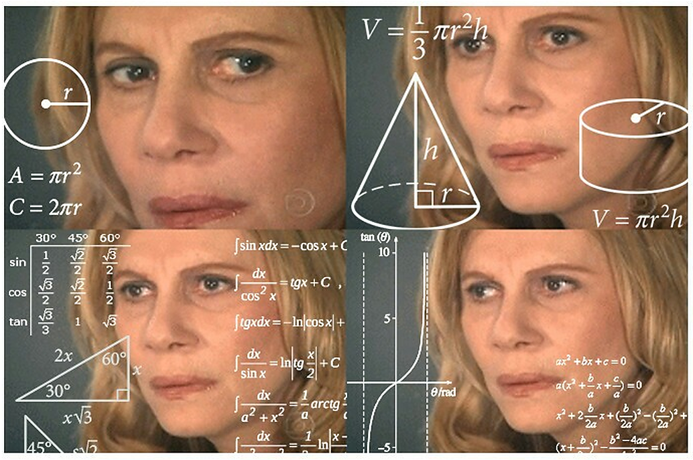
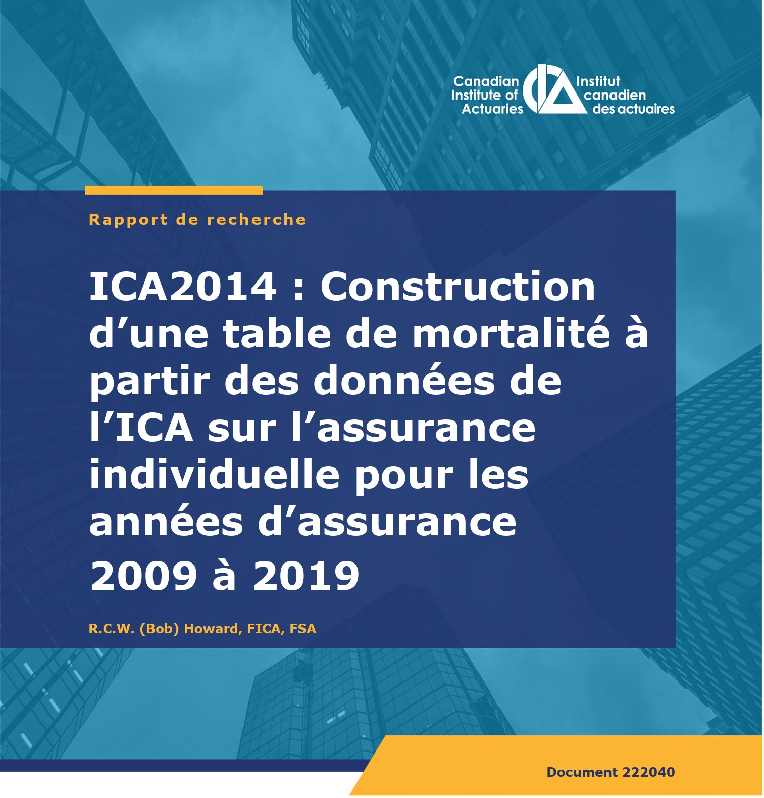
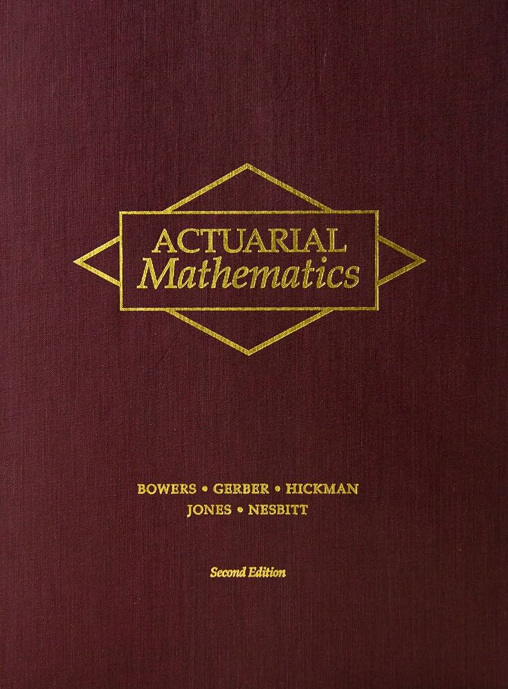
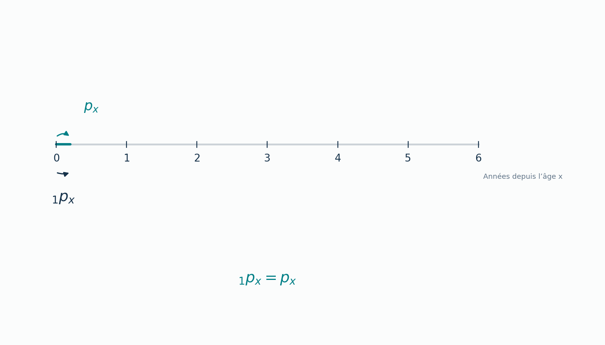
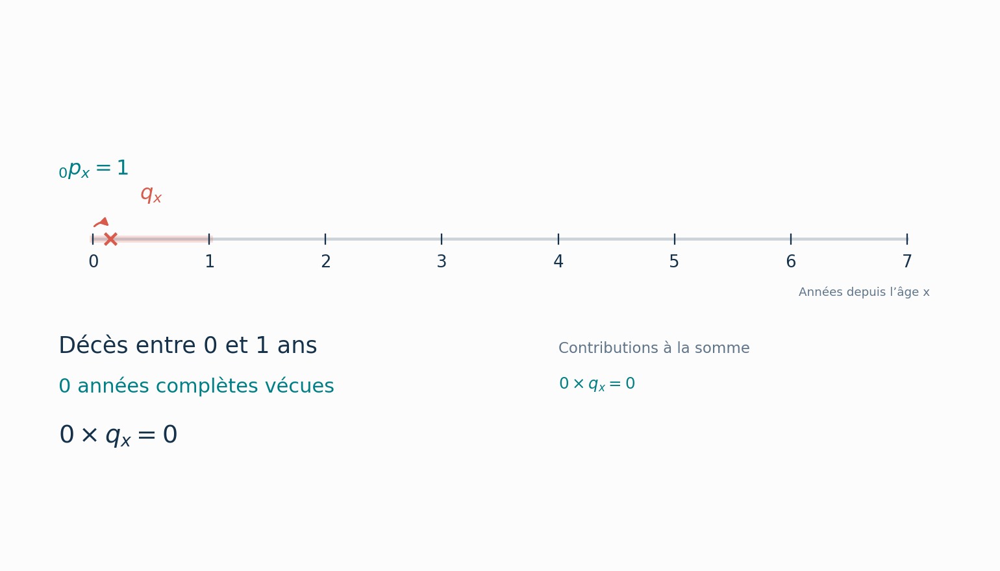
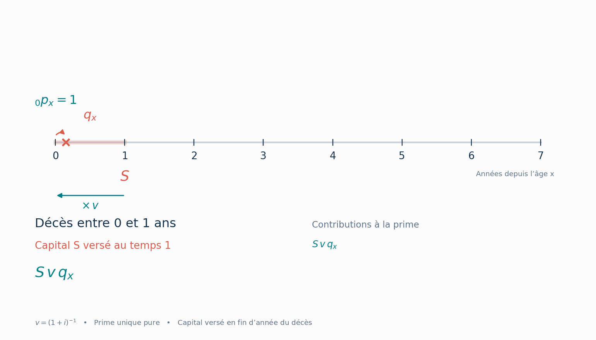
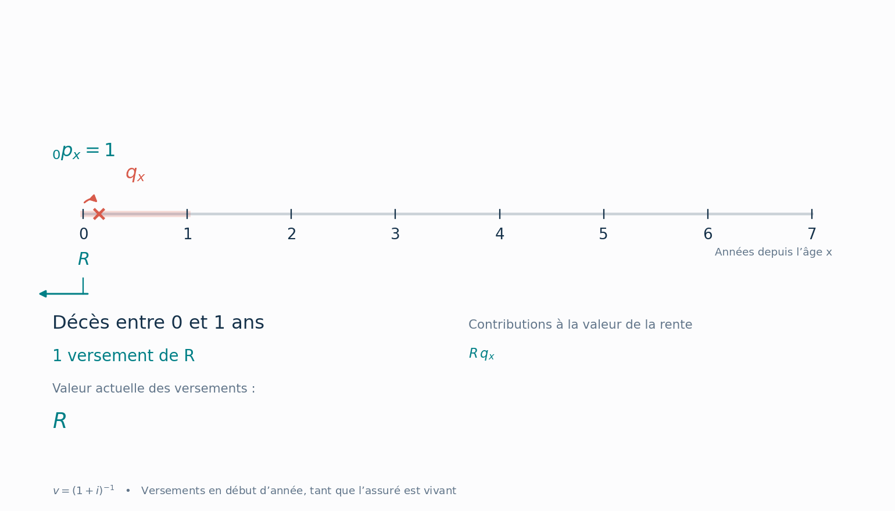
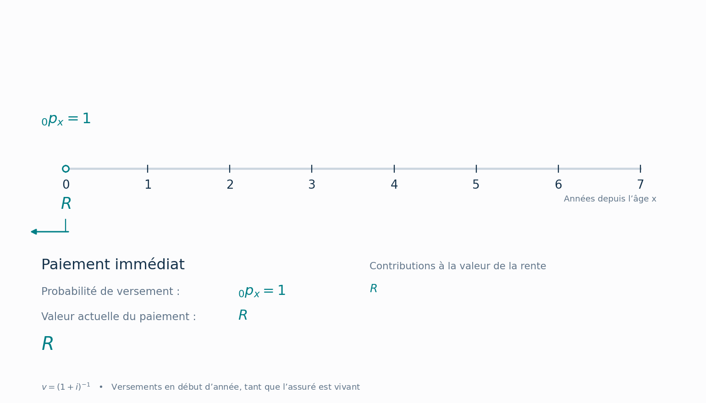

# L'actuariat de l'assurance-vie

::: {.act-objectifs}

<div class="act-objectifs-titre">Objectifs du chapitre</div>

- Expliquer les fondements actuariels de l’assurance-vie en assurance de personnes;
- Décrire les phénomènes de sélection et d’anti-sélection et leurs effets sur la tarification;
- Interpréter et utiliser les principales tables de mortalité en assurance-vie individuelle;
- Calculer des probabilités de décès, des probabilités de survie et une espérance de vie à partir d’une table de mortalité;
- Appliquer le principe de la valeur actuelle espérée à de premiers calculs d’assurance-vie et de rente;
- Comparer les mécanismes actuariels fondamentaux d’une assurance-vie et d’une rente viagère.

:::

## Introduction

<div style="
float:right;
display:inline-block;
margin:0 0 1em 1em;
text-align:center;
padding:6px;
background:white;
max-width:330px;
">



<div style="font-size:0.85em; margin-top:0.4em; color:#555;">
</div>

</div>


L’assurance-vie occupe une place centrale en assurance de personnes. Elle repose sur l’idée qu’un grand nombre d’individus peuvent mettre en commun les conséquences financières associées au décès afin de protéger leurs proches contre une perte de revenu ou un besoin financier important. L’actuariat de l’assurance-vie vise à analyser et à quantifier ces risques afin de déterminer des primes adéquates et de garantir la solidité financière des contrats. Pour y parvenir, les actuaires doivent notamment comprendre les phénomènes de sélection et d’anti-sélection, analyser les probabilités de décès à l’aide de tables de mortalité et concevoir des produits adaptés aux besoins des assurés. Ce chapitre présente les principaux concepts actuariels qui sous-tendent l’assurance-vie et les rentes viagères. Nous y abordons d’abord les notions de sélection des risques et d’anti-sélection, puis le rôle des tables de mortalité dans l’évaluation du risque de décès, avant d’introduire les principes de calcul des assurances-vie et des rentes.

Ce chapitre marque également une transition importante dans le cours, puisqu’il est le premier à faire une place significative aux mathématiques. Les notions abordées ne sont pas nécessairement complexes lorsqu’elles sont prises individuellement, mais leur combinaison demande davantage de rigueur et de travail. Il est donc particulièrement important de bien comprendre les premiers concepts, de prendre le temps de refaire les exemples et de ne pas laisser les difficultés s’accumuler. Les méthodes présentées ici constituent en effet les fondements de nombreux calculs actuariels qui seront approfondis dans la suite du programme.

<div style="clear: both;"></div>


### Introduction aux mathématiques financières

Un principe fondamental des mathématiques financières est qu'un dollar reçu aujourd'hui n'a pas la même valeur qu'un dollar reçu dans un an. En effet, une somme d'argent disponible aujourd'hui peut être investie et produire des intérêts. Pour comparer des montants versés à différentes dates, il faut donc tenir compte de la valeur temporelle de l'argent. Sans faire un résumé du cours  [ACT1200 – Mathématiques financières I](https://etudier.uqam.ca/cours?sigle=ACT1200), il convient néanmoins de faire un survol de quelques notions élémentaires. 

Considérons un exemple simple. Supposons qu'une personne doit recevoir 1 000 $ dans un an et que le taux d'intérêt annuel est de 5 %. Quel montant faudrait-il investir aujourd'hui pour disposer de 1 000 $ dans un an? La réponse est :

$$
\text{Valeur actuelle} = \frac{1\,000}{1.05} = 952.38\ \$.
$$

En effet, un placement de 952,38 $ aujourd'hui produirait approximativement 1 000 $ dans un an, avec un rendement annuel de 5 %. On appelle actualisation l'opération qui consiste à ramener un montant futur à sa valeur d'aujourd'hui. Si l'on note $i$ le taux d'intérêt annuel, le facteur d'actualisation est défini par

$$
v = \frac{1}{1+i}.
$$

Pour étendre ce raisonnement à plusieurs années, on suppose que les intérêts sont composés, c'est-à-dire que les intérêts accumulés chaque année produisent eux-mêmes des intérêts au cours des années suivantes. Ainsi, un montant investi aujourd'hui est multiplié par $(1+i)$ après un an, par $(1+i)^2$ après deux ans, et ainsi de suite. Inversement, pour déterminer la valeur actuelle d'un montant payable dans plusieurs années, on applique le facteur d'actualisation pour chacune des années. Plus généralement, la valeur actuelle d'un montant $M$ payable dans $t$ années est donc donnée par

$$
\text{Valeur actuelle} = Mv^t = \frac{M}{(1+i)^t}.
$$

Cette formule suppose un taux d'intérêt annuel constant et une capitalisation composée des intérêts. On remarque donc que, pour un même montant futur, plus le taux d'intérêt est élevé ou plus le paiement est éloigné dans le temps, plus sa valeur actuelle est faible. Ces quelques notions constituent la base des mathématiques financières, qui seront étudiées plus en détail dans le cours [ACT1200 – Mathématiques financières I](https://etudier.uqam.ca/cours?sigle=ACT1200). En actuariat, nous utiliserons ce principe pour déterminer la valeur actuelle des prestations futures promises par les assureurs. Toutefois, contrairement à notre exemple où le paiement de 1 000 $ était certain, les prestations d'assurance dépendent généralement d'événements incertains, comme le décès ou la survie d'un individu. Il faudra donc combiner l'actualisation et les probabilités pour déterminer leur coût actuariel.

### Introduction aux mathématiques actuarielles

<div style="
float:right;
display:inline-block;
margin:0 0 1em 1em;
text-align:center;
border:0.5px solid #bbb;
padding:6px;
background:white;
box-shadow:0 3px 10px rgba(0,0,0,0.15);
max-width:220px;
">


<div style="font-size:0.85em; margin-top:0.4em; color:#555;">
Edmond Halley (1656–1742). Astronome anglais surtout connu pour la comète qui porte son nom, il publie en 1693 l'une des premières tables de mortalité fondées sur des observations démographiques. 
</div>

</div>

Dans la section précédente, nous avons vu comment déterminer la valeur actuelle d'un paiement futur. Toutefois, notre exemple supposait que le paiement serait effectué avec certitude. En assurance-vie, une difficulté supplémentaire apparaît : la prestation n'est versée que si l'assuré décède pendant la période de couverture. Il faut donc tenir compte non seulement du moment où le paiement pourrait être effectué, mais également de la probabilité qu'il soit effectivement versé.

Considérons un exemple simple. Supposons qu'un assureur offre une protection d'assurance-vie d'une durée d'un an, avec un capital assuré de 100 000 $. Si la probabilité que l'assuré décède pendant cette année est de 0,001, soit 0,1 %, quel est le coût moyen de cette protection pour l'assureur?  Deux situations sont possibles : si l'assuré décède pendant l'année, l'assureur doit verser 100 000 $; s'il survit, aucun montant n'est versé. Le paiement moyen attendu, que l'on appelle l'espérance mathématique de la prestation, est donc

$$
100\,000 \times 0.001 + 0 \times 0.999 = 100\ \$.
$$

Autrement dit, pour un grand nombre de contrats présentant les mêmes caractéristiques, l'assureur peut s'attendre à verser en moyenne 100\$ par contrat au titre des prestations de décès. Cependant, ce montant ne tient pas encore compte de la valeur temporelle de l'argent. Supposons que les prestations de décès soient versées à la fin de l'année et que le taux d'intérêt annuel soit de 5 %. En utilisant le facteur d'actualisation $v$ introduit précédemment, nous obtenons

$$
C = 100 \times \frac{1}{1.05} = 95.24\ \$.
$$

Ce montant représente le coût actuariel de l'assurance, c'est-à-dire la valeur actuelle espérée de la prestation que l'assureur devra verser. Il correspond à la prime pure, sans tenir compte des frais administratifs, des commissions ou des autres chargements. Nous pouvons maintenant généraliser ce raisonnement. Si l'on note $S$ le capital assuré et $q_x$ la probabilité qu'un individu âgé de $x$ ans décède au cours de la prochaine année, la valeur actuelle espérée d'une prestation payable à la fin de cette année est

$$
C = S\,q_x\,v.
$$

Plus généralement, si l'on suppose que la prestation est versée dans $t$ années lorsqu'un décès survient pendant la période d'assurance d'un an, on peut écrire

$$
C = S\,q_x\,v^t,
$$

où :

- $C$ représente le coût actuariel de l'assurance;
- $S$ représente le capital assuré payable au décès;
- $q_x$ représente la probabilité de décès de l'assuré pendant l'année;
- $v^t$ représente le facteur d'actualisation correspondant au moment du paiement.

Dans nos prochains exemples, nous supposerons généralement que les prestations sont versées à la fin de l'année du décès. Pour une assurance d'un an, cela signifie simplement que $t=1$. On comprend ainsi que le calcul actuariel repose sur deux éléments fondamentaux : les probabilités, qui permettent de tenir compte de l'incertitude entourant les paiements, et l'actualisation, qui permet de tenir compte du moment où ces paiements seront effectués. C'est la combinaison de ces deux principes qui constitue la base des mathématiques de l'assurance de personnes.

<div style="clear: both;"></div>


## Les tables de mortalité

<div style="
float:right;
display:inline-block;
margin:0 0 1em 1em;
text-align:center;
border:0.5px solid #bbb;
padding:6px;
background:white;
box-shadow:0 3px 10px rgba(0,0,0,0.15);
max-width:220px;
">


<div style="font-size:0.85em; margin-top:0.4em; color:#555;">
John Graunt (1620–1674). Marchand anglais considéré comme l'un des fondateurs de la démographie et des statistiques de mortalité.
</div>

</div>

Comme nous venons de le voir, le calcul du coût actuariel d'une assurance-vie repose en grande partie sur la probabilité de décès $q_x$, qui représente la probabilité qu'une personne âgée de $x$ ans décède avant d'atteindre l'âge de $x+1$ ans. Pour effectuer des calculs sur plusieurs années, il faut connaître ces probabilités pour une succession d'âges. L'ensemble de ces valeurs constitue ce qu'on appelle une table de mortalité. L'idée de construire de telles tables remonte à plusieurs siècles. Dès 1662, John Graunt utilise les registres de décès de Londres pour étudier la mortalité et proposer l'une des premières tables de survie. Malgré les limites des données disponibles à cette époque, ses travaux ont contribué à établir les fondements de l'analyse statistique de la mortalité.

Aujourd'hui, les probabilités de décès sont estimées à partir de grandes quantités de données sur les décès observés et les populations exposées au risque. Ces probabilités ne sont toutefois pas universelles : elles dépendent notamment de la population étudiée, de la période d'observation et des caractéristiques des individus. C'est pourquoi les actuaires utilisent différentes tables de mortalité selon les risques et les produits qu'ils souhaitent évaluer.

### L'anti-sélection

Une des raisons pour lesquelles les populations assurées peuvent présenter une mortalité différente de celle de la population générale est le phénomène d'anti-sélection. L'anti-sélection survient lorsque certaines personnes disposent d'informations sur leur propre niveau de risque que l'assureur ne possède pas et que cette asymétrie influence leur décision de souscrire une assurance. Les personnes qui se savent particulièrement exposées à un risque peuvent alors être davantage intéressées par une protection offerte à un prix qui ne reflète pas entièrement leur situation.

<div style="clear: both;"></div>


::: {#exm-5 .custom}

Supposons qu'un assureur offre une assurance-vie à toutes les personnes de 50 ans au même tarif, sans procéder à une sélection médicale. Les personnes qui se savent en moins bonne santé pourraient être davantage intéressées par cette protection que celles qui se considèrent en excellente santé. Si ce comportement est suffisamment répandu, la mortalité des personnes qui souscrivent l'assurance pourrait être supérieure à celle que l'assureur avait prévue. Les primes risqueraient alors d'être insuffisantes pour couvrir les prestations attendues.

La situation est inversée pour les rentes viagères. Une personne qui s'attend à vivre longtemps peut être particulièrement intéressée par une rente qui lui garantit un revenu jusqu'à son décès. Les personnes qui achètent volontairement de telles rentes peuvent donc présenter une longévité supérieure à celle de la population générale.

:::

Les conséquences financières des deux exemples sont donc opposées : en assurance-vie, une mortalité plus élevée augmente généralement le coût des prestations, tandis que pour une rente viagère, une mortalité plus faible signifie que les versements devront être effectués pendant une plus longue période. Ces différences expliquent notamment pourquoi les actuaires peuvent utiliser des hypothèses de mortalité distinctes pour l'assurance-vie et les rentes, même lorsque les personnes assurées ont le même âge.

::: {#exm-5 .custom}
L'anti-sélection soulève également des questions sur les informations que les assureurs peuvent utiliser. Par exemple, certaines mutations génétiques peuvent être associées à un risque accru de maladie. Toutefois, au Canada, la [Loi sur la non-discrimination génétique](https://laws-lois.justice.gc.ca/fra/lois/G-2.5/page-1.html) interdit notamment d'exiger un test génétique ou la communication de ses résultats comme condition à la souscription d'un contrat. Certaines différences de risque doivent donc demeurer mutualisées entre les assurés, ce qui illustre les limites juridiques et sociales de la sélection des risques.
:::


### La sélection des risques

Pour évaluer les risques qu'il accepte de couvrir, l'assureur peut procéder à une sélection des personnes qui demandent une assurance. Cette démarche consiste à examiner certaines de leurs caractéristiques afin de déterminer les conditions auxquelles une protection peut leur être offerte.  La sélection permet notamment de limiter les effets de l'anti-sélection et de regrouper les assurés dans des catégories présentant des risques relativement comparables. Les primes peuvent alors être calculées à partir de probabilités de décès représentatives de chaque catégorie. Il ne s'agit toutefois pas de déterminer une prime parfaitement adaptée à chaque individu. La mutualisation demeure au cœur de l'assurance : les assurés sont regroupés en catégories suffisamment larges pour permettre une estimation crédible des coûts. La sélection cherche ainsi à concilier une tarification adaptée aux risques et la mise en commun de ces derniers.


1. **Fonctionnement de la sélection**

    Lorsqu'une personne présente une demande d'assurance-vie individuelle, l'assureur recueille les renseignements nécessaires pour évaluer son risque. Le processus commence généralement par un questionnaire portant sur différentes caractéristiques du demandeur :

    - Sa santé : les maladies présentes ou passées, les traitements reçus et certains antécédents médicaux familiaux.
    - Ses habitudes de vie : la consommation de tabac, d'alcool ou de drogues, ainsi que la pratique de certaines activités comportant des risques particuliers.
    - Sa situation professionnelle et financière : la nature de son emploi, ses revenus, les assurances déjà détenues et la justification du montant de protection demandé.

    Ces renseignements ne servent pas tous directement à estimer la mortalité. Certains permettent plutôt de vérifier que le montant d'assurance demandé correspond à des besoins financiers raisonnables. Selon les réponses obtenues, l'assureur peut demander des informations supplémentaires, comme un rapport du médecin traitant, des analyses médicales ou un examen médical. Le conseiller en sécurité financière peut également transmettre des renseignements utiles à l'évaluation du dossier.

    Plusieurs assureurs canadiens participent aussi au [Medical Information Bureau (MIB)](https://www.mib.com/), un organisme qui facilite l'échange de certains renseignements codés recueillis lors de demandes d'assurance antérieures. Avec l'autorisation du demandeur, un assureur membre peut consulter ces informations afin de vérifier la cohérence des déclarations. Il ne s'agit toutefois pas d'une base de dossiers médicaux complets, et les informations obtenues doivent faire l'objet de vérifications avant de justifier une décision défavorable.

    La profondeur de la sélection varie selon la nature du produit, l'âge du demandeur et le montant de protection demandé. Un simple questionnaire peut parfois suffire, alors que d'autres situations nécessitent une évaluation médicale plus approfondie. L'assureur doit également veiller à ce que les coûts de cette démarche demeurent raisonnables par rapport au risque à couvrir.

2. **Décisions possibles de l'assureur**

    Une fois les renseignements analysés, l'assureur détermine s'il accepte la demande et, le cas échéant, à quelles conditions. Lorsque le demandeur présente un risque jugé habituel, il peut être accepté dans une catégorie standard, avec les primes correspondantes. Certains assureurs proposent également des catégories préférentielles aux personnes présentant des caractéristiques de risque particulièrement favorables.  Dans les autres situations, plusieurs décisions sont possibles :

    - Acceptation avec surprime : l'assureur accepte le risque, mais exige une prime plus élevée pour tenir compte d'une mortalité attendue supérieure.
    - Acceptation avec conditions particulières : selon le produit, l'assureur peut notamment prévoir une exclusion ou proposer un montant de protection inférieur à celui demandé.
    - Report de la décision : l'assureur attend des renseignements supplémentaires ou l'évolution d'une situation médicale avant de se prononcer.
    - Refus de la demande : l'assureur estime que le risque ne peut pas être accepté dans les conditions de souscription du produit, même avec une surprime.

    Une personne présentant un risque de décès supérieur à la moyenne n'est donc pas nécessairement impossible à assurer. Tout dépend de l'ampleur du risque et des conditions auxquelles l'assureur est disposé à offrir la protection. La sélection des risques permet finalement d'établir des catégories d'assurés auxquelles seront associées des hypothèses de mortalité distinctes. Nous verrons maintenant comment ces différences se reflètent dans les tables de mortalité utilisées par les actuaires.

## Les tables de mortalité utilisées en assurance-vie individuelle

Nous avons vu que la mortalité des personnes assurées peut être influencée par le processus de sélection médicale. Une personne qui vient tout juste de souscrire une assurance-vie présente généralement un risque de décès plus faible que celui d'une personne du même âge dont la sélection remonte à plusieurs années. Il ne suffit donc pas toujours de connaître l'âge d'une personne pour déterminer sa probabilité de décès. Il peut également être nécessaire de tenir compte du temps écoulé depuis la souscription de son assurance. Pour cette raison, on distingue trois façons de présenter la mortalité des personnes assurées :

1. **Table sélecte** : Elle tient compte de l'âge auquel une personne a été sélectionnée ainsi que du nombre d'années écoulées depuis cette sélection. Par exemple, une personne de 50 ans qui vient de souscrire une assurance peut présenter une mortalité différente de celle d'une personne du même âge assurée depuis 10 ans. La table sélecte permet de représenter cette différence.

2. **Table ultime** : Après un certain nombre d'années après la sélection, on considère que l'effet de la sélection initiale est devenu suffisamment faible pour ne plus être distingué dans les calculs. La probabilité de décès dépend alors de l'âge atteint, sans tenir compte de la durée écoulée depuis la sélection. On parle de mortalité ultime.

3. **Table agrégée** : Elle regroupe les assurés d'un même âge sans distinguer la durée écoulée depuis leur sélection. Les probabilités de décès reflètent donc un mélange de personnes récemment sélectionnées et d'autres assurées depuis plusieurs années. Contrairement à la table sélecte, elle ne permet pas d'identifier séparément l'effet de la sélection.

Ces tables peuvent également être établies séparément selon certaines caractéristiques des assurés, notamment le sexe et le statut de tabagisme. On obtient ainsi des probabilités de décès adaptées à différentes catégories de risques. Dans le cas de la table canadienne ICA2014, que nous étudierons plus loin, la période sélecte s'étend sur 20 ans. 

### Quelques relations intéressantes

Les taux de mortalité varient non seulement selon l'âge, mais aussi selon les caractéristiques des populations étudiées. Certaines différences sont particulièrement importantes pour les actuaires qui utilisent les tables de mortalité en assurance-vie.

1. **Effet de la sélection**

   Comme nous l'avons vu précédemment, une personne récemment sélectionnée présente généralement une mortalité plus faible qu'une personne du même âge dont la sélection remonte à plusieurs années. Pour une même population assurée, la mortalité sélecte est donc généralement inférieure à la mortalité ultime, tandis que la mortalité agrégée, qui regroupe les assurés de différentes durées depuis la sélection, peut se situer entre les deux. La mortalité de la population générale est également souvent supérieure à celle des personnes couvertes par une assurance-vie individuelle. Cette relation n'est toutefois pas systématique : elle dépend des caractéristiques des populations comparées et ne constitue pas une propriété générale des tables de mortalité.

2. **Différence selon le sexe**

   Dans de nombreuses populations, les femmes présentent en moyenne une mortalité plus faible que les hommes. On observe donc généralement, à âge comparable, la relation suivante :

   $$
   q_x^F < q_x^H
   $$

   Cette différence se reflète dans les tables de mortalité utilisées en assurance. Elle ne signifie toutefois pas que cette relation est nécessairement vérifiée à tous les âges dans toutes les populations.

3. **Différence selon le tabagisme**

   Le tabagisme constitue un facteur important de mortalité, notamment en raison de son association avec plusieurs maladies cardiovasculaires, respiratoires et certains cancers. Les tables d'assurance-vie distinguent donc souvent les fumeurs des non-fumeurs. À âge et caractéristiques comparables, on observe généralement :

   $$
   q_x^{\text{non-fumeur}} < q_x^{\text{fumeur}}
   $$

   Cette distinction permet aux assureurs d'utiliser des hypothèses de mortalité différentes selon le statut de tabagisme des assurés.

4. **Âge limite**

   Une dernière caractéristique mérite d'être mentionnée : l'âge limite d'une table de mortalité, souvent appelé âge oméga et représenté par la lettre grecque $\omega$. Les tables actuarielles comportent généralement un âge terminal au-delà duquel aucun survivant n'est prévu dans le modèle. Lorsque $\omega$ désigne le dernier âge auquel une probabilité de décès est définie, on pose :

   $$
   q_{\omega} =1.
   $$
   Cela signifie que toute personne atteignant cet âge est supposée décéder avant son prochain anniversaire. Il s'agit d'une convention mathématique permettant de terminer les calculs actuariels, et non de l'affirmation qu'aucun être humain ne peut vivre au-delà de cet âge.

## Tables de mortalité utilisées

Au Canada, l'Institut canadien des actuaires (ICA) a publié différentes tables de mortalité fondées sur l'expérience des compagnies d'assurance-vie. Ces tables sont construites à partir des données recueillies auprès des assureurs participants et permettent de mieux représenter la mortalité des personnes détenant une assurance-vie individuelle.  Comme la mortalité évolue au fil du temps, notamment en raison des progrès médicaux et des changements dans les habitudes de vie, les tables doivent être révisées périodiquement. Nous présentons ici deux générations de tables canadiennes, ICA9704 et ICA2014, qui permettent notamment d'observer cette évolution.

### La table ICA9704

La table de mortalité utilisée pendant plusieurs en assurance vie individuelle a été la **table ICA9704**, publiée par l’Institut canadien des actuaires. Comme son nom l’indique, cette table ICA9704 est basée sur l’expérience collectée par l’ICA de 1997 à 2004 inclusivement.  Elle est basée sur les données de 16 sociétés d’assurance du Canada et a été publiée en mai 2010 et est disponible sur le site de l’ICA. Fait intéressant, cette table a été développée par des professeurs d’actuariat de l’UQAM: Claude Pichet et Carole Turcotte, avec l’aide d'un chargé de cours de l'époque, Jean-François Paquin, en vertu d’un contrat intervenu entre l’ICA et l’UQAM en 2007. La table ICA9704 remplaçait à l'époque la table précédente, la table **ICA8692**, qui était basée sur des données de 1986 à 1992.

### La table ICA2014

<div style="
float:right;
display:inline-block;
margin:0 0 1em 1em;
text-align:center;
border:0.5px solid #bbb;
padding:6px;
background:white;
box-shadow:0 3px 10px rgba(0,0,0,0.15);
max-width:220px;
">



<div style="font-size:0.85em; margin-top:0.4em; color:#555;">
Présentation de la nouvelle table de mortalité de l'ICA
</div>

</div>


En 2022, l'Institut canadien des actuaires (ICA) a publié une nouvelle table de mortalité en assurance-vie individuelle, appelée [ICA2014](https://www.cia-ica.ca/fr/publications/rp222040f/). Cette table vise à mieux refléter l'évolution de la mortalité depuis la construction des tables précédentes, notamment ICA9704. Elle repose sur les données d'expérience des assureurs canadiens pour les années d'assurance 2009 à 2019. Le fichier Excel contenant les tables peut être téléchargé sur le [site de l'ICA](https://www.cia-ica.ca/fr/publications/rp222040t1f/).

Ce fichier comporte 17 onglets : un onglet descriptif, nommé `Describe`, et 16 tables de mortalité. Ces dernières sont organisées selon huit catégories, qui distinguent le sexe et le statut de tabagisme :

- `Msm` : hommes fumeurs (*male smokers*)
- `Fsm` : femmes fumeuses (*female smokers*)
- `Mns` : hommes non-fumeurs (*male non-smokers*)
- `Fns` : femmes non-fumeuses (*female non-smokers*)
- `Munk` : hommes dont le statut de tabagisme est inconnu (*male smoking unknown*)
- `Funk` : femmes dont le statut de tabagisme est inconnu (*female smoking unknown*)
- `Mall` : ensemble des hommes, tous statuts de tabagisme confondus
- `Fall` : ensemble des femmes, tous statuts de tabagisme confondus

Les catégories `Mall` et `Fall` permettent donc d'étudier la mortalité globale des hommes et des femmes, sans faire de distinction selon le tabagisme.  Pour chacune des huit catégories, deux versions de la table sont fournies, selon la méthode utilisée pour déterminer l'âge de l'assuré :

- Suffixe `N` : âge au plus proche anniversaire (*age nearest birthday*), correspondant à l'âge arrondi à l'entier le plus proche.
- Suffixe `L` : âge au dernier anniversaire (*age last birthday*), correspondant à l'âge atteint au dernier anniversaire de naissance.

Par exemple, une personne âgée de 50 ans et 8 mois est considérée comme ayant 51 ans selon la première méthode, mais 50 ans selon la seconde. On obtient ainsi 16 tables distinctes, dont :

- `MsmN` : hommes fumeurs, âge au plus proche anniversaire.
- `MsmL` : hommes fumeurs, âge au dernier anniversaire.

<div style="clear: both;"></div>

Le script R suivant permet d'importer ces tables et de commencer à les analyser. Le logiciel R sera largement utilisé pendant vos études en actuariat, notamment dans le cours [ACT3035 – Laboratoire d'actuariat](https://etudier.uqam.ca/cours?sigle=ACT3035).


```{r}
#| code-fold: true
#| echo: true
#| message: false
#| warning: false

library(readxl)

fichier <- "data/222040T1e.xlsx"

onglets <- excel_sheets(fichier)

# Lire tous les onglets
bdd <- lapply(onglets, function(sh) {
  read_excel(
    path = fichier,
    sheet = sh,
    skip = 3
  )
})
names(bdd) <- onglets

# Nom des colonnes de chaque onglet
noms_colonnes <- c(
  "Age1",
  paste0("n", 0:19),
  "nult",
  "Age2"
)

for (i in seq_along(bdd)) {
  colnames(bdd[[i]]) <- noms_colonnes
}

```


<div style="
  background: #F5F7FA;
  border-left: 3px solid #A0A8B0;
  padding: 12px 18px;
  margin: 1.5em 0;
  border-radius: 3px;
">

<strong>Note sur la table de mortalité utilisée</strong>

<p style="margin-top: 0.6em; margin-bottom: 0;">

Bien que l'ICA ait publié en 2026 une nouvelle étude de mortalité couvrant les années 2019 à 2024, nous continuerons d'utiliser la table ICA2014 pour les calculs et les exercices de ce cours. Les nouvelles données pourraient modifier certains résultats numériques, mais elles ne changent pas les principes actuariels ni les méthodes de calcul que nous souhaitons illustrer.
</p>

</div>


### Affichage de la table ICA2014

Pour comprendre comment se lit une table de mortalité, examinons celle des hommes, tous statuts de tabagisme confondus, avec l'âge au dernier anniversaire. Il s'agit de la table `MallL` du fichier Excel. Le script R ci-dessous permet de l'afficher. Cette table comporte 23 colonnes :

- `Age1` : l'âge de l'assuré au moment de la souscription, c'est-à-dire l'âge auquel il a été sélectionné.
- `n0` à `n19` : les probabilités de décès pour chacune des 20 premières années suivant la sélection. La colonne `n0` correspond à la première année de couverture, `n1` à la deuxième, et ainsi de suite jusqu'à `n19`, qui correspond à la vingtième année.
- `nult` : la probabilité de décès ultime, utilisée à partir de la vingt et unième année de couverture, lorsque l'effet de la sélection initiale n'est plus distingué dans la table.
- `Age2` : l'âge atteint par l'assuré après 20 années de couverture, soit `Age1 + 20`. Il permet notamment d'identifier l'âge auquel correspond le taux de mortalité ultime de la ligne.

Par exemple, pour un homme ayant souscrit son assurance à 40 ans, on consulte la ligne `Age1 = 40`. La colonne `n0` donne sa probabilité de décès entre 40 et 41 ans, la colonne `n5` entre 45 et 46 ans, et la colonne `n19` entre 59 et 60 ans. La colonne `nult` correspond ensuite à sa probabilité de décès ultime à 60 ans, l'âge indiqué dans `Age2`. Cette organisation permet donc de suivre l'évolution de la mortalité d'un assuré au cours des années qui suivent sa sélection.


```{r}
#| code-fold: true
#| echo: true
#| message: false
#| warning: false

library(dplyr)
library(knitr)
library(kableExtra)

bdM <- bdd$MallL

# Colonnes de probabilités
cols_q <- c(paste0("n", 0:19), "nult")

# Formatage des probabilités en pourcentage
bdM_fmt <- bdM %>%
  mutate(
    across(
      all_of(cols_q),
      ~ sprintf("%.3f%%", 100 * .)
    )
  )

# Affichage de la table
kable(
  bdM_fmt,
  format = "html",
  escape = TRUE,
  caption = "Table de mortalité MallL (ICA2014)",
  align = c("c", rep("r", 21), "c")
) %>%
  kable_styling(
    full_width = FALSE,
    bootstrap_options = c("striped", "hover", "condensed")
  ) %>%
  scroll_box(
    width = "100%",
    height = "700px"
  )
```


### Analyse de la table ICA2014

La table ICA2014 permet d'illustrer concrètement l'effet de la sélection médicale sur la mortalité. Prenons l'exemple d'un homme âgé de 40 ans aujourd'hui. Sa probabilité de décès peut varier selon le nombre d'années écoulées depuis sa sélection.  À l'aide de la table `MallL`, considérons les trois situations suivantes.

::: {#exm-2 .custom}

1. Quelle est la probabilité de décès d'un homme de 40 ans qui vient tout juste de réussir sa sélection médicale?

2. Quelle est cette probabilité si cet homme a été sélectionné il y a 5 ans?

3. Quelle est cette probabilité si sa sélection remonte plutôt à 10 ans?

:::

::: {.custom-solution}
**Solution.**

Dans les trois situations, l'homme a 40 ans aujourd'hui. C'est donc l'âge auquel il a été sélectionné qui change.

1. Sélection récente : l'assuré a été sélectionné à 40 ans. On consulte donc la ligne `Age1 = 40` et la colonne `n0`, qui correspond à la première année suivant la sélection. On obtient une probabilité de décès de $0.000259$.

2. Sélection il y a 5 ans : l'assuré avait 35 ans lors de sa sélection. On consulte la ligne `Age1 = 35` et la colonne `n5`, qui correspond à la sixième année de couverture. La probabilité de décès est alors de $0.000458$.

3. Sélection il y a 10 ans : l'assuré avait 30 ans lors de sa sélection. On utilise donc la ligne `Age1 = 30` et la colonne `n10`, ce qui donne une probabilité de décès de $0.000614$.

Pour comparer des assurés ayant tous le même âge atteint $x$, mais des durées différentes depuis leur sélection, on suit donc une diagonale de la table : $(x,n0)$, puis $(x-1,n1)$, $(x-2,n2)$, et ainsi de suite.

Il faut toutefois distinguer cette lecture de celle permettant de suivre un même assuré au fil des années. Dans ce dernier cas, l'âge à la sélection demeure fixe : on reste sur une même ligne `Age1` et on passe successivement des colonnes `n0` à `n1`, puis à `n2`, etc.

Les probabilités peuvent être obtenues directement dans la table ou à l'aide du script R suivant.

```{r}
#| code-fold: true
#| echo: true
#| message: false
#| warning: false

library(dplyr)
library(tibble)
library(knitr)
library(kableExtra)

bdM <- bdd$MallL

q0 <- bdM %>%
  filter(Age1 == 40) %>%
  pull(n0)

q5 <- bdM %>%
  filter(Age1 == 35) %>%
  pull(n5)

q10 <- bdM %>%
  filter(Age1 == 30) %>%
  pull(n10)

tab <- tibble(
  Situation = c(
    "Sélection récente",
    "Sélection il y a 5 ans",
    "Sélection il y a 10 ans"
  ),
  `Probabilité de décès` = c(q0, q5, q10)
)

kable(tab, digits = 6, align = "lc") %>%
  kable_styling(full_width = FALSE)
```

Les trois résultats illustrent l'effet de la sélection : à âge atteint identique, la mortalité estimée est ici plus faible lorsque la sélection médicale est récente.

:::


### Quelques graphiques intéressants

Les graphiques suivants permettent de visualiser certaines caractéristiques des probabilités de décès de la table ICA2014. Les deux premiers graphiques présentent la mortalité des hommes et des femmes durant la première année suivant la sélection médicale, en fonction de l'âge. Le premier utilise l'échelle naturelle des probabilités, tandis que le second utilise une échelle logarithmique. Sur l'échelle naturelle, la mortalité augmente fortement avec l'âge, mais les différences aux jeunes âges sont difficiles à distinguer puisque les probabilités de décès sont très faibles. L'échelle logarithmique permet de mieux observer ces différences et de comparer les variations relatives de la mortalité.

On peut notamment s'intéresser à une particularité bien connue de la mortalité humaine : l'augmentation temporaire du risque de décès à la fin de l'adolescence et au début de l'âge adulte, appelée *accident hump*. Ce phénomène, généralement plus prononcé chez les hommes, est notamment associé aux accidents, à la violence et à certains comportements à risque. Il peut interrompre temporairement la progression autrement relativement régulière de la mortalité avec l'âge.

```{r}
#| code-fold: true
#| echo: true
#| message: false
#| warning: false
#| fig-height: 4
#| fig-width: 14
#| fig-align: center

library(ggplot2)
library(dplyr)
library(patchwork)

# Mortalité durant la première année après sélection
df_plot <- bind_rows(
  bdd$MallL %>%
    transmute(age = Age1, q = n0, sexe = "Hommes"),
  bdd$FallL %>%
    transmute(age = Age1, q = n0, sexe = "Femmes")
) %>%
  filter(!is.na(q), q > 0)

# Échelle naturelle
p1 <- ggplot(df_plot, aes(x = age, y = q, color = sexe)) +
  geom_line(linewidth = 1) +
  scale_color_manual(values = c("Hommes" = "blue", "Femmes" = "red")) +
  labs(
    x = "Âge à la sélection",
    y = "Probabilité de décès",
    color = "Sexe",
    title = "Probabilité de décès"
  ) +
  theme_bw()

# Échelle logarithmique
p2 <- ggplot(df_plot, aes(x = age, y = log(q), color = sexe)) +
  geom_line(linewidth = 1) +
  scale_color_manual(values = c("Hommes" = "blue", "Femmes" = "red")) +
  labs(
    x = "Âge à la sélection",
    y = "Logarithme de la probabilité de décès",
    color = "Sexe",
    title = "Probabilité de décès (échelle logarithmique)"
  ) +
  theme_bw()

p1 | p2
```


Les deux graphiques suivants illustrent des différences de mortalité particulièrement importantes en assurance-vie.  

  - Le graphique de gauche compare la mortalité durant la première année suivant la sélection médicale avec la mortalité ultime, à un même âge atteint. Les assurés récemment sélectionnés présentent généralement une mortalité plus faible, ce qui illustre l'effet de la sélection médicale. Il faut toutefois rappeler que les deux courbes ne représentent pas exactement la même population : les taux ultimes correspondent à des assurés dont la sélection remonte à au moins 20 ans.  

  - Le graphique de droite compare la mortalité des hommes fumeurs et non-fumeurs durant la première année suivant la sélection. On observe généralement une mortalité plus élevée chez les fumeurs, particulièrement à certains âges. Cette différence contribue à expliquer pourquoi le statut de tabagisme constitue une variable importante dans la tarification de l'assurance-vie.


```{r}
#| code-fold: true
#| echo: true
#| message: false
#| warning: false
#| fig-height: 4
#| fig-width: 14
#| fig-align: center

library(ggplot2)
library(dplyr)
library(patchwork)

# Graphique 1 : mortalité sélecte et ultime
# Comparaison à un même âge atteint

df_selection <- bind_rows(
  bdd$MallL %>%
    transmute(
      age = Age1,
      q = n0,
      type = "Sélecte (1re année)"
    ),
  bdd$MallL %>%
    transmute(
      age = Age2,
      q = nult,
      type = "Ultime"
    )
) %>%
  filter(!is.na(q), q > 0)

p1 <- ggplot(df_selection, aes(x = age, y = log(q), color = type)) +
  geom_line(linewidth = 1) +
  scale_color_manual(values = c(
    "Sélecte (1re année)" = "blue",
    "Ultime" = "red"
  )) +
  labs(
    x = "Âge atteint",
    y = "Logarithme de la probabilité de décès",
    color = "Type de taux",
    title = "Effet de la sélection"
  ) +
  theme_bw()

# Graphique 2 : fumeurs et non-fumeurs
# Mortalité durant la première année après sélection

df_tabac <- bind_rows(
  bdd$MsmL %>%
    transmute(age = Age1, q = n0, type = "Fumeurs"),
  bdd$MnsL %>%
    transmute(age = Age1, q = n0, type = "Non-fumeurs")
) %>%
  filter(!is.na(q), q > 0)

p2 <- ggplot(df_tabac, aes(x = age, y = log(q), color = type)) +
  geom_line(linewidth = 1) +
  scale_color_manual(values = c(
    "Fumeurs" = "red",
    "Non-fumeurs" = "blue"
  )) +
  labs(
    x = "Âge à la sélection",
    y = "Logarithme de la probabilité de décès",
    color = "Statut tabagique",
    title = "Effet du tabagisme"
  ) +
  theme_bw()

p1 | p2
```


## Quelques notions des mathématiques de l'assurance de personnes

<div style="
float:right;
display:inline-block;
margin:0 0 1em 1em;
text-align:center;
border:0.5px solid #bbb;
padding:6px;
background:white;
box-shadow:0 3px 10px rgba(0,0,0,0.15);
max-width:220px;
">



<div style="font-size:0.85em; margin-top:0.4em; color:#555;">
Le <em>Bowers</em>, un livre légendaire en mathématiques actuarielles de l'assurance de personnes
</div>

</div>

Les mathématiques liées à la mortalité ont longtemps constitué le coeur de la formation actuarielle à l'université, et souvent les cours les plus difficiles du programme. En effet, la grande majorité des actuaires œuvraient dans le domaine de l’assurance de personnes et des régimes de retraite. Les cours universitaires associés aux mathématiques de la mortalité étaient même souvent appelés *mathématiques actuarielles* dans les programmes universitaires, d’où le surnom bien connu de *matraque*.

Avec le développement du domaine actuariel, notamment dans le secteur de l’assurance de dommages, cette appellation a progressivement été abandonnée. On parle aujourd’hui plus précisément de **mathématiques de l’assurance de personnes**.  À l’UQAM, ces notions sont abordées principalement dans les cours [ACT3300](https://etudier.uqam.ca/cours?sigle=ACT3300) et [ACT4300](https://etudier.uqam.ca/cours?sigle=ACT4300). Sans entrer dans les notions avancées présentées dans ces cours, il est néanmoins pertinent de profiter de l’occasion d’avoir sous la main des tables de mortalité réelles pour introduire quelques notions de base du domaine.

<div style="clear: both;"></div>


### Taux de survie et probabilités cumulatives

Nous avons vu que la probabilité de décès au cours d'une année est généralement notée $q_x$. La probabilité correspondante de survie, notée $p_x = 1-q_x$, représente la probabilité qu'une personne âgée de $x$ ans atteigne l'âge $x+1$. À partir de ces probabilités annuelles, il est possible de calculer la probabilité de survivre pendant plusieurs années. On note ${}_t p_x$ la probabilité qu'une personne âgée de $x$ ans survive au moins $t$ années. Elle s'obtient en multipliant les probabilités de survie successives :

$$
{}_t p_x = p_x \times p_{x+1} \times \cdots \times p_{x+t-1}.
$$
Prenons l'exemple d'une personne âgée de $x$ ans dont on souhaite calculer la probabilité de survie pendant les trois prochaines années, notée ${}_3 p_x$. Pour survivre trois ans, cette personne doit franchir trois étapes successives :

- **Première année :** elle doit survivre de l'âge $x$ à l'âge $x+1$, avec une probabilité $p_x$.
- **Deuxième année :** si elle survit, elle doit ensuite atteindre l'âge $x+2$, avec une probabilité conditionnelle de survie $p_{x+1}$.
- **Troisième année :** enfin, elle doit survivre de l'âge $x+2$ à l'âge $x+3$, avec une probabilité conditionnelle de survie $p_{x+2}$.

La probabilité de survivre aux trois années correspond donc au produit de ces trois probabilités :

$$
{}_3 p_x = p_x \times p_{x+1} \times p_{x+2}.
$$

L'animation suivante permet de visualiser ce calcul :

{width=60% fig-align="center"}

#### **Probabilité cumulative de décès** {-}

Il est important de ne pas confondre la probabilité de survie pendant plusieurs années avec la probabilité cumulative de décès, notée ${}_t q_x$. Cette dernière représente la probabilité qu'une personne âgée de $x$ ans décède à un moment quelconque au cours des $t$ prochaines années. Reprenons notre exemple d'une période de trois ans. Pour qu'une personne survive pendant les trois années, elle doit nécessairement survivre à chacune d'elles. En revanche, pour qu'elle décède au cours de cette période, plusieurs possibilités existent :

- **Première année :** la personne décède entre les âges $x$ et $x+1$.
- **Deuxième année :** la personne survit à la première année, mais décède entre les âges $x+1$ et $x+2$.
- **Troisième année :** la personne survit aux deux premières années, mais décède entre les âges $x+2$ et $x+3$.

Il faut donc bien distinguer deux événements complémentaires : survivre aux trois années ou décéder pendant au moins l'une de ces trois années. Puisqu'une personne doit nécessairement se retrouver dans l'une ou l'autre de ces situations, la somme de leurs probabilités est égale à 1. Nous obtenons ainsi :

$$
{}_3 q_x = 1 - {}_3 p_x
= 1 - p_x p_{x+1} p_{x+2}.
$$

Plus généralement, pour une période de $t$ années :

$$
{}_t q_x = 1-{}_t p_x.
$$

Attention: une erreur fréquente consiste à croire que la probabilité de décéder au cours des trois prochaines années correspond simplement à $q_x+q_{x+1}+q_{x+2}$. Ce n'est pas le cas. Les probabilités $q_{x+1}$ et $q_{x+2}$ supposent que la personne a déjà survécu jusqu'aux âges correspondants. Pour tenir compte de cette condition, il faudrait plutôt calculer :

$$
{}_3 q_x = q_x + p_x q_{x+1} + p_x p_{x+1} q_{x+2}.
$$

Cette dernière expression donne exactement le même résultat que $1-{}_3 p_x$. Toutefois, il est généralement beaucoup plus simple de calculer d'abord la probabilité de survie, puis de prendre son complément.


::: {#exm-2 .custom}

Considérons un homme âgé de 40 ans auquel nous appliquons les taux de mortalité ultimes de la table ICA2014, sans tenir compte de l'effet de sélection médicale. Quelle est sa probabilité de survivre pendant 1, 2, 5, 10 et 50 ans?

:::

::: {.custom-solution}

**Solution**.

Nous utilisons les colonnes `Age2` et `nult` de la table `MallL`. Pour chaque âge, nous calculons d'abord la probabilité annuelle de survie $p_x=1-q_x$, puis le produit cumulatif permettant d'obtenir ${}_t p_{40}$.  Par exemple, la probabilité de survivre deux ans est :

$$
{}_2 p_{40} = p_{40}p_{41}
             = (1-q_{40})(1-q_{41}).
$$

Le script R suivant permet d'effectuer ces calculs pour les 50 prochaines années. Le tableau présente les cinq premières années ainsi que les six dernières.

```{r}
#| code-fold: true
#| echo: false
#| message: false
#| warning: false

library(dplyr)
library(tibble)
library(knitr)
library(kableExtra)

# Calcul des probabilités de survie à partir de 40 ans
survie <- bdd$MallL %>%
  filter(Age2 >= 40, Age2 <= 89) %>%
  arrange(Age2) %>%
  transmute(
    age_debut = Age2,
    t = Age2 - 40 + 1,
    qx = nult,
    px = 1 - nult
  ) %>%
  mutate(
    tpx = cumprod(px),
    age_atteint = 40 + t
  )

# Formatage du tableau détaillé
survie_fmt <- survie %>%
  select(age_debut, t, qx, px, tpx) %>%
  mutate(
    age_debut = as.character(age_debut),
    t = as.character(t),
    across(c(qx, px, tpx), ~ sprintf("%.6f", .x))
  )

# Afficher les cinq premières et les six dernières années
survie_court <- bind_rows(
  slice(survie_fmt, 1:5),
  tibble(
    age_debut = "...",
    t = "...",
    qx = "...",
    px = "...",
    tpx = "..."
  ),
  slice(survie_fmt, 45:50)
)

kable(
  survie_court,
  align = "c",
  col.names = c(
    "Âge au début",
    "t",
    "q_x",
    "p_x",
    "t p_40"
  )
) %>%
  kable_styling(
    full_width = FALSE,
    position = "center",
    bootstrap_options = c("striped", "hover")
  )
```

Pour mieux visualiser l'évolution de la probabilité cumulative de survie, on peut tracer une courbe en fonction de l'âge atteint. Les points rouges correspondent aux horizons demandés dans l'exemple.

```{r}
#| code-fold: true
#| echo: true
#| message: false
#| warning: false
#| fig-height: 4
#| fig-width: 14
#| fig-align: center

library(dplyr)
library(ggplot2)

bdM <- bdd$MallL

q0 <- bdM %>%
  filter(Age2 >= 40) %>%
  select(Age2, nult) %>%
  mutate(
    q = nult,
    p = 1 - q,
    pcumul = cumprod(p),
    age_atteint = Age2 + 1
  )

# Ajouter le point initial : survie à 40 ans = 100 %
courbe <- bind_rows(
  tibble(age_atteint = 40, pcumul = 1),
  q0
)

# Horizons demandés
h <- c(1, 2, 5, 10, 50)

points <- q0 %>%
  filter(age_atteint %in% (40 + h))

ggplot(courbe, aes(x = age_atteint, y = pcumul)) +
  geom_line(linewidth = 1.2, color = "#3a8f5a") +
  geom_point(data = points, color = "red", size = 3) +
  labs(
    x = "Âge atteint",
    y = "Probabilité",
    title = "Probabilité cumulative de survie à partir de 40 ans"
  ) +
  theme_bw() +
  theme(
    panel.background = element_rect(fill = "#eef7f1"),
    plot.background = element_rect(fill = "#eef7f1")
  )


```


Enfin, on peut résumer les probabilités de survie et de décès pour chacun des horizons demandés.


```{r}
#| code-fold: true
#| echo: true
#| message: false
#| warning: false

resultats <- points %>%
  transmute(
    `Nombre d'années` = age_atteint - 40,
    `Âge atteint` = age_atteint,
    `Probabilité de survie` = sprintf("%.3f %%", 100 * pcumul),
    `Probabilité de décès` = sprintf("%.3f %%", 100 * (1 - pcumul))
  )

kable(resultats, align = "c") %>%
  kable_styling(
    full_width = FALSE,
    position = "center",
    bootstrap_options = c("striped", "hover")
  )
```


La probabilité de survie diminue naturellement lorsque l'horizon considéré augmente. À l'inverse, la probabilité cumulative de décès augmente avec le nombre d'années. Ces deux probabilités demeurent complémentaires : leur somme est toujours égale à 1 pour un même horizon.

:::


### Espérance de vie

Une autre notion importante qu'il est pertinent d’introduire, et qui peut être dérivée directement des tables de mortalité, est l’espérance de vie d’un assuré âgé de $x$, généralement notée $e_x$. Cette quantité représente le nombre moyen d’années qu’une personne âgée de $x$ ans peut espérer vivre, selon la table de mortalité considérée. Les espérances de vie sont particulièrement importantes et largement utilisées :

- dans les régimes de retraite;
- dans l’évaluation des rentes viagères;
- dans la tarification de certains produits d’assurance.

Mathématiquement, l’espérance de vie correspond à une moyenne pondérée des durées de vie futures possibles. Cette notion est centrale en assurance de personnes, et vous verrez plusieurs manières plus rigoureuses de la calculer dans le programme d’actuariat. Toutefois, dans le cadre de ce cours, il est utile de commencer par une formulation intuitive, qui repose simplement sur les probabilités cumulatives de survie. L’espérance de vie restante à l’âge $x$, notée $e_x$, peut être interprétée comme l’espérance mathématique d’une variable aléatoire représentant la durée de vie future d’un individu âgé de $x$ ans. Dans l’approche retenue ici, nous considérons uniquement les années complètes vécues. Ainsi, un décès survenant pendant l’année $t+1$ est comptabilisé comme $t$ années de vie supplémentaires. Cette convention s'applique même si le décès survient le dernier jour de cette année, puisque l'individu n'a pas encore complété une année supplémentaire.

Considérons donc la variable aléatoire discrète $K_x$, qui représente le nombre d’années complètes de vie future. La probabilité que le décès survienne pendant l’année $t+1$, c’est-à-dire entre les âges $x+t$ et $x+t+1$, est donnée par

$$
P(K_x = t) = {}_t p_x \, q_{x+t}.
$$

En effet, ${}_t p_x$ est la probabilité que l’individu survive $t$ années après l’âge $x$, tandis que $q_{x+t}$ est la probabilité qu’il décède pendant l’année suivante. Le produit ${}_t p_x q_{x+t}$ représente donc la probabilité que le décès survienne pendant l’année $t+1$. L’espérance de vie correspond alors à l’espérance mathématique de la variable aléatoire $K_x$. Par la définition générale de l’espérance d’une variable discrète, on obtient

$$
e_x = E[K_x] = \sum_{t=0}^{\infty} t\,{}_t p_x\, q_{x+t}.
$$

Ainsi, l’espérance de vie est une moyenne pondérée des nombres d'années complètes de vie future, chaque durée $t$ étant pondérée par la probabilité que le décès survienne durant l’année correspondante. Cette approche, appelée espérance de vie abrégée, ne tient donc pas compte des fractions d'année vécues avant le décès. Une manière visuelle de comprendre le calcul de l'espérance de vie est celle-ci :

{width=60% fig-align="center"} 


::: {#exm-2 .custom}
On reprend une autre fois le cas d'un homme âgé de 40 ans qui n'a jamais fait de sélection médicale. Quelle est son espérance de vie?
:::

::: {.custom-solution}
**Solution.**

On peut reprendre le même tableau qu'à l'exemple précédent, auquel on ajoute quelques colonnes supplémentaires. La colonne ${}_{t-1}p_x$ représente la probabilité que l’individu survive jusqu’au début de l’année $t$. En multipliant cette probabilité par le taux de mortalité de l’année correspondante, on obtient la probabilité que le décès survienne pendant l’année $t$. La colonne *ex* représente ensuite la contribution de chaque année possible de décès au calcul de l’espérance de vie. Pour chaque valeur de $t$, on multiplie le nombre d’années complètes vécues, soit $t-1$, par la probabilité que le décès survienne pendant cette année.

On applique ainsi la convention selon laquelle une personne décédant pendant une année donnée n'a pas complété cette année, même si son décès survient le dernier jour.

```{r}
#| code-fold: true
#| echo: false
#| message: false
#| warning: false

library(dplyr)
library(tibble)
library(knitr)
library(kableExtra)

bdM <- bdd$MallL

q1 <- bdM %>% 
  filter(Age2 >= 40) %>%
  select(Age2, nult) %>%
  mutate(
    Age = Age2,
    t = row_number(),
    qx = nult, 
    px = 1 - qx,
    tpx = cumprod(px)
  ) %>%
  mutate(
    lag_tpx = lag(tpx),
    lag_tpx = ifelse(is.na(lag_tpx), 1, lag_tpx)
  ) %>%
  mutate(
    ex = lag_tpx * qx * (t - 1)
  ) %>%
  select(Age, t, qx, px, tpx, lag_tpx, ex) 

# Préparer un tableau formaté
q1_fmt <- q1 %>%
  mutate(
    Age = as.character(Age),
    t   = as.character(t),
    qx  = sprintf("%.6f", qx),
    px  = sprintf("%.6f", px),
    tpx = sprintf("%.6f", tpx),
    lag_tpx = sprintf("%.6f", lag_tpx),
    ex  = sprintf("%.6f", ex)
  )

# Tableau raccourci avec ligne de séparation
q1_small <- bind_rows(
  slice(q1_fmt, 1:5),
  tibble(
    Age = "...",
    t   = "...",
    qx  = "...",
    px  = "...",
    tpx = "...",
    lag_tpx = "...",
    ex  = "..."
  ),
  slice(q1_fmt, 72:76)
)

kable(
  q1_small,
  align = "c",
  booktabs = TRUE,
  escape = FALSE,
  col.names = c(
    "Âge", "t", "q_x", "p_x",
    "t p_x", "(t-1) p_x", "Contribution"
  )
) %>%
  kable_styling(
    full_width = FALSE,
    position = "center",
    bootstrap_options = c("striped", "hover")
  ) %>%
  row_spec(6, italic = TRUE, color = "gray40")

```

L’espérance de vie restante est finalement obtenue en additionnant toutes ces contributions. En sommant la colonne *ex*, on obtient une espérance de vie restante de **`r sprintf("%.5f", sum(q1$ex))` années**.

On peut encore une fois s'écrire un script R qui fait ces calculs.

```{r}
#| code-fold: true
#| echo: true
#| message: false
#| warning: false
#| fig-align: center

library(dplyr)
library(tibble)
library(knitr)
library(kableExtra)

bdM <- bdd$MallL

# Fonction qui calcule l'espérance de vie abrégée
esperance_vie <- function(x, table) {

  table %>%
    filter(Age2 >= x) %>%
    select(Age2, nult) %>%
    mutate(
      q = nult,
      p = 1 - q,
      t = row_number() - 1,
      tpx = lag(cumprod(p), default = 1),
      contribution = t * tpx * q
    ) %>%
    summarise(e = sum(contribution)) %>%
    pull(e)
}

ages <- c(20, 40, 60, 80)

resultats <- tibble(
  `Âge` = ages,
  `Espérance de vie restante` = sapply(
    ages, esperance_vie, table = bdM
  )
)

resultats %>%
  mutate(
    `Espérance de vie restante` = sprintf(
      "%.2f ans", `Espérance de vie restante`
    )
  ) %>%
  kable(
    align = c("c", "c")
  ) %>%
  kable_styling(
    full_width = FALSE,
    position = "center",
    bootstrap_options = c("striped", "hover")
  ) %>%
  column_spec(2, bold = TRUE)

```

:::


### Coût d'une assurance-vie d'un an

On peut tout d'abord reprendre l'équation présentée au début du chapitre pour le calcul de la prime pure en assurance-vie. Nous avions :

$$
C = S \, q_x \, v^{t}
$$

où :

- $C$ représente le coût actuariel de l’assurance, ou la prime pure;
- $S$ représente le montant d’assurance (capital assuré payable au décès);
- $q_x$ représente la probabilité qu’un assuré âgé de $x$ ans décède au cours de l’année;
- $v^{t}$ représente le facteur d’actualisation correspondant au moment du paiement de la prestation.

Dans le cas d'une assurance d'une durée d'un an dont la prestation est versée à la fin de l'année du décès, on a $t=1$. Le coût actuariel devient donc :

$$
C = S \, q_x \, v = \frac{S \, q_x}{1+i},
$$

où $i$ représente le taux d'intérêt annuel. On peut ainsi reprendre les probabilités de décès calculées plus tôt afin de déterminer le coût actuariel d'une assurance-vie. Ce coût correspond à la prime pure, c'est-à-dire à la valeur actuelle espérée de la prestation, sans tenir compte des frais administratifs, des commissions ou des autres chargements de l'assureur.

::: {#exm-prime-vie-un-an .custom}

On considère une assurance-vie temporaire d'une durée d'un an, offrant un capital assuré de 100 000 \$ versé à la fin de l'année si le décès survient pendant celle-ci. En supposant un taux d'intérêt annuel de 5 %, calculez la prime pure dans les situations suivantes :

1. Un homme âgé de 40 ans qui vient de subir la sélection médicale avec succès;
2. Un homme âgé de 40 ans qui a subi la sélection médicale avec succès il y a 5 ans;
3. Un homme âgé de 40 ans qui a subi la sélection médicale avec succès il y a 10 ans.

:::

::: {.custom-solution}

**Solution.**

Pour chacune des trois situations, on utilise la probabilité de décès correspondant à l'âge actuel de l'assuré et au nombre d'années écoulées depuis sa sélection médicale. En reprenant les probabilités de mortalité calculées précédemment, on obtient :

\begin{align*}
C_1 &= 100\,000 \times 0{,}000259 \times \frac{1}{1{,}05}
     \approx 24{,}67\ \$ \\[6pt]
C_2 &= 100\,000 \times 0{,}000458 \times \frac{1}{1{,}05}
     \approx 43{,}62\ \$ \\[6pt]
C_3 &= 100\,000 \times 0{,}000614 \times \frac{1}{1{,}05}
     \approx 58{,}48\ \$.
\end{align*}

On constate que le coût de l'assurance augmente avec le nombre d'années écoulées depuis la sélection médicale, même si les trois assurés ont exactement le même âge. Cette différence s'explique par l'effet de la sélection médicale sur les probabilités de décès. Pour répondre à ces questions, on peut également écrire un script R qui effectue les calculs directement à partir de la table de mortalité.

```{r}
#| code-fold: true
#| echo: true
#| message: false
#| warning: false

library(dplyr)
library(tibble)
library(knitr)
library(kableExtra)

bdM <- bdd$MallL

# Probabilités de décès

# Homme de 40 ans nouvellement sélectionné
q0 <- bdM %>% 
  filter(Age1 == 40) %>% 
  pull(n0)

# Homme de 40 ans sélectionné il y a 5 ans
# Âge à la sélection : 35 ans
q5 <- bdM %>% 
  filter(Age1 == 35) %>% 
  pull(n5)

# Homme de 40 ans sélectionné il y a 10 ans
# Âge à la sélection : 30 ans
q10 <- bdM %>% 
  filter(Age1 == 30) %>% 
  pull(n10)

# Paramètres du problème
S <- 100000
i <- 0.05
v <- 1 / (1 + i)

# Calcul des primes pures
C0 <- S * q0 * v
C5 <- S * q5 * v
C10 <- S * q10 * v

# Tableau des résultats
tab <- tibble(
  Situation = c(
    "Homme de 40 ans nouvellement sélectionné",
    "Homme de 40 ans sélectionné il y a 5 ans",
    "Homme de 40 ans sélectionné il y a 10 ans"
  ),
  `Prime pure ($)` = c(C0, C5, C10)
)

tab %>%
  mutate(
    `Prime pure ($)` = sprintf("%.2f $", `Prime pure ($)`)
  ) %>%
  kable(
    align = c("l", "r")
  ) %>%
  kable_styling(
    full_width = FALSE,
    position = "center",
    bootstrap_options = c("striped", "hover")
  ) %>%
  column_spec(2, bold = TRUE)

```

:::

### Coût d'une assurance-vie temporaire de 2 ans

On peut maintenant généraliser le calcul précédent au cas d’une assurance-vie temporaire de 2 ans. Dans ce type de contrat, la prestation de décès est versée si l’assuré décède pendant l’une des deux années de couverture. Si le décès survient pendant la première année, la prestation est payable à la fin de cette première année. Si le décès survient pendant la deuxième année, la prestation est payable à la fin de la deuxième année. Pour calculer le coût actuariel de cette assurance, il faut donc additionner la valeur actuelle espérée de la prestation pour chacune des deux années possibles de décès. Deux situations sont possibles :

- Le décès survient pendant la **première année**, avec probabilité $q_x$, et la prestation est versée à la fin de cette année.
- Le décès survient pendant la **deuxième année**, avec probabilité $p_x q_{x+1}$, et la prestation est versée à la fin de cette deuxième année. Pour que ce décès survienne, l'assuré doit d'abord survivre à la première année (probabilité $p_x$), puis décéder pendant la deuxième année, alors qu'il est âgé de $x+1$ ans (probabilité $q_{x+1}$).

Le coût actuariel devient donc :

$$
C = S v q_x + S v^2 p_x q_{x+1}.
$$

Autrement dit, la prime pure d’une assurance-vie temporaire de 2 ans est obtenue en additionnant le coût actuariel du paiement possible à la fin de la première année et celui du paiement possible à la fin de la deuxième année.

::: {#exm-2b .custom}

On considère une assurance-vie temporaire d'une durée de 2 ans, offrant un capital assuré de 100 000 \$ versé à la fin de l'année du décès, si celui-ci survient pendant la période de couverture. En supposant un taux d’intérêt annuel de 5 %, calculez la prime pure dans les situations suivantes :

1. Un homme âgé de 40 ans qui vient de subir la sélection médicale avec succès;
2. Un homme âgé de 40 ans qui a subi la sélection médicale avec succès il y a 5 ans;
3. Un homme âgé de 40 ans qui a subi la sélection médicale avec succès il y a 10 ans.

:::

::: {.custom-solution}

**Solution.**

Tout d'abord, nous reprenons les probabilités de décès pendant la première année pour les trois situations. Les probabilités de survie correspondantes sont obtenues par $p_x=1-q_x$ :

\begin{align*}
q_x^{(1)} &= 0.000259
\quad \Rightarrow \quad
p_x^{(1)} = 1-0.000259 = 0.999741 \\[6pt]
q_x^{(2)} &= 0.000458
\quad \Rightarrow \quad
p_x^{(2)} = 1-0.000458 = 0.999542 \\[6pt]
q_x^{(3)} &= 0.000614
\quad \Rightarrow \quad
p_x^{(3)} = 1-0.000614 = 0.999386.
\end{align*}

Nous devons maintenant déterminer les probabilités de décès pendant la deuxième année, soit $q_{x+1}^{(1)}$, $q_{x+1}^{(2)}$ et $q_{x+1}^{(3)}$. Ces probabilités doivent tenir compte du fait qu'une année supplémentaire s'est écoulée depuis la sélection médicale. Dans notre table de mortalité, elles correspondent respectivement :

- à la colonne *n1* de la ligne *Age1 = 40*;
- à la colonne *n6* de la ligne *Age1 = 35*;
- à la colonne *n11* de la ligne *Age1 = 30*.

On obtient :

\begin{align*}
q_{x+1}^{(1)} &= 0.000341 \\[6pt]
q_{x+1}^{(2)} &= 0.000516 \\[6pt]
q_{x+1}^{(3)} &= 0.000671.
\end{align*}

Nous disposons maintenant de toutes les probabilités nécessaires pour calculer les primes pures.

**Situation 1 : Homme de 40 ans nouvellement sélectionné**

$$
\begin{aligned}
C_1 &= S q_x^{(1)} v + S p_x^{(1)} q_{x+1}^{(1)} v^2 \\[6pt]
&= \left(100000 \times 0.000259 \times \frac{1}{1.05}\right)
+ \left(100000 \times 0.999741 \times 0.000341 \times \frac{1}{1.05^2}\right) \\[6pt]
&\approx 24.67 + 30.92 = 55.59 \ \$.
\end{aligned}
$$

**Situation 2 : Homme de 40 ans sélectionné il y a 5 ans**

$$
\begin{aligned}
C_2 &= S q_x^{(2)} v + S p_x^{(2)} q_{x+1}^{(2)} v^2 \\[6pt]
&= \left(100000 \times 0.000458 \times \frac{1}{1.05}\right)
+ \left(100000 \times 0.999542 \times 0.000516 \times \frac{1}{1.05^2}\right) \\[6pt]
&\approx 43.62 + 46.78 = 90.40 \ \$.
\end{aligned}
$$

**Situation 3 : Homme de 40 ans sélectionné il y a 10 ans**

$$
\begin{aligned}
C_3 &= S q_x^{(3)} v + S p_x^{(3)} q_{x+1}^{(3)} v^2 \\[6pt]
&= \left(100000 \times 0.000614 \times \frac{1}{1.05}\right)
+ \left(100000 \times 0.999386 \times 0.000671 \times \frac{1}{1.05^2}\right) \\[6pt]
&\approx 58.48 + 60.82 = 119.30 \ \$.
\end{aligned}
$$

Les trois assurés ont le même âge et bénéficient de la même protection. Toutefois, leurs primes pures sont différentes en raison du temps écoulé depuis leur sélection médicale. Plus cette sélection est ancienne, plus les probabilités de décès utilisées dans le calcul sont élevées.

:::

### Assurance-vie entière

On peut généraliser le calcul d'une assurance temporaire de 2 ans à une assurance couvrant un nombre quelconque d'années. Un cas particulier important est celui de l'assurance-vie entière, qui offre une protection pour toute la durée de vie de l'assuré. Contrairement à une assurance temporaire, ce contrat ne prévoit pas de date d'expiration de la couverture : la prestation est versée au décès de l'assuré, peu importe le moment où celui-ci survient, tant que le contrat demeure en vigueur.

Le calcul de l'espérance de vie présenté précédemment permet d'entrevoir une méthode générale pour déterminer le coût actuariel d'un tel contrat. En effet, dans le cas de l'espérance de vie, nous avons calculé une moyenne pondérée des durées de vie possibles, où chaque durée est pondérée par la probabilité correspondante de décès. Le calcul du coût d'une assurance repose sur le même principe : il s'agit de calculer la valeur moyenne des prestations que l'assureur devra verser, en tenant compte des probabilités de décès. Supposons, pour simplifier, qu'un contrat d'assurance-vie entière verse un capital de 1 dollar au décès de l'assuré. Si le décès survient pendant l'année $t+1$, c'est-à-dire entre les âges $x+t$ et $x+t+1$, la probabilité de cet événement est, comme nous l'avons vu précédemment,

$$
{}_t p_x\, q_{x+t}.
$$

Ainsi, la prestation de 1 dollar sera versée avec cette probabilité. La contribution de cette année à l'espérance mathématique de la prestation est donc

$$
1 \times {}_t p_x\, q_{x+t}.
$$

Pour un capital assuré de $S$ dollars, cette contribution devient

$$
S \times {}_t p_x\, q_{x+t}.
$$

Si l'on additionne ces contributions pour toutes les années possibles de décès, on obtient l'espérance mathématique de la prestation totale versée par l'assureur. Dans la pratique, un élément supplémentaire doit toutefois être pris en compte : la valeur temporelle de l'argent. Une prestation versée dans plusieurs années vaut moins aujourd'hui qu'une prestation versée immédiatement. Il faut donc actualiser les paiements futurs à l'aide d'un taux d'intérêt. Comme dans les exemples précédents, nous supposons que la prestation est versée à la fin de l'année du décès. Si l'on note $v=\frac{1}{1+i}$ le facteur d'actualisation associé au taux d'intérêt annuel $i$, la valeur actuelle d'une prestation versée dans $t+1$ années est obtenue en la multipliant par $v^{t+1}$. La valeur actuelle espérée des prestations d'une assurance-vie entière offrant un capital de $S$ dollars devient alors

$$
C = S \sum_{t=0}^{\infty} v^{t+1}\,{}_t p_x\, q_{x+t}.
$$

Cette quantité représente le coût actuariel de la prestation promise par le contrat. Elle correspond également à la prime unique pure, c'est-à-dire au montant qui devrait être payé en une seule fois au début du contrat pour financer la prestation future, sans tenir compte des frais ou des autres chargements. Bien entendu, dans la pratique, les assureurs doivent également tenir compte des frais d'administration, des marges de sécurité et des bénéfices. De plus, les primes d'assurance sont souvent payées périodiquement plutôt qu'en un seul versement, ce qui nécessite un calcul supplémentaire. Néanmoins, le principe fondamental demeure le même : le coût actuariel d'une assurance est déterminé à partir de la valeur actuelle espérée des prestations futures.

Encore une fois, une manière visuelle de comprendre le calcul est celle-ci:

{width=60% fig-align="center"}


::: {#exm-assurance-vie-entiere .custom}

On reprend une autre fois le cas d'un homme âgé de 40 ans qui n'a jamais fait de sélection médicale. Quel est le coût actuariel d'une assurance-vie entière offrant un capital assuré de 100 000 \$, en supposant un taux d'intérêt annuel de 5 % et une prestation payable à la fin de l'année du décès?

:::

::: {.custom-solution}

**Solution.**

Le coût actuariel correspond à la valeur actuelle espérée des prestations futures. Dans le cas d'une assurance-vie entière, on doit considérer toutes les années possibles de décès :

$$
C = S \sum_{t=0}^{\infty} v^{t+1}\,{}_t p_x\,q_{x+t}.
$$

Pour notre assuré de 40 ans, le calcul devient :

$$
C = 100\,000 \sum_{t=0}^{\infty}
\left(\frac{1}{1.05}\right)^{t+1}
{}_t p_{40}\,q_{40+t}.
$$

Le développement détaillé de cette somme est laissé en exercice. Il peut être intéressant de comparer son développement mathématique avec le script R ci-dessous, qui effectue les calculs directement à partir de la table de mortalité. Le script permet également de calculer le coût actuariel pour différents âges, afin d'en comparer les résultats.

```{r}
#| code-fold: true
#| echo: true
#| message: false
#| warning: false
#| fig-align: center

library(dplyr)
library(tibble)
library(knitr)
library(kableExtra)

bdM <- bdd$MallL

# Paramètres financiers
i <- 0.05
v <- 1 / (1 + i)
S <- 100000

# Fonction qui calcule le coût actuariel
# d'une assurance-vie entière

assurance_vie_entiere <- function(x, table, v, S) {

  table %>%
    filter(Age2 >= x) %>%
    arrange(Age2) %>%
    select(Age2, nult) %>%
    mutate(
      q = nult,
      p = 1 - q,
      t = row_number() - 1,
      tpx = lag(cumprod(p), default = 1),
      contribution = v^(t + 1) * tpx * q
    ) %>%
    summarise(C = S * sum(contribution)) %>%
    pull(C)
}

# Calcul pour différents âges
ages <- c(20, 40, 60, 80)

resultats <- tibble(
  `Âge` = ages,
  `Coût actuariel` = sapply(
    ages,
    assurance_vie_entiere,
    table = bdM,
    v = v,
    S = S
  )
)

# Présentation des résultats
resultats %>%
  mutate(
    `Coût actuariel` = sprintf(
      "%.2f $", `Coût actuariel`
    )
  ) %>%
  kable(
    align = c("c", "c")
  ) %>%
  kable_styling(
    full_width = FALSE,
    position = "center",
    bootstrap_options = c("striped", "hover")
  ) %>%
  column_spec(2, bold = TRUE)

```

:::


#### **Quelques observations** {-}

On peut noter que le coût actuariel d’une assurance-vie entière peut sembler élevé, mais cela s’explique par une caractéristique fondamentale du produit : la prestation de décès sera éventuellement versée, à condition que le contrat demeure en vigueur. Contrairement à une assurance temporaire, où l’assureur ne paie que si le décès survient pendant une période donnée, l’assurance-vie entière prévoit le versement du capital assuré au décès, peu importe le moment où celui-ci survient. L’incertitude ne porte donc pas sur le fait que la prestation sera payée, mais plutôt sur le moment où elle le sera.

Le calcul actuariel consiste ainsi à déterminer la valeur actuelle espérée de ce paiement futur, en tenant compte à la fois des probabilités de décès et du taux d’intérêt utilisé pour actualiser les prestations. Il faut également noter que nous avons volontairement simplifié le produit afin d’introduire les mécanismes de base du calcul actuariel. Dans la pratique, plusieurs éléments supplémentaires interviennent dans la tarification, notamment les valeurs de rachat, les déchéances et les frais du contrat. De plus, dans ce calcul, nous avons déterminé la prime unique pure d’une assurance-vie entière, c’est-à-dire le montant qui devrait être payé en une seule fois au moment de la souscription pour financer la prestation future, sans tenir compte des frais et des autres chargements. Or, dans de nombreux contrats, la prime n’est pas payée en une seule fois, mais plutôt sous forme de primes périodiques, par exemple mensuelles ou annuelles. Ces primes peuvent être payables pendant toute la vie de l'assuré ou pendant une période déterminée. Dans ce cas, chaque prime n’est payable que si l’assuré est encore vivant au moment du paiement et que le contrat prévoit toujours le versement de cette prime. Le calcul actuariel doit donc tenir compte de la probabilité que l’assuré soit en vie à chaque échéance de paiement.

Mathématiquement, la valeur actuelle espérée de ces primes périodiques se calcule selon le même principe que celle d'une rente viagère, éventuellement limitée à une durée déterminée. C’est pourquoi l’étude des rentes constitue une étape essentielle pour déterminer les primes périodiques des contrats d’assurance-vie.


### Premiers calculs d'une rente

La même logique probabiliste permet également d’introduire les premiers calculs liés aux rentes viagères. Dans le cas d’une assurance-vie, la prestation est versée en raison du décès de l'assuré. Dans le cas d’une rente viagère, la situation est inverse : des paiements sont versés tant que l’assuré est vivant. La durée des paiements dépend donc directement de la durée de vie de l’individu.

<div style="
  background: #F5F7FA;
  border-left: 3px solid #A0A8B0;
  padding: 12px 18px;
  margin: 1.5em 0;
  border-radius: 3px;
">

<strong>Rente viagère due et rente viagère immédiate</strong>

<p style="margin-top: 0.6em; margin-bottom: 0;">

Comme nous le verrons plus en détail au <a href="Chap14_Actuariat_retraite.html">Chapitre 14 : L’actuariat des régimes de retraite</a>, une rente qui verse $R$ dollars au début de chaque année, tant que l’individu âgé de $x$ ans est en vie, est appelée une <strong>rente viagère due</strong> (ou rente à échoir). À l’inverse, une rente qui verse $R$ dollars à la fin de chaque année, à condition que l’individu soit toujours en vie, est appelée une <strong>rente viagère immédiate</strong> (ou rente à terme échu).

</p>

</div>

Dans le cas d'une rente viagère due, les versements de $R$ sont effectués au début de chaque année où l'assuré est en vie. Pour déterminer la valeur actuelle espérée de cette rente, on peut calculer la valeur actuelle des versements associés à chaque scénario possible de décès, puis pondérer cette valeur par la probabilité que ce scénario se réalise. On obtient ainsi l'équation suivante pour la valeur actuelle espérée de la rente :


$$
C = \sum_{t=0}^{\infty} \left( \sum_{m=0}^{t} R v^m \right) \,{}_t p_x\, q_{x+t}
$$

Une manière visuelle de comprendre le calcul de la rente est celle-ci:

{width=60% fig-align="center"}

Une autre manière de calculer la valeur d'une rente est possible, et elle est généralement plus simple mathématiquement. Considérons encore une fois une rente qui verse $R$ dollars au début de chaque année tant que l’individu âgé de $x$ ans est en vie. Le premier paiement est versé immédiatement, avec une probabilité de 1. Le deuxième paiement sera versé dans un an si l’individu est encore vivant à ce moment-là; la probabilité que ce paiement soit versé est donc ${}_1 p_x$. Le troisième paiement sera versé dans deux ans si l’individu survit deux années après l’âge $x$, ce qui se produit avec probabilité ${}_2 p_x$.

Plus généralement, le paiement effectué dans $t$ années, soit au début de l'année $t+1$, est versé avec probabilité ${}_t p_x$.  Comme dans le cas de l’assurance-vie, il faut également tenir compte de la valeur temporelle de l’argent. Si l’on note $v=\frac{1}{1+i}$ le facteur d’actualisation associé au taux d’intérêt annuel $i$, la valeur actuelle d’un paiement de $R$ dollars versé dans $t$ années est $Rv^t$. La valeur actuelle espérée de cette rente viagère devient alors

$$
\sum_{t=0}^{\infty} R v^t\, {}_t p_x.
$$

Cette expression représente la valeur actuelle actuarielle d’une rente viagère annuelle de $R$ dollars, versée au début de chaque année tant que l’assuré est en vie. On remarque que cette formule repose exactement sur le même principe que les calculs effectués précédemment : chaque paiement possible est pondéré par la probabilité correspondante de survie et actualisé pour tenir compte du moment où il sera versé.  Une manière visuelle de comprendre le calcul de la rente est celle-ci:

{width=60% fig-align="center"}

Pour terminer, il est intéressant de noter que les deux manières de calculer la valeur actuelle d’une rente viagère sont équivalentes :

$$
\sum_{t=0}^{\infty}
\left( \sum_{m=0}^{t} R v^m \right)
\,{}_t p_x\, q_{x+t}
=
\sum_{t=0}^{\infty} R v^t\, {}_t p_x.
$$

Dans la première approche, on considère les différents scénarios possibles de décès et on calcule, pour chacun, la valeur actuelle des paiements reçus. Dans la deuxième approche, on considère plutôt chaque paiement possible et la probabilité qu'il soit effectivement versé. Les deux méthodes conduisent exactement au même résultat.  La démonstration mathématique de cette équivalence dépasse le cadre de ce cours, mais elle devient accessible après les cours [ACT3300](https://etudier.uqam.ca/cours?sigle=ACT3300) et [ACT4300](https://etudier.uqam.ca/cours?sigle=ACT4300).


::: {#exm-rente-viagere-fin-annee .custom}

On reprend une autre fois le cas d'un homme âgé de 40 ans qui n'a jamais fait de sélection médicale. Quelle est la valeur actuelle actuarielle d'une rente viagère de 1 \$ par année, payable à la fin de chaque année tant que l'assuré est vivant, en supposant un taux d'intérêt annuel de 5 %?

:::

::: {.custom-solution}

**Solution.**

Contrairement à la rente due présentée précédemment, nous considérons ici une rente viagère immédiate (ou encore rente viagère à terme échu). Le premier versement est donc effectué à la fin de la première année, uniquement si l'assuré est toujours vivant à ce moment. Aucun versement n'est effectué à la fin de l'année au cours de laquelle survient le décès.

La valeur actuelle actuarielle de cette rente est donnée par :

$$
C = R \sum_{t=1}^{\infty} v^t\, {}_t p_x.
$$

Dans notre exemple, avec $R=1$, $x=40$ et $i=5\%$, on obtient :

$$
C = \sum_{t=1}^{\infty}
\left(\frac{1}{1.05}\right)^t {}_t p_{40}.
$$

Le développement détaillé de cette somme est laissé en exercice. Il peut être intéressant de comparer son développement mathématique avec le script R ci-dessous, qui effectue les calculs directement à partir de la table de mortalité.

```{r}
#| code-fold: true
#| echo: true
#| message: false
#| warning: false
#| fig-align: center

library(dplyr)
library(tibble)
library(knitr)
library(kableExtra)

bdM <- bdd$MallL

# Paramètres
i <- 0.05
v <- 1 / (1 + i)
R <- 1

# Fonction qui calcule la valeur actuelle actuarielle
# d'une rente viagère immédiate
rente_viagere <- function(x, table, v, R = 1) {

  table %>%
    filter(Age2 >= x) %>%
    arrange(Age2) %>%
    select(Age2, nult) %>%
    mutate(
      q = nult,
      p = 1 - q,
      t = row_number(),
      tpx = cumprod(p),
      contribution = R * v^t * tpx
    ) %>%
    summarise(ax = sum(contribution)) %>%
    pull(ax)
}

# Calcul pour différents âges
ages <- c(20, 40, 60, 80)

resultats2 <- tibble(
  `Âge` = ages,
  `Coût actuariel de la rente` = sapply(
    ages,
    rente_viagere,
    table = bdM,
    v = v,
    R = R
  )
)

# Présentation des résultats
resultats2 %>%
  mutate(
    `Coût actuariel de la rente` = sprintf(
      "%.2f $", `Coût actuariel de la rente`
    )
  ) %>%
  kable(
    align = c("c", "c")
  ) %>%
  kable_styling(
    full_width = FALSE,
    position = "center",
    bootstrap_options = c("striped", "hover")
  ) %>%
  column_spec(2, bold = TRUE)

```

:::

### Prime d'assurance annuelle

Dans ce chapitre, nous avons calculé la prime unique pure d’une assurance-vie entière, c’est-à-dire le montant qui devrait être payé en une seule fois au moment de la souscription pour financer la prestation future. Dans la pratique, les primes d’assurance ne sont généralement pas payées en une seule fois, mais plutôt sous forme de primes périodiques, par exemple chaque année. Une prime annuelle nivelée peut alors être vue, de façon intuitive, comme la prime unique de l’assurance répartie sur les années où l’assuré est encore en vie. Toutefois, cette répartition doit tenir compte à la fois de la valeur temporelle de l'argent et de la probabilité que l'assuré soit vivant au moment de chaque paiement. Mathématiquement, sans démontrer cette équation, notons que cette répartition s’effectue à l’aide d’une rente viagère. Ainsi, la prime annuelle pure correspond à

$$
\text{Prime annuelle pure}
=
\frac{\text{Valeur actuelle espérée des prestations}}
{\text{Valeur actuelle actuarielle d'une rente de 1 \$ par année}}.
$$

Puisque les primes annuelles sont généralement payées au début de chaque année, nous devons utiliser une rente viagère due. Or, dans notre exemple précédent, nous avions calculé une rente immédiate, dont les paiements étaient effectués en fin d'année. Pour obtenir la rente due correspondante, il suffit d'ajouter le premier paiement de 1 \$, versé immédiatement et avec certitude. Dans vos cours de mathématiques de l’assurance de personnes, vous verrez plus en détail comment ces rentes sont calculées et comment elles permettent de déterminer précisément les primes périodiques des contrats d’assurance.

::: {#exm-prime-annuelle .custom}

On reprend la prime unique pure d’une assurance-vie entière pour un homme âgé de 40 ans qui n’a jamais fait l’objet d’une sélection médicale, telle que calculée précédemment. En supposant que la prime annuelle est constante et payable au début de chaque année tant que l'assuré est vivant, quelle serait la prime annuelle pure correspondante?

:::

::: {.custom-solution}

**Solution.**

En combinant les résultats précédents, nous pouvons déterminer la prime annuelle pure en divisant la prime unique pure de l'assurance par la valeur actuelle actuarielle de la rente viagère due.Puisque nous avons déjà calculé la valeur d'une rente immédiate, il suffit d'ajouter 1 à cette valeur pour tenir compte du premier paiement immédiat. On obtient donc :

$$
P = \frac{C}{1+a_x},
$$

où $C$ représente la prime unique pure et $a_x$ la valeur actuelle actuarielle de la rente immédiate de 1 \$ par année. Le script R suivant combine les résultats des deux exemples précédents et calcule les primes annuelles correspondantes pour différents âges.

```{r}
#| code-fold: true
#| echo: true
#| message: false
#| warning: false
#| fig-align: center

library(dplyr)
library(tibble)
library(knitr)
library(kableExtra)

# Combiner les résultats des exemples précédents
# resultats  : prime unique pure de l'assurance-vie entière
# resultats2 : valeur actuelle de la rente immédiate

resultats3 <- resultats %>%
  left_join(resultats2, by = "Âge") %>%
  mutate(
    `Rente viagère due` =
      1 + `Coût actuariel de la rente`,

    `Prime annuelle pure` =
      `Coût actuariel` / `Rente viagère due`
  ) %>%
  select(
    `Âge`,
    `Prime unique pure` = `Coût actuariel`,
    `Rente viagère due`,
    `Prime annuelle pure`
  )

# Présentation des résultats
resultats3 %>%
  mutate(
    across(
      -`Âge`,
      ~ sprintf("%.2f $", .)
    )
  ) %>%
  kable(
    align = c("c", "c", "c", "c")
  ) %>%
  kable_styling(
    full_width = FALSE,
    position = "center",
    bootstrap_options = c("striped", "hover")
  ) %>%
  column_spec(4, bold = TRUE)

```

On obtient ainsi une prime annuelle pure qui, selon le principe d'équivalence actuarielle, possède la même valeur actuelle espérée que la prestation d'assurance promise. Il faut toutefois rappeler que ce calcul ne tient compte que des prestations de décès et des primes, sans considérer les frais, les marges de sécurité ou les autres éléments de tarification.

:::


### Rente versus assurance

Les calculs effectués précédemment reposent sur le même principe fondamental : la valeur actuelle espérée de paiements futurs. La principale différence entre une assurance-vie et une rente viagère provient de l'événement qui détermine les paiements : dans une assurance-vie, la prestation est versée en raison du décès de l'assuré, tandis que dans une rente viagère, les paiements sont versés tant que l'assuré est en vie. On peut ainsi résumer cette différence de la manière suivante :

::: {.encadre}

| Produit | Événement considéré | Probabilité utilisée | Interprétation |
|---|---|---|---|
| Assurance-vie | Décès durant l'année $t+1$ | ${}_t p_x q_{x+t}$ | La prestation est versée si le décès survient pendant cette année |
| Rente viagère | Survie jusqu'au temps $t$ | ${}_t p_x$ | Le paiement est versé si l'assuré est encore en vie |

:::

Les formules obtenues reflètent directement cette différence. Pour une assurance-vie entière qui verse 1 dollar à la fin de l'année du décès, la valeur actuelle espérée des prestations est

$$
\sum_{t=0}^{\infty} v^{t+1} \, {}_t p_x q_{x+t}.
$$

Pour une rente viagère qui verse 1 dollar au début de chaque année tant que l'assuré est vivant, la valeur actuelle espérée des paiements est

$$
\sum_{t=0}^{\infty} v^t \, {}_t p_x.
$$

Ainsi, l'assurance et la rente peuvent être vues comme deux faces d'un même problème actuariel :

- l'assurance paie lorsque la vie s'interrompt;
- la rente paie lorsque la vie se poursuit.

Cette différence a également des implications importantes du point de vue de l'anti-sélection, comme nous l'avions mentionné plus tôt. Une personne qui pense avoir une espérance de vie plus courte que la moyenne peut avoir moins d'intérêt à acheter une rente viagère, puisqu'elle risque de recevoir moins de paiements. À l'inverse, une personne qui s'attend à vivre longtemps peut avoir avantage à convertir son capital en rente afin de recevoir des paiements pendant une période plus longue. La situation est donc inversée pour l'assurance-vie : les individus qui croient présenter un risque de décès plus élevé peuvent être davantage incités à souscrire une assurance, puisqu'ils anticipent une probabilité plus élevée que la prestation soit versée rapidement. Ces comportements peuvent influencer les caractéristiques des populations qui souscrivent les différents produits. En particulier, les personnes qui achètent volontairement des rentes viagères présentent souvent une longévité supérieure à celle de la population générale. Les actuaires doivent donc tenir compte de ces effets de sélection lorsqu'ils établissent les hypothèses de mortalité utilisées pour tarifer les différents produits.


### Notations usuelles en assurance-vie et en rentes

Pour terminer, mentionnons qu'en actuariat, certaines notations reviennent constamment pour représenter la valeur actuelle actuarielle des prestations promises par un contrat. Les symboles ci-dessous permettent de résumer, de façon compacte, la valeur actuarielle de différents produits. Vous vous familiariserez davantage avec ces notations plus tard dans le programme. Dans tous les cas, nous considérons des prestations ou des versements de 1 dollar.

::: {.encadre}

| Symbole | Interprétation |
|---|---|
| $A_x$ | Valeur actuarielle d'une **assurance-vie entière** sur une personne âgée de $x$ ans, payable en fin d'année du décès |
| $A^{1}_{x:\overline{n}|}$ | Valeur actuarielle d'une **assurance temporaire décès de $n$ ans** sur une personne âgée de $x$ ans |
| $\ddot{a}_x$ | Valeur actuarielle d'une **rente viagère payable au début de chaque année** à une personne âgée de $x$ ans |
| $a_x$ | Valeur actuarielle d'une **rente viagère payable à la fin de chaque année** à une personne âgée de $x$ ans |
| $\ddot{a}_{x:\overline{n}|}$ | Valeur actuarielle d'une **rente viagère temporaire de $n$ ans payable au début de chaque année**, tant que l'assuré est vivant |
| $a_{x:\overline{n}|}$ | Valeur actuarielle d'une **rente viagère temporaire de $n$ ans payable à la fin de chaque année**, tant que l'assuré est vivant |

:::

On remarque donc que les notations des assurances-vie et des rentes viagères se ressemblent, mais qu'elles ne décrivent pas le même type de paiement. Les assurances sont liées au décès, alors que les rentes sont liées à la survie. Cette distinction sera centrale dans le calcul des primes et des réserves.


## Conclusion

Ce chapitre a présenté les fondements actuariels de l'assurance-vie, notamment les phénomènes de sélection et d'anti-sélection ainsi que leur influence sur les hypothèses de mortalité. L'étude de la table ICA2014 a permis de comprendre comment les probabilités de décès varient selon les caractéristiques des assurés et la durée écoulée depuis leur sélection médicale. Nous avons ensuite utilisé ces probabilités pour calculer des probabilités de survie, des espérances de vie et les coûts actuariels de différents contrats d'assurance-vie et de rentes viagères. Ces premiers calculs ont permis d'introduire le principe de la valeur actuelle espérée, qui constitue la base des mathématiques de l'assurance de personnes.

---

## Questions de révision {-}

::: {.custom-question}
1. Dans le contexte de l’assurance, pourquoi certains soutiennent-ils que l’interdiction d’utiliser les tests génétiques peut favoriser l’accessibilité à l’assurance ?

   a) Parce que les mutations génétiques disparaissent progressivement lorsque les assureurs ne les utilisent pas.  
   b) Parce que les personnes ayant des risques génétiques élevés paient automatiquement des primes plus faibles que les autres assurés.  
   c) Parce que les assureurs ont l’obligation légale d’offrir exactement la même prime à tous les individus.  
   d) Parce que le concept d’antisélection en tarification fait en sorte que les tests génétiques posent des problèmes moraux aux actuaires.  
   e) Parce que les risques élevés demeurent mutualisés dans l’ensemble des assurés plutôt que d’être isolés dans des catégories très coûteuses.

2. Lequel des énoncés suivants est le plus cohérent avec les relations généralement observées dans les tables de mortalité utilisées en actuariat?

   a) Les taux de mortalité des tables sélectes sont généralement plus élevés que ceux des tables ultimes, puisque la sélection médicale identifie davantage de problèmes de santé.  
   b) Les tables de population présentent souvent des taux de mortalité plus élevés que les tables sélectes, car elles incluent des individus n’ayant pas subi de sélection médicale.  
   c) Les non-fumeurs présentent généralement des taux de mortalité plus élevés que les fumeurs en raison d’un effet de compensation statistique.  
   d) Les assureurs intensifient généralement la sélection médicale après 80 ans afin de réduire fortement l’incertitude sur l’état de santé.  
   e) L’âge Oméga représente l’âge auquel la mortalité devient nulle dans la table de mortalité.

3. Un actuaire souhaite utiliser la table de mortalité ICA2014 pour des femmes non-fumeuses, avec un âge calculé au dernier anniversaire. Laquelle des tables suivantes devrait-il utiliser?

   a) FnsL  
   b) FnsN  
   c) FsmL  
   d) FunkL  
   e) FallN

4. En démographie et en actuariat, le phénomène appelé *accident hump* désigne généralement :

   a) Une baisse soudaine de la mortalité observée après 65 ans grâce aux progrès médicaux.  
   b) Une hausse de mortalité causée principalement par les maladies dégénératives liées au vieillissement avancé.  
   c) Une augmentation artificielle des taux de mortalité créée par les méthodes statistiques utilisées dans les tables.  
   d) Une période où les taux de mortalité des hommes et des femmes deviennent pratiquement identiques.  
   e) Une augmentation temporaire de la mortalité au début de l’âge adulte, souvent associée à des comportements à risque.

5. Pourquoi peut-on interpréter l’espérance de vie restante d’un individu âgé de $x$ ans comme une moyenne pondérée des durées de vie futures possibles?

   a) Parce que toutes les durées de vie futures possibles sont considérées comme également probables.  
   b) Parce que seules les durées de vie supérieures à la moyenne sont utilisées dans le calcul.  
   c) Parce que les probabilités de décès sont remplacées par des taux d’intérêt actuariels dans le calcul de l’espérance de vie.  
   d) Parce que chaque durée de vie future possible est multipliée par la probabilité associée au moment où le décès survient.  
   e) Parce que l’espérance de vie correspond simplement à l’âge Oméga divisé par le nombre d’assurés.

6. Dans le calcul de la valeur actuelle espérée d’une prestation d’assurance-vie entière, quel rôle joue le terme ${}_t p_x\, q_{x+t}$?

   a) Il représente la probabilité que l’assuré survive pendant $t$ années après l’âge $x$, puis décède durant l’année suivante.  
   b) Il représente la probabilité que l’assuré décède exactement à l’âge $x+t$.  
   c) Il représente la probabilité que l’assuré âgé de $x+t$ survive pendant $x$ années puis décède durant l’année suivante.  
   d) Il représente la probabilité que l’assuré survive pendant $x$ années après l’âge $x+t$, puis décède durant les $x$ années suivantes.  
   e) Il représente la probabilité que l’assuré survive pendant $x+t$ années après l’âge $x+t$, puis décède durant les $t$ années suivantes.

7. Lequel des symboles suivants représente la valeur actuarielle d’une assurance temporaire décès de $t$ ans sur une personne âgée de $y$ ans?

   a) $A_y$  
   b) $a_{y:\overline{t}|}$  
   c) $\ddot{a}_{y:\overline{t}|}$  
   d) $A^{1}_{y:\overline{t}|}$  
   e) $A_{t:\overline{y}|}$

8. Lequel des symboles suivants correspond à une rente viagère payable au début de chaque année à une personne âgée de $z$ ans?

   a) $a_z$  
   b) $A_z$  
   c) $\ddot{a}_z$  
   d) $\ddot{a}_{z:\overline{m}|}$  
   e) $A_{z:\overline{m}|}$

9. Lequel des symboles suivants représente correctement une rente viagère temporaire de $m$ ans payable à la fin de chaque année à une personne âgée de $x$ ans?

   a) $\ddot{a}_{x:\overline{m}|}$  
   b) $a_{x:\overline{m}|}$  
   c) $A_{x:\overline{m}|}$  
   d) $a_m$  
   e) $A_{m:\overline{x}|}$

:::

::: {.custom-solution}
**Solution.**

1. e) Parce que les risques élevés demeurent mutualisés dans l’ensemble des assurés plutôt que d’être isolés dans des catégories très coûteuses.
2. b) Les tables de population présentent souvent des taux de mortalité plus élevés que les tables sélectes, car elles incluent des individus n’ayant pas subi de sélection médicale.
3. a) FnsL
4. e) Une augmentation temporaire de la mortalité au début de l’âge adulte, souvent associée à des comportements à risque.
5. d) Parce que chaque durée de vie future possible est multipliée par la probabilité associée au moment où le décès survient.
6. a) Il représente la probabilité que l’assuré survive pendant $t$ années après l’âge $x$, puis décède durant l’année suivante.
7. d) $A^{1}_{y:\overline{t}|}$
8. c) $\ddot{a}_z$
9. b) $a_{x:\overline{m}|}$

:::

---

## Exercices mathématiques {-}

::: {.custom-question}
**Question 1.**
Utilisez la table de mortalité ICA2014, plus précisément la table de tous les hommes, statuts de tabagisme confondus, avec l’âge au dernier anniversaire. Cette table figure dans l’onglet MallL du fichier Excel et est également reproduite dans ces notes de cours. On considère les quatre personnes suivantes :

- Francis, un homme âgé de 38 ans et qui vient de subir la sélection médicale avec succès;
- Antoine, un homme âgé de 45 ans et qui a subi la sélection médicale avec succès il y a 5 ans;
- Sébastien, un homme âgé de 78 ans et qui a subi la sélection médicale avec succès il y a 10 ans;
- Alexandre, un homme âgé de 100 ans et qui a subi la sélection médicale avec succès il y a 10 ans.

Répondez aux questions suivantes:

a) Pour ces personnes, quelles sont les probabilités de décès et de survie dans la prochaine année?
b) Pour ces personnes, quelles sont les probabilités de décès et de survie dans les deux prochaines années?
c) Pour ces personnes, quelles sont les probabilités de décès et de survie dans les cinq prochaines années?

:::

::: {.custom-solution}
**Solution.**

Probabilité de décès et de survie dans la prochaine année

```{r}
#| code-fold: true
#| echo: false
#| message: false
#| warning: false

library(dplyr)

bdM <- bdd$MallL

q1 <- bdM %>% 
  filter(Age1 == 38) %>% 
  pull(n0)

q2 <- bdM %>% 
  filter(Age1 == 40) %>% 
  pull(n5)

q3 <- bdM %>% 
  filter(Age1 == 68) %>% 
  pull(n10)

q4 <- bdM %>% 
  filter(Age1 == 90) %>% 
  pull(n10)

library(tibble)
library(knitr)
library(kableExtra)

tab <- tibble(
  Personne = c(
    "Francis",
    "Antoine",
    "Sébastien",
    "Alexandre"
  ),
  `Probabilité de décès` = c(q1, q2, q3, q4),
  `Probabilité de survie` = c(1-q1, 1-q2, 1-q3, 1-q4)
)

kable(tab, digits = 6, align = "lcc") %>%
  kable_styling(full_width = FALSE)

```

Probabilités de décès et de survie dans les deux prochaines années.

```{r}
#| code-fold: true
#| echo: false
#| message: false
#| warning: false

library(dplyr)

bdM <- bdd$MallL

q1a <- bdM %>% 
  filter(Age1 == 38) %>% 
  pull(n0)
q1b <- bdM %>% 
  filter(Age1 == 38) %>% 
  pull(n1)
p1 <- (1-q1a)*(1-q1b)

q2a <- bdM %>% 
  filter(Age1 == 40) %>% 
  pull(n5)
q2b <- bdM %>% 
  filter(Age1 == 40) %>% 
  pull(n6)
p2 <- (1-q2a)*(1-q2b)

q3a <- bdM %>% 
  filter(Age1 == 68) %>% 
  pull(n10)
q3b <- bdM %>% 
  filter(Age1 == 68) %>% 
  pull(n11)
p3 <- (1-q3a)*(1-q3b)

q4a <- bdM %>% 
  filter(Age1 == 90) %>% 
  pull(n10)
q4b <- bdM %>% 
  filter(Age1 == 90) %>% 
  pull(n11)
p4 <- (1-q4a)*(1-q4b)


library(tibble)
library(knitr)
library(kableExtra)

tab <- tibble(
  Personne = c(
    "Francis",
    "Antoine",
    "Sébastien",
    "Alexandre"
  ),
  `Probabilité de décès` = c(1-p1, 1-p2, 1-p3, 1-p4),
  `Probabilité de survie` = c(p1, p2, p3, p4)
)

kable(tab, digits = 6, align = "lcc") %>%
  kable_styling(full_width = FALSE)

```

Probabilités de décès et de survie dans les cinq prochaines années

```{r}
#| code-fold: true
#| echo: false
#| message: false
#| warning: false

library(dplyr)
library(tibble)
library(knitr)
library(kableExtra)

bdM <- bdd$MallL

# Fonction générale
library(dplyr)
library(tibble)
library(purrr)

calc_survival_death <- function(data, age, duration_start, n_years) {
  
  row_age <- data %>% filter(Age1 == age)
  
  if (nrow(row_age) != 1) {
    stop("Âge absent ou dupliqué dans la table.")
  }
  
  cols_needed <- paste0("n", duration_start + 0:(n_years - 1))
  
  if (!all(cols_needed %in% names(data))) {
    stop("Certaines colonnes demandées n'existent pas dans la table.")
  }
  
  q_vec <- map_dbl(cols_needed, ~ row_age[[.x]][1])
  
  p_surv <- prod(1 - q_vec)
  q_death <- 1 - p_surv
  
  tibble(
    age = age,
    duration_start = duration_start,
    n_years = n_years,
    prob_death = q_death,
    prob_survival = p_surv
  )
}

library(knitr)
library(kableExtra)

tab <- bind_rows(
  calc_survival_death(bdM, age = 38, duration_start = 0,  n_years = 5) %>%
    mutate(Personne = "Francis"),
  calc_survival_death(bdM, age = 40, duration_start = 5,  n_years = 5) %>%
    mutate(Personne = "Antoine"),
  calc_survival_death(bdM, age = 68, duration_start = 10, n_years = 5) %>%
    mutate(Personne = "Sébastien"),
  calc_survival_death(bdM, age = 90, duration_start = 10, n_years = 5) %>%
    mutate(Personne = "Alexandre")
) %>%
  select(
    Personne,
    `Probabilité de décès` = prob_death,
    `Probabilité de survie` = prob_survival
  )

kable(tab, digits = 6, align = "lcc") %>%
  kable_styling(full_width = FALSE)


```

  
:::


::: {.custom-question}
**Question 2.**
On prend les mêmes quatre assurés de la question 1.  Répondez aux questions suivantes:

a) Pour ces personnes, quel est le coût d'une assurance-vie d'un an, avec prestation de 1 000 \$ payable en fin d'année de décès, si le taux d'actualisation est de 0\%, 2\% et 5\%?
b) Pour ces personnes, quel est le coût d'une assurance-vie de 2 ans, avec prestation de 1 000 \$ payable en fin d'année de décès, si le taux d'actualisation est de 0\%, 2\% et 5\%?
c) Pour ces personnes, quel est le coût d'une assurance-vie de 5 ans, avec prestation de 1 000 \$ payable en fin d'année de décès, si le taux d'actualisation est de 0\%, 2\% et 5\%?


:::

::: {.custom-solution}
**Solution.**

```{r}
#| code-fold: true
#| echo: false
#| message: false
#| warning: false

library(dplyr)
library(tidyr)
library(purrr)
library(tibble)
library(knitr)
library(kableExtra)

bdM <- bdd$MallL

# Fonction générale : coût d'une assurance-vie temporaire de n années
calc_term_life_cost <- function(data, age, duration_start, n_years,
                                benefit = 1000, i = 0) {
  
  row_age <- data %>% filter(Age1 == age)
  
  if (nrow(row_age) != 1) {
    stop("Âge absent ou dupliqué dans la table.")
  }
  
  cols_needed <- paste0("n", duration_start + 0:(n_years - 1))
  
  if (!all(cols_needed %in% names(data))) {
    stop("Certaines colonnes demandées n'existent pas dans la table.")
  }
  
  q_vec <- as.numeric(unlist(row_age[1, cols_needed], use.names = FALSE))
  v <- 1 / (1 + i)
  
  # Probabilités de survie jusqu'au début de chaque année
  surv_to_start <- c(1, cumprod(1 - q_vec))[1:n_years]
  
  # Coût actuariel
  cost <- benefit * sum(surv_to_start * q_vec * v^(1:n_years))
  
  tibble(
    age = age,
    duration_start = duration_start,
    n_years = n_years,
    taux = i,
    cout = cost
  )
}

```

Coût d'une assurance-vie d'un an

```{r}
#| code-fold: true
#| echo: false
#| message: false
#| warning: false

library(dplyr)
library(tidyr)
library(purrr)
library(tibble)
library(knitr)
library(kableExtra)

personnes <- tibble(
  Personne = c("Francis", "Antoine", "Sébastien", "Alexandre"),
  age = c(38, 40, 68, 90),
  duration_start = c(0, 5, 10, 10)
)

durees <- c(1)
tauxs  <- c(0, 0.02, 0.05)

tab_cout <- crossing(personnes, Duree = durees, taux = tauxs) %>%
  mutate(
    cout = pmap_dbl(
      list(age, duration_start, Duree, taux),
      ~ calc_term_life_cost(
        bdM, ..1, ..2,
        n_years = ..3,
        benefit = 1000,
        i = ..4
      )$cout
    )
  ) %>%
  mutate(
    taux = paste0(100 * taux, "%"),
    Personne = factor(
      Personne,
      levels = c("Francis", "Antoine", "Sébastien", "Alexandre")
    )
  ) %>%
  select(Personne, taux, cout) %>%
  pivot_wider(
    names_from = taux,
    values_from = cout,
    names_prefix = "Coût de l'assurance "
  ) %>%
  arrange(Personne)

kable(tab_cout, digits = 2, align = "lccc") %>%
  kable_styling(full_width = FALSE)

```

Coût d'une assurance-vie de 2 ans

```{r}
#| code-fold: true
#| echo: false
#| message: false
#| warning: false

library(dplyr)
library(tidyr)
library(purrr)
library(tibble)
library(knitr)
library(kableExtra)

personnes <- tibble(
  Personne = c("Francis", "Antoine", "Sébastien", "Alexandre"),
  age = c(38, 40, 68, 90),
  duration_start = c(0, 5, 10, 10)
)

durees <- c(2)
tauxs  <- c(0, 0.02, 0.05)

tab_cout <- crossing(personnes, Duree = durees, taux = tauxs) %>%
  mutate(
    cout = pmap_dbl(
      list(age, duration_start, Duree, taux),
      ~ calc_term_life_cost(
        bdM, ..1, ..2,
        n_years = ..3,
        benefit = 1000,
        i = ..4
      )$cout
    )
  ) %>%
  mutate(
    taux = paste0(100 * taux, "%"),
    Personne = factor(
      Personne,
      levels = c("Francis", "Antoine", "Sébastien", "Alexandre")
    )
  ) %>%
  select(Personne, taux, cout) %>%
  pivot_wider(
    names_from = taux,
    values_from = cout,
    names_prefix = "Coût de l'assurance "
  ) %>%
  arrange(Personne)

kable(tab_cout, digits = 2, align = "lccc") %>%
  kable_styling(full_width = FALSE)

```


Coût d'une assurance-vie de 5 ans

```{r}
#| code-fold: true
#| echo: false
#| message: false
#| warning: false

library(dplyr)
library(tidyr)
library(purrr)
library(tibble)
library(knitr)
library(kableExtra)

personnes <- tibble(
  Personne = c("Francis", "Antoine", "Sébastien", "Alexandre"),
  age = c(38, 40, 68, 90),
  duration_start = c(0, 5, 10, 10)
)

durees <- c(5)
tauxs  <- c(0, 0.02, 0.05)

tab_cout <- crossing(personnes, Duree = durees, taux = tauxs) %>%
  mutate(
    cout = pmap_dbl(
      list(age, duration_start, Duree, taux),
      ~ calc_term_life_cost(
        bdM, ..1, ..2,
        n_years = ..3,
        benefit = 1000,
        i = ..4
      )$cout
    )
  ) %>%
  mutate(
    taux = paste0(100 * taux, "%"),
    Personne = factor(
      Personne,
      levels = c("Francis", "Antoine", "Sébastien", "Alexandre")
    )
  ) %>%
  select(Personne, taux, cout) %>%
  pivot_wider(
    names_from = taux,
    values_from = cout,
    names_prefix = "Coût de l'assurance "
  ) %>%
  arrange(Personne)

kable(tab_cout, digits = 2, align = "lccc") %>%
  kable_styling(full_width = FALSE)

```

  
:::


::: {.custom-question}
**Question 3.**
On prend les mêmes quatre assurés de la question 1.  Répondez aux questions suivantes:

a) Pour ces personnes, quel est le coût d'une rente due temporaire sur la vie d'un an, avec prestation de 1 000 \$ payable en début d'année, si le taux d'actualisation est de 0\%, 2\% et 5\%?
b) Pour ces personnes, quel est le coût d'une rente due temporaire sur la vie de 2 ans, avec prestation de 1 000 \$ payable en début d'année, si le taux d'actualisation est de 0\%, 2\% et 5\%?
c) Pour ces personnes, quel est le coût d'une rente due temporaire sur la vie de 5 ans, avec prestation de 1 000 \$ payable en début d'année, si le taux d'actualisation est de 0\%, 2\% et 5\%?


:::

::: {.custom-solution}
**Solution.**

Rente due temporaire d'un an

Le premier versement étant immédiat, cette rente d'un an vaut 1 000 \$ pour chacun des assurés, quel que soit le taux d'intérêt.

```{r}
#| code-fold: true
#| echo: false
#| message: false
#| warning: false

library(dplyr)
library(tidyr)
library(purrr)
library(tibble)
library(knitr)
library(kableExtra)

bdM <- bdd$MallL

# Caractéristiques des quatre assurés (âges à la sélection)
personnes <- tibble(
  Personne = c("Francis", "Antoine", "Sébastien", "Alexandre"),
  age = c(38, 40, 68, 90),
  duration_start = c(0, 5, 10, 10)
)

calc_life_annuity_due_cost <- function(data, age, duration_start, n_years,
                                       benefit = 1000, i = 0) {
  
  row_age <- data %>% filter(Age1 == age)
  
  if (nrow(row_age) != 1) {
    stop("Âge absent ou dupliqué dans la table.")
  }
  
  if (n_years == 1) {
    surv_probs <- 1
  } else {
    cols_needed <- paste0("n", duration_start + 0:(n_years - 2))
    
    if (!all(cols_needed %in% names(data))) {
      stop("Certaines colonnes demandées n'existent pas dans la table.")
    }
    
    q_vec <- as.numeric(unlist(row_age[1, cols_needed], use.names = FALSE))
    
    # {}_0p, {}_1p, ..., {}_{n-1}p
    surv_probs <- c(1, cumprod(1 - q_vec))
  }
  
  v <- 1 / (1 + i)
  
  cost <- benefit * sum(surv_probs * v^(0:(n_years - 1)))
  
  tibble(
    age = age,
    duration_start = duration_start,
    n_years = n_years,
    taux = i,
    cout = cost
  )
}

make_annuity_table <- function(n) {
  
  tauxs <- c(0, 0.02, 0.05)
  
  crossing(personnes, taux = tauxs) %>%
    mutate(
      cout = pmap_dbl(
        list(age, duration_start, taux),
        ~ calc_life_annuity_due_cost(
          data = bdM,
          age = ..1,
          duration_start = ..2,
          n_years = n,
          benefit = 1000,
          i = ..3
        )$cout
      ),
      taux = paste0(100 * taux, "%"),
      Personne = factor(
        Personne,
        levels = c("Francis", "Antoine", "Sébastien", "Alexandre")
      )
    ) %>%
    select(Personne, taux, cout) %>%
    pivot_wider(
      names_from = taux,
      values_from = cout,
      names_prefix = "Coût de la rente "
    ) %>%
    select(
      Personne,
      `Coût de la rente 0%`,
      `Coût de la rente 2%`,
      `Coût de la rente 5%`
    ) %>%
    arrange(Personne)
}

tab_rente_1 <- make_annuity_table(1)

kable(tab_rente_1, digits = 2, align = "lccc") %>%
  kable_styling(full_width = FALSE)
```

Rente due temporaire sur 2 ans

```{r}
#| code-fold: true
#| echo: false
#| message: false
#| warning: false

tab_rente_2 <- make_annuity_table(2)

kable(tab_rente_2, digits = 2, align = "lccc") %>%
  kable_styling(full_width = FALSE)
```

Rente due temporaire sur 5 ans

```{r}
#| code-fold: true
#| echo: false
#| message: false
#| warning: false

tab_rente_5 <- make_annuity_table(5)

kable(tab_rente_5, digits = 2, align = "lccc") %>%
  kable_styling(full_width = FALSE)

```

:::

::: {.custom-question}
**Question 4.**

Utilisez le tableau suivant qui correspond à une table de mortalité fictive indiquant les probabilités de décès pour les hommes, tous statuts de tabagisme confondus, avec l’âge au dernier anniversaire. Pour les colonnes **n0** à **n4**, la colonne **Âge** indique l'âge à la sélection médicale; **n0**, **n1**, ..., **n4** représentent les probabilités annuelles de décès aux durées 0, 1, ..., 4 après cette sélection. Pour la colonne **nult**, **Âge** désigne plutôt l'âge atteint; cette colonne donne la probabilité annuelle de décès lorsque la sélection médicale remonte à 5 ans ou plus, ou lorsqu'aucune sélection n'a été effectuée.

| Âge | n0   | n1   | n2   | n3   | n4   | nult |
|-----|------|------|------|------|------|------|
| 50  | 0.50% | 0.60% | 0.70% | 0.80% | 0.90% | 1.00% |
| 51  | 0.60% | 0.70% | 0.80% | 0.90% | 1.00% | 1.10% |
| 52  | 0.60% | 0.80% | 0.85% | 0.95% | 1.00% | 1.10% |
| 53  | 0.70% | 0.85% | 0.95% | 1.00% | 1.10% | 1.20% |
| 54  | 0.75% | 0.85% | 1.00% | 1.05% | 1.15% | 1.30% |
| 55  | 0.75% | 0.95% | 1.00% | 1.10% | 1.20% | 1.40% |
| 56  | 0.85% | 0.95% | 1.05% | 1.10% | 1.20% | 1.50% |
| 57  | 0.95% | 1.00% | 1.10% | 1.20% | 1.30% | 1.60% |
| 58  | 1.10% | 1.05% | 1.15% | 1.25% | 1.35% | 1.70% |
| 59  | 1.20% | 1.10% | 1.15% | 1.30% | 1.40% | 1.80% |

Répondez aux questions suivantes:

i. Pour la population correspondant à cette table de mortalité, quel est le taux de mortalité d’une personne âgée de 52 ans et qui vient de subir la sélection médicale avec succès?

ii. Pour la population correspondant à cette table de mortalité, quel est le taux de mortalité d’une personne âgée de 55 ans et qui a subi la sélection médicale avec succès il y a 3 ans?

iii. Pour la population correspondant à cette table de mortalité, quel est le taux de mortalité d’une personne âgée de 59 ans et qui a subi la sélection médicale avec succès il y a 8 ans?

iv. On suppose une personne âgée de 51 ans de la population correspondant à cette table de mortalité mais qui n’a jamais fait de sélection médicale. Quelle est la probabilité que cette personne survive 2 ans (en pourcentage, 3 décimales)?

v. On suppose une personne âgée de 52 ans de la population correspondant à cette table de mortalité mais qui n’a jamais fait de sélection médicale. Quelle est la probabilité que cette personne décède dans les 5 prochaines années (en pourcentage, 3 décimales)?

vi. On suppose une personne âgée de 58 ans de la population correspondant à cette table de mortalité qui a fait une sélection médicale il y a 3 ans. Elle achète une protection d’assurance-vie d’une durée d’un an pour un montant de 5 000 \$ payable au décès. En supposant un taux d’intérêt de 10 % et que la prestation d’assurance est versée en fin d’année, calculez la prime d’assurance.
:::


::: {.custom-solution}
**Solution.**

i. 0,60 %

ii. 0,95 %

iii. 1,80 % (âge atteint de 59 ans, colonne `nult`).

iv. ${}_2 p_{51} = (1-0{,}011)(1-0{,}011) = 0{,}978121$, soit **97,812 %**.

v. ${}_5 q_{52} = 1-(1-0{,}011)(1-0{,}012)(1-0{,}013)(1-0{,}014)(1-0{,}015)$, soit **6,334 %**.

vi. $C = 5\,000 \times 0{,}011 /(1+0{,}10) = \boxed{50\ \$}$, car la sélection date de 3 ans (colonne `n3`, âge à la sélection de 55 ans).
:::

