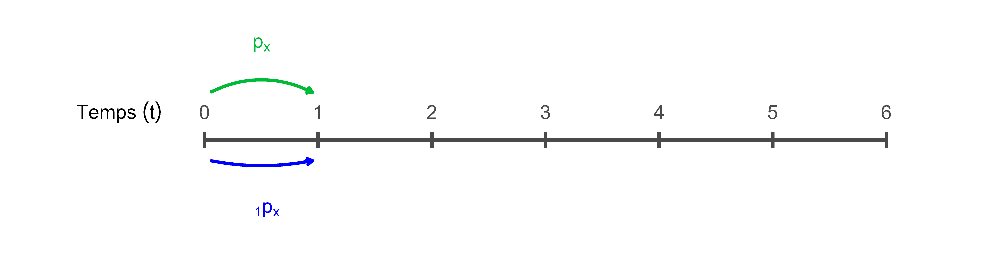
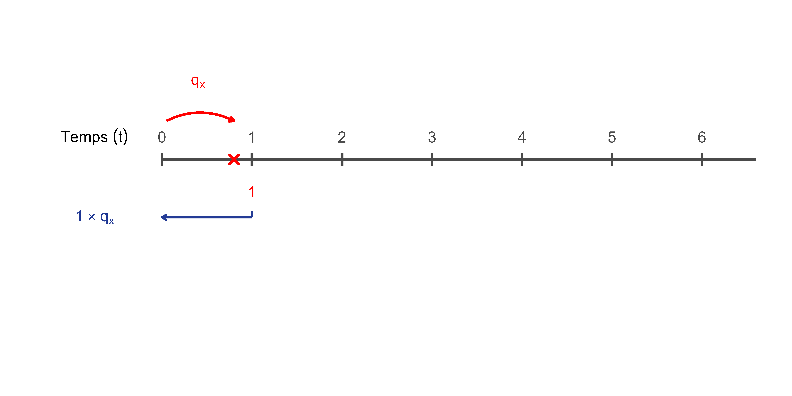
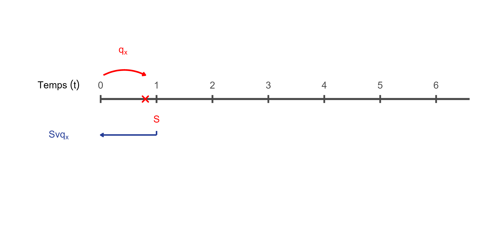
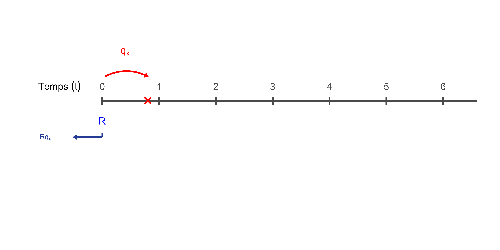

# L'actuariat de l'assurance-vie

### Objectifs du chapitre {-}

- Expliquer les fondements actuariels de l’assurance-vie en assurance de personnes;
- Décrire les phénomènes de sélection et d’anti-sélection et leurs effets sur la tarification;
- Interpréter et utiliser les principales tables de mortalité en assurance-vie individuelle;
- Calculer des probabilités de décès, des probabilités de survie et une espérance de vie à partir d’une table de mortalité;
- Appliquer le principe de la valeur actuelle espérée à de premiers calculs d’assurance-vie et de rente;
- Comparer les mécanismes actuariels fondamentaux d’une assurance-vie et d’une rente viagère.

## Introduction

L’assurance-vie occupe une place centrale en assurance de personnes. Elle repose sur l’idée qu’un grand nombre d’individus peuvent mettre en commun les conséquences financières associées au décès afin de protéger leurs proches contre une perte de revenu ou un besoin financier important. L’actuariat de l’assurance-vie vise à analyser et à quantifier ces risques afin de déterminer des primes adéquates et de garantir la solidité financière des contrats. Pour y parvenir, les actuaires doivent notamment comprendre les phénomènes de sélection et d’anti-sélection, analyser les probabilités de décès à l’aide de tables de mortalité et concevoir des produits adaptés aux besoins des assurés. Ce chapitre présente les principaux concepts actuariels qui sous-tendent l’assurance-vie. Nous y abordons d’abord les notions de sélection des risques et d’anti-sélection, puis le rôle des tables de mortalité dans l’évaluation du risque de décès. 

### Coût actuariel d’une assurance sur une année

<div style="
float:right;
display:inline-block;
margin:0 0 1em 1em;
text-align:center;
border:0.5px solid #bbb;
padding:6px;
background:white;
box-shadow:0 3px 10px rgba(0,0,0,0.15);
max-width:220px;
">


<div style="font-size:0.85em; margin-top:0.4em; color:#555;">
Edmond Halley (1656–1742). Astronome anglais surtout connu pour la comète qui porte son nom, il publie en 1693 l’un des premiers calculs actuariels modernes.
</div>

</div>


Le coût actuariel d’une assurance-vie correspond à la valeur actuelle espérée de la prestation payable en cas de décès. Dans le cas d’une assurance couvrant une période d’un an, ce coût peut s’écrire :

$$
C = S \, q_x \, v^{t}
$$

où :

- $C$ représente le coût actuariel de l’assurance pour l’année;
- $S$ représente le montant d’assurance (capital assuré payable au décès);
- $q_x$ représente la probabilité qu’un assuré âgé de $x$ ans décède au cours de l’année;
- $v^{t}$ représente le facteur d’actualisation correspondant au moment du paiement.

Le facteur d’actualisation est défini par $v = \frac{1}{1+i},$ où $i$ est le taux d’intérêt annuel. Le terme $t$ représente le temps, exprimé en années, entre le moment où la prime est établie et le moment où la prestation est versée (voir le cours [ACT1200: Mathématiques financières I](https://etudier.uqam.ca/cours?sigle=ACT1200)) Selon les hypothèses retenues concernant le moment du paiement de la prestation, différentes valeurs peuvent être utilisées pour $t$. Si la prestation est versée à la fin de l’année de décès, on prend généralement $t = 1$, ce qui donne

$$
C = S q_x v;
$$

Cette expression en $C$ correspond à la valeur actuelle espérée du paiement effectué par l’assureur dans le cas d’une assurance temporaire d’un an. Elle constitue l’un des **éléments de base des calculs actuariels en assurance-vie**.

<div style="clear: both;"></div>


::: {.callout-note icon=false}

## Notations actuarielles

En actuariat, la notation $q_x$ représente la probabilité de passer d’un état à un autre. Par exemple, il peut s’agir de passer de l’état vivant à l’état décédé, de l’état actif à l’état invalide ou encore de l’état invalide à l’état actif. Lorsque plusieurs transitions sont possibles, on précise généralement la nature du changement d’état à l’aide d’un exposant.
:::

### Les tables de mortalité : considérations générales

<div style="
float:right;
display:inline-block;
margin:0 0 1em 1em;
text-align:center;
border:0.5px solid #bbb;
padding:6px;
background:white;
box-shadow:0 3px 10px rgba(0,0,0,0.15);
max-width:220px;
">


<div style="font-size:0.85em; margin-top:0.4em; color:#555;">
John Graunt (1620–1674), qui a construit l’une des premières tables de mortalité
</div>

</div>


Les calculs actuariels en assurance-vie reposent en grande partie sur l’utilisation de tables de mortalité. Ces tables fournissent des estimations des probabilités de décès selon l’âge et certaines caractéristiques des individus. Il existe plusieurs types de tables de mortalité. On distingue notamment cinq grandes familles.

1. **Tables de population** : Ces tables sont généralement produites par des organismes gouvernementaux et incluent l’ensemble des décès observés dans une population. Elles comprennent donc les décès de personnes en très mauvaise santé, ce qui les rend représentatives de la mortalité générale. Ces tables permettent notamment :

   - de comparer la mortalité entre différents pays ;
   - de comparer la mortalité entre différentes régions d’un même pays ;
   - d’éclairer certaines décisions de politique publique, par exemple l’âge d’admissibilité à certaines prestations publiques.

   Par exemple, certaines études ont montré que l’espérance de vie des personnes vivant dans l’est de Montréal peut être inférieure de plusieurs années à celle observée dans l’ouest de l’île.

2. **Tables d’assurance individuelle**  : Ces tables sont utilisées pour la tarification des produits d’assurance-vie individuelle.

3. **Tables de rentes individuelles**: Ces tables servent à tarifer les produits de rente individuelle.

4. **Tables d’assurance collective**: Ces tables sont utilisées pour la tarification des régimes d’assurance collective.

5. **Tables de régimes de retraite**: Ces tables servent à estimer les coûts associés aux régimes de retraite.

Les différences observées entre ces différentes tables s’expliquent notamment par les effets de la sélection et de l’anti-sélection.

<div style="clear: both;"></div>


## L’anti-sélection

L’anti-sélection correspond à une situation dans laquelle l’assuré possède plus d’information sur son propre état de santé ou sur son niveau de risque que l’assureur. Cette asymétrie d’information peut avantager l’assuré au détriment de l’assureur. Autrement dit, l’assuré peut parfois bénéficier d’une tarification plus favorable que celle qui serait appliquée si l’assureur disposait de toute l’information pertinente.

::: {#exm-5 .custom}
Une personne souffre d’un problème de santé dont l’assureur n’a pas connaissance. Cette situation peut survenir parce qu’aucune question précise n’a été posée dans la proposition d’assurance ou parce que ce risque n’est pas facilement observable.

Dans ce cas, la probabilité réelle de décès de cette personne peut être plus élevée que celle des individus appartenant à la classe de risque dans laquelle elle est classée. La prime qu’elle paie sera alors inférieure à celle qui aurait été exigée si l’assureur avait disposé de toute l’information pertinente.
:::

::: {#exm-5 .custom}
Un exemple souvent mentionné concerne les mutations génétiques associées à un risque élevé de développer certaines maladies graves. Si l’assureur ne demande pas de test génétique permettant d’identifier une telle mutation, il peut être difficile de détecter ce risque accru lors de l’évaluation du dossier. Une personne porteuse de cette mutation pourrait alors être classée dans une catégorie de risque correspondant à la population générale, même si son risque réel de maladie ou de décès est plus élevé.

Il est toutefois possible d’interpréter cette situation d’une autre manière. Lorsque certaines informations médicales ne sont pas connues ou ne peuvent pas être utilisées par l’assureur, le risque associé à ces conditions demeure réparti dans l’ensemble de la population assurée. Si ces informations étaient systématiquement utilisées, certaines personnes présentant des risques très élevés pourraient devenir difficilement assurables.
:::

### Impacts en assurance-vie et pour les rentes

Si l’assureur ne procédait à aucune sélection médicale en assurance-vie, il attirerait principalement des personnes présentant un risque de mortalité plus élevé que la moyenne, par exemple des personnes en moins bonne santé ou pratiquant des activités dangereuses. La situation est toutefois différente pour les produits de rente. Dans ce cas, les personnes qui achètent une rente sont souvent celles qui s’attendent à vivre longtemps. Les personnes en mauvaise santé peuvent préférer conserver leur épargne et la dépenser plus rapidement plutôt que de la convertir en une rente viagère.

::: {#exm-5 .custom}
Une personne dont les parents ont vécu au-delà de cent ans peut anticiper une longévité supérieure à la moyenne. Si cette personne achète une rente, elle pourrait recevoir des versements pendant une période plus longue que celle anticipée par l’assureur.
:::

Pour se protéger contre l’anti-sélection, les assureurs ajustent généralement leurs hypothèses de mortalité. En assurance-vie, ils peuvent utiliser des taux de mortalité plus élevés pour certains groupes lorsque l’information médicale disponible est limitée. À l’inverse, pour les produits de rente, ils peuvent utiliser des taux de mortalité plus faibles afin de refléter la longévité plus élevée des personnes qui choisissent ce type de produit.  Il peut ainsi arriver qu’une même personne se voie appliquer des hypothèses de mortalité différentes selon le produit qu’elle achète, par exemple une assurance-vie et une rente.


## La sélection des risques

La sélection des risques est le processus par lequel l’assureur évalue les caractéristiques d’une personne qui demande une assurance afin de classer ce risque dans une catégorie appropriée. La sélection des risques poursuit plusieurs objectifs.

- **Contrer l’anti-sélection**: Si l’on veut réaliser une mise en commun juste et équitable des risques, il est nécessaire de regrouper des individus présentant des probabilités de sinistre similaires. Autrement dit, les groupes d’assurés doivent être relativement homogènes quant au niveau de risque.

- **Maintenir l’équité entre les assurés**: En classant les assurés dans des catégories homogènes, on s’assure que des personnes présentant des risques semblables paient des primes semblables.

- **Faciliter la mise en commun des risques**: Lorsque les assurés sont classés selon certaines caractéristiques (par exemple l’âge, le sexe ou l’état de santé), il devient possible de mettre en commun des risques comparables et d’estimer plus précisément la mortalité attendue pour chaque groupe.

- **Garantir que les primes soient proportionnelles au coût actuariel**: En regroupant les assurés selon leur risque de mortalité, l’assureur peut leur appliquer un taux de mortalité représentatif de leur classe de risque. En utilisant une relation du type
$C = S \, q_x \, v^{t}$, auquel on ajoute des frais et du profit pour obtenir une prime d'assurance, on s’assure que la prime demandée est proportionnelle au coût actuariel attendu du contrat.

### Fonctionnement de la sélection

Parmi les personnes qui demandent une assurance, l’assureur sélectionne celles dont le niveau de risque est acceptable et les classe dans une catégorie de risque donnée. La prime demandée est ensuite déterminée à partir de la mortalité moyenne prévue pour cette classe de risque, selon certaines caractéristiques comme l’âge, le sexe ou le statut de fumeur. La sélection des risques comprend généralement plusieurs éléments.

- **Questionnaire médical**: Le demandeur doit remplir un questionnaire qui sera analysé par l’assureur. Celui-ci peut également demander des informations supplémentaires. Le questionnaire porte généralement sur :

  - l’histoire familiale (maladies des parents ou des frères et sœurs), afin de détecter un risque de maladies héréditaires ;
  - l’utilisation de tabac, d’alcool ou de drogues, associée notamment à un risque accru de cancer ou de maladies cardiovasculaires ;
  - les habitudes de vie et les loisirs, afin d’identifier la pratique d’activités dangereuses ;
  - l’emploi du demandeur, afin de détecter certains risques occupationnels (par exemple dans les métiers à haut risque) ;
  - la détention d’autres polices d’assurance, afin d’identifier un risque de sur-assurance ;
  - la présence d’un casier judiciaire, pouvant indiquer un risque accru de fraude ;
  - le revenu et la situation financière du demandeur, afin d’évaluer la capacité de payer les primes.

- **Tests médicaux**: Selon le montant d’assurance demandé, l’assureur peut exiger certains tests médicaux, par exemple une analyse de sang, une analyse d’urine ou une mesure de la pression artérielle.

- **Examen médical**: Dans certains cas, un examen médical complet peut être exigé.

- **Rapport du conseiller en sécurité financière**: Le conseiller peut fournir à l’assureur des informations supplémentaires sur la situation du demandeur.

- **Consultation du *Medical Information Bureau* (MIB)**: Lorsqu’une personne fait une demande d’assurance, elle autorise généralement l’assureur à consulter ses dossiers médicaux et à partager certaines informations avec le Medical Information Bureau (MIB). Les assureurs peuvent consulter cette base de données afin de vérifier si certaines informations médicales importantes ont déjà été signalées lors de demandes d’assurance antérieures.

La profondeur de la sélection dépend généralement du montant d’assurance demandé. En effet, le coût du processus de sélection ne doit pas être disproportionné par rapport au coût actuariel du contrat.

### Décisions possibles de l’assureur

Après avoir analysé l’ensemble des informations recueillies lors du processus de sélection, l’assureur peut prendre différentes décisions.

- **Accepter le demandeur comme risque standard**: La classe standard regroupe la majorité des assurés. Elle doit être suffisamment large pour contenir une grande proportion des personnes assurées, généralement près de 90 %. Cette approche permet :

  - d’obtenir une mortalité stable et prévisible ;
  - de réduire les coûts administratifs ;
  - de faciliter le travail des conseillers en sécurité financière ;
  - de maintenir une bonne image publique.

- **Classer le demandeur comme risque aggravé (ou risque taré)**: Certains individus présentent un risque de mortalité plus élevé que la moyenne. Lorsque ce risque supplémentaire est jugé significatif, l’assureur peut accepter la demande mais appliquer une mortalité plus élevée. Cette différence de mortalité entraîne une prime plus élevée, appelée surprime.

- **Réduire le montant d’assurance demandé**: Même si le risque est acceptable, l’assureur peut décider d’émettre une police pour un montant inférieur à celui demandé si le montant paraît excessif par rapport aux besoins réels du demandeur.

- **Différer ou reporter la décision**: Si l’information disponible est insuffisante, l’assureur peut demander des examens médicaux supplémentaires ou attendre que certaines informations soient clarifiées avant de rendre sa décision.

- **Refuser le risque**: Dans certains cas, le niveau de risque est jugé trop élevé pour être assuré, même avec une surprime. L’assureur peut alors refuser d’émettre la police d’assurance.
  

## Les tables de mortalité utilisées en assurance vie individuelle

Une table de mortalité est un outil fondamental en actuariat. Elle fournit, pour chaque âge, une estimation de la probabilité de décès au cours de l’année. En notation actuarielle, cette probabilité est généralement représentée par $q_x$, qui désigne la probabilité qu’une personne âgée de $x$ ans décède avant d’atteindre l’âge $x+1$. Une table de mortalité est donc essentiellement un ensemble de valeurs de $q_x$ (et parfois d’autres quantités dérivées) pour différents âges et différentes catégories d’assurés. Les tables de mortalité utilisées en assurance individuelle existent en trois versions :  

1) **Table sélecte**, qui est une table à 4 dimensions et qui représente l’évolution de la mortalité en tenant compte de la durée écoulée depuis la sélection. Elle contient des taux de mortalité variant selon :

   - l’âge à l’émission de la police (= âge à la sélection du risque)
   - la durée écoulée depuis l’émission de la police
   - le sexe de l’assuré (hommes et femmes seulement – sexe à la naissance)
   - le statut de tabagisme (fumeur vs non-fumeur)

2) **Table ultime**, qui est une table à 3 dimensions et qui représente l’évolution de la mortalité lorsque la sélection est suffisamment ancienne pour n’avoir plus aucun impact sur la mortalité. Elle contient des taux de mortalité variant selon :

   - l’âge atteint
   - le sexe de l’assuré (hommes et femmes seulement – sexe à la naissance)
   - le statut de tabagisme (fumeur vs non-fumeur)

3) **Table agrégée**, qui correspond à la combinaison d’une table sélecte et d’une table ultime. Comme la table ultime, elle est donc une table à 3 dimensions et contient des taux de mortalité variant selon :

   - l’âge atteint
   - le sexe de l’assuré (hommes et femmes seulement – sexe à la naissance)
   - le statut de tabagisme (fumeur vs non-fumeur)

### Notations

Comme nous l’avions déjà mentionné, en actuariat, le symbole $q_x$ représente la probabilité qu’un individu change d’état au cours de l’année suivant l’âge $x$. Selon le contexte, ce changement d’état peut correspondre, par exemple :

- au passage de l’état vivant à l’état décédé;
- au passage de l’état actif à l’état retraité.

Dans le cas des tables de mortalité utilisées en assurance-vie individuelle, $q_x$ représente simplement la probabilité qu’une personne âgée de $x$ ans décède avant d’atteindre l’âge $x+1$. Cette notation peut être généralisée afin de tenir compte de certaines caractéristiques des assurés.

::: {.encadre}

| Symbole | Interprétation |
|---|---|
| $q_x$ | Probabilité de décès à l’âge $x$ |
| $q_x^H$ | Probabilité de décès d’un homme à l’âge $x$ |
| $q_x^F$ | Probabilité de décès d’une femme à l’âge $x$ |
| $q_{x+n}$ | Probabilité de décès à l’âge $x+n$ pour une personne sélectionnée à l’âge $x$ |
| $q_{x+n}^H$ | Probabilité de décès d’un homme à l’âge $x+n$ sélectionné à l’âge $x$ |
| $q_{x+n}^F$ | Probabilité de décès d’une femme à l’âge $x+n$ sélectionnée à l’âge $x$ |
:::

Dans cette notation, le terme $n$ représente le nombre d’années écoulées depuis la sélection médicale.

### Relations entre les tables

Les différentes tables de mortalité utilisées en actuariat reflètent des populations ayant des caractéristiques de risque différentes. On observe ainsi plusieurs relations générales entre les taux de mortalité.

1. **Effet de la sélection**

   De façon générale, les taux de mortalité vérifient la relation suivante :

   $$
   q_{x}^{\text{sélecte}} < q_{x}^{\text{agrégée}} < q_{x}^{\text{ultime}} < q_{x}^{\text{population}}
   $$

   Cette relation s’explique par l’effet de la sélection des risques. Dans une table sélecte, les assurés viennent tout juste de subir une sélection médicale et présentent donc généralement un meilleur état de santé que la moyenne. À mesure que le temps passe, cet avantage s’estompe graduellement, ce qui conduit aux taux observés dans la table ultime. Les tables de population incluent quant à elles l’ensemble des individus d’une population, y compris des personnes très malades, ce qui conduit généralement à des taux de mortalité plus élevés.

2. **Différence selon le sexe**

   Pour la plupart des âges, on observe la relation suivante :

   $$
   q_x^F < q_x^H
   $$

   Autrement dit, la mortalité des femmes est généralement plus faible que celle des hommes. Cette différence s’observe dans de nombreuses populations et se reflète également dans les tables utilisées en assurance.

3. **Différence selon le tabagisme**

   Les tables de mortalité distinguent souvent les fumeurs et les non-fumeurs, car la consommation de tabac est associée à un risque accru de plusieurs maladies graves. On observe généralement la relation suivante :

   $$
   q_x^{\text{non-fumeur}} < q_x^{\text{fumeur}}
   $$

   Les fumeurs présentent donc, en moyenne, une mortalité plus élevée que les non-fumeurs.

4. **Fin de la sélection médicale**

   Les assureurs ne procèdent généralement plus à une sélection médicale au-delà d’environ 80 ans. À ces âges, le risque qu’un problème de santé important ne soit pas détecté devient plus élevé, d’autant plus que la majorité des individus présentent déjà certaines conditions liées au vieillissement (par exemple le diabète, l’hypertension artérielle ou certaines maladies dégénératives).

5. **Âge Oméga**

   Les tables de mortalité d’assurance individuelle se terminent généralement à un âge limite compris entre 100 et 120 ans. Cet âge maximal est appelé **âge Oméga** (âge $\omega$ ou $\Omega$), en référence à la dernière lettre de l’alphabet grec. En notation actuarielle, cela signifie que

   $$
   q_{\Omega} = 1,
   $$

   c’est-à-dire qu’une personne ayant atteint cet âge est supposée décéder avant l’âge suivant.
   
## Tables de mortalité utilisées

### La table ICA9704

La table de mortalité utilisée pendant plusieurs en assurance vie individuelle a été la **table ICA9704**, publiée par l’Institut canadien des actuaires. Comme son nom l’indique, cette table ICA9704 est basée sur l’expérience collectée par l’ICA de 1997 à 2004 inclusivement.  Elle est basée sur les données de 16 sociétés d’assurance du Canada et a été publiée en mai 2010 et est disponible sur le site de l’ICA. Fait intéressant, cette table a été développée par des professeurs d’actuariat de l’UQAM: Claude Pichet et Carole Turcotte, avec l’aide d'un chargé de cours de l'époque, Jean-François Paquin, en vertu d’un contrat intervenu entre l’ICA et l’UQAM en 2007. La table ICA9704 remplaçait à l'époque la table précédente, la table **ICA8692**, qui était basée sur des données de 1986 à 1992.

### La table ICA2014

<div style="
float:right;
display:inline-block;
margin:0 0 1em 1em;
text-align:center;
border:0.5px solid #bbb;
padding:6px;
background:white;
box-shadow:0 3px 10px rgba(0,0,0,0.15);
max-width:220px;
">


<div style="font-size:0.85em; margin-top:0.4em; color:#555;">
Présentation de la nouvelle table de mortalité de l'ICA
</div>

</div>


En 2022, l’Institut canadien des actuaires a publié une nouvelle table basée sur des données beaucoup plus récentes, appelée [ICA2014](https://www.cia-ica.ca/fr/publications/rp222040f/). Cette table a été créée parce que les tables ICA8692 et ICA9704 ne reflétaient plus bien l’expérience de mortalité actuelle. Elle est construite à partir de données d’expérience d’assurance-vie individuelle couvrant environ 2009 à 2019. On peut télécharger la table en utilisant le [lien suivant](https://www.cia-ica.ca/publications/rp222040t1e/). 

Le fichier Excel comporte 17 onglets, dont un onglet *Describe*. Les huit classes de risque sont donc :

- **Msm** : hommes fumeurs (*male smokers*)
- **Fsm** : femmes fumeuses (*female smokers*)
- **Mns** : hommes non-fumeurs (*male non-smokers*)
- **Fns** : femmes non-fumeuses (*female non-smokers*)
- **Munk** : hommes dont le statut de tabagisme est inconnu (*male smoking unknown*)
- **Funk** : femmes dont le statut de tabagisme est inconnu (*female smoking unknown*)
- **Mall** : hommes, tous statuts de tabagisme confondus (*male all smoking statuses*)
- **Fall** : femmes, tous statuts de tabagisme confondus (*female all smoking statuses*)

Pour chacune de ces 8 classes, deux tables sont fournies, une table avec **âge au plus proche anniversaire** (suffixe **N**)
et une table avec **âge au dernier anniversaire** (suffixe **L**), pour ainsi produire 16 tables possibles. Ainsi, au final, nous avons par exemple les tables:

- **MsmN** : hommes fumeurs, âge au plus proche anniversaire  
- **MsmL** : hommes fumeurs, âge au dernier anniversaire

<div style="clear: both;"></div>

Le script R suivant permet de télécharger les données et de les analyser avec le logiciel R, un logiciel de base que vous allez devoir maîtriser pendant vos études en actuariat, entre autres dans le cours [ACT3035: Laboratoire d'actuariat](https://etudier.uqam.ca/cours?sigle=ACT3035). 

```{r}
#| code-fold: true
#| echo: true
#| message: false
#| warning: false

library(readxl)

fichier <- "data/222040T1e.xlsx"

onglets <- excel_sheets(fichier)

# Lire tous les onglets
bdd <- lapply(onglets, function(sh) {
  read_excel(
    path = fichier,
    sheet = sh,
    skip = 3
  )
})
names(bdd) <- onglets

# Nom des colonnes de chaque onglet
noms_colonnes <- c(
  "Age1",
  paste0("n", 0:19),
  "nult",
  "Age2"
)

for (i in seq_along(bdd)) {
  colnames(bdd[[i]]) <- noms_colonnes
}

```

### Affichage de la table ICA2014

On peut consulter une des tables de mortalité afin de mieux comprendre comment elle se lit. Prenons par exemple les probabilités de décès pour les hommes, tous statuts de tabagisme confondus, avec l’âge au dernier anniversaire. Autrement dit, on utilise l’onglet *MallL* du fichier Excel. Le tableau ci-dessus affiche les résultats.

On y observe 23 colonnes :

- La première colonne, *Age1*, indique l’âge auquel un assuré a subi la sélection médicale avec succès.
- Les colonnes *n0* à *n19* correspondent aux probabilité de décès en fonction du nombre d’années écoulées depuis que l’assuré a réussi sa sélection médicale.
- La colonne *nult* correspond aux probabilités de décès lorsque la sélection médicale remonte à 20 ans ou plus.
- La colonne *Age2* indique l’âge atteint par l’assuré après 20 ans depuis sa sélection médicale.


```{r}
#| code-fold: true
#| echo: true
#| message: false
#| warning: false

library(dplyr)
library(knitr)
library(kableExtra)

bdM <- bdd$MallL

# Colonnes de probabilités
cols_q <- c(paste0("n", 0:19), "nult")

# Formatage des probabilités en pourcentage
bdM_fmt <- bdM %>%
  mutate(
    across(
      all_of(cols_q),
      ~ sprintf("%.3f%%", 100 * .)
    )
  )

# Affichage de la table
kable(
  bdM_fmt,
  format = "html",
  escape = TRUE,
  caption = "Table de mortalité MallL (ICA2014)",
  align = c("c", rep("r", 21), "c")
) %>%
  kable_styling(
    full_width = FALSE,
    bootstrap_options = c("striped", "hover", "condensed")
  ) %>%
  scroll_box(
    width = "100%",
    height = "700px"
  )
```


## Analyse de la table ICA2014

Le tableau que nous avons imprimé nous permet de comprendre le fonctionnement de la table ICA2014.  Pour les hommes, tabagisme confondu, avec l'âge au dernier anniversaire, il nous est possible de répondre aux questions suivantes.

::: {#exm-2 .custom}
1) Quel est le taux de mortalité d’un homme âgé de 40 ans et qui vient de subir la sélection médicale avec succès?

2) Quel est le taux de mortalité d’un homme âgé de 40 ans et qui a subi la sélection médicale avec succès il y a 5 ans?

3) Quel est le taux de mortalité d’un homme âgé de 40 ans et qui a subi la sélection médicale avec succès il y a 10 ans?
:::

::: {.custom-solution}
**Solution.**

On peut regarder chacune des possibilités:  

1) L'homme a fait sa sélection médicale à 40 ans: on regarde donc la ligne avec *Age1=40*.  Ensuite, comme il s'agit de la première année suivant son examen, on regarde la valeur de cette ligne pour la colonne *n0*, ce qui donne $0.000259$.

2) Ici, il faut bien comprendre la fonctionnement. L'homme a 40 ans aujourd'hui et a subi sa sélection médicale avec succès il y a 5 ans.  Ainsi, *Age1* correspondant à l’âge auquel un assuré a subi la sélection médicale avec succès est donc de 35. On regarde la valeur de cette ligne pour la colonne *n5*, ce qui donne $0.000458$.

3) Selon la même logique, l'homme a 40 ans aujourd'hui et a subi sa sélection médicale avec succès il y a 10 ans.  Ainsi, *Age1*  est donc de 30. On regarde la valeur de cette ligne pour la colonne *n10*, ce qui donne $0.000614$.

On peut ainsi analyser les taux de mortalité d’un individu âgé de $x$ ans en suivant, période après période, la diagonale de la table de mortalité qui correspond au temps depuis l'examen de sélection médical. En partant de la position $(x, n_0)$, on se déplace vers $(x-1, n_1)$, puis $(x-2, n_2)$, et ainsi de suite. 

Par ailleurs, pour répondre à ces questions, on peut regarder la table directement, ou encore s'écrire un script R qui fait ces calculs.

```{r}
#| code-fold: true
#| echo: true
#| message: false
#| warning: false

library(dplyr)

bdM <- bdd$MallL

q0 <- bdM %>% 
  filter(Age1 == 40) %>% 
  pull(n0)

q5 <- bdM %>% 
  filter(Age1 == 35) %>% 
  pull(n5)

q10 <- bdM %>% 
  filter(Age1 == 30) %>% 
  pull(n10)

library(tibble)
library(knitr)
library(kableExtra)

tab <- tibble(
  Situation = c(
    "Sélection récente",
    "Sélection il y a 5 ans",
    "Sélection il y a 10 ans"
  ),
  `Taux de mortalité` = c(q0, q5, q10)
)

kable(tab, digits = 6, align = "lc") %>%
  kable_styling(full_width = FALSE)

```

:::


### Quelques graphiques intéressants

Les deux graphiques ci-dessous illustrent l’évolution de la probabilité de décès durant la première année suivant la sélection médicale, en fonction de l’âge à la sélection.

Dans le premier graphique, les probabilités sont représentées sur leur échelle naturelle. Comme les probabilités de décès sont très faibles aux jeunes âges, les différences entre les courbes sont difficiles à observer. La croissance de la mortalité avec l’âge devient surtout visible aux âges plus élevés. Le second graphique représente le logarithme de la probabilité de décès. Cette transformation permet de mieux visualiser les variations relatives de la mortalité, en particulier aux jeunes âges. Sur cette échelle, les différences entre les hommes et les femmes apparaissent plus clairement, et l’on observe aussi certaines caractéristiques bien connues de la mortalité humaine.

On remarque notamment une augmentation temporaire de la mortalité au début de l’âge adulte, souvent appelée *accident hump* dans la littérature démographique. Ce phénomène se manifeste généralement entre la fin de l’adolescence et le début de la trentaine. Il s’explique principalement par des causes de décès liées aux comportements à risque plutôt qu’à des causes biologiques associées au vieillissement. Parmi les facteurs souvent mentionnés, on trouve notamment :

- les accidents de la route ;
- les comportements dangereux ou la prise de risques ;
- certaines formes de violence ;
- la consommation d’alcool ou de drogues.

Ce phénomène est généralement plus prononcé chez les hommes que chez les femmes, ce qui contribue à l’écart de mortalité observé entre les deux sexes dans ces graphiques. Après cette période, la mortalité recommence à suivre une progression plus régulière avec l’âge, dominée par les mécanismes biologiques du vieillissement.

```{r}
#| code-fold: true
#| echo: true
#| message: false
#| warning: false
#| fig-height: 4
#| fig-width: 14
#| fig-align: center

library(ggplot2)
library(dplyr)

bdM <- bdd$MallL
bdF <- bdd$FallL

# Préparer les données
df_plot <- bind_rows(
  bdM %>% select(Age1, n1) %>% mutate(sexe = "Hommes"),
  bdF %>% select(Age1, n1) %>% mutate(sexe = "Femmes")
)

# Graphique
p1 <- ggplot(df_plot, aes(x = Age1, y = n1, color = sexe)) +
  geom_line(linewidth = 1) +
  scale_color_manual(values = c("Hommes" = "blue", "Femmes" = "red")) +
  labs(
    x = "Âge à la sélection",
    y = "Probabilité de décès",
    color = "Sexe",
    title = "Probabilité de décès"
  ) +
  theme_bw()

p2 <- ggplot(df_plot, aes(x = Age1, y = log(n1), color = sexe)) +
  geom_line(linewidth = 1) +
  scale_color_manual(values = c("Hommes" = "blue", "Femmes" = "red")) +
  labs(
    x = "Âge à la sélection",
    y = "log(probabilité) de décès",
    color = "Sexe",
    title = "Log(probabilité) de décès"
  ) +
  theme_bw()

library(patchwork)

p1 | p2

```

Les deux graphiques ci-dessous illustrent deux phénomènes importants en assurance-vie : l’effet de la sélection médicale (à gauche) et la différence de mortalité entre fumeurs et non-fumeurs (à droite).

- Les probabilités de décès $n_1$ correspondent à la mortalité observée durant la première année suivant la sélection médicale, alors que $n_{ult}$ représente la mortalité ultime, c’est-à-dire la mortalité observée lorsque l’effet de la sélection a disparu. On observe généralement que $n_1$ est inférieur à $n_{ult}$ pour un même âge. Cela s’explique par le processus de sélection médicale lors de la souscription d’un contrat : les personnes présentant des risques élevés peuvent être refusées ou classées dans une catégorie différente. Les assurés nouvellement acceptés forment donc un groupe en moyenne plus en santé que la population assurée à long terme. Cet avantage est toutefois temporaire : avec le temps, l’état de santé évolue et la mortalité converge graduellement vers la mortalité ultime après la période dite *sélecte*.

- La comparaison entre fumeurs et non-fumeurs met en évidence l’un des déterminants majeurs de la mortalité dans les tables d’assurance-vie. À âge donné, la probabilité de décès des fumeurs est systématiquement plus élevée que celle des non-fumeurs. Cet écart s’explique par l’impact du tabagisme sur plusieurs causes importantes de décès, notamment les maladies cardiovasculaires, certains cancers et les maladies respiratoires. La différence est suffisamment marquée pour que les assureurs distinguent généralement ces deux groupes et appliquent des primes plus élevées aux fumeurs afin de refléter leur risque de mortalité plus élevé.


```{r}
#| code-fold: true
#| echo: true
#| message: false
#| warning: false
#| fig-height: 4
#| fig-width: 14
#| fig-align: center

library(ggplot2)
library(dplyr)
library(patchwork)

bdM <- bdd$MallL

# Préparer les données
df_plot <- bind_rows(
  bdM %>% select(Age1, n1)   %>% mutate(type = "n1 (après sélection)"),
  bdM %>% select(Age2, nult) %>% rename(n1 = nult, Age1=Age2) %>% mutate(type = "nult (ultime)")
)

p1 <- ggplot(df_plot, aes(x = Age1, y = log(n1), color = type)) +
  geom_line(linewidth = 1) +
  scale_color_manual(values = c(
    "n1 (après sélection)" = "blue",
    "nult (ultime)" = "red"
  )) +
  labs(
    x = "Âge à la sélection",
    y = "log(probabilité) de décès",
    color = "Type de taux",
    title = "Log(probabilité) de décès : effet de la sélection"
  ) +
  theme_bw()

library(ggplot2)
library(dplyr)
library(patchwork)

# Tables
bdM_sm <- bdd$MsmL
bdM_ns <- bdd$MnsL

# Préparer les données
df_plot2 <- bind_rows(
  bdM_sm %>% select(Age1, n1) %>% mutate(type = "Fumeurs"),
  bdM_ns %>% select(Age1, n1) %>% mutate(type = "Non-fumeurs")
)

# Graphique
p2 <- ggplot(df_plot2, aes(x = Age1, y = log(n1), color = type)) +
  geom_line(linewidth = 1) +
  scale_color_manual(values = c(
    "Fumeurs" = "red",
    "Non-fumeurs" = "blue"
  )) +
  labs(
    x = "Âge à la sélection",
    y = "log(probabilité) de décès",
    color = "Statut tabagique",
    title = "Log(probabilité) de décès : fumeurs vs non-fumeurs"
  ) +
  theme_bw()

p1 | p2


```

## Quelques notions des mathématiques de l'assurance de personnes

<div style="
float:right;
display:inline-block;
margin:0 0 1em 1em;
text-align:center;
border:0.5px solid #bbb;
padding:6px;
background:white;
box-shadow:0 3px 10px rgba(0,0,0,0.15);
max-width:220px;
">


<div style="font-size:0.85em; margin-top:0.4em; color:#555;">
Le <em>Bowers</em>, un livre légendaire en mathématiques actuarielles de l'assurance de personnes
</div>

</div>

Les mathématiques liées à la mortalité ont longtemps constitué le coeur de la formation actuarielle à l'université, et souvent les cours les plus difficiles du programme. En effet, la grande majorité des actuaires œuvraient dans le domaine de l’assurance de personnes et des régimes de retraite. Les cours universitaires associés aux mathématiques de la mortalité étaient même souvent appelés *mathématiques actuarielles* dans les programmes universitaires, d’où le surnom bien connu de *matraque*.

Avec le développement du domaine actuariel, notamment dans le secteur de l’assurance de dommages, cette appellation a progressivement été abandonnée. On parle aujourd’hui plus précisément de **mathématiques de l’assurance de personnes**.  À l’UQAM, ces notions sont abordées principalement dans les cours [ACT3300](https://etudier.uqam.ca/cours?sigle=ACT3300) et [ACT4300](https://etudier.uqam.ca/cours?sigle=ACT4300). Sans entrer dans les notions avancées présentées dans ces cours, il est néanmoins pertinent de profiter de l’occasion d’avoir sous la main des tables de mortalité réelles pour introduire quelques notions de base du domaine.

<div style="clear: both;"></div>

### Taux de survie et probabilités cumulatives

Nous avons vu que l'une des notions les plus fondamentales en assurance de personnes est le taux de mortalité, généralement noté $q_x$.  On note ainsi $p_x = 1 - q_x$, la probabilité de survie. Cette quantité représente la probabilité qu’une personne âgée de $x$ ans atteigne l’âge $x+1$. À partir des probabilités annuelles, il est possible de calculer la probabilité de survivre plusieurs années. La probabilité qu’une personne âgée de $x$ ans survive $t$ années est ainsi notée

$$
{}_t p_x
$$

et correspond au produit des probabilités de survie annuelles :

$$
{}_t p_x = p_x \times p_{x+1} \times \cdots \times p_{x+t-1}.
$$

Une manière visuelle de voir cette égalité est celle-ci:

{width=60% fig-align="center"}

Attention, la probabilité qu’un individu décède **avant $n$ années** **n'est pas**

$$
{}_t q_x \ne q_x \times q_{x+1} \times \cdots \times q_{x+t-1}.
$$

mais est plutôt:

$$
{}_t q_x = 1 - {}_t p_x.
$$


::: {#exm-2 .custom}
On reprend le cas d'un homme âgé de 40 ans, mais qui n'a jamais fait de sélection médicale (afin de pouvoir travailler directement avec *nult*). Quelle est la probabilité qu'il survive 1, 2, 5, 10 et 50 ans?
:::

::: {.custom-solution}
**Solution.**

Ici, on s’intéresse uniquement aux colonnes *Age2* et *nult* de la table de mortalité. La colonne *nult* correspond à la probabilité de décès $q_x$. À partir de cette information, on peut d’abord calculer la probabilité de survie annuelle $p_x = 1 - q_x$.  On calcule ensuite la probabilité de survie cumulative ${}_t p_x$, qu'on obtient en prenant le produit cumulatif des probabilités de survie annuelles $p_x$.

```{r}
#| code-fold: true
#| echo: false
#| message: false
#| warning: false

library(dplyr)
library(tibble)
library(knitr)
library(kableExtra)

bdM <- bdd$MallL

q1 <- bdM %>% 
  filter(Age2 >= 40) %>%
  select(Age2, nult) %>%
  mutate(
    Age = Age2,
    t = row_number(),
    qx = nult, 
    px = 1 - qx,
    tpx = cumprod(px)
  ) %>%
  select(Age, t, qx, px, tpx) %>%
  slice(1:50)

# Préparer un tableau formaté en texte
q1_fmt <- q1 %>%
  mutate(
    Age = as.character(Age),
    t   = as.character(t),
    qx  = sprintf("%.6f", qx),
    px  = sprintf("%.6f", px),
    tpx = sprintf("%.6f", tpx)
  )

# Tableau raccourci avec ligne de séparation
q1_small <- bind_rows(
  slice(q1_fmt, 1:5),
  tibble(
    Age = "...",
    t   = "...",
    qx  = "...",
    px  = "...",
    tpx = "..."
  ),
  slice(q1_fmt, 45:50)
)

kable(
  q1_small,
  align = "c",
  booktabs = TRUE,
  col.names = c("Âge", "t", "q_x", "p_x", "t p_x")
) %>%
  kable_styling(
    full_width = FALSE,
    position = "center",
    bootstrap_options = c("striped", "hover")
  ) %>%
  row_spec(6, italic = TRUE, color = "gray40")

```


Encore une fois, pour répondre à cette question, on peut s'écrire un script R qui fait ces calculs.  On peut tout d'abord calculer la probabilité de survie pour tous les âges, et illustrer par un graphique.

```{r}
#| code-fold: true
#| echo: true
#| message: false
#| warning: false
#| fig-align: center
#| fig-height: 4
#| fig-width: 7

library(dplyr)

bdM <- bdd$MallL

q0 <- bdM %>% 
  filter(Age2 >= 40) %>%
  select(Age2, nult) %>%
  mutate(q = nult, 
         p = 1-q,
         pcumul = cumprod(p))
  


library(ggplot2)

# horizons demandés
h <- c(1, 2, 5, 10, 50)
points <- q0 %>%
  filter(Age2 %in% (40 + h))

ggplot(q0, aes(x = Age2, y = pcumul)) +
  geom_line(size = 1.2, color = "#3a8f5a") +
  geom_point(data = points, color = "red", size = 3) +
  labs(
    x = "Âge",
    y = "Probabilité",
    title = "Probabilité cumulative de survie à partir de 40 ans"
  ) +
  theme_bw() +
  theme(
    panel.background = element_rect(fill = "#eef7f1"),
    plot.background  = element_rect(fill = "#eef7f1")
  )

```

Pour répondre directement à la question, on peut produire le tableau suivant.

```{r}
#| code-fold: true
#| echo: true
#| message: false
#| warning: false
#| fig-align: center

points <- q0 %>%
  filter(Age2 %in% (40 + h)) %>%
  mutate(
    annees = Age2 - 40,
    p_deces = 1 - pcumul
  ) %>%
  select(
    annees,
    Age2,
    pcumul,
    p_deces
  ) %>%
  mutate(
  pcumul = sprintf("%.3f %%", 100 * pcumul),
  p_deces = sprintf("%.3f %%", 100 * p_deces)) %>%
  rename(
    "Nombre d'années" = annees,
    "Âge atteint" = Age2,
    "Probabilité de survie" = pcumul,
    "Probabilité de décès" = p_deces
  ) 

library(knitr)
library(kableExtra)

kable(points, align = "c", booktabs = TRUE) %>%
  kable_styling(
    full_width = FALSE,
    position = "center",
    bootstrap_options = c("striped", "hover")
  )

```

:::


### Espérance de vie

Une autre notion importante qu'il est pertinent d’introduire, et qui peut être dérivée directement des tables de mortalité, est l’espérance de vie d’un assuré âgé de $x$, généralement notée $e_x$. Cette quantité représente le nombre moyen d’années qu’une personne âgée de $x$ ans peut espérer vivre, selon la table de mortalité considérée. Les espérances de vie sont particulièrement importantes et largement utilisées :

- dans les régimes de retraite;
- dans l’évaluation des rentes viagères;
- dans la tarification de certains produits d’assurance.

Mathématiquement, l’espérance de vie correspond à une moyenne pondérée des durées de vie futures possibles. Cette notion est centrale en assurance de personnes, et vous verrez plusieurs manières plus rigoureuses de la calculer dans le programme d’actuariat. Toutefois, dans le cadre de ce cours, il est utile de commencer par une formulation intuitive, qui repose simplement sur les probabilités cumulatives de survie.

L’espérance de vie restante à l’âge $x$, notée $e_x$, peut être interprétée comme l’espérance mathématique d’une variable aléatoire représentant la durée de vie future d’un individu âgé de $x$ ans. Dans l’approche retenue ici, on suppose qu’un décès survenant pendant l’année $t+1$ est comptabilisé comme $t+1$ années de vie.  Considérons donc la variable aléatoire discrète $T_x$, qui représente le nombre d’années de vie futures ainsi comptabilisées. La probabilité que le décès survienne pendant l’année $t+1$, c’est-à-dire entre les âges $x+t$ et $x+t+1$, est donnée par

$$
P(T_x = t+1) = {}_t p_x \, q_{x+t}.
$$

En effet, ${}_t p_x$ est la probabilité que l’individu survive $t$ années après l’âge $x$, tandis que $q_{x+t}$ est la probabilité qu’il décède pendant l’année suivante. Le produit ${}_t p_x q_{x+t}$ représente donc la probabilité que le décès survienne pendant l’année $t+1$. L’espérance de vie correspond alors à l’espérance mathématique de la variable aléatoire $T_x$. Par la définition générale de l’espérance d’une variable discrète, on obtient

$$
e_x = E[T_x] = \sum_{t=0}^{\infty} (t+1)\,{}_t p_x\, q_{x+t}.
$$

Ainsi, l’espérance de vie est une moyenne pondérée des durées de vie futures possibles, chaque durée $(t+1)$ étant pondérée par la probabilité que le décès survienne durant l’année correspondante.

Une manière visuelle de comprendre le calcul de l'espérance de vie est celle-ci:

{width=60% fig-align="center"}


::: {#exm-2 .custom}
On reprend une autre fois le cas d'un homme âgé de 40 ans qui n'a jamais fait de sélection médicale. Quelle est son espérance de vie?
:::

::: {.custom-solution}
**Solution.**

On peut reprendre le même tableau qu'à l'exemple précédent, auquel on ajoute quelques colonnes supplémentaires. La colonne $(t-1) p_x$ représente la probabilité que l’individu survive jusqu’au début de l’année $t$. En multipliant cette probabilité par le taux de mortalité de l’année correspondante, on obtient la probabilité que le décès survienne pendant l’année $t$. La colonne *ex* représente ensuite la contribution de chaque année possible de décès au calcul de l’espérance de vie. Pour chaque valeur de $t$, on multiplie le nombre d’années comptabilisées par la probabilité que le décès survienne pendant cette année.

L’espérance de vie restante est finalement obtenue en additionnant toutes ces contributions. En sommant la colonne *ex*, on obtient une espérance de vie restante de **44.32024 années**.

```{r}
#| code-fold: true
#| echo: false
#| message: false
#| warning: false

library(dplyr)
library(tibble)
library(knitr)
library(kableExtra)

bdM <- bdd$MallL

q1 <- bdM %>% 
  filter(Age2 >= 40) %>%
  select(Age2, nult) %>%
  mutate(
    Age = Age2,
    t = row_number(),
    qx = nult, 
    px = 1 - qx,
    tpx = cumprod(px)
  ) %>%
  mutate(lag_tpx = lag(tpx),
         lag_tpx = ifelse(is.na(lag_tpx), 1, lag_tpx)) %>%
  mutate(ex = lag_tpx * qx * t) %>%
  select(Age, t, qx, px, tpx, lag_tpx, ex) 

# Préparer un tableau formaté
q1_fmt <- q1 %>%
  mutate(
    Age = as.character(Age),
    t   = as.character(t),
    qx  = sprintf("%.6f", qx),
    px  = sprintf("%.6f", px),
    tpx = sprintf("%.6f", tpx),
    lag_tpx = sprintf("%.6f", lag_tpx),
    ex  = sprintf("%.6f", ex)
  )

# Tableau raccourci avec ligne de séparation
q1_small <- bind_rows(
  slice(q1_fmt, 1:5),
  tibble(
    Age = "...",
    t   = "...",
    qx  = "...",
    px  = "...",
    tpx = "...",
    lag_tpx = "...",
    ex  = "..."
  ),
  slice(q1_fmt, 72:76)
)

kable(
  q1_small,
  align = "c",
  booktabs = TRUE,
  escape = FALSE,
  col.names = c("Âge", "t", "q_x", "p_x", "t p_x", "(t-1) p_x", "Contribution")
) %>%
  kable_styling(
    full_width = FALSE,
    position = "center",
    bootstrap_options = c("striped", "hover")
  ) %>%
  row_spec(6, italic = TRUE, color = "gray40")

#sum(q1$ex)

```


On peut encore une fois s'écrire un script R qui fait ces calculs.
 
```{r}
#| code-fold: true
#| echo: true
#| message: false
#| warning: false
#| fig-align: center

library(dplyr)
library(tibble)
library(knitr)
library(kableExtra)

bdM <- bdd$MallL

# Fonction qui calcule e_x
esperance_vie <- function(x, table) {
  
  table %>%
    filter(Age2 >= x) %>%
    select(Age2, nult) %>%
    mutate(
      q = nult,
      p = 1 - q,
      t = row_number() - 1,
      tpx = lag(cumprod(p), default = 1),
      contribution = (t + 1) * tpx * q
    ) %>%
    summarise(e = sum(contribution)) %>%
    pull(e)
}

ages <- c(20, 40, 60, 80)

resultats <- tibble(
  `Âge` = ages,
  `Espérance de vie restante` = sapply(ages, esperance_vie, table = bdM)
)

resultats %>%
  mutate(`Espérance de vie restante` = sprintf("%.2f ans", `Espérance de vie restante`)) %>%
  kable(
    align = c("c", "c")
  ) %>%
  kable_styling(
    full_width = FALSE,
    position = "center",
    bootstrap_options = c("striped", "hover")
  ) %>%
  column_spec(2, bold = TRUE)

```

:::


### Coût d'une assurance-vie d'un an

On peut tout d'abord reprendre l'équation présentée au début du chapitre pour le calcul de la prime en assurance-vie. Nous avions :

$$
C = S \, q_x \, v^{t}
$$

où :

- $C$ représente le coût actuariel de l’assurance pour l’année;
- $S$ représente le montant d’assurance (capital assuré payable au décès);
- $q_x$ représente la probabilité qu’un assuré âgé de $x$ ans décède au cours de l’année;
- $v^{t}$ représente le facteur d’actualisation correspondant au moment du paiement de la prestation.

On peut ainsi reprendre les probabilités de décès calculées plus tôt afin de déterminer le coût actuariel (ou la prime pure) d’une assurance-vie.

::: {#exm-2 .custom}
Sachant que l'assuré achète une protection d'assurance-vie d'une durée d’un an pour un montant de 100 000 \$ payable au décès, en supposant un taux d’intérêt de 5 % et que la prestation d’assurance est versée en fin d’année, calculez la prime d’assurance dans les situations suivantes :  

1) Un homme âgé de 40 ans qui vient de subir la sélection médicale avec succès;  
2) Un homme âgé de 40 ans qui a subi la sélection médicale avec succès il y a 5 ans;  
3) Un homme âgé de 40 ans qui a subi la sélection médicale avec succès il y a 10 ans.  

:::

::: {.custom-solution}
**Solution.**

On cherche ainsi:

\begin{align*}
C_1 &= S \, q_x \, v^{t} = 100000\$ \times 0.000259 \times \frac{1}{1.05} = 24.67\$\\
C_2 &= S \, q_x \, v^{t} = 100000\$ \times 0.000458 \times \frac{1}{1.05} = 43.62\$\\
C_3 &= S \, q_x \, v^{t} = 100000\$ \times 0.000614 \times \frac{1}{1.05} = 58.48\$.
\end{align*}

Pour répondre à ces questions, on peut aussi s'écrire un script R qui fait ces calculs.

```{r}
#| code-fold: true
#| echo: true
#| message: false
#| warning: false

library(dplyr)

bdM <- bdd$MallL

# Probabilités de décès
q0 <- bdM %>% 
  filter(Age1 == 40) %>% 
  pull(n0)

q5 <- bdM %>% 
  filter(Age1 == 35) %>% 
  pull(n5)

q10 <- bdM %>% 
  filter(Age1 == 30) %>% 
  pull(n10)

# Paramètres du problème
S <- 100000
i <- 0.05
v <- 1/(1+i)

# Coût actuariel
C0 <- S * q0 * v
C5 <- S * q5 * v
C10 <- S * q10 * v

library(tibble)
library(knitr)
library(kableExtra)

# Tableau des résultats
tab <- tibble(
  Situation = c(
    "Homme de 40 ans nouvellement sélectionné",
    "Homme de 40 ans sélectionné il y a 5 ans",
    "Homme de 40 ans sélectionné il y a 10 ans"
  ),
  `Prime ($)` = c(C0, C5, C10)
)

tab %>%
  mutate(`Prime ($)` = sprintf("%.2f $", `Prime ($)`)) %>%
  kable(
    align = c("l", "r")
  ) %>%
  kable_styling(
    full_width = FALSE,
    position = "center",
    bootstrap_options = c("striped", "hover")
  )
```

:::

### Coût d'une assurance-vie temporaire de 2 ans

On peut maintenant généraliser le calcul précédent au cas d’une assurance-vie temporaire de 2 ans. Dans ce type de contrat, la prestation de décès est versée si l’assuré décède pendant l’une des 2 années de couverture.  Si l'assuré meurt pendant la première année, sa prestation est payable à la fin de la première année, et s'il meurt dans la seconde année de couverture, cette prestation sera payé à la fin de la seconde année. 

Pour calculer le coût actuariel de cette assurance, il faut généraliser notre approche précédente et additionner la valeur actuelle espérée de la prestation pour chacune des deux années possibles de décès. Deux situations sont possibles :

- le décès survient pendant la première année, avec probabilité $q_x$, et la prestation est versée en fin de première année;
- le décès survient pendant la deuxième année, avec probabilité $p_x q_{x+1}$, et la prestation est versée en fin de deuxième année. Notons ici que pour le décès en deuxième année, l'assuré doit tout d'abord survivre la première année ($p_x$) et décéder lors de la seconde année sachant qu'il est maintenant âgé de $x+1$ ans. 

Le coût actuariel devient donc

$$
C = S v q_x + S v^2 p_x q_{x+1}.
$$

Autrement dit, la prime pure d’une assurance-vie temporaire de 2 ans est obtenue en additionnant le coût actuariel du paiement possible à la fin de la première année et le coût actuariel du paiement possible à la fin de la deuxième année.

::: {#exm-2b .custom}
Sachant que l'assuré achète une protection d'assurance-vie d'une durée de 2 ans pour un montant de 100 000 \$ payable au décès, en supposant un taux d’intérêt de 5 % et que la prestation d’assurance est versée en fin d’année de décès, calculez la prime d’assurance dans les situations suivantes :

1) Un homme âgé de 40 ans qui vient de subir la sélection médicale avec succès;  
2) Un homme âgé de 40 ans qui a subi la sélection médicale avec succès il y a 5 ans;  
3) Un homme âgé de 40 ans qui a subi la sélection médicale avec succès il y a 10 ans.
:::

::: {.custom-solution}
**Solution.**

Tout d'abord, nous savons que 

\begin{align*}
q_x^{(1)} = 0.000259 \rightarrow p_x^{(1)} = 1-0.000259 = 0.999741\\
q_x^{(2)} = 0.000458 \rightarrow p_x^{(2)} = 1-0.000427 = 0.999573\\
q_x^{(3)} = 0.000614 \rightarrow p_x^{(3)} = 1-0.000589 = 0.999411
\end{align*}

Nous devons maintenant aussi trouvé $q_{x+1}^{(1)}$, $q_{x+1}^{(2)}$ et $q_{x+1}^{(3)}$. soit la colonne *n1* de la ligne *Age1=40*, la colonne *n6* de la ligne *Age1=35* et la colonne *n11* de la ligne *Age1=30*:  

\begin{align*}
q_{x+1}^{(1)} = 0.000341 \\
q_{x+1}^{(2)} = 0.000516 \\
q_{x+1}^{(3)} = 0.000671 
\end{align*}

On calcule ainsi:

$$
\begin{aligned}
C_1 &= S q_x^{(1)} v + S p_x^{(1)} q_{x+1}^{(1)} v^2 \\[6pt]
&= \left(100000 \times 0.000259 \times \frac{1}{1.05}\right)
+ \left(100000 \times 0.999741 \times 0.000341 \times \frac{1}{1.05^2}\right) \\[6pt]
&= 24.67 + 30.92 = 55.59
\end{aligned}
$$

$$
\begin{aligned}
C_2 &= S q_x^{(2)} v + S p_x^{(2)} q_{x+1}^{(2)} v^2 \\[6pt]
&= \left(100000 \times 0.000458 \times \frac{1}{1.05}\right)
+ \left(100000 \times 0.999573 \times 0.000516 \times \frac{1}{1.05^2}\right) \\[6pt]
&= 43.62 + 46.78 = 90.40
\end{aligned}
$$

$$
\begin{aligned}
C_3 &= S q_x^{(3)} v + S p_x^{(3)} q_{x+1}^{(3)} v^2 \\[6pt]
&= \left(100000 \times 0.000614 \times \frac{1}{1.05}\right)
+ \left(100000 \times 0.999411 \times 0.000671 \times \frac{1}{1.05^2}\right) \\[6pt]
&= 58.48  + 60.83 = 119.31
\end{aligned}
$$

:::


### Assurance-vie entière

On peut généraliser l'assurance d'une durée de 2 ans à n'importe quelle longueur.  Toutefois, l'introduction du calcul de l'espérance de vie permet aussi d’entrevoir une méthode générale utilisée pour déterminer la prime d’un contrat d’assurance-vie. En effet, dans le cas de l’espérance de vie, nous avons calculé une moyenne pondérée des durées de vie possibles, où chaque durée est pondérée par la probabilité correspondante de décès. Le calcul d’une prime d’assurance repose sur le même principe : il s’agit de calculer la valeur moyenne des prestations que l’assureur devra verser, en tenant compte des probabilités de décès.

Supposons, pour simplifier, qu’un contrat d’assurance verse un capital de 1 dollar si le décès de l’assuré survient pendant l’année $t+1$, c’est-à-dire entre les âges $x+t$ et $x+t+1$. Comme nous l’avons vu précédemment, la probabilité que cet événement survienne est

$$
{}_t p_x\, q_{x+t}.
$$

Ainsi, la prestation de $S$ dollar sera versée avec cette probabilité. La valeur moyenne de la prestation versée pendant l’année $t+1$ est donc

$$
S \times {}_t p_x\, q_{x+t}.
$$

Si l’on additionne ces valeurs moyennes pour toutes les années possibles de décès, on obtient l’espérance mathématique de la prestation totale versée par l’assureur.  Dans la pratique, un élément supplémentaire doit toutefois être pris en compte : la valeur temporelle de l’argent. Une prestation versée dans plusieurs années vaut moins aujourd’hui qu’une prestation versée immédiatement. Il faut donc actualiser les paiements futurs à l’aide d’un taux d’intérêt.

Si l’on note $v=\frac{1}{1+i}$ le facteur d’actualisation associé au taux d’intérêt $i$, la valeur actuelle d’une prestation versée dans $t+1$ années est $v^{t+1}$. La valeur actuelle espérée d’une prestation de $S$ dollar versée au décès devient alors

$$
S \times \sum_{t=0}^{\infty} v^{t+1}\,{}_t p_x\, q_{x+t}.
$$

Cette quantité représente le coût actuariel moyen de la prestation promise par le contrat. Dans une première approximation, la prime d’assurance doit au moins couvrir cette valeur actuelle espérée. Bien entendu, dans la pratique, les assureurs doivent également tenir compte d’autres éléments comme les frais d’administration, les marges de sécurité et les bénéfices. Néanmoins, le principe fondamental demeure le même : la prime est déterminée à partir de la valeur actuelle espérée des prestations futures.

Encore une fois, une manière visuelle de comprendre le calcul est celle-ci:

{width=60% fig-align="center"}


::: {#exm-2 .custom}
On reprend une autre fois le cas d'un homme âgé de 40 ans qui n'a jamais fait de sélection médicale. Quelle est le coût d'une assurance vie entière si on suppose un taux d'intérêt de 5\%, avec une prestation de 100 000\$ au décès payable en fin d'année?
:::

::: {.custom-solution}
**Solution.**

À faire en exercice.  Il pourrait être stratégique de comparer son développement mathématique avec le script R ci-dessous.

```{r}
#| code-fold: true
#| echo: true
#| message: false
#| warning: false
#| fig-align: center

library(dplyr)
library(tibble)
library(knitr)
library(kableExtra)

bdM <- bdd$MallL

# Paramètres financiers
i <- 0.05
v <- 1 / (1 + i)

# Fonction qui calcule le coût actuariel d'une assurance vie entière de 1 $
assurance_vie_entiere <- function(x, table, v) {
  
  table %>%
    filter(Age2 >= x) %>%
    select(Age2, nult) %>%
    mutate(
      q = nult,
      p = 1 - q,
      t = row_number() - 1,
      tpx = lag(cumprod(p), default = 1),
      contribution = (v^(t + 1)) * tpx * q
    ) %>%
    summarise(Ax = 100000*sum(contribution)) %>%
    pull(Ax)
}

ages <- c(20, 40, 60, 80)

resultats <- tibble(
  `Âge` = ages,
  `Coût actuariel` = sapply(ages, assurance_vie_entiere, table = bdM, v = v)
)

resultats %>%
  mutate(`Coût actuariel` = sprintf("%.2f $", `Coût actuariel`)) %>%
  kable(
    align = c("c", "c")
  ) %>%
  kable_styling(
    full_width = FALSE,
    position = "center",
    bootstrap_options = c("striped", "hover")
  ) %>%
  column_spec(2, bold = TRUE)


```
:::


#### **Quelques observations** {-}

On peut noter que le coût actuariel d’une assurance vie entière peut sembler élevé, mais cela s’explique par une caractéristique fondamentale du produit : la prestation de décès sera versée avec certitude. Contrairement à une assurance temporaire, où l’assureur ne paie que si le décès survient pendant une période donnée, l’assurance vie entière garantit le versement du capital assuré tôt ou tard. L’incertitude ne porte donc pas sur le fait que la prestation sera payée, mais plutôt sur le moment où elle le sera. Le calcul actuariel consiste ainsi à déterminer la valeur actuelle espérée de ce paiement futur, en tenant compte à la fois des probabilités de décès et du rendement des placements réalisés par l’assureur.

Il faut également noter que nous avons volontairement simplifié le produit afin d’introduire les mécanismes de base du calcul actuariel. Dans la pratique, plusieurs éléments supplémentaires interviennent dans la tarification, notamment les valeurs de rachat, les déchéances et les frais du contrat.

De plus, dans ce calcul nous avons déterminé la prime unique d’une assurance vie entière, c’est-à-dire le montant qui devrait être payé en une seule fois au moment de la souscription pour financer la prestation future. Or, dans la plupart des contrats, la prime n’est pas payée en une seule fois mais plutôt sous forme de primes périodiques, généralement annuelles. Dans ce cas, chaque prime n’est payable que si l’assuré est encore vivant au moment du paiement. Le calcul actuariel doit donc tenir compte de la probabilité que l’assuré soit en vie à chaque échéance de paiement. Mathématiquement, ces primes périodiques correspondent à une rente viagère payable tant que l’assuré est en vie. C’est pourquoi l’étude des rentes constitue une étape essentielle pour déterminer les primes annuelles des contrats d’assurance vie.

### Premiers calculs d'une rente

La même logique probabiliste permet également d’introduire les premiers calculs liés aux rentes viagères. Dans le cas d’une assurance-vie, la prestation est versée au moment du décès. Dans le cas d’une rente, la situation est inverse : des paiements sont versés tant que l’assuré est vivant. La durée des paiements dépend donc directement de la durée de vie de l’individu.  Si l’on généralise le raisonnement utilisé pour le calcul d'une assurance-vie, une manière visuelle de comprendre le calcul d’une rente est la suivante :

{width=60% fig-align="center"}

On comprend ainsi qu’en fonction de la date de décès, la rente totale obtenue correspond aux versements $R$ effectués au début de chaque année où l’assuré est en vie. On somme donc la contribution associée à chaque scénario de décès afin d’obtenir la valeur de la rente.

Toutefois, une autre manière de calculer une rente est possible. Considérons, pour simplifier, une rente qui verse $R$ dollar au début de chaque année tant que l’individu âgé de $x$ ans est en vie. Le premier paiement est versé immédiatement. Le deuxième paiement sera versé dans un an si l’individu est encore vivant à ce moment-là; la probabilité que ce paiement soit versé est donc ${}_1 p_x$. Le troisième paiement sera versé dans deux ans si l’individu survit deux années après l’âge $x$, ce qui se produit avec probabilité ${}_2 p_x$. Plus généralement, le paiement versé au début de l’année $t$ est effectué avec probabilité ${}_t p_x$. Comme dans le cas de l’assurance-vie, il faut également tenir compte de la valeur temporelle de l’argent. Si l’on note $v=\frac{1}{1+i}$ le facteur d’actualisation associé au taux d’intérêt $i$, la valeur actuelle d’un paiement de 1 dollar versé dans $t$ années est $v^t$. La valeur actuelle espérée de cette rente viagère devient alors

$$
\sum_{t=0}^{\infty} R v^t\, {}_t p_x.
$$

Cette expression représente la valeur actuelle actuarielle d’une rente viagère annuelle de $R$ dollars versée au début de chaque année tant que l’assuré est en vie. On remarque que cette formule repose exactement sur le même principe que les calculs effectués précédemment : chaque paiement possible est pondéré par la probabilité correspondante de survie et actualisé pour tenir compte du moment où il sera versé.  Pour terminer, il est intéressant de noter que les deux manières de calculer la valeur actuelle d’une rente viagère sont équivalentes :

$$
\sum_{t=0}^{\infty} \left( \sum_{m=0}^{t} R v^m \right)\, {}_t p_x\, q_{x+t}
=
\sum_{t=0}^{\infty} R v^t\, {}_t p_x.
$$

La preuve dépasse le cadre de ce cours, mais elle devient accessible après les cours [ACT3300](https://etudier.uqam.ca/cours?sigle=ACT3300) et [ACT4300](https://etudier.uqam.ca/cours?sigle=ACT4300).

::: {#exm-2 .custom}
On reprend une autre fois le cas d'un homme âgé de 40 ans qui n'a jamais fait de sélection médicale. Quelle est le coût d'une rente viagère si on suppose un taux d'intérêt de 5\%, avec une rente annuelle de 1\$ payable en fin d'année?
:::

::: {.custom-solution}
**Solution.**

À faire en exercice.  Il pourrait être stratégique de comparer son développement mathématique avec le script R ci-dessous.

```{r}
#| code-fold: true
#| echo: true
#| message: false
#| warning: false
#| fig-align: center

library(dplyr)
library(tibble)
library(knitr)
library(kableExtra)

bdM <- bdd$MallL

# Paramètres
i <- 0.05
v <- 1 / (1 + i)
R <- 1
ages <- c(20, 40, 60, 80)

# Fonction qui calcule la valeur actuelle d'une rente viagère
rente_viagere <- function(x, table, v, R = 1) {
  
  table %>%
    filter(Age2 >= x) %>%
    select(Age2, nult) %>%
    mutate(
      q = nult,
      p = 1 - q,
      t = row_number(),
      tpx = cumprod(p),
      contribution = R * (v^t) * tpx
    ) %>%
    summarise(ax = sum(contribution)) %>%
    pull(ax)
}

resultats2 <- tibble(
  `Âge` = ages,
  `Coût actuariel de la rente` = sapply(ages, rente_viagere, table = bdM, v = v, R = R)
)

resultats2 %>%
  mutate(`Coût actuariel de la rente` = sprintf("%.2f $", `Coût actuariel de la rente`)) %>%
  kable(
    align = c("c", "c")
  ) %>%
  kable_styling(
    full_width = FALSE,
    position = "center",
    bootstrap_options = c("striped", "hover")
  ) %>%
  column_spec(2, bold = TRUE)

```
:::

### Prime d'assurance annuelle

Dans ce chapitre, nous avons calculé la prime totale d’une assurance vie entière, c’est-à-dire le montant qui devrait être payé en une seule fois au moment de la souscription pour financer la prestation future. Dans la pratique, les primes d’assurance ne sont généralement pas payées en une seule fois, mais plutôt sous forme de primes périodiques, par exemple chaque année. Une prime annuelle nivelée peut alors être vue, de façon intuitive, comme la prime totale de l’assurance répartie sur les années où l’assuré est encore en vie.

Mathématiquement, sans prouver cette équation, notons que cette répartition s’effectue à l’aide d’une rente viagère. Ainsi, la prime annuelle correspond essentiellement à

$$
\text{prime annuelle}
=
\frac{\text{valeur actuelle de la prestation d’assurance}}{\text{valeur actuelle de la rente viagère des primes}}.
$$

Dans vos cours de mathématiques de l’assurance de personnes, vous verrez plus en détail comment ces rentes sont calculées et comment elles permettent de déterminer précisément les primes périodiques des contrats d’assurance.

::: {#exm-2 .custom}
On reprend la prime totale d’une assurance vie entière pour un homme âgé de 40 ans qui n’a jamais fait l’objet d’une sélection médicale, telle que calculée précédemment. En utilisant le coût actuariel de la rente viagère que nous venons de déterminer, quelle serait la prime annuelle d’assurance correspondante ?
:::


::: {.custom-solution}
**Solution.**

En combinant les résultats précédents, nous avons ainsi:

```{r}
#| code-fold: true
#| echo: true
#| message: false
#| warning: false
#| fig-align: center

resultats3 <- cbind(resultats, resultats2)
colnames(resultats3) <- c("c1","c2","c3","c4")
resultats3 <- resultats3[, -3]

resultats3$c5 <- resultats3$c2 / resultats3$c4

colnames(resultats3) <- c(
  "Âge",
  "Prime assurance (total)",
  "Rente viagère",
  "Prime assurance (annuelle)"
)

resultats3 %>%
  mutate(across(-`Âge`, ~ sprintf("%.2f $", .))) %>%
  kbl(
    align = rep("c", 4)
  ) %>%
  kable_styling(
    full_width = FALSE,
    position = "center",
    bootstrap_options = c("striped", "hover")
  ) %>%
  column_spec(4, bold = TRUE)

```

:::


### Rente versus assurance

Les calculs effectués dans les deux sous-sections précédentes reposent sur le même principe fondamental : la valeur actuelle espérée de paiements futurs. La différence entre une assurance-vie et une rente provient simplement de l’événement qui déclenche les paiements: dans une assurance-vie, la prestation est versée au moment du décès, dans une rente, les paiements sont versés tant que l’assuré est en vie.  On peut ainsi résumer cette différence de la manière suivante :

::: {.encadre}
| Produit | Événement déclencheur | Probabilité utilisée | Interprétation |
|---|---|---|---|
| Assurance-vie | Décès durant l’année $t+1$ | ${}_t p_x q_{x+t}$ | La prestation est versée lorsque le décès survient |
| Rente viagère | Survie jusqu’à l’année $t$ | ${}_t p_x$ | Le paiement est versé si l’assuré est encore en vie |

:::

Les formules obtenues reflètent directement cette différence. Pour une assurance-vie qui verse 1 dollar au moment du décès, la valeur actuelle espérée des prestations est

$$
\sum_{t=0}^{\infty} v^{t+1} \, {}_t p_x q_{x+t}.
$$

Pour une rente viagère qui verse 1 dollar au début de chaque année tant que l’assuré est vivant, la valeur actuelle espérée des paiements est

$$
\sum_{t=0}^{\infty} v^t \, {}_t p_x.
$$

Ainsi, l’assurance et la rente peuvent être vues comme deux faces d’un même problème actuariel :

- l’assurance paie lorsque la vie s’interrompt;
- la rente paie lorsque la vie se poursuit.

Cette différence a également des implications importantes du point de vue de l’anti-sélection. Une personne qui pense avoir une espérance de vie plus courte que la moyenne a peu d’intérêt à acheter une rente viagère, puisqu’elle risque de recevoir peu de paiements. À l’inverse, une personne qui s’attend à vivre longtemps peut avoir avantage à convertir son capital en rente afin de recevoir des paiements pendant une période plus longue. La situation est donc inversée pour l’assurance-vie : les individus qui croient présenter un risque de décès plus élevé peuvent être davantage incités à souscrire une assurance. 

Pour cette raison, les hypothèses de mortalité utilisées pour tarifer les rentes sont généralement plus faibles que celles utilisées pour l’assurance-vie, car les personnes qui achètent une rente ont souvent une longévité supérieure à la moyenne.

### Notations usuelles en assurance-vie et en rentes

Pour terminer, mentionnons qu'en actuariat, certaines notations reviennent constamment pour représenter la valeur actuelle des prestations promises par un contrat.  Les symboles ci-dessous servent donc à résumer, de façon compacte, la valeur actuarielle de ces différents produits.  Vous allez vous familiariser avec ces notations plus tard dans le programme.

::: {.encadre}

| Symbole | Interprétation |
|---|---|
| $A_x$ | Valeur actuarielle d’une **assurance-vie entière** sur une personne âgée de $x$ ans |
| $A_{x:\overline{n}|}$ | Valeur actuarielle d’une **assurance temporaire de $n$ ans** sur une personne âgée de $x$ ans |
| $\ddot{a}_x$ | Valeur actuarielle d’une **rente viagère payable au début de chaque année** à une personne âgée de $x$ ans |
| $a_x$ | Valeur actuarielle d’une **rente viagère payable à la fin de chaque année** à une personne âgée de $x$ ans |
| $\ddot{a}_{x:\overline{n}|}$ | Valeur actuarielle d’une **rente temporaire de $n$ ans payable au début de chaque année** |
| $a_{x:\overline{n}|}$ | Valeur actuarielle d’une **rente temporaire de $n$ ans payable à la fin de chaque année** |

:::

On remarque donc que les notations des assurances-vie et des rentes viagères se ressemblent, mais qu’elles ne décrivent pas le même type de paiement. Les assurances sont liées au **décès**, alors que les rentes sont liées à la **survie**. Cette distinction sera centrale dans le calcul des primes et des réserves.


## Conclusion

Ce chapitre a présenté les fondements actuariels de l’assurance-vie, notamment les phénomènes de sélection et d’anti-sélection ainsi que leur influence sur les hypothèses de mortalité. L’étude de la table ICA2014 a permis de comprendre comment les probabilités de décès varient selon les caractéristiques des assurés et la durée écoulée depuis leur sélection médicale. Nous avons ensuite utilisé ces probabilités pour calculer des probabilités de survie, des espérances de vie et les coûts actuariels de différents contrats d’assurance-vie et de rentes viagères. Ces premiers calculs ont permis d’introduire le principe de la valeur actuelle espérée, qui constitue la base des mathématiques de l’assurance de personnes.

---

## Questions de révision

1. Dans le contexte de l’assurance, pourquoi certains soutiennent-ils que l’interdiction d’utiliser les tests génétiques peut favoriser l’accessibilité à l’assurance ?

   a) Parce que les mutations génétiques disparaissent progressivement lorsque les assureurs ne les utilisent pas.  
   b) Parce que les personnes ayant des risques génétiques élevés paient automatiquement des primes plus faibles que les autres assurés.  
   c) Parce que les assureurs ont l’obligation légale d’offrir exactement la même prime à tous les individus.  
   d) Parce que le concept d’antisélection en tarification fait en sorte que les tests génétiques posent des problèmes moraux aux actuaires.  
   e) Parce que les risques élevés demeurent mutualisés dans l’ensemble des assurés plutôt que d’être isolés dans des catégories très coûteuses.

2. Lequel des énoncés suivants est le plus cohérent avec les relations généralement observées dans les tables de mortalité utilisées en actuariat?

   a) Les taux de mortalité des tables sélectes sont généralement plus élevés que ceux des tables ultimes, puisque la sélection médicale identifie davantage de problèmes de santé.  
   b) Les tables de population présentent souvent des taux de mortalité plus élevés que les tables sélectes, car elles incluent des individus n’ayant pas subi de sélection médicale.  
   c) Les non-fumeurs présentent généralement des taux de mortalité plus élevés que les fumeurs en raison d’un effet de compensation statistique.  
   d) Les assureurs intensifient généralement la sélection médicale après 80 ans afin de réduire fortement l’incertitude sur l’état de santé.  
   e) L’âge Oméga représente l’âge auquel la mortalité devient nulle dans la table de mortalité.

3. Un actuaire souhaite utiliser la table de mortalité ICA2014 pour des femmes non-fumeuses, avec un âge calculé au dernier anniversaire. Laquelle des tables suivantes devrait-il utiliser?

   a) FnsL  
   b) FnsN  
   c) FsmL  
   d) FunkL  
   e) FallN

4. En démographie et en actuariat, le phénomène appelé accident hump désigne généralement :

   a) Une baisse soudaine de la mortalité observée après 65 ans grâce aux progrès médicaux.  
   b) Une hausse de mortalité causée principalement par les maladies dégénératives liées au vieillissement avancé.  
   c) Une augmentation artificielle des taux de mortalité créée par les méthodes statistiques utilisées dans les tables.  
   d) Une période où les taux de mortalité des hommes et des femmes deviennent pratiquement identiques.
   e) Une augmentation temporaire de la mortalité au début de l’âge adulte, souvent associée à des comportements à risque.
   
5. Pourquoi peut-on interpréter l’espérance de vie restante d’un individu âgé de $x$ ans comme une moyenne pondérée des durées de vie futures possibles?

   a) Parce que toutes les durées de vie futures possibles sont considérées comme également probables.  
   b) Parce que seules les durées de vie supérieures à la moyenne sont utilisées dans le calcul.  
   d) Parce que les probabilités de décès sont remplacées par des taux d’intérêt actuariels dans le calcul de l’espérance de vie.  
   d) Parce que chaque durée de vie future possible est multipliée par la probabilité associée au moment où le décès survient.
   e) Parce que l’espérance de vie correspond simplement à l’âge Oméga divisé par le nombre d’assurés.

6. Dans le calcul de la valeur actuelle espérée d’une prestation d’assurance-vie entière, quel rôle joue le terme ${}_t p_x\, q_{x+t}$?

   a) Il représente la probabilité que l’assuré survive pendant t années après l’âge $x$, puis décède durant l’année suivante.  
   b) Il représente la probabilité que l’assuré décède exactement à l’âge $x+t$.  
   c) Il représente la probabilité que l’assuré âgé de x+t survive pendant $x$ années puis décède durant l’année suivante.  
   d) Il représente la probabilité que l’assuré survive pendant x années après l’âge $x+t$, puis décède durant les $x$ années suivantes.
   e) Il représente la probabilité que l’assuré survive pendant x + t années après l’âge $x+t$, puis décède durant les $t$ années suivantes.

7. Lequel des symboles suivants représente la valeur actuarielle d’une assurance temporaire de $t$ ans sur une personne âgée de $y$ ans?

   a) $A_y$  
   b) $a_{y:\overline{t}|}$  
   c) $\ddot{a}_{y:\overline{t}|}$  
   d) $A_{y:\overline{t}|}$  
   e) $A_{t:\overline{y}|}$

8. Lequel des symboles suivants correspond à une rente viagère payable au début de chaque année à une personne âgée de $z$ ans?

   a) $a_z$  
   b) $A_z$  
   c) $\ddot{a}_z$  
   d) $\ddot{a}_{z:\overline{m}|}$  
   e) $A_{z:\overline{m}|}$

9. Lequel des symboles suivants représente correctement une rente temporaire de $m$ ans payable à la fin de chaque année à une personne âgée de $x$ ans?

   a) $\ddot{a}_{x:\overline{m}|}$  
   b) $a_{x:\overline{m}|}$  
   c) $A_{x:\overline{m}|}$  
   d) $a_m$  
   e) $A_{m:\overline{x}|}$
   
---

#### **Réponses** {-}

1.  e)	Parce que les risques élevés demeurent mutualisés dans l’ensemble des assurés plutôt que d’être isolés dans des catégories très coûteuses.
2.  b)	Les tables de population présentent souvent des taux de mortalité plus élevés que les tables sélectes, car elles incluent des individus n’ayant pas subi de sélection médicale.
3.  a)	FnsL
4.  e) Une augmentation temporaire de la mortalité au début de l’âge adulte, souvent associée à des comportements à risque.
5.  d) Parce que chaque durée de vie future possible est multipliée par la probabilité associée au moment où le décès survient.
6.  a) Il représente la probabilité que l’assuré survive pendant t années après l’âge $x$, puis décède durant l’année suivante.  
7.  d) $A_{y:\overline{t}|}$
8.  c) $\ddot{a}_z$
9.  b) $a_{x:\overline{m}|}$

## Exercices

::: {.custom-question}
**Question 1.**
Utilisez la table de mortalité ICA2024, plus précisément la table de tous la hommes, statuts de tabagisme confondus, avec l’âge au dernier anniversaire. Autrement dit, on utilise l’onglet MallL du fichier Excel, et celle affichée dans ces notes de cours.  On suppose quatre personnes

- Francis, un homme âgé de 38 ans et qui vient de subir la sélection médicale avec succès?
- Antoine, un homme âgé de 45 ans et qui a subi la sélection médicale avec succès il y a 5 ans?
- Sébastien, un homme âgé de 78 ans et qui a subi la sélection médicale avec succès il y a 10 ans?
- Alexandre, un homme âgé de 100 ans et qui a subi la sélection médicale avec succès il y a 10 ans?

Répondez aux questions suivantes:

a) Pour ces personnes, quelle sont les probabilités de décès et de survie dans la prochaine année?
b) Pour ces personnes, quelle sont les probabilités de décès et de survie dans les deux prochaines années?
c) Pour ces personnes, quelle sont les probabilités de décès et de survie dans les cinq prochaines années?

:::

::: {.custom-solution}
**Solution.**

Probabilité de décès et de survie dans la prochaine année

```{r}
#| code-fold: true
#| echo: false
#| message: false
#| warning: false

library(dplyr)

bdM <- bdd$MallL

q1 <- bdM %>% 
  filter(Age1 == 38) %>% 
  pull(n0)

q2 <- bdM %>% 
  filter(Age1 == 40) %>% 
  pull(n5)

q3 <- bdM %>% 
  filter(Age1 == 68) %>% 
  pull(n10)

q4 <- bdM %>% 
  filter(Age1 == 90) %>% 
  pull(n10)

library(tibble)
library(knitr)
library(kableExtra)

tab <- tibble(
  Personne = c(
    "Francis",
    "Antoine",
    "Sébastien",
    "Alexandre"
  ),
  `Probabilité de décès` = c(q1, q2, q3, q4),
  `Probabilité de survie` = c(1-q1, 1-q2, 1-q3, 1-q4)
)

kable(tab, digits = 6, align = "lcc") %>%
  kable_styling(full_width = FALSE)

```

Probabilités de décès et de survie dans les deux prochaines années.

```{r}
#| code-fold: true
#| echo: false
#| message: false
#| warning: false

library(dplyr)

bdM <- bdd$MallL

q1a <- bdM %>% 
  filter(Age1 == 38) %>% 
  pull(n0)
q1b <- bdM %>% 
  filter(Age1 == 38) %>% 
  pull(n1)
p1 <- (1-q1a)*(1-q1b)

q2a <- bdM %>% 
  filter(Age1 == 40) %>% 
  pull(n5)
q2b <- bdM %>% 
  filter(Age1 == 40) %>% 
  pull(n6)
p2 <- (1-q2a)*(1-q2b)

q3a <- bdM %>% 
  filter(Age1 == 68) %>% 
  pull(n10)
q3b <- bdM %>% 
  filter(Age1 == 68) %>% 
  pull(n11)
p3 <- (1-q3a)*(1-q3b)

q4a <- bdM %>% 
  filter(Age1 == 90) %>% 
  pull(n10)
q4b <- bdM %>% 
  filter(Age1 == 90) %>% 
  pull(n11)
p4 <- (1-q4a)*(1-q4b)


library(tibble)
library(knitr)
library(kableExtra)

tab <- tibble(
  Personne = c(
    "Francis",
    "Antoine",
    "Sébastien",
    "Alexandre"
  ),
  `Probabilité de décès` = c(1-p1, 1-p2, 1-p3, 1-p4),
  `Probabilité de survie` = c(p1, p2, p3, p4)
)

kable(tab, digits = 6, align = "lcc") %>%
  kable_styling(full_width = FALSE)

```

Probabilités de décès et de survie dans les cinq prochaines années

```{r}
#| code-fold: true
#| echo: false
#| message: false
#| warning: false

library(dplyr)
library(tibble)
library(knitr)
library(kableExtra)

bdM <- bdd$MallL

# Fonction générale
library(dplyr)
library(tibble)
library(purrr)

calc_survival_death <- function(data, age, duration_start, n_years) {
  
  row_age <- data %>% filter(Age1 == age)
  
  if (nrow(row_age) != 1) {
    stop("Âge absent ou dupliqué dans la table.")
  }
  
  cols_needed <- paste0("n", duration_start + 0:(n_years - 1))
  
  if (!all(cols_needed %in% names(data))) {
    stop("Certaines colonnes demandées n'existent pas dans la table.")
  }
  
  q_vec <- map_dbl(cols_needed, ~ row_age[[.x]][1])
  
  p_surv <- prod(1 - q_vec)
  q_death <- 1 - p_surv
  
  tibble(
    age = age,
    duration_start = duration_start,
    n_years = n_years,
    prob_death = q_death,
    prob_survival = p_surv
  )
}

library(knitr)
library(kableExtra)

tab <- bind_rows(
  calc_survival_death(bdM, age = 38, duration_start = 0,  n_years = 5) %>%
    mutate(Personne = "Francis"),
  calc_survival_death(bdM, age = 40, duration_start = 5,  n_years = 5) %>%
    mutate(Personne = "Antoine"),
  calc_survival_death(bdM, age = 68, duration_start = 10, n_years = 5) %>%
    mutate(Personne = "Sébastien"),
  calc_survival_death(bdM, age = 90, duration_start = 10, n_years = 5) %>%
    mutate(Personne = "Alexandre")
) %>%
  select(
    Personne,
    `Probabilité de décès` = prob_death,
    `Probabilité de survie` = prob_survival
  )

kable(tab, digits = 6, align = "lcc") %>%
  kable_styling(full_width = FALSE)


```

  
:::


::: {.custom-question}
**Question 2.**
On prend les mêmes quatres assurés de la question 1.  Répondez aux questions suivantes:

a) Pour ces personnes, quel est le coût d'une assurance-vie d'un an, avec prestation de 1000$ payable en fin d'année de décès, si le taux d'actualisation est de 0\%, 2\% et 5\%?
b) Pour ces personnes, quel est le coût d'une assurance-vie de 2 ans, avec prestation de 1000$ payable en fin d'année de décès, si le taux d'actualisation est de 0\%, 2\% et 5\%?
c) Pour ces personnes, quel est le coût d'une assurance-vie de 5 ans, avec prestation de 1000$ payable en fin d'année de décès, si le taux d'actualisation est de 0\%, 2\% et 5\%?


:::

::: {.custom-solution}
**Solution.**

```{r}
#| code-fold: true
#| echo: false
#| message: false
#| warning: false

library(dplyr)
library(tidyr)
library(purrr)
library(tibble)
library(knitr)
library(kableExtra)

bdM <- bdd$MallL

# Fonction générale : coût d'une assurance-vie temporaire de n années
calc_term_life_cost <- function(data, age, duration_start, n_years,
                                benefit = 1000, i = 0) {
  
  row_age <- data %>% filter(Age1 == age)
  
  if (nrow(row_age) != 1) {
    stop("Âge absent ou dupliqué dans la table.")
  }
  
  cols_needed <- paste0("n", duration_start + 0:(n_years - 1))
  
  if (!all(cols_needed %in% names(data))) {
    stop("Certaines colonnes demandées n'existent pas dans la table.")
  }
  
  q_vec <- as.numeric(row_age[1, cols_needed])
  v <- 1 / (1 + i)
  
  # Probabilités de survie jusqu'au début de chaque année
  surv_to_start <- c(1, cumprod(1 - q_vec))[1:n_years]
  
  # Coût actuariel
  cost <- benefit * sum(surv_to_start * q_vec * v^(1:n_years))
  
  tibble(
    age = age,
    duration_start = duration_start,
    n_years = n_years,
    taux = i,
    cout = cost
  )
}

```

Coût d'une assurance-vie d'un an

```{r}
#| code-fold: true
#| echo: false
#| message: false
#| warning: false

library(dplyr)
library(tidyr)
library(purrr)
library(tibble)
library(knitr)
library(kableExtra)

personnes <- tibble(
  Personne = c("Francis", "Antoine", "Sébastien", "Alexandre"),
  age = c(38, 40, 68, 90),
  duration_start = c(0, 5, 10, 10)
)

durees <- c(1)
tauxs  <- c(0, 0.02, 0.05)

tab_cout <- crossing(personnes, Duree = durees, taux = tauxs) %>%
  mutate(
    cout = pmap_dbl(
      list(age, duration_start, Duree, taux),
      ~ calc_term_life_cost(
        bdM, ..1, ..2,
        n_years = ..3,
        benefit = 1000,
        i = ..4
      )$cout
    )
  ) %>%
  mutate(
    taux = paste0(100 * taux, "%"),
    Personne = factor(
      Personne,
      levels = c("Francis", "Antoine", "Sébastien", "Alexandre")
    )
  ) %>%
  select(Personne, taux, cout) %>%
  pivot_wider(
    names_from = taux,
    values_from = cout,
    names_prefix = "Coût de l'assurance "
  ) %>%
  arrange(Personne)

kable(tab_cout, digits = 2, align = "lccc") %>%
  kable_styling(full_width = FALSE)

```

Coût d'une assurance-vie 2 ans

```{r}
#| code-fold: true
#| echo: false
#| message: false
#| warning: false

library(dplyr)
library(tidyr)
library(purrr)
library(tibble)
library(knitr)
library(kableExtra)

personnes <- tibble(
  Personne = c("Francis", "Antoine", "Sébastien", "Alexandre"),
  age = c(38, 40, 68, 90),
  duration_start = c(0, 5, 10, 10)
)

durees <- c(2)
tauxs  <- c(0, 0.02, 0.05)

tab_cout <- crossing(personnes, Duree = durees, taux = tauxs) %>%
  mutate(
    cout = pmap_dbl(
      list(age, duration_start, Duree, taux),
      ~ calc_term_life_cost(
        bdM, ..1, ..2,
        n_years = ..3,
        benefit = 1000,
        i = ..4
      )$cout
    )
  ) %>%
  mutate(
    taux = paste0(100 * taux, "%"),
    Personne = factor(
      Personne,
      levels = c("Francis", "Antoine", "Sébastien", "Alexandre")
    )
  ) %>%
  select(Personne, taux, cout) %>%
  pivot_wider(
    names_from = taux,
    values_from = cout,
    names_prefix = "Coût de l'assurance "
  ) %>%
  arrange(Personne)

kable(tab_cout, digits = 2, align = "lccc") %>%
  kable_styling(full_width = FALSE)

```


Coût d'une assurance-vie 5 ans

```{r}
#| code-fold: true
#| echo: false
#| message: false
#| warning: false

library(dplyr)
library(tidyr)
library(purrr)
library(tibble)
library(knitr)
library(kableExtra)

personnes <- tibble(
  Personne = c("Francis", "Antoine", "Sébastien", "Alexandre"),
  age = c(38, 40, 68, 90),
  duration_start = c(0, 5, 10, 10)
)

durees <- c(5)
tauxs  <- c(0, 0.02, 0.05)

tab_cout <- crossing(personnes, Duree = durees, taux = tauxs) %>%
  mutate(
    cout = pmap_dbl(
      list(age, duration_start, Duree, taux),
      ~ calc_term_life_cost(
        bdM, ..1, ..2,
        n_years = ..3,
        benefit = 1000,
        i = ..4
      )$cout
    )
  ) %>%
  mutate(
    taux = paste0(100 * taux, "%"),
    Personne = factor(
      Personne,
      levels = c("Francis", "Antoine", "Sébastien", "Alexandre")
    )
  ) %>%
  select(Personne, taux, cout) %>%
  pivot_wider(
    names_from = taux,
    values_from = cout,
    names_prefix = "Coût de l'assurance "
  ) %>%
  arrange(Personne)

kable(tab_cout, digits = 2, align = "lccc") %>%
  kable_styling(full_width = FALSE)

```

  
:::


::: {.custom-question}
**Question 3.**
On prend les mêmes quatres assurés de la question 1.  Répondez aux questions suivantes:

a) Pour ces personnes, quel est le coût d'une rente temporaire sur la vie d'un an, avec prestation de 1000$ payable en début d'année, si le taux d'actualisation est de 0\%, 2\% et 5\%?
b) Pour ces personnes, quel est le coût d'une rente temporaire sur la vie de 2 ans, avec prestation de 1000$ payable en début d'année, si le taux d'actualisation est de 0\%, 2\% et 5\%?
c) Pour ces personnes, quel est le coût d'une rente temporaire sur la vie de 5 ans, avec prestation de 1000$ payable en début d'année, si le taux d'actualisation est de 0\%, 2\% et 5\%?


:::

::: {.custom-solution}
**Solution.**

Rente temporaire d'un an

```{r}
#| code-fold: true
#| echo: false
#| message: false
#| warning: false

library(dplyr)
library(tidyr)
library(purrr)
library(tibble)
library(knitr)
library(kableExtra)

bdM <- bdd$MallL

calc_life_annuity_due_cost <- function(data, age, duration_start, n_years,
                                       benefit = 1000, i = 0) {
  
  row_age <- data %>% filter(Age1 == age)
  
  if (nrow(row_age) != 1) {
    stop("Âge absent ou dupliqué dans la table.")
  }
  
  if (n_years == 1) {
    surv_probs <- 1
  } else {
    cols_needed <- paste0("n", duration_start + 0:(n_years - 2))
    
    if (!all(cols_needed %in% names(data))) {
      stop("Certaines colonnes demandées n'existent pas dans la table.")
    }
    
    q_vec <- as.numeric(row_age[1, cols_needed])
    
    # {}_0p, {}_1p, ..., {}_{n-1}p
    surv_probs <- c(1, cumprod(1 - q_vec))
  }
  
  v <- 1 / (1 + i)
  
  cost <- benefit * sum(surv_probs * v^(0:(n_years - 1)))
  
  tibble(
    age = age,
    duration_start = duration_start,
    n_years = n_years,
    taux = i,
    cout = cost
  )
}

make_annuity_table <- function(n) {
  
  tauxs <- c(0, 0.02, 0.05)
  
  crossing(personnes, taux = tauxs) %>%
    mutate(
      cout = pmap_dbl(
        list(age, duration_start, taux),
        ~ calc_life_annuity_due_cost(
          data = bdM,
          age = ..1,
          duration_start = ..2,
          n_years = n,
          benefit = 1000,
          i = ..3
        )$cout
      ),
      taux = paste0(100 * taux, "%"),
      Personne = factor(
        Personne,
        levels = c("Francis", "Antoine", "Sébastien", "Alexandre")
      )
    ) %>%
    select(Personne, taux, cout) %>%
    pivot_wider(
      names_from = taux,
      values_from = cout,
      names_prefix = "Coût de la rente "
    ) %>%
    select(
      Personne,
      `Coût de la rente 0%`,
      `Coût de la rente 2%`,
      `Coût de la rente 5%`
    ) %>%
    arrange(Personne)
}

tab_rente_1 <- make_annuity_table(1)

kable(tab_rente_1, digits = 2, align = "lccc") %>%
  kable_styling(full_width = FALSE)
```

Rente temporaire sur 2 ans

```{r}
#| code-fold: true
#| echo: false
#| message: false
#| warning: false

tab_rente_2 <- make_annuity_table(2)

kable(tab_rente_2, digits = 2, align = "lccc") %>%
  kable_styling(full_width = FALSE)
```

Rente temporaire sur 5 ans

```{r}
#| code-fold: true
#| echo: false
#| message: false
#| warning: false

tab_rente_5 <- make_annuity_table(5)

kable(tab_rente_5, digits = 2, align = "lccc") %>%
  kable_styling(full_width = FALSE)

```

:::

::: {.custom-question}
**Question 4.**

Utilisez le tableau suivant qui correspond à une table de mortalité fictive indiquant les probabilités de décès pour les hommes, tous statuts de tabagisme confondus, avec l’âge au dernier anniversaire. La colonne **nult** correspond aux probabilités de décès lorsque la sélection médicale remonte à 5 ans ou plus.

| Âge | n0   | n1   | n2   | n3   | n4   | nult |
|-----|------|------|------|------|------|------|
| 50  | 0.50% | 0.60% | 0.70% | 0.80% | 0.90% | 1.00% |
| 51  | 0.60% | 0.70% | 0.80% | 0.90% | 1.00% | 1.10% |
| 52  | 0.60% | 0.80% | 0.85% | 0.95% | 1.00% | 1.10% |
| 53  | 0.70% | 0.85% | 0.95% | 1.00% | 1.10% | 1.20% |
| 54  | 0.75% | 0.85% | 1.00% | 1.05% | 1.15% | 1.30% |
| 55  | 0.75% | 0.95% | 1.00% | 1.10% | 1.20% | 1.40% |
| 56  | 0.85% | 0.95% | 1.05% | 1.10% | 1.20% | 1.50% |
| 57  | 0.95% | 1.00% | 1.10% | 1.20% | 1.30% | 1.60% |
| 58  | 1.10% | 1.05% | 1.15% | 1.25% | 1.35% | 1.70% |
| 59  | 1.20% | 1.10% | 1.15% | 1.30% | 1.40% | 1.80% |

Répondez aux questions suivantes:

i. Pour la population correspondant à cette table de mortalité, quel est le taux de mortalité d’une personne âgée de 52 ans et qui vient de subir la sélection médicale avec succès?

ii. Pour la population correspondant à cette table de mortalité, quel est le taux de mortalité d’une personne âgée de 55 ans et qui a subi la sélection médicale avec succès il y a 3 ans?

iii. Pour la population correspondant à cette table de mortalité, quel est le taux de mortalité d’une personne âgée de 60 ans et qui a subi la sélection médicale avec succès il y a 8 ans?

iv. On suppose une personne âgée de 51 ans de la population correspondant à cette table de mortalité mais qui n’a jamais fait de sélection médicale. Quelle est la probabilité que cette personne survive 2 ans (3 décimales)?

v. On suppose une personne âgée de 52 ans de la population correspondant à cette table de mortalité mais qui n’a jamais fait de sélection médicale. Quelle est la probabilité que cette personne meurt dans les 5 prochaines années (3 décimales)?

vi. On suppose une personne âgée de 58 ans de la population correspondant à cette table de mortalité qui a fait une sélection médicale il y a 3 ans. Elle achète une protection d’assurance-vie d’une durée d’un an pour un montant de 5000 $ payable au décès. En supposant un taux d’intérêt de 10 % et que la prestation d’assurance est versée en fin d’année, calculez la prime d’assurance.
:::


::: {.custom-solution}
**Solution.**

i. 0.60%

ii. 0.95%

iii. 1.20%

iv. 97.121%

v. 5.571%

vi. 50$
:::

