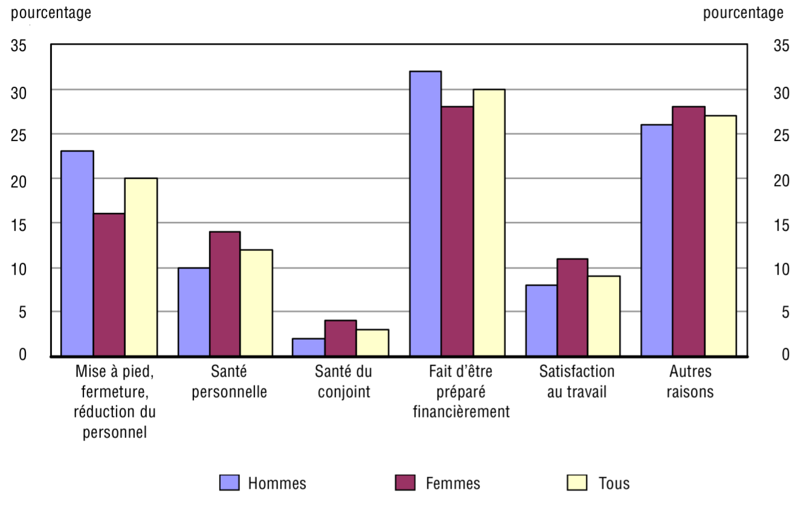
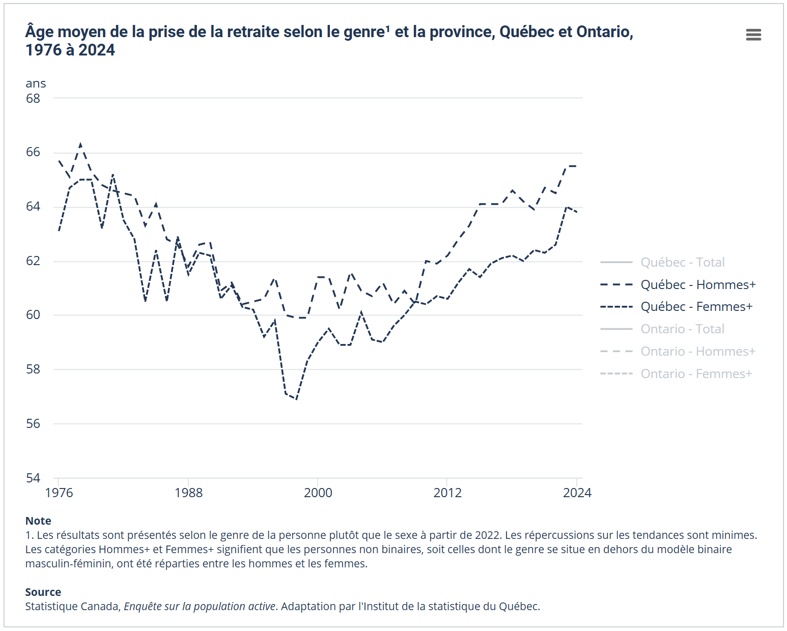
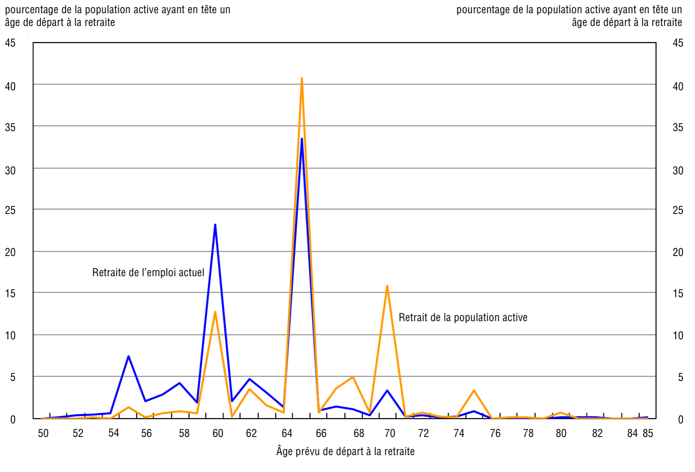
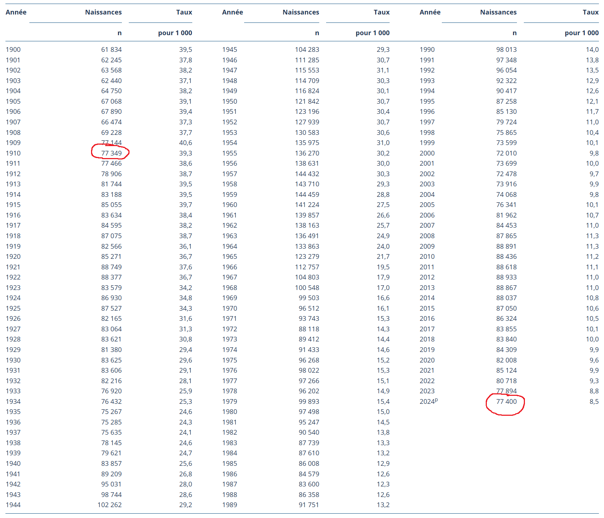
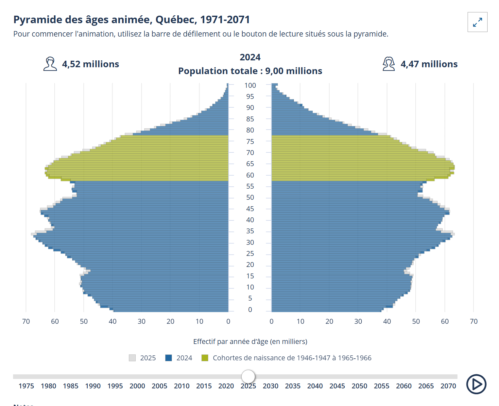
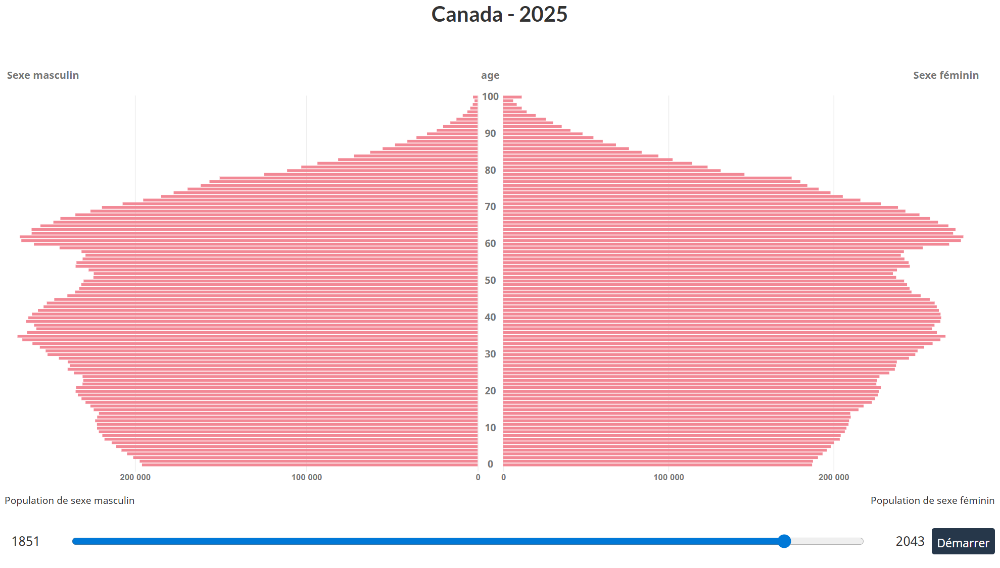
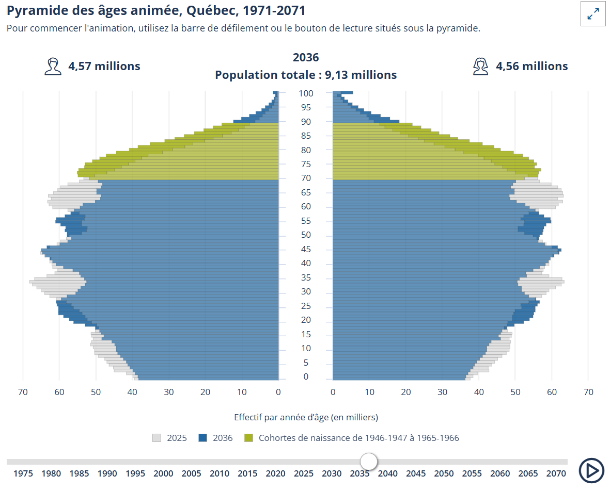
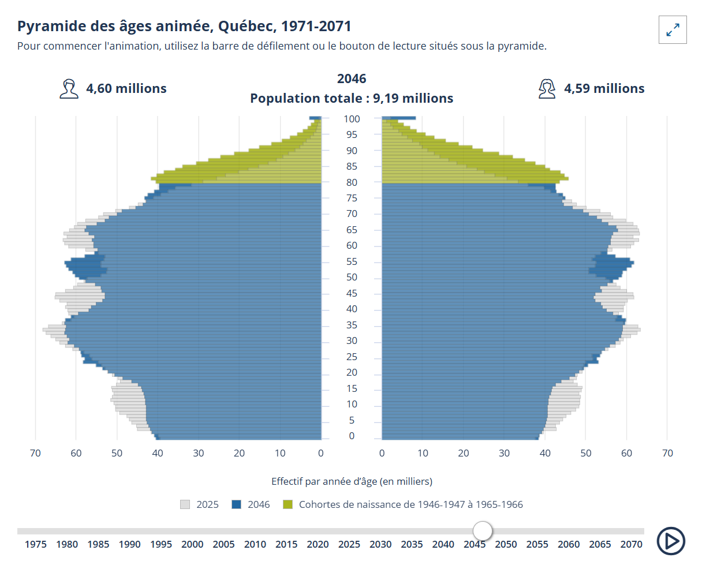

# Notions de base en régime de retraite

::: {.act-objectifs}

<div class="act-objectifs-titre">Objectifs du chapitre</div>

- Comprendre la notion de retraite et les principales sources de revenu à la retraite;
- Expliquer la notion de remplacement du revenu et les facteurs qui déterminent le niveau de vie à la retraite;
- Distinguer les principaux programmes publics, régimes collectifs et mécanismes d'épargne individuelle;
- Identifier les risques de longévité, d'inflation et de départ à la retraite;
- Interpréter les conséquences du vieillissement démographique sur le financement des retraites;
- Décrire les principales interventions des actuaires dans ce domaine.

:::

## Introduction

La retraite constitue une étape importante du cycle de vie économique d’un individu. Elle correspond au moment où le revenu d’emploi cesse d’être la principale source de subsistance et doit être remplacé par des revenus provenant de différentes sources. Dans la plupart des pays, dont le Canada, le revenu de retraite repose sur une combinaison de régimes publics, d’épargne individuelle et de régimes offerts par les employeurs. Ces différentes composantes forment un système complexe dont l’objectif est d’assurer un niveau de vie adéquat après la vie active. Parmi ces sources, les régimes complémentaires de retraite jouent un rôle particulier, puisqu’ils traduisent un arrangement entre l’employeur et l’employé quant au financement de la retraite. Leur conception peut varier de façon importante, notamment selon que le régime promet un revenu déterminé ou qu’il repose sur l’accumulation d’une épargne. 

Dans ce chapitre, nous présentons les sources de revenu à la retraite, quelques calculs simples de remplacement du revenu et les principaux risques associés à cette période de la vie. Nous examinons ensuite les enjeux démographiques et le rôle des actuaires. Le fonctionnement détaillé des régimes à prestations déterminées, à cotisations déterminées et des formules mixtes sera abordé dans les chapitres suivants.

## La notion de retraite

<div style="
float:right;
display:inline-block;
margin:0 0 1em 1em;
text-align:center;
border:0.5px solid #bbb;
padding:6px;
background:white;
box-shadow:0 3px 10px rgba(0,0,0,0.15);
max-width:220px;
">


<div style="font-size:0.85em; margin-top:0.4em; color:#555;">
Carey Price, ancien gardien du Canadien de Montréal, illustre le retrait de la compétition professionnelle
</div>

</div>

La retraite désigne la transition vers une période où le revenu d'emploi cesse d'être la principale source de subsistance. Elle peut être complète ou progressive : une personne peut percevoir une rente tout en conservant une activité professionnelle. Ses revenus proviennent alors de différentes sources, dont les programmes publics, les régimes d'employeur et l'épargne accumulée.  

Afin de présenter les principales sources de revenu à la retraite, il est utile de replacer d’abord la retraite dans son contexte économique. Lorsqu’une personne cesse de travailler, elle a besoin de revenus afin de subvenir à ses dépenses pendant toute la période où elle ne participe plus à la population active. Dans les pays développés, ces revenus proviennent généralement de plusieurs sources complémentaires. Dans la littérature actuarielle et économique, on distingue souvent trois grandes composantes du système de retraite, parfois appelées les trois piliers du financement de la retraite :

- les régimes publics mis en place par l’État, qui fournissent un revenu de base aux personnes âgées au moyen de régimes universels, d’allocations ou de programmes d’aide;
- les régimes de retraite offerts par les employeurs ou par des associations de travailleurs, qui permettent d’accumuler des droits à une rente pendant la vie active;
- l’épargne individuelle, qui regroupe les sommes accumulées par les individus eux-mêmes au moyen de différents instruments d’épargne ou d’investissement.

Dans la plupart des pays, les systèmes de retraite reposent sur une combinaison de ces différentes sources de revenus. Chaque composante joue un rôle distinct : les régimes publics visent généralement à assurer un revenu minimal, les régimes d’employeur permettent de maintenir une partie du niveau de vie acquis pendant la carrière, et l’épargne personnelle complète ces revenus selon la capacité d’épargne de chacun.

<div style="clear: both;"></div>

### Le moment de la retraite

Le moment où une personne prend sa retraite dépend de plusieurs facteurs, dont ses ressources financières, son état de santé, ses préférences personnelles et les règles des régimes de retraite auxquels elle participe. Bien que l’étude commence à dater — et qu’il ne semble pas exister d’enquête plus récente de même nature — Statistique Canada a identifié plusieurs raisons expliquant la prise de la retraite dans son *Enquête sur les travailleurs âgés de 2008* (voir la [source](https://www150.statcan.gc.ca/n1/fr/pub/89-646-x/89-646-x2010001-fra.pdf)).

{width=50% fig-align="center"}

Plus concrètement, la retraite survient généralement lorsqu’une personne :

- atteint un âge prédéterminé (par exemple 65 ans) ;
- satisfait un critère combinant l’âge et les années de service auprès de son employeur ;
- se considère trop âgée pour continuer à travailler ;
- ou a accumulé suffisamment d’épargne pour ne plus avoir besoin de travailler.

Dans la pratique, la décision de prendre sa retraite résulte souvent d’une combinaison de facteurs.  Certaines personnes prennent toutefois leur retraite plus tôt. Dans ce cas, l’absence temporaire de prestations publiques doit souvent être compensée par d’autres sources de revenus, comme :

- l’épargne personnelle ;
- une prestation de raccordement versée par un régime de retraite privé jusqu’à l’âge de 65 ans.

La retraite peut également être totale ou progressive. Dans le cas d’une retraite progressive, la personne réduit graduellement son volume de travail et son salaire. La baisse de revenu est alors compensée en partie par l’épargne personnelle ou par des prestations de retraite progressive offertes par certains régimes privés.

### Âge moyen à la retraite

Les deux tableaux suivants proviennent de données de Statistique Canada et présentent l’âge de la retraite au Canada selon la catégorie de travailleur.

Source : [Statistique Canada](https://www150.statcan.gc.ca/t1/tbl1/fr/tv.action?pid=1410006001), *Âge de la retraite selon la catégorie de travailleur, données annuelles*, tableau 14-10-0060-01.  

::: {.encadre}

```{r}
#| code-fold: true
#| echo: false
#| message: false
#| warning: false
#| fig-height: 4.8
#| fig-width: 9
#| fig-align: center

library(dplyr)
library(kableExtra)
library(tibble)

tab_moyen <- tibble(
  `Catégorie de travailleur` = c(
    "Total des retraités",
    "Employés du secteur public",
    "Employés du secteur privé",
    "Travailleurs autonomes"
  ),
  `2021` = c(64.3, 62.5, 64.4, 67.1),
  `2022` = c(64.7, 62.9, 64.9, 68.0),
  `2023` = c(65.1, 63.2, 65.3, 68.0),
  `2024` = c(65.3, 63.8, 65.1, 67.9),
  `2025` = c(65.4, 62.6, 66.0, 68.4)
)

tab_moyen %>%
  mutate(across(`2021`:`2025`, ~ format(round(.x,1), decimal.mark=","))) %>%
  kbl(
    align = c("l","c","c","c","c","c"),
    caption = "Âge moyen de la retraite selon la catégorie de travailleur, Canada"
  ) %>%
  kable_styling(
    bootstrap_options = c("striped","hover","condensed"),
    full_width = FALSE,
    position = "center"
  )


tab_median <- tibble(
  `Catégorie de travailleur` = c(
    "Total des retraités",
    "Employés du secteur public",
    "Employés du secteur privé",
    "Travailleurs autonomes"
  ),
  `2021` = c(64.4, 61.8, 64.7, 65.7),
  `2022` = c(64.8, 61.8, 64.9, 67.8),
  `2023` = c(64.9, 63.0, 65.1, 67.8),
  `2024` = c(65.1, 64.1, 65.1, 66.7),
  `2025` = c(65.3, 61.8, 65.4, 67.4)
)

tab_median %>%
  mutate(across(`2021`:`2025`, ~ format(round(.x,1), decimal.mark=","))) %>%
  kbl(
    align = c("l","c","c","c","c","c"),
    caption = "Âge médian de la retraite selon la catégorie de travailleur, Canada"
  ) %>%
  kable_styling(
    bootstrap_options = c("striped","hover","condensed"),
    full_width = FALSE,
    position = "center"
  )


```
:::

Les tableaux montrent que l’âge de la retraite au Canada se situe généralement autour de 65 ans. On observe également que les travailleurs autonomes prennent leur retraite plus tard que les employés, leur âge moyen de retraite se situant autour de 68 ans. À l’inverse, les employés du secteur public partent en moyenne plus tôt que ceux du secteur privé, ce qui peut s’expliquer en partie par l’existence de régimes de retraite plus structurés dans ce secteur.  Enfin, les données suggèrent une légère tendance à la hausse de l’âge de la retraite au cours des dernières années, particulièrement chez les employés du secteur privé et chez les travailleurs autonomes.

### La retraite et l’espérance de vie

La question de la retraite est étroitement liée à celle de l’espérance de vie. La durée de versement des prestations dépend de la mortalité **après l'âge de la retraite**, et non de l'espérance de vie à la naissance. Selon la table canadienne de mortalité de 2017 à 2019 reproduite plus loin, l'espérance de vie *résiduelle* à 65 ans est d'environ 19,5 ans pour les hommes et 22,2 ans pour les femmes. Il s'agit de moyennes de période; une proportion importante des personnes vivra plus longtemps que ces durées. Cette évolution soulève un enjeu important pour les systèmes de retraite. Si les retraités vivent plus longtemps, plusieurs ajustements deviennent possibles :

- repousser l’âge de la retraite ;
- réduire le montant des prestations ;
- augmenter le financement des régimes de retraite ;
- ou adopter une combinaison de ces différentes mesures.

Il n’existe pas de réponse unique à ces questions. Les choix dépendent à la fois de considérations économiques, démographiques et politiques. Comprendre ces enjeux et analyser leurs conséquences financières fait précisément partie du rôle des actuaires. Ce sont donc en grande partie les actuaires de demain — peut-être certains d’entre vous — qui devront contribuer à évaluer ces options et à proposer des solutions viables pour les systèmes de retraite.

### Objectif de remplacement du revenu à la retraite

Un enjeu central en matière de retraite consiste à déterminer de quel revenu une personne aura besoin pour maintenir raisonnablement son niveau de vie après la fin de sa vie active. Lorsqu’une personne prend sa retraite, certaines dépenses reliées à l’emploi disparaissent. En contrepartie, plusieurs dépenses courantes demeurent : logement, nourriture, soins de santé, transport personnel et loisirs. Le revenu nécessaire à la retraite est donc généralement inférieur au revenu d’emploi, mais il doit tout de même permettre de couvrir ces dépenses pendant une période parfois très longue.

Parmi les dépenses qui disparaissent généralement à la retraite, on peut notamment mentionner :

- le transport entre la résidence et le lieu de travail (transport en commun, automobile, essence, stationnement, etc.);
- certains repas pris à l’extérieur de la résidence;
- certains vêtements requis pour respecter le code vestimentaire de l’employeur;
- les contributions aux programmes sociaux liés au revenu d’emploi (Régime de rentes du Québec ou Régime de pensions du Canada, assurance emploi, assurance parentale);
- les cotisations aux régimes de retraite et aux régimes d’avantages sociaux de l’employeur.

Comme ces dépenses ne donnent habituellement pas droit à une aide fiscale (déduction ou crédit d’impôt), elles sont généralement payées à partir d’un revenu déjà imposé. La structure progressive de l’impôt sur le revenu — où les taux d’imposition augmentent avec le niveau de revenu — a alors un effet important. Une personne qui dispose d’un revenu plus faible à la retraite peut se retrouver dans une tranche d’imposition inférieure à celle qui s’appliquait pendant sa vie active.  Ainsi, même si le revenu brut diminue à la retraite, le revenu net disponible peut diminuer dans une proportion moindre. 

#### **Calcul approximatif de l'impôt** {-}

Pour comparer le salaire et le revenu à la retraite, il ne suffit pas d'appliquer un taux fixe d'impôt au revenu brut. Au fédéral comme au Québec, **l'impôt est progressif** : chaque taux marginal s'applique uniquement à la tranche de revenu correspondante. Une diminution du revenu imposable ne produit donc pas nécessairement une diminution proportionnelle de l'impôt.

La distinction entre **revenu brut**, **revenu imposable** et **revenu disponible** est essentielle :

- Le *revenu brut* est la rémunération ou la rente reçue avant retenues.
- Le *revenu imposable* sert de base au calcul de l'impôt, après les déductions applicables. Il ne s'agit pas d'une dépense supplémentaire à soustraire du revenu brut.
- Le *revenu résiduel disponible* correspond, dans nos exemples, au revenu brut diminué de l'épargne-retraite, des impôts, des cotisations sociales, de l'assurance et des dépenses propres au travail. Il s'agit d'un indicateur simplifié du budget de consommation, et non du « revenu disponible » au sens statistique de Statistique Canada.

**Le calcul fiscal utilisé dans ce chapitre se fait en trois étapes.** D'abord, nous appliquons les tranches fédérales et québécoises de 2026 ainsi que les montants personnels de base. Ensuite, pour un salarié, nous déduisons les cotisations supplémentaires au RRQ du revenu imposable et prenons en compte certains crédits fédéraux liés au travail et aux cotisations. Au Québec, nous appliquons également la déduction pour travailleur. Enfin, pour un retraité d'au moins 65 ans recevant une rente admissible, nous ajoutons les crédits fédéraux et québécois pour revenus de pension et ceux liés à l'âge, lorsqu'ils sont encore applicables.

Les [tables d'Ernst & Young pour 2026](https://www.ey.com/content/dam/ey-unified-site/ey-com/en-ca/services/tax/tax-calculators/2026/ey-tax-rates-quebec-2026-01-15-v1.pdf) fournissent un point de départ commode : elles intègrent les montants personnels de base et l'abattement fédéral du Québec de 16,5 %, mais **pas les autres crédits**. Pour un résident du Québec, les revenus imposables fédéral et provincial peuvent aussi différer; nous les calculons séparément pour les salariés.

::: {.callout-note collapse="true"}
## Quels éléments fiscaux sont inclus dans notre approximation?

**Pour le salarié**, nous retenons la déduction des cotisations d'épargne-retraite (hypothèse de 9 % du salaire), les déductions liées aux cotisations supplémentaires au RRQ, la déduction québécoise pour travailleur, le crédit fédéral sur la portion de base du RRQ ainsi que sur les cotisations à l'AE et au RQAP, et le montant canadien pour emploi.

**Pour le retraité**, nous supposons une personne âgée d'au moins 65 ans qui reçoit **une rente imposable admissible aux crédits pour revenus de pension**, sans autres sources de revenus. Nous appliquons le crédit fédéral en raison de l'âge, le crédit fédéral pour revenu de pension et les crédits québécois correspondants, après leur réduction selon le revenu. **Les prestations du RRQ et de la Sécurité de la vieillesse ne sont pas, à elles seules, admissibles aux crédits pour revenus de pension.** La composition réelle du revenu à la retraite changerait donc les résultats.

Le modèle ne tient pas compte des situations conjugales, du fractionnement du revenu de pension, des crédits pour personne vivant seule, des avantages imposables offerts par un employeur, des frais médicaux, du Supplément de revenu garanti, de la récupération de la Sécurité de la vieillesse ni de toutes les particularités d'une déclaration fiscale. Les montants présentés sont des **estimations pédagogiques arrondies**, non des calculs de retenues à la source ou des conseils fiscaux.

Références complémentaires : [Agence du revenu du Canada — barèmes 2026](https://www.canada.ca/fr/agence-revenu/services/impot/particuliers/taux-imposition-tranches-revenu/annee-en-cours.html), [Revenu Québec — barèmes 2026](https://www.revenuquebec.ca/fr/citoyens/declaration-de-revenus/produire-votre-declaration-de-revenus/taux-dimposition/), [Revenu Québec — paramètres pour employeurs 2026](https://www.revenuquebec.ca/fr/entreprises/retenues-a-la-source-et-cotisations-de-lemployeur/employeur-principaux-changements-2026/) et [Chaire de recherche en fiscalité et en finances publiques — crédits pour revenus de pension](https://cffp.recherche.usherbrooke.ca/outils-ressources/guide-mesures-fiscales/credit-revenu-pension-credit-revenus-retraite/).
:::

Le code R ci-dessous détaille l'application du **barème de base d'EY**. Il est volontairement consultable dans la version HTML. Les autres déductions et crédits sont calculés, plus bas, dans les fonctions servant aux exemples de revenu avant et après la retraite.

```{r}
#| code-fold: true
#| code-summary: "Voir le code R : barèmes fiscaux de base de 2026"
#| echo: true
#| message: false
#| warning: false

library(dplyr)
library(tidyr)
library(ggplot2)
library(kableExtra)

# EY : revenu imposable fédéral et revenu imposable québécois.
# Montants personnels de base déjà inclus; crédit supplémentaire NON inclus.
# L'impôt fédéral est déjà net de l'abattement québécois de 16,5 %.
impot_barreme_ey_2026 <- function(revenu_federal, revenu_quebec = revenu_federal) {
  stopifnot(length(revenu_federal) == 1, length(revenu_quebec) == 1,
            is.finite(revenu_federal), is.finite(revenu_quebec),
            revenu_federal >= 0, revenu_quebec >= 0)

  f <- revenu_federal
  q <- revenu_quebec
  impot_federal <- if (f <= 16452) {
    0
  } else if (f <= 58523) {
    0.1169 * (f - 16452)
  } else if (f <= 117045) {
    4918 + 0.1712 * (f - 58523)
  } else if (f <= 181440) {
    14936 + 0.2171 * (f - 117045)
  } else if (f <= 258482) {
    28916 + 0.2446 * (f - 181440)
  } else {
    47761 + 0.2756 * (f - 258482)
  }

  impot_quebec <- if (q <= 18952) {
    0
  } else if (q <= 54345) {
    0.14 * (q - 18952)
  } else if (q <= 108680) {
    4955 + 0.19 * (q - 54345)
  } else if (q <= 132245) {
    15279 + 0.24 * (q - 108680)
  } else {
    20934 + 0.2575 * (q - 132245)
  }

  c(federal = max(0, impot_federal),
    quebec = max(0, impot_quebec))
}
```

La figure montre seulement l'**impôt calculé à partir des barèmes de base** pour un même revenu imposable au fédéral et au Québec. Elle ne représente donc pas l'impôt définitif d'un salarié ou d'un retraité.

```{r}
#| code-fold: true
#| echo: false
#| message: false
#| warning: false
#| fig-height: 4.8
#| fig-width: 9
#| fig-align: center
#| fig-cap: "Impôt calculé selon les barèmes de base de 2026, avant crédits particuliers"
#| label: fig-impot_par_revenu

impot_points <- lapply(seq(20000, 200000, by = 1000), function(y) {
  imp <- impot_barreme_ey_2026(y)
  data.frame(revenu = y, Canada = unname(imp["federal"]),
             Québec = unname(imp["quebec"]), Total = sum(imp))
}) %>% bind_rows() %>%
  pivot_longer(cols = c(Canada, Québec, Total),
               names_to = "type", values_to = "impot")

ggplot(impot_points, aes(revenu, impot, color = type)) +
  geom_line(linewidth = 1.1) +
  scale_color_manual(values = c("Québec" = "blue", "Canada" = "red", "Total" = "black")) +
  labs(x = "Revenu imposable (identique dans les deux juridictions)",
       y = "Impôt avant crédits particuliers", color = NULL) +
  theme_bw()
```

### Exemples numériques concrets

Nous comparons deux travailleurs québécois dont les salaires bruts annuels sont de **120 000 $** et de **60 000 $**. L'objectif n'est pas de prévoir leur pension future : il s'agit de trouver, *à règles fiscales et prix de 2026 constants*, la rente annuelle qui laisse un budget de consommation comparable à celui dont ils disposent en travaillant.

Pour isoler le mécanisme, nous supposons la même situation fiscale simplifiée dans les deux exemples, des revenus d'emploi et de retraite entièrement imposables, et aucun autre revenu ni prestation publique. Les montants des programmes sociaux reposent sur les barèmes 2026, tandis que les hypothèses d'épargne et de dépenses sont choisies uniquement pour l'exercice.

| Hypothèse ou paramètre | Valeur retenue |
|:--|--:|
| Épargne-retraite du salarié, déductible | 9 % du salaire |
| RRQ — gains cotisables | De 3 500 $ à 74 600 $, puis jusqu'à 85 000 $ |
| RRQ — cotisation salariale sur la première tranche | 5,30 % (régime de base) + 1,00 % (première cotisation supplémentaire) |
| RRQ — deuxième cotisation supplémentaire | 4,00 % entre 74 600 $ et 85 000 $ |
| AE au Québec | 1,30 % du salaire, jusqu'à 68 900 $ |
| RQAP | 0,430 % du salaire, jusqu'à 103 000 $ |
| Assurance collective au travail (hypothèse) | 800 $ + 2 % du salaire |
| Dépenses liées au travail (hypothèse) | 7 % du salaire |
| Prime annuelle du régime public d'assurance médicaments à la retraite (hypothèse) | 750 $ |

Les taux de cotisation sont tirés de [Retraite Québec](https://www.retraitequebec.gouv.qc.ca/fr/professionnels-et-employeurs/role-employeur-et-regime-rentes-quebec/cotisations-regime-rentes-quebec), de [Service Canada](https://www.canada.ca/fr/emploi-developpement-social/programmes/assurance-emploi/ae-liste/assurance-emploi-employeurs/reduction-taux-cotisation/maximum-remuneration-assurable-2026.html) et de [Revenu Québec](https://www.revenuquebec.ca/fr/entreprises/retenues-a-la-source-et-cotisations-de-lemployeur/calcul-des-retenues-et-des-cotisations/cotisations-au-rqap/maximum-de-revenus-assurables-et-taux-de-cotisation/). La [RAMQ](https://www.ramq.gouv.qc.ca/fr/citoyens/assurance-medicaments/tarifs-vigueur) indique que la prime annuelle réelle peut varier de **0 $ à 789 $** pour la période du 1er juillet 2026 au 30 juin 2027; le montant de 750 $ est donc une simple convention pour faciliter les comparaisons. Les franchises et les montants payés à la pharmacie ne sont pas inclus.

**Calcul du revenu disponible.** Pour un salaire brut annuel $S$, nous posons $E=0,09S$ pour l'épargne-retraite, $C$ pour la somme des cotisations au RRQ, à l'AE et au RQAP, $A=800+0,02S$ pour l'assurance collective et $D=0,07S$ pour les dépenses de travail. Si $I_{\mathrm{actif}}$ représente l'impôt estimé, alors :

$$
B_{\mathrm{actif}}=S-E-C-I_{\mathrm{actif}}-A-D.
$$

À la retraite, nous supposons que la personne reçoit une rente annuelle imposable $R$ et qu'elle n'a ni revenu d'emploi, ni nouvelle épargne-retraite, ni dépenses directement liées au travail. Si $I_{\mathrm{retraité}}(R)$ est son impôt estimé, son budget résiduel devient :

$$
B_{\mathrm{retraité}}(R)=R-I_{\mathrm{retraité}}(R)-750.
$$

Nous cherchons la rente $R$ qui vérifie $B_{\mathrm{retraité}}(R)=B_{\mathrm{actif}}$. Le **taux de remplacement du salaire brut** est alors $R/S$. Il s'agit d'une égalisation de budgets simplifiés, *pas* du taux de remplacement garanti par un régime de retraite.

::: {.callout-note}
**Lecture des tableaux :** les lignes « revenu imposable fédéral » et « revenu imposable québécois » servent uniquement à expliquer les calculs fiscaux. Elles **ne sont ni ajoutées ni retranchées** une deuxième fois lors du calcul du revenu résiduel disponible.
:::

Le code qui suit détaille les cotisations, les déductions, les crédits retenus et la recherche numérique de la rente équivalente. Il demeure accessible dans le HTML grâce au repli du bloc de code.

```{r}
#| code-fold: true
#| code-summary: "Voir le code R : cotisations, impôts et calcul de la rente équivalente"
#| echo: true
#| message: false
#| warning: false

library(dplyr)
library(tibble)
library(knitr)
library(kableExtra)

parametres_2026 <- list(
  exemption_rrq = 3500, MGA = 74600, MSGA = 85000,
  taux_rrq_base = 0.053, taux_rrq1 = 0.01, taux_rrq2 = 0.04,
  taux_ae = 0.013, max_ae = 68900,
  taux_rqap = 0.00430, max_rqap = 103000,
  taux_epargne = 0.09,
  assurance_fixe = 800, assurance_taux = 0.02,
  taux_depenses_travail = 0.07, prime_medicaments = 750,
  deduction_travail_qc = 1450, montant_emploi_federal = 1501,
  taux_credit_federal_qc = 0.1169,
  montant_age_federal = 9208, seuil_age_federal = 46432,
  montant_pension_federal = 2000,
  montant_age_qc = 3986, montant_pension_qc = 3541,
  seuil_age_pension_qc = 42955
)

# Portion de base et portions supplémentaires du RRQ distinguées,
# car leurs traitements fiscaux diffèrent.
cotisations_sociales <- function(salaire, par = parametres_2026) {
  gains_rrq <- max(0, min(salaire, par$MGA) - par$exemption_rrq)
  gains_rrq2 <- max(0, min(salaire, par$MSGA) - par$MGA)
  c(rrq_base = gains_rrq * par$taux_rrq_base,
    rrq_sup1 = gains_rrq * par$taux_rrq1,
    rrq_sup2 = gains_rrq2 * par$taux_rrq2,
    ae = min(salaire, par$max_ae) * par$taux_ae,
    rqap = min(salaire, par$max_rqap) * par$taux_rqap)
}

impot_salarie_2026 <- function(salaire, par = parametres_2026) {
  cot <- cotisations_sociales(salaire, par)
  epargne <- salaire * par$taux_epargne
  ded_rrq <- unname(cot["rrq_sup1"] + cot["rrq_sup2"])
  ded_travail <- min(0.06 * salaire, par$deduction_travail_qc)
  imposable_f <- salaire - epargne - ded_rrq
  imposable_q <- imposable_f - ded_travail

  bareme <- impot_barreme_ey_2026(imposable_f, imposable_q)
  # Crédit fédéral sur RRQ de base, AE, RQAP et emploi.
  montant_credits <- unname(cot["rrq_base"] + cot["ae"] + cot["rqap"]) +
    min(salaire, par$montant_emploi_federal)
  credit_f <- par$taux_credit_federal_qc * montant_credits
  federal <- max(0, unname(bareme["federal"]) - credit_f)
  quebec <- unname(bareme["quebec"])

  list(impot_federal = federal, impot_quebec = quebec,
       impot_total = federal + quebec,
       revenu_imposable_federal = imposable_f,
       revenu_imposable_quebec = imposable_q,
       deduction_rrq = ded_rrq, deduction_travail = ded_travail,
       credit_federal = credit_f, cotisations = cot)
}

# Retraité de 65 ans ou plus, rente d'employeur admissible au crédit de
# pension, sans autres revenus ni crédits liés à la situation familiale.
impot_retraite_2026 <- function(rente, par = parametres_2026) {
  bareme <- impot_barreme_ey_2026(rente, rente)

  base_age_f <- max(0, par$montant_age_federal -
                      0.15 * max(0, rente - par$seuil_age_federal))
  credit_age_f <- par$taux_credit_federal_qc * base_age_f
  credit_pension_f <- par$taux_credit_federal_qc *
    min(rente, par$montant_pension_federal)

  # Au Québec, les montants pour âge et pension sont réduits ensemble.
  base_age_pension_q <- max(0, par$montant_age_qc +
                              min(rente, par$montant_pension_qc) -
                              0.1875 * max(0, rente - par$seuil_age_pension_qc))
  credit_age_pension_q <- 0.14 * base_age_pension_q

  federal <- max(0, unname(bareme["federal"]) -
                   credit_age_f - credit_pension_f)
  quebec <- max(0, unname(bareme["quebec"]) - credit_age_pension_q)
  list(impot_federal = federal, impot_quebec = quebec,
       impot_total = federal + quebec,
       revenu_imposable_federal = rente, revenu_imposable_quebec = rente,
       credit_age_federal = credit_age_f,
       credit_pension_federal = credit_pension_f,
       credit_age_pension_quebec = credit_age_pension_q)
}

calcul_actif_2026 <- function(salaire, par = parametres_2026) {
  res <- impot_salarie_2026(salaire, par)
  cot <- res$cotisations
  epargne <- salaire * par$taux_epargne
  assurance <- par$assurance_fixe + par$assurance_taux * salaire
  depenses <- par$taux_depenses_travail * salaire
  disponible <- salaire - epargne - res$impot_total -
    sum(cot) - assurance - depenses
  tibble(
    element = c("Salaire brut annuel", "Épargne-retraite déductible (9 %)",
      "Revenu imposable fédéral (calcul seulement)",
      "Revenu imposable Québec (calcul seulement)",
      "Impôt fédéral et québécois estimé", "Cotisations au RRQ",
      "Cotisations à l'assurance-emploi (AE)", "Cotisations au RQAP",
      "Cotisations à l'assurance collective",
      "Dépenses supplémentaires liées au travail",
      "Revenu résiduel disponible"),
    montant = c(salaire, -epargne,
      res$revenu_imposable_federal, res$revenu_imposable_quebec,
      -res$impot_total, -sum(cot[c("rrq_base", "rrq_sup1", "rrq_sup2")]),
      -cot["ae"], -cot["rqap"], -assurance, -depenses, disponible)
  )
}

calcul_retraite_2026 <- function(rente, par = parametres_2026) {
  res <- impot_retraite_2026(rente, par)
  disponible <- rente - res$impot_total - par$prime_medicaments
  tibble(
    element = c("Revenu annuel de rente imposable", "Épargne-retraite",
      "Revenu imposable fédéral (calcul seulement)",
      "Revenu imposable Québec (calcul seulement)",
      "Impôt fédéral et québécois estimé", "Cotisations au RRQ",
      "Cotisations à l'assurance-emploi (AE)", "Cotisations au RQAP",
      "Prime d'assurance médicaments (hypothèse)",
      "Dépenses supplémentaires liées au travail",
      "Revenu résiduel disponible"),
    montant = c(rente, 0, rente, rente, -res$impot_total,
                0, 0, 0, -par$prime_medicaments, 0, disponible)
  )
}

revenu_disponible <- function(tab) {
  as.numeric(tail(tab$montant, 1))
}

rente_equivalente_2026 <- function(salaire, par = parametres_2026) {
  budget_cible <- revenu_disponible(calcul_actif_2026(salaire, par))
  f <- function(rente) {
    revenu_disponible(calcul_retraite_2026(rente, par)) - budget_cible
  }
  uniroot(f, lower = 0, upper = max(1000000, salaire * 3))$root
}

afficher_decomposition <- function(tab, titre) {
  monnaie <- function(x) {
    txt <- format(round(abs(x)), big.mark = " ", scientific = FALSE,
                  trim = TRUE)
    ifelse(x < 0,
           cell_spec(paste0("(", txt, " $)"), color = "red"),
           paste0(txt, " $"))
  }
  tab %>%
    mutate(Montant = monnaie(montant)) %>%
    select(`Élément` = element, Montant) %>%
    kbl(caption = titre, escape = FALSE, align = c("l", "r"),
        booktabs = TRUE) %>%
    kable_styling(
      bootstrap_options = c("striped", "hover", "condensed"),
      full_width = FALSE, position = "center"
    ) %>%
    row_spec(c(1, 11), bold = TRUE)
}

salaires_exemples <- c(120000, 60000)
rentes_exemples <- vapply(salaires_exemples, rente_equivalente_2026, numeric(1))
```

#### **Premier exemple** {-}

Un travailleur gagne **120 000 $** par année. Il verse 10 800 $ à l'épargne-retraite (9 % de son salaire). En 2026, ses cotisations salariales au RRQ comprennent :

$$
(74\,600-3\,500)\times 6,30\% + (85\,000-74\,600)\times 4\%
= 4\,895,30\ \$.
$$

Les cotisations à l'AE et au RQAP totalisent respectivement 895,70 $ et 442,90 $. Sur le plan fiscal, la première cotisation supplémentaire au RRQ (711 $) et la deuxième (416 $) sont déductibles, tout comme les 10 800 $ d'épargne-retraite. La déduction québécoise pour travailleur est plafonnée à 1 450 $. Cela donne :

$$
\begin{aligned}
\text{Revenu imposable fédéral} &= 120\,000-10\,800-711-416=108\,073\ \$,\\
\text{Revenu imposable Québec} &=108\,073-1\,450=106\,623\ \$.
\end{aligned}
$$

Les barèmes de 2026, diminués des crédits fédéraux usuels liés aux cotisations et au revenu d'emploi, produisent un impôt total d'environ **`r format(round(impot_salarie_2026(120000)$impot_total), big.mark=" ", trim=TRUE)` $**. Le tableau présente ensuite les sorties de fonds et le budget résiduel.

::: {.encadre}

```{r}
#| code-fold: true
#| echo: false
#| message: false
#| warning: false

afficher_decomposition(
  calcul_actif_2026(120000),
  "Décomposition du revenu et des dépenses — Avant la retraite (120 000 $)"
)
```

:::

À la retraite, nous recherchons une rente imposable admissible aux crédits pour revenus de pension, reçue à 65 ans ou plus. Les cotisations au RRQ, à l'AE et au RQAP ne s'appliquent pas à ce **revenu de rente**, et l'épargne-retraite ainsi que les dépenses professionnelles sont supposées nulles. Une prime annuelle de 750 $ pour les médicaments remplace ici la contribution à l'assurance collective. Les règles fiscales demeurent celles de 2026 pour permettre la comparaison.

::: {.encadre}

```{r}
#| code-fold: true
#| echo: false
#| message: false
#| warning: false

afficher_decomposition(
  calcul_retraite_2026(rentes_exemples[1]),
  "Décomposition du revenu et des dépenses — À la retraite (120 000 $ avant retraite)"
)
```

:::

Le budget résiduel estimé pendant la vie active est d'environ **`r format(round(revenu_disponible(calcul_actif_2026(120000))), big.mark=" ", trim=TRUE)` $**. La rente nécessaire pour reproduire ce montant est d'environ **`r format(round(rentes_exemples[1]), big.mark=" ", trim=TRUE)` $**, ce qui correspond à un **taux de remplacement du salaire brut de `r sprintf("%.1f", 100*rentes_exemples[1]/120000)` %**.

#### **Deuxième exemple** {-}

Considérons maintenant un travailleur qui gagne **60 000 $**. Nous conservons exactement les mêmes hypothèses : épargne-retraite de 9 %, assurances et dépenses liées au travail calculées selon les mêmes formules, ainsi que les cotisations sociales de 2026.

Son épargne-retraite est de 5 400 $, ses cotisations au RRQ totalisent 3 559,50 $ et ses cotisations à l'AE et au RQAP sont respectivement de 780 $ et 258 $. Seule la première cotisation supplémentaire au RRQ (565 $) s'applique. Les revenus imposables simplifiés deviennent donc :

$$
\begin{aligned}
\text{Revenu imposable fédéral} &= 60\,000-5\,400-565=54\,035\ \$,\\
\text{Revenu imposable Québec} &=54\,035-1\,450=52\,585\ \$.
\end{aligned}
$$

Après les crédits retenus dans notre modèle, l'impôt combiné est estimé à environ **`r format(round(impot_salarie_2026(60000)$impot_total), big.mark=" ", trim=TRUE)` $**.

::: {.encadre}

```{r}
#| code-fold: true
#| echo: false
#| message: false
#| warning: false

afficher_decomposition(
  calcul_actif_2026(60000),
  "Décomposition du revenu et des dépenses — Avant la retraite (60 000 $)"
)
```

:::

Nous cherchons ensuite la rente qui reproduit le même budget résiduel, en prenant en compte l'impôt applicable à la rente de pension ainsi que l'hypothèse de prime d'assurance médicaments.

::: {.encadre}

```{r}
#| code-fold: true
#| echo: false
#| message: false
#| warning: false

afficher_decomposition(
  calcul_retraite_2026(rentes_exemples[2]),
  "Décomposition du revenu et des dépenses — À la retraite (60 000 $ avant retraite)"
)
```

:::

Le budget résiduel pendant la vie active est d'environ **`r format(round(revenu_disponible(calcul_actif_2026(60000))), big.mark=" ", trim=TRUE)` $**. La rente correspondante est d'environ **`r format(round(rentes_exemples[2]), big.mark=" ", trim=TRUE)` $**, soit un taux de remplacement d'environ **`r sprintf("%.1f", 100*rentes_exemples[2]/60000)` %**.

#### **Interprétation des exemples** {-}

Dans les deux situations, la rente nécessaire est inférieure au salaire brut. Cela s'explique principalement par la disparition de l'épargne-retraite, des cotisations sociales sur le salaire et des dépenses directement liées à l'emploi; l'impôt est également recalculé selon la nature et le niveau du revenu. **Le taux de remplacement n'est donc pas une propriété universelle du système de retraite.** Il dépend des hypothèses de dépenses, de fiscalité et de composition des revenus.

La figure suivante prolonge exactement le même calcul pour des salaires de 40 000 $ à 200 000 $. Les points rouges correspondent aux deux exemples précédents.

```{r}
#| code-fold: true
#| echo: false
#| message: false
#| warning: false
#| fig-height: 4.8
#| fig-width: 9
#| fig-align: center
#| fig-cap: "Taux de remplacement du salaire brut nécessaire pour reproduire le budget résiduel, selon les hypothèses de 2026"
#| label: fig-tauxderemp_par_revenu

library(ggplot2)
library(scales)

bd_remplacement <- tibble(revenu = seq(40000, 200000, by = 1000)) %>%
  mutate(
    rente = vapply(revenu, rente_equivalente_2026, numeric(1)),
    pct = rente / revenu
  )
pts <- bd_remplacement %>% filter(revenu %in% c(60000, 120000))

ggplot(bd_remplacement, aes(x = revenu, y = pct)) +
  geom_line(linewidth = 1.2, color = "blue") +
  geom_point(data = pts, color = "red", size = 3) +
  scale_x_continuous(labels = label_number(suffix = " $", big.mark = " ")) +
  scale_y_continuous(labels = percent_format(accuracy = 1)) +
  labs(x = "Salaire brut annuel", y = "Taux de remplacement du salaire brut") +
  theme_bw()
```

La courbe peut présenter des changements de pente aux seuils des tranches d'impôt ou des cotisations. Elle dépend également de l'assurance collective hypothétique, du taux d'épargne et de la prime de médicaments retenue. Les pourcentages ne doivent donc pas être interprétés comme des recommandations individuelles ni comme des prestations promises par les régimes publics. Pour une planification réelle, il faudrait notamment distinguer les rentes du RRQ, la Sécurité de la vieillesse, les rentes d'employeur et les retraits d'épargne; chacune de ces sources peut avoir un traitement fiscal distinct.

## Les composantes du revenu à la retraite

Une personne qui cesse de travailler continue d’encourir des dépenses pour son logement, sa nourriture, ses soins, ses vêtements, ses déplacements et ses loisirs. Elle a donc besoin de revenus afin de pouvoir subvenir à ses dépenses. Dans les pays développés, ces revenus proviennent généralement de trois sources :

- Les régimes d’État
  - régimes publics de retraite
  - allocations universelles
  - aide sociale
- Les régimes de retraite collectifs privés, mis sur pied par des employeurs ou des associations de travailleurs
- Les épargnes personnelles

Dans certaines situations, nous verrons que ces sources de revenus peuvent être capitalisées ou non capitalisées. On dit qu’un régime de retraite est capitalisé lorsque les cotisations versées par les participants et les employeurs sont accumulées dans un fonds et investies afin de financer les prestations futures. Les rentes sont alors payées à partir de ce capital accumulé et des revenus de placement qu’il génère. À l’inverse, dans un régime non capitalisé (ou financé par répartition), les cotisations des travailleurs actifs servent principalement à payer les prestations des retraités actuels. Il n’existe donc pas nécessairement de fonds important accumulé pour financer les prestations futures.

Dans tous les cas, il convient maintenant de présenter brièvement chacune de ces trois sources.

### Programmes d’État  

#### **Régimes publics de retraite** 

Les programmes d’État des pays occidentaux comprennent généralement un régime public de retraite accessible à une grande partie de la population active (le type de personnes couvertes varie toutefois d’un pays à l’autre). Ces régimes font partie des programmes d’assurance sociale, car ils possèdent plusieurs caractéristiques distinctives :

- transfert d’un risque — ici le risque de vivre au-delà de ses épargnes — vers un organisme public ou supervisé par l’État;
- régime établi par une loi;
- participation généralement obligatoire pour les travailleurs visés;
- cotisations versées par les travailleurs, par les employeurs ou par les deux;
- financement reposant soit sur un système de répartition (les cotisations courantes financent les prestations), soit sur un fonds partiellement capitalisé, soit sur une combinaison des deux.

Les régimes varient considérablement d’un pays à l’autre. Dans tous les cas, ils constituent toutefois un régime de base visant à remplacer une partie relativement modeste des revenus antérieurs à la retraite. À titre d’illustration, on peut examiner quelques exemples internationaux.

::: {#exm-retraite-france .custom}
**France**

<div style="
float:right;
width:28vw;
max-width:420px;
min-width:240px;
margin:0 0 1em 1em;
text-align:center;
">

<div style="font-size:0.85em; margin-top:0.3em;">
</div>
</div>

Le système de retraite français repose sur plusieurs régimes publics obligatoires. Le principal est le régime de base de l’assurance vieillesse, auquel s’ajoutent des régimes complémentaires obligatoires pour la plupart des travailleurs salariés.

Dans le régime de base, la pension à taux plein correspond généralement à 50 % d'un salaire annuel moyen calculé selon les règles du régime général, notamment à partir des 25 meilleures années, dans la limite des plafonds applicables. L'âge légal de départ dépend de l'année de naissance. Selon les règles en vigueur à compter du 1er septembre 2026, il est par exemple de 62 ans et 9 mois pour la génération 1964, de 63 ans et 6 mois pour celle de 1967 et de 64 ans pour les personnes nées à partir de 1969. La durée d'assurance requise pour une pension sans décote varie elle aussi selon la génération; le taux plein automatique peut notamment être obtenu à 67 ans. La réforme de 2023 a fait l'objet d'une suspension partielle jusqu'en 2028, ce qui explique les ajustements récents. Les salariés cotisent aussi à des régimes complémentaires obligatoires, notamment AGIRC-ARRCO, qui fonctionnent par points.

[Âges légaux en vigueur (Service Public)](https://www.service-public.gouv.fr/particuliers/vosdroits/F14043)

[Source](https://www.service-public.gouv.fr/particuliers/vosdroits/F36464)

<div style="clear: both;"></div>
:::


::: {#exm-uk .custom}
**Royaume-Uni**

<div style="
float:right;
width:28vw;
max-width:420px;
min-width:240px;
margin:0 0 1em 1em;
text-align:center;
">

<div style="font-size:0.85em; margin-top:0.3em;">
</div>
</div>

La pension publique britannique (*New State Pension*) est une prestation liée à l'historique de cotisations au système de *National Insurance*. Le taux hebdomadaire complet est de 241,30 £ en 2026-2027, soit environ 12 548 £ par année. Une carrière comportant généralement 35 années admissibles peut donner droit au taux complet, mais les règles transitoires peuvent conduire à des résultats différents. Le montant effectivement versé dépend du dossier de l'assuré.

L'âge d'admissibilité à la pension publique dépend de la date de naissance et augmente progressivement. Il est de 66 ans pour une partie des cohortes actuelles, avec un relèvement programmé à 67 ans, puis à 68 ans selon le calendrier législatif. Il ne faut pas confondre cet âge avec l'âge auquel un salarié choisit de cesser de travailler.

[Source](https://www.gov.uk/new-state-pension)
<div style="clear: both;"></div>
:::

::: {#exm-us .custom}
**États-Unis**

<div style="
float:right;
width:28vw;
max-width:420px;
min-width:240px;
margin:0 0 1em 1em;
text-align:center;
">

<div style="font-size:0.85em; margin-top:0.3em;">
</div>
</div>

Le programme *Social Security* verse une pension calculée à partir des gains de carrière indexés du travailleur. Le montant de la prestation est déterminé selon une formule progressive appliquée au revenu mensuel moyen indexé. De façon simplifiée, la pension correspond à la somme de :

- 90 % des premiers niveaux de revenu;
- 32 % des niveaux intermédiaires;
- 15 % des niveaux supérieurs.

Ces pourcentages s’appliquent à des seuils appelés bend points, qui sont ajustés périodiquement. Les gains des 35 années les plus favorables entrent généralement dans le calcul du salaire mensuel moyen indexé servant à établir la pension. L’âge normal de la retraite (Full Retirement Age) varie entre 66 ans pour les personnes nées entre 1943 et 1954, et 67 ans pour celles nées à partir de 1960.

[Source](https://www.ssa.gov/OACT/COLA/piaformula.html) 
<div style="clear: both;"></div>
:::


::: {#exm-retraite-canada .custom}
**Canada**

<div style="
float:right;
width:28vw;
max-width:420px;
min-width:240px;
margin:0 0 1em 1em;
text-align:center;
">

<div style="font-size:0.85em; margin-top:0.3em;">
</div>
</div>

Au Canada, les Régimes de rentes du Québec (RRQ) et de pensions du Canada (RPC) constituent les principaux régimes publics contributifs de retraite. Ils couvrent la majorité des travailleurs et sont financés par des cotisations versées par les employés et les employeurs. Les prestations sont calculées en fonction des gains admissibles au cours de la carrière, jusqu’à un plafond annuel appelé maximum des gains admissibles (MGA). Traditionnellement, ces régimes visaient à remplacer environ 25 % du revenu moyen gagné au cours de la carrière, jusqu’à ce plafond.

Depuis une réforme entrée en vigueur en 2019, le taux de remplacement est graduellement augmenté pour atteindre environ 33 % des gains admissibles, et le plafond des gains couverts par le régime est également relevé. L’âge normal de versement est de 65 ans. La rente du RRQ peut être demandée dès 60 ans, avec réduction, ou reportée pour obtenir une majoration jusqu’à 72 ans. Pour le RPC, la majoration liée au report cesse à 70 ans.

Les détails du calcul exact de ces prestations seront étudiés dans un prochain chapitre.

<div style="clear: both;"></div>
:::


#### **Allocations universelles** 

Une allocation universelle est une prestation versée par l’État à une large partie de la population âgée, indépendamment de ses revenus de carrière. L’admissibilité repose principalement sur des critères démographiques, comme l’âge et la durée de résidence dans le pays. Ces programmes possèdent généralement les caractéristiques suivantes :

- prestation monétaire versée périodiquement;
- admissibilité basée principalement sur des critères démographiques (âge, résidence, etc.);
- régime établi par une loi;
- financement provenant des fonds généraux du gouvernement plutôt que de cotisations spécifiques.

Au Canada, la Pension de la sécurité de la vieillesse (PSV) constitue une prestation publique largement accessible en fonction notamment de l’âge et de la durée de résidence, indépendamment des cotisations de carrière. Elle est toutefois soumise à une récupération fiscale lorsque le revenu dépasse certains seuils. Elle ne constitue donc pas une prestation identique pour toutes les personnes âgées, quel que soit leur revenu.  

#### **Aide sociale** 

Lorsque les régimes de sécurité sociale et les allocations universelles ne suffisent pas à assurer un revenu minimal aux personnes âgées, les gouvernements peuvent offrir des programmes d’aide sociale.  Contrairement aux allocations universelles, ces programmes sont destinés uniquement aux personnes dont les revenus ou le patrimoine sont jugés insuffisants. L’accès aux prestations est donc généralement conditionnel à une évaluation des ressources du demandeur.  Ces programmes présentent généralement les caractéristiques suivantes :

- prestation monétaire (ou parfois prestation en nature);
- destinée aux personnes à faible revenu;
- accès conditionnel à une évaluation des revenus ou du patrimoine;
- régime établi par une loi;
- financement provenant des fonds généraux du gouvernement.

Au Canada, le Supplément de revenu garanti (SRG) et l’Allocation au conjoint constituent des programmes de ce type. Ils sont administrés par le gouvernement fédéral conjointement avec la Pension de sécurité de la vieillesse.

### Régimes de retraite collectifs privés

Dans une économie mixte, les programmes publics ne visent généralement pas à remplacer la totalité du salaire d'une personne. La proportion remplacée varie fortement selon la carrière, le niveau de revenu et l'âge de début des prestations. Les régimes d'employeur et l'épargne individuelle servent donc notamment à combler deux écarts :

- la différence entre les prestations publiques effectivement reçues et le revenu que la personne souhaite conserver;
- le remplacement d’une partie du revenu qui excède le niveau couvert par les régimes publics.

Les régimes de retraite collectifs privés servent à combler ces écarts, soit en permettant d’accumuler un capital qui servira à financer la retraite (régimes à cotisations déterminées), soit en promettant, selon la formule du régime, une prestation déterminée à l’avance (régimes à prestations déterminées). Cette dernière est souvent une rente calculée en fonction du salaire et du service reconnu, mais d’autres formules existent.  Nous détaillerons les différences entre ces deux types de régimes dans les chapitres suivants.

- **Point de vue de l’État**

  Dans plusieurs pays, dont le Canada, l’État permet aux employeurs de mettre sur pied des régimes de retraite bénéficiant d’un traitement fiscal avantageux. Une partie du salaire des employés peut ainsi être versée dans un régime de retraite, et l’impôt sur ces sommes est différé jusqu’au moment où elles sont retirées, généralement à la retraite. Du point de vue de l’État, un régime de retraite constitue donc un mécanisme fiscal permettant à l’employé :

  - de payer l’impôt plus tard, soit au moment de la retraite;
  - de payer éventuellement cet impôt à un taux plus faible si son revenu est moindre à la retraite;
  - d’accumuler des revenus de placement à l’abri de l’impôt pendant la période d’épargne.

  L’État y trouve également plusieurs avantages :

  - les sommes retirées du régime seront imposées dans le futur;
  - les retraités disposant d’une rente privée sont moins susceptibles d’avoir recours à l’aide sociale;
  - les retraités disposant d’un revenu plus élevé consomment davantage, ce qui augmente les recettes fiscales (notamment les taxes de vente).

- **Point de vue des employeurs**

  Avant les réformes des pensions mises en œuvre entre le milieu des années 1980 et le début des années 1990, les régimes de retraite servaient souvent à retenir les employés. Les travailleurs qui quittaient leur emploi avant d’avoir atteint un certain âge ou un certain nombre d’années de participation pouvaient perdre une partie importante des avantages accumulés. Le régime de retraite était alors perçu comme un moyen de récompenser de longues années de service et de favoriser la fidélité des employés.

  Les règles d'acquisition des droits et de financement ont changé avec les réformes législatives. Elles varient selon la province et le type de régime; au Québec, l'acquisition des droits des participants est généralement immédiate. Dans plusieurs contextes, des exigences minimales s'appliquent aussi aux contributions des employeurs, mais il serait inexact de résumer toutes les lois canadiennes par une obligation identique de prise en charge de 50 % du coût. Les régimes de retraite sont donc aujourd’hui souvent considérés comme une forme de salaire différé. Pour les employeurs, ces régimes présentent plusieurs avantages :

  - ils permettent d’offrir une rémunération globale plus compétitive;
  - ils facilitent le recrutement et la rétention de travailleurs qualifiés;
  - ils contribuent à projeter une image positive de l’employeur.

- **Point de vue des employés**

  Pour de nombreux employés, l’un des principaux défis consiste à arbitrer entre l’épargne et les dépenses courantes. Le revenu de travail doit notamment servir à payer le logement, le transport, la nourriture, les vêtements, les loisirs, etc. Après ces dépenses, il reste parfois peu de place pour l’épargne, surtout lorsque la personne doit rembourser des dettes ou assumer des dépenses fixes importantes.

  Un régime de retraite constitue alors une forme d’épargne forcée. Les cotisations de l’employeur ne peuvent pas être retirées par l’employé et, lorsque l’employé cotise lui-même au régime, ces sommes ne peuvent généralement pas être retirées avant la retraite. Les cotisations étant souvent prélevées directement sur le salaire, l’employé s’habitue progressivement à vivre avec un revenu disponible plus faible. Les principaux avantages d’un régime de retraite pour un employé sont les suivants :

  - il constitue une forme d’épargne automatique;
  - il permet de reporter l’impôt sur les sommes cotisées;
  - il est financé en partie par l’employeur;
  - il permet d'accumuler des droits à une rente ou un capital; la stabilité du revenu éventuel dépend toutefois du type de régime;
  - les fonds sont généralement détenus en fiducie et protégés contre les créanciers de l’employeur;
  - dans le cas des régimes à prestations déterminées, il permet d’obtenir une rente relativement prévisible;
  - dans le cas des régimes à cotisations déterminées, il donne accès à des instruments de placement souvent moins accessibles aux épargnants individuels.
  
  
### Épargnes personnelles

Les épargnes personnelles constituent la troisième composante du revenu à la retraite. 

Au Canada, selon les règles fiscales, elles prennent essentiellement trois formes :

- Des mécanismes formels d’accumulation assortis d’un report d’impôt. Dans ce cas, la somme cotisée est déduite du revenu imposable pour l’année de cotisation, mais les sommes retirées sont imposables dans l’année du retrait. On parle alors de placements enregistrés, comme les [régimes enregistrés d'épargne-retraite](https://www.canada.ca/fr/agence-revenu/services/impot/particuliers/sujets/reer-regimes-connexes/regime-enregistre-epargne-retraite-reer.html) (REER) au Canada. Les montants retirés sont imposés comme un revenu au moment du retrait. Les sommes accumulées dans un REER doivent être transformées, au plus tard à l’âge de 71 ans, en un mécanisme de décaissement dont les versements seront imposés, comme un fonds enregistré de revenu de retraite (FERR) ou une rente.

- Des mécanismes formels d’accumulation assortis d’avantages fiscaux, comme le [compte d’épargne libre d’impôt](https://www.canada.ca/fr/agence-revenu/services/impot/particuliers/sujets/compte-epargne-libre-impot.html) (CELI). Dans ce cas, les sommes investies ne donnent pas droit à une déduction fiscale, mais les revenus de placement et les retraits ne sont pas imposables.

- Des placements divers non enregistrés ne bénéficiant pas d’avantages fiscaux particuliers liés à l’épargne-retraite, tels que les immeubles, les comptes bancaires, les actions, les obligations ou les parts de fonds communs de placement. Les revenus de placement sont généralement imposés au fur et à mesure qu’ils sont gagnés, et les gains en capital sont imposés lorsqu’ils sont réalisés (la résidence principale étant généralement exonérée d’impôt sur les gains en capital).

Les épargnes personnelles jouent plusieurs rôles importants dans le financement de la retraite. 

- Elles peuvent servir à compléter les revenus provenant des régimes publics et des régimes de retraite d’employeur, mais aussi à financer certaines périodes particulières de la retraite. 

- L’épargne personnelle peut également jouer un rôle important dans le financement d’une retraite anticipée. Lorsqu’une personne prend sa retraite avant le moment où les prestations des régimes publics deviennent disponibles, il peut exister une période pendant laquelle ces revenus ne sont pas encore versés. Certains régimes de retraite d’employeur prévoient alors une rente dite de raccordement destinée à combler cet écart jusqu’au début des prestations publiques. En l’absence d’un tel mécanisme, l’épargne personnelle peut être utilisée pour financer la période comprise entre le début de la retraite et le moment où les prestations des régimes publics commencent à être versées.

### Combinaison des sources

Au final, le revenu de retraite provient généralement de la combinaison de plusieurs sources : les régimes publics, les régimes de retraite d’employeur et les épargnes personnelles. Une cible de remplacement du revenu brut de l'ordre de 60 % à 80 % est parfois utilisée comme repère de planification, mais elle ne constitue ni une garantie ni un besoin identique pour tous. Les exemples précédents montrent justement que la proportion pertinente dépend des dépenses, de l'épargne, de la fiscalité et de l'âge de retraite. Il faut aussi tenir compte des dates de début des prestations publiques : la Pension de la sécurité de la vieillesse est normalement accessible à partir de 65 ans, alors que les rentes du RRQ ou du RPC peuvent être demandées plus tôt avec réduction, ou plus tard avec bonification.

## Les risques reliés à la retraite

<div style="
float:right;
display:inline-block;
margin:0 0 1em 1em;
text-align:center;
border:0.5px solid #bbb;
padding:6px;
background:white;
box-shadow:0 3px 10px rgba(0,0,0,0.15);
max-width:330px;
">


<div style="font-size:0.85em; margin-top:0.4em; color:#555;">
</div>

</div>

Le travail de l’actuaire consiste essentiellement à analyser des situations où les résultats futurs sont incertains et où cette incertitude peut avoir des conséquences financières mesurables. Dans ce contexte, on parle de *risque* lorsqu’un événement futur incertain peut entraîner un gain ou une perte pour un individu, une entreprise ou une institution.  Deux caractéristiques sont généralement associées à un risque :

- l’événement concerné est aléatoire, c’est-à-dire que sa réalisation et son moment de survenance ne sont pas connus à l’avance ;
- cet événement peut être quantifié financièrement, ce qui permet d’en évaluer le coût attendu ou les conséquences économiques.

Par exemple, dans le domaine de l’assurance vie et des régimes de retraite, la durée de vie d’une personne est incertaine. On sait qu’un individu finira par décéder, mais on ne sait pas quand cet événement surviendra. Cette incertitude a une importance financière directe, car la durée de vie détermine notamment la période pendant laquelle une rente devra être versée. De la même manière, plusieurs variables économiques importantes pour les régimes de retraite sont incertaines. Les rendements des placements, l’inflation ou encore l’évolution des salaires futurs peuvent varier au fil du temps et influencer la capacité d’un régime de retraite à financer les prestations promises.

L’analyse actuarielle consiste précisément à modéliser ces incertitudes, à en mesurer l’impact financier et à concevoir des mécanismes permettant de gérer ou de transférer les risques associés. Plusieurs risques affectent ainsi directement les régimes de retraite, qu’ils soient individuels ou collectifs.


<div style="clear: both;"></div>

### Le risque de longévité

Le principal risque relié à la retraite est le *risque de longévité*. Il correspond au fait que la durée de vie d’un individu est incertaine et peut dépasser la période pendant laquelle ses ressources financières sont suffisantes pour soutenir son niveau de consommation. Ce risque découle directement de l’incertitude entourant la durée de vie humaine. Même si l’on peut estimer une espérance de vie à partir des tables de mortalité, la durée de vie réelle d’un individu peut être sensiblement plus courte ou plus longue que cette moyenne. Une personne a donc toujours une probabilité non négligeable de vivre plusieurs années au-delà de son espérance de vie.

Dans le contexte de la retraite, cette incertitude crée un problème financier important. Une personne qui finance sa retraite au moyen de son épargne doit déterminer combien retirer chaque année. Si les retraits sont trop élevés, l’épargne risque d’être épuisée avant la fin de la vie. À l’inverse, des retraits trop prudents peuvent réduire inutilement le niveau de vie pendant la retraite. Le risque de longévité correspond donc au risque d’épuiser ses ressources financières avant son décès. Ce risque est particulièrement difficile à gérer pour un individu seul, car il dépend d’un événement fondamentalement aléatoire : la durée de sa propre vie.

L’exemple suivant illustre concrètement ce problème.

::: {#exm-longévité-rente-certaine .custom}
Voici un exemple. Avec un taux d'intérêt annuel constant de 2 \%, sans frais et avec un capital de 1 000 000 \$ à 65 ans, une personne peut financer les rentes **certaines dues** suivantes (versements au début de chaque année) :

::: {.encadre}

```{r}
#| code-fold: true
#| echo: false
#| message: false
#| warning: false
#| fig-height: 4
#| fig-width: 9
#| fig-align: center

library(tibble)
library(dplyr)
library(kableExtra)

tab_rentes <- tibble(
  `Durée de la rente certaine due` = c(10, 15, 20, 25, 30, 35),
  `Montant annuel` = c(109144, 76299, 59958, 50216, 43774, 39218)
) %>%
  mutate(
    `Durée de la rente certaine due` = paste0(`Durée de la rente certaine due`, " ans"),
    `Montant annuel` = paste0(
      format(
        `Montant annuel`,
        big.mark = " ",
        decimal.mark = ",",
        scientific = FALSE
      ),
      " $"
    )
  )

tab_rentes %>%
  kbl(
    align = c("c", "c"),
    col.names = c("Durée", "Montant annuel de la rente")
  ) %>%
  kable_styling(
    bootstrap_options = c("striped", "hover", "condensed"),
    full_width = FALSE,
    position = "center"
  )
```
:::


Pour une rente certaine due versée sur $n$ années, le montant annuel $R$ se calcule en égalant la valeur actuelle des paiements au capital initial :

$$
1\,000\,000 = R\sum_{t=0}^{n-1}(1,02)^{-t},
\qquad
R=\frac{1\,000\,000}{\displaystyle\sum_{t=0}^{n-1}(1,02)^{-t}}.
$$

Les valeurs du tableau sont arrondies au dollar; elles ne comprennent pas de frais d'assurance ni de prestation conditionnelle à la survie.

Si la personne choisit une rente certaine due d’une durée de 10 ans, les versements cessent à l’âge de 75 ans. Si elle est encore en vie à ce moment, elle ne dispose plus de revenu provenant de cette rente. À l’inverse, une rente certaine due d’une durée de 35 ans procure un revenu annuel plus faible, soit 39\,218 \$, mais pendant une période beaucoup plus longue. Ce choix illustre la difficulté fondamentale du financement individuel de la retraite : la durée de vie est incertaine et une personne peut survivre à la période pendant laquelle ses ressources sont disponibles.

Une solution consiste à transférer ce risque à un assureur en achetant une rente viagère due, dont les paiements sont versés au début de chaque année tant que le rentier est vivant. Par exemple, à 65 ans, un capital de 1\,000\,000 \$ pourrait financer une rente viagère dont le montant dépend de la table de mortalité, du taux d'intérêt, des frais et des garanties contractuelles. Le montant ne peut pas être déduit de la seule durée moyenne de vie. Dans la pratique actuarielle canadienne, ces calculs reposent généralement sur les tables de mortalité de la série CPM publiées par l’Institut canadien des actuaires.

Le montant de la rente est déterminé de manière à ce que la valeur actuarielle des paiements corresponde au capital initial. Les décès précoces de certains rentiers contribuent, collectivement, au financement des versements effectués à ceux qui vivent plus longtemps. L'assureur mutualise ainsi les écarts entre durées de vie individuelles; le résultat financier global dépend aussi des rendements, des frais et des hypothèses de tarification. La rente viagère permet ainsi de garantir un revenu stable pendant toute la durée de la vie.

:::

En général, les individus ont une certaine aversion pour les risques qu’ils ne contrôlent pas. Ils sont donc souvent disposés à céder une partie de leur richesse afin de transférer ce risque à une entreprise ou à une institution spécialisée. Par exemple, certaines personnes accepteront d’échanger leur capital contre une rente viagère, même si des frais et des marges réduisent le montant annuel comparativement à un calcul théorique sans chargements, puisqu’elles obtiennent en contrepartie une protection contre le risque de manquer de revenus en cas de longue vie.

Le risque de longévité est particulièrement difficile à supporter pour un individu isolé, puisqu'une part importante des individus vivra au-delà de cette moyenne, même si cette proportion n'est pas nécessairement de 50 %. Il devient donc avantageux de transférer ce risque à une organisation capable de le mutualiser entre un grand nombre de personnes. C’est précisément le rôle des régimes de retraite, des compagnies d’assurance et, dans certains cas, de l’État. L’actuaire est le professionnel le mieux outillé pour analyser et gérer ce risque de longévité.


Le tableau suivant présente un extrait de la table complète de mortalité pour les hommes et les femmes au Canada, pour la période 2017 à 2019. Afin d’en faciliter la lecture, seules les observations par saut de 5 ans ont été conservées, ainsi que le nombre de survivants $l_x$ et l’espérance de vie résiduelle $e_x$.

Source : [Statistique Canada](https://www150.statcan.gc.ca/n1/pub/84-537-x/2020001/xls/2017-2019_Tbl-fra.xlsx)

::: {.encadre}
```{r}
#| code-fold: true
#| echo: false
#| message: false
#| warning: false
#| fig-height: 4
#| fig-width: 9
#| fig-align: center

library(tibble)
library(dplyr)
library(kableExtra)

tab_mortalite_comp <- tibble(
  age = c(0, 5, 10, 15, 20, 25, 30, 35, 40, 45, 50, 55, 60, 65, 70, 75,
          80, 85, 90, 95, 100, 105, 110),
  lx_h = c(100000, 99447, 99407, 99348, 99137, 98753, 98285, 97744,
           97136, 96354, 95252, 93614, 91135, 87364, 81640, 73087,
           60780, 44391, 25601, 9594, 1864, 159, 6),
  ex_h = c(80.0, 75.4, 70.5, 65.5, 60.6, 55.9, 51.1, 46.4,
           41.7, 37.0, 32.4, 27.9, 23.6, 19.5, 15.7, 12.2,
           9.1, 6.5, 4.5, 3.0, 2.2, 1.6, 1.4),
  lx_f = c(100000, 99530, 99493, 99445, 99331, 99158, 98949, 98691,
           98379, 97920, 97213, 96149, 94532, 92030, 88107, 81931,
           72329, 58025, 38773, 18226, 4799, 570, 27),
  ex_f = c(84.2, 79.6, 74.6, 69.6, 64.7, 59.8, 54.9, 50.1,
           45.2, 40.4, 35.7, 31.1, 26.6, 22.2, 18.1, 14.2,
           10.8, 7.8, 5.3, 3.6, 2.5, 1.8, 1.5)
) %>%
  mutate(
    `Âge` = ifelse(age == 110, "110 ans et plus", paste0(age, " ans")),
    `Survivants` = format(lx_h, big.mark = " ", decimal.mark = ","),
    `Espérance de vie` = format(ex_h, nsmall = 1, decimal.mark = ","),
    `Survivantes` = format(lx_f, big.mark = " ", decimal.mark = ","),
    `Espérance de vie ` = format(ex_f, nsmall = 1, decimal.mark = ",")
  ) %>%
  select(`Âge`, `Survivants`, `Espérance de vie`, `Survivantes`, `Espérance de vie `)

tab_mortalite_comp %>%
  kbl(
    align = c("c", "c", "c", "c", "c"),
    col.names = c("Âge", "l<sub>x</sub>", "e<sub>x</sub>", "l<sub>x</sub>", "e<sub>x</sub>"),
    escape = FALSE,
    caption = "Extrait des tables complètes de mortalité, Canada, 2017 à 2019"
  ) %>%
  add_header_above(c(" " = 1, "Hommes" = 2, "Femmes" = 2), escape = FALSE) %>%
  kable_styling(
    bootstrap_options = c("striped", "hover", "condensed"),
    full_width = FALSE,
    position = "center"
  )

```
:::

Les graphiques suivants illustrent les données du tableau.  Le premier présente l’espérance de vie restante selon l’âge pour les hommes et les femmes. Le second graphique montre l’âge actuel plus l’espérance de vie restante. Cette valeur correspond à l’âge moyen au décès conditionnel à avoir atteint l’âge $x$.

```{r}
#| code-fold: true
#| echo: false
#| message: false
#| warning: false
#| fig-height: 4
#| fig-width: 14
#| fig-align: center

library(tibble)
library(dplyr)
library(ggplot2)
library(tidyr)
library(patchwork)

tab_mortalite_comp <- tibble(
  age = c(0, 5, 10, 15, 20, 25, 30, 35, 40, 45, 50, 55, 60, 65, 70, 75,
          80, 85, 90, 95, 100, 105, 110),
  lx_h = c(100000, 99447, 99407, 99348, 99137, 98753, 98285, 97744,
           97136, 96354, 95252, 93614, 91135, 87364, 81640, 73087,
           60780, 44391, 25601, 9594, 1864, 159, 6),
  ex_h = c(80.0, 75.4, 70.5, 65.5, 60.6, 55.9, 51.1, 46.4,
           41.7, 37.0, 32.4, 27.9, 23.6, 19.5, 15.7, 12.2,
           9.1, 6.5, 4.5, 3.0, 2.2, 1.6, 1.4),
  lx_f = c(100000, 99530, 99493, 99445, 99331, 99158, 98949, 98691,
           98379, 97920, 97213, 96149, 94532, 92030, 88107, 81931,
           72329, 58025, 38773, 18226, 4799, 570, 27),
  ex_f = c(84.2, 79.6, 74.6, 69.6, 64.7, 59.8, 54.9, 50.1,
           45.2, 40.4, 35.7, 31.1, 26.6, 22.2, 18.1, 14.2,
           10.8, 7.8, 5.3, 3.6, 2.5, 1.8, 1.5)
)

df_plot <- tab_mortalite_comp %>%
  transmute(
    age,
    Hommes = ex_h,
    Femmes = ex_f,
    `Hommes (âge + e[x])` = age + ex_h,
    `Femmes (âge + e[x])` = age + ex_f
  )

df_ex <- df_plot %>%
  select(age, Hommes, Femmes) %>%
  pivot_longer(cols = -age, names_to = "sexe", values_to = "esperance_vie")

df_total <- df_plot %>%
  select(age, `Hommes (âge + e[x])`, `Femmes (âge + e[x])`) %>%
  pivot_longer(cols = -age, names_to = "sexe", values_to = "age_total") %>%
  mutate(
    sexe = recode(
      sexe,
      `Hommes (âge + e[x])` = "Hommes",
      `Femmes (âge + e[x])` = "Femmes"
    )
  )

p1 <- ggplot(df_ex, aes(x = age, y = esperance_vie, color = sexe)) +
  geom_line(linewidth = 1.1) +
  geom_point(size = 2) +
  labs(
    title = "Espérance de vie selon l'âge",
    x = "Âge",
    y = "Espérance de vie restante"
  ) +
  theme_bw() +
  theme(
    legend.title = element_blank(),
    plot.title = element_text(face = "bold")
  )

p2 <- ggplot(df_total, aes(x = age, y = age_total, color = sexe)) +
  geom_line(linewidth = 1.1) +
  geom_point(size = 2) +
  labs(
    title = "Âge actuel + espérance de vie",
    x = "Âge",
    y = "Âge atteint en moyenne"
  ) +
  theme_bw() +
  theme(
    legend.title = element_blank(),
    plot.title = element_text(face = "bold")
  )

library(patchwork)

p1 | p2

```

### Le risque d'inflation

Le risque d’inflation correspond au risque d’érosion du pouvoir d’achat de la monnaie : lorsque les prix augmentent, une même somme d’argent permet d’acheter moins de biens et de services. Ce risque est important en assurance et en finance, puisque plusieurs engagements financiers s’étendent sur de longues périodes. Au Canada, l’inflation est demeurée relativement faible pendant plusieurs années, ce qui pouvait donner l’impression que ce risque était limité. Pourtant, l’histoire montre que l’inflation peut varier fortement. Par exemple, dans les années 1970 et au début des années 1980, les taux d’inflation ont parfois dépassé 10 %. Plus récemment, après la pandémie de COVID-19, l’inflation a de nouveau augmenté rapidement entre 2021 et 2023, atteignant des niveaux qu’on n’avait plus observés depuis plusieurs décennies.

Le tableau suivant présente l’indice des prix à la consommation (IPC) pour le Canada. L’IPC est une mesure statistique qui suit l’évolution du prix moyen d’un ensemble de biens et de services consommés par les ménages (par exemple la nourriture, le logement, les vêtements et le transport). Il est couramment utilisé pour mesurer l’inflation. Les données proviennent du [site suivant](http://www.statsnwt.ca/TSR/series.php?seriesid=V41690973).

::: {.encadre}
```{r}
#| code-fold: true
#| echo: false
#| message: false
#| warning: false
#| fig-height: 4
#| fig-width: 14
#| fig-align: center

library(dplyr)
library(tidyr)
library(kableExtra)
library(stringr)

txt <- "
Year January February March April May June July August September October November December
1970 20.2 20.2 20.2 20.3 20.3 20.3 20.5 20.5 20.4 20.4 20.4 20.3
1971 20.4 20.5 20.5 20.7 20.7 20.8 21.0 21.2 21.1 21.2 21.2 21.3
1972 21.4 21.5 21.6 21.7 21.7 21.7 22.0 22.2 22.3 22.3 22.3 22.4
1973 22.6 22.8 22.8 23.1 23.2 23.4 23.7 24.0 24.1 24.2 24.4 24.5
1974 24.7 24.9 25.2 25.4 25.9 26.1 26.3 26.6 26.8 27.1 27.3 27.6
1975 27.6 27.9 28.0 28.2 28.5 28.8 29.2 29.5 29.6 29.8 30.1 30.2
1976 30.3 30.5 30.6 30.7 30.9 31.1 31.3 31.3 31.5 31.7 31.8 31.9
1977 32.2 32.4 32.8 33.0 33.4 33.5 33.9 33.9 34.2 34.5 34.7 34.9
1978 35.1 35.4 35.7 35.8 36.3 36.6 37.1 37.2 37.1 37.6 37.8 37.9
1979 38.1 38.6 39.0 39.3 39.7 39.9 40.2 40.3 40.7 41.0 41.4 41.6
1980 41.8 42.3 42.6 42.9 43.4 43.9 44.2 44.7 45.0 45.4 46.0 46.2
1981 46.9 47.4 48.0 48.3 48.7 49.5 49.9 50.3 50.7 51.2 51.6 51.8
1982 52.2 52.8 53.5 53.8 54.5 55.1 55.4 55.6 55.9 56.3 56.6 56.6
1983 56.5 56.8 57.4 57.4 57.5 58.1 58.4 58.7 58.7 59.1 59.1 59.2
1984 59.6 59.9 60.0 60.2 60.2 60.6 60.8 60.8 60.9 61.1 61.4 61.4
1985 61.7 62.1 62.2 62.5 62.7 63.0 63.3 63.3 63.4 63.6 63.8 64.1
1986 64.4 64.7 64.9 64.9 65.3 65.4 65.9 66.0 66.0 66.4 66.7 66.8
1987 67.0 67.3 67.5 67.9 68.3 68.5 68.9 69.0 69.0 69.2 69.5 69.6
1988 69.7 70.0 70.4 70.6 71.0 71.2 71.6 71.7 71.8 72.2 72.3 72.3
1989 72.7 73.2 73.6 73.8 74.6 74.9 75.4 75.5 75.6 75.9 76.1 76.1
1990 76.7 77.2 77.5 77.5 77.9 78.2 78.5 78.6 78.8 79.5 80.0 79.9
1991 82.0 82.0 82.3 82.3 82.7 83.1 83.2 83.3 83.1 83.0 83.3 82.9
1992 83.3 83.3 83.6 83.7 83.8 84.0 84.2 84.2 84.2 84.3 84.7 84.7
1993 85.0 85.3 85.2 85.2 85.4 85.4 85.6 85.7 85.7 85.9 86.3 86.1
1994 86.1 85.4 85.4 85.4 85.2 85.4 85.7 85.8 85.9 85.7 86.2 86.3
1995 86.6 87.0 87.2 87.5 87.7 87.7 87.9 87.7 87.8 87.7 88.0 87.8
1996 88.0 88.1 88.5 88.7 89.0 89.0 89.0 89.0 89.1 89.3 89.7 89.7
1997 89.9 90.1 90.2 90.2 90.3 90.5 90.5 90.6 90.6 90.6 90.5 90.4
1998 90.9 91.0 91.1 91.0 91.3 91.4 91.4 91.4 91.2 91.6 91.6 91.3
1999 91.5 91.6 92.0 92.5 92.7 92.9 93.1 93.3 93.6 93.7 93.6 93.7
2000 93.5 94.1 94.8 94.5 94.9 95.5 95.8 95.7 96.1 96.3 96.6 96.7
2001 96.3 96.8 97.1 97.8 98.6 98.7 98.4 98.4 98.6 98.1 97.2 97.4
2002 97.6 98.2 98.9 99.5 99.7 99.9 100.5 100.9 100.9 101.2 101.5 101.1
2003 102.0 102.8 103.1 102.4 102.5 102.5 102.6 102.9 103.1 102.8 103.1 103.2
2004 103.3 103.5 103.9 104.1 105.0 105.1 105.0 104.8 105.0 105.2 105.6 105.4
2005 105.3 105.7 106.3 106.6 106.7 106.9 107.1 107.5 108.4 107.9 107.7 107.6
2006 108.2 108.0 108.6 109.2 109.7 109.5 109.6 109.8 109.2 109.0 109.2 109.4
2007 109.4 110.2 111.1 111.6 112.1 111.9 112.0 111.7 111.9 111.6 111.9 112.0
2008 111.8 112.2 112.6 113.5 114.6 115.4 115.8 115.6 115.7 114.5 114.1 113.3
2009 113.0 113.8 114.0 113.9 114.7 115.1 114.7 114.7 114.7 114.6 115.2 114.8
2010 115.1 115.6 115.6 116.0 116.3 116.2 116.8 116.7 116.9 117.4 117.5 117.5
2011 117.8 118.1 119.4 119.8 120.6 119.8 120.0 120.3 120.6 120.8 120.9 120.2
2012 120.7 121.2 121.7 122.2 122.1 121.6 121.5 121.8 122.0 122.2 121.9 121.2
2013 121.3 122.7 122.9 122.7 123.0 123.0 123.1 123.1 123.3 123.0 123.0 122.7
2014 123.1 124.1 124.8 125.2 125.8 125.9 125.7 125.7 125.8 125.9 125.4 124.5
2015 124.3 125.4 126.3 126.2 126.9 127.2 127.3 127.3 127.1 127.2 127.1 126.5
2016 126.8 127.1 127.9 128.3 128.8 129.1 128.9 128.7 128.8 129.1 128.6 128.4
2017 129.5 129.7 129.9 130.4 130.5 130.4 130.4 130.5 130.8 130.9 131.3 130.8
2018 131.7 132.5 132.9 133.3 133.4 133.6 134.3 134.2 133.7 134.1 133.5 133.4
2019 133.6 134.5 135.4 136.0 136.6 136.3 137.0 136.8 136.2 136.6 136.4 136.4
2020 136.8 137.4 136.6 135.7 136.1 137.2 137.2 137.0 136.9 137.5 137.7 137.4
2021 138.2 138.9 139.6 140.3 141.0 141.4 142.3 142.6 142.9 143.9 144.2 144.0
2022 145.3 146.8 148.9 149.8 151.9 152.9 153.1 152.6 152.7 153.8 154.0 153.1
2023 153.9 154.5 155.3 156.4 157.0 157.2 158.1 158.7 158.5 158.6 158.8 158.3
2024 158.3 158.8 159.8 160.6 161.5 161.4 162.1 161.8 161.1 161.8 161.8 161.2
2025 161.3 163.0 163.5 163.4 164.3 164.4 164.9 164.8 164.9 165.3 165.4 165.0
2026 165.0 XXX XXX XXX XXX XXX XXX XXX XXX XXX XXX XXX
"

df <- read.table(text = txt, header = TRUE, check.names = FALSE)

df_jan <- df %>%
  transmute(
    annee = Year,
    ipc = January,
    decennie = paste0(floor(annee / 10) * 10, "s")
  ) %>%
  filter(annee >= 1970)

ordre_decennies <- unique(df_jan$decennie)

n_max <- df_jan %>%
  count(decennie) %>%
  summarise(max_n = max(n)) %>%
  pull(max_n)

liste_blocs <- lapply(ordre_decennies, function(d) {
  x <- df_jan %>%
    filter(decennie == d) %>%
    mutate(
      rang = row_number(),
      ipc = format(ipc, nsmall = 1, decimal.mark = ",")
    ) %>%
    select(rang, annee, ipc)

  tibble(rang = 1:n_max) %>%
    left_join(x, by = "rang") %>%
    transmute(
      !!paste0(d, "_annee") := ifelse(is.na(annee), "", annee),
      !!paste0(d, "_ipc")   := ifelse(is.na(ipc), "", ipc)
    )
})

tab_decennies <- bind_cols(liste_blocs)

header_top <- setNames(rep(2, length(ordre_decennies)), ordre_decennies)

tab_decennies %>%
  kbl(
    align = rep("c", ncol(tab_decennies)),
    col.names = rep(c("Année", "IPC"), length(ordre_decennies))
  ) %>%
  add_header_above(header_top) %>%
  kable_styling(
    bootstrap_options = c("striped", "hover", "condensed"),
    full_width = FALSE,
    position = "center"
  )
```
:::

Le graphique suivant présente l’évolution des taux d’inflation annuels au Canada à partir de l’indice des prix à la consommation (IPC),

```{r}
#| code-fold: true
#| echo: false
#| message: false
#| warning: false
#| fig-height: 4
#| fig-width: 14
#| fig-align: center

library(dplyr)
library(ggplot2)

df_inflation <- df_jan %>%
  arrange(annee) %>%
  mutate(
    inflation_pct = 100 * (ipc / lag(ipc) - 1)
  ) %>%
  filter(annee >= 1970)

ggplot(df_inflation, aes(x = annee, y = inflation_pct)) +
  geom_hline(yintercept = 0, linewidth = 0.5, linetype = "dashed", colour = "grey50") +
  geom_hline(yintercept = 2, linewidth = 0.5, linetype = "dashed", colour = "red") +
  geom_line(linewidth = 1, color = "blue") +
  geom_point(size = 2, color = "blue") +
  scale_x_continuous(breaks = seq(1970, max(df_inflation$annee), by = 5)) +
  scale_y_continuous(
    breaks = seq(0,12,by = 2)
  ) +
  labs(
    x = "Année",
    y = "Inflation annuelle (%)"
  ) +
  theme_bw()

```

Selon ce tableau, un retraité qui dispose d’un revenu fixe de 3000\$ par mois en 1999 voit progressivement son pouvoir d’achat diminuer avec l’inflation. En dollars constants de 1999, ce revenu ne vaut plus que 2229,89\$ après 15 ans, soit à 80 ans (en 2014), s’il a pris sa retraite à 65 ans. À 90 ans, en 2024, son pouvoir d’achat tombe à 1733,92\$. On peut aussi voir ce phénomène du point de vue des prix. Par exemple, un loyer de 600\$ par mois en 1999 correspondrait à 807,21\$ en 2014 et à 1038,03\$ en 2024, alors que le revenu mensuel du retraité demeure de 3000\$. L’inflation réduit donc progressivement ce que ce revenu permet réellement d’acheter.

L'inflation dépend de plusieurs facteurs, dont la demande, les coûts de production, les conditions monétaires et les chocs d'offre. Des hausses de salaires peuvent parfois contribuer à sa persistance si elles sont répercutées dans les prix, mais une telle dynamique n'est ni automatique ni la seule explication de l'inflation.

Au Canada, la politique monétaire vise à maintenir l’inflation à un niveau modéré. La Banque du Canada cherche généralement à maintenir le taux d’inflation dans une fourchette cible de 1\% à 3\% par année. Il est possible de se protéger partiellement contre l’inflation grâce à des rentes indexées, dont les paiements augmentent avec le temps. Toutefois, cette protection a un coût. Dans un contexte de taux d’intérêt faibles, l’indexation peut être coûteuse, car elle réduit une grande partie de l’effet de l’intérêt composé utilisé pour financer les paiements futurs.

### Le risque de retraite

Bien que la retraite soit un phénomène souvent contrôlé par le (futur) rentier, la date de la prise de la retraite comporte son lot d’incertitudes.  Sur le site de [Statistique Québec](https://statistique.quebec.ca/vitrine/vieillissement/themes/travail-retraite/age-prise-retraite), on peut aussi trouver un graphique montrant l'évolution de l'âge de retraite au Québec. 

{width=50% fig-align="center"}


On observe d’abord une baisse marquée entre la fin des années 1970 et la fin des années 1990. Durant cette période, l’âge moyen de la retraite recule sensiblement, avant de remonter durant les décennies suivantes. Cette lecture reste tributaire des définitions et des périodes retenues dans la série représentée. À partir du début des années 2000, la tendance s’inverse. L’âge moyen de la retraite augmente progressivement pour atteindre environ $65$ ans chez les hommes et environ $64$ ans chez les femmes en 2024. On remarque également que l’écart entre les hommes et les femmes diminue avec le temps. Alors que les femmes prenaient nettement leur retraite plus tôt dans les années 1990, les âges de retraite des deux groupes sont aujourd’hui beaucoup plus rapprochés.

Ce graphique illustre le fait que les individus ne prennent pas tous leur retraite au même âge. Certains quittent le marché du travail avant 60 ans, tandis que d’autres poursuivent leur activité au-delà de 65 ans. Un âge moyen ne rend pas compte, à lui seul, de cette diversité. Pour l’actuaire, cette dispersion est importante. Lorsqu’on veut évaluer le coût d’une rente de retraite, il ne suffit pas de supposer que tout le monde prend sa retraite au même âge. Il faut plutôt tenir compte d’une probabilité de départ à la retraite pour chaque âge, par exemple entre 55 et 70 ans. Cette distribution influence directement la durée pendant laquelle la rente devra être versée. Ces probabilités varient également selon plusieurs facteurs, notamment le sexe et la province de résidence. Par exemple, le Québec se distingue du reste du Canada par un âge moyen de retraite plus faible. 

Dans cette enquête, Statistique Canada a également recueilli des données sur l’âge auquel les Canadiens prévoient prendre leur retraite, ce qui permet d’obtenir une distribution des âges de départ à la retraite telle qu’illustrée dans le graphique ci-dessus.

{width=50% fig-align="center"}

Le graphique montre la distribution des âges auxquels les travailleurs prévoient prendre leur retraite. La première observation importante est que les départs à la retraite sont très concentrés autour de quelques âges précis plutôt que répartis uniformément. En particulier, on observe un pic très marqué à 65 ans, qui correspond à l’âge traditionnel de la retraite dans de nombreux régimes publics et privés. Un second groupe important apparaît autour de 60 ans. Cela reflète l’existence de mécanismes de retraite anticipée dans plusieurs régimes d’employeurs ou dans certains programmes publics, qui permettent de quitter le marché du travail avant 65 ans, souvent avec une réduction des prestations.

On remarque également que les travailleurs interrogés dans l’enquête prévoient généralement prendre leur retraite un peu plus tôt que ce que suggère la distribution observée dans l’ensemble de la population active. Autrement dit, les intentions de retraite tendent à être plus optimistes que les comportements réels : plusieurs travailleurs prévoient quitter le marché du travail relativement tôt, mais finissent par prolonger leur carrière. Enfin, la distribution n’est pas symétrique. Les départs très précoces (avant 55 ans) sont rares, alors que certains travailleurs demeurent actifs bien après 65 ans. Cette asymétrie reflète notamment les contraintes financières, l’état de santé, les conditions du marché du travail et les règles des régimes de retraite.

Le tableau suivant présente un exemple d’hypothèse de probabilité de départ à la retraite selon l’âge. Ce type d’hypothèse est utilisé dans les modèles actuariels pour estimer à quel moment les individus quittent le marché du travail.

::: {.encadre}

```{r}
#| code-fold: true
#| echo: false
#| message: false
#| warning: false
#| fig-height: 4
#| fig-width: 14
#| fig-align: center

library(tibble)
library(kableExtra)

tab_retraite <- tibble(
  age = 55:65,
  homme = c(7, 2.5, 2.5, 2.5, 2.5, 40, 5, 5, 5, 20, 100),
  femme = c(10, 4, 4, 4, 4, 50, 8, 8, 8, 25, 100)
)

tab_retraite %>%
  mutate(
    Age = age,
    Homme = paste0(format(homme, nsmall = 2, decimal.mark = ","), " %"),
    Femme = paste0(format(femme, nsmall = 2, decimal.mark = ","), " %")
  ) %>%
  select(Age, Homme, Femme) %>%
  kbl(
    align = c("c","c","c"),
    col.names = c("Âge", "Homme", "Femme")
  ) %>%
  add_header_above(c(" " = 1, "Probabilité de retraite" = 2)) %>%
  kable_styling(
    bootstrap_options = c("striped", "hover", "condensed"),
    full_width = FALSE,
    position = "center"
  )

```

:::

Quelques remarques permettent de mieux interpréter ce tableau :

- La somme des pourcentages des différentes lignes peut dépasser 100\% : chaque ligne indique la probabilité **conditionnelle** de prendre sa retraite à cet âge, *parmi les personnes encore actives juste avant cet âge*. Ces taux ne constituent pas les probabilités inconditionnelles d'une distribution d'âges à la retraite.

- Pour certains âges intermédiaires (par exemple de 56 à 59 ans et de 61 à 63 ans), les taux sont souvent nivelés afin d’éviter des fluctuations trop importantes d’un âge à l’autre.

Les valeurs présentées ci-dessus sont des **hypothèses illustratives** et non une estimation statistique que l'on devrait employer telle quelle dans un régime réel. Dans un régime de retraite réel, plusieurs facteurs influencent l’âge de départ à la retraite, notamment les paramètres du régime (âge normal de retraite, pénalités ou bonifications pour une retraite anticipée ou retardée, etc.) ainsi que le comportement des participants.


## L’aspect sociétal

### Le vieillissement de la population

La baisse de la natalité qui a suivi le *baby-boom*, parfois appelée *baby-bust*, s’explique par plusieurs transformations sociales et économiques, dont la diffusion de la contraception, l’évolution de la participation des femmes au marché du travail et les changements dans les choix familiaux. Le taux de natalité au Québec a fortement diminué après les années 1960, comme l’illustre le tableau historique présenté ci-dessous. Les taux récents ne doivent pas être considérés comme constants : ils varient d’une année à l’autre.

Les cohortes du *baby-boom* (personnes nées approximativement de 1946 à 1965) sont restées très visibles dans la structure d’âge de la population pendant plusieurs décennies. Leur poids relatif évolue toutefois avec le vieillissement, la mortalité et l’immigration. Il faut donc distinguer la taille historique de ces cohortes de leur place dans la population actuelle.

Le tableau suivant présente l’évolution de la natalité au Québec. [Source](https://statistique.quebec.ca/fr/produit/tableau/naissances-et-taux-de-natalite-quebec)

{width=75% fig-align="center"}

Le graphique ci-dessous reprend les valeurs du tableau précédent, pour montrer la forte tendance à la baisse dans le taux de natalité au Québec depuis la fin de la période de baby-boom.

```{r}
#| code-fold: true
#| echo: false
#| message: false
#| warning: false
#| fig-height: 4
#| fig-width: 14
#| fig-align: center

library(tidyverse)

df_naissance <- tribble(
~annee, ~taux,
1900,39.5,1901,37.8,1902,38.2,1903,37.1,1904,38.2,
1905,39.1,1906,39.4,1907,37.3,1908,37.7,1909,40.6,
1910,39.3,1911,38.6,1912,38.7,1913,39.5,1914,39.5,
1915,39.7,1916,38.4,1917,38.2,1918,38.7,1919,36.1,
1920,36.7,1921,37.6,1922,36.7,1923,34.2,1924,34.8,
1925,34.3,1926,31.6,1927,31.3,1928,30.8,1929,29.4,
1930,29.6,1931,29.1,1932,28.1,1933,25.9,1934,25.3,
1935,24.6,1936,24.3,1937,24.1,1938,24.6,1939,24.7,
1940,25.6,1941,26.8,1942,28.0,1943,28.6,1944,29.2,
1945,29.3,1946,30.7,1947,31.1,1948,30.3,1949,30.1,
1950,30.7,1951,30.4,1952,30.7,1953,30.6,1954,31.0,
1955,30.2,1956,30.0,1957,30.3,1958,29.3,1959,28.8,
1960,27.5,1961,26.6,1962,25.7,1963,24.9,1964,24.0,
1965,21.7,1966,19.5,1967,17.9,1968,17.0,1969,16.6,
1970,16.1,1971,15.3,1972,14.3,1973,14.4,1974,14.6,
1975,15.2,1976,15.3,1977,15.1,1978,14.9,1979,15.4,
1980,15.0,1981,14.5,1982,13.8,1983,13.3,1984,13.2,
1985,12.9,1986,12.6,1987,12.3,1988,12.6,1989,13.2,
1990,14.0,1991,13.8,1992,13.5,1993,12.9,1994,12.6,
1995,12.1,1996,11.7,1997,11.0,1998,10.4,1999,10.1,
2000,9.8,2001,10.0,2002,9.7,2003,9.9,2004,9.8,
2005,10.1,2006,10.7,2007,11.0,2008,11.3,2009,11.3,
2010,11.2,2011,11.1,2012,11.0,2013,11.0,2014,10.8,
2015,10.6,2016,10.5,2017,10.1,2018,10.0,2019,9.9,
2020,9.6,2021,9.9,2022,9.3,2023,8.8,2024,8.5
)

ggplot(df_naissance, aes(x = annee, y = taux)) +
  geom_line(linewidth = 1, colour = "blue") +
  #geom_point(size = 1.5, colour = "blue") +
  geom_vline(xintercept = 1946, linetype = "dotted", linewidth = 0.7) +
  geom_vline(xintercept = 1960, linetype = "dotted", linewidth = 0.7) +
  annotate("text", x = 1953, y = 36, label = "baby boom", size = 4) +
  scale_x_continuous(breaks = seq(1900, 2030, by = 10)) +
  scale_y_continuous(breaks = seq(8, 42, by = 2)) +
  labs(
    x = "Année",
    y = "Naissances pour 1000 habitants"
  ) +
  theme_bw()

```

Bien que le taux de natalité soit un bon indicateur de la composition de la population dans le futur, il est peut-être encore plus intéressant d'analyser la pyramide des âges de la population au Québec et au Canada.  Dans un premier temps, on peut s'attarder à analyser le Québec, avec le site de statistique Québec qui propose un source interactive [ici](https://statistique.quebec.ca/vitrine/vieillissement/themes/population/pyramide-ages-animee)

{width=50% fig-align="center"}

Similairement, le site de Statistique Canada propose aussi un outil similaire, avec une source interactive [ici](https://www12.statcan.gc.ca/census-recensement/2021/dp-pd/dv-vd/pyramid/index-fra.cfm)

{width=50% fig-align="center"}

#### **Lecture de la pyramide démographique actuelle** {-}

Les pyramides démographiques du Canada et du Québec révèlent plusieurs caractéristiques importantes de l’évolution récente de la population.

- La pyramide traditionnelle — caractérisée par une base très large et un sommet étroit — s’est progressivement transformée en une structure qui ressemble davantage à un *champignon démographique*. La base de la pyramide est relativement étroite, tandis que les groupes d’âge intermédiaires et plus âgés occupent une part plus importante de la population.

- La partie la plus large du « chapeau » correspond à la génération du *baby-boom*, c’est-à-dire les cohortes nées approximativement entre 1946 et 1965 (en vert dans la pyramide du Québec). Ces cohortes demeurent particulièrement visibles dans la structure d’âge de la population, même plusieurs décennies après leur naissance.

- L’ampleur du *baby-bust*, c’est-à-dire la chute de la fécondité qui a suivi le baby-boom, apparaît clairement lorsque l’on compare la largeur des cohortes jeunes avec celle des cohortes nées durant les années 1950 et 1960. Si la natalité était demeurée au niveau observé avant la baisse de la fécondité, la base de la pyramide serait aujourd’hui beaucoup plus large. Cette transformation signifie que, dans la structure démographique actuelle, les générations plus jeunes sont relativement moins nombreuses que celles qui les précèdent. La pyramide reflète donc un processus graduel de vieillissement de la population.

- Historiquement, de nombreux systèmes économiques et sociaux reposaient implicitement sur une structure démographique différente : une population active nombreuse soutenant une population retraitée relativement plus petite - une forme de pyramide en d'autres mots. Lorsque la pyramide se transforme et que la proportion de personnes âgées augmente, cet équilibre devient plus difficile à maintenir.  Dans ce contexte, les mécanismes de financement de la retraite évoluent progressivement. Les systèmes reposent de plus en plus sur une combinaison de capitalisation individuelle, d’épargne accumulée au cours de la vie active et de mécanismes publics de redistribution.

- Les gouvernements doivent également adapter leurs politiques publiques afin de financer les services destinés à une population plus âgée, notamment les pensions publiques, les soins de santé et les services d’hébergement.

- Pour les actuaires, ces transformations démographiques sont fondamentales. L’analyse de la structure d’âge de la population permet d’anticiper les pressions financières futures et de concevoir des régimes d’assurance et de retraite capables de demeurer viables à long terme.

### Lecture démographique de l’année 2036

Maintenant, que se passe-t-il si l’on prolonge cette évolution démographique jusqu’en 2036 ?

{width=50% fig-align="center"}

Les projections démographiques permettent souvent d’illustrer un principe important en actuariat :  les grandes structures de population évoluent lentement et peuvent donc être anticipées plusieurs décennies à l’avance. Il est intéressant de relire certaines prévisions formulées il y a une quinzaine d’années à propos de l’année 2036 (dans les anciennes notes de cours). Plusieurs de ces observations demeurent étonnamment justes aujourd’hui.

- **Une cohorte au cœur de sa carrière**

  Les étudiants universitaires du cours en 2027 auront une dizaine d’années de plus en 2036. Autrement dit, ils entreront alors dans la phase généralement la plus productive de leur carrière. Cette observation peut sembler banale, mais elle rappelle un aspect central de la démographie économique : *les grandes cohortes progressent dans la pyramide des âges comme une onde démographique*. Lorsqu’une cohorte nombreuse atteint les âges de forte activité professionnelle, elle influence fortement :

  - la taille de la population active;
  - la production économique;
  - la demande de logement et d’actifs financiers.

- **Le vieillissement des baby-boomers**

  Les personnes nées durant le baby-boom (environ 1946–1965) atteindront environ 71 à 90 ans en 2036. Dans les pyramides d’âge projetées, cette cohorte apparaît clairement comme un renflement important dans les âges avancés. Les classes d’âge autour de 75 à 80 ans demeurent ainsi parmi les plus nombreuses de la population. Ce phénomène avait été largement anticipé. La démographie du baby-boom est suffisamment marquée pour que ses effets restent visibles pendant plusieurs décennies. Les conséquences sont bien connues :

  - forte croissance de la population âgée;
  - pression accrue sur les systèmes de santé;
  - augmentation du nombre de bénéficiaires des régimes publics de retraite.

- **Les effets persistants de la baisse de natalité**

  La forte baisse de la natalité observée autour de la fin des années 1990 et du début des années 2000 crée également une trace visible dans la structure démographique. Ces cohortes relativement peu nombreuses se déplacent graduellement vers le haut de la pyramide. Lorsqu’elles atteindront l’âge de la retraite, elles créeront à leur tour une forme particulière dans la structure d’âge. Autrement dit, même si l’histoire ne se répète pas exactement, elle bégaie : *les irrégularités dans la natalité laissent des empreintes durables dans la population*.

- **Pression sur les régimes publics**

  Le vieillissement rapide de la population a des implications directes pour les régimes publics. Au Canada et au Québec, on observe déjà :

  - une hausse graduelle des cotisations dans les régimes contributifs comme le Régime des Rentes du Québec (RRQ);
  - une pression budgétaire croissante pour les programmes non provisionnés comme la Pension de la sécurité de la vieillesse (PSV).

  La question fondamentale demeure la suivante : *comment répartir la richesse entre les travailleurs actifs et les retraités dans une société vieillissante?* Cette tension démographique est l’un des enjeux structurants de l’actuariat public.

- **L’âge de la retraite**

  Face au vieillissement, plusieurs pays ont envisagé ou adopté des mesures visant à repousser l’âge normal de la retraite. L’idée de relever l’âge d’admissibilité à certaines prestations publiques – par exemple de 65 à 67 ans ou davantage – revient régulièrement dans les débats politiques. Même lorsque ces réformes sont retardées ou abandonnées, la logique démographique qui les motive ne disparaît pas : plus l’espérance de vie augmente, plus la durée moyenne de la retraite s’allonge.

- **Une nuance importante : le rôle de l’immigration**

  Les prévisions démographiques anciennes supposaient souvent une croissance relativement modérée de la population. Or, depuis les années 2020, le Canada a connu une immigration particulièrement élevée, concentrée chez les adultes jeunes. Cela a deux effets :

  1. la population active augmente plus rapidement que prévu;
  2. la pyramide des âges est partiellement élargie dans les groupes d’âge de 20 à 40 ans.

  L’immigration agit donc comme un mécanisme qui ralentit temporairement le vieillissement démographique, sans toutefois l’éliminer.

- **Un regard au-delà de 2036 : le déplacement des cohortes**

  Si l'on prolonge la lecture de la pyramide au-delà de 2036, les cohortes nées autour de l'an 2000 approcheront les âges de 45 à 60 ans entre 2045 et 2060. Elles ne seront donc pas encore toutes à l'âge de la retraite. Leur taille pourra néanmoins influencer les effectifs actifs, puis le nombre de futurs retraités à plus long terme. Les projections démographiques doivent également tenir compte de l'immigration et de la mortalité; on ne peut pas déduire l'apparition d'un nouveau « renflement » autour de 65 ans de la seule existence d'une cohorte de naissance.

  {width=50% fig-align="center"}

  Pour les actuaires, l'évolution des cohortes influence la taille des populations cotisantes et retraitées, les dépenses des régimes et les besoins de financement.


### Les preneurs du risque de longévité

Rares sont les individus qui ont accumulé suffisamment d’épargne pour assumer eux-mêmes le risque de longévité à la retraite. Par ailleurs, la structure actuelle de la population limite la capacité des générations plus jeunes à assumer le risque de longévité des générations plus âgées. Plusieurs acteurs peuvent toutefois prendre en charge, en tout ou en partie, ce risque de longévité.

- **L’État**

  Un des rôles essentiels de l’État consiste à répartir la richesse collective à travers la société, notamment en la redistribuant des personnes les plus favorisées économiquement vers celles qui le sont moins. Parmi ces dernières, on compte un grand nombre de personnes âgées. Certaines personnes âgées cessent de travailler par choix ou pour des raisons de santé, tandis que d’autres poursuivent une activité rémunérée. Certaines ne disposent pas de ressources suffisantes pour couvrir leurs dépenses pendant toute la retraite.

  Aux citoyens canadiens âgés de 65 ans et plus ayant des revenus modestes, l’État (gouvernement du Canada) fournit un revenu de base, notamment par la pension de sécurité de la vieillesse et le supplément de revenu garanti (régimes vus en détail dans un prochain chapitre). Dans ces programmes, l’État assume le risque de longévité, puisque les versements sont effectués tant que la personne est vivante. Ces régimes sont financés par les revenus généraux du gouvernement fédéral (taxes et impôts). Le montant de la Pension de la sécurité de la vieillesse est fixé selon des règles distinctes de celles des rentes contributives et ne correspond pas à un pourcentage constant du salaire antérieur.

  Le Québec administre le Régime de rentes du Québec (RRQ), tandis que le Régime de pensions du Canada (RPC) est administré au niveau fédéral et couvre les travailleurs visés dans les autres provinces et territoires. Ces régimes seront étudiés en détail dans un prochain chapitre. Le montant des rentes dépend notamment des gains admissibles et des cotisations de carrière. Les régimes de base visaient historiquement un remplacement d’environ 25 % des gains admissibles; les bonifications en cours visent un remplacement supérieur pour les années de cotisation concernées. Le RRQ et le RPC mutualisent le risque de longévité. Leur équilibre financier est encadré par des mécanismes de financement et de révision législative : les effets d’une insuffisance éventuelle ne peuvent pas être attribués automatiquement aux seuls cotisants actifs.

- **Les employeurs**

  Les employeurs peuvent assumer une partie plus ou moins importante du risque de longévité de leurs travailleurs en mettant sur pied des régimes de retraite. Dans certains cas, ces régimes permettent uniquement l’accumulation d’une épargne pendant la carrière active. Le risque de longévité n’est alors pris en charge que dans la mesure où la somme accumulée permet d’acheter une rente suffisante auprès d’un assureur, lequel assumera lui aussi une partie de ce risque.  Les employeurs peuvent également offrir des régimes garantissant le versement d’une rente habituellement basée sur le salaire gagné et sur les années de service. Dans ce cas, le régime de retraite assume directement le risque de longévité, dans la mesure où l’inflation ne vient pas éroder de façon importante la valeur réelle de la rente promise.

- **Les assureurs**

  Les assureurs peuvent commercialiser des rentes viagères et prendre en charge le risque lié au versement des prestations pendant toute la vie des rentiers. Des régimes à prestations déterminées peuvent également porter ce risque. L'indexation éventuelle de la rente constitue une question distincte : elle protège contre le risque d'inflation, alors qu'une rente viagère non indexée protège contre le risque de manquer de versements nominaux du fait d'une longue vie.  Plus généralement, ce qui distingue les assureurs des autres institutions financières est le fait qu’ils offrent des produits permettant de transférer certains risques, notamment le risque de mortalité et, par conséquent, le risque de longévité. Le transfert de risque constitue d’ailleurs la caractéristique fondamentale de l’assurance.

- **Les individus**

  Les personnes qui ne transforment pas leurs épargnes en rente au moment de la retraite se trouvent à assumer elles-mêmes leur risque de longévité. Si elles vivent plus longtemps que prévu, elles risquent d’épuiser leurs économies avant leur décès et de se retrouver dans une situation de dépendance financière, notamment à l’égard des programmes publics. Dans la pratique, plusieurs personnes ne convertissent qu’une partie de leur épargne en rente et conservent le reste sous forme d’actifs financiers qu’elles peuvent utiliser au besoin. En présence d’un risque d’inflation, le fait de conserver une partie de l’épargne au lieu de tout immobiliser dans une rente non indexée peut permettre de mieux gérer le risque de longévité. Cette portion de l’épargne peut continuer de croître à un taux espéré légèrement supérieur à l’inflation et être utilisée plus tard dans la retraite, lorsque l’inflation aura réduit le pouvoir d’achat de la rente.
  

## Rôles remplis par les actuaires dans le domaine des régimes de retraite

Les actuaires interviennent à différentes étapes de la vie d’un régime de retraite, depuis sa conception jusqu’à son suivi à long terme. Leur travail ne se limite pas aux calculs financiers : ils participent également à l’évaluation des risques, à la communication de l’information aux participants et au développement des hypothèses utilisées dans les projections. Leurs principales responsabilités peuvent être regroupées en quatre grandes catégories :

- **Conception de régime**

  La conception des régimes de retraite est souvent confiée à un actuaire, car l’employeur ou le responsable du régime ne connaît généralement que le coût qu’il est prêt à assumer sur une période plus ou moins longue (de quelques années à plusieurs années). Dans le cas d’un régime à cotisations déterminées, le responsable du régime n’a pas nécessairement besoin d’un actuaire, puisqu’il lui suffit de fixer un niveau de cotisation jugé acceptable (par exemple 4 % du salaire annuel). Un actuaire peut toutefois être utile pour mettre en place des outils de projection permettant d’estimer la rente que l’employé pourra recevoir à la retraite, compte tenu notamment de l’âge de la retraite, du rendement obtenu sur la caisse de retraite et des probabilités de décès après la retraite selon l’âge et le sexe. Pour ce faire, l’actuaire doit modéliser les différents risques et paramètres du régime.

  Si l’on souhaite mettre sur pied un régime à prestations déterminées, il est généralement nécessaire de faire appel à un actuaire. Celui-ci établira notamment le coût « normal » du régime pour le service courant des employés. Si l’on prévoit reconnaître le service antérieur à l’entrée en vigueur du régime, l’actuaire devra également estimer le déficit actuariel initial, c’est-à-dire le coût des prestations déjà constituées au moment de l’entrée en vigueur du régime. L’actuaire choisit également les hypothèses actuarielles pertinentes (mortalité avant et après la retraite, invalidité, rendement des placements, âge de la retraite, etc.). Souvent, l’employeur lui demandera d’évaluer différentes structures de régime afin de choisir la formule la plus appropriée : quel pourcentage de remplacement du salaire viser, faut-il utiliser le salaire moyen de carrière ou la moyenne des dernières ou des meilleures années de gains, et quel âge de retraite normale adopter (65 ans, un autre âge, ou une combinaison d’âge et d’années de service).

- **Évaluation de régime**

  Lorsqu’un régime de retraite à prestations déterminées est en place, son coût doit être réévalué périodiquement par un actuaire. Seul un actuaire titulaire du titre de « Fellow » de l’Institut canadien des actuaires et possédant les qualifications requises en régimes de retraite peut effectuer cette évaluation et en certifier le résultat. L’évaluation actuarielle est encadrée par les [normes de pratique](https://www.cia-ica.ca/docs/default-source/standards/sp060915f.pdf?sfvrsn=2) et les [règles de déontologie](https://www.cia-ica.ca/docs/default-source/2016/216083f.pdf?sfvrsn=0) de l’Institut canadien des actuaires. L’Institut publie également du [matériel d’orientation](https://www.cia-ica.ca/fr/publications/materiel), dont des notes éducatives portant sur l’évaluation des régimes de retraite.  La Loi de l’impôt sur le revenu et les lois provinciales sur les régimes complémentaires de retraite définissent également certains aspects du rôle de l’actuaire dans le cadre de l’évaluation d’un régime.

- **Communication**

  Les lois régissant les régimes de retraite exigent qu’un relevé annuel de participation soit transmis à chaque participant d’un régime à prestations déterminées. Ce relevé doit généralement indiquer les droits acquis par le participant (montant de la rente accumulée, date normale de retraite, etc.) ainsi que le niveau de provisionnement du régime, qui peut parfois être inférieur à 100 %. Les actuaires sont souvent impliqués dans la préparation de ces relevés. Ils doivent notamment communiquer le taux de provisionnement du régime et s’assurer de l’exactitude des informations transmises aux participants. Dans la pratique, les relevés sont souvent produits par le département d’administration des régimes de retraite d’une firme d’actuaires.

- **Recherche**

  De façon générale, les tables de mortalité utilisées dans le domaine des assurances et des rentes sont élaborées par des actuaires. Ceux-ci participent activement à la collecte et à l’analyse des données sous-jacentes, construisent les tables elles-mêmes et développent des échelles ou des méthodes de projection permettant d’anticiper les améliorations futures de la mortalité. Dans le cas des régimes de retraite, il est souvent nécessaire d’adapter les tables de mortalité au groupe particulier faisant l’objet d’une évaluation. L’actuaire doit notamment déterminer dans quelle mesure une table de mortalité publiée est applicable à un groupe donné. Par exemple, il n’est pas évident que la mortalité de camionneurs retraités soit la même que celle d’employés de bureau ou de professionnels retraités. Ce travail d’analyse et d’adaptation relève de la responsabilité de l’actuaire.  De la même manière, les taux de retraite selon l’âge et le sexe peuvent varier considérablement d’un régime ou d’un groupe à l’autre. L’actuaire doit donc développer et justifier des hypothèses appropriées concernant ces taux de retraite.


## Conclusion

La préparation financière à la retraite repose sur une question fondamentale : comment disposer d'un revenu suffisant pendant une période dont on ne connaît pas la durée? Les programmes publics, les régimes collectifs et l'épargne personnelle apportent chacun une partie de la réponse, mais leur combinaison ne fait pas disparaître les risques liés à la longévité, à l'inflation et au moment du départ à la retraite.

Ces enjeux dépassent les décisions individuelles. Le vieillissement de la population soulève également des questions importantes pour le financement et la pérennité des régimes de retraite. C'est dans ce contexte que les actuaires interviennent, notamment pour concevoir les régimes, évaluer leurs engagements financiers et contribuer à leur gestion à long terme.

