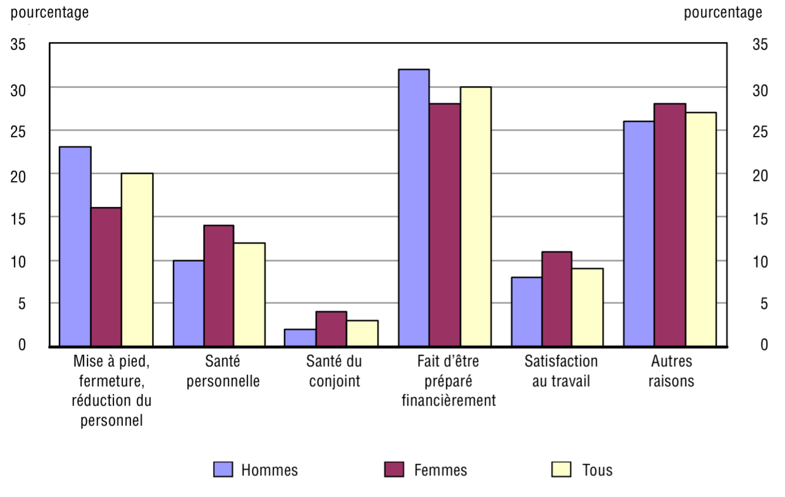

# Fondements de la retraite

::: {.act-objectifs}

<div class="act-objectifs-titre">Objectifs du chapitre</div>

- Définir la retraite et distinguer la cessation d'emploi du début du versement des prestations;
- Décrire les facteurs qui influencent l'âge de départ à la retraite et interpréter des statistiques sur cet âge;
- Expliquer pourquoi le revenu nécessaire à la retraite peut être inférieur au salaire brut antérieur;
- Interpréter un calcul simplifié du revenu résiduel disponible, en tenant compte des cotisations, des dépenses et de la fiscalité;
- Distinguer les trois grandes sources de revenu à la retraite : régimes publics, régimes collectifs et épargne personnelle;
- Reconnaître les principales caractéristiques de ces sources et expliquer comment elles peuvent se combiner à différents âges.

:::

::: {.callout-note collapse="true"}

## Plan du chapitre

<div id="plan-chapitre-auto"></div>

<!--

<div style="clear: both;"></div>
-->


:::


## Introduction

La retraite correspond généralement à une période durant laquelle les revenus d'emploi diminuent ou cessent et doivent être remplacés par d'autres ressources. Elle ne signifie toutefois pas nécessairement la fin de toute activité professionnelle : une personne peut quitter son emploi principal, continuer à travailler à temps partiel ou commencer à recevoir une rente à un moment différent de son départ du marché du travail. Cette transition soulève une question économique fondamentale : quel revenu faut-il pour maintenir un niveau de vie comparable à celui de la vie active? La réponse dépend non seulement du salaire antérieur, mais aussi des cotisations qui cessent, des dépenses liées au travail qui disparaissent et de la fiscalité applicable aux revenus de retraite. Elle dépend également des sources de revenu disponibles, puisque les régimes publics, les régimes d'employeur et l'épargne personnelle n'obéissent pas tous aux mêmes règles ni aux mêmes âges de versement. Dans ce chapitre, nous examinons d'abord la notion de retraite et les âges auxquels elle survient. Nous illustrons ensuite, à partir d'exemples chiffrés et d'une approximation de la fiscalité de 2026, comment estimer le revenu de retraite nécessaire pour conserver un budget de consommation comparable. Enfin, nous présentons les principales sources de revenu à la retraite, leurs caractéristiques et la façon dont elles peuvent se compléter. Le fonctionnement actuariel détaillé des régimes sera abordé dans les chapitres suivants.


## La notion de retraite



La retraite ne correspond pas nécessairement à un arrêt définitif de toute activité professionnelle. Elle peut être complète ou progressive : une personne peut réduire ses heures de travail, changer d'emploi ou continuer de travailler tout en percevant des revenus de retraite. [↗](https://www.retraitequebec.gouv.qc.ca/fr/citoyens/retraite-et-planification/retraite/transition-retraite "Retraite Québec — Transition vers la retraite"){.source-link} Sur le plan économique, la retraite soulève une question fondamentale : comment financer ses dépenses lorsque les revenus d'emploi diminuent ou disparaissent?

Pour répondre à cette question, il est utile de distinguer trois grandes sources de revenu à la retraite. [↗](https://www.retraitequebec.gouv.qc.ca/fr/citoyens/retraite-et-planification/planifiez-retraite/planifier-5-etapes/determinez-revenus/sources-revenu "Retraite Québec — Sources de revenu à la retraite"){.source-link}

1. Les régimes publics de retraite constituent généralement une première source de revenu. Ils comprennent notamment des prestations liées aux revenus de travail, comme celles du Régime de rentes du Québec (RRQ), et des programmes destinés aux personnes âgées, comme la Pension de la Sécurité de la vieillesse (PSV). Ces programmes seront présentés au [chapitre 16 — Régimes de retraite publics](Chap16_Retraite_public.qmd).

2. Les régimes collectifs de retraite, généralement offerts par les employeurs, permettent aux travailleurs d'accumuler des droits à des prestations de retraite pendant leur carrière. Selon le type de régime, les prestations peuvent être déterminées à l'avance ou dépendre des cotisations accumulées et des rendements obtenus. Ces deux approches seront étudiées aux [chapitre 17 — Régimes à prestations déterminées](Chap17_Retraite_PD.qmd) et [chapitre 18 — Régimes à cotisations déterminées](Chap18_Retraite_CD.qmd).

3. L'épargne personnelle regroupe les sommes qu'une personne accumule elle-même en prévision de sa retraite, par exemple dans un régime enregistré d'épargne-retraite (REER), un compte d'épargne libre d'impôt (CELI) ou d'autres placements. Les aspects fiscaux de ces instruments seront notamment abordés au [chapitre 19 — Aspects fiscaux](Chap19_Retraite_fiscal.qmd).

Ces trois sources sont complémentaires. Par exemple, une personne retraitée pourrait recevoir chaque mois une rente du RRQ, une rente de son ancien employeur et retirer périodiquement des sommes de son REER. Ses revenus de retraite proviendraient alors simultanément des trois catégories. L'importance relative de chacune varie considérablement d'une personne à l'autre. Certains retraités dépendent principalement des régimes publics, tandis que d'autres disposent également d'un régime d'employeur important ou d'une épargne personnelle substantielle.


<div style="clear: both;"></div>

### Le moment de la retraite

Le moment où une personne prend sa retraite dépend de plusieurs facteurs, dont ses ressources financières, son état de santé, ses préférences personnelles et les règles des régimes de retraite auxquels elle participe. Pour mieux comprendre les circonstances entourant cette décision, Statistique Canada a notamment étudié les principales raisons du départ à la retraite dans son *Enquête sur les travailleurs âgés de 2008*. Bien que ces données soient relativement anciennes, elles permettent d'illustrer la diversité des facteurs qui interviennent dans cette décision. [↗](https://www150.statcan.gc.ca/n1/fr/pub/89-646-x/89-646-x2010001-fra.pdf "Statistique Canada — Premiers résultats de l'Enquête sur les travailleurs âgés, 2008, graphique 4.3, p. 23"){.source-link}


{width=50% fig-align="center"}


Le graphique présente les principales raisons invoquées pour expliquer une première retraite. Plusieurs constats se dégagent :

- La préparation financière constitue le motif le plus fréquemment mentionné, avec environ 30 % des réponses.
- Les pertes d'emploi, notamment les mises à pied, les fermetures d'entreprise et les réductions de personnel, représentent environ 20 % des réponses.
- Les problèmes de santé personnels ou touchant le conjoint expliquent environ 15 % des départs.
- L'insatisfaction au travail est mentionnée par environ 9 % des répondants.
- Les autres raisons, qui regroupent plus du quart des réponses, comprennent notamment l'atteinte du nombre d'années de service donnant droit à une pension, le désir de consacrer davantage de temps à sa famille ou simplement la volonté de cesser de travailler.

On observe également certaines différences entre les hommes et les femmes. Les pertes d'emploi sont plus souvent mentionnées par les hommes, tandis que les problèmes de santé personnels sont davantage invoqués par les femmes.  Il faut toutefois interpréter ces résultats avec prudence. L'enquête portait sur des personnes âgées de 50 à 75 ans qui travaillaient ou avaient travaillé au cours des deux années précédentes. Le graphique concerne uniquement celles qui avaient déjà pris une première retraite. Il ne représente donc pas l'ensemble des retraités canadiens. Ces résultats illustrent néanmoins une distinction importante : la retraite n'est pas toujours une décision entièrement volontaire. Si certaines personnes choisissent de quitter le marché du travail lorsqu'elles s'estiment financièrement prêtes, d'autres y sont amenées par des circonstances indépendantes de leur volonté, parfois plus tôt qu'elles ne l'avaient prévu.

::: {style="background: #F5F7FA; border-left: 3px solid #A0A8B0; padding: 12px 18px; margin: 1.5em 0; border-radius: 3px;"}

**Départ à la retraite et versement des prestations**

Du point de vue des régimes de retraite, il faut également distinguer le moment où une personne cesse de travailler de celui où elle commence à recevoir ses prestations. Certains régimes prévoient un âge normal de retraite, généralement fixé à 65 ans, ainsi que des possibilités de retraite anticipée. D'autres conditions, comme le nombre d'années de service, peuvent également influencer les prestations auxquelles une personne a droit. [↗](https://www.retraitequebec.gouv.qc.ca/fr/programmes/regimes-retraite-secteurs-prive-municipal-et-universitaires/regime-prestations-determinees/revenus-regime/types-rentes "Retraite Québec — Types de rentes et conditions de retraite"){.source-link}  Lorsqu'une personne prend sa retraite avant de commencer à recevoir certaines prestations publiques, elle doit financer cette période à partir d'autres sources de revenus. Il peut notamment s'agir :

- de son épargne personnelle ;
- de prestations provenant d'un régime de retraite d'employeur, notamment une prestation de raccordement, qui constitue un supplément temporaire généralement versé jusqu'à 65 ans. [↗](https://www.retraitequebec.gouv.qc.ca/fr/programmes/regimes-retraite-secteurs-prive-municipal-et-universitaires/regime-prestations-determinees/revenus-regime/types-rentes "Retraite Québec — Prestation de raccordement"){.source-link}

Enfin, la retraite peut être totale ou progressive. Dans le cas d'une retraite progressive, une personne demeure active sur le marché du travail, souvent en réduisant graduellement ses heures de travail et son salaire. Cette diminution de revenu peut être compensée en partie par l'épargne personnelle ou par des prestations de retraite progressive offertes par certains régimes d'employeur. [↗](https://www.retraitequebec.gouv.qc.ca/fr/citoyens/retraite-et-planification/retraite/transition-retraite/retraite-progressive-et-regime-prestations-determinees "Retraite Québec — Retraite progressive et régime à prestations déterminées"){.source-link}

:::


### Âge moyen à la retraite

Les tableaux suivants présentent l'âge moyen à la retraite au Canada selon la catégorie de travailleurs, à partir des données annuelles publiées par Statistique Canada. [↗](https://www150.statcan.gc.ca/t1/tbl1/fr/tv.action?pid=1410006001 "Statistique Canada — Tableau 14-10-0060-01 : Âge de la retraite selon la catégorie de travailleur, données annuelles"){.source-link}


::: {.encadre}

```{r}
#| code-fold: true
#| echo: true
#| message: false
#| warning: false
#| fig-height: 4.8
#| fig-width: 9
#| fig-align: center

library(dplyr)
library(kableExtra)
library(tibble)

tab_moyen <- tibble(
  `Catégorie de travailleur` = c(
    "Total des retraités",
    "Employés du secteur public",
    "Employés du secteur privé",
    "Travailleurs autonomes"
  ),
  `2021` = c(64.3, 62.5, 64.4, 67.1),
  `2022` = c(64.7, 62.9, 64.9, 68.0),
  `2023` = c(65.1, 63.2, 65.3, 68.0),
  `2024` = c(65.3, 63.8, 65.1, 67.9),
  `2025` = c(65.4, 62.6, 66.0, 68.4)
)

tab_moyen %>%
  mutate(across(`2021`:`2025`, ~ format(round(.x,1), decimal.mark=","))) %>%
  kbl(
    align = c("l","c","c","c","c","c"),
    caption = "Âge moyen de la retraite selon la catégorie de travailleur, Canada"
  ) %>%
  kable_styling(
    bootstrap_options = c("striped","hover","condensed"),
    full_width = FALSE,
    position = "center"
  )


tab_median <- tibble(
  `Catégorie de travailleur` = c(
    "Total des retraités",
    "Employés du secteur public",
    "Employés du secteur privé",
    "Travailleurs autonomes"
  ),
  `2021` = c(64.4, 61.8, 64.7, 65.7),
  `2022` = c(64.8, 61.8, 64.9, 67.8),
  `2023` = c(64.9, 63.0, 65.1, 67.8),
  `2024` = c(65.1, 64.1, 65.1, 66.7),
  `2025` = c(65.3, 61.8, 65.4, 67.4)
)

tab_median %>%
  mutate(across(`2021`:`2025`, ~ format(round(.x,1), decimal.mark=","))) %>%
  kbl(
    align = c("l","c","c","c","c","c"),
    caption = "Âge médian de la retraite selon la catégorie de travailleur, Canada"
  ) %>%
  kable_styling(
    bootstrap_options = c("striped","hover","condensed"),
    full_width = FALSE,
    position = "center"
  )


```
:::

Les tableaux montrent que l’âge de la retraite au Canada se situe généralement autour de 65 ans. On observe également que les travailleurs autonomes prennent leur retraite plus tard que les employés, leur âge moyen de retraite se situant autour de 68 ans. À l’inverse, les employés du secteur public partent en moyenne plus tôt que ceux du secteur privé, ce qui peut s’expliquer en partie par l’existence de régimes de retraite plus structurés dans ce secteur.  Enfin, les données suggèrent une légère tendance à la hausse de l’âge de la retraite au cours des dernières années, particulièrement chez les employés du secteur privé et chez les travailleurs autonomes. [↗](https://www150.statcan.gc.ca/t1/tbl1/fr/tv.action?pid=1410006001 "Statistique Canada — Âge de la retraite selon la catégorie de travailleur"){.source-link}

## Calcul approximatif de l'impôt

La structure progressive de l’impôt sur le revenu — où les taux d’imposition augmentent avec le niveau de revenu — a alors un effet important. Une personne qui dispose d’un revenu plus faible à la retraite peut se retrouver dans une tranche d’imposition inférieure à celle qui s’appliquait pendant sa vie active. [↗](https://www.canada.ca/fr/agence-revenu/services/impot/particuliers/taux-imposition-tranches-revenu/annee-en-cours.html "Agence du revenu du Canada — Taux et tranches d’imposition 2026"){.source-link}  Ainsi, même si le revenu brut diminue à la retraite, le revenu net disponible peut diminuer dans une proportion moindre.  Pour comparer le salaire et le revenu à la retraite, il ne suffit donc pas d'appliquer un taux fixe d'impôt au revenu brut. Au fédéral comme au Québec, l'impôt est progressif : chaque taux marginal s'applique uniquement à la tranche de revenu correspondante. Une diminution du revenu imposable ne produit donc pas nécessairement une diminution proportionnelle de l'impôt. La distinction entre certains types de revenu est essentielle :

- Le **revenu brut** est la rémunération ou la rente reçue avant retenues.
- Le **revenu imposable** sert de base au calcul de l'impôt, après les déductions applicables. Il ne s'agit pas d'une dépense supplémentaire à soustraire du revenu brut.
- Le **revenu résiduel disponible** correspond, dans nos exemples, au revenu brut diminué de l'épargne-retraite, des impôts, des cotisations sociales, de l'assurance et des dépenses propres au travail. Il s'agit d'un indicateur simplifié du budget de consommation, et non du « revenu disponible » au sens statistique de Statistique Canada.


### Calcul fiscal utilisé

Le calcul fiscal utilisé dans ce chapitre se fait en trois étapes :

- D'abord, nous appliquons les tranches d'imposition fédérales et québécoises de 2026 ainsi que les montants personnels de base.
- Ensuite, pour un salarié, nous déduisons les cotisations supplémentaires au RRQ du revenu imposable et prenons en compte certains crédits fédéraux liés au travail et aux cotisations. Au Québec, nous appliquons également la déduction pour travailleur.
- Enfin, pour un retraité d'au moins 65 ans recevant une rente admissible, nous ajoutons les crédits fédéraux et québécois pour revenus de pension ainsi que ceux liés à l'âge, lorsqu'ils sont applicables.

Les tables fiscales d'Ernst & Young pour 2026 constituent un point de départ commode pour ces calculs. [↗](https://www.ey.com/content/dam/ey-unified-site/ey-com/en-ca/services/tax/tax-calculators/2026/ey-tax-rates-quebec-2026-01-15-v1.pdf "Ernst & Young — Taux d'imposition et crédits d'impôt fédéraux et québécois, 2026"){.source-link} Elles intègrent les montants personnels de base et l'abattement fédéral du Québec de 16,5 %, mais les autres crédits d'impôt doivent être appliqués séparément. Pour un résident du Québec, les revenus imposables fédéral et provincial peuvent également différer; nous les calculons donc séparément pour les salariés. Le code R ci-dessous détaille l'application du barème de base d'EY. Il est volontairement consultable dans la version HTML. Les autres déductions et crédits sont calculés, plus bas, dans les fonctions servant aux exemples de revenu avant et après la retraite. La figure ci-dessous montre l'impôt calculé à partir des barèmes de base pour un même revenu imposable au fédéral et au Québec. 

```{r}
#| code-fold: true
#| echo: true
#| message: false
#| warning: false
#| fig-height: 4.8
#| fig-width: 9
#| fig-align: center
#| fig-cap: "Impôt calculé selon les barèmes de base de 2026, avant crédits particuliers"
#| label: fig-impot_par_revenu

library(dplyr)
library(tidyr)
library(ggplot2)
library(kableExtra)

# EY : revenu imposable fédéral et revenu imposable québécois.
# Montants personnels de base déjà inclus; crédit supplémentaire NON inclus.
# L'impôt fédéral est déjà net de l'abattement québécois de 16,5 %.
impot_barreme_ey_2026 <- function(revenu_federal, revenu_quebec = revenu_federal) {
  stopifnot(length(revenu_federal) == 1, length(revenu_quebec) == 1,
            is.finite(revenu_federal), is.finite(revenu_quebec),
            revenu_federal >= 0, revenu_quebec >= 0)

  f <- revenu_federal
  q <- revenu_quebec
  impot_federal <- if (f <= 16452) {
    0
  } else if (f <= 58523) {
    0.1169 * (f - 16452)
  } else if (f <= 117045) {
    4918 + 0.1712 * (f - 58523)
  } else if (f <= 181440) {
    14936 + 0.2171 * (f - 117045)
  } else if (f <= 258482) {
    28916 + 0.2446 * (f - 181440)
  } else {
    47761 + 0.2756 * (f - 258482)
  }

  impot_quebec <- if (q <= 18952) {
    0
  } else if (q <= 54345) {
    0.14 * (q - 18952)
  } else if (q <= 108680) {
    4955 + 0.19 * (q - 54345)
  } else if (q <= 132245) {
    15279 + 0.24 * (q - 108680)
  } else {
    20934 + 0.2575 * (q - 132245)
  }

  c(federal = max(0, impot_federal),
    quebec = max(0, impot_quebec))
}

impot_points <- lapply(seq(20000, 200000, by = 1000), function(y) {
  imp <- impot_barreme_ey_2026(y)
  data.frame(revenu = y, Canada = unname(imp["federal"]),
             Québec = unname(imp["quebec"]), Total = sum(imp))
}) %>% bind_rows() %>%
  pivot_longer(cols = c(Canada, Québec, Total),
               names_to = "type", values_to = "impot")

ggplot(impot_points, aes(revenu, impot, color = type)) +
  geom_line(linewidth = 1.1) +
  scale_color_manual(values = c("Québec" = "blue", "Canada" = "red", "Total" = "black")) +
  labs(x = "Revenu imposable (identique dans les deux juridictions)",
       y = "Impôt avant crédits particuliers", color = NULL) +
  theme_bw()
```


::: {.callout-note collapse="true"}
## Quels éléments fiscaux sont inclus dans notre approximation?

Les calculs reposent sur les barèmes d'imposition fédéraux [↗](https://www.canada.ca/fr/agence-revenu/services/impot/particuliers/taux-imposition-tranches-revenu/annee-en-cours.html "Agence du revenu du Canada — Barèmes d'imposition fédéraux de 2026"){.source-link} et québécois [↗](https://www.revenuquebec.ca/fr/citoyens/declaration-de-revenus/produire-votre-declaration-de-revenus/taux-dimposition/ "Revenu Québec — Taux d'imposition de 2026"){.source-link} de 2026.

  - **Pour le salarié**, nous retenons la déduction des cotisations d'épargne-retraite (hypothèse de 9 % du salaire), les déductions liées aux cotisations supplémentaires au RRQ, la déduction québécoise pour travailleur, le crédit fédéral sur la portion de base du RRQ ainsi que sur les cotisations à l'AE et au RQAP, et le montant canadien pour emploi. Les paramètres des cotisations sociales et de la déduction québécoise pour travailleur proviennent de Revenu Québec. [↗](https://www.revenuquebec.ca/fr/entreprises/retenues-a-la-source-et-cotisations-de-lemployeur/employeur-principaux-changements-2026/ "Revenu Québec — Principaux paramètres fiscaux et cotisations sociales pour 2026"){.source-link}

  - **Pour le retraité**, nous supposons une personne âgée d'au moins 65 ans qui reçoit une rente imposable admissible aux crédits pour revenus de pension, sans autres sources de revenus. Nous appliquons le crédit fédéral en raison de l'âge, le crédit fédéral pour revenu de pension et les crédits québécois correspondants, en tenant compte des réductions liées au revenu lorsqu'elles sont applicables. [↗](https://cffp.recherche.usherbrooke.ca/outils-ressources/guide-mesures-fiscales/credit-revenu-pension-credit-revenus-retraite/ "Chaire de recherche en fiscalité et en finances publiques — Crédits pour revenus de pension et de retraite"){.source-link} Les prestations du RRQ et de la Sécurité de la vieillesse ne sont pas, à elles seules, admissibles aux crédits pour revenus de pension. [↗](https://www.canada.ca/fr/agence-revenu/services/impot/particuliers/sujets/tout-votre-declaration-revenus/declaration-revenus/remplir-declaration-revenus/deductions-credits-depenses/ligne-31400-montant-revenu-pension.html "Agence du revenu du Canada — Montant pour revenu de pension et revenus non admissibles"){.source-link} La composition réelle du revenu à la retraite changerait donc les résultats.

Le modèle ne tient pas compte des situations conjugales, du fractionnement du revenu de pension, des crédits pour personne vivant seule, des avantages imposables offerts par un employeur, des frais médicaux, du Supplément de revenu garanti, de la récupération de la Sécurité de la vieillesse ni de toutes les particularités d'une déclaration fiscale. Les montants présentés sont des estimations pédagogiques arrondies, non des calculs de retenues à la source ou des conseils fiscaux.

:::

### Composantes concrètes

Plus bas, nousallons comparer deux travailleurs québécois dont les salaires bruts annuels sont de **120 000 $** et de **60 000 $**. L'objectif n'est pas de prévoir leur pension future : il s'agit de trouver, à règles fiscales et prix de 2026 constants, la rente annuelle qui laisse un budget de consommation comparable à celui dont ils disposent en travaillant. Pour isoler le mécanisme, nous supposons la même situation fiscale simplifiée dans les deux exemples, des revenus d'emploi et de retraite entièrement imposables, et aucun autre revenu ni prestation publique. Les montants des programmes sociaux reposent sur les barèmes 2026, tandis que les hypothèses d'épargne et de dépenses sont choisies uniquement pour l'exercice.  

Les taux de cotisation sont tirés de [Retraite Québec](https://www.retraitequebec.gouv.qc.ca/fr/professionnels-et-employeurs/role-employeur-et-regime-rentes-quebec/cotisations-regime-rentes-quebec), de [Service Canada](https://www.canada.ca/fr/emploi-developpement-social/programmes/assurance-emploi/ae-liste/assurance-emploi-employeurs/reduction-taux-cotisation/maximum-remuneration-assurable-2026.html) et de [Revenu Québec](https://www.revenuquebec.ca/fr/entreprises/retenues-a-la-source-et-cotisations-de-lemployeur/calcul-des-retenues-et-des-cotisations/cotisations-au-rqap/maximum-de-revenus-assurables-et-taux-de-cotisation/). La [RAMQ](https://www.ramq.gouv.qc.ca/fr/citoyens/assurance-medicaments/tarifs-vigueur) indique que la prime annuelle réelle peut varier de **0 $ à 789 $** pour la période du 1er juillet 2026 au 30 juin 2027; le montant de 750 $ est donc une simple convention pour faciliter les comparaisons. Les franchises et les montants payés à la pharmacie ne sont pas inclus. Le tableau suivant résume les paramètres utilisés. 

::: {.encadre}

| Hypothèse ou paramètre | Valeur retenue |
|:--|--:|
| Épargne-retraite du salarié, déductible | 9 % du salaire |
| RRQ — gains cotisables | De 3 500 $ à 74 600 $, puis jusqu'à 85 000 $ |
| RRQ — cotisation salariale sur la première tranche | 5,30 % (régime de base) + 1,00 % (première cotisation supplémentaire) |
| RRQ — deuxième cotisation supplémentaire | 4,00 % entre 74 600 $ et 85 000 $ |
| AE au Québec | 1,30 % du salaire, jusqu'à 68 900 $ |
| RQAP | 0,430 % du salaire, jusqu'à 103 000 $ |
| Assurance collective au travail (hypothèse) | 800 $ + 2 % du salaire |
| Dépenses liées au travail (hypothèse) | 7 % du salaire |
| Prime annuelle du régime public d'assurance médicaments à la retraite (hypothèse) | 750 $ |

:::

### Du salaire au revenu de retraite

Lorsqu'une personne prend sa retraite, son revenu diminue généralement, mais plusieurs dépenses et cotisations associées à sa vie professionnelle disparaissent également. Par conséquent, il n'est pas nécessaire de remplacer intégralement son ancien salaire brut pour maintenir un niveau de vie comparable. [↗](https://www.retraitequebec.gouv.qc.ca/fr/savoir-faire-pousser-ble/fin-carriere/planifier-financierement-retraite/quels-sont-revenus-dont-vous-aurez-besoin-retraite "Retraite Québec — Quels sont les revenus dont vous aurez besoin à la retraite?"){.source-link} Pour déterminer le revenu nécessaire à la retraite, quatre changements principaux doivent être considérés :

- L'épargne-retraite : pendant sa carrière, une personne consacre une partie de son salaire à préparer sa retraite. Une fois retraitée, nous supposons qu'elle cesse de contribuer à cette épargne.

- Les cotisations sociales : les cotisations au RRQ, à l'assurance-emploi (AE) et au Régime québécois d'assurance parentale (RQAP) s'appliquent aux revenus de travail, mais pas aux revenus provenant d'une rente de retraite. Ces retenues disparaissent donc de nos calculs. [↗](https://www.retraitequebec.gouv.qc.ca/fr/savoir-faire-pousser-ble/fin-carriere/faire-transition-retraite/comment-gerer-depenses-retraite "Retraite Québec — Comment gérer vos dépenses à la retraite?"){.source-link}

- Les dépenses liées au travail : les déplacements, les repas à l'extérieur et certaines autres dépenses professionnelles diminuent ou disparaissent à la retraite. [↗](https://www.retraitequebec.gouv.qc.ca/fr/savoir-faire-pousser-ble/fin-carriere/faire-transition-retraite/comment-gerer-depenses-retraite "Retraite Québec — Dépenses liées au travail à la retraite"){.source-link}

- Les assurances : pendant sa carrière, un travailleur peut bénéficier d'un régime d'assurance collective. À la retraite, nous supposons, pour simplifier les calculs, qu'il ne bénéficie plus de ce régime et qu'il doit plutôt payer une prime au régime public d'assurance médicaments. En réalité, les personnes de 65 ans ou plus qui ont accès à une assurance privée peuvent choisir entre différentes options de couverture. [↗](https://www.ramq.gouv.qc.ca/fr/citoyens/votre-65e-anniversaire "RAMQ — Assurance médicaments à partir de 65 ans"){.source-link}

La fiscalité doit également être prise en compte. Même si le salaire et la rente sont tous deux imposables, leur traitement fiscal n'est pas identique. Certaines déductions liées au travail disparaissent, tandis que des crédits d'impôt liés à l'âge ou aux revenus de pension peuvent devenir applicables. [↗](https://www.revenuquebec.ca/fr/citoyens/credits-dimpot/montant-accorde-en-raison-de-lage-ou-pour-personne-vivant-seule-ou-pour-revenus-de-retraite/ "Revenu Québec — Montants accordés en raison de l'âge et pour revenus de retraite"){.source-link} [↗](https://www.canada.ca/fr/agence-revenu/services/impot/particuliers/sujets/tout-votre-declaration-revenus/declaration-revenus/remplir-declaration-revenus/deductions-credits-depenses/ligne-31400-montant-revenu-pension.html "Agence du revenu du Canada — Montant pour revenu de pension"){.source-link} L'impôt doit donc être recalculé pour chacune des deux situations, en utilisant dans notre cas les règles fiscales de 2026. Notre objectif est ainsi de déterminer le revenu de retraite qui permet de conserver un budget de consommation comparable à celui de la vie active, et non de remplacer intégralement le salaire brut.

::: {.callout-note collapse="true"}
##  Calcul du revenu disponible

Pour un salaire brut annuel $S$, nous posons $E=0,09S$ pour l'épargne-retraite, $C$ pour la somme des cotisations au RRQ, à l'AE et au RQAP, $A=800+0,02S$ pour l'assurance collective et $D=0,07S$ pour les dépenses de travail. Si $I_{\mathrm{actif}}$ représente l'impôt estimé, alors :

$$
B_{\mathrm{actif}}=S-E-C-I_{\mathrm{actif}}-A-D.
$$

 la retraite, nous supposons que la personne reçoit une rente annuelle imposable $R$ et qu'elle n'a ni revenu d'emploi, ni nouvelle épargne-retraite, ni dépenses directement liées au travail. Si $I_{\mathrm{retraité}}(R)$ est son impôt estimé, son budget résiduel devient :

$$
B_{\mathrm{retraité}}(R)=R-I_{\mathrm{retraité}}(R)-750.
$$

Nous cherchons la rente $R$ qui vérifie $B_{\mathrm{retraité}}(R)=B_{\mathrm{actif}}$. Le **taux de remplacement du salaire brut** est alors $R/S$. Il s'agit d'une égalisation de budgets simplifiés, *pas* du taux de remplacement garanti par un régime de retraite.

```{r}
#| code-fold: true
#| code-summary: "Voir le code R : cotisations, impôts et calcul de la rente équivalente"
#| echo: true
#| message: false
#| warning: false

library(dplyr)
library(tibble)
library(knitr)
library(kableExtra)

parametres_2026 <- list(
  exemption_rrq = 3500, MGA = 74600, MSGA = 85000,
  taux_rrq_base = 0.053, taux_rrq1 = 0.01, taux_rrq2 = 0.04,
  taux_ae = 0.013, max_ae = 68900,
  taux_rqap = 0.00430, max_rqap = 103000,
  taux_epargne = 0.09,
  assurance_fixe = 800, assurance_taux = 0.02,
  taux_depenses_travail = 0.07, prime_medicaments = 750,
  deduction_travail_qc = 1450, montant_emploi_federal = 1501,
  taux_credit_federal_qc = 0.1169,
  montant_age_federal = 9208, seuil_age_federal = 46432,
  montant_pension_federal = 2000,
  montant_age_qc = 3986, montant_pension_qc = 3541,
  seuil_age_pension_qc = 42955
)

# Portion de base et portions supplémentaires du RRQ distinguées,
# car leurs traitements fiscaux diffèrent.
cotisations_sociales <- function(salaire, par = parametres_2026) {
  gains_rrq <- max(0, min(salaire, par$MGA) - par$exemption_rrq)
  gains_rrq2 <- max(0, min(salaire, par$MSGA) - par$MGA)
  c(rrq_base = gains_rrq * par$taux_rrq_base,
    rrq_sup1 = gains_rrq * par$taux_rrq1,
    rrq_sup2 = gains_rrq2 * par$taux_rrq2,
    ae = min(salaire, par$max_ae) * par$taux_ae,
    rqap = min(salaire, par$max_rqap) * par$taux_rqap)
}

impot_salarie_2026 <- function(salaire, par = parametres_2026) {
  cot <- cotisations_sociales(salaire, par)
  epargne <- salaire * par$taux_epargne
  ded_rrq <- unname(cot["rrq_sup1"] + cot["rrq_sup2"])
  ded_travail <- min(0.06 * salaire, par$deduction_travail_qc)
  imposable_f <- salaire - epargne - ded_rrq
  imposable_q <- imposable_f - ded_travail

  bareme <- impot_barreme_ey_2026(imposable_f, imposable_q)
  # Crédit fédéral sur RRQ de base, AE, RQAP et emploi.
  montant_credits <- unname(cot["rrq_base"] + cot["ae"] + cot["rqap"]) +
    min(salaire, par$montant_emploi_federal)
  credit_f <- par$taux_credit_federal_qc * montant_credits
  federal <- max(0, unname(bareme["federal"]) - credit_f)
  quebec <- unname(bareme["quebec"])

  list(impot_federal = federal, impot_quebec = quebec,
       impot_total = federal + quebec,
       revenu_imposable_federal = imposable_f,
       revenu_imposable_quebec = imposable_q,
       deduction_rrq = ded_rrq, deduction_travail = ded_travail,
       credit_federal = credit_f, cotisations = cot)
}

# Retraité de 65 ans ou plus, rente d'employeur admissible au crédit de
# pension, sans autres revenus ni crédits liés à la situation familiale.
impot_retraite_2026 <- function(rente, par = parametres_2026) {
  bareme <- impot_barreme_ey_2026(rente, rente)

  base_age_f <- max(0, par$montant_age_federal -
                      0.15 * max(0, rente - par$seuil_age_federal))
  credit_age_f <- par$taux_credit_federal_qc * base_age_f
  credit_pension_f <- par$taux_credit_federal_qc *
    min(rente, par$montant_pension_federal)

  # Au Québec, les montants pour âge et pension sont réduits ensemble.
  base_age_pension_q <- max(0, par$montant_age_qc +
                              min(rente, par$montant_pension_qc) -
                              0.1875 * max(0, rente - par$seuil_age_pension_qc))
  credit_age_pension_q <- 0.14 * base_age_pension_q

  federal <- max(0, unname(bareme["federal"]) -
                   credit_age_f - credit_pension_f)
  quebec <- max(0, unname(bareme["quebec"]) - credit_age_pension_q)
  list(impot_federal = federal, impot_quebec = quebec,
       impot_total = federal + quebec,
       revenu_imposable_federal = rente, revenu_imposable_quebec = rente,
       credit_age_federal = credit_age_f,
       credit_pension_federal = credit_pension_f,
       credit_age_pension_quebec = credit_age_pension_q)
}

calcul_actif_2026 <- function(salaire, par = parametres_2026) {
  res <- impot_salarie_2026(salaire, par)
  cot <- res$cotisations
  epargne <- salaire * par$taux_epargne
  assurance <- par$assurance_fixe + par$assurance_taux * salaire
  depenses <- par$taux_depenses_travail * salaire
  disponible <- salaire - epargne - res$impot_total -
    sum(cot) - assurance - depenses
  tibble(
    element = c("Salaire brut annuel", "Épargne-retraite déductible (9 %)",
      "Revenu imposable fédéral (calcul seulement)",
      "Revenu imposable Québec (calcul seulement)",
      "Impôt fédéral et québécois estimé", "Cotisations au RRQ",
      "Cotisations à l'assurance-emploi (AE)", "Cotisations au RQAP",
      "Cotisations à l'assurance collective",
      "Dépenses supplémentaires liées au travail",
      "Revenu résiduel disponible"),
    montant = c(salaire, -epargne,
      res$revenu_imposable_federal, res$revenu_imposable_quebec,
      -res$impot_total, -sum(cot[c("rrq_base", "rrq_sup1", "rrq_sup2")]),
      -cot["ae"], -cot["rqap"], -assurance, -depenses, disponible)
  )
}

calcul_retraite_2026 <- function(rente, par = parametres_2026) {
  res <- impot_retraite_2026(rente, par)
  disponible <- rente - res$impot_total - par$prime_medicaments
  tibble(
    element = c("Revenu annuel de rente imposable", "Épargne-retraite",
      "Revenu imposable fédéral (calcul seulement)",
      "Revenu imposable Québec (calcul seulement)",
      "Impôt fédéral et québécois estimé", "Cotisations au RRQ",
      "Cotisations à l'assurance-emploi (AE)", "Cotisations au RQAP",
      "Prime d'assurance médicaments (hypothèse)",
      "Dépenses supplémentaires liées au travail",
      "Revenu résiduel disponible"),
    montant = c(rente, 0, rente, rente, -res$impot_total,
                0, 0, 0, -par$prime_medicaments, 0, disponible)
  )
}

revenu_disponible <- function(tab) {
  as.numeric(tail(tab$montant, 1))
}

rente_equivalente_2026 <- function(salaire, par = parametres_2026) {
  budget_cible <- revenu_disponible(calcul_actif_2026(salaire, par))
  f <- function(rente) {
    revenu_disponible(calcul_retraite_2026(rente, par)) - budget_cible
  }
  uniroot(f, lower = 0, upper = max(1000000, salaire * 3))$root
}

afficher_decomposition <- function(tab, titre) {
  monnaie <- function(x) {
    txt <- format(round(abs(x)), big.mark = " ", scientific = FALSE,
                  trim = TRUE)
    ifelse(x < 0,
           cell_spec(paste0("(", txt, " $)"), color = "red"),
           paste0(txt, " $"))
  }
  tab %>%
    mutate(Montant = monnaie(montant)) %>%
    select(`Élément` = element, Montant) %>%
    kbl(caption = titre, escape = FALSE, align = c("l", "r"),
        booktabs = TRUE) %>%
    kable_styling(
      bootstrap_options = c("striped", "hover", "condensed"),
      full_width = FALSE, position = "center"
    ) %>%
    row_spec(c(1, 11), bold = TRUE)
}

salaires_exemples <- c(120000, 60000)
rentes_exemples <- vapply(salaires_exemples, rente_equivalente_2026, numeric(1))
```

::::


::: {#exm-120K .custom}

**Revenu de 120 000 \$**

Considérons d'abord un travailleur québécois dont le salaire annuel brut est de 120 000 $. Il s'agit d'un revenu relativement élevé. À titre de comparaison, selon Statistique Canada, le seuil d'appartenance aux 10 % des particuliers ayant les revenus les plus élevés était de 116 500 $ au Canada et de 107 300 $ au Québec en 2023. [↗](https://www150.statcan.gc.ca/t1/tbl1/fr/tv.action?pid=1110005501 "Statistique Canada — Les déclarants à revenu élevé au Canada, tableau 11-10-0055-01"){.source-link} [↗](https://www150.statcan.gc.ca/t1/tbl1/fr/tv.action?pid=1110005601 "Statistique Canada — Seuils régionaux de revenu élevé, tableau 11-10-0056-01"){.source-link} Le tableau suivant présente les principales déductions et dépenses prises en compte afin de déterminer le budget résiduel dont ce travailleur dispose pendant sa vie active.

::: {.encadre}

```{r}
#| code-fold: true
#| echo: true
#| message: false
#| warning: false

afficher_decomposition(
  calcul_actif_2026(120000),
  "Décomposition du revenu et des dépenses — Avant la retraite (120 000 $)"
)
```

:::

Tel que mentionné plus tôt, à la retraite, nous cherchons à déterminer le montant d'une rente annuelle imposable qui permettrait de conserver exactement le même budget résiduel. Plusieurs éléments du calcul changent alors :

- Les cotisations au RRQ, à l'assurance-emploi et au RQAP ne s'appliquent plus au revenu provenant de la rente.
- Les cotisations d'épargne-retraite et les dépenses professionnelles sont supposées nulles.
- Une dépense annuelle hypothétique de 750 $ pour l'assurance médicaments remplace les cotisations à l'assurance collective.
- Les règles fiscales de 2026 sont conservées afin de permettre une comparaison cohérente.

Le tableau suivant présente la décomposition du revenu à la retraite selon ces hypothèses.

::: {.encadre}

```{r}
#| code-fold: true
#| echo: true
#| message: false
#| warning: false

afficher_decomposition(
  calcul_retraite_2026(rentes_exemples[1]),
  "Décomposition du revenu et des dépenses — À la retraite (120 000 $ avant retraite)"
)
```

:::

Le budget résiduel estimé pendant la vie active est d'environ **`r format(round(revenu_disponible(calcul_actif_2026(120000))), big.mark=" ", trim=TRUE)` $**. Pour conserver ce même montant à la retraite, une rente annuelle d'environ **`r format(round(rentes_exemples[1]), big.mark=" ", trim=TRUE)` $** serait nécessaire. Cela correspond à un **taux de remplacement du salaire brut de `r sprintf("%.1f", 100*rentes_exemples[1]/120000)` %**.

:::


::: {#exm-60K .custom}

**Revenu de 60 000 \$**

Considérons maintenant un travailleur québécois dont le salaire annuel brut est de 60 000 $. Ce revenu est nettement plus modeste que celui de l'exemple précédent, mais demeure supérieur au revenu total médian des particuliers québécois. À titre de comparaison, selon l'Institut de la statistique du Québec, le revenu total médian avant impôt des particuliers de 18 ans et plus s'établissait à 45 600 $ en 2022. [↗](https://statistique.quebec.ca/fr/fichier/bulletin-analyse-indice-vitalite-economique-territoires-edition-2025.pdf "Institut de la statistique du Québec — Indice de vitalité économique des territoires, édition 2025"){.source-link} Le tableau suivant présente les principales déductions et dépenses prises en compte afin de déterminer le budget résiduel dont ce travailleur dispose pendant sa vie active.

::: {.encadre}

```{r}
#| code-fold: true
#| echo: true
#| message: false
#| warning: false

afficher_decomposition(
  calcul_actif_2026(60000),
  "Décomposition du revenu et des dépenses — Avant la retraite (60 000 $)"
)
```

:::

Nous cherchons ensuite à déterminer la rente annuelle imposable qui permettrait de conserver ce même budget résiduel à la retraite. Les hypothèses demeurent identiques à celles de l'exemple précédent, notamment en ce qui concerne la disparition des cotisations et des dépenses professionnelles, ainsi que la prime annuelle de 750 $ pour l'assurance médicaments.

::: {.encadre}

```{r}
#| code-fold: true
#| echo: true
#| message: false
#| warning: false

afficher_decomposition(
  calcul_retraite_2026(rentes_exemples[2]),
  "Décomposition du revenu et des dépenses — À la retraite (60 000 $ avant retraite)"
)
```

:::

Le budget résiduel estimé pendant la vie active est d'environ **`r format(round(revenu_disponible(calcul_actif_2026(60000))), big.mark=" ", trim=TRUE)` $**. Pour conserver ce même montant à la retraite, une rente annuelle d'environ **`r format(round(rentes_exemples[2]), big.mark=" ", trim=TRUE)` $** serait nécessaire. Cela correspond à un **taux de remplacement du salaire brut de `r sprintf("%.1f", 100*rentes_exemples[2]/60000)` %**.

:::

### Interprétation des exemples

Dans les deux situations, la rente nécessaire est inférieure au salaire brut. Cela s'explique principalement par la disparition de l'épargne-retraite, des cotisations sociales sur le salaire et des dépenses directement liées à l'emploi; l'impôt est également recalculé selon la nature et le niveau du revenu. Le taux de remplacement n'est donc pas une propriété universelle du système de retraite. Il dépend des hypothèses de dépenses, de fiscalité et de composition des revenus.  La figure suivante prolonge exactement le même calcul pour des salaires de 40 000 $ à 200 000 $. Les points rouges correspondent aux deux exemples précédents.

```{r}
#| code-fold: true
#| echo: true
#| message: false
#| warning: false
#| fig-height: 4.8
#| fig-width: 9
#| fig-align: center
#| fig-cap: "Taux de remplacement du salaire brut nécessaire pour reproduire le budget résiduel, selon les hypothèses de 2026"
#| label: fig-tauxderemp_par_revenu

library(ggplot2)
library(scales)

bd_remplacement <- tibble(revenu = seq(40000, 400000, by = 2000)) %>%
  mutate(
    rente = vapply(revenu, rente_equivalente_2026, numeric(1)),
    pct = rente / revenu
  )
pts <- bd_remplacement %>% filter(revenu %in% c(60000, 120000))

ggplot(bd_remplacement, aes(x = revenu, y = pct)) +
  geom_line(linewidth = 1.2, color = "blue") +
  geom_point(data = pts, color = "red", size = 3) +
  scale_x_continuous(labels = label_number(suffix = " $", big.mark = " ")) +
  scale_y_continuous(labels = percent_format(accuracy = 1)) +
  labs(x = "Salaire brut annuel", y = "Taux de remplacement du salaire brut") +
  theme_bw()
```


Le graphique montre que le taux de remplacement nécessaire pour maintenir un même budget résiduel varie selon le salaire :

- Pour un salaire de 60 000 $, il se situe autour de 65 %.
- Pour un salaire de 120 000 $, il atteint près de 70 %.
- Au-delà de 120 000 $, il fluctue légèrement, mais demeure généralement voisin de 69 %.

Ces variations s'expliquent notamment par :

- la progressivité de l'impôt et les différents crédits fiscaux;
- les seuils et plafonds des cotisations sociales;
- les hypothèses retenues concernant l'épargne-retraite, les dépenses professionnelles et l'assurance médicaments.

Ces résultats montrent que le taux de remplacement n'est pas nécessairement constant ni croissant avec le salaire. Ils demeurent toutefois propres à notre modèle simplifié. Dans la réalité, la composition des revenus de retraite (RRQ, Sécurité de la vieillesse, régimes d'employeur et épargne personnelle) pourrait modifier sensiblement les taux obtenus.


## Les composantes du revenu à la retraite

Nous avons présenté en introduction les trois grandes sources de revenu à la retraite : les programmes publics, les régimes de retraite collectifs privés et l'épargne personnelle. Examinons maintenant plus en détail leur fonctionnement, leurs principales caractéristiques et la façon dont elles peuvent se combiner pour financer la retraite.

### Les régimes publics de retraite

Les programmes d’État des pays occidentaux comprennent généralement un régime public de retraite couvrant une grande partie de la population active. Ces régimes font partie des programmes d’assurance sociale et possèdent plusieurs caractéristiques distinctives :

- protection contre certains risques économiques liés à la retraite, notamment celui de vivre au-delà de ses épargnes;
- régime établi par une loi;
- participation généralement obligatoire pour les travailleurs visés;
- cotisations versées par les travailleurs, les employeurs ou les deux;
- financement reposant sur la répartition, la capitalisation ou une combinaison des deux, selon les pays et les régimes. [↗](https://www.oecd.org/fr/publications/panorama-des-pensions-2025_58bd74b1-fr/full-report/architecture-of-national-pension-systems_2850d0fe.html "OCDE — Panorama des pensions 2025 : Architecture des systèmes de retraite nationaux"){.source-link}

Le Régime de rentes du Québec (RRQ), par exemple, combine les cotisations courantes et les revenus provenant d'une réserve financière accumulée au fil des années. [↗](https://www.retraitequebec.gouv.qc.ca/fr/publications/programmes/regime-rentes-quebec-rrq/evaluations-actuarielles/evaluation-actuarielle-regime-rentes-quebec-31-decembre-2024 "Retraite Québec — Évaluation actuarielle du RRQ au 31 décembre 2024"){.source-link} Nous examinerons plus en détail les régimes canadiens et québécois au [Chapitre 16 : Régimes de retraite publics](Chap16_Retraite_public.qmd). Pour l'instant, quelques exemples internationaux permettront d'illustrer la diversité des systèmes de retraite publics.


::: {#exm-retraite-france .custom}
**France**

<div style="
float:right;
width:28vw;
max-width:420px;
min-width:240px;
margin:0 0 1em 1em;
text-align:center;
">

<div style="font-size:0.85em; margin-top:0.3em;">
</div>
</div>

Le système français de retraite repose sur plusieurs régimes obligatoires, dont les règles varient selon la catégorie de travailleurs. Pour les salariés du secteur privé, il comprend un régime de base relevant de la Sécurité sociale, auquel s'ajoute un régime complémentaire obligatoire, l'AGIRC-ARRCO, qui fonctionne par points. [↗](https://www.service-public.gouv.fr/particuliers/vosdroits/F36464 "Service Public — Retraite de base et retraite complémentaire des salariés"){.source-link}

Dans le régime général, la pension de base à taux plein est calculée en appliquant un taux de 50 % au salaire annuel moyen, généralement établi à partir des 25 meilleures années de rémunération, dans la limite des plafonds applicables. Le montant effectivement versé dépend également de la durée d'assurance validée dans le régime. [↗](https://www.service-public.gouv.fr/particuliers/vosdroits/F21552 "Service Public — Calcul du montant de la retraite du salarié du secteur privé"){.source-link}

L'âge légal de départ dépend de l'année de naissance. Selon les règles en vigueur depuis le 1er septembre 2026, il est par exemple de 62 ans et 9 mois pour la génération 1964, de 63 ans et 6 mois pour celle de 1967 et de 64 ans pour les personnes nées à partir de 1969. [↗](https://www.service-public.gouv.fr/particuliers/vosdroits/F14043 "Service Public — Âge légal de départ à la retraite selon l'année de naissance"){.source-link} La durée d'assurance requise pour une pension sans décote varie également selon la génération, mais le taux plein peut généralement être obtenu automatiquement à 67 ans, indépendamment du nombre de trimestres validés. Le relèvement de l'âge légal et de la durée d'assurance prévu par la réforme de 2023 a été suspendu jusqu'en 2028, ce qui explique les ajustements entrés en vigueur en septembre 2026. [↗](https://www.service-public.gouv.fr/particuliers/actualites/A18825 "Service Public — Suspension de la réforme des retraites et nouvelles règles en 2026"){.source-link}

<div style="clear: both;"></div>
:::


::: {#exm-uk .custom}
**Royaume-Uni**

<div style="
float:right;
width:28vw;
max-width:420px;
min-width:240px;
margin:0 0 1em 1em;
text-align:center;
">

<div style="font-size:0.85em; margin-top:0.3em;">
</div>
</div>

La pension publique britannique (*New State Pension*) est une prestation dont le montant dépend des années admissibles accumulées dans le système de *National Insurance*, notamment au moyen de cotisations ou de crédits reconnus. Le taux hebdomadaire complet est de 241,30 £ en 2026-2027, soit environ 12 548 £ par année. [↗](https://www.gov.uk/government/publications/benefit-and-pension-rates-2026-to-2027 "Gouvernement britannique — Taux des pensions publiques pour 2026-2027"){.source-link}

Pour les personnes dont le dossier de *National Insurance* a commencé après avril 2016, 35 années admissibles permettent généralement d'obtenir la pension complète, tandis qu'un minimum de 10 années est normalement nécessaire pour recevoir une prestation. Les règles transitoires applicables aux carrières antérieures à 2016 peuvent toutefois modifier le montant versé et le nombre d'années nécessaires. [↗](https://www.gov.uk/new-state-pension/what-youll-get "Gouvernement britannique — Calcul et montant de la New State Pension"){.source-link}

L'âge d'admissibilité à la pension publique dépend de la date de naissance. Le relèvement progressif de 66 à 67 ans se déroule entre avril 2026 et avril 2028. Un autre relèvement, de 67 à 68 ans, est actuellement prévu entre 2044 et 2046, sous réserve de modifications législatives futures. [↗](https://www.gov.uk/government/publications/state-pension-age-timetable/state-pension-age-timetable "Gouvernement britannique — Calendrier légal de l'âge d'admissibilité à la pension publique"){.source-link} Il ne faut pas confondre cet âge d'admissibilité avec l'âge auquel une personne choisit de cesser de travailler.

<div style="clear: both;"></div>
:::


::: {#exm-us .custom}
**États-Unis**

<div style="
float:right;
width:28vw;
max-width:420px;
min-width:240px;
margin:0 0 1em 1em;
text-align:center;
">

<div style="font-size:0.85em; margin-top:0.3em;">
</div>
</div>

Le programme public américain *Social Security* verse une pension calculée à partir des gains de carrière du travailleur. Les revenus des 35 années les plus favorables, après indexation, servent généralement à déterminer un revenu mensuel moyen indexé (*Average Indexed Monthly Earnings*, ou AIME). [↗](https://www.ssa.gov/OACT/ProgData/retirebenefit1.html "Social Security Administration — Calcul des prestations à partir des 35 meilleures années"){.source-link}

Le montant de la pension est ensuite déterminé selon une formule progressive. De façon simplifiée, pour une personne devenant admissible en 2026, la prestation mensuelle de base correspond à la somme de :

- 90 % des premiers 1 286 $ du revenu mensuel moyen indexé;
- 32 % de la portion comprise entre 1 286 $ et 7 749 $;
- 15 % de la portion supérieure à 7 749 $.

Ces seuils, appelés *bend points*, sont ajustés annuellement. Cette formule favorise proportionnellement les travailleurs ayant gagné des revenus plus faibles, puisque les premières tranches de revenu sont remplacées à des taux plus élevés. [↗](https://www.ssa.gov/policy/docs/chartbooks/fast_facts/2026/fast_facts26.html "Social Security Administration — Formule de calcul et seuils applicables en 2026"){.source-link}

L'âge normal de la retraite (*Full Retirement Age*) varie selon l'année de naissance. Il est de 66 ans pour les personnes nées entre 1943 et 1954, augmente progressivement pour les générations suivantes et atteint 67 ans pour celles nées à partir de 1960. [↗](https://www.ssa.gov/OACT/ProgData/nra.html "Social Security Administration — Âge normal de la retraite selon l'année de naissance"){.source-link} Il est toutefois possible de commencer à recevoir une pension dès 62 ans, moyennant une réduction permanente des prestations. À l'inverse, reporter le début du versement au-delà de l'âge normal permet d'augmenter la pension, jusqu'à l'âge de 70 ans. [↗](https://www.ssa.gov/benefits/retirement/planner/agereduction.html "Social Security Administration — Retraite anticipée et report des prestations"){.source-link}

<div style="clear: both;"></div>
:::

### Les régimes de retraite collectifs privés

Les programmes publics présentés précédemment constituent une première source de revenus à la retraite. Ils ne permettent toutefois pas nécessairement aux travailleurs de maintenir le niveau de vie auquel ils étaient habitués pendant leur carrière. C'est notamment pour compléter ces revenus que les employeurs peuvent mettre en place des régimes de retraite collectifs, dont les régimes complémentaires de retraite. [↗](https://www.retraitequebec.gouv.qc.ca/fr/programmes/regimes-retraite-secteurs-prive-municipal-et-universitaires/regimes-complementaires-retraite "Retraite Québec — Régimes complémentaires de retraite"){.source-link}

Le principe est relativement simple. Une entreprise peut offrir à ses employés un régime de retraite auquel elle contribue financièrement. Dans plusieurs régimes, les employés versent également une partie de leur salaire, généralement prélevée directement sur leur paie. Les cotisations de l'employeur et, s'il y a lieu, celles des employés servent alors à financer les prestations futures. Ces sommes sont généralement accumulées et investies dans une caisse de retraite. Le caractère collectif du régime vient du fait qu'il est organisé pour un ensemble de travailleurs plutôt que séparément par chaque individu. Cette organisation permet notamment de partager certains frais d'administration et de bénéficier de frais de gestion des placements généralement plus avantageux que ceux des régimes individuels. [↗](https://www.retraitequebec.gouv.qc.ca/fr/citoyens/retraite-et-planification/planifiez-retraite/planifier-5-etapes/determinez-revenus/regimes-retraite-offerts-employeur "Retraite Québec — Avantages des régimes de retraite offerts par l'employeur"){.source-link}

Il existe différentes façons de structurer ces régimes :

- Dans un régime à cotisation déterminée, les sommes versées et les rendements des placements servent à constituer un capital pour la retraite. Le revenu futur dépend notamment du capital accumulé.
- Dans un régime à prestations déterminées, le régime promet plutôt une rente calculée selon une formule établie à l'avance, souvent en fonction du salaire et des années de service.
- D'autres formules existent également, notamment les régimes à prestations cibles. [↗](https://www.retraitequebec.gouv.qc.ca/fr/citoyens/retraite-et-planification/planifiez-retraite/planifier-5-etapes/determinez-revenus/regimes-retraite-offerts-employeur "Retraite Québec — Régimes à prestations déterminées, à cotisation déterminée et à prestations cibles"){.source-link}

Les différences entre ces régimes seront étudiées au [chapitre 17 — Régimes à prestations déterminées](Chap17_Retraite_PD.qmd) et au [chapitre 18 — Régimes à cotisations déterminées](Chap18_Retraite_CD.qmd).

::: {#exm-cotisations-partagees .custom}
Une entreprise offre un régime de retraite à ses employés. Selon les modalités du régime, chaque employé verse 100 $ par paie, et l'employeur ajoute lui aussi 100 $. Ainsi, pour chaque paie, 200 $ sont consacrés au financement de la retraite de l'employé.  

  - Dans un régime à cotisation déterminée, ces sommes et les revenus de placement s'accumulent dans un compte associé au participant.  
  - Dans un régime à prestations déterminées, elles contribuent plutôt au financement de la caisse de retraite qui sert à payer les rentes promises.

Il s'agit évidemment d'un exemple simplifié : les montants et le partage des cotisations varient d'un régime à l'autre.
:::

#### **Point de vue de l'État** {-}



Dans plusieurs pays, dont le Canada, l'État encourage la mise en place de régimes de retraite collectifs en leur accordant un traitement fiscal avantageux. Les cotisations versées aux régimes de pension agréés sont généralement déductibles du revenu imposable, et les revenus de placement s'accumulent sans être imposés immédiatement. [↗](https://www.canada.ca/fr/agence-revenu/services/impot/particuliers/taux-imposition-tranches-revenu/annee-en-cours.html "Agence du revenu du Canada — Régime de pension agréé et fiscalité"){.source-link} L'impôt est plutôt perçu au moment du versement des prestations, généralement pendant la retraite.  Ce mécanisme permet notamment aux travailleurs :

- de reporter le paiement d'une partie de leur impôt à la retraite;
- de bénéficier éventuellement d'un taux d'imposition plus faible si leurs revenus diminuent à la retraite;
- de faire fructifier les sommes accumulées sans imposition annuelle des revenus de placement à l'intérieur du régime.

Du point de vue de l'État, ces mesures fiscales encouragent l'accumulation d'une épargne destinée à la retraite. Elles contribuent également à compléter les revenus provenant des programmes publics et peuvent réduire la dépendance de certains retraités envers les programmes de soutien financier destinés aux personnes à faible revenu.

<div style="clear: both;"></div>


#### **Point de vue des employeurs** {-}




Pour un employeur, offrir un régime de retraite constitue une façon d'améliorer la rémunération globale de ses employés. En plus du salaire, l'employeur contribue à financer un revenu que le travailleur recevra plus tard. Le régime de retraite peut donc être considéré comme une forme de rémunération différée. [↗](https://www.canada.ca/fr/agence-revenu/services/impot/administrateurs-regimes-enregistres/regimes-pension-agrees/a-propos-regimes-pension-agrees.html "Agence du revenu du Canada — Régimes de pension agréés"){.source-link} Historiquement, les régimes de retraite servaient également à fidéliser les travailleurs. Certaines anciennes règles faisaient en sorte qu'un employé quittant son entreprise avant d'avoir atteint un certain âge ou une certaine ancienneté pouvait perdre une partie importante de ses avantages. Les réformes législatives ont progressivement renforcé la protection des droits accumulés par les participants, réduisant ainsi cet effet de rétention. [↗](https://statistique.quebec.ca/fr/fichier/vie-des-generation-et-personnes-agees-aujourdhui-et-demain-volume-1.pdf "Institut de la statistique du Québec — Évolution historique de l’acquisition des droits, p. 270"){.source-link}  Aujourd'hui, les régimes de retraite demeurent intéressants pour les employeurs parce qu'ils permettent notamment :

- d'offrir une rémunération globale plus compétitive;
- de faciliter le recrutement et la rétention des employés;
- de se distinguer des entreprises qui n'offrent pas de régime de retraite;
- de contribuer à la sécurité financière à long terme de leurs employés.

<div style="clear: both;"></div>


#### **Point de vue des employés** {-}



Pour les employés, l'un des principaux défis de la préparation à la retraite consiste à épargner régulièrement pendant leur carrière. Une grande partie du salaire est consacrée aux dépenses courantes : logement, alimentation, transport, loisirs, remboursement des dettes, etc. L'épargne pour la retraite peut donc facilement être reportée à plus tard.  Un régime de retraite collectif permet de rendre cette épargne beaucoup plus systématique. Lorsque les cotisations des employés sont prélevées directement sur leur salaire, ils n'ont pas à prendre chaque mois la décision de mettre de l'argent de côté. Dans les régimes où la participation et les cotisations sont obligatoires, il s'agit même d'une forme d'épargne forcée. [↗](https://www.retraitequebec.gouv.qc.ca/fr/programmes/regimes-retraite-secteurs-prive-municipal-et-universitaires/regimes-complementaires-retraite "Retraite Québec — Cotisations obligatoires aux régimes complémentaires"){.source-link}  Le régime présente ainsi plusieurs avantages pour les employés :

- il favorise une épargne régulière et automatique pendant la carrière;
- il permet de bénéficier des cotisations versées par l'employeur, qui s'ajoutent à la rémunération directe;
- il offre un traitement fiscal avantageux en reportant généralement l'imposition d'une partie des revenus;
- il donne accès à une gestion collective des placements et, dans certains cas, à des frais de gestion moins élevés;
- il permet d'accumuler des droits à un revenu de retraite, sous forme de rente ou de capital selon les caractéristiques du régime;
- il prévoit généralement que les sommes destinées au financement des prestations soient détenues séparément des actifs de l'employeur, ce qui contribue à protéger les droits des participants. [↗](https://www.retraitequebec.gouv.qc.ca/fr/publications/programmes/regimes-complementaires-retraite/bien-administrer-regime-retraite "Retraite Québec — Caisse de retraite en fiducie"){.source-link}

Les avantages et les risques diffèrent toutefois selon le type de régime. Dans un régime à prestations déterminées, l'employé connaît généralement à l'avance la formule servant à calculer sa rente. Dans un régime à cotisation déterminée, le revenu disponible à la retraite dépend notamment du capital accumulé et des rendements obtenus sur les placements. [↗](https://www.retraitequebec.gouv.qc.ca/fr/professionnels-et-employeurs/employeur-regimes-retraite-secteurs-prive-municipal-et-universitaire/vous-voulez-mettre-place-regime-retraite/regime-cotisation-ou-prestations-determinees "Retraite Québec — Régimes à cotisation et à prestations déterminées"){.source-link} Les régimes collectifs permettent donc aux travailleurs de préparer leur retraite avec la participation financière et administrative de leur employeur. Ils ne constituent toutefois pas la seule façon d'accumuler des sommes pour la retraite. Les travailleurs peuvent également épargner individuellement, indépendamment des régimes offerts dans leur milieu de travail.  

<div style="clear: both;"></div>

### Épargne personnelle

L'épargne personnelle constitue la troisième composante du revenu à la retraite. Au Canada, elle peut prendre différentes formes, notamment :

- Le régime enregistré d'épargne-retraite (REER) : les cotisations sont généralement déductibles du revenu imposable et les revenus de placement s'accumulent à l'abri de l'impôt. Les sommes retirées sont toutefois imposables. [↗](https://www.canada.ca/fr/agence-revenu/services/impot/particuliers/sujets/reer-regimes-connexes/regime-enregistre-epargne-retraite-reer.html "Agence du revenu du Canada — Régime enregistré d'épargne-retraite"){.source-link}
- Le compte d'épargne libre d'impôt (CELI) : les cotisations ne sont pas déductibles, mais les revenus de placement et les retraits sont généralement non imposables. [↗](https://www.canada.ca/fr/agence-revenu/services/impot/particuliers/sujets/compte-epargne-libre-impot/quest-ce-celi.html "Agence du revenu du Canada — Fonctionnement et fiscalité du CELI"){.source-link}
- Les placements non enregistrés : comptes bancaires, actions, obligations, fonds de placement ou immeubles, dont les revenus et les gains sont généralement soumis aux règles fiscales habituelles.

L'épargne personnelle offre une certaine flexibilité. Elle peut servir à compléter les autres revenus de retraite, à financer une retraite anticipée ou à couvrir des dépenses ponctuelles importantes. Elle permet également, selon les instruments utilisés, une plus grande liberté quant au moment et au montant des retraits. Nous examinerons plus en détail les règles fiscales applicables à ces différentes formes d'épargne au [Chapitre 19 : Épargne personnelle et fiscalité](Chap19_Retraite_fiscal.qmd).


::: {style="background: #F5F7FA; border-left: 3px solid #A0A8B0; padding: 12px 18px; margin: 1.5em 0; border-radius: 3px;"}

**Combinaison des sources**

Le revenu de retraite repose généralement sur une combinaison des trois sources présentées précédemment. Au-delà du taux de remplacement visé, qui se situe parfois entre 60 % et 80 % du salaire brut, il faut également tenir compte du moment où chacune de ces sources devient disponible :

- La Pension de la sécurité de la vieillesse peut commencer à 65 ans, mais son versement peut être reporté jusqu'à 70 ans. [↗](https://www.canada.ca/fr/services/prestations/pensionspubliques/securite-vieillesse/quand-debut.html "Service Canada — Âge de début de la Sécurité de la vieillesse"){.source-link}
- Les rentes du RRQ et du RPC peuvent commencer dès 60 ans, avec une réduction, ou être reportées au-delà de 65 ans pour obtenir une rente plus élevée. Le report peut aller jusqu'à 72 ans pour le RRQ [↗](https://www.retraitequebec.gouv.qc.ca/fr/citoyens/retraite-et-planification/demandez-rente-retraite/rente-retraite-regime-rentes-quebec/quel-age-devriez-vous-demander-rente-retraite "Retraite Québec — Choisir l'âge de début de la rente"){.source-link} et 70 ans pour le RPC. [↗](https://www.canada.ca/fr/services/prestations/pensionspubliques/rpc/quand-debut.html "Service Canada — Âge de début de la pension du RPC"){.source-link}
- Les régimes d'employeur et l'épargne personnelle peuvent fournir des revenus supplémentaires, notamment pendant les années précédant le début des prestations publiques.

Ainsi, la composition du revenu de retraite peut évoluer au fil du temps, certaines sources prenant progressivement le relais d'autres.

:::

## Conclusion

La retraite ne se résume pas à une date unique. Le départ d'un emploi, le retrait définitif du marché du travail et le début des prestations peuvent survenir à des moments différents. Les statistiques sur l'âge de la retraite permettent d'observer les comportements des travailleurs, mais elles ne suffisent pas, à elles seules, à déterminer les revenus dont une personne disposera après sa vie active. Pour comparer le salaire et le revenu de retraite, il faut également aller au-delà des montants bruts. Les cotisations sociales, l'épargne-retraite, les dépenses liées au travail et les règles fiscales changent lorsque la personne cesse de travailler. Les exemples présentés dans ce chapitre montrent ainsi que le taux de remplacement nécessaire pour conserver un budget de consommation comparable varie selon le revenu et les hypothèses retenues. Il ne s'agit pas d'un pourcentage universel ni d'une prévision de la rente qu'un régime versera réellement. Enfin, le revenu à la retraite provient généralement d'une combinaison de régimes publics, de régimes offerts par les employeurs et d'épargne personnelle. Ces sources se distinguent par leurs modalités de calcul, leur traitement fiscal et l'âge auquel elles deviennent disponibles. Comprendre leur complémentarité constitue une première étape pour étudier, dans les chapitres suivants, le fonctionnement des régimes de retraite et les questions actuarielles liées à leurs engagements.


::: {.callout-note collapse="true" icon=false}

## Références et liens utiles {-}

### Comprendre la retraite et les âges de départ {-}

- [Retraite Québec — Transition vers la retraite](https://www.retraitequebec.gouv.qc.ca/fr/citoyens/retraite-et-planification/retraite/transition-retraite)
- [Retraite Québec — Les différentes sources de revenu à la retraite](https://www.retraitequebec.gouv.qc.ca/fr/citoyens/retraite-et-planification/planifiez-retraite/planifier-5-etapes/determinez-revenus/sources-revenu)
- [Retraite Québec — Estimer le revenu nécessaire à la retraite](https://www.retraitequebec.gouv.qc.ca/fr/savoir-faire-pousser-ble/fin-carriere/planifier-financierement-retraite/quels-sont-revenus-dont-vous-aurez-besoin-retraite)
- [Retraite Québec — Gestion des dépenses à la retraite](https://www.retraitequebec.gouv.qc.ca/fr/savoir-faire-pousser-ble/fin-carriere/faire-transition-retraite/comment-gerer-depenses-retraite)
- [Retraite Québec — Types de rentes et conditions de retraite](https://www.retraitequebec.gouv.qc.ca/fr/programmes/regimes-retraite-secteurs-prive-municipal-et-universitaires/regime-prestations-determinees/revenus-regime/types-rentes)
- [Retraite Québec — Retraite progressive dans un régime à prestations déterminées](https://www.retraitequebec.gouv.qc.ca/fr/citoyens/retraite-et-planification/retraite/transition-retraite/retraite-progressive-et-regime-prestations-determinees)
- [Statistique Canada — Enquête sur les travailleurs âgés de 2008 (PDF)](https://www150.statcan.gc.ca/n1/fr/pub/89-646-x/89-646-x2010001-fra.pdf)
- [Statistique Canada — Âge moyen et médian de la retraite, tableau 14-10-0060-01](https://www150.statcan.gc.ca/t1/tbl1/fr/tv.action?pid=1410006001)

### Statistiques sur les revenus des particuliers {-}

- [Statistique Canada — Seuils des revenus élevés au Canada, tableau 11-10-0055-01 (2023)](https://www150.statcan.gc.ca/t1/tbl1/fr/tv.action?pid=1110005501)
- [Statistique Canada — Seuils régionaux des revenus élevés, tableau 11-10-0056-01 (2023)](https://www150.statcan.gc.ca/t1/tbl1/fr/tv.action?pid=1110005601)
- [Institut de la statistique du Québec — Revenu total médian des particuliers de 18 ans et plus, données de 2022 (PDF, p. 9)](https://statistique.quebec.ca/fr/fichier/bulletin-analyse-indice-vitalite-economique-territoires-edition-2025.pdf)

### Revenu disponible et fiscalité — Paramètres de 2026 {-}

- [Agence du revenu du Canada — Taux et tranches d'imposition fédéraux](https://www.canada.ca/fr/agence-revenu/services/impot/particuliers/taux-imposition-tranches-revenu/annee-en-cours.html)
- [Revenu Québec — Taux d'imposition des particuliers](https://www.revenuquebec.ca/fr/citoyens/declaration-de-revenus/produire-votre-declaration-de-revenus/taux-dimposition/)
- [EY — Barèmes d'imposition et crédits d'impôt, Québec, 2026 (PDF)](https://www.ey.com/content/dam/ey-unified-site/ey-com/en-ca/services/tax/tax-calculators/2026/ey-tax-rates-quebec-2026-01-15-v1.pdf)
- [Revenu Québec — Principaux changements fiscaux et sociaux pour 2026](https://www.revenuquebec.ca/fr/entreprises/retenues-a-la-source-et-cotisations-de-lemployeur/employeur-principaux-changements-2026/)
- [Retraite Québec — Cotisations au Régime de rentes du Québec](https://www.retraitequebec.gouv.qc.ca/fr/professionnels-et-employeurs/role-employeur-et-regime-rentes-quebec/cotisations-regime-rentes-quebec)
- [Emploi et Développement social Canada — Maximum de la rémunération assurable à l'assurance-emploi en 2026](https://www.canada.ca/fr/emploi-developpement-social/programmes/assurance-emploi/ae-liste/assurance-emploi-employeurs/reduction-taux-cotisation/maximum-remuneration-assurable-2026.html)
- [Revenu Québec — Cotisations au Régime québécois d'assurance parentale](https://www.revenuquebec.ca/fr/entreprises/retenues-a-la-source-et-cotisations-de-lemployeur/calcul-des-retenues-et-des-cotisations/cotisations-au-rqap/maximum-de-revenus-assurables-et-taux-de-cotisation/)
- [RAMQ — Tarifs du régime public d'assurance médicaments](https://www.ramq.gouv.qc.ca/fr/citoyens/assurance-medicaments/tarifs-vigueur)
- [RAMQ — Assurance médicaments à partir de 65 ans](https://www.ramq.gouv.qc.ca/fr/citoyens/votre-65e-anniversaire)
- [Chaire en fiscalité et en finances publiques — Crédits d'impôt pour revenus de retraite](https://cffp.recherche.usherbrooke.ca/outils-ressources/guide-mesures-fiscales/credit-revenu-pension-credit-revenus-retraite/)
- [Agence du revenu du Canada — Montant pour revenu de pension](https://www.canada.ca/fr/agence-revenu/services/impot/particuliers/sujets/tout-votre-declaration-revenus/declaration-revenus/remplir-declaration-revenus/deductions-credits-depenses/ligne-31400-montant-revenu-pension.html)
- [Revenu Québec — Crédit d'impôt en raison de l'âge et pour revenus de retraite](https://www.revenuquebec.ca/fr/citoyens/credits-dimpot/montant-accorde-en-raison-de-lage-ou-pour-personne-vivant-seule-ou-pour-revenus-de-retraite/)

### Régimes publics de retraite et comparaisons internationales {-}

- [OCDE — Architecture des systèmes nationaux de retraite, Panorama des pensions 2025](https://www.oecd.org/fr/publications/panorama-des-pensions-2025_58bd74b1-fr/full-report/architecture-of-national-pension-systems_2850d0fe.html)

#### Canada et Québec {-}

- [Retraite Québec — Évaluation actuarielle du RRQ au 31 décembre 2024](https://www.retraitequebec.gouv.qc.ca/fr/publications/programmes/regime-rentes-quebec-rrq/evaluations-actuarielles/evaluation-actuarielle-regime-rentes-quebec-31-decembre-2024)
- [Retraite Québec — Choisir l'âge de début de la rente du RRQ](https://www.retraitequebec.gouv.qc.ca/fr/citoyens/retraite-et-planification/demandez-rente-retraite/rente-retraite-regime-rentes-quebec/quel-age-devriez-vous-demander-rente-retraite)
- [Service Canada — Âge de début de la Pension de la Sécurité de la vieillesse](https://www.canada.ca/fr/services/prestations/pensionspubliques/securite-vieillesse/quand-debut.html)
- [Service Canada — Âge de début de la pension du Régime de pensions du Canada](https://www.canada.ca/fr/services/prestations/pensionspubliques/rpc/quand-debut.html)

#### France {-}

- [Service-Public — Régimes de retraite de base et complémentaires](https://www.service-public.gouv.fr/particuliers/vosdroits/F36464)
- [Service-Public — Calcul de la pension de retraite](https://www.service-public.gouv.fr/particuliers/vosdroits/F21552)
- [Service-Public — Âge légal de départ à la retraite](https://www.service-public.gouv.fr/particuliers/vosdroits/F14043)
- [Service-Public — Évolution des règles de retraite en 2026](https://www.service-public.gouv.fr/particuliers/actualites/A18825)

#### Royaume-Uni {-}

- [GOV.UK — Montants des pensions publiques en 2026-2027](https://www.gov.uk/government/publications/benefit-and-pension-rates-2026-to-2027)
- [GOV.UK — New State Pension : conditions et calcul](https://www.gov.uk/new-state-pension/what-youll-get)
- [GOV.UK — Calendrier de l'âge d'admissibilité à la pension publique](https://www.gov.uk/government/publications/state-pension-age-timetable/state-pension-age-timetable)

#### États-Unis {-}

- [Social Security Administration — Calcul des prestations de retraite](https://www.ssa.gov/OACT/ProgData/retirebenefit1.html)
- [Social Security Administration — Paramètres de la Social Security en 2026](https://www.ssa.gov/policy/docs/chartbooks/fast_facts/2026/fast_facts26.html)
- [Social Security Administration — Âge normal de la retraite](https://www.ssa.gov/OACT/ProgData/nra.html)
- [Social Security Administration — Réduction pour retraite anticipée et majoration pour report](https://www.ssa.gov/benefits/retirement/planner/agereduction.html)

### Régimes collectifs et épargne personnelle {-}

#### Régimes de retraite offerts par les employeurs {-}

- [Retraite Québec — Régimes de retraite offerts par l'employeur](https://www.retraitequebec.gouv.qc.ca/fr/citoyens/retraite-et-planification/planifiez-retraite/planifier-5-etapes/determinez-revenus/regimes-retraite-offerts-employeur)
- [Retraite Québec — Régimes complémentaires de retraite](https://www.retraitequebec.gouv.qc.ca/fr/programmes/regimes-retraite-secteurs-prive-municipal-et-universitaires/regimes-complementaires-retraite)
- [Retraite Québec — Régimes à cotisation déterminée et à prestations déterminées](https://www.retraitequebec.gouv.qc.ca/fr/professionnels-et-employeurs/employeur-regimes-retraite-secteurs-prive-municipal-et-universitaire/vous-voulez-mettre-place-regime-retraite/regime-cotisation-ou-prestations-determinees)
- [Retraite Québec — Administration d'un régime complémentaire de retraite](https://www.retraitequebec.gouv.qc.ca/fr/publications/programmes/regimes-complementaires-retraite/bien-administrer-regime-retraite)
- [Agence du revenu du Canada — Régimes de pension agréés](https://www.canada.ca/fr/agence-revenu/services/impot/administrateurs-regimes-enregistres/regimes-pension-agrees/a-propos-regimes-pension-agrees.html)
- [Institut de la statistique du Québec — Évolution historique des droits de retraite (PDF)](https://statistique.quebec.ca/fr/fichier/vie-des-generation-et-personnes-agees-aujourdhui-et-demain-volume-1.pdf)

#### Épargne individuelle {-}

- [Agence du revenu du Canada — Régime enregistré d'épargne-retraite (REER)](https://www.canada.ca/fr/agence-revenu/services/impot/particuliers/sujets/reer-regimes-connexes/regime-enregistre-epargne-retraite-reer.html)
- [Agence du revenu du Canada — Compte d'épargne libre d'impôt (CELI)](https://www.canada.ca/fr/agence-revenu/services/impot/particuliers/sujets/compte-epargne-libre-impot/quest-ce-celi.html)

:::

