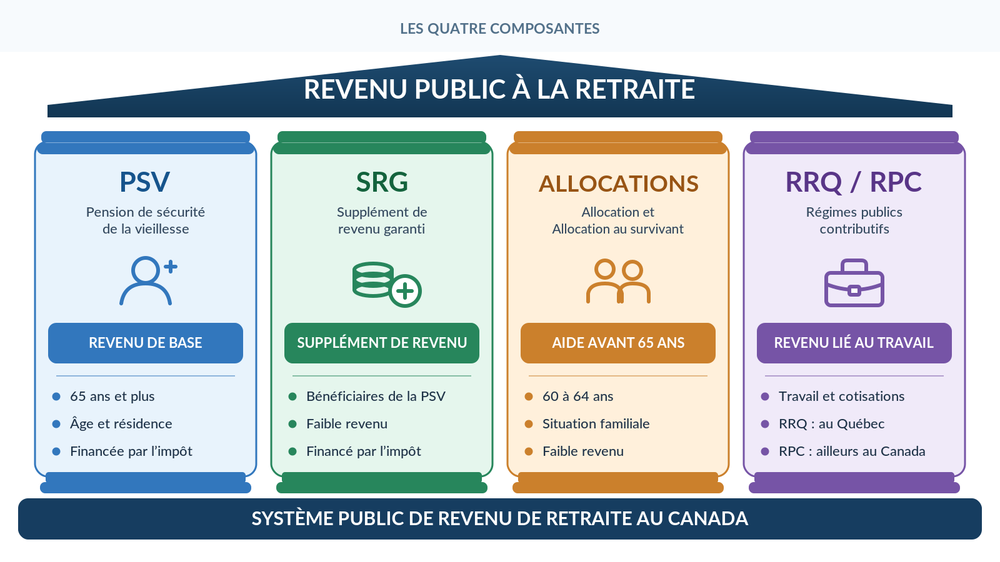
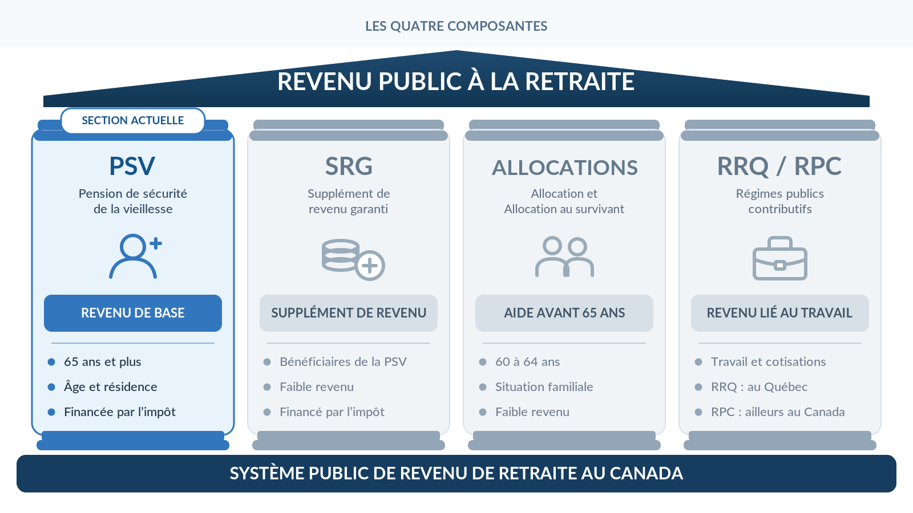
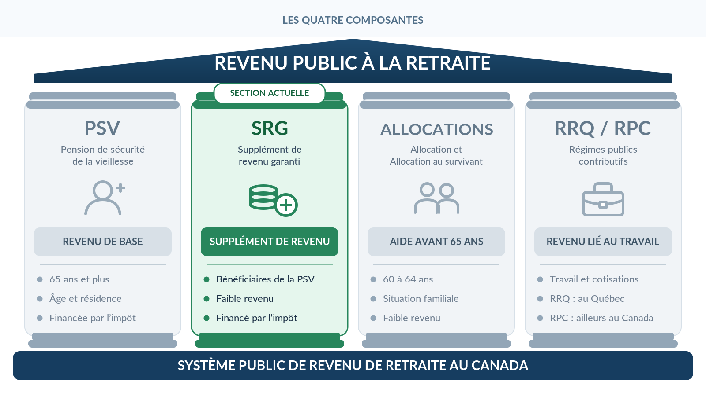
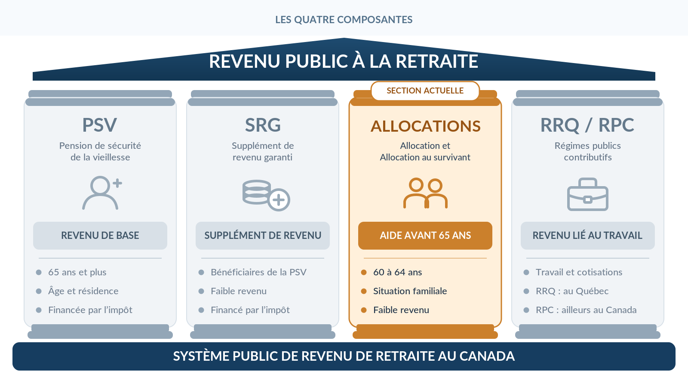
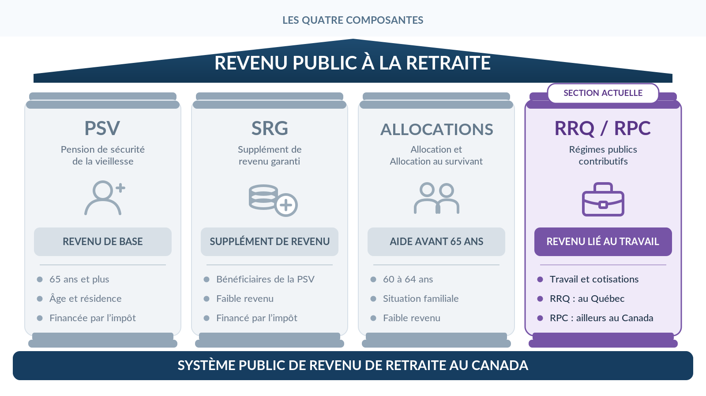

# Régimes de retraite publics 

::: {.act-objectifs}

<div class="act-objectifs-titre">Objectifs du chapitre</div>

- Distinguer les principaux programmes publics de retraite au Canada selon leurs objectifs, leurs conditions d'admissibilité et leurs modes de financement.
- Expliquer le fonctionnement de la Pension de sécurité de la vieillesse (PSV), du Supplément de revenu garanti (SRG) et des Allocations, notamment les règles de calcul, d'indexation et de réduction des prestations.
- Comprendre les principes des régimes contributifs RRQ et RPC, leur évolution historique et les changements introduits par la bonification amorcée en 2019.
- Calculer une rente de retraite du RRQ à partir des gains admissibles, en tenant compte de leur rajustement, des différentes composantes de la rente et de l'âge de la retraite.
- Identifier les principales prestations du RRQ en cas de décès ou d'invalidité d'un participant.
- Calculer les cotisations au RRQ et au RPC et expliquer les mécanismes de financement des régimes ainsi que le rôle des évaluations actuarielles.

:::

::: {.callout-note collapse="true"}

## Plan du chapitre

<div id="plan-chapitre-auto"></div>

<!--

<div style="clear: both;"></div>
-->

:::


## Introduction

Le passage de la vie active à la retraite entraîne généralement une diminution ou une disparition des revenus de travail. Pour permettre aux personnes âgées de conserver un certain revenu, les gouvernements ont progressivement mis en place différents programmes publics de retraite. Ces programmes ne poursuivent toutefois pas tous les mêmes objectifs et ne reposent pas sur les mêmes mécanismes de financement. Certains procurent un revenu de base aux personnes âgées, indépendamment de leur carrière professionnelle. D'autres visent à soutenir les personnes disposant de faibles ressources financières. Enfin, les régimes contributifs permettent aux travailleurs de remplacer une partie de leurs revenus d'emploi à la retraite, en fonction des droits accumulés pendant leur vie active.

### Survol 

<div style="
float:right;
display:inline-block;
margin:0 0 1em 1em;
text-align:center;
border:0.5px solid #bbb;
padding:6px;
background:white;
box-shadow:0 3px 10px rgba(0,0,0,0.15);
max-width:330px;
">

</div>

Au Canada, le système public de revenu de retraite comprend quatre grandes composantes complémentaires :

- La *Pension de sécurité de la vieillesse (PSV)*, qui procure un revenu de base aux personnes âgées admissibles, principalement selon leur âge et leurs années de résidence au Canada.
- Le *Supplément de revenu garanti (SRG)*, qui complète la PSV pour les personnes disposant de faibles revenus.
- L'*Allocation et l'Allocation au survivant*, qui offrent un soutien financier à certaines personnes âgées de 60 à 64 ans dont la situation familiale et les revenus répondent aux conditions prévues.
- Le *Régime de rentes du Québec (RRQ)* et le *Régime de pensions du Canada (RPC)*, qui versent des prestations fondées notamment sur les revenus de travail et les cotisations accumulées pendant la carrière.

Ces programmes se distinguent notamment par leurs critères d'admissibilité, leurs méthodes de calcul et la façon dont leurs prestations évoluent avec l'âge ou les revenus des bénéficiaires. Leur financement fait également appel à deux logiques différentes : les recettes fiscales générales pour les trois premières composantes, et les cotisations des travailleurs et des employeurs, accompagnées de revenus de placement, pour les régimes contributifs. Dans ce chapitre, nous examinerons le fonctionnement de chacun de ces programmes, leur évolution historique et les principaux mécanismes actuariels qui interviennent dans le calcul des prestations et leur financement. Les exemples numériques utiliseront principalement les paramètres applicables en 2026.

<div style="clear: both;"></div>


::: {.callout-note collapse="true"}

## Comment lire les calculs de ce chapitre

Les exemples numériques visent à illustrer le fonctionnement des régimes publics de retraite, sans nécessairement reproduire tous les détails des calculs administratifs.

Quelques conventions sont utilisées dans ce chapitre :

- Les paramètres officiels (taux, plafonds, prestations maximales, etc.) sont accompagnés de leur période de référence et de liens vers les organismes responsables.
- Les calculs utilisent les formules officielles lorsque celles-ci peuvent être appliquées directement. Dans les autres cas, des simplifications permettent d'illustrer les mécanismes essentiels.
- Les hypothèses nécessaires aux exemples sont précisées, notamment concernant les revenus, la situation familiale, les années de résidence ou les carrières fictives.
- Sauf indication contraire, les exemples utilisent les paramètres de 2026. Certains montants peuvent être supposés constants afin de faciliter les calculs.

Les résultats doivent donc être interprétés comme des illustrations pédagogiques, et non comme des estimations individuelles des prestations réellement payables.

Le code R utilisé pour les calculs importants peut être déplié par le lecteur. Le code servant uniquement à produire les graphiques demeure généralement masqué.

:::

---

## Pension de sécurité de la vieillesse (PSV)

<div style="
float:right;
display:inline-block;
margin:0 0 1em 1em;
text-align:center;
border:0.5px solid #bbb;
padding:6px;
background:white;
box-shadow:0 3px 10px rgba(0,0,0,0.15);
max-width:330px;
">

</div>

La [Pension de sécurité de la vieillesse (PSV)](https://www.canada.ca/fr/services/prestations/pensionspubliques/securite-vieillesse.html) constitue la première composante du système public de retraite canadien. Elle vise à procurer un revenu de base aux personnes âgées, indépendamment de leur participation au marché du travail. Contrairement au RRQ et au RPC, il n'est donc pas nécessaire d'avoir travaillé ou cotisé à un régime de retraite pour y être admissible.

Historiquement, ce programme s'est développé à une époque où de nombreuses personnes âgées ne disposaient pas de ressources suffisantes pour subvenir à leurs besoins. L'épargne personnelle et les régimes de retraite privés étaient souvent insuffisants, ce qui rendait les personnes incapables de continuer à travailler particulièrement vulnérables. [↗](https://publications.gc.ca/Pilot/LoPBdP/MR/mr58-e.htm "Bibliothèque du Parlement — Historique du programme de la Sécurité de la vieillesse"){.source-link} Le système canadien s'est construit progressivement :

- En 1927, le Canada adopte la *Loi des pensions de vieillesse*. Le gouvernement fédéral contribue au financement des prestations, mais leur administration relève des provinces. L'aide est réservée aux personnes âgées dont les ressources financières sont insuffisantes. [↗](https://www150.statcan.gc.ca/n1/pub/11-516-x/sectionc/4057749-fra.htm "Statistique Canada — Statistiques historiques du Canada : pensions de vieillesse"){.source-link}

- En 1952, l'entrée en vigueur de la *Loi sur la sécurité de la vieillesse* marque un tournant. Le programme devient entièrement fédéral et offre une prestation uniforme aux personnes âgées de 70 ans et plus, principalement selon des critères d'âge et de résidence, sans évaluation de leurs ressources financières. [↗](https://www.osfi-bsif.gc.ca/fr/bac/rapports-actuariels/rapport-actuariel-16e-sur-programme-securite-vieillesse "BSIF — Rapport actuariel sur le Programme de la sécurité de la vieillesse"){.source-link}

- Entre 1966 et 1970, l'âge d'admissibilité est progressivement abaissé de 70 à 65 ans, élargissant ainsi l'accès à la pension. [↗](https://www150.statcan.gc.ca/n1/pub/11-516-x/sectionc/4057749-fra.htm "Statistique Canada — Évolution historique de la Sécurité de la vieillesse"){.source-link}

#### **Réformes et débats sur l'universalité** {-}

Après plusieurs décennies d'élargissement du programme, les débats entourant la PSV changent progressivement de nature. À partir des années 1980, la question n'est plus seulement de savoir comment assurer un revenu aux personnes âgées, mais aussi comment maîtriser le coût du programme, particulièrement lorsque les bénéficiaires disposent déjà de revenus élevés. Plusieurs réformes sont alors envisagées ou adoptées :

- 1989 — Introduction de la récupération fiscale. Le gouvernement instaure un mécanisme obligeant les personnes à revenu élevé à rembourser une partie ou la totalité de leur PSV. Le programme conserve ses critères d'admissibilité, mais le montant réellement conservé dépend désormais du revenu. [↗](https://search.open.canada.ca/qpnotes/record/esdc-edsc%2CPA-SEN_009_20260106 "Emploi et Développement social Canada — Historique de l'impôt de récupération de la PSV"){.source-link}

- 1996 — Projet de prestation pour les aînés. Le gouvernement propose de remplacer la PSV et le Supplément de revenu garanti (SRG) par un nouveau programme davantage fondé sur le revenu. L'objectif est notamment de mieux cibler les prestations et d'en ralentir la croissance des coûts. Le projet suscite toutefois des critiques et est finalement abandonné en 1998. [↗](https://publications.gc.ca/collections/Collection/F1-23-1996-4F.pdf "Ministère des Finances du Canada — La prestation aux aînés : assurer l'avenir, budget de 1996"){.source-link} [↗](https://publications.gc.ca/collections/Collection/BT31-4-43-1999F.pdf "Développement des ressources humaines Canada — Rapport sur le rendement 1998-1999, p. 44, abandon de la réforme"){.source-link}

- 2012 — Projet de hausse de l'âge d'admissibilité. Le gouvernement adopte une réforme prévoyant de faire passer progressivement l'âge d'admissibilité de 65 à 67 ans, entre 2023 et 2029. Cette mesure est toutefois annulée en 2016, avant son entrée en application. L'âge minimal demeure donc fixé à 65 ans. [↗](https://www.budget.canada.ca/2016/docs/plan/ch5-fr.html "Ministère des Finances du Canada — Budget de 2016, rétablissement de l'âge d'admissibilité à 65 ans"){.source-link}

Ces épisodes illustrent une tension persistante entre deux objectifs : offrir un revenu de base largement accessible aux personnes âgées et contrôler les dépenses publiques associées au programme. Malgré ces débats, la PSV conserve sa vocation initiale. Son montant est également indexé chaque trimestre en fonction de l'inflation afin de protéger le pouvoir d'achat des bénéficiaires. [↗](https://www.canada.ca/fr/services/prestations/pensionspubliques/securite-vieillesse/paiements.html "Service Canada — Indexation et montants de la Sécurité de la vieillesse"){.source-link}

::: {style="background: #F5F7FA; border-left: 3px solid #A0A8B0; padding: 12px 18px; margin: 1.5em 0; border-radius: 3px;"}

**Financement**

Contrairement aux régimes contributifs comme le RRQ et le RPC, la PSV est financée à partir des recettes fiscales générales du gouvernement fédéral. Elle repose sur un système de *répartition* (*pay-as-you-go*) : les prestations sont financées par les recettes publiques courantes, sans qu'un fonds distinct soit accumulé pour couvrir les prestations futures. [↗](https://publications.gc.ca/Pilot/LoPBdP/MR/mr58-e.htm "Bibliothèque du Parlement — Historique et financement de la Sécurité de la vieillesse"){.source-link} Ce mode de financement rend le coût du programme sensible au vieillissement de la population. Lorsque le nombre de bénéficiaires augmente, les dépenses peuvent croître, même si le montant des prestations individuelles demeure inchangé. Leur poids dans les finances publiques dépend également de l'évolution de l'économie et des recettes fiscales. [↗](https://www.osfi-bsif.gc.ca/fr/bac/rapports-actuariels/18e-rapport-actuariel-sur-programme-securite-vieillesse-au-31-decembre-2021 "BSIF — 18e rapport actuariel sur le Programme de la sécurité de la vieillesse, projections financières"){.source-link}

:::

<div style="clear: both;"></div>

### Admissibilité

La PSV est souvent qualifiée d'universelle, puisqu'elle ne dépend pas des cotisations versées pendant la vie active. Toutefois, son admissibilité repose sur certaines conditions, notamment l'âge, le statut légal et la durée de résidence au Canada. La pension peut commencer à 65 ans, mais son versement peut être reporté jusqu'à 70 ans, ce qui permet d'obtenir une prestation mensuelle plus élevée. [↗](https://www.canada.ca/fr/services/prestations/pensionspubliques/securite-vieillesse/quand-debut.html "Service Canada — Quand commencer à recevoir la PSV"){.source-link} Pour [être admissible à la PSV](https://www.canada.ca/fr/services/prestations/pensionspubliques/securite-vieillesse/admissibilite.html), une personne doit être âgée d'au moins 65 ans et satisfaire aux conditions suivantes :

- **Si elle réside au Canada :**
  - être citoyenne canadienne ou résidente autorisée au moment de l'approbation de sa demande;
  - avoir résidé au Canada pendant au moins 10 ans après l'âge de 18 ans.

- **Si elle réside à l'extérieur du Canada :**
  - avoir été citoyenne canadienne ou résidente autorisée au moment de quitter le Canada;
  - avoir résidé au Canada pendant au moins 20 ans après l'âge de 18 ans.

Certaines exceptions existent. Par exemple, les personnes ayant travaillé à l'étranger pour un employeur canadien peuvent, sous certaines conditions, faire reconnaître cette période comme une période de résidence au Canada. Des [accords internationaux de sécurité sociale](https://www.canada.ca/fr/services/prestations/pensionspubliques/internationales/accords.html) peuvent également permettre à une personne de devenir admissible même si elle ne satisfait pas aux exigences habituelles de résidence. [↗](https://www.canada.ca/fr/services/prestations/pensionspubliques/securite-vieillesse/admissibilite.html "Service Canada — Conditions particulières d'admissibilité"){.source-link}

### Calcul de la pension



Le montant de la Pension de sécurité de la vieillesse (PSV) dépend notamment de l'âge du bénéficiaire et de sa durée de résidence au Canada. Pour le trimestre d'octobre à décembre 2026, la pension mensuelle maximale est de :

- 762,50 $ pour les personnes âgées de 65 à 74 ans;
- 838,75 $ pour les personnes âgées de 75 ans et plus.

La pension est donc 10 % plus élevée à partir de 75 ans, une bonification introduite en juillet 2022. Ces montants sont révisés chaque trimestre. [↗](https://www.canada.ca/fr/services/prestations/pensionspubliques/securite-vieillesse/paiements.html "Service Canada — Montants de la PSV et bonification à 75 ans"){.source-link} Toutefois, plusieurs facteurs peuvent modifier le montant reçu :

- La durée de résidence : une personne ayant résidé moins de 40 ans au Canada après ses 18 ans peut recevoir une pension partielle. Par exemple, 25 années de résidence donnent généralement droit à $25/40=62{,}5\%$ de la pension complète. [↗](https://www.canada.ca/fr/emploi-developpement-social/programmes/securite-vieillesse/rapports/sv-boite-outils.html "Emploi et Développement social Canada — Calcul d'une pension partielle"){.source-link}

- Le report de la pension : une personne peut choisir de commencer à recevoir sa PSV après 65 ans. Chaque mois de report augmente sa pension de 0,6 %, jusqu'à une augmentation maximale de 36 % à 70 ans. [↗](https://www.canada.ca/fr/services/prestations/pensionspubliques/securite-vieillesse/quand-debut.html "Service Canada — Effet du report de la PSV"){.source-link}

Enfin, la PSV est imposable et peut également être réduite pour les personnes à revenu élevé, comme nous le verrons dans la prochaine section. [↗](https://www.canada.ca/fr/services/prestations/pensionspubliques/securite-vieillesse/impot-recuperation.html "Service Canada — Impôt de récupération de la PSV"){.source-link} Pour estimer sa propre pension, Service Canada propose un [estimateur en ligne](https://estimateursv-oasestimator.digital.service.canada.ca/fr) qui tient compte de ces différents paramètres.

<div style="clear: both;"></div>

#### **Illustration graphique de la pension** {-}

Le graphique suivant illustre l'effet de l'âge et des années de résidence sur la pension mensuelle, en utilisant les montants d'octobre à décembre 2026. Il ne tient compte ni de la récupération fiscale ni d'une éventuelle majoration pour report.

```{r}
#| code-fold: true
#| echo: true
#| message: false
#| warning: false
#| fig-height: 4
#| fig-width: 9
#| fig-align: center
#| fig-cap: "PSV mensuelle théorique selon l'âge et les années de résidence, octobre–décembre 2026 (avant récupération fiscale)"
#| label: fig-psv_par_residence

library(ggplot2)
library(dplyr)

psv_scenarios <- expand.grid(
  age = c("65 à 74 ans", "75 ans et plus"),
  residence = c(10, 25, 40)
) %>%
  mutate(montant_complet = ifelse(age == "65 à 74 ans", 762.50, 838.75),
         montant = montant_complet * residence / 40,
         residence = factor(residence, levels = c(10, 25, 40),
                            labels = c("10 ans", "25 ans", "40 ans")))

ggplot(psv_scenarios, aes(x = residence, y = montant, fill = age)) +
  geom_col(position = "dodge") +
  labs(x = "Années de résidence admissibles", y = "PSV mensuelle ($)", fill = NULL) +
  theme_bw()
```

### Pension partielle et récupération fiscale

Nous avons vu que la PSV peut être réduite selon le nombre d'années de résidence au Canada. Toutefois, un second mécanisme peut également diminuer le montant reçu : la *récupération fiscale* qui dépend du revenu. Une personne ayant un revenu élevé doit en effet rembourser une partie, voire la totalité, de sa PSV, même si elle est admissible à la pension complète. Plus concrètement, lorsque le revenu net d'une personne dépasse un certain seuil, elle doit rembourser **15 % de la portion de son revenu qui dépasse ce seuil**. [↗](https://www.canada.ca/fr/services/prestations/pensionspubliques/securite-vieillesse/impot-recuperation.html "Service Canada — Impôt de récupération de la PSV"){.source-link}  De manière générale, si $P$ représente la PSV annuelle avant récupération, $Y$ le revenu net de référence et $Y_0$ le seuil de récupération, on obtient la formule simplifiée suivante :

$$
P_{\mathrm{net}}=\max\left(0,\ P-0{,}15\max(0,Y-Y_0)\right).
$$

Pour la période de récupération de juillet 2026 à juin 2027, le seuil de récupération $Y_0$ est de 93 454 $, établi à partir du revenu de 2025. Cette récupération est distincte de l'impôt ordinaire sur le revenu, auquel la PSV est également assujettie. 

#### **Paramètres officiels (2026)** {-}

Le tableau suivant rassemble les paramètres officiels : les montants mensuels sont ceux d'octobre à décembre 2026, tandis que les seuils de revenu concernent la récupération de juillet 2026 à juin 2027, établie selon le revenu de 2025. [↗](https://www.canada.ca/fr/services/prestations/pensionspubliques/securite-vieillesse/paiements.html "Service Canada — Montants mensuels de la PSV"){.source-link} [↗](https://www.canada.ca/fr/services/prestations/pensionspubliques/securite-vieillesse/impot-recuperation.html "Service Canada — Seuils de récupération pour 2026-2027"){.source-link}

::: {.encadre}

```{r}
#| code-fold: true
#| echo: true
#| message: false
#| warning: false
#| fig-height: 4
#| fig-width: 9
#| fig-align: center

library(dplyr)
library(tidyr)
library(ggplot2)
library(kableExtra)
library(scales)

mnt.65 <- 762.50
mnt.75 <- 838.75

min.65 <- 93454
min.75 <- 93454

max.65 <- 152062
max.75 <- 157923

pct <- 0.15

tab_psv <- tibble(
  Groupe = c("65-74 ans", "75 ans et plus"),
  `Montant mensuel` = c(mnt.65, mnt.75),
  `Seuil min de récupération` = c(min.65, min.75),
  `Seuil max de récupération` = c(max.65, max.75),
  `Pct de récupération` = c(pct, pct)
)

tab_psv |>
  mutate(
    `Montant mensuel` = dollar(`Montant mensuel`, accuracy = 0.01, prefix = "", suffix = " $"),
    `Seuil min de récupération` = dollar(`Seuil min de récupération`, accuracy = 1, prefix = "", suffix = " $"),
    `Seuil max de récupération` = dollar(`Seuil max de récupération`, accuracy = 1, prefix = "", suffix = " $"),
    `Pct de récupération` = percent(`Pct de récupération`, accuracy = 0.1, decimal.mark = ",")
  ) |>
  kbl(
    align = c("l", "c", "c", "c", "c"),
    booktabs = TRUE,
    escape = FALSE,  # <-- essentiel pour <br>
    col.names = c(
      "Groupe <br> d'âge",
      "Montant <br>mensuel",
      "Seuil min.<br> de récupération",
      "Seuil max.<br> de récupération",
      "Pourcentage <br>de récupération"
    )
  ) |>
  kable_styling(
    bootstrap_options = c("striped", "hover", "condensed"),
    full_width = FALSE,
    position = "center"
  )
```

:::

#### **Graphique PSV versus revenus** {-}

Le graphique suivant illustre l'effet du revenu sur la PSV en supposant, pour simplifier, que les montants d'octobre à décembre 2026 demeurent constants pendant douze mois. Il ne reproduit pas les retenues administratives exactes : les prestations sont indexées trimestriellement et les seuils de récupération complète publiés portent sur une période différente. Ainsi, le point où une courbe atteint zéro ne coïncide pas nécessairement avec le seuil officiel du tableau.

```{r}
#| code-fold: true
#| echo: true
#| message: false
#| warning: false
#| fig-height: 4
#| fig-width: 9
#| fig-align: center
#| fig-cap: "Illustration simplifiée de la PSV annuelle après récupération, paramètres d’octobre–décembre 2026 et revenu de référence 2025"
#| label: fig-psv_par_revenu

revenu_seq <- seq(0, 180000, by = 500)

psv_df <- tibble(
  revenu = revenu_seq,
  "65-74 ans" = pmax(0, 12 * mnt.65 - pmax(0, revenu - min.65) * pct),
  "75 ans et plus" = pmax(0, 12 * mnt.75 - pmax(0, revenu - min.75) * pct)
) |>
  pivot_longer(
    cols = c("65-74 ans", "75 ans et plus"),
    names_to = "Groupe",
    values_to = "PSV_annuelle"
  )

ggplot(psv_df, aes(x = revenu, y = PSV_annuelle, color = Groupe)) +
  geom_line(linewidth = 1.1) +
  scale_color_manual(
    values = c(
      "65-74 ans" = "#2a6fdb",
      "75 ans et plus" = "#d62828"
    )
  ) +
  scale_x_continuous(
    labels = label_dollar(big.mark = " ", decimal.mark = ",", suffix = " $"),
    breaks = seq(0, 180000, by = 30000)
  ) +
  scale_y_continuous(
    labels = label_dollar(big.mark = " ", decimal.mark = ",", suffix = " $")
  ) +
  labs(
    x = "Revenu annuel",
    y = "PSV annuelle reçue",
    color = NULL
  ) +
  theme_bw() +
  theme(
    legend.position = "right"
  )

```  

#### **Combinaison des effets** {-}

Nous avons vu que la PSV peut être réduite par deux mécanismes : une durée de résidence insuffisante au Canada et un revenu élevé. Ces deux réductions peuvent s'appliquer à une même personne. L'exemple suivant illustre comment elles se combinent.

::: {#exm-psv-recuperation .custom}

Considérons une personne de 70 ans qui reçoit la PSV depuis l'âge de 65 ans, sans report. Pour simplifier les calculs, supposons que :

- Sa pension mensuelle maximale est de 762,50 $, montant d'octobre à décembre 2026, maintenu constant pendant 12 mois.
- Son revenu net de référence pour 2025 est de 110 000 $.
- Le seuil de récupération applicable est de 93 454 $.

Calculez sa PSV annuelle après récupération si :  
  a) elle avait accumulé 40 années de résidence admissibles au début de sa pension;  
  b) elle avait accumulé seulement 25 années de résidence admissibles au début de sa pension.

:::

::: {.custom-solution}

**Solution.**

La récupération fiscale est la même dans les deux situations, puisque le revenu de référence est identique :

$$
Rc = 0{,}15(110\,000-93\,454)
={2\,481{,}90\ \$}.
$$

a) Avec 40 années de résidence, la personne a droit à la pension complète. Après récupération :

$$
PSV=12\times762{,}50-2\,481{,}90
={6\,668{,}10\ \$}.
$$

b) Avec 25 années de résidence, la personne reçoit seulement $25/40=62{,}5\%$ de la pension complète. Après récupération :

$$
PSV=12\times762{,}50\times0{,}625-2\,481{,}90
={3\,236{,}85\ \$}.
$$

Même si les deux personnes ont le même revenu, celle qui reçoit une pension partielle conserve beaucoup moins de PSV après récupération. La récupération de 2 481,90 $ représente une proportion plus importante de sa pension initiale. 
:::


### Indexation de la PSV

La Pension de sécurité de la vieillesse est indexée selon l'évolution de l'*indice des prix à la consommation* (IPC), qui mesure les variations du prix des biens et services achetés par les ménages canadiens. Le montant de la PSV est révisé quatre fois par année, soit en janvier, avril, juillet et octobre. Cette indexation vise à préserver le pouvoir d'achat des bénéficiaires. [↗](https://www.canada.ca/fr/services/prestations/pensionspubliques/securite-vieillesse/paiements.html "Service Canada — Indexation trimestrielle de la PSV"){.source-link} Une caractéristique importante distingue ce mécanisme :

- Lorsque l'IPC augmente suffisamment, la pension est augmentée en conséquence.
- Lorsque l'IPC diminue, la pension demeure inchangée. Il faut alors attendre que l'IPC dépasse de nouveau son niveau de référence avant qu'une nouvelle augmentation soit accordée.

Pour effectuer ces ajustements, Service Canada compare les moyennes de l'IPC sur des périodes de trois mois. La comparaison ne se fait donc pas nécessairement entre deux trimestres consécutifs. De façon générale, le principe d'indexation peut s'exprimer par :

$$
P_t=P_{t-1}\max\left(1,\frac{\overline{IPC}_{\text{récent}}}{\overline{IPC}_{\text{référence}}}\right),
$$

où :

- $P_t$ représente la pension après la révision;
- $P_{t-1}$ représente la pension avant la révision;
- $\overline{IPC}_{\text{récent}}$ est la moyenne de l'IPC des trois mois les plus récents disponibles;
- $\overline{IPC}_{\text{référence}}$ est la moyenne de la dernière période ayant entraîné une augmentation de la pension.

La fonction $\max$ empêche toute diminution de la pension. Lorsque l'IPC recule, la période de référence demeure inchangée jusqu'à ce qu'une nouvelle augmentation soit possible. [↗](https://laws-lois.justice.gc.ca/fra/lois/o-9/ "Loi sur la sécurité de la vieillesse — Montant de la pension et règles de révision"){.source-link}

::: {#exm-psv-indexation .custom}

**Exemple — Protection contre une baisse de l'IPC**

En octobre 2026, la PSV maximale pour les personnes de 65 à 74 ans est de 762,50 $ par mois. La moyenne de l'IPC utilisée pour déterminer cette pension est de 169,5. [↗](https://www.canada.ca/fr/services/prestations/pensionspubliques/securite-vieillesse/paiements.html "Service Canada — Montants et indexation d'octobre 2026"){.source-link} Supposons maintenant que l'IPC évolue de la façon suivante au cours des trois révisions suivantes. Les valeurs futures sont fictives et servent uniquement à illustrer le mécanisme.

| Révision | IPC moyen | Pension mensuelle |
|---|---:|---:|
| Octobre 2026 | 169,5 | 762,50 $ |
| Janvier 2027 | 168,0 | 762,50 $ |
| Avril 2027 | 169,0 | 762,50 $ |
| Juillet 2027 | 171,0 | 769,25 $ |

Examinons les trois révisions :

- **Janvier 2027 :** l'IPC diminue de 169,5 à 168,0. La pension demeure donc inchangée à 762,50 $.

- **Avril 2027 :** l'IPC remonte à 169,0. Même s'il augmente par rapport à la période précédente, il demeure inférieur au niveau de référence de 169,5. La pension reste donc à 762,50 $.

- **Juillet 2027 :** l'IPC atteint 171,0, dépassant enfin le niveau de référence. La pension peut alors augmenter :

$$
P = 762{,}50\times\frac{171{,}0}{169{,}5}
\approx 769{,}25\ \$.
$$

Le point important est que la nouvelle augmentation est calculée par rapport à 169,5 et non à 169,0. La baisse précédente n'est donc pas prise en compte comme une diminution permanente de la base de calcul. Ainsi, la PSV est protégée contre les baisses de l'IPC, mais une remontée des prix ne donne pas nécessairement lieu à une augmentation immédiate de la pension. Il faut d'abord que l'IPC dépasse son niveau de référence antérieur.

:::


---


## Supplément de revenu garanti (SRG)

<div style="
float:right;
display:inline-block;
margin:0 0 1em 1em;
text-align:center;
border:0.5px solid #bbb;
padding:6px;
background:white;
box-shadow:0 3px 10px rgba(0,0,0,0.15);
max-width:330px;
">

</div>

Le [Supplément de revenu garanti (SRG)](https://www.canada.ca/fr/services/prestations/pensionspubliques/securite-vieillesse/supplement-revenu-garanti.html) constitue la deuxième composante du système public de retraite canadien. Contrairement à la Pension de sécurité de la vieillesse (PSV), qui est largement accessible aux personnes âgées, le SRG repose sur une logique explicitement redistributive. Il vise à compléter les revenus des personnes âgées disposant de ressources financières limitées et contribue ainsi à réduire la pauvreté chez les aînés. Il s'agit d'une prestation non contributive et non imposable, dont le montant dépend des revenus du bénéficiaire et, le cas échéant, de ceux de son conjoint. [↗](https://www.canada.ca/fr/services/prestations/pensionspubliques/securite-vieillesse/supplement-revenu-garanti.html "Service Canada — Présentation du Supplément de revenu garanti"){.source-link} Historiquement, le SRG apparaît dans le contexte de la création du Régime de rentes du Québec (RRQ) et du Régime de pensions du Canada (RPC), entrés en vigueur en 1966. Ces nouveaux régimes contributifs ne peuvent immédiatement procurer des rentes substantielles aux travailleurs qui approchent déjà de la retraite, puisqu'ils n'ont pas eu le temps d'y accumuler suffisamment de droits. Le SRG est donc initialement envisagé comme une mesure temporaire, destinée à soutenir les personnes âgées à faible revenu pendant la maturation des nouveaux régimes. Toutefois, les besoins de soutien financier persistent, et le programme devient permanent. [↗](https://lop.parl.ca/staticfiles/PublicWebsite/Home/ResearchPublications/BackgroundPapers/PDF/2019-40-F.pdf "Bibliothèque du Parlement — Le système de revenu de retraite du Canada, historique du SRG"){.source-link}

Le programme se développe progressivement :

- En 1967, le SRG entre en vigueur à la suite d'une modification de la *Loi sur la sécurité de la vieillesse* adoptée en 1966. Son montant maximal est initialement fixé à 30 $ par mois, en complément de la PSV. Contrairement à cette dernière, le supplément est dès le départ réservé aux personnes disposant de faibles revenus. [↗](https://chrsstat.uqam.ca/securite-de-vieillesse/ "UQAM — Les régulations sociales en données : historique du SRG"){.source-link}

- En 1973, l'indexation des prestations du SRG devient trimestrielle plutôt qu'annuelle, afin de mieux suivre l'évolution du coût de la vie. Cette modification prend une importance particulière dans le contexte inflationniste des années 1970. [↗](https://chrsstat.uqam.ca/securite-de-vieillesse/ "UQAM — Évolution historique de l'indexation du SRG"){.source-link}

- En 1975, le gouvernement fédéral introduit l'*Allocation au conjoint*, un programme distinct destiné aux personnes de 60 à 64 ans dont le conjoint reçoit la PSV et le SRG, sous réserve de certaines conditions de revenu. Cette mesure vise notamment les ménages dont un seul membre a atteint l'âge d'admissibilité à la PSV. [↗](https://www150.statcan.gc.ca/n1/pub/11-516-x/sectionc/4057749-fra.htm "Statistique Canada — Statistiques historiques du Canada : Sécurité de la vieillesse et Allocation au conjoint"){.source-link}

#### **Réformes et débats sur le soutien au revenu** {-}

Au fil des décennies, les débats entourant le SRG portent principalement sur deux enjeux : le niveau de soutien financier offert aux personnes âgées les plus pauvres et les conséquences de la réduction des prestations lorsque les bénéficiaires disposent d'autres sources de revenu. Plusieurs réformes cherchent ainsi à améliorer la protection des aînés à faible revenu tout en préservant l'intérêt financier de poursuivre une activité professionnelle.

- 2011 — Bonification pour les aînés à très faible revenu. Le gouvernement introduit une prestation complémentaire au SRG, pouvant atteindre 600 $ par année pour les personnes vivant seules et 840 $ pour les couples. Cette mesure vise particulièrement les personnes âgées qui dépendent presque exclusivement de la PSV et du SRG pour subvenir à leurs besoins. [↗](https://www.budget.canada.ca/2011/plan/chap1-fra.html "Ministère des Finances du Canada — Budget de 2011, bonification du SRG"){.source-link}

- 2016 — Augmentation des prestations pour les personnes vivant seules. Le gouvernement bonifie la prestation complémentaire au SRG d'un montant pouvant atteindre 947 $ supplémentaires par année pour les personnes seules ayant les plus faibles revenus. Cette réforme tient notamment compte de leur plus grande vulnérabilité économique, puisqu'elles ne peuvent partager certaines dépenses avec un conjoint. [↗](https://budget.canada.ca/2016/docs/plan/ch5-fr.html "Ministère des Finances du Canada — Budget de 2016, augmentation du SRG pour les aînés vivant seuls"){.source-link}

- 2020 — Assouplissement des règles relatives aux revenus de travail. Le gouvernement augmente les exemptions applicables aux revenus d'emploi et les étend aux revenus de travail autonome. L'objectif est de permettre aux bénéficiaires du SRG de conserver une plus grande partie de leurs prestations lorsqu'ils poursuivent une activité rémunérée. [↗](https://www.canada.ca/fr/emploi-developpement-social/programmes/securite-vieillesse/rapports/sv-boite-outils.html "Emploi et Développement social Canada — Exemption des revenus de travail dans le calcul du SRG"){.source-link}

Ces réformes illustrent une tension persistante entre deux objectifs : offrir un soutien financier suffisant aux personnes âgées les plus vulnérables et éviter que la réduction des prestations ne décourage l'obtention d'autres revenus. Le SRG conserve néanmoins sa vocation initiale de programme ciblé, destiné à compléter la PSV pour les personnes âgées disposant de faibles ressources financières.

::: {style="background: #F5F7FA; border-left: 3px solid #A0A8B0; padding: 12px 18px; margin: 1.5em 0; border-radius: 3px;"}

#### **Financement** {-}

Comme la PSV, le SRG est entièrement financé à partir des recettes fiscales générales du gouvernement fédéral. Il repose sur un système de *répartition* (*pay-as-you-go*) : les prestations sont financées par les recettes publiques courantes, sans qu'un fonds distinct soit accumulé pour couvrir les prestations futures. [↗](https://lop.parl.ca/staticfiles/PublicWebsite/Home/ResearchPublications/BackgroundPapers/PDF/2019-40-F.pdf "Bibliothèque du Parlement — Le système de revenu de retraite du Canada, financement des programmes publics"){.source-link} 
Le coût du SRG dépend toutefois de facteurs différents de ceux qui influencent la PSV. Alors que les dépenses de la PSV sont principalement liées au nombre de bénéficiaires et au montant des pensions, celles du SRG dépendent également de la proportion de personnes âgées disposant de faibles revenus. Par exemple, une amélioration des rentes versées par le RRQ, le RPC ou les régimes d'employeur peut réduire les prestations de SRG auxquelles les retraités ont droit. Inversement, une augmentation du nombre de retraités ayant peu d'autres sources de revenu peut entraîner une hausse des dépenses du programme. Les projections actuarielles doivent ainsi tenir compte non seulement du vieillissement de la population et de l'inflation, mais également de l'évolution des revenus de retraite et de leur distribution parmi les personnes âgées. [↗](https://www.osfi-bsif.gc.ca/fr/bac/rapports-actuariels/18e-rapport-actuariel-sur-programme-securite-vieillesse-au-31-decembre-2021 "BSIF — 18e rapport actuariel sur le Programme de la sécurité de la vieillesse"){.source-link}

:::

<div style="clear: both;"></div>


### Admissibilité

Le Supplément de revenu garanti (SRG) est destiné aux personnes âgées qui disposent de faibles revenus. Contrairement à la PSV, dont l'admissibilité dépend principalement de l'âge et des années de résidence au Canada, le SRG est une prestation soumise à une vérification des ressources financières.  Pour être admissible au SRG [↗](https://www.canada.ca/fr/services/prestations/pensionspubliques/securite-vieillesse/supplement-revenu-garanti/admissibilite.html "Service Canada — Conditions d'admissibilité au Supplément de revenu garanti"){.source-link}, une personne doit satisfaire aux conditions suivantes :

- Être âgée de 65 ans ou plus et recevoir la Pension de sécurité de la vieillesse (PSV);
- Être citoyenne canadienne ou résidente autorisée;
- Résider au Canada;
- Avoir un revenu annuel inférieur au seuil applicable à sa situation familiale;
- Ne pas être visée par une entente de parrainage en cours, sauf dans certaines situations particulières prévues par le programme.

La particularité du SRG est que l'admissibilité et le montant de la prestation dépendent non seulement du revenu, mais également de la situation conjugale. Pour une personne seule, on considère son revenu individuel. Pour une personne mariée ou vivant en union de fait, on tient généralement compte du revenu combiné du couple. Le traitement diffère également selon que le conjoint reçoit lui-même la PSV, bénéficie de l'Allocation ou ne reçoit aucune de ces prestations.


### Montants du SRG et seuils de revenu

Le SRG est une prestation mensuelle versée en complément de la PSV. Son montant dépend de la situation familiale et des revenus du bénéficiaire. Une personne disposant de très faibles revenus peut recevoir le montant maximal prévu par le programme, tandis qu'une personne ayant des revenus plus élevés recevra un supplément réduit. Au-delà d'un certain niveau de revenu, appelé seuil de revenu annuel, le SRG n'est plus versé dans la catégorie familiale considérée. Pour les couples, ce seuil est établi à partir du revenu combiné des deux conjoints. [↗](https://www.canada.ca/fr/services/prestations/pensionspubliques/securite-vieillesse/paiements.html "Service Canada — Montants et seuils de revenu du SRG"){.source-link} Pour déterminer le revenu pris en compte dans le calcul du SRG :

- **Revenus exclus :** les prestations de PSV et de SRG elles-mêmes.
- **Revenus inclus :** notamment les rentes du RRQ, les pensions d'employeur et les revenus de placement. Une partie des revenus d'emploi et de travail autonome peut toutefois être exemptée. [↗](https://www.canada.ca/fr/emploi-developpement-social/programmes/securite-vieillesse/rapports/sv-boite-outils.html "Service Canada — Exemptions des revenus de travail"){.source-link}

Le tableau suivant présente les montants maximaux du SRG et les seuils de revenu applicables d'octobre à décembre 2026. Les montants annuels correspondent à douze fois la prestation mensuelle, en supposant que celle-ci demeure constante pendant toute l'année. [↗](https://www.canada.ca/fr/services/prestations/pensionspubliques/securite-vieillesse/paiements.html "Service Canada — Montants maximaux et seuils de revenu, octobre à décembre 2026"){.source-link}  Ces montants supposent que le bénéficiaire reçoit une pleine PSV. Lorsqu'une pension partielle est versée, le SRG maximal peut être augmenté pour compenser la différence. [↗](https://www.osfi-bsif.gc.ca/fr/bac/rapports-actuariels/18e-rapport-actuariel-sur-programme-securite-vieillesse-au-31-decembre-2021 "BSIF — Rapport actuariel sur le programme de la Sécurité de la vieillesse"){.source-link}

::: {.encadre}

```{r}
#| code-fold: true
#| echo: true
#| message: false
#| warning: false
#| fig-align: center

library(kableExtra)
library(dplyr)
library(scales)

df <- data.frame(
  Situation = c(
    "Personne seule",
    "Conjoint recevant la PSV",
    "Conjoint recevant l'Allocation",
    "Conjoint sans PSV ni Allocation"
  ),
  montant = c(
    1138.90,
    685.56,
    685.56,
    1138.90
  ),
  revenu = c(
    23112,
    30528,
    42768,
    55392
  )
) |>
  mutate(
    `SRG mensuel maximal ($)` =
      dollar(montant, accuracy = 0.01,
             decimal.mark = ",", big.mark = " "),
    `SRG annuel maximal ($)` =
      dollar(12 * montant, accuracy = 0.01,
             decimal.mark = ",", big.mark = " "),
    `Seuil de revenu annuel ($)` =
      dollar(revenu, accuracy = 1,
             decimal.mark = ",", big.mark = " ")
  ) |>
  select(
    Situation,
    `SRG mensuel maximal ($)`,
    `SRG annuel maximal ($)`,
    `Seuil de revenu annuel ($)`
  )

df |>
  kbl(
    align = c("l", "c", "c", "c")
  ) |>
  kable_styling(
    bootstrap_options = c("striped", "hover", "condensed"),
    full_width = FALSE,
    position = "center"
  )
```

:::

Finalement, notons que comme la PSV, le SRG est également indexé chaque trimestre selon l'évolution de l'indice des prix à la consommation (IPC). Le même mécanisme de protection contre les baisses de l'IPC s'applique, comme nous l'avons expliqué précédemment pour la PSV. [↗](https://www.canada.ca/fr/services/prestations/pensionspubliques/securite-vieillesse/paiements.html "Service Canada — Indexation trimestrielle des prestations de la Sécurité de la vieillesse"){.source-link}

### Réduction du SRG

Le SRG vise à compléter les revenus des personnes âgées disposant de peu d'autres ressources financières. Son montant diminue donc progressivement à mesure que les revenus pris en compte augmentent. Toutefois, cette réduction ne s'effectue pas toujours au même rythme. Cette particularité s'explique notamment par le fait que le SRG comprend deux composantes : une prestation de base et une prestation complémentaire destinée aux bénéficiaires ayant les revenus les plus faibles. Chacune possède ses propres règles de réduction. Ainsi, selon le niveau de revenu, les deux composantes peuvent diminuer simultanément ou à des rythmes différents. [↗](https://www.canada.ca/fr/emploi-developpement-social/ministere/rapports/evaluations/programme-sv-phase-01.html "Emploi et Développement social Canada — Évaluation du programme de la Sécurité de la vieillesse"){.source-link}

Le calcul exact du SRG peut donc être complexe. En pratique, on utilise les [barèmes officiels du gouvernement fédéral](https://publications.gc.ca/collections/collection_2026/edsc-esdc/SG3-3-2026-4.pdf), qui tiennent compte des différentes règles applicables. Les fichiers CSV qui servent à produire le graphique proviennent du [jeu de données officiel des barèmes du SRG et des Allocations](https://open.canada.ca/data/fr/dataset/dfa4daf1-669e-4514-82cd-982f27707ed0 "Gouvernement ouvert — Barèmes trimestriels des prestations"){.source-link}. Le graphique suivant présente les quatre barèmes officiels du SRG pour octobre à décembre 2026, selon la situation familiale et le revenu annuel pris en compte. Les montants mensuels ont été multipliés par 12 pour les exprimer sur une base annuelle. On peut notamment observer que les courbes ne sont pas de simples droites : leur pente varie selon les niveaux de revenu, et certaines présentent même des portions horizontales.

```{r}
#| code-fold: true
#| echo: true
#| message: false
#| warning: false
#| fig-height: 5
#| fig-width: 10
#| fig-align: center
#| fig-cap: "SRG annuel selon le revenu et la situation familiale — octobre à décembre 2026"
#| label: fig-srg_par_revenu

library(ggplot2)
library(dplyr)
library(scales)

# --------------------------------------------------
# 1. Sources officielles : quatre tableaux
# --------------------------------------------------

base_url <- paste0(
  "https://open.canada.ca/data/dataset/",
  "dfa4daf1-669e-4514-82cd-982f27707ed0/resource/"
)

dir.create("data", showWarnings = FALSE)

# --------------------------------------------------
# 2. Lecture des fichiers CSV
# --------------------------------------------------

charger_table <- function(numero, ressource, fichier,
                          situation, maximum, seuil) {

  url <- paste0(
    base_url, ressource, "/download/", fichier
  )

  chemin <- file.path("data", fichier)

  if (!file.exists(chemin)) {
    download.file(
      url, chemin,
      mode = "wb",
      quiet = TRUE
    )
  }

  brut <- read.csv(
    chemin,
    check.names = FALSE,
    colClasses = "character",
    fileEncoding = "UTF-8-BOM"
  )

  names(brut) <- tolower(trimws(names(brut)))

  # Colonnes officielles :
  # t1income_from, t1income_to, t1gistotal
  # et équivalents t2, t3, t4

  colonnes <- paste0(
    "t", numero,
    c("income_from", "income_to", "gistotal")
  )

  if (!all(colonnes %in% names(brut))) {
    stop(
      "Colonnes manquantes dans le tableau ",
      numero, " : ",
      paste(setdiff(colonnes, names(brut)),
            collapse = ", ")
    )
  }

  vers_nombre <- function(x) {
    as.numeric(
      gsub(",", "", as.character(x), fixed = TRUE)
    )
  }

  resultat <- data.frame(
    Situation = situation,
    revenu_min = vers_nombre(brut[[colonnes[1]]]),
    revenu_max = vers_nombre(brut[[colonnes[2]]]),
    srg_mensuel = vers_nombre(brut[[colonnes[3]]])
  ) |>
    filter(
      is.finite(revenu_min),
      is.finite(revenu_max),
      is.finite(srg_mensuel)
    ) |>
    arrange(revenu_min)

  # Vérifier les montants et les seuils officiels
  stopifnot(
    nrow(resultat) > 50,
    abs(resultat$srg_mensuel[1] - maximum) < 0.01,
    abs(tail(resultat$revenu_max, 1) -
          (seuil - 0.01)) < 0.10,
    all(diff(resultat$revenu_min) > 0)
  )

  # Pour les tableaux 1, 2 et 3, ajouter le point
  # où le SRG devient nul.
  #
  # Exception : dans le tableau 4, lorsque
  # l'Allocation cesse, le bénéficiaire peut
  # continuer à recevoir le SRG (tableau 3).

  if (numero != 4) {
    resultat <- bind_rows(
      resultat,
      data.frame(
        Situation = situation,
        revenu_min = seuil,
        revenu_max = seuil,
        srg_mensuel = 0
      )
    )
  }

  resultat |>
    arrange(revenu_min) |>
    mutate(srg_annuel = 12 * srg_mensuel)
}

# --------------------------------------------------
# 3. Charger les quatre situations familiales
# --------------------------------------------------

srg_seule <- charger_table(
  numero = 1,
  ressource = "0a7918f0-6e8a-433b-9ea2-60e2b8674cb5",
  fichier = paste0(
    "table1_gis_for_single_who_receives_",
    "oas_pension_october2026.csv"
  ),
  situation = "Personne seule",
  maximum = 1138.90,
  seuil = 23112
)

srg_deux_psv <- charger_table(
  numero = 2,
  ressource = "5efa3920-83f6-4108-bb51-db2456e7b37c",
  fichier = paste0(
    "table2_gis_for_spouse_of_someone_",
    "receiving_oas_pension_october2026.csv"
  ),
  situation = "Conjoint recevant la PSV",
  maximum = 685.56,
  seuil = 30528
)

srg_allocation <- charger_table(
  numero = 4,
  ressource = "89b0fa2c-af49-4fb5-a74c-1cf2268fb521",
  fichier = paste0(
    "table4_gis_and_allowance_for_",
    "couple_october2026.csv"
  ),
  situation = "Conjoint recevant l'Allocation",
  maximum = 685.56,
  seuil = 42768
)

srg_sans_psv <- charger_table(
  numero = 3,
  ressource = "b4e1258c-2a72-4c64-b202-d0ab6aa2d21a",
  fichier = paste0(
    "table3_gis_for_spouse_of_someone_",
    "who_does_not_receive_oas_pension_october2026.csv"
  ),
  situation = "Conjoint sans PSV ni Allocation",
  maximum = 1138.90,
  seuil = 55392
)

# --------------------------------------------------
# 4. Regrouper les données
# --------------------------------------------------

srg_graphique <- bind_rows(
  srg_seule,
  srg_deux_psv,
  srg_allocation,
  srg_sans_psv
)

# Vérification : exactement quatre catégories
stopifnot(
  n_distinct(srg_graphique$Situation) == 4
)

# Ordre des catégories dans la légende
srg_graphique$Situation <- factor(
  srg_graphique$Situation,
  levels = c(
    "Personne seule",
    "Conjoint recevant la PSV",
    "Conjoint recevant l'Allocation",
    "Conjoint sans PSV ni Allocation"
  )
)

# --------------------------------------------------
# 5. Graphique des quatre barèmes
# --------------------------------------------------

ggplot(
  srg_graphique,
  aes(
    x = revenu_min,
    y = srg_annuel,
    color = Situation,
    group = Situation
  )
) +
  geom_step(
    linewidth = 1.05,
    direction = "hv"
  ) +
  scale_x_continuous(
    limits = c(0, 56000),
    breaks = seq(0, 55000, 10000),
    labels = label_dollar(
      big.mark = " ",
      decimal.mark = ","
    )
  ) +
  scale_y_continuous(
    breaks = seq(0, 14000, 2000),
    labels = label_dollar(
      big.mark = " ",
      decimal.mark = ","
    )
  ) +
  labs(
    x = "Revenu annuel pris en compte ($)",
    y = "SRG annuel par bénéficiaire ($)",
    color = NULL
  ) +
  theme_bw() +
  theme(
    legend.position = "bottom",
    legend.text = element_text(size = 9)
  ) +
  guides(
    color = guide_legend(ncol = 2)
  )

```


::: {style="background: #F5F7FA; border-left: 3px solid #A0A8B0; padding: 12px 18px; margin: 1.5em 0; border-radius: 3px;"}


#### **Une particularité : la fin de l'Allocation** {-}

La courbe correspondant à un conjoint recevant l'Allocation présente une particularité : elle s'arrête lorsque le revenu familial atteint 42 768 $, alors que le SRG demeure positif. En effet, lorsqu'un ménage dépasse le seuil de revenu donnant droit à l'Allocation, le conjoint qui reçoit la PSV peut continuer de bénéficier du SRG. Sa prestation est alors déterminée selon le barème applicable aux personnes dont le conjoint ne reçoit ni PSV ni Allocation. C'est pourquoi, sur le graphique, la courbe bleu poudre s'arrête et la courbe violette prend le relais, sans que le SRG disparaisse.

::: {#exm-srg-couple .custom}

Considérons un couple formé de Jean, 68 ans, qui reçoit la PSV et le SRG, et de Marie, 62 ans, qui reçoit l'Allocation. Selon les barèmes d'octobre à décembre 2026 [↗](https://publications.gc.ca/collections/collection_2026/edsc-esdc/SG3-3-2026-4.pdf "Service Canada — Barèmes officiels d'octobre à décembre 2026, tableaux 3 et 4"){.source-link} :

- Avec un revenu familial annuel pris en compte de **42 750 $**, Jean reçoit un SRG mensuel de 262,92 $, tandis que Marie reçoit une Allocation de 0,57 $.
- Si ce revenu était plutôt de **42 800 $**, Marie ne recevrait plus l'Allocation. Jean continuerait toutefois de recevoir un SRG mensuel de 262,49 $.

Le changement de catégorie permet donc à Jean de conserver son SRG, même après la disparition de l'Allocation de Marie.
:::

Pour bien comprendre cette particularité du SRG, il reste toutefois à examiner le fonctionnement de l'**Allocation au conjoint**, qui constitue la troisième composante du système public de retraite canadien et que nous présenterons dans la prochaine section.

:::

---


## Allocation au conjoint et Allocation au survivant

<div style="
float:right;
display:inline-block;
margin:0 0 1em 1em;
text-align:center;
border:0.5px solid #bbb;
padding:6px;
background:white;
box-shadow:0 3px 10px rgba(0,0,0,0.15);
max-width:330px;
">

</div>

L'[Allocation au conjoint](https://www.canada.ca/fr/services/prestations/pensionspubliques/securite-vieillesse/supplement-revenu-garanti/allocation.html) et l'[Allocation au survivant](https://www.canada.ca/fr/services/prestations/pensionspubliques/securite-vieillesse/supplement-revenu-garanti/allocation-survivant.html) constituent la troisième composante du programme fédéral de la Sécurité de la vieillesse. Contrairement à la PSV et au SRG, ces prestations s'adressent aux personnes âgées de **60 à 64 ans**, qui n'ont donc pas encore atteint l'âge d'admissibilité à la PSV. Elles visent à soutenir deux catégories particulières de personnes disposant de faibles revenus : celles dont le conjoint reçoit la PSV et le SRG, et celles dont le conjoint est décédé. Ces deux prestations reposent sur une logique redistributive semblable à celle du SRG. Elles sont non contributives et non imposables, et leur montant dépend des revenus du bénéficiaire ou du couple. Leur objectif est de procurer un soutien financier à certaines personnes qui se trouvent dans une situation de vulnérabilité économique avant l'âge de 65 ans. [↗](https://www.canada.ca/fr/emploi-developpement-social/ministere/rapports/evaluations/programme-sv-phase-02.html "Emploi et Développement social Canada — Évaluation du programme de la Sécurité de la vieillesse, phase 2"){.source-link}

Historiquement, ces programmes apparaissent dans un contexte où les revenus de retraite sont souvent concentrés entre les mains d'un seul membre du couple. Dans les années 1970, la participation des femmes mariées au marché du travail demeure relativement faible, et plusieurs ne disposent pas de droits importants à une pension de retraite. Lorsqu'un conjoint plus âgé prend sa retraite, le ménage peut alors dépendre essentiellement de sa PSV et de son SRG, même si l'autre conjoint n'a pas encore atteint 65 ans. Le décès du conjoint pensionné peut également provoquer une diminution importante du revenu familial. [↗](https://www.canada.ca/fr/emploi-developpement-social/ministere/rapports/evaluations/programme-sv-phase-02.html "Emploi et Développement social Canada — Contexte historique et justification des Allocations"){.source-link}

Le système se développe progressivement pour répondre à ces situations :

- En 1975, le gouvernement fédéral introduit l'*Allocation au conjoint*. Elle permet à certaines personnes de 60 à 64 ans de recevoir une prestation lorsque leur conjoint plus âgé bénéficie de la PSV et du SRG. L'objectif est de soutenir les couples à faible revenu dont un seul membre a atteint l'âge d'admissibilité aux programmes de la Sécurité de la vieillesse. [↗](https://www.canada.ca/fr/emploi-developpement-social/ministere/rapports/evaluations/programme-sv-phase-02.html "Emploi et Développement social Canada — Instauration de l'Allocation en 1975"){.source-link}

- En 1978, le programme est étendu aux personnes veuves qui recevaient l'Allocation lorsque leur conjoint pensionné est décédé. Elles peuvent désormais conserver leur prestation pendant une période maximale de six mois suivant le décès. Cette mesure vise à éviter une interruption immédiate du soutien financier. [↗](https://www.canada.ca/fr/emploi-developpement-social/ministere/rapports/evaluations/programme-sv-phase-02.html "Emploi et Développement social Canada — Élargissement de 1978"){.source-link}

- En 1979, cette protection est prolongée jusqu'à ce que la personne survivante atteigne 65 ans ou se remarie. Le soutien n'est donc plus limité aux six mois suivant le décès. [↗](https://www.canada.ca/fr/emploi-developpement-social/ministere/rapports/evaluations/programme-sv-phase-02.html "Emploi et Développement social Canada — Réforme de 1979"){.source-link}

- En 1985, le gouvernement crée l'*Allocation au survivant*. Cette nouvelle prestation élargit la protection aux personnes veuves de 60 à 64 ans à faible revenu, même lorsqu'elles ne recevaient pas auparavant l'Allocation au conjoint. [↗](https://www.canada.ca/fr/emploi-developpement-social/ministere/rapports/evaluations/programme-sv-phase-02.html "Emploi et Développement social Canada — Création de l'Allocation au survivant en 1985"){.source-link}

<div style="clear: both;"></div>


#### **Évolution et débats sur la protection du revenu** {-}



L'évolution de ces programmes illustre une préoccupation importante des politiques publiques de retraite : comment soutenir les personnes qui n'ont pas encore atteint l'âge d'admissibilité aux pensions publiques, mais qui disposent de ressources financières insuffisantes? Les débats entourant l'élargissement des Allocations ont notamment porté sur la situation des femmes veuves, qui avaient souvent consacré une partie importante de leur vie à des activités familiales non rémunérées et disposaient de droits limités à des pensions personnelles. L'extension du soutien à l'ensemble des personnes de 60 à 64 ans à faible revenu a toutefois été jugée trop coûteuse. Le gouvernement a donc maintenu une protection ciblée selon la situation conjugale. [↗](https://www.canada.ca/fr/emploi-developpement-social/ministere/rapports/evaluations/programme-sv-phase-02.html "Emploi et Développement social Canada — Débats sur l'élargissement des Allocations"){.source-link} Les caractéristiques des bénéficiaires ont également évolué avec la participation croissante des femmes au marché du travail et l'amélioration des revenus de retraite. Dans une évaluation publiée par le gouvernement fédéral, les bénéficiaires des deux Allocations représentaient environ 3 % de l'ensemble des Canadiens âgés de 60 à 64 ans en 2016, mais 22 % des personnes veuves de cette tranche d'âge. Ces programmes demeurent donc relativement restreints dans l'ensemble de la population, tout en jouant un rôle important pour certaines catégories de personnes. [↗](https://www.canada.ca/fr/emploi-developpement-social/ministere/rapports/evaluations/programme-sv-phase-02.html "Emploi et Développement social Canada — Profil et proportion des bénéficiaires des Allocations"){.source-link}

<div style="clear: both;"></div>


::: {style="background: #F5F7FA; border-left: 3px solid #A0A8B0; padding: 12px 18px; margin: 1.5em 0; border-radius: 3px;"}

#### **Financement** {-}

Comme la PSV et le SRG, l'Allocation au conjoint et l'Allocation au survivant sont financées à partir des recettes fiscales générales du gouvernement fédéral. Elles reposent donc sur un système de *répartition* (*pay-as-you-go*), sans cotisations particulières des bénéficiaires ni constitution d'un fonds distinct destiné à financer les prestations futures. [↗](https://www.canada.ca/fr/emploi-developpement-social/ministere/rapports/resultats-ministeriels/2024-2025/programmes-paiements-transfert.html "Emploi et Développement social Canada — Paiements de transfert du programme de la Sécurité de la vieillesse"){.source-link} Le coût de ces prestations dépend notamment du nombre de personnes âgées de 60 à 64 ans, de leur situation conjugale et de leurs ressources financières. Par exemple, une diminution de la proportion de personnes veuves disposant de faibles revenus peut réduire les dépenses de l'Allocation au survivant. Inversement, une augmentation du nombre de couples dont un seul conjoint reçoit une pension publique peut accroître les dépenses de l'Allocation au conjoint. Les projections actuarielles doivent donc tenir compte de l'évolution démographique, de la situation familiale et de la distribution des revenus chez les personnes approchant l'âge de la retraite. [↗](https://www.osfi-bsif.gc.ca/fr/bac/rapports-actuariels/18e-rapport-actuariel-sur-programme-securite-vieillesse-au-31-decembre-2021 "BSIF — 18e rapport actuariel sur le Programme de la sécurité de la vieillesse"){.source-link}

:::


### Admissibilité

L'Allocation au conjoint et l'Allocation au survivant s'adressent toutes deux aux personnes âgées de 60 à 64 ans ayant de faibles revenus. Toutefois, les conditions d'admissibilité diffèrent selon la situation conjugale. Certaines conditions sont communes aux deux programmes :

- Être âgé de 60 à 64 ans;
- Être citoyen canadien ou résident autorisé;
- Résider au Canada et y avoir généralement accumulé au moins 10 années de résidence depuis l'âge de 18 ans;
- Avoir un revenu annuel inférieur au seuil applicable;
- Ne pas être visé par une entente de parrainage en cours, sauf dans certaines situations particulières.

Des exceptions à la condition de résidence peuvent notamment s'appliquer lorsqu'une personne a vécu ou travaillé dans un pays ayant conclu une entente de sécurité sociale avec le Canada. [↗](https://www.canada.ca/fr/services/prestations/pensionspubliques/securite-vieillesse/supplement-revenu-garanti/allocation/admissibilite.html "Service Canada — Admissibilité à l'Allocation au conjoint"){.source-link} [↗](https://www.canada.ca/fr/services/prestations/pensionspubliques/securite-vieillesse/supplement-revenu-garanti/allocation-survivant/admissibilite.html "Service Canada — Admissibilité à l'Allocation au survivant"){.source-link}  Les conditions particulières à chaque prestation sont les suivantes [↗](https://www.canada.ca/fr/services/prestations/pensionspubliques/securite-vieillesse/supplement-revenu-garanti/allocation/admissibilite.html "Service Canada — Conditions particulières de l'Allocation"){.source-link} [↗](https://www.canada.ca/fr/services/prestations/pensionspubliques/securite-vieillesse/supplement-revenu-garanti/allocation-survivant/admissibilite.html "Service Canada — Conditions particulières de l'Allocation au survivant"){.source-link}:

- **Allocation au conjoint :** le bénéficiaire doit avoir un époux ou un conjoint de fait qui reçoit la PSV et qui est admissible au SRG. Le revenu utilisé pour déterminer l'admissibilité correspond au revenu combiné du couple.

- **Allocation au survivant :** le bénéficiaire doit avoir perdu son époux ou conjoint de fait et ne pas s'être remarié ni engagé dans une nouvelle union de fait depuis le décès. Le revenu utilisé correspond à son revenu individuel.

Une distinction importante avec le SRG apparaît donc : il n'est pas nécessaire de recevoir la PSV pour bénéficier de ces Allocations. Au contraire, elles s'adressent précisément à des personnes qui n'ont pas encore atteint l'âge de 65 ans.


### Montants des Allocations et seuils de revenu

L'Allocation au conjoint et l'Allocation au survivant sont des prestations mensuelles dont le montant varie selon le revenu pris en compte. Comme pour le SRG, les personnes disposant de très faibles revenus peuvent recevoir la prestation maximale, tandis que celles ayant des revenus plus élevés obtiennent un montant réduit. Au-delà du seuil applicable, aucune Allocation n'est versée. La différence essentielle entre les deux programmes concerne le revenu utilisé pour déterminer la prestation :

- **Allocation au conjoint :** le revenu combiné des deux conjoints.
- **Allocation au survivant :** le revenu individuel de la personne survivante.

Le tableau suivant présente les montants maximaux des Allocations et les seuils de revenu applicables d'octobre à décembre 2026. Les montants annuels correspondent à douze fois la prestation mensuelle, en supposant que celle-ci demeure constante pendant toute l'année. [↗](https://www.canada.ca/fr/services/prestations/pensionspubliques/securite-vieillesse/paiements.html "Service Canada — Montants maximaux des Allocations, octobre à décembre 2026"){.source-link}  Les montants maximaux de l'Allocation au conjoint supposent que le conjoint pensionné reçoit une pleine PSV. Les montants effectivement versés peuvent être différents lorsque cette condition n'est pas remplie.

::: {.encadre}

```{r}
#| code-fold: true
#| echo: true
#| message: false
#| warning: false
#| fig-align: center

library(kableExtra)
library(dplyr)
library(scales)

df <- data.frame(
  Prestation = c(
    "Allocation au conjoint",
    "Allocation au survivant"
  ),
  montant = c(
    1448.06,
    1726.18
  ),
  revenu = c(
    42768,
    31152
  )
) |>
  mutate(
    `Montant mensuel maximal ($)` =
      dollar(montant, accuracy = 0.01,
             decimal.mark = ",", big.mark = " "),
    `Montant annuel maximal ($)` =
      dollar(12 * montant, accuracy = 0.01,
             decimal.mark = ",", big.mark = " "),
    `Seuil de revenu annuel ($)` =
      dollar(revenu, accuracy = 1,
             decimal.mark = ",", big.mark = " ")
  ) |>
  select(
    Prestation,
    `Montant mensuel maximal ($)`,
    `Montant annuel maximal ($)`,
    `Seuil de revenu annuel ($)`
  )

df |>
  kbl(
    align = c("l", "c", "c", "c")
  ) |>
  kable_styling(
    bootstrap_options = c("striped", "hover", "condensed"),
    full_width = FALSE,
    position = "center"
  )
```

:::

Comme la PSV et le SRG, les deux Allocations sont également indexées chaque trimestre selon l'évolution de l'indice des prix à la consommation (IPC). Elles bénéficient du même mécanisme de protection contre les diminutions liées à une baisse de cet indice. [↗](https://www.canada.ca/fr/services/prestations/pensionspubliques/securite-vieillesse/paiements.html "Service Canada — Indexation trimestrielle des prestations de la Sécurité de la vieillesse"){.source-link}


### Réduction des Allocations

Comme pour le Supplément de revenu garanti (SRG), le montant de l'Allocation au conjoint et de l'Allocation au survivant diminue à mesure que les revenus pris en compte augmentent. Cette réduction ne s'effectue toutefois pas à un rythme constant, car les différentes composantes des prestations sont soumises à des règles de réduction distinctes. Le calcul exact des Allocations peut donc être complexe. En pratique, on utilise les [barèmes officiels du gouvernement fédéral](https://publications.gc.ca/collections/collection_2026/edsc-esdc/SG3-3-2026-4.pdf), qui tiennent compte des règles applicables à chaque prestation. Les données du graphique proviennent des [fichiers CSV officiels du SRG et des Allocations](https://open.canada.ca/data/fr/dataset/dfa4daf1-669e-4514-82cd-982f27707ed0 "Gouvernement ouvert — Données CSV et dictionnaire des variables"){.source-link}.

Le graphique suivant présente les deux barèmes officiels des Allocations pour octobre à décembre 2026, selon le revenu annuel pris en compte. Pour l'Allocation au conjoint, il s'agit du revenu combiné du couple, tandis que pour l'Allocation au survivant, il s'agit du revenu individuel. Les montants mensuels ont été multipliés par 12 pour les exprimer sur une base annuelle.  On peut notamment observer que les deux prestations diminuent à des rythmes différents et que leurs seuils de disparition ne sont pas les mêmes. De plus, l'Allocation au survivant offre une prestation maximale plus élevée que l'Allocation au conjoint, mais elle disparaît à un niveau de revenu plus faible. Il faut toutefois rappeler que les deux courbes ne reposent pas sur la même définition du revenu : celui du couple pour l'Allocation au conjoint et celui de la personne survivante pour l'Allocation au survivant.

```{r}
#| code-fold: true
#| echo: true
#| message: false
#| warning: false
#| fig-height: 5
#| fig-width: 10
#| fig-align: center
#| fig-cap: "Allocations annuelles selon le revenu — octobre à décembre 2026"
#| label: fig-allocations_par_revenu

library(ggplot2)
library(dplyr)
library(scales)

# --------------------------------------------------
# 1. Sources officielles
# --------------------------------------------------

base_url <- paste0(
  "https://open.canada.ca/data/dataset/",
  "dfa4daf1-669e-4514-82cd-982f27707ed0/resource/"
)

dir.create("data", showWarnings = FALSE)

# --------------------------------------------------
# 2. Fonction de lecture des barèmes
# --------------------------------------------------

charger_allocation <- function(numero, ressource, fichier,
                               prestation, maximum, seuil,
                               colonne_montant) {

  url <- paste0(
    base_url, ressource, "/download/", fichier
  )

  chemin <- file.path("data", fichier)

  if (!file.exists(chemin)) {
    download.file(
      url, chemin,
      mode = "wb",
      quiet = TRUE
    )
  }

  brut <- read.csv(
    chemin,
    check.names = FALSE,
    colClasses = "character",
    fileEncoding = "UTF-8-BOM",
    stringsAsFactors = FALSE
  )

  names(brut) <- tolower(trimws(names(brut)))

  colonnes <- c(
    paste0("t", numero, "income_from"),
    paste0("t", numero, "income_to"),
    colonne_montant
  )

  if (!all(colonnes %in% names(brut))) {
    stop(
      "Colonnes manquantes dans le tableau ",
      numero, " : ",
      paste(setdiff(colonnes, names(brut)),
            collapse = ", ")
    )
  }

  vers_nombre <- function(x) {
    x <- gsub(",", "", as.character(x), fixed = TRUE)
    x <- gsub("[^0-9.-]", "", x)
    suppressWarnings(as.numeric(x))
  }

  resultat <- data.frame(
    Prestation = prestation,
    revenu_min = vers_nombre(brut[[colonnes[1]]]),
    revenu_max = vers_nombre(brut[[colonnes[2]]]),
    allocation_mensuelle = vers_nombre(brut[[colonnes[3]]])
  ) |>
    filter(
      is.finite(revenu_min),
      is.finite(revenu_max),
      is.finite(allocation_mensuelle)
    ) |>
    arrange(revenu_min)

  # Vérifications des données officielles
  stopifnot(
    nrow(resultat) > 100,
    abs(resultat$allocation_mensuelle[1] - maximum) < 0.01,
    all(diff(resultat$revenu_min) > 0),
    all(resultat$revenu_max >= resultat$revenu_min)
  )

  # Vérifier que le barème atteint bien son seuil
  if (abs(tail(resultat$revenu_max, 1) -
          (seuil - 0.01)) > 0.10) {
    stop(
      "Le barème ne couvre pas le seuil attendu : ",
      prestation
    )
  }

  # Ajouter le point où l'Allocation devient nulle
  resultat <- bind_rows(
    resultat,
    data.frame(
      Prestation = prestation,
      revenu_min = seuil,
      revenu_max = seuil,
      allocation_mensuelle = 0
    )
  ) |>
    arrange(revenu_min) |>
    mutate(
      allocation_annuelle = 12 * allocation_mensuelle
    )

  resultat
}

# --------------------------------------------------
# 3. Charger les deux Allocations
# --------------------------------------------------

allocation_conjoint <- charger_allocation(
  numero = 4,
  ressource = "89b0fa2c-af49-4fb5-a74c-1cf2268fb521",
  fichier = paste0(
    "table4_gis_and_allowance_for_",
    "couple_october2026.csv"
  ),
  prestation = "Allocation au conjoint",
  maximum = 1448.06,
  seuil = 42768,
  colonne_montant = "t4alwtotal"
)

allocation_survivant <- charger_allocation(
  numero = 5,
  ressource = "807c638f-10e7-4c79-b756-677d3af7265c",
  fichier = paste0(
    "table5_allowance_for_the_survivor_",
    "october2026.csv"
  ),
  prestation = "Allocation au survivant",
  maximum = 1726.18,
  seuil = 31152,
  colonne_montant = "t5alwstotal"
)

# --------------------------------------------------
# 4. Regrouper les données
# --------------------------------------------------

allocations_graphique <- bind_rows(
  allocation_conjoint,
  allocation_survivant
)

stopifnot(
  n_distinct(allocations_graphique$Prestation) == 2
)

allocations_graphique$Prestation <- factor(
  allocations_graphique$Prestation,
  levels = c(
    "Allocation au conjoint",
    "Allocation au survivant"
  )
)

# --------------------------------------------------
# 5. Graphique des deux barèmes
# --------------------------------------------------

ggplot(
  allocations_graphique,
  aes(
    x = revenu_min,
    y = allocation_annuelle,
    color = Prestation,
    group = Prestation
  )
) +
  geom_step(
    linewidth = 1.1,
    direction = "hv"
  ) +
  scale_x_continuous(
    limits = c(0, 45000),
    breaks = seq(0, 45000, 5000),
    labels = label_dollar(
      big.mark = " ",
      decimal.mark = ","
    )
  ) +
  scale_y_continuous(
    breaks = seq(0, 22000, 2000),
    labels = label_dollar(
      big.mark = " ",
      decimal.mark = ","
    )
  ) +
  labs(
    x = "Revenu annuel pris en compte ($)",
    y = "Allocation annuelle ($)",
    color = NULL
  ) +
  theme_bw() +
  theme(
    legend.position = "bottom",
    legend.text = element_text(size = 10)
  )
```


---

## Régime de rentes du Québec (RRQ) et Régime de pensions du Canada (RPC)

<div style="
float:right;
display:inline-block;
margin:0 0 1em 1em;
text-align:center;
border:0.5px solid #bbb;
padding:6px;
background:white;
box-shadow:0 3px 10px rgba(0,0,0,0.15);
max-width:330px;
">

</div>

Le [Régime de rentes du Québec (RRQ)](https://www.retraitequebec.gouv.qc.ca/fr/programmes/regime-rentes-quebec) et le [Régime de pensions du Canada (RPC)](https://www.canada.ca/fr/services/prestations/pensionspubliques/rpc.html) constituent la quatrième composante du système public de retraite canadien présenté dans ce chapitre. Il s'agit de deux régimes publics d'assurance sociale destinés principalement à remplacer une partie des revenus de travail à la retraite. Le RRQ s'applique aux travailleurs du Québec, tandis que le RPC couvre ceux des autres provinces et territoires canadiens.

Contrairement à la PSV, au SRG, à l’Allocation au conjoint et à l’Allocation au survivant, le RRQ et le RPC sont des régimes contributifs. Leur financement repose sur des cotisations obligatoires versées par les travailleurs salariés et leurs employeurs, ainsi que par les travailleurs autonomes. Les rentes de retraite dépendent notamment des revenus de travail sur lesquels les participants ont cotisé au cours de leur carrière. Ces régimes offrent également une protection financière en cas d’invalidité ou de décès d’un participant.  [↗](https://www.retraitequebec.gouv.qc.ca/fr/programmes/regime-rentes-quebec "Retraite Québec — Présentation du Régime de rentes du Québec"){.source-link}

Bien que le RRQ et le RPC soient administrés séparément, ils sont étroitement coordonnés. Une personne ayant travaillé au Québec et dans une autre province peut ainsi faire reconnaître ses périodes de cotisation aux deux régimes pour déterminer ses droits à une rente. [↗](https://www.retraitequebec.gouv.qc.ca/fr/citoyens/retraite-et-planification/planifiez-retraite/planifier-5-etapes/determinez-revenus/regime-rentes-quebec "Retraite Québec — Coordination du RRQ et du RPC"){.source-link}

<div style="clear: both;"></div>


### Historique du RRQ et du RPC

<div style="
float:right;
display:inline-block;
margin:0 0 1em 1em;
text-align:center;
border:0.5px solid #bbb;
padding:6px;
background:white;
box-shadow:0 3px 10px rgba(0,0,0,0.15);
max-width:350px;
">


<div style="font-size:0.85em; margin-top:0.4em; color:#555;">
Claude Castonguay (1929–2020), actuaire et homme politique québécois, a joué un rôle majeur dans la conception du RRQ. Il est également connu comme le « père de l'assurance maladie » au Québec. [↗](https://www.ordre-national.gouv.qc.ca/membres/membre.asp?id=73 "Ordre national du Québec — Biographie de Claude Castonguay"){.source-link}
</div>

</div>

Le Régime de rentes du Québec et le Régime de pensions du Canada trouvent leur origine dans un même projet de création d'un régime public de retraite au début des années 1960. À cette époque, le gouvernement fédéral souhaite compléter les programmes existants de soutien aux personnes âgées par un régime contributif obligatoire, permettant aux travailleurs d'accumuler des droits à une rente en fonction de leurs revenus d'emploi.  Le Québec, alors engagé dans la *Révolution tranquille*, choisit toutefois de créer son propre régime plutôt que d'adhérer au régime fédéral. Cette décision répond à deux objectifs : assurer une plus grande autonomie dans l'administration des pensions et utiliser les cotisations accumulées comme un instrument de développement économique du Québec. Le RRQ devient ainsi un élément important de la modernisation des institutions québécoises. [↗](https://www.retraitequebec.gouv.qc.ca/fr/propos-nous/grands-moments-histoire "Retraite Québec — Grands moments de notre histoire"){.source-link} [↗](https://observatoireretraite.ca/publications/articles/le-regime-de-rentes-du-quebec-aux-origines-dun-regime-solidaire-et-structurant "Observatoire de la retraite — Aux origines du Régime de rentes du Québec"){.source-link} Plusieurs étapes marquent la création et l'évolution des deux régimes :

- En 1963, le gouvernement de Jean Lesage confie à l'actuaire Claude Castonguay un rôle central dans l'élaboration du futur RRQ. Celui-ci contribue à concevoir un régime de retraite québécois dont les fonds accumulés pourront être investis au bénéfice des participants, tout en soutenant le développement économique de la province. [↗](https://www.ordre-national.gouv.qc.ca/membres/membre.asp?id=73 "Ordre national du Québec — Claude Castonguay et la création du RRQ"){.source-link}

- En 1965, après des négociations entre Québec et Ottawa, les deux régimes sont créés. La même année, le Québec met en place la Régie des rentes du Québec et la *Caisse de dépôt et placement du Québec*, notamment chargée d'investir les fonds du nouveau régime. Cette création constitue une étape importante de l'histoire économique québécoise. [↗](https://www.retraitequebec.gouv.qc.ca/fr/propos-nous/grands-moments-histoire "Retraite Québec — Création de la Régie des rentes"){.source-link} [↗](https://www.lacaisse.com/fr/a-propos/histoire "La Caisse — Historique de la Caisse de dépôt et placement du Québec"){.source-link}

- Le 1er janvier 1966, le RRQ et le RPC entrent officiellement en vigueur. Les deux régimes reposent sur des principes semblables : participation obligatoire des travailleurs visés, cotisations liées aux revenus de travail et prestations établies à partir des gains admissibles. Une coordination est également prévue afin de permettre aux travailleurs de conserver leurs droits lorsqu'ils passent d'une province à une autre. [↗](https://www.retraitequebec.gouv.qc.ca/fr/propos-nous/grands-moments-histoire "Retraite Québec — Entrée en vigueur du RRQ en 1966"){.source-link}

- À la fin des années 1990, les deux régimes font l'objet de réformes importantes visant à renforcer leur financement à long terme. Le vieillissement de la population et l'allongement de l'espérance de vie amènent les gouvernements à revoir les cotisations et la constitution des réserves destinées au paiement des prestations futures. [↗](https://www.retraitequebec.gouv.qc.ca/fr/publications/retraite-quebec/analyses-experts/rrq-pilier-securite-financiere-depuis-1966 "Retraite Québec — Évolution historique et réformes du RRQ"){.source-link}

- À partir de 2019, une nouvelle réforme majeure entreprend de bonifier progressivement les rentes de retraite du RRQ et du RPC. Cette réforme vise à augmenter la proportion des revenus de travail remplacée par les régimes publics contributifs, tout en élargissant la portion des revenus couverts. [↗](https://www.retraitequebec.gouv.qc.ca/fr/programmes/regime-rentes-quebec/regime-supplementaire "Retraite Québec — Création du régime supplémentaire en 2019"){.source-link} [↗](https://www.canada.ca/fr/services/prestations/pensionspubliques/rpc/bonification-rpc.html "Service Canada — Bonification du Régime de pensions du Canada"){.source-link}

Aujourd'hui, le RRQ et le RPC demeurent deux régimes distincts, mais leur coordination permet d'offrir une protection relativement uniforme aux travailleurs canadiens, indépendamment des provinces dans lesquelles ils ont exercé leurs activités professionnelles.

<div style="clear: both;"></div>


### Objectifs du RRQ et du RPC

À leur création, le RRQ et le RPC visaient à offrir une rente de retraite permettant de remplacer environ 25 % des revenus de travail admissibles d'une personne ayant effectué une carrière complète. En combinaison avec la Pension de sécurité de la vieillesse (PSV), présentée au début de ce chapitre, le système public devait ainsi procurer un taux de remplacement global d'environ 40 % pour un travailleur gagnant un revenu moyen. Ce pourcentage demeure toutefois indicatif, puisque le remplacement effectif dépend notamment du revenu et de la carrière de chaque personne. [↗](https://www.retraitequebec.gouv.qc.ca/sites/default/files/SiteCollectionDocuments/RetraiteQuebec/fr/publications/rq/etudes-et-sondages/retraite/EtudesFranc.pdf "Retraite Québec — Évaluation du système québécois de sécurité financière à la retraite, taux de remplacement"){.source-link}

Une fois en paiement, la rente de retraite est indexée le 1er janvier de chaque année selon l'évolution de l'indice des prix à la consommation (IPC). Pour le RRQ, le taux d'indexation correspond à la variation de la moyenne de l'IPC canadien des 12 mois se terminant le 31 octobre, par rapport à la moyenne des 12 mois précédents. Contrairement à la PSV, dont l'indexation est trimestrielle, celle du RRQ et du RPC est donc annuelle. La rente de retraite est également imposable. [↗](https://www.retraitequebec.gouv.qc.ca/fr/montants-prestations/comprendre-indexation-rentes-regime-rentes-quebec "Retraite Québec — Comprendre l'indexation des rentes"){.source-link} [↗](https://www.retraitequebec.gouv.qc.ca/fr/citoyens/retraite-et-planification/retraite/regime-rentes-quebec-apres-depart-retraite "Retraite Québec — Fiscalité et versement des rentes"){.source-link}


::: {style="background: #F5F7FA; border-left: 3px solid #A0A8B0; padding: 12px 18px; margin: 1.5em 0; border-radius: 3px;"}

#### **Régime supplémentaire** {-}

Depuis 2019, une réforme bonifie progressivement le RRQ et le RPC afin d'augmenter les revenus de retraite des travailleurs. Cette bonification repose sur deux mécanismes complémentaires :

- **Augmentation du taux de remplacement.** Le taux historique de 25 % est progressivement porté à 33,33 % pour les personnes ayant cotisé pendant une carrière complète au régime bonifié. Cette augmentation a été introduite par étapes, de sorte que les droits acquis sur les revenus de chaque année correspondent aux taux suivants :

  - 2019 : 26,25 %;
  - 2020 : 27,50 %;
  - 2021 : 29,17 %;
  - 2022 : 31,25 %;
  - Depuis 2023 : 33,33 %.

  Ces pourcentages représentent les taux de remplacement associés aux gains de chacune de ces années, et non le taux de remplacement de l'ensemble de la carrière d'un participant. [↗](https://www.retraitequebec.gouv.qc.ca/fr/programmes/regime-rentes-quebec/regime-supplementaire "Retraite Québec — Régime supplémentaire"){.source-link}

- **Élargissement des revenus couverts.** Depuis 2024, un nouveau plafond, appelé *maximum supplémentaire des gains admissibles (MSGA)*, permet de couvrir une partie des revenus dépassant le MGA traditionnel. Ce plafond représentait 107 % du MGA en 2024, puis 114 % à partir de 2025. [↗](https://www.canada.ca/en/services/benefits/publicpensions/cpp/cpp-enhancement.html "Service Canada — Bonification du RPC"){.source-link}

Les effets de cette réforme se feront sentir progressivement. Les personnes qui prennent leur retraite après 2019 peuvent déjà bénéficier d'une rente bonifiée, mais seulement pour les années durant lesquelles elles ont cotisé au régime supplémentaire. À mesure que ces années s'accumulent, la bonification devient plus importante. Les effets complets de la réforme ne seront donc observés que pour les générations ayant cotisé pendant l'ensemble de leur carrière au régime bonifié.

:::

### Maximum des gains admissibles (MGA)

Le taux de remplacement de 25 % prévu à l'origine ne s'appliquait pas à l'ensemble des revenus de travail, mais seulement jusqu'à un certain plafond. Ce plafond, appelé *maximum des gains admissibles (MGA)*, représentait historiquement un montant proche du salaire industriel moyen au Canada.  À la création des régimes en 1966, le MGA était fixé à 5 000 $. Son mode d'ajustement a évolué au fil des décennies. Depuis 1988, sa progression est déterminée à partir de l'évolution de la rémunération moyenne des travailleurs canadiens, plutôt que directement à partir de l'inflation. Le MGA suit donc généralement la croissance des salaires, sans nécessairement correspondre exactement au salaire moyen observé. [↗](https://www.legisquebec.gouv.qc.ca/fr/document/lc/R-9 "Loi sur le régime de rentes du Québec — Article 40, détermination du MGA"){.source-link} Depuis l'introduction du régime supplémentaire, il faut distinguer deux plafonds :

- Le MGA, qui délimite les revenus couverts par le régime de base et le premier volet du régime supplémentaire.
- Le MSGA, qui constitue un plafond plus élevé permettant de couvrir une tranche additionnelle de revenus dans le deuxième volet du régime supplémentaire.

En 2026, le MGA est fixé à **74 600 $**, tandis que le MSGA atteint **85 000 $**. Ainsi, un travailleur gagnant 100 000 $ peut accumuler des droits à une rente sur ses revenus de travail jusqu'à 85 000 $, mais pas au-delà. La tranche comprise entre 74 600 $ et 85 000 $ relève exclusivement du régime supplémentaire. [↗](https://www.retraitequebec.gouv.qc.ca/fr/programmes/regime-rentes-quebec/travail-et-cotisations/revenus-travail-admissibles-et-cotisations "Retraite Québec — Revenus de travail admissibles et cotisations"){.source-link} Le graphique suivant présente l'évolution du MGA depuis 1966, ainsi que l'apparition du MSGA en 2024. Les montants sont exprimés en dollars courants, sans ajustement pour l'inflation.

**Les valeurs du MGA et du MSGA sont identiques pour le RRQ et le RPC, ce qui contribue à assurer la coordination des deux régimes à l'échelle canadienne.**

```{r}
#| code-fold: true
#| echo: true
#| message: false
#| warning: false
#| fig-height: 4
#| fig-width: 9
#| fig-align: center
#| fig-cap: "Évolution du MGA et du MSGA, 1966–2026"
#| label: fig-mga_par_annee

library(ggplot2)
library(dplyr)
library(tidyr)
library(scales)

# --------------------------------------------------
# 1. Données historiques du MGA : 1966 à 2026
# Source : Retraite Québec
# --------------------------------------------------

rrq_plafonds <- data.frame(
  annee = 1966:2026,
  mga = c(
    # 1966 à 1975
    5000, 5000, 5100, 5200, 5300,
    5400, 5500, 5900, 6600, 7400,

    # 1976 à 1985
    8300, 9300, 10400, 11700, 13100,
    14700, 16500, 18500, 20800, 23400,

    # 1986 à 1995
    25800, 25900, 26500, 27700, 28900,
    30500, 32200, 33400, 34400, 34900,

    # 1996 à 2005
    35400, 35800, 36900, 37400, 37600,
    38300, 39100, 39900, 40500, 41100,

    # 2006 à 2015
    42100, 43700, 44900, 46300, 47200,
    48300, 50100, 51100, 52500, 53600,

    # 2016 à 2025
    54900, 55300, 55900, 57400, 58700,
    61600, 64900, 66600, 68500, 71300,

    # 2026
    74600
  )
)

# --------------------------------------------------
# 2. Ajout du MSGA depuis 2024
# --------------------------------------------------

rrq_plafonds <- rrq_plafonds |>
  mutate(
    msga = case_when(
      annee == 2024 ~ 73200,
      annee == 2025 ~ 81200,
      annee == 2026 ~ 85000,
      TRUE ~ NA_real_
    )
  )

# Vérification des données
stopifnot(
  nrow(rrq_plafonds) == 61,
  rrq_plafonds$mga[rrq_plafonds$annee == 2026] == 74600,
  rrq_plafonds$msga[rrq_plafonds$annee == 2024] == 73200,
  rrq_plafonds$msga[rrq_plafonds$annee == 2025] == 81200,
  rrq_plafonds$msga[rrq_plafonds$annee == 2026] == 85000
)

# --------------------------------------------------
# 3. Préparation des données pour le graphique
# --------------------------------------------------

plafonds_long <- rrq_plafonds |>
  pivot_longer(
    cols = c(mga, msga),
    names_to = "Plafond",
    values_to = "Montant",
    values_drop_na = TRUE
  ) |>
  mutate(
    Plafond = factor(
      Plafond,
      levels = c("mga", "msga"),
      labels = c("MGA", "MSGA")
    )
  )

# --------------------------------------------------
# 4. Graphique du MGA et du MSGA
# --------------------------------------------------

ggplot() +

  # Zone entre les deux plafonds depuis 2024
  geom_ribbon(
    data = rrq_plafonds |> filter(!is.na(msga)),
    aes(x = annee, ymin = mga, ymax = msga),
    fill = "#E9A45B",
    alpha = 0.25
  ) +

  # Courbes du MGA et du MSGA
  geom_line(
    data = plafonds_long,
    aes(
      x = annee,
      y = Montant,
      color = Plafond
    ),
    linewidth = 1.1
  ) +

  # Points pour les trois années du MSGA
  geom_point(
    data = plafonds_long |> filter(Plafond == "MSGA"),
    aes(
      x = annee,
      y = Montant,
      color = Plafond
    ),
    size = 2.5
  ) +

  scale_color_manual(
    values = c(
      "MGA" = "#2A6FDB",
      "MSGA" = "#D97736"
    )
  ) +

  scale_x_continuous(
    breaks = seq(1966, 2026, by = 10)
  ) +

  scale_y_continuous(
    breaks = seq(0, 90000, by = 10000),
    labels = label_dollar(
      big.mark = " ",
      decimal.mark = ","
    )
  ) +

  coord_cartesian(
    ylim = c(0, 90000)
  ) +

  labs(
    x = "Année",
    y = "Gains admissibles maximaux ($)",
    color = NULL
  ) +

  theme_bw() +

  theme(
    legend.position = "bottom",
    legend.text = element_text(size = 10)
  )
```


### Le calcul de la rente du RRQ



Le calcul de la rente de retraite du RRQ repose sur les revenus de travail accumulés au cours de la carrière du participant. Toutefois, ces revenus ne sont pas nécessairement pris en compte dans leur totalité. Ils doivent d'abord être plafonnés selon les règles du régime, puis rajustés afin de rendre comparables les revenus gagnés à différentes époques. Depuis l'introduction du régime supplémentaire en 2019 [↗](https://www.retraitequebec.gouv.qc.ca/fr/publications/programmes/regime-rentes-quebec-rrq/retraite/methode-calcul-rente-retraite-regime-rentes-quebec "Retraite Québec — Méthode de calcul de la rente de retraite"){.source-link}, la rente de retraite comprend trois composantes :

- Le régime de base, qui vise à remplacer 25 % de la moyenne des gains admissibles rajustés.
- Le premier volet supplémentaire, introduit en 2019, qui augmente progressivement le taux de remplacement des revenus admissibles jusqu'au MGA.
- Le deuxième volet supplémentaire, introduit en 2024, qui procure une rente additionnelle sur les revenus compris entre le MGA et le MSGA.

Le calcul de ces trois composantes repose sur plusieurs étapes.


#### **Détermination des gains admissibles** {-}

Pour chaque année de travail, les revenus du participant doivent d'abord être comparés aux plafonds du régime. Le MGA limite les revenus pris en compte dans le régime de base et le premier volet supplémentaire, tandis que le MSGA permet de couvrir une tranche additionnelle de revenus dans le deuxième volet supplémentaire. Notons $S_t$ le revenu de travail du participant durant l'année $t$. Pour une année complète, les gains admissibles sont déterminés séparément pour les trois composantes de la rente :

- **Régime de base.** Les gains admissibles correspondent au plus petit montant entre le revenu de travail annuel et le MGA :

  $$
  G_t=\min(S_t,MGA_t).
  $$

  Ainsi, lorsque le revenu est inférieur au MGA, il est entièrement retenu. Lorsqu'il dépasse le MGA, seule la portion allant jusqu'à ce plafond est considérée.

- **Premier volet supplémentaire.** Les gains admissibles sont exactement les mêmes que ceux du régime de base, soit $G_t$. La différence entre ces deux composantes ne se situe donc pas dans les revenus retenus, mais dans les règles de calcul de la rente. Le premier volet ne tient notamment compte que des droits accumulés depuis 2019.

- **Deuxième volet supplémentaire.** Depuis 2024, cette composante permet de retenir une tranche additionnelle de revenus, comprise entre le MGA et le MSGA :

  $$
  H_t=\max\left(0,\min(S_t,MSGA_t)-MGA_t\right).
  $$

  Cette formule tient compte de deux limites :

  - Les revenus inférieurs ou égaux au MGA ne génèrent aucun gain admissible au deuxième volet.
  - Les revenus dépassant le MSGA ne sont pas retenus au-delà de ce deuxième plafond.

Les trois composantes de la rente reposent donc sur deux catégories de gains admissibles : $G_t$, utilisé pour le régime de base et le premier volet supplémentaire, et $H_t$, utilisé exclusivement pour le deuxième volet supplémentaire. Lorsque la période de participation ne couvre pas une année complète, des règles particulières s'appliquent pour déterminer les gains admissibles et les plafonds correspondants.

<div style="clear: both;"></div>


::: {#exm-rrq-composantes .custom}

En 2024, une personne gagne un revenu de travail annuel de 75 000 $. Pour cette année, le MGA est de 68 500 $ et le MSGA est de 73 200 $. Les gains admissibles au régime de base et au premier volet supplémentaire sont :

$$
G_{2024}=\min(75\,000,68\,500)
=68\,500\ \$.
$$

Pour le deuxième volet supplémentaire, on obtient :

$$
\begin{aligned}
H_{2024}
&=\max(0,\min(75\,000,73\,200)-68\,500)\\
&={4\,700\ \$}.
\end{aligned}
$$

Sur le revenu total de 75 000 $, une première tranche de 68 500 $ est donc retenue pour le régime de base et le premier volet supplémentaire, une tranche additionnelle de 4 700 $ est retenue pour le deuxième volet, et les 1 800 $ restants ne sont pas pris en compte.

:::


#### **Rajustement des gains admissibles** {-}

Les revenus de travail accumulés au cours d'une carrière ne sont pas directement comparables, puisque le niveau général des salaires évolue avec le temps. Le RRQ prévoit donc un mécanisme de rajustement des gains admissibles. Ce rajustement ne repose pas directement sur l'inflation mesurée par l'indice des prix à la consommation (IPC), mais plutôt sur l'évolution du MGA, qui suit généralement celle des rémunérations au Canada. Pour calculer une rente de retraite, on détermine d'abord la moyenne des MGA des cinq dernières années civiles pertinentes, notée $MGAM5$. Les gains admissibles d'une année antérieure sont ensuite multipliés par un facteur de rajustement :

$$
a_t=\frac{MGAM5}{MGA_t}.
$$

Les gains rajustés du régime de base et du premier volet supplémentaire deviennent ainsi :

$$
G_t^*=a_tG_t.
$$

Pour le deuxième volet supplémentaire, le même principe s'applique à la tranche de revenus comprise entre le MGA et le MSGA :

$$
H_t^*=a_tH_t.
$$

Ce mécanisme permet d'exprimer les gains de différentes années sur une base comparable, en tenant compte de l'évolution des salaires plutôt que de leur seule valeur nominale.

::: {#exm-rrq-rajustement .custom}

Considérons une personne qui commence à recevoir sa rente en 2025. La moyenne des MGA des cinq années de 2021 à 2025 est :

$$
MGAM5=
\frac{61\,600+64\,900+66\,600+68\,500+71\,300}{5}
={66\,580\ \$}.
$$

Supposons que cette personne avait gagné 6 705 $ en 1979, alors que le MGA était de 11 700 $. Puisque ce revenu était inférieur au MGA, il était entièrement admissible. Le facteur de rajustement applicable à 1979 est :

$$
a_{1979}=\frac{66\,580}{11\,700}\approx 5{,}6906.
$$

Les gains admissibles rajustés de cette année deviennent donc :

$$
G_{1979}^*
=6\,705\times\frac{66\,580}{11\,700}
\approx{38\,155\ \$}.
$$

Ainsi, les 6 705 $ gagnés en 1979 comptent pour environ 38 155 $ dans le calcul de la rente débutant en 2025. Reprenons maintenant les revenus de 2024 de l'exemple précédent. Le MGA était alors de 68 500 $, ce qui donne :

$$
a_{2024}=\frac{66\,580}{68\,500}\approx 0{,}9720.
$$

Les gains rajustés du régime de base et du premier volet sont :

$$
G_{2024}^*
=68\,500\times\frac{66\,580}{68\,500}
={66\,580\ \$}.
$$

Pour le deuxième volet, les gains admissibles de 4 700 $ deviennent :

$$
H_{2024}^*
=4\,700\times\frac{66\,580}{68\,500}
\approx{4\,568\ \$}.
$$

Remarquons que le facteur de rajustement de 2024 est inférieur à 1. Il ne s'agit donc pas nécessairement d'augmenter les revenus passés, mais de les ramener à une échelle commune. Le rajustement permet de comparer les gains de différentes années, même lorsque leurs montants nominaux sont très différents.

:::


#### **Calcul des trois composantes de la rente** {-}

Les trois composantes utilisent les gains admissibles rajustés, mais leurs règles de calcul diffèrent.

- **Régime de base.** La rente vise à remplacer 25 % de la moyenne mensuelle des gains admissibles rajustés. Pour éviter que certaines périodes de faibles revenus réduisent excessivement la rente, il est possible d'exclure jusqu'à 15 % des mois de la période de référence présentant les gains rajustés les plus faibles. Les mois sont donc classés selon leurs gains mensuels rajustés, et non selon l'ordre chronologique ou les revenus nominaux. La moyenne est ensuite calculée à partir des mois conservés.

- **Premier volet supplémentaire.** Ce volet augmente progressivement le taux de remplacement des revenus admissibles de 25 % à 33,33 % pour une carrière entièrement couverte par le régime bonifié. La rente additionnelle repose sur les gains rajustés accumulés depuis 2019. Des coefficients transitoires de 15 %, 30 %, 50 % et 75 % s'appliquent respectivement aux années 2019, 2020, 2021 et 2022. À partir de 2023, les gains sont retenus à 100 % pour ce volet.

- **Deuxième volet supplémentaire.** Ce volet procure une rente additionnelle sur les gains rajustés compris entre le MGA et le MSGA. Il s'applique uniquement aux années à partir de 2024 et vise, pour une carrière entièrement couverte, un taux de remplacement de 33,33 % de cette tranche supplémentaire de revenus.

Pour les deux volets supplémentaires, l'accumulation complète des droits repose sur une période de référence de 480 mois, soit 40 années. Une personne ayant cotisé moins longtemps au régime supplémentaire n'a donc accumulé qu'une partie des droits correspondant à une carrière complète. Finalement, les trois composantes sont additionnées pour obtenir la rente de retraite avant les ajustements liés à l'âge du début des versements :

$$
\text{Rente totale}
=
\text{Rente de base}
+
\text{Rente du premier volet}
+
\text{Rente du deuxième volet}.
$$

::: {#exm-rrq-calcul-rente .custom}

Considérons une personne dont la période de participation au RRQ s'étend sur 564 mois et qui commence à recevoir sa rente en décembre 2025.

Pour le régime de base, on peut exclure 15 % des mois présentant les gains rajustés les plus faibles :

$$
564\times 15\%=84{,}6\approx 85\text{ mois}.
$$

Il reste donc 479 mois pour le calcul de la rente de base. Supposons que la somme des gains mensuels rajustés de ces mois soit de 2 620 550 $.  La rente mensuelle du régime de base correspond alors à :

$$
R_{\text{base}}
=\frac{2\,620\,550}{479}\times 25\%
={1\,367{,}72\ \$}.
$$

Pour le premier volet supplémentaire, supposons que la somme des gains mensuels rajustés et pondérés accumulés depuis 2019 atteigne 307 377 $. On obtient :

$$
R_{\text{supplémentaire 1}}
=\frac{307\,377}{480}\times 8{,}33\%
={53{,}34\ \$}.
$$

Enfin, pour le deuxième volet supplémentaire, supposons que les gains rajustés accumulés depuis 2024 dans la tranche comprise entre le MGA et le MSGA totalisent 13 043 $. On obtient :

$$
R_{\text{supplémentaire 2}}
=\frac{13\,043}{480}\times 33{,}33\%
={9{,}06\ \$}.
$$

La rente mensuelle totale, avant ajustement pour l'âge, est donc :

$$
\begin{aligned}
R_{\text{totale}}
&=1\,367{,}72+53{,}34+9{,}06 ={1\,430{,}12\ \$}.
\end{aligned}
$$

Cet exemple montre que les deux volets supplémentaires contribuent déjà à la rente, même si leur mise en place est relativement récente. Leurs effets continueront de croître à mesure que les participants accumuleront davantage d'années de cotisation au régime bonifié. Les montants utilisés proviennent de l'exemple officiel de Retraite Québec pour une rente débutant en décembre 2025. [↗](https://www.retraitequebec.gouv.qc.ca/sites/default/files/SiteCollectionDocuments/RetraiteQuebec/fr/publications/nos-programmes/regime-de-rentes/retraite/1036-1f-Methode-calcul-rente-2025.pdf "Retraite Québec — Méthode de calcul de la rente de retraite, 2025"){.source-link}

:::

Nous pouvons maintenant appliquer l'ensemble de ces règles à un exemple numérique détaillé couvrant une carrière complète.


### Calcul réaliste d'une rente de retraite 

Les exemples numériques présentés dans les sections précédentes étaient tirés d'une même carrière, celle d'une personne née en novembre 1960 qui commence à recevoir sa rente de retraite en décembre 2025, à 65 ans et un mois. Nous allons maintenant reprendre cette carrière dans son intégralité afin d'illustrer comment les différentes étapes du calcul s'enchaînent pour déterminer le montant de la rente. Les données proviennent de l'[exemple officiel de Retraite Québec](https://www.retraitequebec.gouv.qc.ca/sites/default/files/SiteCollectionDocuments/RetraiteQuebec/fr/publications/nos-programmes/regime-de-rentes/retraite/1036-1f-Methode-calcul-rente-2025.pdf). La période de participation s'étend de décembre 1978 à novembre 2025, soit 564 mois répartis sur 48 années civiles. Le calcul peut être décomposé en quatre étapes.

1. **Déterminer les gains admissibles.** Pour chaque année de carrière, les revenus de travail sont comparés au MGA applicable. Depuis 2024, la tranche comprise entre le MGA et le MSGA est également prise en compte pour le deuxième volet supplémentaire. Nous retrouvons ici les revenus de 2024 utilisés dans notre premier exemple : sur un salaire de 75 000 $, un montant de 68 500 $ est admissible au régime de base et au premier volet supplémentaire, tandis que 4 700 $ sont admissibles au deuxième volet. Les revenus dépassant le MSGA ne sont pas retenus. Pour les années partielles, les plafonds sont ajustés en fonction du nombre de mois de participation.

2. **Rajuster les gains admissibles.** Comme nous l'avons vu dans le deuxième exemple, les revenus gagnés à différentes époques doivent être ramenés à une échelle commune. Pour cette rente débutant en 2025, la moyenne des MGA des cinq années de 2021 à 2025 est :

   $$
   MGAM5
   = \frac{61\,600+64\,900+66\,600+68\,500+71\,300}{5}
   = 66\,580\ \$.
   $$

   Les gains admissibles de chaque année sont multipliés par le rapport entre cette moyenne et le MGA de l'année correspondante :

   $$
   \text{Gains rajustés}_t
   =
   \text{Gains admissibles}_t
   \times
   \frac{66\,580}{MGA_t}.
   $$

   Nous avions notamment obtenu des gains rajustés d'environ 38 155 $ pour les 6 705 $ gagnés en 1979. Le même mécanisme est appliqué à toutes les années de carrière, ainsi qu'aux gains admissibles des deux volets supplémentaires. Pour le premier volet, les coefficients transitoires applicables aux années 2019 à 2022 sont également pris en compte.

3. **Déterminer les mois à exclure.** Pour le régime de base, jusqu'à 15 % des mois de la période de référence présentant les gains mensuels rajustés les plus faibles peuvent être exclus. Dans notre exemple :

   $$
   564\times 15\% = 84{,}6
   \approx 85\text{ mois}.
   $$

   Pour identifier ces mois, les gains annuels rajustés sont d'abord répartis entre les mois de participation correspondants. Les 564 mois sont ensuite classés selon leurs gains mensuels rajustés, et les 85 moins favorables sont retirés du calcul.  Cette opération permet notamment de constater que les 12 mois de 1979, dont les gains rajustés représentent environ 3 180 $ par mois, sont exclus. En appliquant la même méthode à l'ensemble de la carrière, les mois exclus sont les suivants :

   - 1979 : 12 mois;
   - 1986 : 12 mois;
   - 1998 : 1 mois;
   - 1999 : 12 mois;
   - 2002 à 2005 : 48 mois, soit quatre années complètes.

   Il reste donc **479 mois** pour déterminer la moyenne des gains rajustés du régime de base. Soulignons que l'exclusion ne porte pas nécessairement sur des années entières : dans cet exemple, un seul mois de 1998 est exclu. Le choix des mois dépend uniquement de leurs gains rajustés, et non de leur ancienneté.

4. **Calculer les trois composantes de la rente.** Une fois les gains admissibles rajustés et les mois retenus déterminés, il devient possible de calculer séparément les trois composantes :

   - Pour le régime de base, on calcule la moyenne mensuelle des gains rajustés des 479 mois conservés, puis on applique le taux de remplacement de 25 %.
   - Pour le premier volet supplémentaire, on retient les gains rajustés admissibles depuis 2019, en appliquant les coefficients transitoires de 15 %, 30 %, 50 % et 75 % pour les années 2019 à 2022. Le calcul repose sur une période de référence de 480 mois et un taux de remplacement additionnel de 8,33 %.
   - Pour le deuxième volet supplémentaire, on retient les gains rajustés compris entre le MGA et le MSGA depuis 2024. Le calcul repose également sur une période de référence de 480 mois, mais avec un taux de remplacement de 33,33 %.

   Les trois composantes sont finalement additionnées pour déterminer la rente totale avant ajustement pour l'âge du début des versements.

#### **Détails des calculs** {-}

Le tableau suivant reprend l'ensemble des années de cette carrière. Il présente les revenus de travail, les plafonds applicables, les gains rajustés retenus pour chacune des trois composantes et la contribution de chaque année au montant mensuel de la rente. Il permet ainsi de retrouver, à partir des données détaillées, les résultats numériques obtenus précédemment et de comprendre comment les droits accumulés au fil de la carrière se combinent pour déterminer la rente finale.

::: {.encadre}

```{r}
#| code-fold: true
#| echo: true
#| message: false
#| warning: false

library(dplyr)
library(tidyr)
library(tibble)
library(kableExtra)
library(scales)

# --------------------------------------------------
# 1. Données de carrière
# Source : Retraite Québec, méthode de calcul 2025
# --------------------------------------------------

donnees <- "
1978 18 10400 NA 1100 1
1979 19 11700 NA 6705 12
1980 20 13100 NA 13110 12
1981 21 14700 NA 14700 12
1982 22 16500 NA 16500 12
1983 23 18500 NA 18500 12
1984 24 20800 NA 20800 12
1985 25 23400 NA 23400 12
1986 26 25800 NA 23466 12
1987 27 25900 NA 24113 12
1988 28 26500 NA 25232 12
1989 29 27700 NA 26101 12
1990 30 28900 NA 27332 12
1991 31 30500 NA 29954 12
1992 32 32200 NA 31250 12
1993 33 33400 NA 31782 12
1994 34 34400 NA 32751 12
1995 35 34900 NA 34900 12
1996 36 35400 NA 33333 12
1997 37 35800 NA 35800 12
1998 38 36900 NA 33825 12
1999 39 37400 NA 34283 12
2000 40 37600 NA 37600 12
2001 41 38300 NA 38300 12
2002 42 39100 NA 35000 12
2003 43 39900 NA 36000 12
2004 44 40500 NA 37000 12
2005 45 41100 NA 37675 12
2006 46 42100 NA 40000 12
2007 47 43700 NA 43700 12
2008 48 44900 NA 44900 12
2009 49 46300 NA 46300 12
2010 50 47200 NA 47200 12
2011 51 48300 NA 48300 12
2012 52 50100 NA 50100 12
2013 53 51100 NA 51100 12
2014 54 52500 NA 52500 12
2015 55 53600 NA 53600 12
2016 56 54900 NA 54900 12
2017 57 55300 NA 55300 12
2018 58 55900 NA 55900 12
2019 59 57400 NA 57400 12
2020 60 58700 NA 58700 12
2021 61 61600 NA 61600 12
2022 62 64900 NA 64900 12
2023 63 66600 NA 66600 12
2024 64 68500 73200 75000 12
2025 65 71300 81200 85000 11
"

carriere <- read.table(
  text = donnees,
  header = FALSE,
  na.strings = "NA",
  col.names = c(
    "Annee", "Age", "MGA", "MSGA",
    "Revenus", "mois"
  )
)

# --------------------------------------------------
# 2. Rajustement des gains
# --------------------------------------------------

# Moyenne des MGA de 2021 à 2025
MGAM5 <- mean(
  carriere$MGA[carriere$Annee %in% 2021:2025]
)

stopifnot(MGAM5 == 66580)

carriere <- carriere |>
  mutate(
    fraction_annee = mois / 12,

    # Gains de base plafonnés
    gains_base = pmin(
      Revenus,
      MGA * fraction_annee
    ),

    # Gains de base rajustés
    gains_base_raj = gains_base * MGAM5 / MGA,

    # Pondération du premier volet supplémentaire
    facteur_sup1 = case_when(
      Annee == 2019 ~ 0.15,
      Annee == 2020 ~ 0.30,
      Annee == 2021 ~ 0.50,
      Annee == 2022 ~ 0.75,
      Annee >= 2023 ~ 1.00,
      TRUE ~ 0
    ),

    # Gains rajustés du premier volet
    gains_sup1_raj =
      gains_base_raj * facteur_sup1,

    # Gains du deuxième volet (MGA à MSGA)
    gains_sup2 = if_else(
      Annee >= 2024,
      pmax(
        0,
        pmin(
          Revenus,
          coalesce(MSGA, MGA) * fraction_annee
        ) - MGA * fraction_annee
      ),
      0
    ),

    # Gains rajustés du deuxième volet
    gains_sup2_raj =
      gains_sup2 * MGAM5 / MGA
  )

# --------------------------------------------------
# 3. Répartition mensuelle
# --------------------------------------------------

mois_carriere <- carriere |>
  uncount(
    weights = mois,
    .id = "numero_mois",
    .remove = FALSE
  ) |>
  mutate(
    base_mensuel = gains_base_raj / mois,
    sup1_mensuel = gains_sup1_raj / mois,
    sup2_mensuel = gains_sup2_raj / mois
  ) |>
  arrange(base_mensuel, Annee, numero_mois)

# --------------------------------------------------
# 4. Exclusion des 15 % de mois les plus faibles
#    pour le régime de base seulement
# --------------------------------------------------

nombre_mois <- nrow(mois_carriere)
nombre_exclus <- round(0.15 * nombre_mois)

mois_carriere <- mois_carriere |>
  mutate(
    exclu_base = row_number() <= nombre_exclus
  )

nombre_conserves <- sum(!mois_carriere$exclu_base)

stopifnot(
  nombre_mois == 564,
  nombre_exclus == 85,
  nombre_conserves == 479
)

# --------------------------------------------------
# 5. Contributions de chaque année
# --------------------------------------------------

contributions <- mois_carriere |>
  group_by(Annee) |>
  summarise(

    # Nombre de mois exclus
    mois_exclus = sum(exclu_base),

    # Gains rajustés retenus : régime de base
    gains_base_retenus = sum(
      if_else(exclu_base, 0, base_mensuel)
    ),

    # Gains rajustés : premier volet
    gains_sup1_retenus = sum(sup1_mensuel),

    # Gains rajustés : deuxième volet
    gains_sup2_retenus = sum(sup2_mensuel),

    .groups = "drop"
  ) |>
  mutate(

    # Contribution mensuelle au régime de base
    Rente_base =
      0.25 * gains_base_retenus / nombre_conserves,

    # Contribution mensuelle au premier volet
    Rente_sup1 =
      0.0833 * gains_sup1_retenus / 480,

    # Contribution mensuelle au deuxième volet
    Rente_sup2 =
      0.3333 * gains_sup2_retenus / 480
  )

# --------------------------------------------------
# 6. Rentes mensuelles finales
# --------------------------------------------------

rente_base <- sum(contributions$Rente_base)
rente_sup1 <- sum(contributions$Rente_sup1)
rente_sup2 <- sum(contributions$Rente_sup2)

rente_mensuelle <- sum(
  rente_base,
  rente_sup1,
  rente_sup2
)

# Vérifications avec l'exemple officiel
stopifnot(
  round(rente_base, 2) == 1367.72,
  round(rente_sup1, 2) == 53.34,
  round(rente_sup2, 2) == 9.06,
  sum(contributions$mois_exclus) == 85
)

# --------------------------------------------------
# 7. Construire le tableau annuel
# --------------------------------------------------

tableau <- carriere |>
  select(
    Annee, Age, Revenus, mois, MGA, MSGA
  ) |>
  left_join(
    contributions,
    by = "Annee"
  ) |>
  arrange(Annee)

# --------------------------------------------------
# 8. Ajouter la ligne Total
# --------------------------------------------------

ligne_total <- tibble(
  Annee = NA_integer_,
  Age = NA_integer_,
  Revenus = NA_real_,
  mois = sum(tableau$mois),
  MGA = NA_real_,
  MSGA = NA_real_,

  mois_exclus = sum(tableau$mois_exclus),

  gains_base_retenus =
    sum(tableau$gains_base_retenus),

  gains_sup1_retenus =
    sum(tableau$gains_sup1_retenus),

  gains_sup2_retenus =
    sum(tableau$gains_sup2_retenus),

  Rente_base = sum(tableau$Rente_base),
  Rente_sup1 = sum(tableau$Rente_sup1),
  Rente_sup2 = sum(tableau$Rente_sup2)
)

tableau <- bind_rows(tableau, ligne_total)

# --------------------------------------------------
# 9. Formatage des valeurs
# --------------------------------------------------

format_nombre <- function(x, decimales = 0) {

  resultat <- scales::number(
    x,
    accuracy = 10^(-decimales),
    big.mark = " ",
    decimal.mark = ","
  )

  resultat[is.na(x)] <- "—"
  resultat
}

tableau_affiche <- tableau |>
  transmute(
    `Année` = if_else(
      is.na(Annee), "Total", as.character(Annee)
    ),

    `Âge` = if_else(
      is.na(Age), "—", as.character(Age)
    ),

    `Revenu` = format_nombre(Revenus),
    `Mois` = mois,
    `MGA` = format_nombre(MGA),
    `MSGA` = format_nombre(MSGA),

    `Mois exclus` = mois_exclus,

    `Base` = format_nombre(gains_base_retenus),
    `1er volet` = format_nombre(gains_sup1_retenus),
    `2e volet` = format_nombre(gains_sup2_retenus),

    `Rente base` = format_nombre(Rente_base, 2),
    `Rente 1er` = format_nombre(Rente_sup1, 2),
    `Rente 2e` = format_nombre(Rente_sup2, 2)
  )

# --------------------------------------------------
# 10. Présentation du tableau
# --------------------------------------------------

tableau_affiche |>
  kbl(
    align = c(
      "c", "c", "r", "c", "r", "r", "c",
      "r", "r", "r", "r", "r", "r"
    ),
    caption = NULL
  ) |>
  add_header_above(
    c(
      " " = 7,
      "Gains rajustés retenus ($)" = 3,
      "Contribution à la rente mensuelle ($)" = 3
    )
  ) |>
  kable_styling(
    bootstrap_options = c(
      "striped", "hover", "condensed"
    ),
    full_width = FALSE,
    position = "center",
    font_size = 9
  ) |>
  row_spec(
    nrow(tableau_affiche),
    bold = TRUE,
    background = "#F5F7FA"
  )

```

:::

Chaque ligne du tableau représente la contribution d'une année de carrière à la rente mensuelle finale. Pour le régime de base, cette contribution est répartie après l'exclusion des mois les plus faibles. Les deux volets supplémentaires commencent respectivement en 2019 et en 2024. Le tableau suivant présente les trois composantes réunies. Les montants mensuels sont arrondis au cent avant leur annualisation.

::: {.encadre}

```{r}
#| code-fold: true
#| echo: true
#| message: false
#| warning: false

library(dplyr)
library(tibble)
library(kableExtra)
library(scales)

# Montants mensuels des trois composantes
montants <- round(
  c(rente_base, rente_sup1, rente_sup2),
  2
)

# Tableau récapitulatif
resultat_rrq <- tibble(
  Composante = c(
    "Régime de base",
    "Régime supplémentaire — 1er volet",
    "Régime supplémentaire — 2e volet",
    "Total"
  ),
  Mensuel = c(
    montants,
    sum(montants)
  )
) |>
  mutate(
    Annuel = 12 * Mensuel
  )

# Présentation
resultat_rrq |>
  mutate(
    `Rente mensuelle ($)` = scales::dollar(
      Mensuel,
      accuracy = 0.01,
      decimal.mark = ",",
      big.mark = " "
    ),
    `Rente annuelle ($)` = scales::dollar(
      Annuel,
      accuracy = 0.01,
      decimal.mark = ",",
      big.mark = " "
    )
  ) |>
  select(
    Composante,
    `Rente mensuelle ($)`,
    `Rente annuelle ($)`
  ) |>
  kbl(
    align = c("l", "r", "r")
  ) |>
  kable_styling(
    bootstrap_options = c("striped", "hover"),
    full_width = FALSE,
    position = "center"
  ) |>
  row_spec(4, bold = TRUE)
```

:::

#### **Sommaire de l'exemple** {-}



La rente totale obtenue est donc de **1 430,12 $ par mois**, soit 17 161,44 $ sur une période de douze mois au même taux. Ce résultat correspond à la rente calculée par Retraite Québec pour cet exemple, avant tout ajustement lié à l'âge du début des versements. [↗](https://www.retraitequebec.gouv.qc.ca/sites/default/files/SiteCollectionDocuments/RetraiteQuebec/fr/publications/nos-programmes/regime-de-rentes/retraite/1036-1f-Methode-calcul-rente-2025.pdf "Retraite Québec — Exemple officiel de calcul d'une rente de retraite en 2025"){.source-link}

Cet exercice illustre notamment que les années antérieures à 2019 contribuent uniquement au régime de base, tandis que les années plus récentes permettent aussi d'accumuler des droits dans les deux volets supplémentaires. Les trois composantes sont calculées séparément, puis additionnées pour établir la rente de retraite.

En définitive, le calcul d'une rente du RRQ n'est pas particulièrement complexe sur le plan mathématique : il repose essentiellement sur des opérations arithmétiques relativement simples. Sa difficulté réside surtout dans le grand nombre de données à traiter, les rajustements à effectuer et les règles particulières à appliquer, ce qui rend le processus long et fastidieux lorsqu'il est réalisé manuellement. En pratique, ces calculs sont automatisés à l'aide de systèmes informatiques et de logiciels spécialisés, qui permettent de traiter l'ensemble de la carrière d'un participant et d'appliquer les règles du régime. L'intérêt de cet exercice n'est donc pas d'apprendre à effectuer tous ces calculs à la main, mais plutôt de comprendre les mécanismes qui déterminent le montant de la rente.

<div style="clear: both;"></div>

### Ajustement pour l'âge de retraite

Une personne devient admissible à la rente de retraite du RRQ dès l'âge de 60 ans, à condition d'avoir cotisé au régime pendant au moins une année. Il n'est pas nécessaire d'avoir cessé de travailler pour recevoir cette rente. L'âge normal de la retraite est toutefois fixé à 65 ans, âge auquel la rente calculée selon les règles du régime est versée sans réduction ni majoration liée à l'âge. [↗](https://www.retraitequebec.gouv.qc.ca/fr/citoyens/retraite-et-planification/demandez-rente-retraite/rente-retraite-regime-rentes-quebec/pouvez-vous-recevoir-rente-retraite "Retraite Québec — Conditions d'admissibilité à la rente de retraite"){.source-link} Il faut cependant distinguer l'âge auquel une personne cesse de travailler de celui auquel elle commence à recevoir sa rente du RRQ. Une personne peut prendre sa retraite avant 60 ans, mais elle ne peut pas encore recevoir sa rente de retraite du RRQ. Elle doit donc financer cette période à partir d'autres sources de revenus, notamment ses épargnes personnelles ou un régime de retraite d'employeur, si elle en possède un. À l'inverse, une personne peut continuer de travailler tout en recevant sa rente du RRQ. [↗](https://www.retraitequebec.gouv.qc.ca/fr/citoyens/retraite-et-planification/retraite/transition-retraite/retraite-progressive-et-regime-rentes-quebec "Retraite Québec — Retraite progressive et RRQ"){.source-link} Lorsque le versement de la rente débute avant ou après 65 ans, son montant est ajusté selon les règles suivantes [↗](https://www.retraitequebec.gouv.qc.ca/fr/citoyens/retraite-et-planification/demandez-rente-retraite/rente-retraite-regime-rentes-quebec/quel-age-devriez-vous-demander-rente-retraite "Retraite Québec — À quel âge demander sa rente de retraite?"){.source-link}:

- Avant 60 ans, aucune rente de retraite du RRQ ne peut être versée.
- De 60 à 64 ans, la rente est réduite de 0,5 % à 0,6 % pour chaque mois d'anticipation. Le taux applicable dépend du montant de la rente de base du participant : il est généralement proche de 0,5 % pour les petites rentes et peut atteindre 0,6 % pour les rentes les plus élevées.
- À 65 ans, aucun ajustement lié à l'âge ne s'applique.
- De 65 à 72 ans, la rente est majorée de 0,7 % pour chaque mois de report. La majoration maximale atteint donc 58,8 %, soit 84 mois multipliés par 0,7 %.
- Après 72 ans, il demeure possible de demander sa rente, mais le facteur de majoration n'augmente plus. Une personne qui attend davantage ne bénéficie donc d'aucune majoration supplémentaire liée à l'âge.

::: {style="background: #F5F7FA; border-left: 3px solid #A0A8B0; padding: 12px 18px; margin: 1.5em 0; border-radius: 3px;"}

#### **Justification actuarielle des ajustements** {-}

Ces ajustements tiennent notamment compte de la durée anticipée des versements. Une personne qui commence à recevoir sa rente plus tôt devrait généralement la recevoir pendant une période plus longue, ce qui justifie une réduction du montant versé chaque mois. À l'inverse, une personne qui reporte sa rente devrait généralement la recevoir pendant une période plus courte, ce qui justifie une majoration. Il importe de distinguer cet ajustement du calcul des droits accumulés. Le montant de la rente à 65 ans dépend notamment des revenus de travail et des années de cotisation, tandis que le facteur d'ajustement lié à l'âge modifie le montant de la rente selon la date du début des versements. La réduction ou la majoration liée à l'âge s'applique de façon permanente. La rente ainsi déterminée continue toutefois d'être indexée annuellement.

:::

#### **Facteurs d'ajustement** {-}

Le tableau suivant présente les facteurs d'ajustement de la rente du RRQ selon l'âge du début des versements, de 60 à 72 ans et plus. Il faut toutefois rappeler que le montant de la rente dépend également de la carrière du participant. Une personne qui continue de travailler et de cotiser tout en reportant le début de sa rente peut accumuler des droits supplémentaires. La comparaison des rentes à différents âges ne se limite donc pas à l'application des facteurs d'ajustement présentés dans ce tableau.

::: {.encadre}

```{r}
#| code-fold: true
#| echo: true
#| message: false
#| warning: false

library(kableExtra)

# Âges et facteurs d'ajustement
ages <- 60:72

facteurs <- ifelse(
  ages < 65,
  1 - (65 - ages) * 12 * 0.006,
  1 + pmin(ages - 65, 7) * 12 * 0.007
)

# Vérifications
stopifnot(
  isTRUE(all.equal(facteurs[ages == 60], 0.64)),
  isTRUE(all.equal(facteurs[ages == 65], 1)),
  isTRUE(all.equal(facteurs[ages == 72], 1.588))
)

# Étiquettes des âges
etiquettes <- c(
  "Moins de 60 ans",
  paste0(60:71, " ans"),
  "72 ans et plus"
)

# Facteurs en pourcentage
pourcentages <- c(
  "Non admissible",
  paste0(
    formatC(
      100 * facteurs,
      format = "f",
      digits = 1,
      decimal.mark = ","
    ),
    " %"
  )
)

# Compléter les groupes à cinq lignes
completer <- function(x) {
  c(x, rep("", 5 - length(x)))
}

# Répartition : moins de 60 à 63 / 64 à 68 / 69 à 72+
df <- data.frame(
  Age1 = completer(etiquettes[1:5]),
  Facteur1 = completer(pourcentages[1:5]),
  Age2 = completer(etiquettes[6:10]),
  Facteur2 = completer(pourcentages[6:10]),
  Age3 = completer(etiquettes[11:14]),
  Facteur3 = completer(pourcentages[11:14])
)

# Tableau compact
knitr::kable(
  df,
  align = rep("c", 6),
  booktabs = TRUE,
  col.names = rep(c("Âge", "Facteur"), 3)
) |>
  kableExtra::add_header_above(
    c(
      "Moins de 60 à 63 ans" = 2,
      "64 à 68 ans" = 2,
      "69 ans et plus" = 2
    )
  ) |>
  kableExtra::kable_styling(
    full_width = FALSE,
    position = "center",
    bootstrap_options = c(
      "striped", "hover", "condensed"
    ),
    font_size = 11
  )

```

:::

Le graphique suivant illustre l'évolution du facteur d'ajustement selon l'âge du début des versements, en mettant notamment en évidence l'absence d'ajustement à 65 ans et le plafonnement de la majoration à partir de 72 ans.

```{r}
#| code-fold: true
#| echo: true
#| message: false
#| warning: false
#| fig-height: 4
#| fig-width: 9
#| fig-align: center
#| fig-cap: "Facteur d'ajustement de la rente du RRQ selon l'âge du début des versements"
#| label: fig-rrq-facteur-age

library(ggplot2)
library(scales)

# Âges de 60 à 75 ans, par mois
ages_mois <- seq(60 * 12, 75 * 12, by = 1)

# Facteurs d'ajustement
# Réduction : 0,6 % par mois avant 65 ans
# Majoration : 0,7 % par mois après 65 ans
# Plafond : 72 ans

facteurs <- ifelse(
  ages_mois < 65 * 12,
  1 - (65 * 12 - ages_mois) * 0.006,
  1 + pmin(ages_mois - 65 * 12, 84) * 0.007
)

df <- data.frame(
  Age = ages_mois / 12,
  Facteur = facteurs
)

# Points de référence
points <- data.frame(
  Age = c(60, 65, 72, 75),
  Facteur = c(0.64, 1, 1.588, 1.588)
)

# Graphique
ggplot(df, aes(x = Age, y = Facteur)) +

  geom_hline(
    yintercept = 1,
    linetype = "dashed",
    color = "gray65"
  ) +

  geom_vline(
    xintercept = 72,
    linetype = "dotted",
    color = "gray65"
  ) +

  geom_line(
    linewidth = 1.2,
    color = "#2A6FDB"
  ) +

  geom_point(
    data = points,
    size = 2.5,
    color = "#2A6FDB"
  ) +

  annotate(
    "text",
    x = 73.5,
    y = 1.65,
    label = "Plafond : 158,8 %",
    size = 3.5
  ) +

  scale_x_continuous(
    breaks = c(60, 62, 64, 65, 67, 69, 72, 75)
  ) +

  scale_y_continuous(
    breaks = c(0.64, 0.8, 1, 1.2, 1.4, 1.588),
    labels = scales::label_percent(
      accuracy = 0.1,
      decimal.mark = ","
    ),
    limits = c(0.6, 1.72)
  ) +

  labs(
    x = "Âge au début des versements",
    y = "Facteur d'ajustement"
  ) +

  theme_bw()
```


### Prestations en cas de décès d'un participant



Le Régime de rentes du Québec (RRQ) prévoit également une protection financière pour les proches d'une personne décédée, à condition que celle-ci ait suffisamment cotisé au régime. Cette protection prend la forme de trois prestations de survivants [↗](https://www.retraitequebec.gouv.qc.ca/fr/citoyens/deces/rentes-et-prestations-conjoints-enfants-et-heritiers "Retraite Québec — Rentes et prestations pour les conjoints, les enfants et les héritiers"){.source-link} :

- La rente de conjoint survivant, qui procure un revenu mensuel au conjoint admissible.
- La rente d'orphelin, qui prévoit un montant mensuel pour les enfants admissibles de moins de 18 ans.
- La prestation de décès, qui consiste en un versement forfaitaire unique.

En règle générale, la personne décédée doit avoir cotisé au RRQ pendant au moins dix années, ou pendant au moins le tiers de sa période de cotisation, avec un minimum de trois années. Certaines exceptions sont prévues, notamment dans des situations particulières d'invalidité ou lorsque les cotisations sont insuffisantes pour donner droit à toutes les prestations. [↗](https://www.retraitequebec.gouv.qc.ca/fr/citoyens/deces/prestation-deces/admissibilite-prestations-survivants "Retraite Québec — Admissibilité aux prestations de survivants"){.source-link}

<div style="clear: both;"></div>

#### **Rente de conjoint survivant du RRQ** {-}

La rente de conjoint survivant est une prestation mensuelle versée au conjoint d'une personne décédée ayant suffisamment cotisé au RRQ. Elle peut être versée à vie au conjoint marié, uni civilement ou de fait. Dans ce dernier cas, une période de vie commune d'au moins trois ans est généralement exigée, réduite à un an lorsqu'un enfant est issu de l'union ou dans certaines situations d'adoption. [↗](https://www.retraitequebec.gouv.qc.ca/fr/citoyens/deces/rentes-et-prestations-conjoints-enfants-et-heritiers/rente-conjoint-survivant "Retraite Québec — Rente de conjoint survivant"){.source-link} Le montant dépend notamment des cotisations de la personne décédée, de l'âge du conjoint survivant, de la présence d'enfants à charge et d'une éventuelle invalidité. Le tableau suivant présente les montants mensuels maximaux en 2026, dans le cas où la personne décédée ne recevait pas encore sa rente de retraite. [↗](https://www.retraitequebec.gouv.qc.ca/fr/montants-prestations-et-donnees-base "Retraite Québec — Montants des prestations, 2026"){.source-link}

::: {.encadre}

```{r}
#| code-fold: true
#| echo: true
#| message: false
#| warning: false

library(kableExtra)

df <- data.frame(
  Age = c(
    "Moins de 45 ans",
    "Moins de 45 ans",
    "Moins de 45 ans",
    "45 à 64 ans",
    "65 ans et plus"
  ),

  Situation = c(
    "Sans enfant à charge, non invalide",
    "Avec enfant à charge, non invalide",
    "Invalide, avec ou sans enfant à charge",
    "Toutes les situations",
    "Ne reçoit pas de rente de retraite"
  ),

  Montant = c(
    "719,50 $",
    "1 129,95 $",
    "1 173,58 $",
    "1 173,58 $",
    "881,48 $"
  )
)

knitr::kable(
  df,
  align = c("c", "l", "r"),
  booktabs = TRUE,
  col.names = c(
    "Âge du conjoint",
    "Situation",
    "Maximum mensuel"
  )
) |>
  kable_styling(
    full_width = FALSE,
    position = "center",
    bootstrap_options = c(
      "striped", "hover", "condensed"
    )
  )
```

:::

Ces montants sont des maximums, et non des prestations garanties. Si le conjoint survivant reçoit déjà une rente de retraite ou d'invalidité du RRQ ou du RPC, les prestations sont combinées et soumises à certains plafonds : elles ne s'additionnent donc pas nécessairement. La rente de conjoint survivant est imposable, indexée annuellement et généralement versée à vie, même en cas de remariage. [↗](https://www.retraitequebec.gouv.qc.ca/fr/citoyens/deces/rentes-et-prestations-conjoints-enfants-et-heritiers/rente-conjoint-survivant "Retraite Québec — Calcul et versement de la rente de conjoint survivant"){.source-link}

#### **Rente d'orphelin du RRQ** {-}

La rente d'orphelin est une prestation mensuelle versée aux enfants de moins de 18 ans d'une personne décédée ayant suffisamment cotisé au RRQ. Elle peut être accordée aux enfants biologiques ou adoptés, ainsi qu'à certains enfants auxquels la personne décédée tenait lieu de parent. [↗](https://www.retraitequebec.gouv.qc.ca/fr/citoyens/deces/rentes-et-prestations-conjoints-enfants-et-heritiers/rente-orphelin "Retraite Québec — Rente d'orphelin"){.source-link} En 2026, son montant est fixé à **307,81 $ par mois par enfant**, indépendamment des revenus de travail du parent décédé. La rente est indexée annuellement, imposable entre les mains de l'enfant et cesse à son 18e anniversaire. Elle est généralement versée à la personne qui assure sa subsistance. [↗](https://www.retraitequebec.gouv.qc.ca/fr/montants-prestations-et-donnees-base "Retraite Québec — Montants des prestations, 2026"){.source-link} Certaines règles limitent le cumul des prestations : notamment, un enfant dont les deux parents décèdent ne peut recevoir qu'une seule rente d'orphelin du RRQ. Cette rente constitue ainsi une protection financière de base dont le montant est uniforme pour tous les enfants admissibles.

#### **Prestation de décès du RRQ** {-}

La prestation de décès du RRQ est un versement forfaitaire unique d'un maximum de 2 500 $, destiné principalement à contribuer aux frais funéraires d'une personne ayant suffisamment cotisé au régime. Durant les 60 premiers jours suivant le décès, la priorité est accordée à la personne ayant payé les frais funéraires. Par la suite, la prestation peut notamment être versée aux héritiers ou au liquidateur de la succession. La demande doit être présentée dans les cinq années suivant le décès. [↗](https://www.retraitequebec.gouv.qc.ca/fr/citoyens/deces/rentes-et-prestations-conjoints-enfants-et-heritiers/prestation-deces "Retraite Québec — Prestation de décès"){.source-link} La prestation est imposable et doit généralement être déclarée dans le revenu de la succession. Elle est distincte des rentes de conjoint survivant et d'orphelin. Dans certaines situations où les cotisations sont insuffisantes, une prestation réduite peut néanmoins être versée. [↗](https://www.retraitequebec.gouv.qc.ca/fr/citoyens/deces/prestation-deces/admissibilite-prestations-survivants "Retraite Québec — Conditions d'admissibilité"){.source-link}


### Autres prestations

En plus des rentes de retraite et des prestations de survivants, le RRQ prévoit deux prestations destinées aux personnes touchées par une invalidité grave et prolongée, ainsi qu'à leurs enfants:

- La **rente d'invalidité** est versée aux cotisants reconnus invalides par Retraite Québec avant 65 ans. Pour les personnes de moins de 60 ans, son montant dépend notamment des revenus de travail antérieurs et peut atteindre 1 737,67 $ par mois en 2026. Entre 60 et 65 ans, une prestation uniforme de 610,43 $ par mois peut s'ajouter à la rente de retraite. [↗](https://www.retraitequebec.gouv.qc.ca/fr/citoyens/invalidite/prestations-invalidite-regime-rentes-quebec/rente-invalidite "Retraite Québec — Rente d'invalidité"){.source-link}

- La **rente d'enfant de cotisant invalide** est une prestation mensuelle versée pour chaque enfant admissible de moins de 18 ans d'une personne recevant une rente d'invalidité. Son montant est fixe et s'élève à 97,74 $ par mois en 2026. [↗](https://www.retraitequebec.gouv.qc.ca/fr/citoyens/invalidite/prestations-invalidite-regime-rentes-quebec/rente-enfant-cotisant-invalide "Retraite Québec — Rente d'enfant de cotisant invalide"){.source-link}

Ces prestations sont soumises à des conditions d'admissibilité particulières et sont indexées annuellement. Nous ne détaillerons pas leurs règles de calcul dans ce cours.


### Cotisations au RRQ et au RPC



Le Régime de rentes du Québec (RRQ) et le Régime de pensions du Canada (RPC) reposent sur des mécanismes de financement similaires. Tous deux sont financés par les cotisations des travailleurs et des employeurs, ainsi que par les revenus générés par le placement de leurs réserves. Contrairement à un compte d'épargne individuel, les cotisations alimentent un mécanisme collectif destiné à financer les prestations actuelles et futures. Dans les deux régimes, les cotisations sont partagées à parts égales entre les salariés et leurs employeurs. Les travailleurs autonomes assument les deux parts. Les taux de cotisation diffèrent toutefois entre le RRQ et le RPC, comme nous le verrons dans la section suivante. [↗](https://www.retraitequebec.gouv.qc.ca/fr/programmes/regime-rentes-quebec "Retraite Québec — Fonctionnement et financement du RRQ"){.source-link} [↗](https://www.canada.ca/fr/emploi-developpement-social/programmes/regime-pensions.html "Gouvernement du Canada — Régime de pensions du Canada"){.source-link}


#### **Taux de cotisation** {-}

Depuis l'introduction du régime supplémentaire en 2019, les cotisations au RRQ et au RPC comprennent trois composantes : le régime de base, le premier volet supplémentaire et le deuxième volet supplémentaire. Pour 2026, les deux régimes utilisent les mêmes paramètres :

- Une exemption générale de 3 500 $, correspondant à la portion du revenu non assujettie aux cotisations.
- Un maximum des gains admissibles (MGA) de 74 600 $.
- Un maximum supplémentaire des gains admissibles (MSGA) de 85 000 $.

Les taux de cotisation diffèrent toutefois légèrement entre les deux régimes, comme le montre le tableau suivant.

::: {.encadre}

| Tranche de revenu | Composante | RRQ | RPC |
|:---|:---|---:|---:|
| 3 500 $ à 74 600 $ | Régime de base | 5,30 % | 4,95 % |
| 3 500 $ à 74 600 $ | Premier volet supplémentaire | 1,00 % | 1,00 % |
| 74 600 $ à 85 000 $ | Deuxième volet supplémentaire | 4,00 % | 4,00 % |

:::

Les deux premières composantes s'appliquent aux mêmes revenus et leurs taux s'additionnent. Ainsi, pour les revenus compris entre 3 500 $ et 74 600 $, le taux combiné est de **6,30 % au RRQ** et de **5,95 % au RPC**. Sur la tranche comprise entre 74 600 $ et 85 000 $, seul le taux de 4 % du deuxième volet s'applique. Aucun revenu dépassant le MSGA n'est assujetti aux cotisations. Ces taux représentent la part du salarié, à laquelle l'employeur verse une cotisation égale. Les travailleurs autonomes assument les deux parts. [↗](https://www.retraitequebec.gouv.qc.ca/fr/montants-prestations-et-donnees-base "Retraite Québec — Paramètres et taux de cotisation de 2026"){.source-link} [↗](https://www.canada.ca/fr/agence-revenu/services/impot/entreprises/sujets/retenues-paie/retenues-paie-cotisations/regime-pensions-canada-rpc/taux-cotisations-rpc-maximums-exemptions.html "Agence du revenu du Canada — Taux de cotisation au RPC"){.source-link}

<div style="clear: both;"></div>


#### **Formalisation du taux de cotisation** {-}

Notons $S$ le revenu annuel de travail. La portion du revenu soumise aux cotisations du régime de base et du premier volet supplémentaire est :

$$
A(S)=\max\left(0,\min(S,\text{MGA})-3\,500\right).
$$

La portion du revenu soumise aux cotisations du deuxième volet supplémentaire est :

$$
B(S)=\max\left(0,\min(S,\text{MSGA})-\text{MGA}\right).
$$

En 2026, la cotisation annuelle d'un salarié au RRQ correspond donc à :

$$
\begin{aligned}
C_{RRQ}(S)
&=(0{,}053+0{,}010)\,A(S)+0{,}04\,B(S)\\
&=0{,}063\,A(S)+0{,}04\,B(S).
\end{aligned}
$$

Pour le RPC, on obtient :

$$
\begin{aligned}
C_{RPC}(S)
&=(0{,}0495+0{,}010)\,A(S)+0{,}04\,B(S)\\
&=0{,}0595\,A(S)+0{,}04\,B(S).
\end{aligned}
$$

Ces formules supposent une année complète de travail et un seul emploi. Certaines situations, notamment les emplois multiples ou les périodes de travail partielles, peuvent nécessiter des ajustements dans le calcul réel des cotisations.

::: {#exm-formalisation-cotisations .custom}

Considérons un salarié dont le revenu annuel de travail est de 80 000 $ en 2026. Calculons ses cotisations au RRQ et au RPC à l'aide des formules précédentes.

La portion du salaire comprise entre l'exemption générale et le MGA est :

$$
A(80\,000)
=\max(0,\min(80\,000,74\,600)-3\,500)
=71\,100\ \$.
$$

La portion comprise entre le MGA et le MSGA est :

$$
B(80\,000)
=\max(0,\min(80\,000,85\,000)-74\,600)
=5\,400\ \$.
$$

Les cotisations annuelles du salarié sont donc :

- **RRQ :**

  $$
  \begin{aligned}
  C_{RRQ}(80\,000)
  &=0{,}063(71\,100)+0{,}04(5\,400)\\
  &=4\,479{,}30+216 ={4\,695{,}30\ \$}.
  \end{aligned}
  $$

- **RPC :**

  $$
  \begin{aligned}
  C_{RPC}(80\,000)
  &=0{,}0595(71\,100)+0{,}04(5\,400)\\
  &=4\,230{,}45+216 ={4\,446{,}45\ \$}.
  \end{aligned}
  $$

Dans les deux régimes, l'employeur verse une cotisation identique à celle du salarié. Un travailleur autonome gagnant le même revenu devrait donc verser 9 390,60 $ au RRQ ou 8 892,90 $ au RPC.

:::


### Mode de financement et rôle de l'actuaire

Le RRQ et le RPC reposent tous deux sur un financement collectif combinant les cotisations des travailleurs et des employeurs avec les revenus générés par le placement de leurs réserves. Ils ne fonctionnent donc ni comme des régimes purement par répartition, ni comme des comptes individuels d'épargne-retraite. Il faut toutefois distinguer deux mécanismes de financement :

- Le régime de base repose sur une *capitalisation partielle* : les cotisations courantes contribuent au paiement des prestations, tandis que les réserves et leurs revenus de placement participent au financement à long terme.
- Le régime supplémentaire, introduit en 2019, repose sur une capitalisation beaucoup plus importante. Les cotisations supplémentaires servent à constituer des réserves destinées à financer les prestations futures.

Les deux composantes disposent de réserves distinctes. Au 31 décembre 2024, celles du RRQ atteignaient environ 126 milliards de dollars pour le régime de base et 16 milliards pour le régime supplémentaire. [↗](https://www.retraitequebec.gouv.qc.ca/fr/publications/programmes/regime-rentes-quebec-rrq/evaluations-actuarielles/resume-evaluation-actuarielle-regime-rentes-quebec-31-decembre-2024 "Retraite Québec — Résumé de l'évaluation actuarielle 2024"){.source-link} Pour évaluer la capacité du régime à financer ses prestations à long terme, les actuaires réalisent périodiquement des projections financières. Celles-ci reposent notamment sur des hypothèses concernant la démographie, la croissance des salaires, la longévité et les rendements des placements.

L'un des principaux indicateurs utilisés pour le régime de base du RRQ est le *taux de cotisation d'équilibre*, qui permet d'apprécier la stabilité financière du régime à long terme. Pour le régime supplémentaire, on utilise plutôt un *taux de cotisation de référence*, adapté à son mode de financement. Ces indicateurs permettent d'évaluer si les taux prévus par la loi sont suffisants pour financer les prestations promises. [↗](https://www.retraitequebec.gouv.qc.ca/fr/publications/programmes/regime-rentes-quebec-rrq/evaluations-actuarielles/resume-evaluation-actuarielle-regime-rentes-quebec-31-decembre-2024 "Retraite Québec — Indicateurs de financement du RRQ"){.source-link} L'évaluation actuarielle du RRQ au 31 décembre 2024 présente des projections sur 50 années, de 2025 à 2074. [↗](https://www.retraitequebec.gouv.qc.ca/fr/publications/programmes/regime-rentes-quebec-rrq/evaluations-actuarielles/evaluation-actuarielle-regime-rentes-quebec-31-decembre-2024 "Retraite Québec — Évaluation actuarielle 2024"){.source-link} Des évaluations comparables sont réalisées pour le RPC par le Bureau de l'actuaire en chef du Canada. [↗](https://www.osfi-bsif.gc.ca/fr/bac/rapports-actuariels/regime-pension-du-canada-32e-rapport-actuariel-version-revisee "BSIF — Rapport actuariel du RPC"){.source-link} Le rôle de l'actuaire consiste ainsi à évaluer si le financement des régimes demeure adéquat à long terme, malgré les incertitudes démographiques et économiques.

::: {style="background: #F5F7FA; border-left: 3px solid #A0A8B0; padding: 12px 18px; margin: 1.5em 0; border-radius: 3px;"}

#### **RRQ versus RPC** {-}



Bien que le RRQ et le RPC offrent des prestations largement comparables et reposent sur des mécanismes de financement similaires, leurs taux de cotisation diffèrent. En 2026, le taux combiné des cotisations salariales et patronales au régime de base est de 10,6 % au RRQ, contre 9,9 % au RPC. Les taux des deux volets supplémentaires sont toutefois identiques. [↗](https://www.retraitequebec.gouv.qc.ca/fr/montants-prestations-et-donnees-base "Retraite Québec — Taux de cotisation 2026"){.source-link} [↗](https://www.canada.ca/fr/agence-revenu/services/impot/entreprises/sujets/retenues-paie/retenues-paie-cotisations/regime-pensions-canada-rpc/taux-cotisations-rpc-maximums-exemptions.html "Agence du revenu du Canada — Taux de cotisation au RPC"){.source-link} Pourquoi deux régimes aussi similaires peuvent-ils avoir des besoins de financement différents? Plusieurs facteurs interviennent :

- La démographie, notamment le rapport entre le nombre de cotisants et celui des bénéficiaires.
- Les revenus cotisables, puisque l'exemption générale de 3 500 $ représente une proportion plus importante des revenus lorsque les salaires sont plus faibles.
- Les prestations, dont certaines règles d'admissibilité ou de calcul peuvent différer.
- Les réserves accumulées et les rendements des placements, qui influencent les besoins de cotisation à long terme.

Ces facteurs sont pris en compte dans les évaluations actuarielles des deux régimes. Les différences historiques entre le Québec et le reste du Canada ne demeurent toutefois pas nécessairement inchangées dans le temps. Ainsi, deux régimes offrant des protections semblables peuvent nécessiter des taux de cotisation différents. L'analyse actuarielle permet précisément d'évaluer leurs besoins de financement en fonction des caractéristiques de leur population, de leurs prestations et de leur situation financière.

<div style="clear: both;"></div>


:::


## Conclusion

Le système public de retraite canadien repose sur plusieurs programmes complémentaires, qui répondent à des besoins différents. La PSV procure un revenu de base lié principalement à l'âge et à la résidence, tandis que le SRG et les Allocations accordent une protection supplémentaire aux personnes disposant de faibles revenus. Le RRQ et le RPC reposent sur une logique différente : ils permettent aux travailleurs d'accumuler des droits à des prestations en fonction de leurs revenus de travail et de leurs cotisations. L'étude de ces programmes montre que le montant d'une prestation publique ne dépend pas nécessairement d'un seul facteur. Selon le régime, il peut être influencé par les années de résidence, les revenus personnels ou familiaux, les gains accumulés pendant la carrière ou encore l'âge auquel une rente commence à être versée. Les mécanismes d'indexation et de réduction des prestations ajoutent également des particularités importantes à leur calcul.

Enfin, le financement de ces programmes soulève des questions actuarielles fondamentales. Les régimes contributifs, en particulier, doivent concilier les cotisations versées aujourd'hui avec les prestations promises sur plusieurs décennies. Les projections démographiques, économiques et financières permettent d'évaluer si les ressources disponibles seront suffisantes pour respecter ces engagements. Les régimes publics constituent ainsi une composante essentielle du système de revenu à la retraite. Leur étude permet de comprendre non seulement comment les prestations sont déterminées, mais également comment les gouvernements et les actuaires organisent le financement collectif des risques associés à la retraite.

::: {.callout-note collapse="true" icon=false}

## Références et liens utiles {-}

### Histoire des programmes publics de retraite {-}

- [Bibliothèque du Parlement — Le système de revenu de retraite du Canada (PDF, 2020)](https://lop.parl.ca/staticfiles/PublicWebsite/Home/ResearchPublications/BackgroundPapers/PDF/2019-40-F.pdf)
- [Bibliothèque du Parlement — Le fonds de la Sécurité de la vieillesse (1990, anglais)](https://publications.gc.ca/Pilot/LoPBdP/MR/mr58-e.htm)
- [Statistique Canada — Statistiques historiques du Canada : sécurité sociale et pensions de vieillesse](https://www150.statcan.gc.ca/n1/pub/11-516-x/sectionc/4057749-fra.htm)
- [UQAM — Les régulations sociales en données : Sécurité de la vieillesse](https://chrsstat.uqam.ca/securite-de-vieillesse/)
- [Ministère des Finances du Canada — La prestation aux aînés : assurer l'avenir (PDF, 1996)](https://publications.gc.ca/collections/Collection/F1-23-1996-4F.pdf)
- [Développement des ressources humaines Canada — Rapport sur le rendement 1998-1999 (PDF, français)](https://publications.gc.ca/collections/Collection/BT31-4-43-1999F.pdf)
- [Gouvernement du Canada — Budget de 2011 : bonification du SRG](https://www.budget.canada.ca/2011/plan/chap1-fra.html)
- [Gouvernement du Canada — Budget de 2016 : PSV et SRG](https://www.budget.canada.ca/2016/docs/plan/ch5-fr.html)

### Pension de sécurité de la vieillesse (PSV) {-}

- [Service Canada — Présentation de la PSV](https://www.canada.ca/fr/services/prestations/pensionspubliques/securite-vieillesse.html)
- [Service Canada — Conditions d'admissibilité et années de résidence](https://www.canada.ca/fr/services/prestations/pensionspubliques/securite-vieillesse/admissibilite.html)
- [Service Canada — Âge de début et majoration en cas de report](https://www.canada.ca/fr/services/prestations/pensionspubliques/securite-vieillesse/quand-debut.html)
- [Service Canada — Montants et indexation trimestrielle, 2026](https://www.canada.ca/fr/services/prestations/pensionspubliques/securite-vieillesse/paiements.html)
- [Service Canada — Impôt de récupération de la PSV](https://www.canada.ca/fr/services/prestations/pensionspubliques/securite-vieillesse/impot-recuperation.html)
- [Service Canada — Estimateur des prestations de la Sécurité de la vieillesse](https://estimateursv-oasestimator.digital.service.canada.ca/fr)
- [Service Canada — Boîte à outils de la Sécurité de la vieillesse](https://www.canada.ca/fr/emploi-developpement-social/programmes/securite-vieillesse/rapports/sv-boite-outils.html)
- [Service Canada — Accords internationaux de sécurité sociale](https://www.canada.ca/fr/services/prestations/pensionspubliques/internationales/accords.html)
- [Loi sur la sécurité de la vieillesse — Texte officiel](https://laws-lois.justice.gc.ca/fra/lois/o-9/)
- [Bureau de l'actuaire en chef — 16e rapport actuariel sur la Sécurité de la vieillesse](https://www.osfi-bsif.gc.ca/fr/bac/rapports-actuariels/rapport-actuariel-16e-sur-programme-securite-vieillesse)
- [Bureau de l'actuaire en chef — 18e rapport actuariel sur la Sécurité de la vieillesse](https://www.osfi-bsif.gc.ca/fr/bac/rapports-actuariels/18e-rapport-actuariel-sur-programme-securite-vieillesse-au-31-decembre-2021)

### Supplément de revenu garanti (SRG) {-}

- [Service Canada — Présentation du SRG](https://www.canada.ca/fr/services/prestations/pensionspubliques/securite-vieillesse/supplement-revenu-garanti.html)
- [Service Canada — Conditions d'admissibilité au SRG](https://www.canada.ca/fr/services/prestations/pensionspubliques/securite-vieillesse/supplement-revenu-garanti/admissibilite.html)
- [Service Canada — Montants et seuils de revenu de la PSV et du SRG](https://www.canada.ca/fr/services/prestations/pensionspubliques/securite-vieillesse/paiements.html)
- [Emploi et Développement social Canada — Barèmes officiels du SRG et des Allocations, octobre à décembre 2026 (PDF)](https://publications.gc.ca/collections/collection_2026/edsc-esdc/SG3-3-2026-4.pdf)
- [Portail du gouvernement ouvert — Barèmes du SRG et des Allocations (CSV, Excel et PDF)](https://open.canada.ca/data/fr/dataset/dfa4daf1-669e-4514-82cd-982f27707ed0)
- [Emploi et Développement social Canada — Évaluation de la Sécurité de la vieillesse, phase 1](https://www.canada.ca/fr/emploi-developpement-social/ministere/rapports/evaluations/programme-sv-phase-01.html)
- [Emploi et Développement social Canada — Étude sur la participation au SRG](https://www.canada.ca/fr/emploi-developpement-social/services/pension/rapports/taux-participation-sv.html)

### Allocation et Allocation au survivant {-}

- [Service Canada — Allocation pour les personnes de 60 à 64 ans](https://www.canada.ca/fr/services/prestations/pensionspubliques/securite-vieillesse/supplement-revenu-garanti/allocation.html)
- [Service Canada — Admissibilité à l'Allocation](https://www.canada.ca/fr/services/prestations/pensionspubliques/securite-vieillesse/supplement-revenu-garanti/allocation/admissibilite.html)
- [Service Canada — Allocation au survivant](https://www.canada.ca/fr/services/prestations/pensionspubliques/securite-vieillesse/supplement-revenu-garanti/allocation-survivant.html)
- [Service Canada — Admissibilité à l'Allocation au survivant](https://www.canada.ca/fr/services/prestations/pensionspubliques/securite-vieillesse/supplement-revenu-garanti/allocation-survivant/admissibilite.html)
- [Emploi et Développement social Canada — Évaluation de la Sécurité de la vieillesse, phase 2](https://www.canada.ca/fr/emploi-developpement-social/ministere/rapports/evaluations/programme-sv-phase-02.html)
- [Emploi et Développement social Canada — Données sur les paiements de transfert en 2024-2025](https://www.canada.ca/fr/emploi-developpement-social/ministere/rapports/resultats-ministeriels/2024-2025/programmes-paiements-transfert.html)

### RRQ et RPC : histoire et bonification {-}

- [Retraite Québec — Présentation du RRQ](https://www.retraitequebec.gouv.qc.ca/fr/programmes/regime-rentes-quebec)
- [Service Canada — Présentation du RPC](https://www.canada.ca/fr/services/prestations/pensionspubliques/rpc.html)
- [Retraite Québec — Grands moments de notre histoire](https://www.retraitequebec.gouv.qc.ca/fr/propos-nous/grands-moments-histoire)
- [Retraite Québec — Le RRQ, pilier de notre sécurité financière depuis 1966](https://www.retraitequebec.gouv.qc.ca/fr/publications/retraite-quebec/analyses-experts/rrq-pilier-securite-financiere-depuis-1966)
- [Ordre national du Québec — Claude Castonguay](https://www.ordre-national.gouv.qc.ca/membres/membre.asp?id=73)
- [La Caisse — Histoire de la Caisse de dépôt et placement du Québec](https://www.lacaisse.com/fr/a-propos/histoire)
- [Observatoire de la retraite — Aux origines du RRQ](https://observatoireretraite.ca/publications/articles/le-regime-de-rentes-du-quebec-aux-origines-dun-regime-solidaire-et-structurant)
- [Retraite Québec — Régime supplémentaire et bonification depuis 2019](https://www.retraitequebec.gouv.qc.ca/fr/programmes/regime-rentes-quebec/regime-supplementaire)
- [Service Canada — Bonification du RPC](https://www.canada.ca/fr/services/prestations/pensionspubliques/rpc/bonification-rpc.html)
- [Retraite Québec — Évaluation du système québécois de sécurité financière à la retraite (PDF)](https://www.retraitequebec.gouv.qc.ca/sites/default/files/SiteCollectionDocuments/RetraiteQuebec/fr/publications/rq/etudes-et-sondages/retraite/EtudesFranc.pdf)

### RRQ : gains admissibles et calcul de la rente {-}

- [Retraite Québec — Revenus de travail admissibles, MGA et MSGA](https://www.retraitequebec.gouv.qc.ca/fr/programmes/regime-rentes-quebec/travail-et-cotisations/revenus-travail-admissibles-et-cotisations)
- [Retraite Québec — Méthode de calcul de la rente de retraite](https://www.retraitequebec.gouv.qc.ca/fr/publications/programmes/regime-rentes-quebec-rrq/retraite/methode-calcul-rente-retraite-regime-rentes-quebec)
- [Retraite Québec — Exemple détaillé de calcul d'une rente débutant en décembre 2025 (PDF)](https://www.retraitequebec.gouv.qc.ca/sites/default/files/SiteCollectionDocuments/RetraiteQuebec/fr/publications/nos-programmes/regime-de-rentes/retraite/1036-1f-Methode-calcul-rente-2025.pdf)
- [Retraite Québec — Conditions d'admissibilité à la rente de retraite](https://www.retraitequebec.gouv.qc.ca/fr/citoyens/retraite-et-planification/demandez-rente-retraite/rente-retraite-regime-rentes-quebec/pouvez-vous-recevoir-rente-retraite)
- [Retraite Québec — À quel âge demander sa rente?](https://www.retraitequebec.gouv.qc.ca/fr/citoyens/retraite-et-planification/demandez-rente-retraite/rente-retraite-regime-rentes-quebec/quel-age-devriez-vous-demander-rente-retraite)
- [Retraite Québec — Retraite progressive et RRQ](https://www.retraitequebec.gouv.qc.ca/fr/citoyens/retraite-et-planification/retraite/transition-retraite/retraite-progressive-et-regime-rentes-quebec)
- [Retraite Québec — Indexation des rentes du RRQ](https://www.retraitequebec.gouv.qc.ca/fr/montants-prestations/comprendre-indexation-rentes-regime-rentes-quebec)
- [Retraite Québec — Le RRQ après le départ à la retraite](https://www.retraitequebec.gouv.qc.ca/fr/citoyens/retraite-et-planification/retraite/regime-rentes-quebec-apres-depart-retraite)

### RRQ : prestations de survivants et d'invalidité {-}

- [Retraite Québec — Prestations pour les conjoints, enfants et héritiers](https://www.retraitequebec.gouv.qc.ca/fr/citoyens/deces/rentes-et-prestations-conjoints-enfants-et-heritiers)
- [Retraite Québec — Conditions d'admissibilité aux prestations de survivants](https://www.retraitequebec.gouv.qc.ca/fr/citoyens/deces/prestation-deces/admissibilite-prestations-survivants)
- [Retraite Québec — Rente de conjoint survivant](https://www.retraitequebec.gouv.qc.ca/fr/citoyens/deces/rentes-et-prestations-conjoints-enfants-et-heritiers/rente-conjoint-survivant)
- [Retraite Québec — Rente d'orphelin](https://www.retraitequebec.gouv.qc.ca/fr/citoyens/deces/rentes-et-prestations-conjoints-enfants-et-heritiers/rente-orphelin)
- [Retraite Québec — Prestation de décès](https://www.retraitequebec.gouv.qc.ca/fr/citoyens/deces/rentes-et-prestations-conjoints-enfants-et-heritiers/prestation-deces)
- [Retraite Québec — Rente d'invalidité](https://www.retraitequebec.gouv.qc.ca/fr/citoyens/invalidite/prestations-invalidite-regime-rentes-quebec/rente-invalidite)
- [Retraite Québec — Rente d'enfant de cotisant invalide](https://www.retraitequebec.gouv.qc.ca/fr/citoyens/invalidite/prestations-invalidite-regime-rentes-quebec/rente-enfant-cotisant-invalide)

### Cotisations et financement actuariel du RRQ et du RPC {-}

- [Retraite Québec — Montants des prestations et données de base, 2026](https://www.retraitequebec.gouv.qc.ca/fr/montants-prestations-et-donnees-base)
- [Retraite Québec — Revenus et cotisations au RRQ](https://www.retraitequebec.gouv.qc.ca/fr/programmes/regime-rentes-quebec/travail-et-cotisations/revenus-travail-admissibles-et-cotisations)
- [Agence du revenu du Canada — Taux de cotisation au RPC, maximums et exemptions](https://www.canada.ca/fr/agence-revenu/services/impot/entreprises/sujets/retenues-paie/retenues-paie-cotisations/regime-pensions-canada-rpc/taux-cotisations-rpc-maximums-exemptions.html)
- [Gouvernement du Québec — Loi sur le régime de rentes du Québec](https://www.legisquebec.gouv.qc.ca/fr/document/lc/R-9)
- [Retraite Québec — Résumé de l'évaluation actuarielle au 31 décembre 2024](https://www.retraitequebec.gouv.qc.ca/fr/publications/programmes/regime-rentes-quebec-rrq/evaluations-actuarielles/resume-evaluation-actuarielle-regime-rentes-quebec-31-decembre-2024)
- [Retraite Québec — Évaluation actuarielle complète au 31 décembre 2024](https://www.retraitequebec.gouv.qc.ca/fr/publications/programmes/regime-rentes-quebec-rrq/evaluations-actuarielles/evaluation-actuarielle-regime-rentes-quebec-31-decembre-2024)
- [Bureau de l'actuaire en chef du Canada — 32e rapport actuariel révisé du RPC](https://www.osfi-bsif.gc.ca/fr/bac/rapports-actuariels/regime-pension-du-canada-32e-rapport-actuariel-version-revisee)

:::
