# L'actuariat à l'UQAM

### Objectifs du chapitre {-}

- Situer l’actuariat à l’UQAM dans son cadre institutionnel, en comprenant comment l’Université est structurée (gouvernance, rectorat, facultés, départements) et où se place le Département de mathématiques.
- Comprendre l’évolution historique des programmes d’actuariat à l’UQAM, depuis la concentration initiale jusqu’au baccalauréat et aux développements plus récents.
- Identifier les principales personnes et catégories d’acteurs qui font vivre la formation en actuariat (professeurs, chargés de cours, auxiliaires d’enseignement) et distinguer leurs rôles respectifs.
- Décrire les mécanismes concrets qui encadrent la vie académique au premier cycle, notamment certains éléments du Règlement numéro 5 pertinents pour le cheminement, l’évaluation et les droits étudiants.
- Présenter les composantes de la vie étudiante en actuariat (association, activités de réseautage, professionnalisation) et comprendre leur utilité dans le parcours universitaire.
- Expliquer le lien entre recherche et enseignement en actuariat à l’UQAM, en présentant les principales structures de recherche (chaires, laboratoires, regroupements).
- Situer les études de cycles supérieurs en actuariat à l’UQAM, en comprenant les voies réelles utilisées (maîtrise et doctorat en mathématiques avec concentrations pertinentes) et leurs exigences générales.

## L’Université du Québec à Montréal

Dans les années 1960, le Québec connaît une transformation profonde de ses institutions publiques, souvent associée à la Révolution tranquille. En matière d’éducation, plusieurs constats mettent en lumière un accès inégal aux études universitaires. À la fin des années 1950, une proportion beaucoup plus élevée de jeunes anglophones que de jeunes francophones poursuivent des études supérieures.

La Commission royale d’enquête sur l’enseignement (Commission Parent), active entre 1961 et 1964, recommande explicitement l’expansion du réseau universitaire francophone, notamment par la création d’une université publique à Montréal regroupant des ressources déjà existantes. En décembre 1968, l’Assemblée nationale adopte la Loi sur l’Université du Québec, qui établit un réseau universitaire public destiné à répondre aux besoins régionaux et sociaux du Québec. Le 9 avril 1969, le décret 1170 institue officiellement l’Université du Québec à Montréal. Ce décret nomme le premier recteur ainsi que les membres du conseil d’administration. L’UQAM accueille ses premiers étudiants dès l’automne 1969.

L’Université du Québec à Montréal (UQAM) est créée le 9 avril 1969 par le gouvernement du Québec. Sa création s’inscrit dans une période de réformes majeures du système d’éducation québécois, marquée par une volonté explicite de démocratiser l’enseignement universitaire et d’en élargir l’accessibilité. L’UQAM résulte du regroupement de plusieurs établissements d’enseignement déjà présents à Montréal, dont le Collège Sainte-Marie, fondé en 1848, l’École des beaux-arts de Montréal, créée en 1922, ainsi que plusieurs écoles normales, notamment l’École normale Jacques-Cartier fondée en 1857. Ce regroupement confère à la nouvelle université, dès sa création, un héritage institutionnel et pédagogique diversifié.

::: {.callout-important}
## UQAM ou UQÀM?

Profitons de l’occasion pour aborder une confusion qui persiste depuis plusieurs années à propos de l’acronyme à utiliser. Tel qu’indiqué par le [Service des communications de l’UQAM](https://servicecom.uqam.ca/normes-et-directives/logo-uqam-et-normes-graphiques.html), « l’acronyme UQAM coiffé de l’accent grave est la signature promotionnelle de l’Université du Québec à Montréal. Il s’agit donc d’un logo et non d’une règle d’écriture. Ainsi, lorsque l’acronyme UQAM est utilisé dans des textes courants, il doit être écrit sans accent ».
:::

### Facultés et Départements

L’Université du Québec à Montréal (UQAM) est structurée en plusieurs facultés et en l’École des sciences de la gestion (ESG), qui regroupent l’ensemble des départements, écoles et unités disciplinaires assurant l’enseignement, la recherche et la création :

<a href="https://www.arts.uqam.ca/">Faculté des arts</a>

<ul>
<li><a href="https://uqam.ca/facultes/departement/danse/">Danse</a></li>
<li><a href="https://uqam.ca/facultes/departement/etudes-litteraires/">Études littéraires</a></li>
<li><a href="https://uqam.ca/facultes/departement/histoire-de-l-art/">Histoire de l’art</a></li>
<li><a href="https://uqam.ca/facultes/departement/musique/">Musique</a></li>
<li><a href="https://design.uqam.ca/">Design (école)</a></li>
<li><a href="https://eavm.uqam.ca/">Arts visuels et médiatiques (école)</a></li>
<li><a href="https://theatre.uqam.ca/">Théâtre (école)</a></li>
</ul>

<a href="https://communication.uqam.ca/">Faculté de communication</a>

<ul>
<li><a href="https://dcsp.uqam.ca/">Communication sociale et publique</a></li>
<li><a href="https://edm.uqam.ca/">École des médias</a></li>
<li><a href="https://langues.uqam.ca/">Langues (école)</a></li>
</ul>

<a href="https://education.uqam.ca/">Faculté des sciences de l’éducation</a>

<ul>
<li><a href="https://ddl.uqam.ca/">Didactique des langues</a></li>
<li><a href="https://didactique.uqam.ca/">Didactique</a></li>
<li><a href="https://defs.uqam.ca/">Éducation et formation spécialisées</a></li>
<li><a href="https://dep.uqam.ca/">Éducation et pédagogie</a></li>
</ul>

<a href="https://sciences.uqam.ca/">Faculté des sciences</a>

<ul>
<li><a href="https://chimie.uqam.ca/">Chimie</a></li>
<li><a href="https://info.uqam.ca/">Informatique</a></li>
<li><a href="https://math.uqam.ca/">Mathématiques</a></li>
<li><a href="https://bio.uqam.ca/">Sciences biologiques</a></li>
<li><a href="https://www.sap.uqam.ca/">Sciences de l’activité physique</a></li>
<li><a href="https://scta.uqam.ca/">Sciences de la Terre et de l’atmosphère</a></li>
<li>Institut :<a href="https://ise.uqam.ca/">Sciences de l’environnement (ISE)</a></li>
</ul>

<a href="https://fsh.uqam.ca/">Faculté des sciences humaines</a>

<ul>
<li><a href="https://geo.uqam.ca/">Géographie</a></li>
<li><a href="https://histoire.uqam.ca/">Histoire</a></li>
<li><a href="https://linguistique.uqam.ca/">Linguistique</a></li>
<li><a href="https://philo.uqam.ca/">Philosophie</a></li>
<li><a href="https://psychologie.uqam.ca/">Psychologie</a></li>
<li><a href="https://religions.uqam.ca/">Sciences des religions</a></li>
<li><a href="https://sexologie.uqam.ca/">Sexologie</a></li>
<li><a href="https://sociologie.uqam.ca/">Sociologie</a></li>
<li><a href="https://travailsocial.uqam.ca/">École de travail social</a></li>
<li>Institut :<a href="https://iref.uqam.ca/">Recherches et études féministes (IREF)</a></li>
<li>Institut :<a href="https://isc.uqam.ca/">Sciences cognitives (ISC)</a></li>
</ul>

<a href="https://esg.uqam.ca/">École des sciences de la gestion (ESG UQAM)</a>

<ul>
<li><a href="https://aoti.esg.uqam.ca/">Analytique, opérations et technologies de l’information</a></li>
<li><a href="https://management.esg.uqam.ca/">Management</a></li>
<li><a href="https://marketing.esg.uqam.ca/">Marketing</a></li>
<li><a href="https://finance.esg.uqam.ca/">Finance</a></li>
<li><a href="https://economie.esg.uqam.ca/">Sciences économiques</a></li>
<li><a href="https://dsc.esg.uqam.ca/">Sciences comptables</a></li>
<li><a href="https://orh.esg.uqam.ca/">Organisation et ressources humaines</a></li>
<li><a href="https://stresoe.esg.uqam.ca/">Stratégie, responsabilité sociale et environnementale</a></li>
<li><a href="https://deut.esg.uqam.ca/">Études urbaines et touristiques</a></li>
<li><a href="https://mode.esg.uqam.ca/">École supérieure de mode</a></li>
</ul>

<a href="https://fspd.uqam.ca/">Faculté de science politique et de droit</a>

<ul>
<li><a href="https://politique.uqam.ca/">Science politique</a></li>
<li><a href="https://juris.uqam.ca/">Sciences juridiques</a></li>
</ul>

Faculté des sciences de la santé

Faculté en développement (nouvelle faculté en émergence)

### Structure institutionnelle de l’UQAM

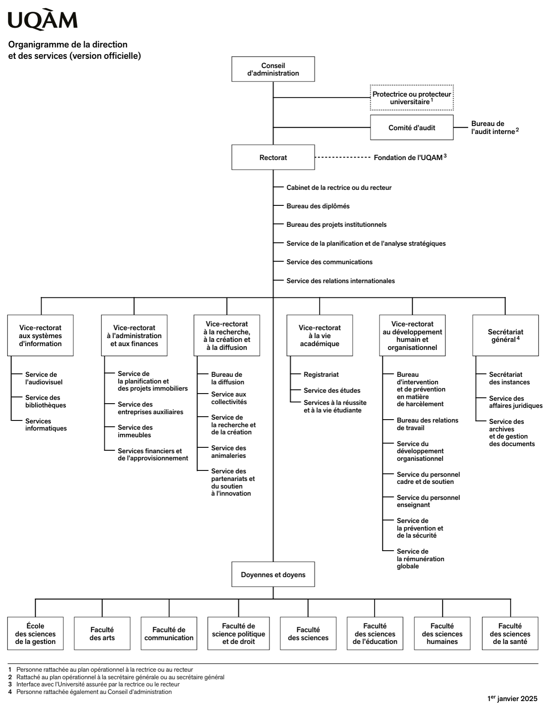

Organigramme de l'UQAM, 2025

Comme on peut le voir avec l'image à droite, la [institutionnelle de l'UQAM](https://ressources-medias.uqam.ca/media/uploads/20250226150055/Organigramme_officiel.pdf)  repose sur un [Conseil d’administration](https://uqam.ca/gouvernance/), qui constitue l’instance supérieure de gouvernance de l’Université. De manière générale, le rôle d’un conseil d’administration consiste à assurer l’orientation stratégique et la supervision de l’organisation. Cette notion sera abordée plus en détail dans l'analyse des compagnies d'assurance, dans un chapitre ultérieur.

Sous l’autorité du Conseil d’administration se trouve le [Rectorat](https://uqam.ca/rectorat/), responsable de la direction générale de l’Université. Le Rectorat est appuyé par plusieurs vice-rectorats, chacun étant associé à un champ de responsabilités précis, notamment l’administration et les finances, la recherche et la création, la vie académique, les systèmes d’information ainsi que le développement humain et organisationnel. Ces vice-rectorats s’appuient sur des services centraux et des unités de soutien qui assurent le fonctionnement quotidien de l’institution.

L’organisation académique de l’Université repose enfin sur les [facultés](https://uqam.ca/facultes/) et sur l’[École des sciences de la gestion](https://esg.uqam.ca/), dirigées par des doyennes et doyens. Ces unités regroupent les départements, les programmes et le corps enseignant, et constituent le cœur des activités d’enseignement et de recherche de l’UQAM. 

En janvier 2026, le recteur de l'UQAM est [Stéphane Pallage](https://rectorat.uqam.ca/biographie-stephane-pallage/), et le doyen de la Faculté des Sciences est [Normand Séguin](https://sciences.uqam.ca/la-faculte/gouvernance/).

## La place de l’actuariat à l’UQAM

### Historique

Les débuts de l’actuariat à l’UQAM peuvent être situés à la création du programme de baccalauréat en actuariat par le professeur Claude Pichet (professeur à la retraite), dont la première cohorte a été admise à l’automne 1997. Ce programme de premier cycle est issu de la scission de la concentration en actuariat du baccalauréat en mathématiques, laquelle avait été mise en place en septembre 1991. La création d’un baccalauréat distinct visait à offrir une formation spécialisée entièrement consacrée à l’actuariat, plutôt qu’une simple concentration au sein d’un programme plus large.

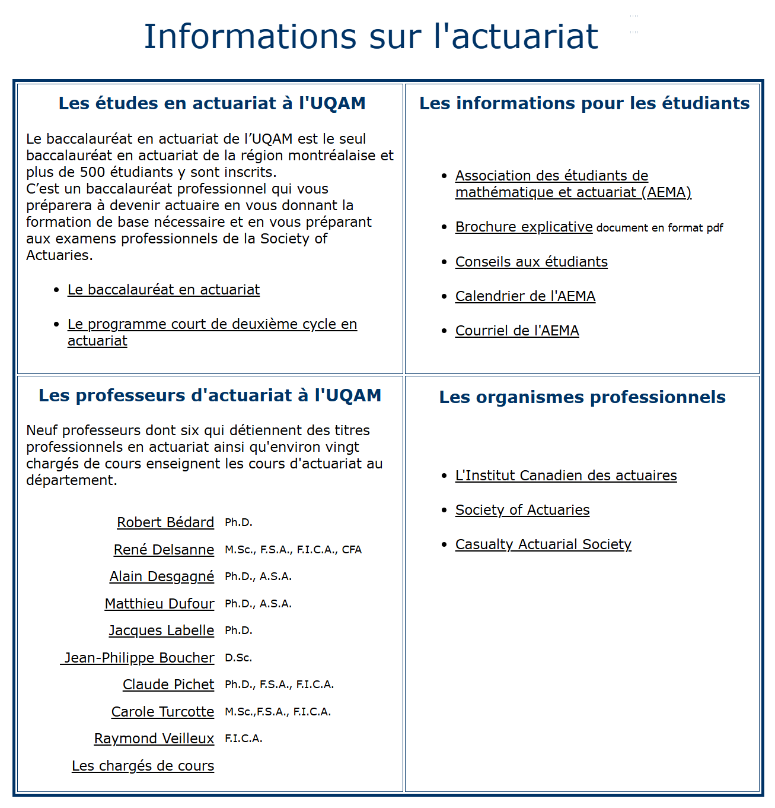

Ancien site web de l'actuariat (vers 2007)

L’UQAM devenait alors la première université à offrir à Montréal, en français, un baccalauréat spécifiquement dédié à l’actuariat, ce qui contribuait à accroître la visibilité de cette discipline au sein du Département de mathématiques. À cette époque, l’Université Laval était la seule université francophone au Québec à offrir un baccalauréat en actuariat. L’Université de Montréal proposait pour sa part, et propose toujours en 2026, une concentration en actuariat intégrée au baccalauréat en mathématiques, plutôt qu’un programme autonome. Il convient également de noter que l’Université Concordia offre un baccalauréat en actuariat, mais en langue anglaise.

La création du baccalauréat en actuariat à l’UQAM répondait à la fois à une demande croissante du secteur privé pour des actuaires et à un intérêt soutenu de la part de la population étudiante pour des études spécialisées en actuariat. En 2014, l’offre de formation a été élargie par la création d’une majeure en actuariat, ainsi que d’une mineure en mathématiques actuarielles et financières. La popularité du baccalauréat en actuariat a conduit à l’embauche de plusieurs professeures et professeurs spécialisés en actuariat depuis le début des années 2000. Le programme a été soutenu, durant ses premières années, par Claude Pichet et par la professeure Carole Turcotte, aujourd’hui à la retraite.

Enfin, au cours de l’année 2018, l’unité regroupant les programmes de premier cycle en actuariat et en mathématiques a été scindée en deux unités distinctes : une unité de programmes en mathématiques et une unité de programmes en actuariat. Au 1er janvier 2026, l’équipe professorale en actuariat, rattachée au Département de mathématiques, compte 11 professeures et professeurs.

### Département de mathématiques de l'UQAM

Le [Département de mathématiques](https://math.uqam.ca/) de l’Université du Québec à Montréal est une unité académique de la Faculté des sciences située au centre-ville de Montréal, principalement au sein du Complexe des sciences Pierre-Dansereau. Depuis la création de l’UQAM, le département joue un rôle central dans l’enseignement des mathématiques, tant pour les programmes spécialisés que pour de nombreux autres programmes de l’Université qui requièrent une formation mathématique de base ou avancée.

{width=80% fig-align="center"}

Au fil de son développement, le département a structuré ses activités autour d’un large éventail de domaines couvrant les mathématiques fondamentales et appliquées. Ses champs d’expertise incluent les mathématiques pures, la statistique, l’actuariat et la didactique des mathématiques. Dans l’organisation interne du Département de mathématiques de l’UQAM, ces quatre domaines correspondent à des **sections**, auxquelles l’ensemble des professeures et professeurs du département sont rattachés. Cette diversité se reflète dans l’offre de formation, qui comprend plusieurs programmes de premier cycle ainsi que des programmes de cycles supérieurs, orientés à la fois vers la recherche, l’enseignement et les applications professionnelles.

## Corps enseignant en actuariat

Le corps enseignant en actuariat à l’UQAM est constitué de professeurs rattachés à la section d’actuariat du Département de mathématiques, ainsi que de chargées et chargés de cours qui participent à l’enseignement du programme. Les professeures et professeurs de la section d’actuariat assurent la responsabilité académique du programme, tant sur le plan de l’enseignement que du développement et de l’évolution des contenus de formation.  On peut consulter un peu plus en détails la composition de la *section actuariat* en visant un [site web](https://actuariat.uqam.ca/) créé par l'ancien directeur de programme, Mathieu Boudreault.

::: {.callout-important icon=false}
## Professeurs des cours MAT ou STT

Dans le cadre du programme de baccalauréat en actuariat, les cours qui ne sont pas siglés ACT sont souvent qualifiés de *cours de service*. Toutefois, les cours siglés MAT ou STT relèvent eux aussi du Département de mathématiques de l’UQAM. Cette organisation fait en sorte que ces cours sont enseignés par des professeurs du même département que ceux rattachés à la section d’actuariat. Il est ainsi possible que des professeurs de la section d’actuariat enseignent des cours siglés MAT ou STT au sein du programme, et inversement, et plus naturellement, que des professeurs d’autres sections du Département de mathématiques assurent l’enseignement de cours MAT ou STT destinés aux étudiants en actuariat.
:::

### Professeurs en actuariat

Dans le contexte universitaire, un professeur est un membre du corps professoral nommé par l’Université, dont les fonctions comprennent l’enseignement, la recherche et la participation à la vie académique et institutionnelle. Les professeurs assument notamment la responsabilité académique des programmes, contribuent à leur développement et encadrent les étudiants aux différents cycles. À l’UQAM, la tâche normale d’un professeur comprend généralement l’enseignement de quatre cours par année, en plus de ses autres responsabilités académiques.

La grille présentée ci-dessous regroupe les 11 professeurs rattachés à la section d’actuariat du Département de mathématiques en janvier 2026. À côté de chaque photo, on peut y voir le ou les cours qu’ils ont habituellement en charge dans l’enseignement du programme d’actuariat.

Il importe toutefois de préciser que les professeurs peuvent enseigner d’autres cours que ceux indiqués ci-dessous et que, inversement, les cours mentionnés peuvent être confiés à d’autres professeurs ou à des chargés de cours au fil des sessions. En effet, la tâche d’enseignement d’un professeur varie notamment en fonction de ses responsabilités administratives, de ses activités de recherche et de sa participation à l’enseignement et à l’encadrement aux cycles supérieurs. Les professeurs peuvent également bénéficier de congés sabbatiques durant lesquels ils n’assurent aucune activité d’enseignement.

#### Liste des professeurs (janvier 2026) {-}

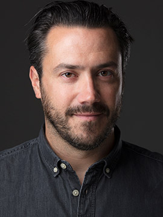

[Jean-Philippe Boucher](https://math.uqam.ca/corps-professoral/professeurs/professeurs-reguliers/professeur/boucher.jean-philippe/)

[ACT1050 – Introduction à l'actuariat I](https://etudier.uqam.ca/cours?sigle=ACT1050) 

[ACT5400 – Crédibilité](https://etudier.uqam.ca/cours?sigle=ACT5400) 

 

[Mathieu Boudreault](https://math.uqam.ca/corps-professoral/professeurs/professeurs-reguliers/professeur/boudreault.mathieu/)

[MAT8600 – Introduction à l'actuariat I](https://etudier.uqam.ca/cours?sigle=MAT8600) 

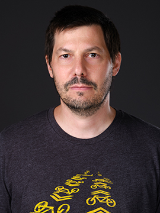

[Arthur Charpentier](https://math.uqam.ca/corps-professoral/professeurs/professeurs-reguliers/professeur/charpentier.arthur/)

[ACT6100 - Analyse de données en actuariat](https://etudier.uqam.ca/cours?sigle=ACT6100) 

[STT5100 - Modèles linéaires appliqués](https://etudier.uqam.ca/cours?sigle=STT5100) 

[Alain Desgagné](https://math.uqam.ca/corps-professoral/professeurs/professeurs-reguliers/professeur/desgagne.alain/)

[ACT4400 - Modèles de survie](https://etudier.uqam.ca/cours?sigle=ACT4400) 

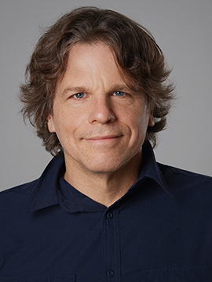

[Matthieu Dufour](https://math.uqam.ca/corps-professoral/professeurs/professeurs-reguliers/professeur/dufour.matthieu/)

[ACT3300 - Mathématiques de l'assurance de personne I](https://etudier.uqam.ca/cours?sigle=ACT3300) 

[ACT4300 - Mathématiques de l'assurance de personne II](https://etudier.uqam.ca/cours?sigle=ACT4300) 

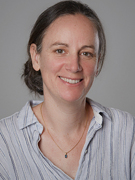

[Hélène Guérin](https://math.uqam.ca/corps-professoral/professeurs/professeurs-reguliers/professeur/guerin.helene/)

[MAT1700 - Probabilités I](https://etudier.uqam.ca/cours?sigle=MAT1700) 

[Mathieu Pigeon](https://math.uqam.ca/corps-professoral/professeurs/professeurs-reguliers/professeur/pigeon.mathieu.2/)

Directeur des programmes de premier cycle en actuariat

[ACT6100 - Analyse de données en actuariat](https://etudier.uqam.ca/cours?sigle=ACT6100) 

[Jean-François Renaud](https://math.uqam.ca/corps-professoral/professeurs/professeurs-reguliers/professeur/renaud.jf/)

[ACT2100 - Compléments de probabilités](https://etudier.uqam.ca/cours?sigle=ACT2100) 

[MAT2720 - Processus stochastiques](https://etudier.uqam.ca/cours?sigle=MAT2720) 

[Clarence Simard](https://math.uqam.ca/corps-professoral/professeurs/professeurs-reguliers/professeur/simard.clarence/)

[MAT1191 - Compléments de mathématiques](https://etudier.uqam.ca/cours?sigle=MAT1191) 

[ACT5310 - Mathématiques de la finance actuarielle II](https://etudier.uqam.ca/cours?sigle=ACT5310) 

[Roxane Turcotte](https://math.uqam.ca/corps-professoral/professeurs/professeurs-reguliers/professeur/turcotte.roxane/)

[ACT3410 - Distribution de sinistres](https://etudier.uqam.ca/cours?sigle=ACT3410) 

[ACT6061 - Modèles actuariels en assurance non-vie](https://etudier.uqam.ca/cours?sigle=ACT6061) 

### Chargés de cours

Comme nous l’avons vu au premier chapitre, les programmes de premier cycle en actuariat représentent chaque année une charge d’enseignement importante, composée de plusieurs cours siglés ACT offerts presque à tous les trimestres d’automne et d’hiver. Le fonctionnement du programme repose ainsi, en partie, sur la contribution essentielle des chargés de cours, qui assurent l’enseignement des cours ne pouvant être pris en charge par les professeurs d'actuariat.

Un chargé de cours est une personne mandatée par l’Université pour assurer l’enseignement d’un ou de plusieurs cours, sans être un employé à temps plein ni être membre du corps professoral. Son rôle est centré sur l’enseignement et l’accompagnement pédagogique des étudiants, dans le cadre des cours qui lui sont confiés. Selon les disciplines et les contextes institutionnels, certains chargés de cours peuvent exercer cette fonction de façon régulière, parfois sur plusieurs années.

En actuariat, la situation des chargés de cours est toutefois particulière en raison du caractère professionnel de la discipline. Les chargés de cours sont presque toujours des diplômés en actuariat qui exercent leur profession dans le milieu et qui viennent transmettre leur expertise tout en conservant leur emploi principal. Étant donné que les responsabilités professionnelles et familiales tendent à augmenter avec les années, on observe un taux de roulement relativement élevé chez les chargés de cours, ceux-ci disposant éventuellement de moins de temps pour l’enseignement.

Enfin, il est également à noter que l’on retrouve, parmi les chargés de cours, des étudiants à la maîtrise ou au doctorat, qui enseignent dans le cadre de leur formation, généralement sous la supervision de professeurs du Département de mathématiques.

#### Liste de quelques uns des chargés de cours en actuariat {-}

Raïssa Coulibaly

<ul class="member-courses">
<li><a href="https://etudier.uqam.ca/cours?sigle=ACT6061">ACT6061 - Modèles actuariels en assurance non-vie</a></li>
<li><a href="https://etudier.uqam.ca/cours?sigle=STT5100">STT5100 – Modèles linéaires appliqués</a></li>
</ul>

Jean-François Forest-Desaulniers

<ul class="member-courses">
<li><a href="https://etudier.uqam.ca/cours?sigle=ACT3300">ACT3300 – Mathématiques de l’assurance de personne I</a></li>
<li><a href="https://etudier.uqam.ca/cours?sigle=ACT5400">ACT5400 – Crédibilité</a></li>
<li><a href="https://etudier.uqam.ca/cours?sigle=ACT6051">ACT6051 – Modèles actuariels en assurance de personne</a></li>
</ul>

Bruno Gagnon

<ul class="member-courses">
<li><a href="https://etudier.uqam.ca/cours?sigle=ACT1050">ACT1050 – Introduction à l'actuariat I</a></li>
<li><a href="https://etudier.uqam.ca/cours?sigle=ACT6041">ACT6041 – Modèles actuariels en assurance collective</a></li></ul>

Christel Jackson Book Botog

<ul class="member-courses">
<li><a href="https://etudier.uqam.ca/cours?sigle=ACT4310">ACT4310 – Mathématiques de la finance actuarielle I</a></li>
</ul>

Sébastien Jessup

<ul class="member-courses">
<li><a href="https://etudier.uqam.ca/cours?sigle=ACT2060">ACT2060 – Applications probabilistes des risques actuariels</a></li>
<li><a href="https://etudier.uqam.ca/cours?sigle=ACT5400">ACT5400 – Crédibilité</a></li>
</ul>

Mathieu Laurendeau

<ul class="member-courses">
<li><a href="https://etudier.uqam.ca/cours?sigle=ACT6031">ACT6031 – Modèles actuariels en régimes de retraite</a></li>
</ul>

Dante Mata López

<ul class="member-courses">
<li><a href="https://etudier.uqam.ca/cours?sigle=ACT1200">ACT1200 – Mathématiques financières I</a></li>
</ul>

Noureddine Meraihi

<ul class="member-courses">
<li><a href="https://etudier.uqam.ca/cours?sigle=ACT1050">ACT1050 – Introduction à l’actuariat I</a></li>
<li><a href="https://etudier.uqam.ca/cours?sigle=ACT1200">ACT1200 – Mathématiques financières I</a></li>
<li><a href="https://etudier.uqam.ca/cours?sigle=ACT3035">ACT3035 – Laboratoire d’actuariat</a></li>
</ul>

Marie Michaelides

<ul class="member-courses">
<li><a href="https://etudier.uqam.ca/cours?sigle=ACT3410">ACT3410 - Distribution de sinistres</a></li>
<li><a href="https://etudier.uqam.ca/cours?sigle=ACT6061">ACT6061 - Modèles actuariels en assurance non-vie</a></li>
</ul>

Nicolas Moughabghab

<ul class="member-courses">
<li><a href="https://etudier.uqam.ca/cours?sigle=ACT6041">ACT6041 – Modèles actuariels en assurance collective</a></li>
</ul>

Samy Senoune

<ul class="member-courses">
<li><a href="https://etudier.uqam.ca/cours?sigle=ACT3035">ACT3035 – Laboratoire d’actuariat</a></li>
</ul>

Tommy Thomassin

<ul class="member-courses">
<li><a href="https://etudier.uqam.ca/cours?sigle=ACT2035">ACT2035 – Actuariat et informatique</a></li>
</ul>

Juan Sebastian Yanez

<ul class="member-courses">
<li><a href="https://etudier.uqam.ca/cours?sigle=ACT1200">ACT1200 – Mathématiques financières I</a></li>
<li><a href="https://etudier.uqam.ca/cours?sigle=ACT3410">ACT3410 - Distribution de sinistres</a></li>
<li><a href="https://etudier.uqam.ca/cours?sigle=ACT6061">ACT6061 - Modèles actuariels en assurance non-vie</a></li></ul>

### Auxiliaires d’enseignement (démonstrateur) 

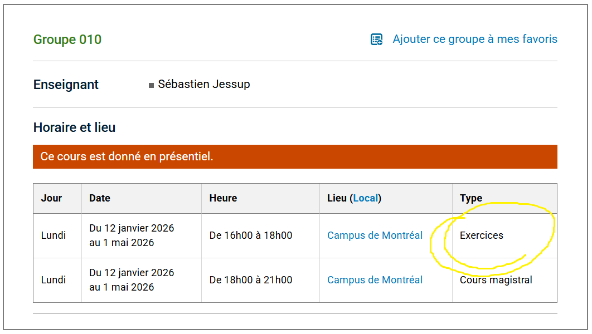

Page du cours ACT5400

Dans les cours de mathématiques, de statistique et d’actuariat à l’UQAM, un démonstrateur est une personne engagée pour soutenir l’enseignement d’un cours, sans en être responsable. Le démonstrateur intervient généralement dans le cadre de séances de travaux dirigés, de périodes d’exercices ou d’ateliers, au cours desquels il accompagne les étudiants dans la compréhension de la matière, la résolution de problèmes et l’application concrète des notions vues en classe.

Le rôle du démonstrateur est complémentaire à celui du professeur ou du chargé de cours. Il n’assume pas la responsabilité pédagogique du cours, n’établit pas le plan de cours et ne prend pas de décisions quant à l’évaluation globale. Ses tâches consistent plutôt à expliquer des méthodes, illustrer des raisonnements, répondre aux questions des étudiants et favoriser leur progression dans l’apprentissage des concepts mathématiques ou actuariels.

En mathématiques, dans la majorité des cas, les démonstrateurs sont des étudiants de cycles supérieurs — à la maîtrise ou au doctorat.  En actuariat, il s'agira parfois aussi d'étudiants de cycle supérieurs, mais plus souvent d'étudiants de premier cycle avancé possédant une solide maîtrise de la matière. Leur contribution joue un rôle important dans le bon déroulement des cours à forte composante quantitative, en particulier lorsque ceux-ci accueillent un grand nombre d’étudiants ou comportent des exercices techniques exigeants.

::: {.callout-note icon=false}
## Affichage

Pour les emplois d'auxiliaire, de monitorats et de surveillances d’examens pour la session d’hiver, l’affichage a normalement lieu pendant 3 semaine au mois de novembre pour la session d'hiver, et pendant les mois de juillet et aout pour la session d'automne. 

L’affichage de ces emplois est sur le [site](https://rh.uqam.ca/setue/). D’autres emplois pour étudiants sont aussi affichés sur ce même site tout au long de la session.

:::

## Vie étudiante en actuariat

La vie étudiante en actuariat ne se résume pas uniquement à la réussite académique ou à l’accumulation de crédits. Elle s’inscrit aussi dans un équilibre à trouver entre les études, la vie personnelle et, pour plusieurs, des engagements professionnels ou familiaux. Il est important que les étudiants se sentent bien dans leur parcours universitaire et puissent progresser à leur rythme, quitte à suivre moins de cours par session lorsque la situation l’exige. La réussite à long terme du programme repose autant sur la persévérance et la compréhension de la matière que sur le maintien d’un équilibre de vie sain.  Dans ce contexte, les parcours en actuariat peuvent être variés, et il n’existe pas de modèle unique de cheminement. L’Université, la Faculté des Sciences et les professeurs en actuariat du Département de mathématiques reconnaissent cette diversité de situations et cherchent à offrir un cadre suffisamment souple pour permettre aux étudiants de concilier leurs études avec leurs autres responsabilités.

### Association étudiante

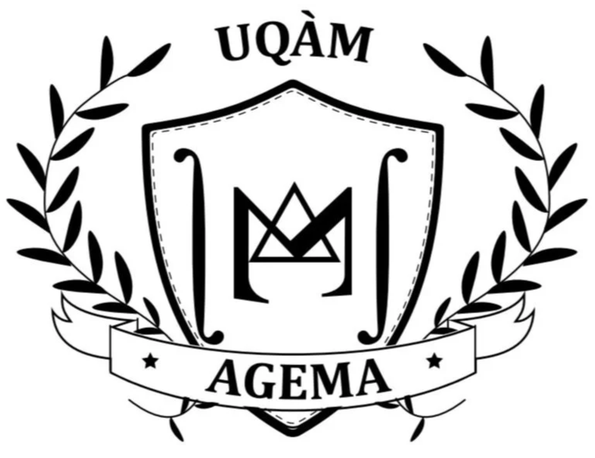

Parallèlement à ces considérations individuelles, la vie étudiante en actuariat s’appuie également sur [l’association étudiante en mathématiques et en actuariat](https://www.agema-uqam.org/), qui regroupe les étudiants des programmes concernés. Tel qu'indiqué sur leur site web:

> L'association étudiante du baccalauréat en mathématiques et en actuariat a pour mandat de représenter et de servir les étudiants de ce programme. Elle vise à promouvoir l'épanouissement académique, professionnel et social de ses membres. L'association organise des événements éducatifs et des conférences pour renforcer les connaissances en actuariat, ainsi que favoriser le réseautage avec des professionnels de l'industrie. Elle encourage également la collaboration entre les étudiants, facilite l'accès à des ressources pertinentes et offre un soutien mutuel pour le développement personnel et professionnel des futurs actuaires et mathématiciens.

### Activités de réseautage et de professionnalisation

La formation en actuariat à l’UQAM est étroitement liée au milieu professionnel, ce qui se reflète dans les activités de réseautage et de professionnalisation offertes aux étudiants tout au long de leur parcours. A chaque automne, une [journée carrière](https://sciences.uqam.ca/journee-carriere-actuariat-et-mathematiques-statistiques/) est organisée par l’Association générale étudiante en mathématiques et actuariat de l’UQAM (AGEMA), en collaboration avec la Faculté des sciences et les Services à la vie étudiante de l’UQAM.

{width=70% fig-align="center"}

Cette activité de réseautage réunit chaque année de nombreux employeurs issus notamment des secteurs bancaire, assurantiel et du conseil, qui sont présents sur place pour rencontrer les étudiantes et étudiants de l’UQAM. Les organisations participantes disposent de kiosques leur permettant de présenter leurs activités, ainsi que les possibilités de stages et d’emplois offertes aux étudiants. L’événement a pour objectif de soutenir l’insertion professionnelle des étudiantes et étudiants, ainsi que des personnes finissantes, en actuariat et en statistique. Il constitue une occasion privilégiée d’échanger directement avec des employeurs, de mieux comprendre les parcours professionnels possibles, les compétences recherchées, les pratiques de travail en vigueur et les processus de recrutement, tout en prenant connaissance des opportunités actuellement disponibles.

En plus de ces activités, l'UQAM organise plusieurs autres activités préparatoires, tel que l'atelier de rédaction d’un CV et d’une lettre de présentation dans le domaine de l’actuariat, des services conseils personnalisés pour vos CV et entrevues futures.  Je vous conseille de visiter régulièrement ce [site de la Faculté](https://sciences.uqam.ca/journee-carriere-actuariat-et-mathematiques-statistiques/).

### Le règlement numéro 5 des études

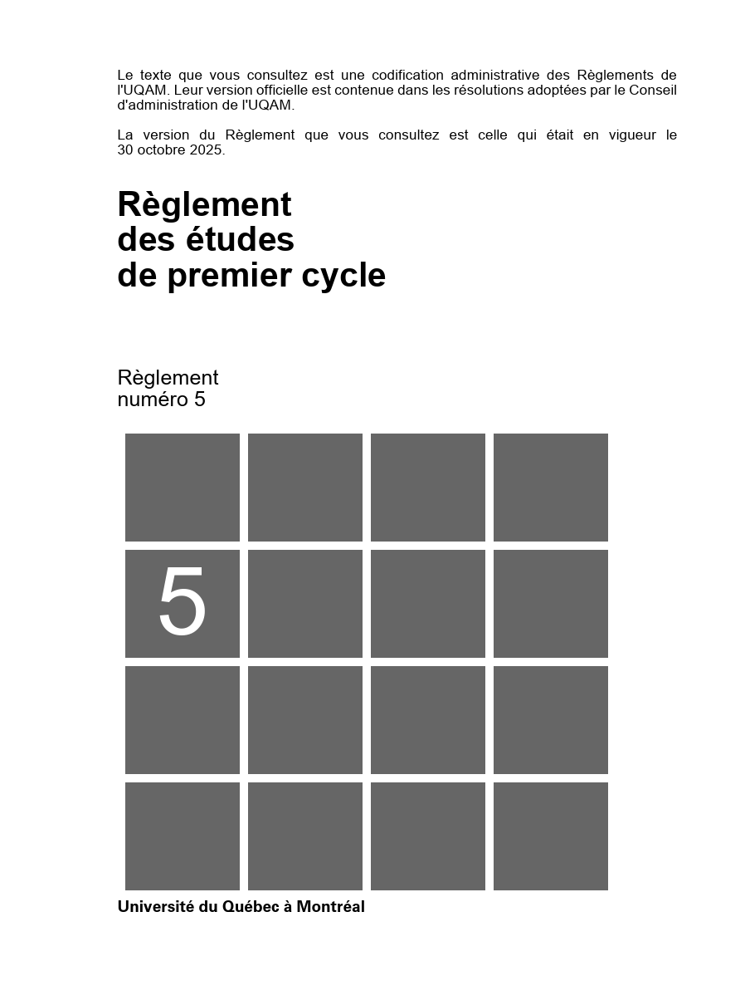

Le [Règlement numéro 5](https://instances.uqam.ca/wp-content/uploads/sites/47/2023/07/REGLEMENT_NO_5.pdf) des études de premier cycle de l'UQAM est le document qui encadre l’ensemble des règles applicables aux études, à l’inscription, à l’évaluation, à la progression et à l’obtention d’un diplôme de premier cycle à l’UQAM. Il fixe les principes fondamentaux qui s’appliquent à toutes les personnes étudiantes de premier cycle, y compris celles inscrites au baccalauréat en actuariat. À ce titre, il constitue la référence centrale en matière de droits, d’obligations et de protection des étudiants tout au long de leur parcours universitaire. L’ensemble du document compte 44 pages, présentées en double colonne, ce qui le rend peu accessible à une lecture rapide pour un étudiant. Les éléments suivants en résument les aspects que je considère les plus concrètes pour les étudiants.

- **Abandon de cours et remboursement**  (article 5.13)
  Les modalités d’abandon de cours sont encadrées par le Règlement no 5 et précisées chaque trimestre dans le calendrier universitaire. La personne étudiante peut abandonner un cours avant une date limite sans que celui-ci n’apparaisse à son relevé de notes sous forme de note d’échec. Au-delà de cette date, l’abandon peut être inscrit au dossier sans impact sur la moyenne cumulative, mais sans remboursement des droits de scolarité. Les dates exactes associées aux abandons avec remboursement, aux abandons sans remboursement et aux abandons avant la mention d’un échec sont déterminées officiellement dans le calendrier universitaire. Ce cadre permet aux étudiants de prendre des décisions éclairées en cas de difficultés académiques, personnelles ou professionnelles.

- **Révision et modification de notes** (article 7.12) 
  Le Règlement no 5 prévoit une procédure claire permettant de contester une note finale jugée erronée ou injustifiée. Dans un premier temps, l’étudiant peut demander une modification de note auprès de l’enseignant ou de la personne responsable du cours. Si cette démarche ne mène pas à une solution satisfaisante, une demande formelle de révision de note peut être déposée auprès de la direction du département. Ces démarches doivent être effectuées dans des délais précis. À titre d’exemple, la demande de modification de note doit être déposée au plus tard 40 jours ouvrables après la fin officielle du trimestre concerné. La procédure de révision vise à protéger les étudiants contre les erreurs de correction, de calcul ou de saisie, ainsi que contre des décisions d’évaluation qui ne seraient pas conformes aux normes établies. Elle peut notamment mener à la formation d’un comité de révision lorsque la situation l’exige.
  
- **Restrictions dans la poursuite des études** (article 8.3)

  Le Règlement numéro 5 prévoit des restrictions dans la poursuite des études lorsqu’un étudiant présente des difficultés académiques importantes. Ces restrictions peuvent notamment s’appliquer en cas d’échec à un cours, d’accumulation de plusieurs notes faibles (D+, D ou E), d’abandons répétés de cours, ou lorsque la moyenne cumulative devient insuffisante.À titre indicatif, un étudiant peut être soumis à des restrictions :
  - après avoir suivi au moins trois cours (neuf crédits) avec une moyenne cumulative égale ou inférieure à 1,5 sur 4,3 ;
  - après avoir suivi au moins douze crédits avec une moyenne cumulative inférieure à 2,0 sur 4,3 ;
  - lorsque les abandons de cours représentent plus de 20 % des crédits du programme ;
  - lorsqu’il ne satisfait pas aux exigences linguistiques prévues par la Politique no 50 de l’Université.
  Lorsqu’une restriction est imposée, l’étudiant peut être placé en période de probation. Cette période vise à encadrer la poursuite des études et peut débuter notamment après l’accumulation de douze crédits, à la fin du troisième trimestre suivant l’admission au programme, ou lorsque la moyenne cumulative est jugée insuffisante.

- **Autres protections et droits des étudiants**  
  Le Règlement no 5 comprend enfin diverses dispositions visant à protéger les droits des étudiants, notamment :
  - le droit d’être informé, en début de trimestre, des modalités d’évaluation applicables à un cours par le biais d’une entente d’évaluation, laquelle doit être présentée, discutée et adoptée en classe ;
  - le droit d’avoir accès à ses notes et, dans les conditions prévues, à ses copies corrigées ;
  - l’existence de règles générales encadrant la conduite universitaire et l’intégrité académique, en lien avec d’autres règlements institutionnels.

- **Comité de programme** (article 2.1.1)  
  Le Règlement numéro 5 prévoit l’existence d’un comité de programme responsable du suivi académique et du développement du programme. Ce comité intervient notamment sur des questions liées à la structure du programme, aux conditions de réussite, à l’évaluation globale des cheminements et à certaines décisions touchant la progression des étudiants. La représentation étudiante au sein de ce comité est assurée par des représentants élus, généralement désignés par l’association étudiante. Cette participation permet aux étudiants de faire entendre leur point de vue dans les instances où se prennent des décisions structurantes pour le programme. À ce titre, l’implication étudiante, notamment par l’intermédiaire de l’association, joue un rôle central dans le bon fonctionnement du comité et dans la prise en compte de la réalité vécue par les étudiants.

  
  
::: {.callout-note icon=false}
## Implication étudiante : norme ou exception?

La présence de représentants étudiants au sein des comités de programme n’est pas propre à l’UQAM et constitue une pratique répandue dans les universités québécoises. Toutefois, l’UQAM se distingue par le rôle structurant accordé à ces comités dans ses règlements et par l’intégration explicite de la représentation étudiante dans les mécanismes de gouvernance académique. Dans ce contexte, l’implication des étudiants, généralement assurée par l’association étudiante, ne relève pas d’une simple consultation symbolique, mais constitue une composante attendue du fonctionnement des programmes.
:::

## Recherche scientifique en actuariat

Ceci n'est pas de la recherche scientifique en actuariat

L’enseignement en actuariat ne consiste pas uniquement à transmettre des connaissances établies. Il repose sur la production continue de nouvelles connaissances, sans laquelle la discipline ne pourrait évoluer ni s’adapter aux défis actuels. Les modèles et outils enseignés proviennent d’un travail scientifique visant à mieux comprendre et quantifier le risque dans des contextes économiques, financiers et sociaux changeants.

La recherche fait progresser la discipline en développant de nouveaux modèles mathématiques, des méthodes statistiques et des outils analytiques adaptés à des situations complexes, comme les risques émergents, l’exploitation de données massives ou les effets des changements climatiques. Elle alimente directement l’enseignement. En actuariat, où les hypothèses et les cadres méthodologiques évoluent rapidement, un enseignement de qualité repose nécessairement sur des résultats de recherche récents. La recherche influence également la pratique professionnelle. Les actuaires travaillent dans des environnements en transformation constante, tant sur le plan réglementaire que technologique. Les travaux universitaires fournissent des outils rigoureux qui orientent les décisions industrielles, institutionnelles et publiques. Enfin, la recherche en actuariat répond à des enjeux sociétaux concrets. La gestion du risque lié aux catastrophes naturelles, aux régimes de retraite ou aux marchés financiers a des effets directs sur la stabilité et la sécurité financières. La production de connaissances scientifiques est donc centrale pour encadrer ces risques à long terme.

À l’UQAM, la recherche en actuariat s’appuie sur des structures universitaires mises en place au fil des années par plusieurs professeurs du Département de mathématiques, tout en laissant place à des initiatives de recherche plus individuelles. Ces structures facilitent le développement de projets, l’encadrement aux cycles supérieurs et les liens avec le milieu professionnel.

### Chaire Co-operators en analyse des risques actuariels (CARA)

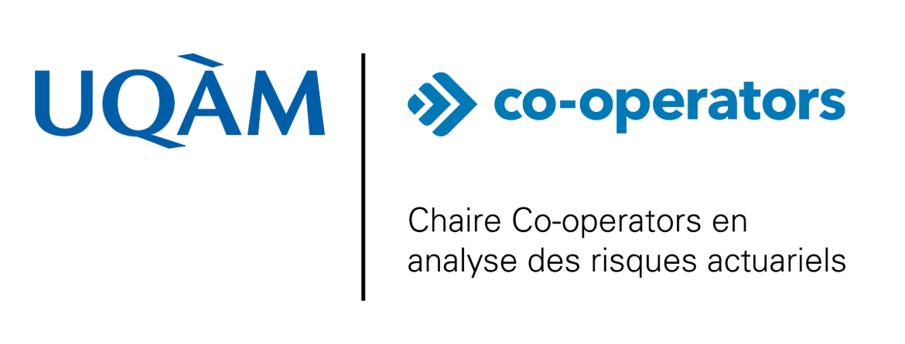

La [Chaire Co-operators en analyse des risques actuariels](https://chairecara.uqam.ca/) a été créée en 2018 grâce à une contribution de la coopérative d’assurance Co-operators, dans le cadre de la campagne *100 millions d’idées* de l’UQAM, avec le professeur Jean-Philippe Boucher comme titulaire. La Chaire a pour objectif général de faire avancer le savoir en actuariat, en mettant l’accent sur l’analyse des risques en assurance de dommages et sur la science des données appliquée à l’assurance. Elle constitue un point d’ancrage structurant pour la recherche en actuariat à l’UQAM et favorise des interactions soutenues avec le milieu professionnel. Il s’agit de la première chaire de recherche explicitement dédiée à l’actuariat établie au Québec. Dans le contexte canadien, les chaires de recherche spécifiquement consacrées à la science actuarielle demeurent peu nombreuses, ce qui confère à la Chaire CARA une position particulière dans le paysage de la recherche actuarielle universitaire.

#### Premier mandat 2018-2024 {-}

Lors d’un premier mandat couvrant la période 2018–2024, la Chaire a permis de mettre en place une structure de recherche solide en actuariat et de réaliser plusieurs avancées marquantes. Les activités de recherche ont mené à la [publication de nombreux articles scientifiques](https://chairecara.uqam.ca/publications.html) dans des revues reconnues en actuariat et en science du risque, notamment *ASTIN Bulletin*, *North American Actuarial Journal*, *Variance*, *Insurance: Mathematics and Economics* et *Risks*. Les travaux de la Chaire ont également fait l’objet de [communications régulières dans des conférences scientifiques majeures](https://chairecara.uqam.ca/presentations.html), telles que l’*Actuarial Research Conference*, la Société statistique du Canada, le *Joint Statistical Meeting* et le congrès CAGNY.

La formation de la relève a constitué un volet central de ce premier mandat. [Plusieurs étudiantes et étudiants](https://chairecara.uqam.ca/anciens.html) ont complété avec succès des maîtrises et des doctorats dans le cadre des activités de la Chaire, contribuant directement à la production scientifique et à la diffusion des connaissances. Cet encadrement s’est accompagné de l’attribution de bourses de maîtrise, de doctorat et de retour aux études, soutenant tant les parcours académiques que la reconversion professionnelle d’actuaires.

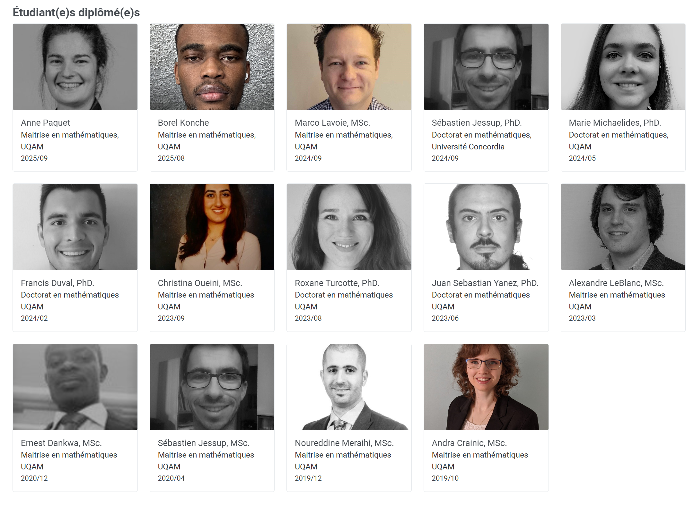

Diplômés de la Chaire depuis 2018

Sur le plan du financement, la Chaire a obtenu des subventions de recherche, notamment du Conseil de recherches en sciences naturelles et en génie du Canada (CRSNG) en 2018 et de l’Autorité des marchés financiers en 2020, afin de développer des modèles actuariels avancés et d’analyser des problématiques liées aux primes non acquises. Ces financements ont permis de soutenir des projets de recherche à long terme et de consolider les activités de formation aux cycles supérieurs.

Les travaux réalisés dans le cadre de la Chaire ont également été reconnus par plusieurs [prix](https://chairecara.uqam.ca/news/Roxane.html) et [distinctions](https://chairecara.uqam.ca/news/Variance2024.html), tant pour la qualité des publications que pour les présentations scientifiques réalisées par les étudiantes et étudiants. Ces reconnaissances, décernées dans des revues et des conférences de premier plan en actuariat et en statistique, témoignent de la visibilité et de la portée des travaux associés à la Chaire, ainsi que de la rigueur scientifique et de la qualité de la formation offerte aux cycles supérieurs. Elles illustrent aussi la capacité des étudiantes et étudiants encadrés à produire des contributions originales reconnues par la communauté scientifique.

#### Second mandat 2024-2029 {-}

En 2024, la Chaire a été officiellement renouvelée pour un second mandat couvrant la période 2024–2029, confirmant son rôle stratégique en recherche actuarielle et en formation aux cycles supérieurs. Ce renouvellement s’accompagne de nouvelles subventions de recherche du CRSNG et de la poursuite des activités de soutien à la relève, incluant des bourses de maîtrise, de doctorat et de retour aux études pour les actuaires en reconversion. Durant ce second mandat, les activités de la Chaire continuent de s’inscrire à l’interface entre recherche académique, enjeux réglementaires et pratiques professionnelles, comme en témoignent la participation du titulaire à des comités consultatifs et la reconnaissance obtenue par les étudiantes et étudiants lors de conférences scientifiques internationales.

### Chaire de recherche en sciences actuarielles et climatiques (ClimACT)

[Lancée](https://actualites.uqam.ca/2025/lancement-de-la-chaire-de-recherche-en-sciences-actuarielles-et-climatiques) en 2025, la Chaire ClimACT vise à mieux comprendre et modéliser les impacts financiers des changements climatiques, un enjeu désormais central pour l’assurance, les régimes de retraite et les politiques publiques. La chaire est dirigée par Mathieu Boudreault, professeur au Département de mathématiques de l’UQAM, et adopte une approche multidisciplinaire combinant l’actuariat, la climatologie, la finance, l’économie et l’intelligence artificielle. La Chaire bénéficie du soutien financier de trois grandes compagnies d’assurance pour un financement total de 1,5 million de dollars sur cinq ans.

Ses objectifs de recherche incluent le développement d’outils concrets pour quantifier les risques liés aux aléas climatiques et leur distribution future, l’analyse des effets des politiques climatiques et énergétiques, ainsi que le renforcement de la résilience financière des institutions et de la société. Dans un contexte d’accélération des phénomènes climatiques, l’intégration de ces risques dans les modèles actuariels est essentielle pour assurer la viabilité des produits financiers et des régimes d’assurance.

### Quantact – Laboratoire de mathématiques actuarielles et financières

La recherche en actuariat s’est structurée de manière formelle à l’UQAM au début des années 2010 avec la création, en 2011, du groupe de recherche [Quantact](https://quantact.uqam.ca). Celui-ci a été fondé par les professeurs du Département de mathématiques de l'UQAM, Jean-Philippe Boucher, Mathieu Boudreault et Jean-François Renaud, et a rapidement obtenu une reconnaissance facultaire officielle de la Faculté des sciences de l’UQAM. Cette reconnaissance marquait une première étape importante dans la structuration collective de la recherche actuarielle à l’université.

En 2014, Quantact a connu une évolution majeure en devenant un laboratoire officiel du [Centre de recherches mathématiques (CRM)](https://www.crm.umontreal.ca), tout en demeurant physiquement situé à l’UQAM. Par cette intégration au CRM, Quantact s’est inscrit dans un réseau de recherche mathématique de portée nationale et internationale, tout en conservant une identité clairement axée sur l’actuariat, la finance et les mathématiques du risque.  À travers Quantact, l’UQAM constitue aujourd’hui le regroupement scientifique officiel de l’ensemble des chercheurs en actuariat au Québec. Le laboratoire rassemble près d’une quarantaine de chercheurs et chercheuses provenant de différentes universités québécoises, dont les travaux couvrent un large éventail de thématiques, incluant la modélisation stochastique du risque, les probabilités appliquées, les mathématiques financières, la tarification, la gestion des risques et les méthodes quantitatives en assurance.

Les activités de Quantact comprennent l’organisation de séminaires scientifiques, le développement de collaborations interuniversitaires et internationales, ainsi que la production et la diffusion de connaissances sous forme d’articles, de conférences et d’événements académiques. Le laboratoire joue également un rôle structurant dans la formation aux cycles supérieurs, tant à la maîtrise qu’au doctorat, en offrant un cadre de recherche collectif et reconnu pour les étudiantes et étudiants en actuariat et en finance.

## Études de cycle supérieur en actuariat à l'UQAM

Le positionnement des études de cycle supérieur après la présentation de la recherche est volontaire. En actuariat, la formation aux cycles supérieurs est indissociable de l’activité de recherche : elle en constitue à la fois le prolongement naturel et l’un des principaux moteurs. Contrairement aux études de premier cycle, qui visent d’abord l’acquisition de bases méthodologiques et conceptuelles, les études de maîtrise et de doctorat reposent sur une participation active à la production de connaissances. Les étudiantes et étudiants y sont appelés à approfondir des problématiques ouvertes, à développer ou adapter des modèles existants, et à contribuer directement à l’avancement du savoir en actuariat.

Les structures de recherche présentées précédemment — chaires et laboratoires — jouent ainsi un rôle central dans l’encadrement des études de cycle supérieur. Elles fournissent le cadre scientifique, les données, les projets et les collaborations nécessaires à la réalisation de mémoires et de thèses, tout en assurant un lien étroit avec les enjeux actuels de la pratique professionnelle. Dans ce contexte, les études de cycle supérieur en actuariat à l’UQAM s’inscrivent dans une logique de continuité entre recherche, formation avancée et application. Elles permettent de former des spécialistes capables non seulement d’utiliser des outils actuariels existants, mais aussi d’en comprendre les limites, d’en proposer des extensions et de répondre à des problématiques nouvelles ou émergentes.

### Maîtrise en actuariat

Il n’existe pas, à proprement parler, de diplôme portant officiellement le nom de maîtrise en actuariat à l’UQAM. En pratique, les étudiantes et étudiants souhaitant poursuivre des études de deuxième cycle en actuariat s’inscrivent à la **concentration mathématiques actuarielles et financières de la maîtrise en mathématiques**. Les diplômés du baccalauréat en actuariat de l’UQAM ayant une moyenne cumulative supérieure à 3,2/4,3 sont même automatiquement admis à la maîtrise en mathématiques, concentration mathématiques actuarielles et financières.

La description officielle du programme est disponible [ici](https://etudier.uqam.ca/programme?code=1990).   Toutefois, pour les personnes provenant du baccalauréat en actuariat, certaines précisions sont nécessaires afin de bien comprendre les exigences académiques et le fonctionnement réel du programme. Bien qu’un profil avec rapport de recherche existe, la quasi-totalité des étudiantes et étudiants en actuariat choisissent le **profil avec mémoire de recherche**.  

#### Cours (scolarité) {-}

De manière générale, il est demandé aux étudiantes et étudiants de :

1) Réussir **un cours siglé FIN**  
   Il est possible de se soustraire à cette exigence. Dans ce cas, il est recommandé d’en discuter avec son directeur ou sa directrice de recherche, qui pourra demander une autorisation à la direction du programme.

2) Compléter la scolarité à partir des cours suivants :  

   - [MAT7081 – Inférence statistique I](https://etudier.uqam.ca/cours?sigle=MAT7081)
   - [MAT7381 – Modèles de régression](https://etudier.uqam.ca/cours?sigle=MAT7381)
   - [MAT8081 – Analyse statistique multivariée](https://etudier.uqam.ca/cours?sigle=MAT8081)
   - [MAT8594 – Statistique en actuariat](https://etudier.uqam.ca/cours?sigle=MAT8594)
   - [MAT8600 – Analyse mathématique du risque](https://etudier.uqam.ca/cours?sigle=MAT8600)
   - [MAT8601 – Méthodes stochastiques en finance I](https://etudier.uqam.ca/cours?sigle=MAT8601)
   - [MAT8602 – Méthodes stochastiques en finance II](https://etudier.uqam.ca/cours?sigle=MAT8602)
   - [MAT8780 – Principes de simulation](https://etudier.uqam.ca/cours?sigle=MAT8780)

#### Honor {-}

Le profil Honor du [baccalauréat en actuariat](https://etudier.uqam.ca/programme?code=7363) de l’UQAM permet de suivre jusqu’à **deux cours de maîtrise** à titre de cours optionnels durant les dernières sessions du baccalauréat. Lorsque ces cours sont réussis, ils sont également reconnus pour la scolarité de la maîtrise. Ainsi, une étudiante ou un étudiant ayant complété le profil Honor n’a généralement que **quatre cours supplémentaires** à réussir, plutôt que six, pour compléter sa scolarité de maîtrise.

#### Mémoire {-}

En plus des cours, les étudiantes et étudiants doivent rédiger un **mémoire de recherche de 27 crédits** portant sur un sujet lié aux thématiques de recherche de leur choix.  Il est fortement recommandé de discuter tôt avec son directeur ou sa directrice de recherche afin d’identifier un sujet de mémoire. Lorsque le projet de recherche s’inscrit dans des problématiques concrètes, des échanges avec des partenaires externes peuvent également avoir lieu.  On peut consulter tous les mémoires fait à l'UQAM en consultant le site [archipel de l'UQAM](https://archipel.uqam.ca/).

#### Cheminement {-}

Le cheminement dépend principalement de la session d’admission :

- Session d’automne (début septembre)  
- Session d’hiver (début janvier)  
- *Exceptionnellement*, session d’été (début mai)

Il est généralement recommandé de suivre **deux à trois cours par session**, ce qui permet de compléter la scolarité en deux ou trois sessions.  

Le sujet de mémoire est souvent défini durant la première année, et le projet de recherche débute habituellement à la fin de la scolarité. La durée du mémoire varie généralement entre **10 et 15 mois**.

En règle générale, aucun cours de cycles supérieurs n’est offert durant l’été. Cette période est donc principalement consacrée au travail de recherche, même si la scolarité n’est pas encore entièrement complétée.

#### Financement {-}

Chaque année, les chaires de recherche en actuariat de l’UQAM sollicitent des candidatures pour le financement des études à la maîtrise. Lorsqu’une étudiante ou un étudiant est sélectionné, le financement débute dès l’entrée dans les études, sous forme de bourse.

Il est fortement recommandé de vérifier l’admissibilité à d’autres sources de financement, notamment :

- Bourses du [Fonds de recherche du Québec – Nature et technologies (FRQNT)](https://frq.gouv.qc.ca/programme/bourses-de-formation-a-la-maitrise-frqnt/)
- Bourses du [Conseil de recherches en sciences naturelles et en génie (CRSNG)](https://www.nserc-crsng.gc.ca/students-etudiants/pg-cs/cgsm-bescm_fra.asp)
- Bourse d’[exemption des droits de scolarité majorés pour étudiantes et étudiants étrangers au 2e cycle](https://bourses.uqam.ca/trouver-une-bourse/bourses-dexemption-des-droits-de-scolarite-majores-pour-etudiants-es-etrangers-eres-au-2e-cycle/)
- Bourses de la [Casualty Actuarial Society (CAS)](https://www.casact.org/trustscholarship)
- Bourses de l’Institut canadien des actuaires
- Bourses de la Society of Actuaries (SOA)

Plusieurs cours du baccalauréat en actuariat comprennent des séances de démonstration de deux heures, en complément du cours magistral. Ces séances, généralement animées par des étudiantes et étudiants de cycles supérieurs ou par d’anciens étudiants du cours, servent à résoudre des exercices et à répondre aux questions.

Il s’agit d’un emploi rémunéré par l’UQAM. Avant d’accepter un contrat de démonstration, il est recommandé d’en discuter avec son directeur ou sa directrice de recherche afin de s’assurer que cette charge de travail demeure compatible avec la progression des études.

#### Information {-}

Chaque année, les professeures et professeurs d’actuariat, souvent associés aux chaires de recherche, organisent une séance d’information sur les études de cycles supérieurs à l’intention des étudiantes et étudiants du baccalauréat en actuariat. L’annonce de cette séance est diffusée par la direction de programme et relayée auprès de l’association étudiante. Cette rencontre vise à présenter les parcours possibles, les attentes académiques et les conditions favorables à l’admission, notamment l’importance d’obtenir de bons résultats scolaires, de réaliser un stage de recherche au cours du baccalauréat et, idéalement, de bénéficier d’une bourse d’été du CRSNG afin de s’initier concrètement au travail de recherche. 

Au plaisir de vous y voir dans quelques années.

### Doctorat en actuariat

Comme pour la maîtrise, il n’existe pas de diplôme portant officiellement le nom de doctorat en actuariat à l’UQAM. En pratique, les étudiantes et étudiants souhaitant poursuivre des études de troisième cycle en actuariat s’inscrivent à la **concentration statistique du doctorat en mathématiques**.  La description officielle du programme est disponible [ici](https://etudier.uqam.ca/programme?code=3673). Toutefois, pour les personnes provenant de l’actuariat, certaines précisions sont utiles afin de bien comprendre la structure réelle du doctorat et ses principales exigences.

#### Cours (scolarité) {-}

La scolarité du doctorat en mathématiques à l’UQAM comprend normalement **six cours**. Bien qu’une liste de cours admissibles soit présentée dans la description officielle du programme, plusieurs de ces cours sont offerts de manière irrégulière. Il est donc essentiel de planifier la scolarité en concertation avec son directeur ou sa directrice de recherche. Un élément particulièrement important de la scolarité est la réussite d’au moins **deux séminaires**, identifiés par un sigle débutant par *MAT9*. 

Afin de compléter la scolarité, il est fréquent que certaines étudiantes et certains étudiants suivent des cours offerts dans d’autres universités montréalaises, par l’intermédiaire de l’[Institut de science mathématique (ISM)](https://ism.uqam.ca/). Les listes de cours en [mathématiques actuarielles et financières](http://ism.uqam.ca/~ism/accueil/formation/mathematiques-actuarielles-et-financieres/) et en [statistique](http://ism.uqam.ca/~ism/accueil/formation/statistics/) contiennent plusieurs cours pouvant être reconnus dans le cadre du doctorat.

Il est possible de faire reconnaître jusqu’à **deux cours de maîtrise** dans la scolarité du doctorat. Dans ce cas, la scolarité peut être réduite à **quatre cours**. Il est recommandé de discuter de cette possibilité avec son directeur ou sa directrice de recherche dès le début du doctorat.

#### Thèse {-}

En plus de la scolarité, les étudiantes et étudiants doivent rédiger une **thèse de doctorat** portant sur un sujet de recherche original en lien avec leurs intérêts scientifiques.   Le choix du sujet se fait généralement en concertation avec le directeur ou la directrice de recherche, et peut évoluer au cours des premières années du doctorat à mesure que le projet de recherche se précise.

#### Examens de synthèse {-}

Le doctorat en mathématiques à l’UQAM comporte la réussite de **deux examens de synthèse**, communément appelés *examens prédoctoraux*.

  - MAT9012 – Examen de synthèse (écrit)
  L’examen écrit porte sur deux thèmes choisis dans une liste proposée par le programme. 
  
  - MAT9013 – Examen de synthèse (oral)
  L’examen oral consiste en une présentation devant un comité de professeures et professeurs. La présentation porte sur le projet de recherche doctoral, les résultats préliminaires obtenus, ainsi que sur le plan de thèse envisagé. Elle est suivie d’une période de questions générales et spécifiques.

#### Cheminement {-}

L’admission au doctorat peut se faire à différentes sessions :

- Session d’automne (début septembre)  
- Session d’hiver (début janvier)  
- *Exceptionnellement*, session d’été (début mai)

La première année est généralement consacrée à la scolarité et à la préparation de l’examen de synthèse écrit (MAT9012). Les travaux de recherche débutent ensuite de façon plus intensive, et l’examen oral (MAT9013) est habituellement réussi au cours de l’année suivante.

La recherche se poursuit par la suite jusqu’au dépôt de la thèse. Celle-ci est évaluée par un jury composé de professeures et professeurs, dont au moins une personne externe à l’UQAM. Après les corrections demandées par le jury, une soutenance publique est organisée.

#### Financement {-}

Plusieurs sources de financement sont disponibles pour les études doctorales. Il est fortement recommandé de se renseigner dès l’admission sur les différentes possibilités.

Parmi les principales sources de financement :

- Bourses du [Fonds de recherche du Québec – Nature et technologies (FRQNT)](https://frq.gouv.qc.ca/programme/bourses-de-formation-a-la-maitrise-frqnt/)
- Bourses du [Conseil de recherches en sciences naturelles et en génie (CRSNG)](https://www.nserc-crsng.gc.ca/students-etudiants/pg-cs/cgsm-bescm_fra.asp)
- Bourse d’[exemption des droits de scolarité majorés pour étudiantes et étudiants étrangers](https://bourses.uqam.ca/)
- Bourses de la [Casualty Actuarial Society (CAS)](https://www.casact.org/trustscholarship)
- Bourses de l’Institut canadien des actuaires
- Bourses de la Society of Actuaries (SOA)

En parallèle, certaines étudiantes et certains étudiants occupent des postes de **démonstration** dans les cours de baccalauréat, ou, plus rarement, des **charges de cours**. Ces activités sont rémunérées, mais il est recommandé d’en discuter avec son directeur ou sa directrice de recherche afin de s’assurer qu’elles demeurent compatibles avec l’avancement des études doctorales.

## Conclusion

L’essentiel à retenir de ce chapitre est que l’actuariat à l’UQAM n’est pas un bloc unique, mais un ensemble de pièces qui s’emboîtent. Il y a d’abord le cadre institutionnel (facultés, département, instances, règlements) qui détermine comment le programme fonctionne concrètement. Il y a ensuite les personnes et les rôles (professeurs, chargés de cours, démonstrateurs, association étudiante), parce qu’un programme n’existe pas “sur papier” : il prend forme dans l’enseignement, l’encadrement et la vie étudiante. Enfin, il y a la recherche et les cycles supérieurs, qui expliquent d’où viennent une partie des contenus enseignés et comment la discipline se développe à l’UQAM à travers des chaires, des projets et des mémoires/thèses.

