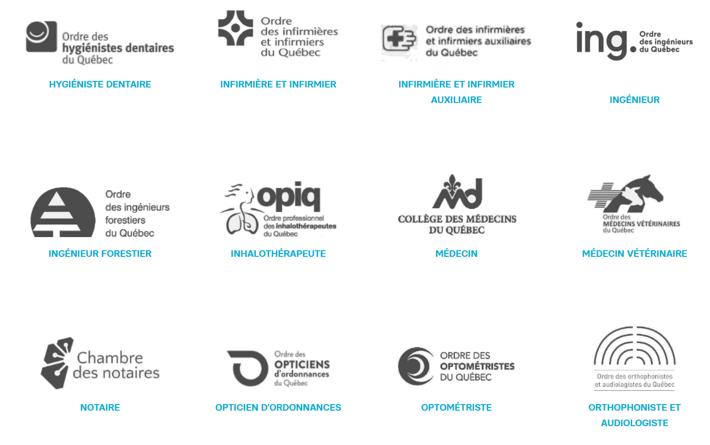
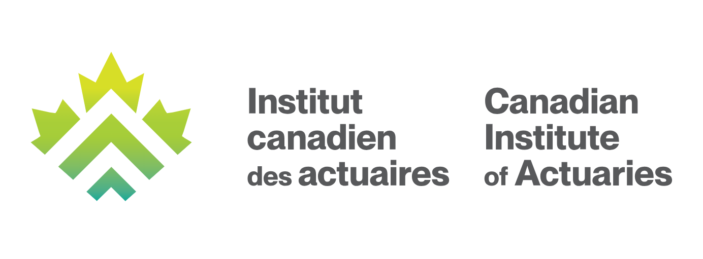
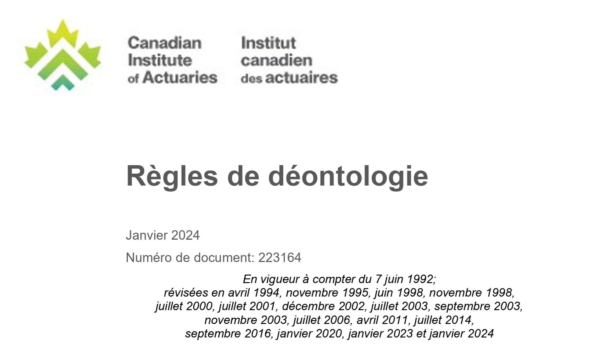
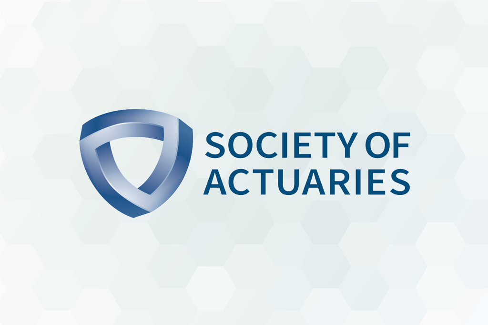
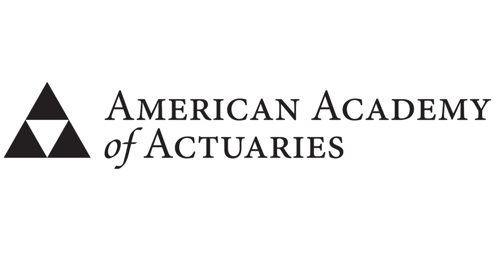
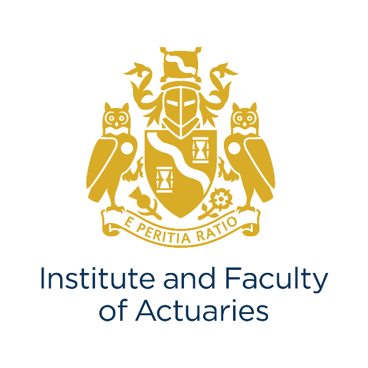
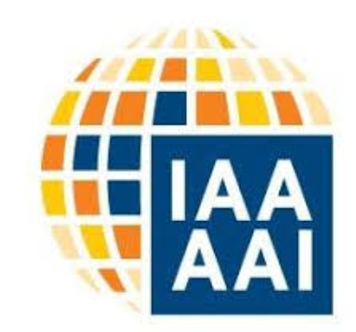
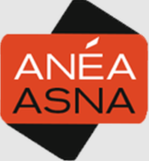
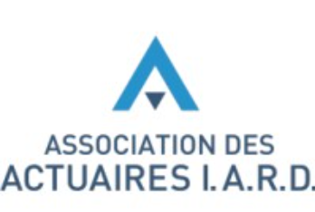

# La profession d'actuaire

::: {.act-objectifs}

Objectifs du chapitre

- Décrire le cadre légal québécois des professions (Code des professions), ainsi que le rôle des ordres professionnels en matière de protection du public.
- Distinguer clairement la réserve du titre et l’exclusivité d’exercice, et illustrer ces notions par des exemples.
- Situer l’actuariat dans le paysage québécois : absence d’ordre professionnel, absence de titre réservé, et conséquences pratiques de ce statut.
- Identifier les principaux contextes législatifs et réglementaires où l’actuaire est explicitement requis au Canada, et expliquer la logique derrière ces références.
- Expliquer la notion d’actuaire désigné et résumer ses responsabilités générales dans le cadre canadien.
- Décrire le rôle de l’Institut canadien des actuaires (ICA) : mission, gouvernance, catégories de membres, et principaux mécanismes de professionnalisme et de discipline.
- Résumer les obligations déontologiques fondamentales imposées aux membres de l’ICA et les relier à l’objectif de protection du public.
- Nommer et situer les principales associations actuarielles auxquelles un actuaire canadien peut être rattaché (SOA, CAS, AAA, IFoA, AAI, ANEA, IABA, AAIARD, Actulab), ainsi que leur rôle général.

:::

::: {.callout-note collapse="true"}

## Plan du chapitre

:::

## Les ordres professionnels au Québec

Le Québec encadre certaines professions par un dispositif juridique central, fondé sur le [Code des professions](https://www.legisquebec.gouv.qc.ca/fr/document/lc/C-26). Ce texte constitue la loi-cadre régissant les professions réglementées. Il prévoit notamment :

- les conditions de création d’un ordre professionnel ;
- les pouvoirs, obligations et responsabilités des ordres ;
- la finalité première du système, soit la protection du public.

En 2026, 55 professions sont régies par le *Code des professions* et encadrées par 46 ordres professionnels. [↗](https://www.quebec.ca/gouvernement/ministeres-organismes/office-professions/coordonnees-structure/organigramme/composition-systeme-professionnel "Source : Office des professions du Québec"){.source-link} Le principe institutionnel: La reconnaissance d’une profession par un ordre professionnel ne vise pas à valoriser la profession elle-même, mais à limiter les risques pour le public liés à l’exercice de certaines activités. 

Voici quelques logos de professions réglementées au Québec:

::: {.encadre}

{width=100% style="max-width: 1000px; display: block; margin: 0 auto;"}

:::

### Les critères examinés par le législateur

L’article 25 du *Code des professions* énumère des facteurs servant à déterminer s’il est pertinent de réglementer une profession par un ordre professionnel. [↗](https://www.legisquebec.gouv.qc.ca/fr/document/lc/C-26 "Source : Code des professions, art. 25"){.source-link} Ces facteurs portent principalement sur la nature des activités professionnelles et sur les risques associés à leur exercice.

- Compétences et autonomie
  - Niveau de connaissances spécialisées requis  
  - Degré d’autonomie dans l’exercice des activités  
  - Difficulté, pour une personne non formée, d’évaluer la qualité des actes professionnels
- Relation et risque pour le public  
  - Relation de confiance particulière entre le professionnel et le client  
  - Gravité des préjudices possibles en cas d’erreur ou de négligence  
  - Accès à des renseignements de nature confidentielle

Ces critères ne sont ni exclusifs ni appliqués mécaniquement. Ils servent de base à une analyse globale menée par les acteurs du système professionnel avant toute décision.

### Titre et exercice de la profession

:::: {.comparaison-concepts}

::: {.concept}

[La réserve du titre]{.concept-titre}

::: {.concept-question}
**Qui peut porter le titre ?**
:::

Lorsqu’une profession est réglementée, le Code des professions prévoit généralement que le titre professionnel associé est contrôlé par l’ordre concerné. Il s’agit de la réserve du titre.Concrètement, seules les personnes membres de l’ordre peuvent porter le titre officiel, et une personne non membre ne peut pas utiliser ce titre, ni une abréviation ou une appellation laissant croire à une telle appartenance. Le titre professionnel sert à informer le public sur la nature des services offerts et à signaler que la personne qui le porte satisfait à certaines exigences minimales de compétence, de formation et de déontologie. [↗](https://www.legisquebec.gouv.qc.ca/fr/document/lc/C-26 "Source : Code des professions, art. 32 et suivants"){.source-link}

:::

::: {.concept}

[L’exclusivité de l’exercice]{.concept-titre}

::: {.concept-question}
**Qui peut poser certains actes ?**
:::

Dans certains cas, le cadre légal va plus loin que la réserve du titre et prévoit une exclusivité de l’exercice. Cela signifie que certains actes professionnels précis ne peuvent être posés que par les membres de l’ordre concerné. On peut notamment penser aux géologues, aux avocats et aux infirmières, dont certaines activités sont réservées par la loi. Selon les dispositions applicables, des exceptions ou des autorisations réglementaires peuvent toutefois permettre à certaines personnes non membres de poser des actes particuliers. [↗](https://www.legisquebec.gouv.qc.ca/fr/document/lc/C-26 "Source : Code des professions, art. 32 à 34 et lois particulières"){.source-link}

:::

::::

## Statut juridique de l’actuaire



Ainsi, on peut voir, à partir de la 
[liste officielle des professions réglementées au Québec](https://www.quebec.ca/emploi/informer-metier-profession/ordres-professionnels/liste-repertoire-membres), que les actuaires ne font pas partie d’un ordre professionnel et ne sont pas régis par le Code des professions du Québec.  En conséquence, le titre d’actuaire n’est pas un titre réservé au sens du Code des professions, et son usage n’est pas protégé par un ordre professionnel québécois.  Une personne peut donc utiliser le terme « actuaire » sans être membre d’un ordre professionnel québécois. Cela ne lui permet toutefois ni de se présenter faussement comme titulaire d’une désignation professionnelle, ni d’exercer les fonctions que certaines lois réservent à des personnes qualifiées.

### Références législatives au rôle de l’actuaire

Malgré l’absence d’un ordre professionnel, de nombreuses lois et réglementations font explicitement référence à un actuaire. Dans ces textes, le terme *actuaire* n’est toutefois pas utilisé de manière uniforme : certains textes en donnent une définition explicite, tandis que d’autres y font référence dans un cadre réglementaire précis, sans définir formellement le titre. On retrouve notamment ce type de référence dans les textes suivants :

- [Loi de l’impôt sur le revenu (Canada)](https://laws-lois.justice.gc.ca/fra/lois/i-3.3/)
- [Loi sur les impôts (Québec)](https://legisquebec.gouv.qc.ca/fr/ShowDoc/cs/I-3)
- [Loi sur le régime de rentes du Québec](https://www.legisquebec.gouv.qc.ca/fr/document/lc/R-9)
- [Règlement sur les normes de prestation de pension (Canada)](https://laws-lois.justice.gc.ca/eng/regulations/sor-87-19/)
- Règlements provinciaux sur les prestations de pension :
  - [Colombie-Britannique — Pension Benefits Standards Act](https://www.bclaws.gov.bc.ca/civix/document/id/complete/statreg/00_12030)
  - [Alberta — Employment Pension Plans Act](https://open.alberta.ca/publications/e08p1)
  - [Saskatchewan — The Pension Benefits Act, 1992](https://pubsaskdev.blob.core.windows.net/pubsask-prod/87570/87570-The_Pension_Benefits_Act%2C_1992.pdf)
  - [Manitoba — The Pension Benefits Act](https://web2.gov.mb.ca/laws/statutes/ccsm/p032.php)
  - [Ontario — Pension Benefits Act](https://www.ontario.ca/laws/statute/90p08)
  - [Nouvelle-Écosse — Pension Benefits Act](https://nslegislature.ca/sites/default/files/legc/statutes/pension%20benefits.pdf)
  - [Nouveau-Brunswick — Pension Benefits Act](https://laws.gnb.ca/en/document/cs/p-5.1)
  - [Terre-Neuve-et-Labrador — Pension Benefits Act, 1997](https://assembly.nl.ca/legislation/sr/statutes/p04-01.htm)
- [Teachers’ Pension Act (Ontario)](https://www.ontario.ca/laws/statute/90t01) et [Insurance Act (Ontario)](https://www.ontario.ca/laws/statute/90i08)
- [Loi sur les assureurs (Québec)](https://www.legisquebec.gouv.qc.ca/fr/document/lc/a-32.1) et [Loi sur les accidents du travail et les maladies professionnelles (Québec)](https://legisquebec.gouv.qc.ca/fr/showdoc/cs/a-3.001)
- [Loi sur les régimes complémentaires de retraite (Québec)](https://www.legisquebec.gouv.qc.ca/fr/document/lc/r-15.1)
- [Code criminel (Canada)](https://laws-lois.justice.gc.ca/fra/lois/c-46/) (notamment l’article 347, relatif au taux d’intérêt criminel)
- [Loi sur les sociétés d’assurances (Canada)](https://laws-lois.justice.gc.ca/fra/lois/I-11.8/)

La [Loi sur les sociétés d’assurances (Canada)](https://laws-lois.justice.gc.ca/fra/lois/I-11.8/) fournit un exemple particulièrement clair : elle définit l’« actuaire » comme un Fellow de l’Institut canadien des actuaires et prévoit explicitement la fonction d’actuaire désigné dans les sociétés d’assurance sous réglementation fédérale. Cet exemple montre que, même sans ordre professionnel québécois ni titre d’actuaire réservé par le *Code des professions*, la loi peut exiger des qualifications précises pour exercer certaines fonctions sensibles. Le Québec prévoit lui aussi, aux articles 115 et 116 de la *Loi sur les assureurs*, que l’actuaire chargé des fonctions prévues par cette loi doit être Fellow de l’ICA. [↗](https://www.legisquebec.gouv.qc.ca/fr/document/lc/A-32.1 "Source : Loi sur les assureurs, art. 115 et 116"){.source-link}

### L’actuaire désigné



La [Loi sur les sociétés d’assurances](https://laws-lois.justice.gc.ca/fra/lois/I-11.8/), adoptée en 1991, a établi le cadre législatif moderne de la fonction d’**actuaire désigné** dans les sociétés d’assurance sous réglementation fédérale. Cette fonction comporte des obligations et des responsabilités précises. Selon la loi et les attentes de l’[organisme fédéral de réglementation (BSIF)](https://www.osfi-bsif.gc.ca/fr/consignes/repertoire-consignes/actuaire-designe-dispositions-legislatives-qualifications-examen-pairs-ligne-directrice-2023), ses principales caractéristiques sont les suivantes :

- la société d’assurance doit désigner un actuaire répondant aux qualifications exigées ;
- l’actuaire désigné peut être un employé de la société ou un consultant externe ;
- il est nommé par le conseil d’administration ;
- il doit avoir accès aux renseignements nécessaires à l’exercice de ses fonctions ;
- il doit signaler au conseil d’administration, et selon les circonstances aux autorités compétentes, les situations importantes prévues par la loi qui pourraient compromettre la situation financière de la société ;
- il formule une opinion actuarielle portant notamment sur l’évaluation des engagements liés aux contrats d’assurance ;
- il prépare les rapports actuariels réglementaires exigés par le BSIF et présente au conseil d’administration ses travaux sur la situation financière de l’assureur.

Le BSIF a également annoncé en septembre 2025 qu’à compter du 1er janvier 2027, l’examen externe périodique des travaux de l’actuaire désigné par des pairs ne serait plus systématiquement exigé, tout en conservant le pouvoir d’en demander un au besoin. [↗](https://www.osfi-bsif.gc.ca/fr/nouvelles/document-dinformation-ligne-directrice-e-15-actuaire-designe-dispositions-legislatives "Source : BSIF, révision E-15 de septembre 2025"){.source-link} Ainsi, même si le titre d'actuaire n'est pas réservé par le *Code des professions* du Québec, certaines lois confient des fonctions précises à des personnes qui possèdent des qualifications actuarielles reconnues, notamment le titre de Fellow de l'Institut canadien des actuaires. L'absence d'ordre professionnel ne signifie donc pas l'absence de règles encadrant la pratique. Autrement dit, le titre générique est libre, mais certaines fonctions ne le sont pas. Il faut donc se rendre à l'évidence : 

> **Si tout le monde peut se déclarer actuaire, certains sont manifestement beaucoup plus actuaires que d'autres.**

## L’Institut canadien des actuaires (ICA)

### Rôle de l’Institut

L’[Institut canadien des actuaires](https://www.cia-ica.ca/fr/) (ICA) est l’association nationale représentant la profession actuarielle au Canada. L’ICA agit à la fois comme organisme de qualification, de gouvernance et de professionnalisme pour ses membres. L’ICA a été constitué le 18 mars 1965 en vertu d’une loi fédérale, la [Loi constituant en corporation l’Institut canadien des actuaires](https://www.cia-ica.ca/publications/6502e/). 

Cette loi précise notamment que l’Institut a pour objet de :

- faire avancer et progresser la science actuarielle ;
- favoriser l’application de la science actuarielle à l’activité humaine ;
- établir, favoriser et maintenir un niveau élevé de compétence et d’éthique dans la profession actuarielle.

Comme nous l'avons vu, l’ICA n’est pas un ordre professionnel au sens du Code des professions du Québec. L’encadrement de l’ICA relève plutôt de ses règles internes, de ses statuts administratifs, et des mécanismes disciplinaires applicables à ses membres. En pratique, l’ICA :

- encadre l’éducation et la qualification des membres ;
- maintient des exigences de professionnalisme et de compétence ;
- publie et soutient des travaux (recherche, documents d’orientation, énoncés publics) ;
- représente la profession dans certaines discussions d’intérêt public.

Ainsi, l’un des [principes directeurs](https://www.cia-ica.ca/fr/professionnalisme/) de l’Institut canadien des actuaires est de faire passer l’intérêt public avant l’intérêt de la profession et de ses membres, principe qui guide notamment les exigences de qualification, les normes professionnelles et les mécanismes disciplinaires de l’ICA.  

### Gouvernance, règles internes et mécanismes disciplinaires

L’ICA s’appuie sur des documents normatifs qui structurent sa gouvernance et ses mécanismes de professionnalisme :

- [Statuts administratifs de l’ICA](https://www.cia-ica.ca/fr/publications/223157e/)
- [Page de référence sur la conduite et les plaintes](https://www.cia-ica.ca/professionalism/conduct-and-complaints/)
- [Politique sur le processus disciplinaire de l’ICA (2024)](https://www.cia-ica.ca/publications/224041e/)

Les statuts administratifs encadrent la gouvernance et certaines règles de fonctionnement. Les politiques et documents de professionnalisme décrivent le traitement des plaintes, l’analyse des situations et, au besoin, les étapes disciplinaires applicables aux membres.

### Plan stratégique en vigueur (2026–2029)

Le [plan stratégique 2026–2029 de l’Institut canadien des actuaires](https://www.cia-ica.ca/fr/publications/226046e/), publié en avril 2026, présente les orientations de l’organisme jusqu’en mars 2029. Comme toute organisation professionnelle, l’ICA doit adapter ses activités aux transformations du marché du travail, aux avancées technologiques et à l’évolution des besoins de la société. Pour cette période de trois ans, l’Institut a retenu trois grandes priorités stratégiques.

::: {style="margin-left: 1.5em;"}

**Priorité 1 — La marque de l’ICA**

L’Institut souhaite consolider la valeur des titres AICA et FICA, au Canada comme à l’étranger. Il entend notamment :

- mieux faire connaître son propre parcours de qualification auprès des étudiants universitaires;
- faciliter l’accès à la profession pour les candidats provenant de formations universitaires diversifiées;
- accentuer ses efforts auprès des employeurs et des autorités réglementaires pour faire reconnaître ses titres.

**Priorité 2 — La mobilisation des membres**

L’Institut cherche à entretenir un sentiment d’appartenance durable chez ses membres, depuis leur entrée dans la profession jusqu’à leur retraite. Il souhaite adapter ses services aux différentes étapes de leur carrière, encourager le bénévolat et favoriser une communauté actuarielle inclusive.

**Priorité 3 — Positionner la profession actuarielle canadienne pour l’avenir**

L’Institut identifie deux champs d’intervention prioritaires :

- **Les technologies émergentes et l’intelligence artificielle :** accompagner les actuaires dans l’intégration responsable de ces technologies à leur pratique professionnelle.
- **Le système public de santé canadien :** développer la recherche actuarielle sur l’évolution des dépenses de santé et intensifier les échanges avec les responsables des politiques publiques.

:::

Ce plan stratégique illustre le fait que le rôle d’une association professionnelle ne se limite pas à la qualification de ses membres et à l’encadrement de leurs activités. L’ICA cherche également à orienter le développement de la profession, à élargir ses domaines d’intervention et à faire reconnaître la pertinence de l’expertise actuarielle dans la résolution de problèmes de société, tout en maintenant la protection de l’intérêt public au cœur de ses activités.

### Catégories de membres de l’ICA

L’ICA distingue aujourd’hui les membres titulaires des désignations professionnelles **FICA** et **AICA**, ainsi que deux catégories destinées aux personnes en cours de formation : les **membres étudiants** et les **membres candidats**. Ces deux dernières catégories existent depuis le 1er décembre 2024. [↗](https://www.cia-ica.ca/fr/devenir-membre/devenir-membre-etudiant-ou-candidat-de-lica/ "Source : ICA, catégories de membres et conditions"){.source-link}

::: {.encadre2}

| Catégorie | Statut et principales caractéristiques |
|:--|:--|
| **Fellow (FICA)** | Membre ayant satisfait aux exigences du titre de Fellow. Ce titre permet, sous réserve des autres exigences applicables, d’exercer certaines fonctions réservées par la loi et de signer des documents actuariels réglementaires. |
| **Associé (AICA)** | Membre ayant satisfait aux exigences du titre d’associé. Il peut exercer des fonctions actuarielles, mais non celles pour lesquelles le titre de Fellow est exigé. |
| **Membre étudiant** | Personne inscrite à un programme universitaire de science actuarielle agréé par l’ICA, qui poursuit sa qualification professionnelle et satisfait aux modalités d’adhésion. |
| **Membre candidat** | Personne poursuivant un parcours vers l’AICA ou le FICA sans bénéficier du statut de membre étudiant, notamment après la fin de celui-ci. |

:::

Les Fellows ont le droit de vote dès leur admission au titre. Les associés en règle l’acquièrent après cinq années d’adhésion, selon les [règles de vote de l’ICA](https://www.cia-ica.ca/fr/etre-membre/vote-des-membres/). Pour les étudiants du baccalauréat, le [statut de membre étudiant](https://www.cia-ica.ca/fr/devenir-membre/devenir-membre-etudiant-ou-candidat-de-lica/) est particulièrement pertinent : il ne comporte pas de cotisation annuelle, mais exige notamment la réussite d’un module d’orientation et une preuve d’inscription à un programme agréé. Les membres étudiants et candidats doivent également respecter les exigences déontologiques et de perfectionnement professionnel continu applicables à leur statut. Nous reviendrons sur les parcours de qualification et les conditions d’adhésion dans le prochain chapitre.

### Règles de déontologie de l’Institut canadien des actuaires

Même si l’actuariat n’est pas encadré au Québec par un ordre professionnel au sens du *Code des professions*, les membres de l’Institut canadien des actuaires sont soumis à ses règles de déontologie. Ces obligations s’appliquent aux Fellows et aux associés, mais aussi aux membres étudiants et candidats. Les règles ainsi que leurs annotations peuvent être consultées dans le document officiel de l’ICA. [↗](https://www.cia-ica.ca/fr/publications/223164f/ "ICA — Règles de déontologie"){.source-link} À titre de synthèse, les treize règles de déontologie peuvent être résumées comme suit : [↗](https://www.cia-ica.ca/fr/etre-membre/les-regles-de-deontologie-et-leur-importance/ "ICA — Les règles de déontologie et leur importance"){.source-link}

- **Règle 1 — Intégrité professionnelle.** Agir de manière honnête, compétente et diligente, sans participer à des travaux malhonnêtes ou trompeurs.
- **Règle 2 — Normes de qualification.** Limiter ses interventions professionnelles à ses domaines de compétence et satisfaire aux exigences de perfectionnement professionnel continu. [↗](https://www.cia-ica.ca/fr/publications/225092f/ "ICA — Exigences relatives au perfectionnement professionnel continu"){.source-link}
- **Règle 3 — Normes de pratique.** Respecter les normes actuarielles applicables, y compris dans les travaux réalisés sous sa supervision. [↗](https://www.cia-ica.ca/fr/etre-membre/normes-de-pratique/ "ICA — Normes de pratique"){.source-link}
- **Règle 4 — Divulgation.** Informer rapidement le client ou l’employeur de la provenance des rémunérations liées au mandat, par exemple des commissions versées par un assureur.
- **Règle 5 — Conflits d’intérêts.** Éviter les situations de conflit d’intérêts, sauf si l’impartialité du membre demeure intacte et que les utilisateurs directs concernés consentent expressément à la prestation des services après avoir été pleinement informés.
- **Règle 6 — Contrôle du produit.** Prendre les précautions raisonnables pour prévenir une utilisation trompeuse ou illégale des travaux actuariels.
- **Règle 7 — Confidentialité.** Préserver le caractère confidentiel des renseignements professionnels, sous réserve des autorisations et des obligations légales ou déontologiques applicables.
- **Règle 8 — Courtoisie et collaboration.** Entretenir des relations professionnelles respectueuses et favoriser la coopération dans l’intérêt du client ou de l’employeur.
- **Règle 9 — Publicité.** Éviter les communications commerciales trompeuses ou préjudiciables à la réputation de la profession.
- **Règle 10 — Titres et désignations.** Respecter les conditions d’utilisation des désignations conférées par les associations actuarielles reconnues.
- **Règle 11 — Condamnations au criminel.** Déclarer à l’Institut les condamnations visées par ses statuts administratifs. [↗](https://www.cia-ica.ca/fr/etre-membre/condamnations-au-criminel/ "ICA — Condamnations au criminel"){.source-link}
- **Règle 12 — Collaboration au processus disciplinaire.** Coopérer pleinement avec les instances responsables des enquêtes et des procédures disciplinaires. [↗](https://www.cia-ica.ca/fr/professionnalisme/conduite-et-plaintes/ "ICA — Conduite et plaintes"){.source-link}
- **Règle 13 — Signalement des manquements.** Chercher à résoudre les manquements apparents importants d’un autre membre en discutant avec lui et, à défaut de résolution, les signaler au Conseil de déontologie, sous réserve des exceptions prévues. [↗](https://www.cia-ica.ca/fr/etre-membre/les-regles-de-deontologie-et-leur-importance/foire-aux-questions/ "ICA — Foire aux questions sur les règles de déontologie"){.source-link}

Dans l’ensemble, ces règles visent à protéger l’intérêt public, à encadrer la conduite des membres et à maintenir la crédibilité de la profession actuarielle, indépendamment de son statut particulier dans le système professionnel québécois.

### Adhésion à l’Institut canadien des actuaires

Avant la fondation de l’Institut et pendant les premières décennies qui ont suivi, le nombre d’actuaires exerçant au Canada était relativement limité. Les actuaires canadiens étaient alors principalement membres d’associations américaines ou internationales, et l’Institut canadien des actuaires n’acceptait comme membres que des membres à part entière (« Fellows ») de ces associations. Les deux associations qui ont fourni le plus grand nombre de membres à l’Institut sont la [Society of Actuaries (SOA)](https://www.soa.org/), qui regroupait initialement surtout des actuaires œuvrant en assurances de personnes et en régimes de retraite, et la [Casualty Actuarial Society (CAS)](https://www.casact.org/), qui regroupait les actuaires travaillant en assurance IARD. D’autres actuaires pratiquant au Canada ont également été formés par l’*Institute of Actuaries* d’Angleterre et par la *Faculty of Actuaries* d’Écosse. Ces deux organisations sont aujourd’hui regroupées sous le nom de [Institute and Faculty of Actuaries (IFoA)](https://actuaries.org.uk/).

À la fin du XIXe siècle et au début du XXe siècle, les sociétés d’actuaires ont progressivement décidé d’uniformiser leurs critères d’admission en imposant des examens formels aux candidats qui se destinaient à la profession actuarielle. À cette époque, l’actuariat était peu enseigné à l’université, et de nombreux actuaires acquéraient leur formation principalement par la pratique, au sein de sociétés d’assurance. Le fait que l’ICA admettait principalement des membres issus de la SOA et de la CAS, combiné à un certain conservatisme institutionnel dans la profession en Amérique du Nord, a eu pour effet que la formation actuarielle au Canada a longtemps reposé sur les examens de ces sociétés. C’est pourquoi, encore aujourd’hui, les examens de la SOA et de la CAS occupent une place importante dans la formation et la qualification des actuaires canadiens. Au prochain chapitre, nous étudierons en détail le lien entre la formation universitaire et l'adhésion à l'ICA.

## Quelques autres associations d’actuaires

Au-delà de l’Institut canadien des actuaires, de nombreuses organisations contribuent au développement et au rayonnement de la profession actuarielle, tant au Canada qu’à l’étranger. Leurs missions sont variées : formation et qualification professionnelles, recherche scientifique, représentation de la profession, réseautage et soutien aux étudiants. Cette section présente quelques-unes de ces organisations.

::: {style="margin-left: 1.5em;"}

::: {.encadre}

:::: {.association}

### La *Society of Actuaries* {-}

::: {.association-info}
SOA · États-Unis · 1949
:::

La [Society of Actuaries (SOA)](https://www.soa.org) est un organisme professionnel international ayant ses racines aux États-Unis, principalement dédié à la formation des actuaires et à la recherche en actuariat. Elle regroupe aujourd’hui plus de 34 000 membres à travers le monde. [↗](https://www.soa.org/about/purpose/ "Source : SOA, présentation officielle"){.source-link} Ses origines remontent à 1889, année de fondation de l’*Actuarial Society of America*. La SOA actuelle a été constituée en 1949 par la fusion de cette société et de l’*American Institute of Actuaries*. Les examens professionnels ont occupé une place centrale dans son histoire et demeurent un élément essentiel de son système de qualification.  Jusqu’en 2012, la SOA concentrait essentiellement ses activités sur les risques liés aux personnes, notamment la mortalité, la morbidité, les taux d’intérêt et les placements. En 2012, elle a décidé de créer un parcours de formation en assurance IARD, dont les premiers examens ont été offerts en 2013. [↗](https://www.soa.org/education/general-insurance/edu-general-ins/ "Source : SOA, lancement du parcours IARD"){.source-link} La SOA offre notamment les titres d’*Associate of the Society of Actuaries (ASA)* et de *Fellow of the Society of Actuaries (FSA)*. Depuis l’automne 2025, le parcours FSA est plus flexible : après les exigences du titre ASA, les candidats doivent réussir quatre cours techniques, dont deux cours successifs dans un même domaine de pratique, ainsi que les activités de professionnalisme et de communication requises. Ils peuvent se concentrer sur un domaine ou combiner plusieurs domaines, par exemple l’assurance-vie, la santé, la retraite, la finance ou la gestion des risques. Les [exigences du titre FSA](https://www.soa.org/education/fsa/) sont présentées sur le site de la SOA.

::::

:::

::: {.encadre}

:::: {.association}

### La *Casualty Actuarial Society* {-}

::: {.association-info}
CAS · États-Unis · 1914
:::

La [Casualty Actuarial Society (CAS)](https://www.casact.org) est un organisme professionnel international, également basé aux États-Unis, consacré exclusivement à la formation des actuaires en assurance IARD et en gestion des risques. Elle comptait 11 509 membres en 2025. [↗](https://www.casact.org/article/cas-releases-updated-membership-glance-infographic-2025 "Source : CAS, effectif 2025 publié en 2026"){.source-link} Fondée en 1914, la CAS a instauré son système d’examens dès 1915, dans le but d’évaluer les compétences techniques nécessaires à la pratique actuarielle en assurance de dommages. On peut retrouver les règles d’examens de 1915 dans les [archives historiques de la CAS](https://www.casact.org/sites/default/files/database/proceed_proceed16_1916.pdf).

::::

:::

::: {.encadre}

:::: {.association}

### L’*American Academy of Actuaries* {-}

::: {.association-info}
AAA · États-Unis
:::

L’[American Academy of Actuaries (AAA)](https://www.actuary.org) est une organisation professionnelle regroupant plus de 19 500 actuaires aux États-Unis. Contrairement à la SOA et à la CAS, l’Académie ne délivre pas de titres par examens. Son rôle principal consiste à représenter la profession actuarielle auprès du public américain ainsi qu’auprès des autorités de réglementation des États et du gouvernement fédéral des États-Unis. L’AAA contribue aussi à l’élaboration des normes de qualification applicables aux actuaires qui produisent des opinions actuarielles aux États-Unis. Le respect de ces normes ne suppose toutefois pas, dans tous les cas, une adhésion à l’AAA : les exigences dépendent des fonctions exercées et du cadre réglementaire pertinent.

::::

:::

::: {.encadre}
:::: {.association}

### L’*Institute and Faculty of Actuaries* {-}

::: {.association-info}
IFoA · Royaume-Uni · 2010
:::

L’[Institute and Faculty of Actuaries (IFoA)](https://www.actuaries.org.uk) est l’organisme professionnel responsable de la formation et de la réglementation des actuaires au Royaume-Uni. Il résulte de la fusion, en 2010, de l’Institute of Actuaries et de la Faculty of Actuaries. [↗](https://actuaries.org.uk/news-and-media-releases/news-articles/2023/july/7-jul-23-ifoa-celebrates-its-175th-anniversary/ "Source : IFoA, histoire institutionnelle"){.source-link} L’IFoA offre un parcours d’examens menant au titre de Fellow, combinant examens techniques, modules de professionnalisme et exigences d’expérience pratique. Son rôle de réglementation et les mécanismes de contrôle professionnel sont décrits sur [son site](https://actuaries.org.uk/standards/our-role-as-a-regulator/).

::::

:::

::: {.encadre}

:::: {.association}

### L’Association actuarielle internationale {-}

::: {.association-info}
AAI / IAA · International · 1895
:::

L’[Association actuarielle internationale (AAI)](https://www.actuaries.org) est l’organisme faîtier regroupant les associations actuarielles nationales reconnues à l’échelle mondiale. Fondée en 1895, elle joue un rôle central dans la coordination internationale de la profession actuarielle. [↗](https://actuaries.org/our-history/ "Source : AAI, historique de l’association"){.source-link} À titre d’organisation internationale, l’AAI a notamment pour mission de représenter la profession actuarielle à l’échelle mondiale, de promouvoir le professionnalisme, les normes de pratique et l’éducation actuarielle, et de favoriser l’harmonisation des standards de formation entre les différentes juridictions. Ses missions et principaux champs d’intervention sont présentés dans sa [déclaration officielle de mission](https://actuaries.org/mission-and-vision/). Anecdote : les bureaux de l’AAI sont situés au Canada, à Ottawa.

::::

:::

::: {.encadre}

:::: {.association}

### L’Association nationale des étudiants en actuariat {-}

::: {.association-info}
ANEA / ASNA · Canada · 1989
:::

L’[Association nationale des étudiants en actuariat (ANEA)](https://anea-asna.ca/) est une association canadienne fondée en 1989, qui représente les étudiants inscrits dans les programmes universitaires d’actuariat au Canada. [↗](https://anea-asna.ca/notre-vision/ "Source : ANÉA, historique et mission"){.source-link} L’ANEA regroupe des étudiants provenant de nombreuses universités canadiennes et organise notamment un congrès annuel au début du mois de janvier, offrant des activités de formation, de réseautage et de développement professionnel.

::::

:::

::: {.encadre}

:::: {.association}

### L’*International Association of Black Actuaries* {-}

::: {.association-info}
IABA · International · 1993
:::

L’[International Association of Black Actuaries (IABA)](https://www.blackactuaries.org) est une organisation professionnelle à but non lucratif dont la première réunion s’est tenue à Washington le 25 octobre 1992 et qui a été officiellement constituée en 1993. [↗](https://www.blackactuaries.org/our-history/ "Source : IABA, histoire de l’organisme"){.source-link} Sa mission est de soutenir, de promouvoir et de développer la présence des personnes noires dans la profession actuarielle, tant chez les étudiants que chez les professionnels. L’IABA offre à ses membres divers services, notamment des programmes de mentorat, des activités de perfectionnement professionnel, des occasions de réseautage ainsi que des bourses d’études destinées aux étudiants en actuariat. L’organisme s’adresse principalement aux actuaires et aux étudiants en actuariat issus des communautés noires et fonctionne principalement en anglais. L’association organise régulièrement des événements professionnels, dont un *Boot Camp* actuariel, ainsi que des activités de formation et de développement de carrière. Elle collabore également avec d’autres organisations actuarielles, notamment la *Society of Actuaries* (SOA) et la *Casualty Actuarial Society* (CAS), dans le cadre d’initiatives visant à favoriser la diversité et l’inclusion au sein de la profession. L’IABA publie également des articles et des témoignages de membres dans [*Voices of IABA*](https://www.blackactuaries.org/voices-of-iaba/), une publication consacrée à la communauté actuarielle et à ses expériences professionnelles.

::::

:::

::: {.encadre}

:::: {.association}

### L’Association des actuaires en assurance de dommages du Québec {-}

::: {.association-info}
AAIARD · Québec
:::

L’[Association des actuaires en assurance de dommages du Québec (AAIARD)](https://app.amilia.com/store/fr/aaiard/shop/programs) est une association professionnelle québécoise qui regroupe les actuaires œuvrant principalement en assurance de dommages et en gestion des risques. Elle vise à promouvoir le développement professionnel, la formation continue et le rayonnement de la pratique actuarielle en assurance IARD au Québec. L’AAIARD organise régulièrement des conférences à Montréal et à Québec destinées à ses membres. Ces événements contribuent au maintien et au développement des compétences professionnelles dans un contexte propre au marché québécois. L’association agit également comme lieu d’échange entre actuaires issus de différents milieux, notamment les assureurs, les cabinets de consultation et les organismes publics. Par ses activités, l’AAIARD favorise le partage de connaissances sur les enjeux techniques, réglementaires et économiques propres à l’assurance de dommages, tout en renforçant les liens entre la communauté actuarielle québécoise et les autres acteurs du secteur financier.

::::

:::

::: {.encadre}

:::: {.association}

### Actulab {-}

::: {.association-info}
Québec · Innovation et apprentissage expérientiel
:::

[Actulab](https://www.actulab.ca/) est une organisation fondée par [Frédérick Guillot](https://www.linkedin.com/in/fr%C3%A9d%C3%A9rick-guillot-336a1237/) qui vise à connecter les étudiants aux professionnels de l’industrie par le biais d’ateliers et d’événements pratiques. Elle met l’accent sur l’innovation, le réseautage et l’apprentissage par l’expérience, en encourageant les participants à travailler sur des problèmes concrets provenant d’entreprises réelles. Les activités d’Actulab se déroulent sous forme d’ateliers ou de séries de rencontres où des étudiants, parfois en équipes, collaborent avec des experts du milieu professionnel pour proposer des pistes de solutions à des défis organisationnels. Ces événements permettent non seulement d’appliquer des connaissances académiques dans un contexte professionnel, mais aussi de développer des compétences transversales telles que la créativité, la communication, l’esprit d’équipe et la résolution de problèmes. Au-delà du volet technique, Actulab offre des occasions de réseautage avec des représentants d’entreprises, ce qui peut favoriser l’accès à des stages, des emplois ou des projets de recherche. Certains événements prévoient également des récompenses monétaires ou des prix, attribués lorsque les propositions des participants se distinguent auprès d’un jury. Actulab favorise la participation d’étudiants de divers programmes, mais les conditions d’inscription varient selon l’événement. Par exemple, pour l’activité organisée à l’UQAM à l’automne 2026, une équipe devait compter au moins une personne inscrite en actuariat, et les participants devaient présenter leur solution lors de l’événement final. [↗](https://www.actulab.ca/ "Source : Actulab, modalités de l’événement UQAM automne 2026"){.source-link} L’organisation fonctionne comme un lieu d’apprentissage expérientiel où l’interaction entre le milieu universitaire et l’industrie est encouragée.

::::

:::

:::

## Conclusion

Ce chapitre avait pour objectif de fournir des repères clairs aux étudiantes et aux étudiants. Il a présenté le cadre juridique québécois des professions, le statut particulier de l’actuariat en l’absence d’un ordre professionnel, ainsi que le rôle central joué par les lois, l’actuaire désigné et l’Institut canadien des actuaires. Il a également montré que la profession repose moins sur la protection légale d’un titre que sur des responsabilités précises, des exigences de compétence et des règles de conduite formelles. Ces éléments permettent aux étudiantes et aux étudiants de comprendre le cadre réel dans lequel s’exerce la profession d’actuaire et les obligations qui l’accompagnent.

::: {.callout-note collapse="true" icon=false}
## Références et liens utiles

Les liens ci-dessous regroupent les sources et les ressources mentionnées dans ce chapitre, sans répétition.

### Cadre professionnel, lois et réglementation {-}

- [Code des professions](https://www.legisquebec.gouv.qc.ca/fr/document/lc/C-26)
- [Office des professions du Québec — Composition du système professionnel](https://www.quebec.ca/gouvernement/ministeres-organismes/office-professions/coordonnees-structure/organigramme/composition-systeme-professionnel)
- [liste officielle des professions réglementées au Québec](https://www.quebec.ca/emploi/informer-metier-profession/ordres-professionnels/liste-repertoire-membres)
- [Loi de l’impôt sur le revenu (Canada)](https://laws-lois.justice.gc.ca/fra/lois/i-3.3/)
- [Loi sur les impôts (Québec)](https://legisquebec.gouv.qc.ca/fr/ShowDoc/cs/I-3)
- [Loi sur le régime de rentes du Québec](https://www.legisquebec.gouv.qc.ca/fr/document/lc/R-9)
- [Règlement sur les normes de prestation de pension (Canada)](https://laws-lois.justice.gc.ca/eng/regulations/sor-87-19/)
- [Colombie-Britannique — Pension Benefits Standards Act](https://www.bclaws.gov.bc.ca/civix/document/id/complete/statreg/00_12030)
- [Alberta — Employment Pension Plans Act](https://open.alberta.ca/publications/e08p1)
- [Saskatchewan — The Pension Benefits Act, 1992](https://pubsaskdev.blob.core.windows.net/pubsask-prod/87570/87570-The_Pension_Benefits_Act%2C_1992.pdf)
- [Manitoba — The Pension Benefits Act](https://web2.gov.mb.ca/laws/statutes/ccsm/p032.php)
- [Ontario — Pension Benefits Act](https://www.ontario.ca/laws/statute/90p08)
- [Nouvelle-Écosse — Pension Benefits Act](https://nslegislature.ca/sites/default/files/legc/statutes/pension%20benefits.pdf)
- [Nouveau-Brunswick — Pension Benefits Act](https://laws.gnb.ca/en/document/cs/p-5.1)
- [Terre-Neuve-et-Labrador — Pension Benefits Act, 1997](https://assembly.nl.ca/legislation/sr/statutes/p04-01.htm)
- [Teachers’ Pension Act (Ontario)](https://www.ontario.ca/laws/statute/90t01)
- [Insurance Act (Ontario)](https://www.ontario.ca/laws/statute/90i08)
- [Loi sur les assureurs (Québec)](https://www.legisquebec.gouv.qc.ca/fr/document/lc/a-32.1)
- [Loi sur les accidents du travail et les maladies professionnelles (Québec)](https://legisquebec.gouv.qc.ca/fr/showdoc/cs/a-3.001)
- [Loi sur les régimes complémentaires de retraite (Québec)](https://www.legisquebec.gouv.qc.ca/fr/document/lc/r-15.1)
- [Code criminel (Canada)](https://laws-lois.justice.gc.ca/fra/lois/c-46/)
- [Loi sur les sociétés d’assurances (Canada)](https://laws-lois.justice.gc.ca/fra/lois/I-11.8/)
- [BSIF — Actuaire désigné : dispositions législatives, qualifications et examen par les pairs](https://www.osfi-bsif.gc.ca/fr/consignes/repertoire-consignes/actuaire-designe-dispositions-legislatives-qualifications-examen-pairs-ligne-directrice-2023)
- [BSIF, révision E-15 de septembre 2025](https://www.osfi-bsif.gc.ca/fr/nouvelles/document-dinformation-ligne-directrice-e-15-actuaire-designe-dispositions-legislatives)

### Institut canadien des actuaires (ICA) {-}

- [Institut canadien des actuaires](https://www.cia-ica.ca/fr/)
- [Loi constituant en corporation l’Institut canadien des actuaires](https://www.cia-ica.ca/publications/6502e/)
- [ICA — Professionnalisme et principes directeurs](https://www.cia-ica.ca/fr/professionnalisme/)
- [Statuts administratifs de l’ICA](https://www.cia-ica.ca/fr/publications/223157e/)
- [ICA — Conduite professionnelle et plaintes](https://www.cia-ica.ca/professionalism/conduct-and-complaints/)
- [Politique sur le processus disciplinaire de l’ICA (2024)](https://www.cia-ica.ca/publications/224041e/)
- [plan stratégique 2026–2029 de l’Institut canadien des actuaires](https://www.cia-ica.ca/fr/publications/226046e/)
- [ICA — Catégories de membres étudiants et candidats](https://www.cia-ica.ca/fr/devenir-membre/devenir-membre-etudiant-ou-candidat-de-lica/)
- [règles de vote de l’ICA](https://www.cia-ica.ca/fr/etre-membre/vote-des-membres/)
- [ICA — Règles de déontologie](https://www.cia-ica.ca/fr/publications/223164f/)

### Associations actuarielles et autres ressources {-}

- [Society of Actuaries (SOA)](https://www.soa.org/)
- [Casualty Actuarial Society (CAS)](https://www.casact.org/)
- [Institute and Faculty of Actuaries (IFoA)](https://actuaries.org.uk/)
- [SOA — Mission et présentation](https://www.soa.org/about/purpose/)
- [SOA — Parcours de formation en assurance IARD](https://www.soa.org/education/general-insurance/edu-general-ins/)
- [exigences du titre FSA](https://www.soa.org/education/fsa/)
- [CAS — Effectif des membres en 2025](https://www.casact.org/article/cas-releases-updated-membership-glance-infographic-2025)
- [archives historiques de la CAS](https://www.casact.org/sites/default/files/database/proceed_proceed16_1916.pdf)
- [American Academy of Actuaries (AAA)](https://www.actuary.org)
- [IFoA, histoire institutionnelle](https://actuaries.org.uk/news-and-media-releases/news-articles/2023/july/7-jul-23-ifoa-celebrates-its-175th-anniversary/)
- [IFoA — Rôle de réglementation](https://actuaries.org.uk/standards/our-role-as-a-regulator/)
- [Association actuarielle internationale (AAI)](https://www.actuaries.org)
- [AAI, historique de l’association](https://actuaries.org/our-history/)
- [déclaration officielle de mission](https://actuaries.org/mission-and-vision/)
- [Association nationale des étudiants en actuariat (ANEA)](https://anea-asna.ca/)
- [ANÉA, historique et mission](https://anea-asna.ca/notre-vision/)
- [International Association of Black Actuaries (IABA)](https://www.blackactuaries.org)
- [IABA — Historique](https://www.blackactuaries.org/our-history/)
- [Voices of IABA](https://www.blackactuaries.org/voices-of-iaba/)
- [Association des actuaires en assurance de dommages du Québec (AAIARD)](https://app.amilia.com/store/fr/aaiard/shop/programs)
- [Actulab](https://www.actulab.ca/)
- [Frédérick Guillot — Profil LinkedIn](https://www.linkedin.com/in/fr%C3%A9d%C3%A9rick-guillot-336a1237/)

:::
