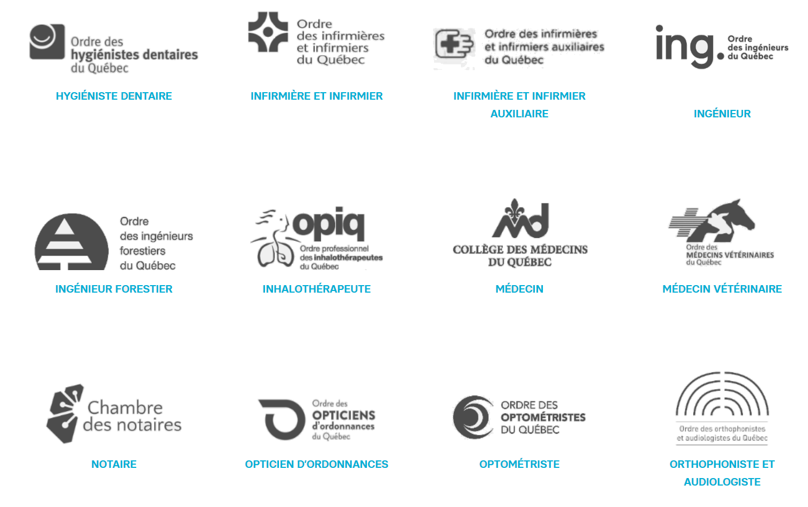
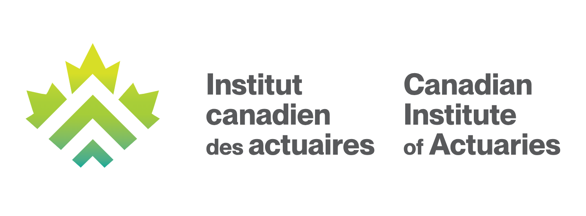
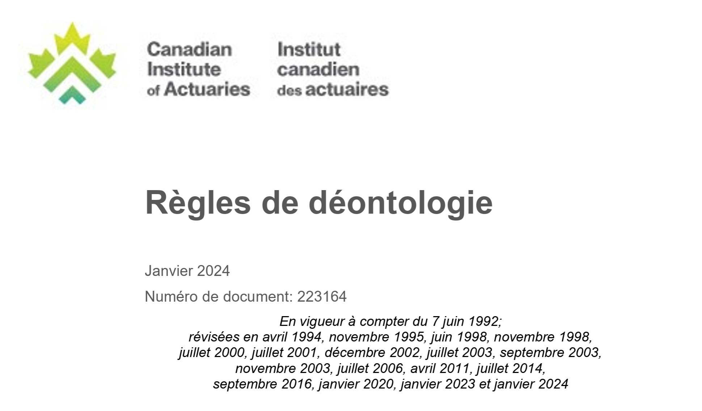
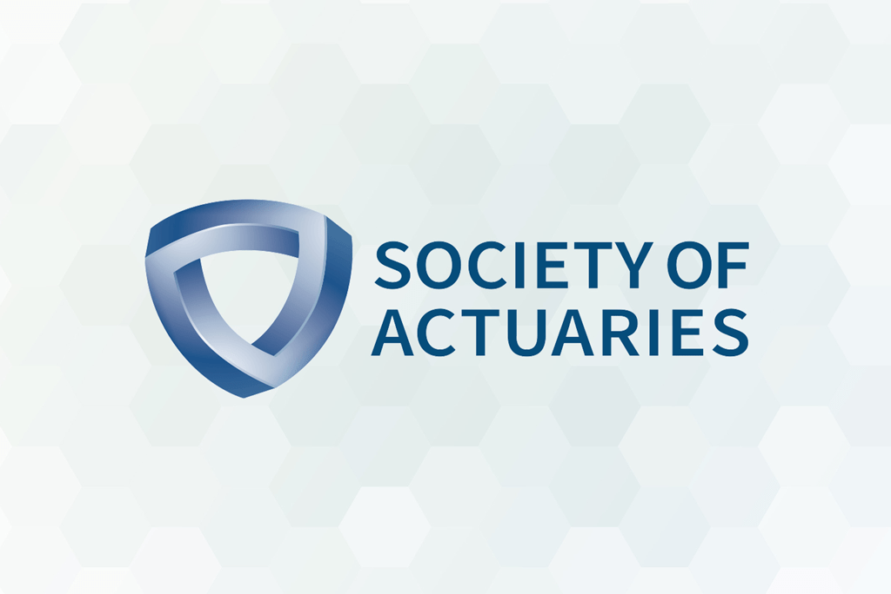
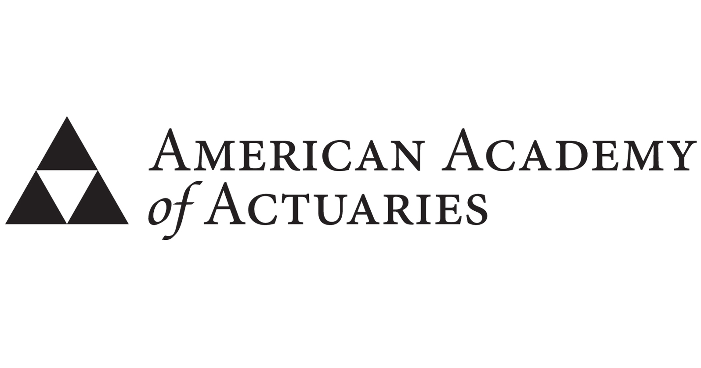
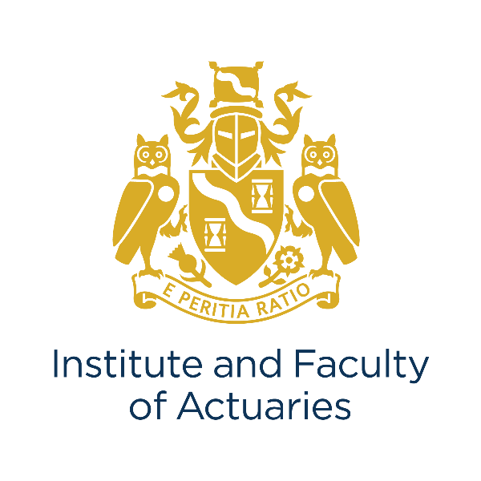
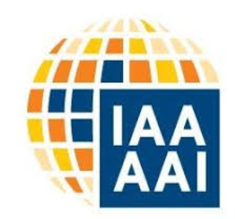
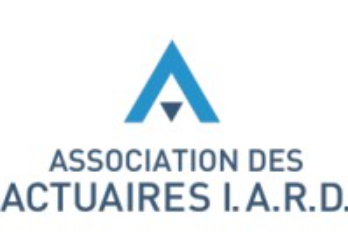

# La profession d'actuaire

::: {.act-objectifs}

Objectifs du chapitre

- Décrire le cadre légal québécois des professions (Code des professions), ainsi que le rôle des ordres professionnels en matière de protection du public.
- Distinguer clairement la réserve du titre et l’exclusivité d’exercice, et illustrer ces notions par des exemples.
- Situer l’actuariat dans le paysage québécois : absence d’ordre professionnel, absence de titre réservé, et conséquences pratiques de ce statut.
- Identifier les principaux contextes législatifs et réglementaires où l’actuaire est explicitement requis au Canada, et expliquer la logique derrière ces références.
- Expliquer la notion d’actuaire désigné et résumer ses responsabilités générales dans le cadre canadien.
- Décrire le rôle de l’Institut canadien des actuaires (ICA) : mission, gouvernance, catégories de membres, et principaux mécanismes de professionnalisme et de discipline.
- Résumer les obligations déontologiques fondamentales imposées aux membres de l’ICA et les relier à l’objectif de protection du public.
- Nommer et situer les principales associations actuarielles auxquelles un actuaire canadien peut être rattaché (SOA, CAS, AAA, IFoA, AAI, ANEA, IABA, AAIARD, Actulab), ainsi que leur rôle général.

:::

## Les ordres professionnels au Québec

Le Québec encadre certaines professions par un dispositif juridique central, fondé sur le Code des professions. Ce texte constitue la loi-cadre régissant les professions réglementées. Il prévoit notamment :

- les conditions de création d’un ordre professionnel ;
- les pouvoirs, obligations et responsabilités des ordres ;
- la finalité première du système, soit la protection du public.

En 2026, tel qu'on peut le voir sur leur [site](https://www.professions-quebec.org/fr/liste-des-ordres-professionnels?), 55 professions sont régies par le Code des professions et encadrées par 46 ordres professionnels.

::: {.callout-important}
## Principe institutionnel
La reconnaissance d’une profession par un ordre professionnel ne vise pas à valoriser la profession elle-même, mais à limiter les risques pour le public liés à l’exercice de certaines activités.
:::

{width=75% .center}

### Les critères examinés par le législateur

L’article 25 du Code des professions énumère des facteurs servant à déterminer s’il est pertinent de réglementer une profession par un ordre professionnel. Ces facteurs portent principalement sur la nature des activités professionnelles et sur les risques associés à leur exercice.

- Compétences et autonomie
  - Niveau de connaissances spécialisées requis  
  - Degré d’autonomie dans l’exercice des activités  
  - Difficulté, pour une personne non formée, d’évaluer la qualité des actes professionnels
- Relation et risque pour le public  
  - Relation de confiance particulière entre le professionnel et le client  
  - Gravité des préjudices possibles en cas d’erreur ou de négligence  
  - Accès à des renseignements de nature confidentielle

Ces critères ne sont ni exclusifs ni appliqués mécaniquement. Ils servent de base à une analyse globale menée par les acteurs du système professionnel avant toute décision.

### Titre et exercice de la profession

::: {.columns}
::: {.column width="48%"}
::: {.callout-note appearance="simple" icon=false}
#### La réserve du titre {-}

Lorsqu’une profession est réglementée, le Code des professions prévoit généralement que le titre professionnel associé est contrôlé par l’ordre concerné. Il s’agit de la réserve du titre. Concrètement, seules les personnes membres de l’ordre peuvent porter le titre officiel, et une personne non membre ne peut pas utiliser ce titre, ni une abréviation ou une appellation laissant croire à une telle appartenance. Le titre professionnel sert à informer le public sur la nature des services offerts et à signaler que la personne qui le porte satisfait à certaines exigences minimales de compétence, de formation et de déontologie.
:::
:::

::: {.column width="4%"}
:::

::: {.column width="48%"}
::: {.callout-note appearance="minimal" icon=false}
#### Exercice de la profession {-}

Dans certains cas, le cadre légal va plus loin que la réserve du titre et prévoit une exclusivité de l’exercice. Cela signifie que certains actes professionnels précis ne peuvent être posés que par les membres de l’ordre concerné. Des exemples souvent cités incluent les géologues, les avocats et les infirmières. Même lorsqu’une exclusivité est prévue par la loi, un ordre professionnel peut, par règlement, autoriser certaines catégories de personnes non membres à exercer des activités spécifiques associées à la profession. Ce type d’autorisation est présenté comme exceptionnel.
:::
:::
:::

Ainsi, la réserve du titre répond à la question : qui peut porter le titre ?, alors que l’exclusivité de l’exercice répond à la question : qui peut poser certains actes ?.

## Statut juridique de l’actuaire

Ainsi, on peut voir, à partir de la 
[liste officielle des ordres professionnels du Québec](https://www.professions-quebec.org/fr/liste-des-ordres-professionnels), que les actuaires ne font pas partie d’un ordre professionnel et ne sont pas régis par le Code des professions du Québec.  En conséquence, le titre d’actuaire n’est pas un titre réservé au sens du Code des professions, et son usage n’est pas protégé par un ordre professionnel québécois.  Tout le monde peut donc se déclarer actuaire.

### Références législatives au rôle de l’actuaire

Malgré l’absence d’un ordre professionnel, de nombreuses lois et réglementations font explicitement référence à un actuaire. Dans ces textes, le terme *actuaire* n’est toutefois pas utilisé de manière uniforme : certains textes en donnent une définition explicite, tandis que d’autres y font référence dans un cadre réglementaire précis, sans définir formellement le titre.

On retrouve notamment ce type de référence dans les textes suivants :

- [Loi de l’impôt sur le revenu (Canada)](https://laws-lois.justice.gc.ca/fra/lois/i-3.3/)
- [Loi sur les impôts (Québec)](https://legisquebec.gouv.qc.ca/fr/ShowDoc/cs/I-3)
- [Loi sur le régime de rentes du Québec](https://www.legisquebec.gouv.qc.ca/fr/document/lc/R-9)
- [Règlement sur les normes de prestation de pension (Canada)](https://laws-lois.justice.gc.ca/eng/regulations/sor-87-19/)
- Règlements provinciaux sur les prestations de pension :
  - [Colombie-Britannique — Pension Benefits Standards Act](https://www.bclaws.gov.bc.ca/civix/document/id/complete/statreg/00_12030)
  - [Alberta — Employment Pension Plans Act](https://open.alberta.ca/publications/e08p1)
  - [Saskatchewan — The Pension Benefits Act, 1992](https://pubsaskdev.blob.core.windows.net/pubsask-prod/87570/87570-The_Pension_Benefits_Act%2C_1992.pdf)
  - [Manitoba — The Pension Benefits Act](https://web2.gov.mb.ca/laws/statutes/ccsm/p032.php)
  - [Ontario — Pension Benefits Act](https://www.ontario.ca/laws/statute/90p08)
  - [Nouvelle-Écosse — Pension Benefits Act](https://nslegislature.ca/sites/default/files/legc/statutes/pension%20benefits.pdf)
  - [Nouveau-Brunswick — Pension Benefits Act](https://laws.gnb.ca/en/document/cs/p-5.1)
  - [Terre-Neuve-et-Labrador — Pension Benefits Act, 1997](https://assembly.nl.ca/legislation/sr/statutes/p04-01.htm)
- [International Financial Business Act (Colombie-Britannique)](https://www.bclaws.gov.bc.ca/civix/document/id/consol1/consol1/96234_01)
- [Teachers’ Pension Act (Ontario)](https://www.ontario.ca/laws/statute/90t01) et [Insurance Act (Ontario)](https://www.ontario.ca/laws/statute/90i08)
- [Loi sur les assureurs (Québec)](https://www.legisquebec.gouv.qc.ca/fr/document/lc/a-32.1) et [Loi sur les accidents du travail et les maladies professionnelles (Québec)](https://legisquebec.gouv.qc.ca/fr/showdoc/cs/a-3.001)
- [Loi sur les régimes complémentaires de retraite (Québec)](https://www.legisquebec.gouv.qc.ca/fr/document/lc/r-15.1)
- [Loi sur les assurances (Québec)](https://www.legisquebec.gouv.qc.ca/fr/document/lc/A-32)
- [Code criminel (Canada)](https://laws-lois.justice.gc.ca/fra/lois/c-46/)
- [Loi sur les sociétés d’assurances (Canada)](https://laws-lois.justice.gc.ca/fra/lois/I-11.8/)

Dans certains cas, la loi définit directement ce qu’est un actuaire. Par exemple:  

  - la [Loi sur les sociétés d’assurances (Canada)](https://laws-lois.justice.gc.ca/fra/lois/I-11.8/) définit l’« actuaire » comme une personne Fellow de l’Institut canadien des actuaires, et prévoit explicitement la fonction d’actuaire désigné pour les sociétés d’assurance.  
  - l’[International Financial Business Act (Colombie-Britannique)](https://www.bclaws.gov.bc.ca/civix/document/id/consol1/consol1/96234_01), le texte législatif exige que certaines évaluations ou certifications soient réalisées par un actuaire, sans créer d’ordre professionnel ni de titre réservé, mais en rattachant implicitement cette fonction à une expertise reconnue et normalisée. 
  
Ces exemples illustrent que, même en l’absence d’un ordre professionnel au sens du Code des professions, le législateur s’appuie de manière répétée sur la figure de l’actuaire pour encadrer des fonctions jugées sensibles sur le plan financier et actuariel.

### L’actuaire désigné

En 1991, le législateur fédéral a modifié la [Loi sur les sociétés d’assurances](https://laws-lois.justice.gc.ca/fra/lois/i-11.8/20240711/p1tt3xt3.html), afin d’y introduire explicitement la fonction d’**actuaire désigné** pour les sociétés d’assurance. Cette fonction est encadrée par la loi et les règlements pris en vertu de celle-ci, et comporte des obligations et des responsabilités précises. Les principales caractéristiques de l’actuaire désigné sont les suivantes :

- chaque société d’assurance est tenue de désigner un actuaire ;
- l’actuaire désigné peut être un employé de la société ou un consultant externe ;
- il est officiellement nommé par le conseil d’administration ;
- il dispose d’un accès à l’information de gestion pertinente ;
- il a l’obligation de signaler au conseil d’administration et aux autorités compétentes toute situation qui, selon son jugement professionnel, a des conséquences défavorables importantes sur la situation financière de la société ;
- il produit un rapport annuel au conseil d’administration ;
- il rédige le Rapport de l’actuaire désigné, lequel accompagne les états financiers publiés de la société.

Ainsi, malgré la facilité avec laquelle on peut se prétendre actuaire, les lois mentionnées ci-dessus réservent l'exercice de certaines fonctions aux Fellows de l'Institut canadien des actuaires. On se retrouve donc dans une situation assez particulière : une profession qui n'est pas officiellement encadrée par un ordre professionnel au sens du *Code des professions*, mais dont certaines activités sont néanmoins réservées à des personnes possédant des qualifications bien précises.

Autrement dit, tout le monde peut se déclarer actuaire, mais lorsque vient le temps d'exercer certaines fonctions, la loi devient soudainement beaucoup plus sélective. Il faut donc se rendre à l'évidence : si tout le monde peut être actuaire, certains sont manifestement beaucoup plus actuaires que d'autres.

## L’Institut canadien des actuaires (ICA)

### Rôle de l’Institut

L’[Institut canadien des actuaires](https://www.cia-ica.ca/fr/) (ICA) est l’association nationale représentant la profession actuarielle au Canada. L’ICA agit à la fois comme organisme de qualification, de gouvernance et de professionnalisme pour ses membres. L’ICA a été constitué le 18 mars 1965 en vertu d’une loi fédérale, la [Loi constituant en corporation l’Institut canadien des actuaires](https://www.cia-ica.ca/publications/6502e/). 

Cette loi précise notamment que l’Institut a pour objet de :

- faire avancer et progresser la science actuarielle ;
- favoriser l’application de la science actuarielle à l’activité humaine ;
- établir, favoriser et maintenir un niveau élevé de compétence et d’éthique dans la profession actuarielle.

Comme nous l'avons vu, l’ICA n’est pas un ordre professionnel au sens du Code des professions du Québec. L’encadrement de l’ICA relève plutôt de ses règles internes, de ses statuts administratifs, et des mécanismes disciplinaires applicables à ses membres. En pratique, l’ICA :

- encadre l’éducation et la qualification des membres ;
- maintient des exigences de professionnalisme et de compétence ;
- publie et soutient des travaux (recherche, documents d’orientation, énoncés publics) ;
- représente la profession dans certaines discussions d’intérêt public.

Ainsi, l’un des [principes directeurs](https://www.cia-ica.ca/fr/professionnalisme/) de l’Institut canadien des actuaires est de faire passer l’intérêt public avant l’intérêt de la profession et de ses membres, principe qui guide notamment les exigences de qualification, les normes professionnelles et les mécanismes disciplinaires de l’ICA.  

### Gouvernance, règles internes et mécanismes disciplinaires

L’ICA s’appuie sur des documents normatifs qui structurent sa gouvernance et ses mécanismes de professionnalisme :

- [Statuts administratifs de l’ICA du 1er janvier 2024](https://www.cia-ica.ca/fr/publications/223157e/)
- [Page de référence sur la conduite et les plaintes](https://www.cia-ica.ca/professionalism/conduct-and-complaints/)
- [Politique sur le processus disciplinaire de l’ICA (2024)](https://www.cia-ica.ca/publications/224041e/)

Les statuts administratifs encadrent la gouvernance et certaines règles de fonctionnement. Les politiques et documents de professionnalisme décrivent le traitement des plaintes, l’analyse des situations et, au besoin, les étapes disciplinaires applicables aux membres.

### Plan stratégique en vigueur (2023–2026)

Pendant les trois prochaines années entre 2023 et 2026, l’Institut concentrera son attention sur le renforcement de ses assises en matière d’éducation et de technologie, sur le sentiment d’engagement et d’appartenance des membres de l’ICA à l’égard de la communauté qu’ils forment, ainsi que sur l’augmentation de la visibilité de l’Institut grâce à des produits de haute qualité et à l’établissement de relations. 

Le [plan stratégique de l'ICA](https://www.cia-ica.ca/fr/publications/223076f/) actuellement en vigueur couvre la période 2023–2026. Ce plan présente la vision, la mission et les valeurs de l’ICA, ainsi que cinq priorités stratégiques pour 2023–2026 :

1. **Développer l’image de marque de l’ICA**  
   L’ICA développera la confiance envers l’autorité compétente, objective et indépendante qu’exerce l’Institut sur la profession actuarielle canadienne et renforcera la valeur de ses titres professionnels au Canada et à l’étranger.

2. **Cultiver l’engagement des membres**  
   L’ICA incitera les membres actuels et futurs à percevoir l’Institut comme leur partenaire de carrière tout au long de leur vie en leur offrant des avantages exclusifs et pertinents ainsi que les ressources nécessaires pour s’acquitter de leurs responsabilités professionnelles.

3. **Être une organisation habile sur le plan technologique**  
   L’ICA optimisera l’utilisation que fait l’Institut de la technologie pour offrir des programmes et des services adaptés aux besoins de ses membres.

4. **Fournir des services et des produits fondés sur les connaissances**  
   L’ICA renforcera les aptitudes, les connaissances et les compétences des membres de l’Institut au moyen d’offres de formation adaptées, de recherches et de documents d’orientation qui les aideront à répondre aux besoins et aux attentes en évolution du marché.

5. **Servir l’intérêt public**  
   Dans le cadre de ses activités et de ses programmes, l’ICA respectera son premier principe directeur, qui consiste à faire passer l’intérêt du public avant les besoins de la profession et de ses membres, afin de s’assurer que ces derniers agissent avec honnêteté, intégrité et compétence, et de manière à s’acquitter des responsabilités de la profession envers le public.

### Catégories de membres de l’ICA

Selon l’[Institut canadien des actuaires](https://www.cia-ica.ca/fr/), l’ICA regroupe plusieurs catégories de personnes liées à la profession actuarielle. Les principales catégories sont les **Fellows**, les **Associés**, ainsi que les **Affiliés**. L’ICA reconnaît également des correspondants et d’autres statuts particuliers dans des contextes précis.

- Les [Fellows](https://www.cia-ica.ca/fr/adhesion/fellowship/) sont des membres de plein droit de l’ICA. Ce sont les seuls membres autorisés à signer les documents pour lesquels une loi ou un règlement exige la signature d’un actuaire. Les Fellows peuvent faire suivre leur nom des lettres **FICA** (Fellow, Institut canadien des actuaires) ou **FCIA** (*Fellow*, *Canadian Institute of Actuaries*). Dès leur admission à ce titre, les Fellows disposent du droit de vote sur les questions relevant de la gouvernance de l’Institut.  
  Source : 

- Les [Associés](https://www.cia-ica.ca/fr/adhesion/associate/) constituent un statut intermédiaire au sein de l’ICA. Les Associés peuvent exercer des fonctions actuarielles, à l’exception de celles qui sont réservées aux Fellows, notamment la signature de certains rapports réglementaires. Ils sont autorisés à utiliser les titres **AICA** (Associé, Institut canadien des actuaires) ou **ACIA** (*Associate*, *Canadian Institute of Actuaries*). Après une période déterminée suivant l’obtention du statut d’Associé, les membres deviennent admissibles au droit de vote selon les règles en vigueur de l’ICA.  

- Les [Affiliés](https://www.cia-ica.ca/fr/adhesion/affiliate/) sont des personnes qui satisfont à certaines exigences de formation et qui ont l’intention de poursuivre le processus menant à l’obtention du titre de Fellow de l’ICA. L’inscription à titre d’Affilié donne lieu à une évaluation initiale de la formation et des qualifications du candidat afin d’en déterminer l’équivalence par rapport aux exigences de l’ICA. Le statut d’Affilié ne confère pas les droits associés à la qualité de membre.  

### Règles de déontologie de l’Institut canadien des actuaires

Comme toute profession réglementée au sens strict, l’actuariat est encadré par des règles de déontologie. Les actuaires ne font pas exception à ce principe : l’ensemble des membres de l’Institut canadien des actuaires, qu’ils soient Associés ou Fellows, sont tenus de se conformer aux règles de déontologie de l’Institut. Ces règles sont disponibles sur le site de l'[ICA](https://www.cia-ica.ca/app/themes/wicket/custom/dl_file.php?p=37850&fid=34012).  

À titre de synthèse, les principales obligations déontologiques imposées aux actuaires peuvent être résumées comme suit :

- Agir avec honnêteté, intégrité, compétence et diligence, notamment en évitant toute association avec des travaux ou des situations faux, trompeurs ou malhonnêtes (Règle 1).
- Ne rendre des services professionnels que dans les domaines pour lesquels l’actuaire est qualifié, ce qui implique également le respect des exigences de perfectionnement professionnel continu (Règle 2).
- Veiller à ce que les services rendus soient conformes aux normes de pratique applicables (Règle 3).
- Divulguer entièrement et sans retard au client ou à l’employeur toute rémunération directe ou indirecte liée aux services professionnels rendus, par exemple lorsqu’une commission est versée par un assureur (Règle 4).
- Éviter de rendre des services professionnels susceptibles de créer un conflit d’intérêts réel ou potentiel, à moins que la situation ne soit pleinement divulguée et acceptée par toutes les parties concernées (Règle 5).
- Prendre des mesures raisonnables afin de s’assurer que les services professionnels ne soient pas utilisés pour induire en erreur ou pour enfreindre ou contourner la loi (Règle 6).
- Protéger la confidentialité des renseignements obtenus dans le cadre de l’exercice professionnel, sauf lorsque leur divulgation est expressément autorisée ou exigée (Règle 7).
- Exercer la profession avec courtoisie et respect professionnel à l’égard des clients, des employeurs et des autres membres de la profession (Règle 8).
- S’abstenir de toute forme de publicité ou de sollicitation fausse, trompeuse ou susceptible de nuire à l’image de la profession (Règle 9).
- Utiliser les titres et désignations professionnelles uniquement conformément aux pratiques autorisées par les organismes actuariels reconnus (Règle 10).
- Divulguer à l’Institut toute condamnation au criminel, conformément aux règles en vigueur (Règle 11).
- Répondre promptement et collaborer pleinement à toute demande formulée par les instances disciplinaires ou de surveillance de l’Institut (Règle 12).
- Lorsqu’un cas important de non-conformité apparente est constaté, tenter d’en discuter avec le membre concerné et, à défaut de résolution, le signaler conformément aux procédures prévues (Règle 13).

Dans l’ensemble, ces règles reposent sur des principes de base largement partagés et visent avant tout à garantir que l’intérêt du public prime sur celui des membres de la profession, condition essentielle au maintien de la crédibilité et de la légitimité de l’actuariat comme profession réglementée.

#### **Fraudes financières** {-}

Le secteur des services financiers, et dans une moindre mesure celui des assurances, fait parfois l’objet d’une perception négative auprès du public. Cette perception s’explique en partie par des comparaisons fréquentes avec le secteur bancaire, mais aussi par le fait que de nombreux professionnels en contact direct avec la clientèle sont rémunérés à commission.

Un client peut ainsi être surpris d’apprendre qu’il verse une commission d’environ 2 % lors de l’achat de parts de fonds de placement, en plus de frais de gestion annuels pouvant atteindre un autre 2 %, ou encore que le représentant qui vend une police d’assurance vie permanente reçoit une commission équivalente — voire supérieure — à la prime de la première année. Ces montants peuvent paraître élevés, surtout lorsqu’ils sont comparés à une institution bancaire qui ne facture aucune commission explicite sur les dépôts.

Cette comparaison demeure toutefois partielle. Les banques génèrent leurs revenus par d’autres mécanismes, notamment par l’écart entre les taux d’intérêt versés sur les dépôts et ceux exigés sur les prêts, ainsi que par divers frais de gestion et de transaction. De plus, la rémunération à commission doit être replacée dans son contexte. Les représentants en assurance et en placement exercent dans un environnement où les ventes sont irrégulières — un client ne souscrit généralement pas plusieurs polices d’assurance vie à court intervalle — et où les dépenses professionnelles peuvent être importantes.

Il n’est donc pas rare qu’un représentant perçoive une commission relativement élevée à la suite d’une vente ponctuelle, puis ne conclue que peu de transactions, ou des ventes beaucoup moins rémunératrices, sur une période prolongée. Dans cette optique, les taux de commission ne sont pas nécessairement excessifs lorsqu’on les compare aux marges observées dans d’autres secteurs commerciaux, notamment dans le commerce de détail.

Cela dit, la perception négative du public à l’égard du secteur financier n’est pas entièrement infondée. Des fraudes financières peuvent effectivement survenir, et celles-ci prennent fréquemment la forme de schémas de Ponzi, où les fonds de nouveaux investisseurs servent à verser de faux rendements aux investisseurs existants. C’est précisément dans ce contexte que les règles de déontologie et les mécanismes de surveillance professionnelle prennent toute leur importance.

Un [schéma de Ponzi](<https://fr.wikipedia.org/wiki/Syst%C3%A8me_de_Ponzi>) est un stratagème frauduleux dans lequel les rendements promis aux investisseurs ne proviennent pas de véritables activités économiques, mais sont plutôt financés par les sommes versées par de nouveaux investisseurs. Ce type de système ne peut fonctionner que tant que de nouveaux fonds continuent d’affluer et s’effondre inévitablement lorsque les retraits excèdent les nouvelles entrées.  Deux cas connus illustrent ce type de schéma.

::: {.callout-important icon=false}
## Une fraude financière au Québec

[L’affaire Norbourg](https://fr.wikipedia.org/wiki/Affaire_Norbourg) est une fraude financière survenue au Québec au milieu des années 2000, impliquant une société de gestion de fonds communs de placement et son dirigeant, Vincent Lacroix. La fraude reposait sur le détournement de sommes appartenant aux investisseurs, la falsification de documents financiers et la dissimulation de la situation réelle des fonds sous gestion. Une partie des actifs confiés n’était pas investie conformément à ce qui était annoncé, et certains documents transmis aux autorités et aux investisseurs ne reflétaient pas la réalité financière de l’entreprise.

Les montants en cause sont estimés à environ 130 à 155 millions de dollars, et plusieurs milliers d’investisseurs ont été touchés. L’affaire a mené à des poursuites pénales et criminelles, à des condamnations à des peines d’emprisonnement, ainsi qu’à des démarches de récupération partielle des fonds pour les victimes.

Cette affaire a mis en évidence des failles importantes dans les mécanismes de surveillance des marchés financiers et a contribué à un resserrement des pratiques de réglementation au Québec.

:::

::: {.callout-important icon=false}
## La plus grande fraude financière de l'histoire

[L’affaire Madoff](https://www.courrierinternational.com/article/etats-unis-l-affaire-madoff-la-plus-grande-pyramide-de-ponzi-de-l-histoire-est-soldee_226109) correspond au plus vaste schéma de Ponzi découvert à ce jour. Pendant plusieurs décennies, Bernard Madoff a géré une activité de placement qui promettait des rendements réguliers et élevés, présentés comme résultant de stratégies financières sophistiquées. En réalité, les rendements versés aux investisseurs ne provenaient pas d’activités économiques réelles, mais de l’argent apporté par de nouveaux investisseurs. Le système reposait donc entièrement sur l’afflux continu de nouveaux fonds, caractéristique centrale d’un schéma de Ponzi.

La fraude a été révélée en 2008, lorsque les demandes de retrait sont devenues trop importantes pour être honorées. Les pertes associées à l’affaire sont estimées à environ 65 milliards de dollars, incluant des gains fictifs inscrits aux comptes des investisseurs. L’affaire a touché des particuliers, des institutions financières et des organismes à vocation philanthropique dans de nombreux pays.

Bernard Madoff a été reconnu coupable de multiples infractions financières et condamné à une peine maximale de prison. Des mécanismes judiciaires ont permis le versement d’indemnités partielles à un grand nombre de victimes, sans toutefois compenser intégralement les pertes subies.

:::

### Adhésion à l’Institut canadien des actuaires

Avant la fondation de l’Institut et pendant les premières décennies qui ont suivi, le nombre d’actuaires exerçant au Canada était relativement limité. Les actuaires canadiens étaient alors principalement membres d’associations américaines ou internationales, et l’Institut canadien des actuaires n’acceptait comme membres que des membres à part entière (« Fellows ») de ces associations. Les deux associations qui ont fourni le plus grand nombre de membres à l’Institut sont la [Society of Actuaries (SOA)](https://www.soa.org/), qui regroupait initialement surtout des actuaires œuvrant en assurances de personnes et en régimes de retraite, et la [Casualty Actuarial Society (CAS)](https://www.casact.org/), qui regroupait les actuaires travaillant en assurance IARD. D’autres actuaires pratiquant au Canada ont également été formés par l’*Institute of Actuaries* d’Angleterre et par la *Faculty of Actuaries* d’Écosse. Ces deux organisations sont aujourd’hui regroupées sous le nom de [Institute and Faculty of Actuaries (IFoA)](https://actuaries.org.uk/).

À la fin du XIXe siècle et au début du XXe siècle, les sociétés d’actuaires ont progressivement décidé d’uniformiser leurs critères d’admission en imposant des examens formels aux candidats qui se destinaient à la profession actuarielle. À cette époque, l’actuariat était peu enseigné à l’université, et de nombreux actuaires acquéraient leur formation principalement par la pratique, au sein de sociétés d’assurance. Le fait que l’ICA admettait principalement des membres issus de la SOA et de la CAS, combiné à un certain conservatisme institutionnel dans la profession en Amérique du Nord, a eu pour effet que la formation actuarielle au Canada a longtemps reposé sur les examens de ces sociétés. C’est pourquoi, encore aujourd’hui, les examens de la SOA et de la CAS occupent une place importante dans la formation et la qualification des actuaires canadiens.

Au prochain chapitre, nous étudierons en détails le lien entre la formation universitaire et l'adhésion à l'ICA.

## Quelques autres autres associations d’actuaires

### La *Society of Actuaries* {-}

::: {.columns .align-center}
::: {.column width="64%"}
La [Society of Actuaries (SOA)](https://www.soa.org) est un organisme professionnel international ayant ses racines aux États-Unis, principalement dédié à la formation des actuaires et à la recherche en actuariat. Elle regroupe aujourd’hui plus de 30 000 membres à travers le monde. Fondée en 1889, à une époque où l’on comptait moins d’une centaine d’actuaires en Amérique du Nord, la SOA a mis en place son système d’examens en 1896 afin d’évaluer les qualifications professionnelles acquises par l’expérience de travail. Entre 1910 et 1920, la vocation éducative des examens s’est progressivement affirmée, avec l’intégration explicite de contenu pédagogique structuré.

Jusqu’en 2012, la SOA concentrait essentiellement ses activités sur les risques liés aux personnes, notamment la mortalité, la morbidité, les taux d’intérêt et les placements. À partir de 2012, elle a élargi son champ d’intervention afin d’inclure également l’assurance IARD et la gestion des risques.

Outre une formation de base en actuariat, la SOA offre aujourd’hui des parcours de spécialisation menant au titre de *Fellow of the Society of Actuaries (FSA)* dans les domaines suivants : finance corporative et gestion du risque d’entreprise, finance quantitative et investissement, assurance vie individuelle et rentes, régimes de retraite, assurance maladie et assurance collective, ainsi qu’assurance IARD. Les exigences détaillées menant au titre de Fellow sont disponibles [ici](https://www.soa.org/education/exam-req/edu-fsa-req/).
:::

::: {.column width="6%"}
:::

::: {.column width="30%"}
{width=70%}
:::

:::

### La *Casualty Actuarial Society* {-}

::: {.columns .align-center}
::: {.column width="64%"}
La [Casualty Actuarial Society (CAS)](https://www.casact.org) est un organisme professionnel international, également basé aux États-Unis, consacré exclusivement à la formation des actuaires en assurance IARD et en gestion des risques. Elle regroupe aujourd’hui plus de 8 000 membres. Fondée en 1914, la CAS a instauré son système d’examens dès 1915, dans le but d’évaluer les compétences techniques nécessaires à la pratique actuarielle en assurance de dommages. Le syllabus historique de 1915 peut être consulté [ici](https://www.casact.org/about/rules1915).
:::

::: {.column width="6%"}
:::

::: {.column width="30%"}
{width=50%}
:::

:::

### L’*American Academy of Actuaries* {-}

::: {.columns .align-center}
::: {.column width="64%"}
L’[American Academy of Actuaries (AAA)](https://www.actuary.org) est une organisation professionnelle regroupant plus de 19 500 actuaires aux États-Unis. Contrairement à la SOA et à la CAS, l’Académie ne délivre pas de titres par examens. Son rôle principal consiste à représenter la profession actuarielle auprès du public américain ainsi qu’auprès des autorités de réglementation des États et du gouvernement fédéral des États-Unis. En pratique, l’adhésion à l’AAA est souvent requise pour exercer certaines fonctions professionnelles ou pour signer des opinions actuarielles dans des contextes réglementés.

:::

::: {.column width="6%"}
:::

::: {.column width="30%"}
{width=80%}
:::

:::

 

### L’*Institute and Faculty of Actuaries* {-}

::: {.columns .align-center}
::: {.column width="64%"}
L’[Institute and Faculty of Actuaries (IFoA)](https://www.actuaries.org.uk) est l’organisme professionnel responsable de la formation et de la réglementation des actuaires au Royaume-Uni. Il résulte de la fusion, en 2010, de l’Institute of Actuaries et de la Faculty of Actuaries. L’IFoA offre un parcours d’examens menant au titre de Fellow, combinant examens techniques, modules de professionnalisme et exigences d’expérience pratique. Sa mission et ses objectifs stratégiques sont décrits [ici](https://www.actuaries.org.uk/about-us/our-strategy-and-objectives).

:::

::: {.column width="6%"}
:::

::: {.column width="30%"}
{width=50%}
:::

:::

 

### L’*Association actuarielle internationale* {-}

::: {.columns .align-center}
::: {.column width="64%"}

L’[Association actuarielle internationale (AAI)](https://www.actuaries.org) est l’organisme faîtier regroupant les associations actuarielle nationales reconnues à l’échelle mondiale. Fondée en 1895, elle joue un rôle central dans la coordination internationale de la profession actuarielle. À titre d’organisation internationale, l’AAI a notamment pour mission de représenter la profession actuarielle à l’échelle mondiale, de promouvoir le professionnalisme, les normes de pratique et l’éducation actuarielle, et de favoriser l’harmonisation des standards de formation entre les différentes juridictions. Les sections et domaines d’intervention de l’AAI sont présentés [ici](https://www.actuaries.org/about/sections).  Anecdote amusant: les bureaux de l'IAA sont situés au Canada, à Ottawa.

:::

::: {.column width="6%"}
:::

::: {.column width="30%"}
{width=40%}
:::

:::

### L’*Association nationale des étudiants en actuariat* {-}

::: {.columns .align-center}
::: {.column width="64%"}
L’[Association nationale des étudiants en actuariat (ANEA)](https://www.anea-asna.ca) est une association canadienne fondée en 1989, qui représente les étudiants inscrits dans les programmes universitaires d’actuariat au Canada.  L’ANEA regroupe des étudiants provenant de 19 universités canadiennes et organise notamment un congrès annuel au début du mois de janvier, offrant des activités de formation, de réseautage et de développement professionnel.

:::

::: {.column width="6%"}
:::

::: {.column width="30%"}
{width=40%}
:::

:::

 

### L’*International Association of Black Actuaries* {-}

::: {.columns .align-center}
::: {.column width="64%"}
L’[International Association of Black Actuaries (IABA)](https://www.blackactuaries.org) est une organisation professionnelle à but non lucratif fondée aux États-Unis le 25 octobre 1992. Sa mission est de soutenir, de promouvoir et de développer la présence des personnes noires dans la profession actuarielle, tant chez les étudiants que chez les professionnels.

L’IABA offre à ses membres divers services, notamment des programmes de mentorat, des activités de perfectionnement professionnel, des occasions de réseautage ainsi que des bourses d’études destinées aux étudiants en actuariat. L’organisme s’adresse principalement aux actuaires et aux étudiants en actuariat issus des communautés noires et fonctionne principalement en anglais.

L’association organise régulièrement des événements professionnels, dont un *Boot Camp* actuariel, ainsi que des activités de formation et de développement de carrière. Elle collabore également avec d’autres organisations actuarielles, notamment la *Society of Actuaries* (SOA) et la *Casualty Actuarial Society* (CAS), dans le cadre d’initiatives visant à favoriser la diversité et l’inclusion au sein de la profession.

L’IABA publie périodiquement un bulletin regroupant des nouvelles de l’organisation, des ressources professionnelles et des informations à l’intention de ses membres. Les bulletins sont accessibles [ici](https://www.blackactuaries.org/page/Newsletters).

:::

::: {.column width="6%"}
:::

::: {.column width="30%"}
{width=60%}
:::

:::

 

### L’Association des actuaires en assurance de dommages du Québec {-}

::: {.columns .align-center}
::: {.column width="64%"}

L’[Association des actuaires en assurance de dommages du Québec (AAIARD)](https://app.amilia.com/store/fr/aaiard/shop/programs) est une association professionnelle québécoise qui regroupe les actuaires œuvrant principalement en assurance de dommages et en gestion des risques. Elle vise à promouvoir le développement professionnel, la formation continue et le rayonnement de la pratique actuarielle en assurance IARD au Québec.

L’AAIARD organise régulièrement, deux fois par année, des conférences à Montréal et à Québec destinées à ses membres. Ces événements contribuent au maintien et au développement des compétences professionnelles dans un contexte propre au marché québécois. L’association agit également comme lieu d’échange entre actuaires issus de différents milieux, notamment les assureurs, les cabinets de consultation et les organismes publics.

Par ses activités, l’AAIARD favorise le partage de connaissances sur les enjeux techniques, réglementaires et économiques propres à l’assurance de dommages, tout en renforçant les liens entre la communauté actuarielle québécoise et les autres acteurs du secteur financier.

:::

::: {.column width="6%"}
:::

::: {.column width="30%"}
{width=50%}
:::

:::

 

### Actulab {-}

::: {.columns .align-center}
::: {.column width="64%"}
[Actulab](https://www.actulab.ca/) est une organisation fondée par [Frédérick Guillot](https://www.linkedin.com/in/fr%C3%A9d%C3%A9rick-guillot-336a1237/) qui vise à connecter les étudiants aux professionnels de l’industrie par le biais d’ateliers et d’événements pratiques. Elle met l’accent sur l’innovation, le réseautage et l’apprentissage par l’expérience, en encourageant les participants à travailler sur problèmes concrets provenant d’entreprises réelles.

Les activités d’Actulab se déroulent sous forme d’ateliers ou de séries de rencontres où des étudiants, parfois en équipes, collaborent avec des experts du milieu professionnel pour proposer des pistes de solutions à des défis organisationnels. Ces événements permettent non seulement d’appliquer des connaissances académiques dans un contexte professionnel, mais aussi de développer des compétences transversales telles que la créativité, la communication, l’esprit d’équipe et la résolution de problèmes.

Au-delà du volet technique, Actulab offre des opportunités de réseautage avec des représentants d’entreprises, ce qui peut favoriser l’accès à des stages, des emplois ou des projets de recherche. Certains événements prévoient également des récompenses monétaires ou des prix, attribués lorsque les propositions des participants se distinguent auprès d’un jury.

Actulab accueille des participants de tous horizons, et les activités sont ouvertes à tous les étudiants intéressés, quel que soit leur programme d’études, sans obligation d’assister à l’intégralité des rencontres proposées. L’organisation fonctionne comme un lieu d’apprentissage expérientiel où l’interaction entre le milieu universitaire et l’industrie est encouragée.

:::

::: {.column width="6%"}
:::

::: {.column width="30%"}
{width=70%}
:::

:::

## Conclusion

Ce chapitre avait pour objectif de fournir des repères clairs aux étudiantes et aux étudiants. Il a présenté le cadre juridique québécois des professions, le statut particulier de l’actuariat en l’absence d’un ordre professionnel, ainsi que le rôle central joué par les lois, l’actuaire désigné et l’Institut canadien des actuaires. Il a également montré que la profession repose moins sur la protection légale d’un titre que sur des responsabilités précises, des exigences de compétence et des règles de conduite formelles. Ces éléments permettent aux étudiantes et aux étudiants de comprendre le cadre réel dans lequel s’exerce la profession d’actuaire et les obligations qui l’accompagnent.
