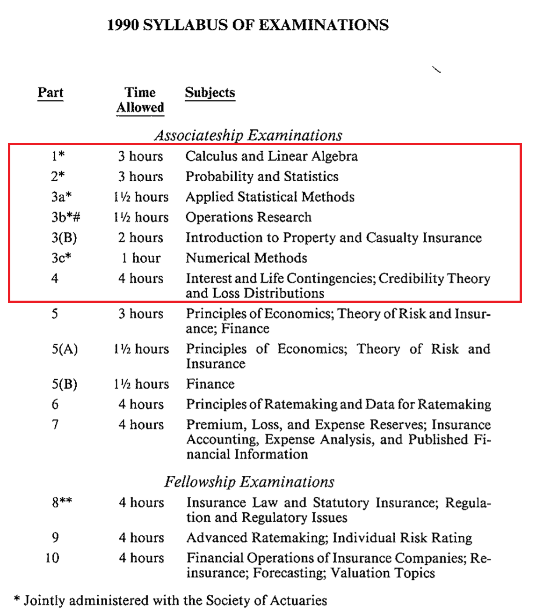
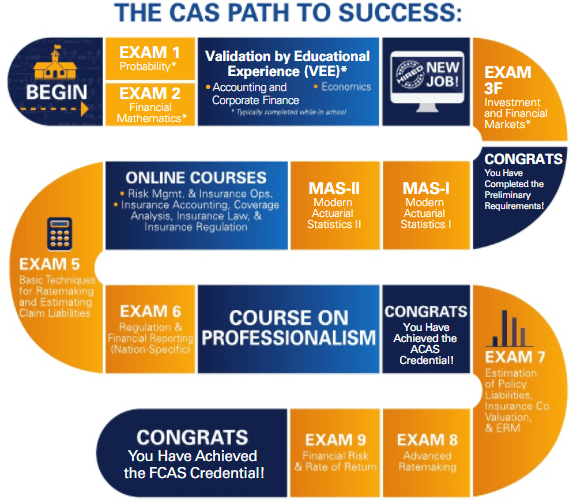
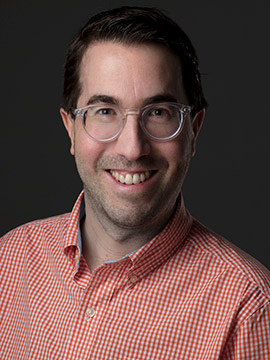
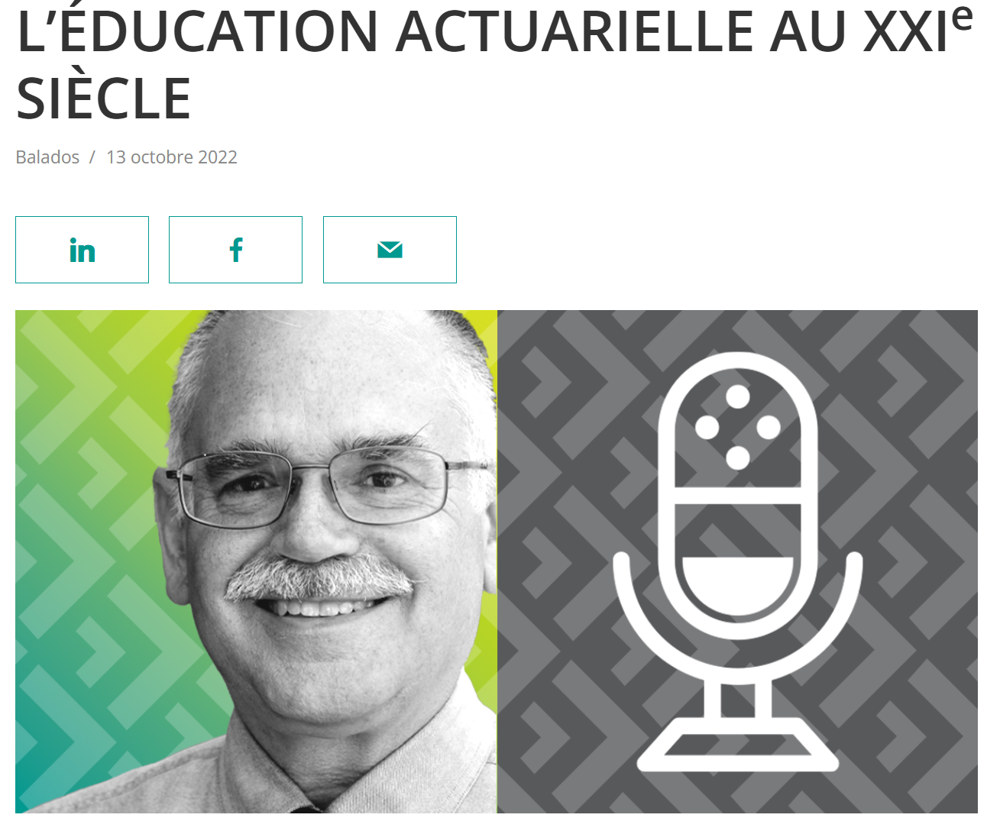
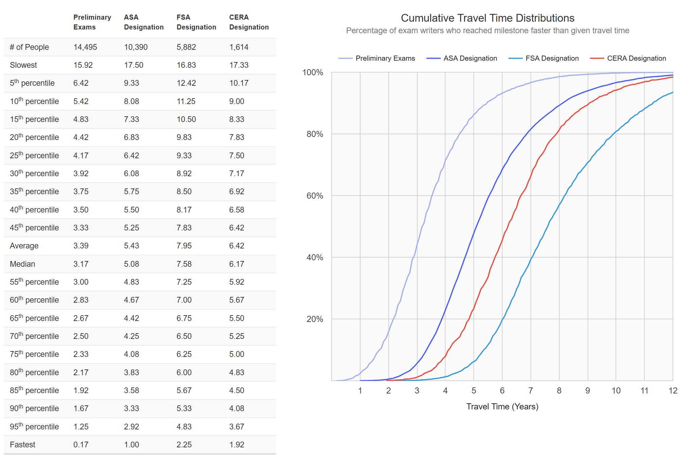
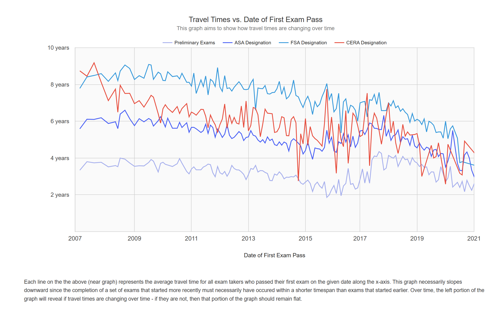
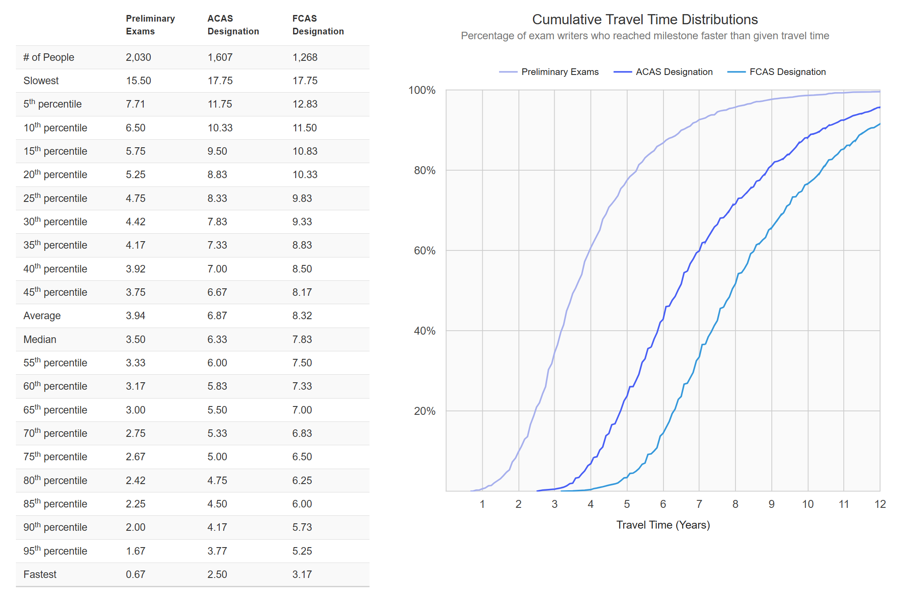
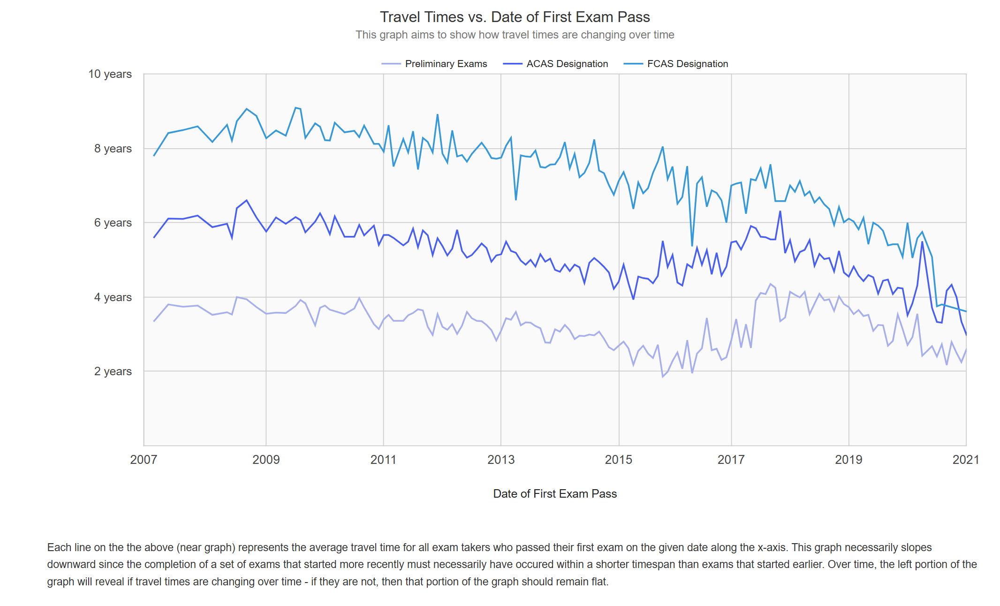

# L'adhésion à l’ICA

::: {.act-objectifs}

<div class="act-objectifs-titre">Objectifs du chapitre</div>

  - Situer la formation actuarielle canadienne dans son contexte institutionnel et historique.
  - Décrire le parcours de qualification en actuariat au Canada, depuis la formation universitaire jusqu’à l’obtention des titres professionnels.
  - Expliquer la distinction entre les examens préliminaires et les examens avancés, ainsi que leur rôle respectif dans la formation des actuaires.
  - Présenter les principales réformes récentes du système de qualification et les motivations qui les sous-tendent.
  - Décrire les exigences professionnelles associées à l’accès au titre de Fellow, incluant la formation en professionnalisme et l’expérience pratique.
  - Discuter, de manière nuancée, des enjeux liés à l’évolution possible du modèle de formation actuarielle, notamment le rôle des universités et la place des examens avancés.

:::

## Retour sur le dernier chapitre

<div style="
float:right;
display:inline-block;
margin:0 0 1em 1em;
text-align:center;
border:0.5px solid #bbb;
padding:6px;
background:white;
box-shadow:0 3px 10px rgba(0,0,0,0.15);
max-width:330px;
">


<div style="font-size:0.85em; margin-top:0.4em; color:#555;">
Un étudiant en actuariat tentant d'expliquer le système d'examens professionnels à sa famille
</div>

</div>

Contrairement à plusieurs autres professions, où la formation universitaire constitue depuis longtemps le cœur du parcours de qualification, l'actuariat nord-américain s'est historiquement appuyé sur un système d'examens professionnels externes pour évaluer une grande partie des connaissances techniques. Il en résultait une situation particulière : même après avoir terminé un baccalauréat spécialisé en actuariat, un diplômé devait souvent démontrer à nouveau sa maîtrise de notions déjà évaluées à l'université. Les médecins, les ingénieurs et d'autres professionnels passent également des examens de qualification; la différence tient surtout à la place respective de la formation universitaire et des examens externes.

Ce modèle s'explique en partie par l'histoire d'une profession qui s'est développée en marge des universités. Il a néanmoins contribué à retarder la pleine reconnaissance de la formation universitaire en actuariat. On pourrait dire, avec un brin d'ironie, que la profession a longtemps fait preuve d'une grande rigueur dans ses examens, mais d'une certaine lenteur à reconnaître que les universités pouvaient aussi offrir une formation professionnelle rigoureuse. Ce choix historique a eu des conséquences concrètes sur le parcours des étudiants et demeure pertinent pour comprendre les réformes récentes.

<div style="clear: both;"></div>


### Universités et examens professionnels

L’histoire récente de la formation actuarielle en Amérique du Nord est marquée par une coexistence durable — parfois tendue — entre la formation universitaire et le système d’examens professionnels administrés par les sociétés d’actuaires, principalement la Society of Actuaries (SOA) et la Casualty Actuarial Society (CAS). À certaines périodes, des divergences importantes entre ces deux associations quant au contenu et à l’orientation des examens ont eu pour effet de forcer les étudiants en actuariat à prendre position quant à la société dont ils souhaitaient suivre le parcours d’examens.

Il est néanmoins possible de dresser un aperçu synthétique, par décennies, de cette évolution afin de mieux comprendre la structure actuelle de la formation et de la qualification professionnelles en actuariat. Avant d’aller plus loin, il est important de distinguer deux catégories d’examens professionnels en actuariat.

1) Les **examens préliminaires** portent principalement sur les fondements mathématiques et probabilistes de la discipline. Ils correspondent aux cours de formation de base, au tronc commun actuariel et aux cours avancés de premier cycle présentés dans le premier chapitre. Ces examens ont donc toujours été étroitement liés à la formation universitaire de premier cycle, tant par leur contenu que par les compétences évaluées.  La réussite des seuls examens préliminaires ne suffit toutefois pas nécessairement à obtenir le titre d'associé : les parcours comportent aussi des modules, des évaluations complémentaires ou des exigences de professionnalisme, selon l'organisme concerné.

2) Les **examens avancés** en actuariat portent sur des domaines spécialisés de la pratique professionnelle (assurances collectives, régimes de retraite, gestion du risque, normes de pratique, professionnalisme). Les cours optionnels du baccalauréat vus au chapitre 1 peuvent servir de porte d’entrée à ces domaines, mais ils ne constituent ni une équivalence ni une validation formelle des examens avancés.  Comme nous le verrons, la reconnaissance universitaire s'est surtout développée pour les matières de base, tandis que les évaluations avancées demeurent principalement sous la responsabilité des organismes professionnels.

## Examens préliminaires 

Les examens préliminaires en actuariat, tant pour la Society of Actuaries (SOA) que pour la Casualty Actuarial Society (CAS), portent principalement sur les fondements mathématiques et probabilistes de l’actuariat. Ils couvrent notamment les probabilités, la statistique mathématique, la théorie du risque, les mathématiques financières, les processus stochastiques, ainsi que des bases de modélisation actuarielle et d’économie financière. Le contenu est volontairement abstrait et technique, relativement indépendant des contextes réglementaires ou sectoriels.

L’objectif principal de ces examens est de vérifier la maîtrise du socle quantitatif commun à toutes les branches de l’actuariat, d’assurer une sélection académique rigoureuse, et de garantir que les candidats possèdent les outils analytiques nécessaires pour aborder, par la suite, des problématiques actuarielles plus appliquées ou spécialisées (assurance vie, assurances IARD, retraite, finance, etc.). Ces examens servent donc moins à former des praticiens qu’à certifier une capacité formelle de raisonnement mathématique et probabiliste.

Si on fait un lien avec le programme d'actuariat de l'UQAM, on parle principalement du contenu des cours des trois catégories :

- Les cours de formation de base ;
- Le tronc commun actuariel ;
- Les cours avancés en actuariat.

### Années 1990 : la formation « en double » 

<div style="
float:right;
width:28vw;
max-width:420px;
min-width:240px;
margin:0 0 1em 1em;
text-align:center;
">

<div style="font-size:0.85em; margin-top:0.3em;">
Syllabus de la CAS en 1990
</div>
</div>

Dans les années 1990, la trajectoire typique d’un actuaire nord-américain — et plus particulièrement au Québec — reposait sur une double exigence. Les étudiants complétaient un diplôme universitaire de premier cycle en actuariat, ou en mathématiques avec concentration en actuariat, tout en préparant simultanément les examens préliminaires de la *Society of Actuaries* (SOA) ou de la *Casualty Actuarial Society* (CAS). Cette organisation entraînait une redondance importante entre la formation universitaire et les examens professionnels : plusieurs notions étaient enseignées à l’université, puis réévaluées, parfois presque à l’identique, dans le cadre des examens. L’université jouait alors principalement un rôle de soutien pédagogique, tandis que la reconnaissance professionnelle demeurait entièrement contrôlée par les sociétés d’actuaires.

Les taux de réussite historiques aux examens préliminaires étaient de l’ordre de 30\% à 40\% des candidats. Cette situation pouvait être source de frustration pour certains étudiants, notamment lorsqu’ils avaient réussi le cours universitaire correspondant à un examen, mais échouaient néanmoins à l’examen professionnel associé. Ainsi, à la suite de l’obtention d’un diplôme universitaire, un diplômé en actuariat entrait fréquemment sur le marché du travail dans le domaine, tout en devant encore compléter certains examens préliminaires, et ce avant même de pouvoir entreprendre les examens avancés de la SOA ou de la CAS.

À droite, on peut voir un extrait d'un [syllabus d'examen de la CAS de 1990](https://www.casact.org/sites/default/files/2021-02/1990syllabus.pdf).  L'encadré en rouge correspondait aux examens préliminaires.  On peut aussi constater que la réussite de tous les examens préliminaires n'était pas suffisante pour obtenir le titre d'associé de la CAS.

::: {.callout-important icon=false}
## Création du baccalauréat en actuariat de l’UQAM

C’est dans ce contexte que le professeur Claude Pichet a créé le baccalauréat en actuariat de l’UQAM en 1997, avec l’idée structurante de mettre en place une formation universitaire explicitement centrée sur la réussite des examens professionnels en actuariat. Le programme comportait ainsi des cours conçus pour préparer au format même des examens, c’est-à-dire la résolution d’une série de problèmes dans un temps limité. On retrouvait notamment un cours préparant à l’[examen P (probabilités)](https://etudier.uqam.ca/cours?sigle=ACT2120), un cours préparant à l’[examen FM (mathématiques financières)](https://etudier.uqam.ca/cours?sigle=ACT3122), ainsi que d’autres cours alignés sur les exigences des examens préliminaires.
:::

<div style="clear: both;"></div>

### Années 2000 : introduction des VEE et structuration universitaire 

<div style="
float:right;
width:28vw;
max-width:420px;
min-width:240px;
margin:0 0 1em 1em;
text-align:center;
">

<div style="font-size:0.85em; margin-top:0.3em;">
Le labyrinthe de la CAS
</div>
</div>

Au début des années 2000, la Society of Actuaries (SOA) introduit officiellement les [Validation by Educational Experience (VEE)](https://www.soa.org/education/exam-req/edu-vee/). Ces validations permettent aux universités reconnues de faire approuver certains cours comme équivalents à des exigences professionnelles, notamment en statistiques, en économie et en finance. Bien que les universités commencent ainsi à être impliquées dans la formation des actuaires, le système reste quand même très difficile à comprendre, tel qu'on peut le voir avec le chemin proposé par la CAS.

À la suite du succès relatif des VEE, l’Institut canadien des actuaires (ICA) amorce à son tour une réflexion sur la formation des actuaires au Canada. Cette réflexion porte moins sur le contenu disciplinaire — déjà bien établi — que sur la question institutionnelle de la responsabilité de la formation et de la qualification professionnelles. En effet, cette situation met en évidence un fait structurel important : la formation professionnelle des actuaires canadiens repose alors largement sur des sociétés d’actuaires américaines, soit la SOA et la CAS, plutôt que sur des organismes canadiens. Les décisions relatives aux parcours d’examens, aux contenus évalués et aux exigences de qualification sont donc prises à l’extérieur du Canada, malgré le développement croissant de programmes universitaires canadiens en actuariat.

<div style="clear: both;"></div>

### Années 2010 : reconnaissance universitaire accrue 

Dans les années 2010, la collaboration entre les universités et les sociétés d’actuaires s’intensifie. Les universités nord-américaines offrent désormais des programmes en actuariat plus structurés, intégrant notamment :  

  - des cours explicitement reconnus dans le cadre des VEE ;  
  - des parcours optimisés pour la préparation aux examens préliminaires ;  
  - une professionnalisation accrue dès le premier cycle universitaire.  

À compter de 2012, l'Institut canadien des actuaires a instauré, dans le cadre de son *programme d'agrément universitaire* (PAU), un mécanisme d'exemptions fondées sur la réussite de cours universitaires reconnus avec une note minimale déterminée. Ce programme permettait d'obtenir certains crédits correspondant à des examens préliminaires, notamment reconnus par la CAS, sans que cette reconnaissance soit équivalente à une dispense d'examens accordée par la SOA. Les dates de reconnaissance des diplômes utilisées ensuite pour les règles de transition, notamment celle du 30 juin 2015, ne doivent pas être confondues avec la mise en place initiale des exemptions par cours.

Le tableau suivant présente, à titre historique, les correspondances et les notes minimales utilisées dans ce dispositif. Aucun nouveau crédit d'exemption du PAU n'est accordé depuis le 31 octobre 2023, mais les crédits confirmés auparavant continuent d'être reconnus conformément aux règles transitoires de l'ICA.

Malgré cette reconnaissance accrue, la compréhension du système d’examens demeurait souvent difficile pour les étudiants. L’administration de ces cours par les universités et les professeurs était également lourde, d’autant plus que le dispositif reposait sur la philosophie d’*imiter* la forme et la sélectivité des examens préliminaires. Ainsi, afin de reproduire des taux de réussite comparables aux taux historiques des examens — de l’ordre de 30 % à 40 % des candidats, comme nous l'avons vu — il ne suffisait pas de réussir un cours universitaire : l’obtention d’une note minimale précise, telle qu’indiquée dans le tableau, était requise.

Dans la même optique, les évaluations écrites devaient représenter plus de 80 % de la note finale, limitant les travaux pratiques à environ 20 %. Une telle répartition apparaît problématique, dans la mesure où l’actuariat est une discipline fondamentalement appliquée et où l’un des principaux avantages de la formation universitaire réside précisément dans la diversité des modes d’évaluation possibles, incluant des projets, des analyses de données et des travaux de synthèse.

```{r}
#| echo: false
#| message: false
#| warning: false
library(knitr)

equiv_soa_cas <- data.frame(
  `Examen SOA ou CAS` = c(
    "P / 1",
    "SRM #1",
    "SRM #2",
    "FM / 2 #1",
    "IFM / 3F #1",
    "IFM / 3F #2",
    "LTAM #1 *",
    "LTAM #2",
    "LTAM #3",
    "STAM #1",
    "STAM #2",
    "STAM #3",
    "STAM #4"
  ),
  `Cours` = c(
    "MAT1700",
    "STT5100",
    "ACT6100",
    "ACT1200",
    "ACT4310",
    "ACT5310",
    "ACT3300",
    "ACT4300",
    "ACT6051",
    "ACT2060",
    "ACT3400",
    "ACT4400",
    "ACT5400"
  ),
  `Titre du cours` = c(
    "Probabilités I",
    "Modèles linéaires appliqués",
    "Analyse de données en actuariat",
    "Mathématiques financières I",
    "Mathématiques de la finance actuarielle I",
    "Mathématiques de la finance actuarielle II",
    "Mathématiques de l'assurance de personne I",
    "Mathématiques de l'assurance de personne II",
    "Modèles actuariels en assurance de personne",
    "Applications probabilistes des risques actuariels",
    "Distribution de sinistres",
    "Modèles de survie",
    "Crédibilité"
  ),
  `Note minimale` = c(
    "B",
    "B",
    "B",
    "B+",
    "B",
    "B",
    "B",
    "B",
    "B",
    "B+",
    "B",
    "B",
    "B"
  )
)

kable(
  equiv_soa_cas,
  caption = "Ancien système du PAU : équivalences par cours et notes minimales (historique)",
  align = c("l", "l", "l", "c")
)
```


::: {.callout-important icon=false}
## Complexité supplémentaire pour les étudiants

La *Casualty Actuarial Society* (CAS) reconnaissait certains crédits accordés dans le cadre du PAU de l'Institut canadien des actuaires (ICA). Un candidat pouvait donc s'en servir dans son cheminement vers l'ACAS, puis éventuellement vers le FCAS, en satisfaisant aux autres exigences de la CAS. Ces crédits pouvaient également être utilisés dans certains parcours de qualification de l'ICA.

Pour sa part, la *Society of Actuaries* (SOA) ne reconnaissait pas les exemptions du PAU. La non-reconnaissance de ces crédits par la SOA pouvait ainsi limiter la possibilité de progresser simultanément dans les parcours des deux organismes. Cette situation constituait une difficulté concrète pour les étudiants qui souhaitaient conserver plusieurs options professionnelles en Amérique du Nord. La qualification pour exercer certaines fonctions aux États-Unis dépendait par ailleurs des exigences applicables à chacune de ces fonctions, et non d'une reconnaissance automatique des crédits du PAU.
:::

## Le nouveau système de qualification de l’ICA (2023–2026)

Annoncée en 2021 et progressivement déployée à partir de 2023, la réforme de la qualification de l'ICA modifie profondément le parcours menant au titre d'associé. Pour les étudiants des programmes universitaires agréés, elle remplace largement l'ancien système d'examens préliminaires externes par un parcours combinant reconnaissance du diplôme, formation complémentaire et évaluations professionnelles. La première édition de l'examen synthèse de niveau AICA a été administrée en janvier 2024.

### Devenir associé de l’ICA (AICA) par le parcours universitaire

Le parcours 1 de l'ICA s'adresse notamment aux diplômés d'universités canadiennes agréées. Il comporte les exigences suivantes :

1. **Être membre étudiant de l'ICA**, ce qui suppose notamment de suivre le module d'orientation de l'Institut. Cette catégorie de membres, accessible aux étudiants admissibles, ne comporte actuellement aucuns frais annuels. Les activités éducatives de l'ICA sont réservées aux membres étudiants ou candidats en règle.
2. **Avoir obtenu un diplôme reconnu d'une université agréée par l'ICA**, comprenant les cours exigés pour la reconnaissance du diplôme. Dans ce parcours, l'ICA n'impose pas de note minimale supérieure à la note de passage pour chacun de ces cours.
3. **Réussir les modules 1 et 2 de niveau AICA**, qui complètent la formation universitaire en abordant la profession actuarielle, les travaux actuariels et leurs applications. Ces modules sont suivis principalement en ligne à travers des lectures, des vidéos et des travaux à remettre.
4. **Réussir l'examen synthèse de niveau AICA**, une évaluation à livre ouvert répartie sur deux journées, qui porte notamment sur l'intégration des connaissances et la capacité de communication.
5. **Réussir l'[Atelier sur le professionnalisme de l'ICA](https://www.cia-ica.ca/fr/devenir-membre/devenir-membre-associe/atelier-sur-le-professionnalisme/)**, comprenant un module préparatoire en ligne et un atelier virtuel interactif de deux jours. Il aborde les règles de déontologie, les normes, le jugement professionnel et la communication.

Le [site de l'ICA consacré au parcours 1](https://www.cia-ica.ca/fr/devenir-membre/parcours-de-qualification/parcours-1/) présente les exigences officielles, qui prévalent en cas de modification du système.

#### **Les cours reconnus à l'UQAM** {-}

À l'UQAM, le cours ACT6100 est l'un des cours explicitement exigés par l'ICA pour la reconnaissance du diplôme, même s'il ne fait pas partie de tous les cheminements obligatoires du baccalauréat. Le tableau suivant reprend la liste des cours actuellement publiés par l'ICA pour l'UQAM, avec une adaptation signalée pour le cours de comptabilité offert aux nouvelles cohortes.

```{r}
#| echo: false
#| message: false
#| warning: false
library(knitr)

cours_ica <- data.frame(
  `Numéro du cours` = c(
    "MAT1700", "ACT1200", "ECO1013", "ECO1023", "SCO1045",
    "ACT4310", "FIN3500", "ACT5310", "ACT3300", "ACT4300",
    "ACT2060", "ACT3400", "ACT4400", "ACT5400", "ACT3035",
    "ACT6100", "STT5100"
  ),
  `Cours` = c(
    "Probabilités I",
    "Mathématiques financières I",
    "Microéconomie I",
    "Macroéconomie I",
    "Introduction à la comptabilité et à la prise de décisions",
    "Mathématiques de la finance actuarielle I",
    "Gestion financière",
    "Mathématiques de la finance actuarielle II",
    "Mathématiques de l'assurance de personne I",
    "Mathématiques de l'assurance de personne II",
    "Applications probabilistes des risques actuariels",
    "Distribution de pertes",
    "Modèles de survie",
    "Crédibilité",
    "Laboratoire d'actuariat",
    "Analyse de données en actuariat",
    "Modèles linéaires appliqués"
  )
)

kable(
  cours_ica,
  caption = "Cours requis pour la reconnaissance du diplôme de l'UQAM par l'ICA (cohorte d'automne 2026)",
  align = c("l", "l")
)
```

**Précision sur SCO1045.** La [liste publique de l'ICA](https://www.cia-ica.ca/fr/commencer-votre-parcours/education-actuarielle-au-canada/) mentionne encore **SCO1250**, alors que l'[UQAM indique que SCO1045 remplace SCO1250 à compter de l'automne 2026](https://actuariat.uqam.ca/etudiants-actuels/validation-by-educational-experience-vee-soa/). Les étudiants concernés devraient faire confirmer auprès du programme et de l'ICA la reconnaissance de cette substitution pour leur cohorte.

#### **Les modules et l'examen synthèse** {-}

L'ICA recommande généralement d'entreprendre le premier module AICA après avoir acquis une partie de la formation universitaire; les modules peuvent aussi être suivis plus tard. Contrairement aux examens traditionnels, ils reposent sur des activités d'apprentissage et des travaux plutôt que sur un examen final distinct. L'examen synthèse reste toutefois une étape exigeante.

Les [résultats officiels publiés par l'ICA](https://www.cia-ica.ca/fr/devenir-membre/cours-et-examens/resultats-aux-examens-aica-et-fica/) permettent désormais de remplacer les premières estimations informelles par des observations : 52 % à l'hiver 2024, 53 % à l'automne 2024, 49 % au printemps 2025 et 36 % à l'automne 2025. Ces taux décrivent les cohortes présentes aux examens; ils ne permettent pas à eux seuls de mesurer la qualité de la formation universitaire ni de prédire le résultat d'un candidat particulier.

Les premiers témoignages recueillis auprès d'étudiants évoquent parfois une préparation de l'ordre de 200 à 300 heures pour l'examen synthèse. Cet ordre de grandeur est indicatif et ne constitue pas une exigence ou une estimation officielle de l'ICA.

### Reconnaissance de l’UQAM par l’ICA

L’Institut canadien des actuaires (ICA) a mis en place un Programme d’agrément universitaire afin de reconnaître officiellement certains programmes universitaires en actuariat au Canada. Cet agrément vise à assurer que la formation universitaire offerte est conforme aux attentes de la profession actuarielle et qu’elle prépare adéquatement les étudiants au processus de qualification menant au titre d’Associé de l’ICA (AICA). Une université accréditée par l’ICA devient ainsi un partenaire formel de la profession, et ses diplômés peuvent accéder au parcours universitaire de qualification, sous réserve de satisfaire aux [exigences définies par l’Institut](https://www.cia-ica.ca/app/themes/wicket/custom/dl_file.php?p=337338&fid=337339): 

- **Structure générale du programme** 

  Pour être admissible à l’agrément, une université doit offrir un programme structuré en actuariat menant à un diplôme reconnu, généralement un baccalauréat d’une durée minimale de trois ans ou une maîtrise spécialisée d’au moins un an. Le programme doit être clairement identifiable comme un programme d’actuariat, tant par son contenu que par ses objectifs pédagogiques. L’ICA s’assure que ce programme couvre l’ensemble des notions jugées fondamentales pour l’entrée dans la profession actuarielle. Il ne s’agit pas uniquement d’une juxtaposition de cours quantitatifs, mais d’un parcours cohérent visant l’acquisition progressive de connaissances théoriques, de compétences analytiques et d’aptitudes à l’application pratique.

- **Qualité académique et encadrement pédagogique**  

  L’agrément repose également sur des normes académiques élevées. L’université doit démontrer qu’elle applique des mécanismes rigoureux d’évaluation des étudiants, qu’elle assure l’intégrité académique et qu’elle dispose de politiques claires en matière d’éthique, de tricherie et de gestion des évaluations.  Dans ce cadre, l’ICA peut demander l’accès à divers documents pédagogiques, tels que des plans de cours, des examens, des travaux et des grilles de correction, afin de vérifier que les standards académiques sont maintenus de façon uniforme et durable.

- **Corps professoral et exigences minimales de l’ICA**  

  L’agrément universitaire de l’ICA impose des exigences précises quant à la composition du corps professoral impliqué dans un programme d’actuariat. À tout le moins, l’université doit démontrer qu’elle dispose d’une masse critique de professeurs possédant une formation actuarielle reconnue et une implication durable dans le programme. Plus précisément, l’ICA exige que l’université emploie :

<div style="
float:right;
width:28vw;
max-width:420px;
min-width:240px;
margin:0 0 1em 1em;
text-align:center;
">

<div style="width:50%; margin:0 auto; font-size:0.85em; margin-top:0.3em; text-align:center;">
Mathieu Boudreault, professeur Fellow de l’UQAM
</div>
</div>

  - au moins deux membres à temps plein du corps professoral détenant le titre de Fellow de l’ICA ou celui de membre associé de l’ICA. Ces professeurs constituent le noyau actuariel permanent du programme et assurent la stabilité institutionnelle de l’enseignement;

  - au moins un autre membre du corps professoral, à temps plein ou à temps partiel, détenant également un titre professionnel actuariel, dont la fonction principale consiste à enseigner l’actuariat ou qui maintient un programme actif de recherche en actuariat;

  - selon la taille et la croissance du programme, un nombre suffisant de professeurs à temps plein ou à temps partiel ainsi que de chargées et chargés d’enseignement, idéalement titulaires d’un titre professionnel actuariel ou dont les activités d’enseignement portent principalement sur les cours obligatoires du programme.

- **Responsable de l’agrément**  

  Chaque programme accrédité doit désigner un actuaire responsable de l’agrément. Cette personne doit être membre en règle de l’ICA et posséder une expérience professionnelle ou académique suffisante. Elle agit comme point de contact officiel entre l’université et l’ICA et veille à la conformité continue du programme avec les exigences de l’Institut.  Ce rôle permet d’assurer un suivi institutionnel stable, même lorsque le programme évolue ou que des changements surviennent au sein du corps professoral.

- **Couverture du programme d’études et lien avec la qualification professionnelle**  

  L’université doit démontrer, à l’aide d’un mappage détaillé des cours, que son programme couvre adéquatement les matières exigées pour l’obtention du titre d’AICA. Ce mappage permet de montrer comment les différents cours contribuent à l’acquisition des compétences évaluées ultérieurement lors de l’examen de synthèse de l’ICA.  L’accent est mis non seulement sur la maîtrise des concepts, mais aussi sur la capacité à les appliquer dans des contextes actuariels réalistes, en mobilisant l’analyse, la synthèse et le jugement professionnel.

- **Maintien et suivi de l’agrément**  

  L’agrément universitaire n’est pas accordé de façon permanente. Il fait l’objet de révisions périodiques, au cours desquelles l’ICA évalue si le programme respecte toujours les critères établis. L’université a l’obligation d’informer l’ICA de tout changement significatif touchant le programme, la structure des cours ou le corps professoral. Les changements importants dans les exigences ou la structure du programme doivent être documentés et examinés dans le cadre de ce suivi.

<div style="clear: both;"></div>

### Évaluation de la réforme du parcours de qualification

La réforme du système de qualification de l'ICA, annoncée en 2021 et mise en œuvre graduellement à partir de 2023, peut être examinée selon plusieurs objectifs :

- **Reconnaissance de la formation universitaire** : mieux tenir compte de la qualité des programmes canadiens agréés et limiter les répétitions entre les cours de premier cycle et les examens professionnels externes.
- **Cohérence pédagogique** : combiner l'enseignement universitaire avec des modules, une évaluation de synthèse et des activités de professionnalisme axées sur l'intégration des connaissances et leur application.
- **Accessibilité du parcours** : chercher à réduire certains coûts, à clarifier les étapes de qualification et à faciliter la transition entre les études et la pratique professionnelle.
- **Autonomie institutionnelle** : permettre à l'ICA de définir plus directement la formation et les qualifications des actuaires canadiens, sans dépendre entièrement des parcours de la SOA ou de la CAS.

Ces objectifs ne doivent pas être confondus avec des résultats déjà démontrés. Il reste notamment à documenter, sur plusieurs cohortes, les effets de la réforme sur les coûts réels, la durée de qualification et la qualité de la préparation professionnelle. La diminution du temps moyen nécessaire pour obtenir le titre de Fellow, en particulier, ne peut pas être affirmée à partir des seules premières cohortes du nouveau système.

### Résistance au changement des actuaires

Une difficulté possible dans la transformation d'un système de qualification concerne la résistance au changement. Les professionnels ayant suivi un parcours particulièrement exigeant peuvent être réticents à l'idée d'en modifier les conditions, notamment s'ils craignent une dévalorisation de leurs propres qualifications. D'autres peuvent aussi s'inquiéter, de façon légitime, du maintien de la qualité des évaluations, de la comparabilité des titres et de la protection du public. Il s'agit de motivations possibles et non de causes démontrées des décisions particulières prises par l'ICA.

Ces considérations montrent pourquoi les réformes professionnelles peuvent susciter des débats complexes. Le véritable enjeu n'est pas de préserver les difficultés d'un ancien parcours pour elles-mêmes, mais de déterminer quelles exigences contribuent effectivement à la compétence professionnelle.

::: {.callout-important icon=false}
## Pour la nouvelle génération

Les exigences professionnelles évoluent avec le temps. Certaines composantes aujourd'hui jugées indispensables — y compris les examens avancés — pourraient être repensées à leur tour. Une profession doit pouvoir distinguer la valeur des exigences de qualification de la simple reproduction des difficultés héritées du passé.
:::

### Entrevue avec Bruno Gagnon

<div style="
float:right;
width:28vw;
max-width:420px;
min-width:240px;
margin:0 0 1em 1em;
text-align:center;
">

<div style="font-size:0.85em; margin-top:0.3em;">
Bruno Gagnon, FICA
</div>
</div>

L’ancien chargé de cours de l’ACT1050, Bruno Gagnon, a été fortement impliqué dans la réflexion ayant mené à la modification du système d’examens de l’Institut canadien des actuaires (ICA). Dans une entrevue accordée au balado *Voir au-delà du risque* de l'ICA, il revient sur son parcours professionnel et sur son engagement au sein des comités d’examen, engagement motivé en partie par les limites qu’il percevait dans le système traditionnel d’évaluation. L’entrevue audio est disponible [ici](https://www.voiraudeladurisque.ca/2022/10/leducation-actuarielle-au-xxie-siecle/) et fait également l’objet d’une transcription.

Gagnon y décrit notamment les difficultés liées à des examens fortement axés sur la mémorisation et la restitution de listes de concepts, où la capacité d’analyse et le jugement professionnel sont parfois difficiles à évaluer de façon cohérente. Selon lui, ce type de format peut mener à une correction plus subjective et à une faible différenciation entre une compréhension superficielle et une réelle maîtrise des enjeux actuariels. Ces constats l’ont amené à s’impliquer directement dans la rédaction et la révision des examens, puis à participer à la conception de nouvelles approches d’évaluation.

Son rôle a été particulièrement marquant dans le développement des cours orientés vers la pratique de l’ICA, où l’objectif était de mieux refléter la réalité du travail actuariel. Il y défend une formation davantage centrée sur la compréhension des mécanismes, l’analyse de situations complexes et l’application concrète des connaissances, plutôt que sur la seule réussite d’épreuves standardisées. L’entrevue aborde aussi, plus largement, l’évolution des attentes envers la profession, notamment en lien avec la diversification des compétences, l’importance croissante du jugement professionnel et l’adaptation de la formation aux transformations du milieu actuariel.

<div style="clear: both;"></div>

::: {.callout-note icon=false}
## Implication des professeurs de l'UQAM

Il est pertinent de souligner que plusieurs professeurs de l’UQAM sont directement impliqués dans l’élaboration des questions de l’examen de synthèse de l’Institut canadien des actuaires (ICA). Cette participation se fait notamment à travers leur engagement au sein de comités de rédaction, de révision et de validation des examens. Cette implication contribue à assurer une certaine cohérence entre les contenus enseignés à l’université, les compétences évaluées lors du processus de qualification professionnelle et les attentes réelles de la pratique actuarielle. Elle favorise également une rétroaction continue entre le milieu académique et les instances professionnelles, permettant d’ajuster progressivement les approches pédagogiques et les méthodes d’évaluation en fonction de l’évolution de la profession.
:::

## Examens avancés en 2026

Même si le parcours universitaire vers le titre d'AICA a été simplifié, la qualification de niveau Fellow repose toujours sur une formation avancée spécialisée, distincte du baccalauréat. Historiquement, les candidats suivaient principalement les examens de la *Society of Actuaries* (SOA) dans les domaines de l'assurance-vie, des prestations collectives et de la retraite, ou ceux de la *Casualty Actuarial Society* (CAS) en assurances IARD. On retrouve ainsi des Fellows de la SOA (FSA) et des Fellows de la CAS (FCAS). Ces parcours demeurent possibles, mais l'ICA propose également ses propres [volets d'examens avancés](https://www.cia-ica.ca/fr/devenir-membre/devenir-membre-fellow/programmes-detudes-de-niveau-fica/).


{width=75% .center}

Chaque volet est composé de deux modules FICA en ligne et de trois examens FICA à livre ouvert. Les modules et les examens permettent à des candidats et candidates issus d’un large éventail de formations et d’horizons professionnels d’acquérir et d’appliquer des connaissances générales et spécifiques aux différents volets grâce au système de gestion de l’apprentissage et à la plateforme d’examen virtuelle de pointe offerts par l’ICA. Ces programmes d’études, combinés à l’expérience requise, prépareront ultimement les candidats et candidates à être admis comme Fellows de l’ICA.  On peut consulter la liste des examens à réussir dans le tableau suivant.

```{r}
#| echo: false
#| message: false
#| warning: false
library(knitr)
library(kableExtra)

teal <- "#00A6A6"

fica <- data.frame(
  Parcours = c(
    "Volet Assurance vie individuelle et rentes\n(AIR)",
    "Volet Assurances IARD (IARD)",
    "Volet Prestations collectives (COL)",
    "Volet Finances, placements et GRE (FPG)\navec option pour le secteur bancaire",
    "Volet Prestations de retraite (RET)"
  ),
  Examens = c(
    paste0(
      cell_spec("F1AIR", color = teal, bold = TRUE), " : Finance et évaluation", "<br><br>",
      cell_spec("F2AIR", color = teal, bold = TRUE), " : Conception et tarification des produits", "<br><br>",
      cell_spec("F3AIR", color = teal, bold = TRUE), " : Gestion des risques"
    ),
    paste0(
      cell_spec("F1IARD", color = teal, bold = TRUE), " : Tarification", "<br><br>",
      cell_spec("F2IARD", color = teal, bold = TRUE), " : Estimation des sinistres non réglés et rapports financiers en vertu de la norme <em>IFRS 17 – Contrats d’assurance</em>", "<br><br>",
      cell_spec("F3IARD", color = teal, bold = TRUE), " : GRE, modélisation du capital économique, et simulation de crise et analyse de scénarios"
    ),
    paste0(
      cell_spec("F1COL", color = teal, bold = TRUE), " : Conception de produits et contexte des prestations collectives", "<br><br>",
      cell_spec("F2COL", color = teal, bold = TRUE), " : Tarification des prestations collectives", "<br><br>",
      cell_spec("F3COL", color = teal, bold = TRUE), " : Réserves relatives aux prestations collectives"
    ),
    paste0(
      cell_spec("F1FPG", color = teal, bold = TRUE), " : Produits financiers", "<br><br>",
      cell_spec("F2FPG", color = teal, bold = TRUE), " : Évaluation et considérations financières", "<br><br>",
      cell_spec("F3FPG", color = teal, bold = TRUE), " : Gestion des risques <em>ou</em>", "<br><br>",
      cell_spec("F3BNC", color = teal, bold = TRUE), " : Applications bancaires"
    ),
    paste0(
      cell_spec("F1RET", color = teal, bold = TRUE), " : Capitalisation et réglementation des régimes de retraite", "<br><br>",
      cell_spec("F2RET", color = teal, bold = TRUE), " : Rapports financiers", "<br><br>",
      cell_spec("F3RET", color = teal, bold = TRUE), " : Gestion du risque relatif aux prestations de retraite"
    )
  )
)

kable(
  fica,
  format = "html",
  escape = FALSE,
  col.names = c("Parcours", "Examens"),
  align = c("l", "l")
) |>
  kable_styling(
    full_width = TRUE,
    position = "center"
  ) |>
  row_spec(0, bold = TRUE, background = "#F2F2F2") |>
  column_spec(1, width = "40%") |>
  column_spec(2, width = "60%") |>
  row_spec(1:nrow(fica), extra_css = "border-top: 2px solid #444; border-bottom: 2px solid #444;")

```


Dans le système actuel de l'ICA, le titre de Fellow (FICA) repose sur une spécialisation avancée, sur le professionnalisme et sur une expérience actuarielle significative. Pour le parcours 1, le candidat doit notamment :

- détenir le titre d'Associé de l'ICA (AICA);
- réussir les deux modules et les trois examens du volet FICA choisi;
- réussir le [Cours avancé sur le professionnalisme et le leadership (CAPL)](https://www.cia-ica.ca/fr/devenir-membre/devenir-membre-fellow/cours-avance-sur-le-professionnalisme-et-le-leadership-de-lica/);
- justifier d'au moins 36 mois d'expérience actuarielle au cours des six dernières années, dont 12 mois d'expérience actuarielle canadienne acquise à titre d'AICA au cours des trois dernières années, attestée par un Fellow de l'ICA (FICA).

Cette dernière condition a une conséquence pratique importante : des stages et des emplois occupés avant l'obtention du titre d'AICA peuvent contribuer à l'expérience actuarielle générale, mais ne remplacent pas les 12 mois spécifiquement exigés *à titre d'AICA*. Les [règles officielles du parcours 1](https://www.cia-ica.ca/fr/devenir-membre/parcours-de-qualification/parcours-1/) doivent être consultées avant de planifier sa demande de qualification.

::: {.callout-important}
## Autres parcours

Dans ce chapitre, seule la voie de qualification par le système canadien et l’ICA est présentée. D’autres parcours de qualification demeurent toutefois possibles. Historiquement, une grande partie des actuaires au Canada ont accédé à la profession en réussissant les examens préliminaires de la CAS ou de la SOA, puis en complétant une série d’examens avancés administrés par ces mêmes organisations. En 2026, un Fellow de la SOA (FSA) ou de la CAS (FCAS) peut également présenter une demande de qualification à titre de FICA selon les parcours de reconnaissance prévus par l'ICA, sous réserve de satisfaire aux conditions canadiennes qui s'appliquent à sa situation.

Par choix pédagogique, ces parcours alternatifs ne sont pas abordés dans ce cours. Les étudiants intéressés peuvent toutefois consulter le site de l’ICA pour obtenir de l’information détaillée sur ces voies parallèles.
:::

## Étudier tout en ayant un emploi

Dans le parcours universitaire de l'ICA, le titre d'associé s'obtient après la satisfaction de l'ensemble des exigences prévues : diplôme reconnu, modules, examen synthèse et atelier sur le professionnalisme. Certaines activités peuvent être entreprises pendant le baccalauréat; d'autres sont souvent complétées après l'entrée sur le marché du travail. Une fois le titre d’Associé obtenu, le parcours se poursuit avec la réussite des examens avancés. La conciliation entre les exigences professionnelles, les études et la vie personnelle constitue alors une caractéristique structurante du cheminement actuariel. Cette réalité fait partie intégrante de la profession et pourra notamment être illustrée par des témoignages de conférenciers invités dans le cadre du cours.

Les examens avancés de l’ICA étant relativement récents dans le paysage canadien, il demeure difficile d’en évaluer précisément le niveau de difficulté et la charge d’étude requise à partir de données historiques propres à l’ICA. Toutefois, dans leurs premières versions, ces examens ont été conçus en s’inspirant très étroitement des examens avancés de la SOA et de la CAS. Il est donc raisonnable de supposer que les exigences d’étude et le niveau de difficulté soient comparables.

À titre indicatif, les candidats aux anciens examens avancés évoquaient souvent plusieurs centaines d'heures de préparation, parfois autour de 400 heures pour un examen. Cette estimation ne constitue toutefois pas une mesure officielle des nouveaux examens de l'ICA. Les [résultats publiés par l'Institut](https://www.cia-ica.ca/fr/devenir-membre/cours-et-examens/resultats-aux-examens-aica-et-fica/) indiquent un taux de réussite agrégé de 40 % à l'automne 2024, de 35 % au printemps 2025 et de 36 % à l'automne 2025; ces résultats varient selon le volet et l'examen.

L'investissement requis est donc conséquent. Pour soutenir leurs employés, plusieurs assureurs et cabinets offrent des congés d'étude rémunérés et des mesures d'aide à la préparation des examens. Le nombre de journées accordées, les conditions applicables en cas de reprise et les augmentations salariales liées à la réussite varient toutefois d'un employeur à l'autre.

### Durée du parcours actuariel

Les ordres de grandeur associés à la durée typique du parcours actuariel — souvent désignée par le terme *travel time* — sont présentés dans les graphiques suivants (voir [Actuarial Lookup](https://www.actuarial-lookup.com/travel-times) ou [Coaching Actuaries](https://www.coachingactuaries.com/blog) pour plus de détails). Ces durées varient naturellement de façon importante selon plusieurs facteurs personnels, et selon le soutien offert par les différents employeurs.

Les statistiques publiées par la SOA et la CAS reposent sur des données agrégées qui incluent à la fois des candidats américains et canadiens. Il n’est toutefois pas possible, à partir des données publiques disponibles, d’isoler uniquement les candidats canadiens afin de produire des courbes ou des tableaux spécifiques à ce sous-groupe.  Par ailleurs, le programme de qualification propre à l’ICA étant relativement récent, il n’existe pas encore de données historiques suffisantes permettant d’estimer ou d’analyser la durée typique du parcours dans le cadre strictement canadien. Les informations présentées ici doivent donc être interprétées comme des ordres de grandeur, et non comme des estimations précises du temps requis pour compléter le parcours de qualification de l’ICA.

#### **Examens de la Society of Actuaries (SOA)** {-}

Le graphique et le tableau présentent les distributions cumulées du temps de parcours (*travel time*), mesuré en années, pour différentes étapes de qualification au sein du système de la SOA. Le temps de parcours correspond au nombre d’années nécessaires pour compléter un ensemble donné d’examens ou pour obtenir une désignation particulière. Il est important de souligner que l’augmentation progressive des temps de parcours observée d’une catégorie à l’autre est structurellement normale. Les désignations ASA, FSA et CERA s’inscrivent dans un parcours séquentiel : un candidat doit d’abord réussir les examens préliminaires, puis obtenir le titre d’ASA, avant de pouvoir accéder aux désignations avancées telles que FSA ou CERA. Les temps de parcours présentés sont donc cumulatifs par nature.

Les données affichées permettent d'observer que les examens préliminaires sont généralement complétés sur un horizon plus court que les qualifications professionnelles avancées. L'obtention du titre d'ASA, puis celle du titre de FSA, exige normalement des étapes supplémentaires. Les écarts observés dans les graphiques doivent cependant être interprétés selon les périodes, les exigences des programmes en vigueur et les populations de candidats retenues. Les parcours ont évolué, notamment à la suite des réformes récentes de la SOA. 

{width=100%}

On peut aussi examiner l’évolution de la durée moyenne observée en fonction de la date de réussite du premier examen. Le site présente notamment cette explication :

> Chaque courbe du graphique ci-dessus (graphique de droite) représente le temps de parcours moyen pour l’ensemble des candidats ayant réussi leur premier examen à la date indiquée sur l’axe des abscisses. Ce graphique présente nécessairement une pente descendante, puisque la complétion d’un ensemble d’examens débuté plus récemment ne peut, par définition, s’être étalée que sur une période plus courte que celle d’un parcours commencé plus tôt.

Cette présentation appelle une précaution statistique importante. Les candidats dont le parcours est toujours en cours sont censurés à droite : leur durée définitive de qualification n'est pas encore connue. Si l'on calcule la durée moyenne uniquement parmi les candidats ayant terminé leur parcours, les cohortes récentes subissent également un biais de sélection des parcours complétés. Les candidats qui termineront après huit ou dix ans ne peuvent pas encore figurer parmi les parcours achevés d'une cohorte récente, ce qui favorise mécaniquement les candidats ayant terminé rapidement et peut produire une baisse artificielle des moyennes observées.

Une comparaison rigoureuse des durées entre cohortes devrait tenir compte de ces observations incomplètes, notamment par des méthodes d'analyse de survie telles que celles étudiées dans le cours [ACT4400 – Modèles de survie](https://etudier.uqam.ca/cours?sigle=ACT4400). Les graphiques d'*Actuarial Lookup* restent intéressants pour décrire les parcours enregistrés, mais ne doivent pas être interprétés spontanément comme des estimations corrigées de ces effets.

{width=100%}


#### **Examens de la Casualty Actuarial Society (CAS)** {-}

Des graphiques comparables sont également disponibles pour la CAS. Les données présentées suggèrent un temps de qualification plus long pour les candidats de la CAS que pour ceux de la SOA. Cette différence peut notamment refléter la structure et le nombre d'évaluations exigées, mais aussi des différences entre les populations de candidats et les périodes considérées. Les données agrégées ne permettent pas d'isoler la contribution de chacun de ces facteurs.

{width=100%}

Le second graphique présente l'évolution des moyennes observées par cohorte de premier examen; les mêmes précautions concernant la censure et la sélection des parcours complétés s'appliquent.

{width=100%}

## Discussion sur l'avenir des examens avancés

La question de l’intégration éventuelle de la formation menant aux examens avancés d’actuariat dans le système universitaire mérite d’être examinée avec nuance et rigueur. Il ne s’agit pas d’un enjeu strictement pédagogique, mais d’un choix structurant pour la profession actuarielle, qui touche à la formation, à la reconnaissance institutionnelle et à l’identité même de la profession.

### Avantages

Du point de vue des avantages potentiels, une telle intégration s’inscrirait dans une tendance observée dans plusieurs autres professions réglementées. En médecine, en droit, en comptabilité ou en ingénierie, la formation avancée repose largement sur des programmes universitaires structurés, combinant acquisition de connaissances théoriques, études de cas, travaux appliqués et évaluations diversifiées. Dans ces disciplines, les examens professionnels existent toujours, mais ils interviennent généralement en complément d’une formation universitaire avancée, et non comme principal vecteur de qualification.

Dans cette perspective, l’intégration universitaire des examens avancés pourrait favoriser une formation plus cohérente, mieux articulée et plus progressive. Elle permettrait également de diversifier les modes d’évaluation, en réduisant la dépendance à des examens ponctuels à fort enjeu, au profit de projets, d’analyses de données, de travaux de synthèse et d’évaluations continues. Un tel modèle pourrait mieux refléter la réalité contemporaine de la pratique actuarielle, qui repose de plus en plus sur le jugement professionnel, la communication et l’analyse de situations complexes.

{.float-left}

Par ailleurs, une formation avancée intégrée à l’université pourrait contribuer à renforcer la reconnaissance académique de l’actuariat comme discipline à part entière, plutôt que comme simple application des mathématiques ou de la statistique. À long terme, cela pourrait favoriser le développement de programmes de cycles supérieurs plus directement ancrés en actuariat, renforcer les liens entre recherche et pratique, et accroître le prestige institutionnel de la profession.

Un autre avantage important d’une telle intégration réside dans la clarification de la transition entre les études et la carrière professionnelle. En concentrant l’essentiel de la formation et des exigences évaluatives à l’intérieur du parcours universitaire, les nouveaux diplômés pourraient entrer sur le marché du travail avec un bagage professionnel plus complet, sans devoir maintenir pendant plusieurs années un double engagement entre le développement de leur carrière et la préparation d’examens avancés. Une séparation plus nette entre la phase de formation et la phase de pratique pourrait ainsi favoriser une insertion professionnelle plus fluide, permettre un investissement plus soutenu dans l’apprentissage en milieu de travail, et réduire la charge cognitive et organisationnelle qui caractérise actuellement les premières années de la carrière actuarielle.

<div style="clear: both;"></div>

### Défis

Toutefois, cette avenue soulève également des défis importants. Dans l’état actuel des choses, une proportion significative des professeurs impliqués dans les programmes d’actuariat proviennent essentiellement des mathématiques ou des statistiques, et s’intéressent parfois davantage aux aspects formels qu’aux réalités concrètes de la pratique actuarielle. Une intégration complète de la formation avancée exigerait donc un effectif professoral plus diversifié, incluant un plus grand nombre d’actuaires expérimentés directement impliqués dans l’enseignement.

<div style="
float:right;
width:28vw;
max-width:420px;
min-width:240px;
margin:0 0 1em 1em;
text-align:center;
">

<div style="font-size:0.85em; margin-top:0.3em;">
</div>
</div>

Or, contrairement à ce que l’on observe dans certains pays européens, une grande partie des actuaires les plus qualifiés en Amérique du Nord ne détiennent pas de diplômes de maîtrise ou de doctorat en actuariat. Cette réalité limite leur admissibilité aux fonctions professorales traditionnelles, qui incluent la recherche, la supervision d’étudiants aux cycles supérieurs et la production scientifique. Une transition vers un modèle universitaire plus avancé nécessiterait donc des ajustements institutionnels importants, tant du côté des universités que de la profession elle-même.

Il demeure néanmoins pertinent de souligner qu’en l’absence de réflexion et d’expérimentation, ces enjeux risquent de se reproduire indéfiniment. Repousser systématiquement la discussion au motif des contraintes actuelles pourrait conduire à une situation où, dans plusieurs décennies encore, la qualification actuarielle reposerait principalement sur des formations à distance et des examens externes, ce qui pose inévitablement la question du positionnement et du prestige de la profession dans l’écosystème des professions réglementées. En ce sens, la question de l’intégration universitaire des examens avancés ne se résume pas à un choix binaire, mais à un débat de fond sur l’évolution souhaitée de la formation actuarielle, sur l’équilibre entre exigences professionnelles et reconnaissance académique, et sur la manière dont la profession entend se projeter à long terme.

<div style="clear: both;"></div>

## Conclusion

Ce chapitre a montré que l’adhésion à l’ICA s’inscrit dans un parcours de qualification qui dépasse largement le diplôme universitaire. Il a mis en évidence la distinction entre les examens préliminaires, désormais étroitement liés à la formation universitaire, et les examens avancés, qui demeurent centrés sur la pratique, le professionnalisme et l’expérience. L’ensemble permet de comprendre que la formation actuarielle au Canada résulte d’un équilibre entre reconnaissance académique, exigences professionnelles et évolution historique du modèle de qualification.

