# Écosystème de l'assurance

::: {.act-objectifs}

Objectifs du chapitre

- Identifier les deux grands segments du marché de l’assurance au Québec, soit l’assurance de personnes et l’assurance de dommages, et comprendre ce qui les distingue ;
- Expliquer la notion de charte de constitution d’un assureur et ses principales déclinaisons (Québec, autre province ou territoire, Canada, étranger) ;
- Distinguer les principaux statuts juridiques utilisés pour classer les assureurs autorisés au Québec et en comprendre les implications générales en matière de gouvernance et de structure ;
- Situer le rôle respectif de l’AMF et du BSIF dans l’encadrement des activités d’assurance, en distinguant la conduite de marché et la surveillance prudentielle ;
- Interpréter des tableaux et graphiques décrivant la taille, la structure, l’évolution et la concentration du marché québécois de l’assurance, en comparant les dynamiques propres aux assurances de personnes et de dommages.

:::

## Rapport annuel de l'AMF

Pour comprendre l'écosystème de l'assurance au Québec, nous nous appuierons principalement sur le [*Rapport annuel sur les institutions financières et les agents d'évaluation du crédit 2024*](https://lautorite.qc.ca/fileadmin/lautorite/grand_public/publications/organisation/rapports-annuels/autorite/amf-rapport-annuel-institutions-financieres-2024.pdf) de l'Autorité des marchés financiers (AMF). Ce rapport présente un portrait détaillé des assureurs autorisés à exercer au Québec au 31 décembre 2024, notamment selon leur charte, leur statut juridique et leurs activités.

L'AMF a depuis modifié la diffusion de ses statistiques : les données plus récentes sont accessibles en ligne, notamment sur Données Québec, et les rapports traditionnels ont été remplacés par des analyses sectorielles plus synthétiques. Le rapport 2024 demeure néanmoins un excellent document de référence pour étudier la structure de l'industrie et interpréter les tableaux et graphiques qui suivent. Pour les données plus récentes, on consultera la [page officielle des rapports et données de l'AMF](https://lautorite.qc.ca/grand-public/publications/publications-organisationnelles/rapports-annuels).

::: {.callout-important icon=false}
## Autorité des marchés financiers (AMF)

L’[Autorité des marchés financiers (AMF)](https://lautorite.qc.ca/grand-public) est l’organisme public chargé de l’encadrement et de la surveillance du secteur financier au Québec.  

Elle exerce ses fonctions notamment dans les domaines des valeurs mobilières, des institutions de dépôt, des instruments dérivés, de la distribution de produits et services financiers, ainsi que de l’assurance.  

Dans le secteur de l'assurance, l'AMF joue un rôle central puisqu'elle autorise les assureurs à exercer leurs activités au Québec et veille au respect des exigences légales applicables. Elle assure notamment la surveillance prudentielle des assureurs de compétence québécoise ainsi que l'encadrement des pratiques commerciales sur le territoire québécois. Les assureurs de compétence fédérale sont pour leur part soumis à la surveillance prudentielle du Bureau du surintendant des institutions financières (BSIF). Ces autorités exercent donc des responsabilités complémentaires.
:::

La table des matières du [rapport annuel de l'AMF](https://lautorite.qc.ca/fileadmin/lautorite/grand_public/publications/organisation/rapports-annuels/autorite/amf-rapport-annuel-institutions-financieres-2024.pdf) au 31 décembre 2024 montre que l’AMF s’intéresse à plusieurs secteurs du système financier québécois. On y retrouve notamment le secteur bancaire (*le secteur des institutions de dépôt*). Dans le cadre de ce cours, nous nous concentrerons toutefois sur le secteur de l’assurance. On constate rapidement que ce secteur est structuré autour de deux grandes catégories distinctes :

- l’assurance de personnes ;
- l’assurance de dommages.

De façon intéressante, cette distinction correspond à la division historique de la profession actuarielle en Amérique du Nord, telle qu’elle s’est développée autour de la  *Society of Actuaries*, traditionnellement associée à l’assurance de personnes, et de la *Casualty Actuarial Society*, associée à l’assurance de dommages.

### Sommaire

Le premier tableau du rapport annuel lié au secteur de l’assurance est le Tableau 19, reproduit ci-dessous. On y observe qu’en assurance de personnes, on dénombre 73 assureurs autorisés à offrir des produits d’assurance au Québec, soit 70 assureurs spécialisés en assurance de personnes auxquels s’ajoutent 3 assureurs exerçant à la fois en assurance de personnes et en assurance de dommages.  De façon analogue, le nombre d’assureurs autorisés dans le secteur de l’assurance de dommages s’élève à 155, soit 152 assureurs de dommages auxquels s’ajoutent les mêmes 3 assureurs exerçant dans les deux secteurs.

Il faut distinguer ces nombres d'autorisations des effectifs utilisés dans les statistiques détaillées du rapport. Trois assureurs autorisés en assurance de personnes remplissent le formulaire de divulgation des assureurs de dommages : les analyses sectorielles portent donc sur **70 assureurs de personnes** et **158 assureurs de dommages**. Les populations statistiques ne coïncident pas exactement avec les catégories d'autorisation du tableau 19.

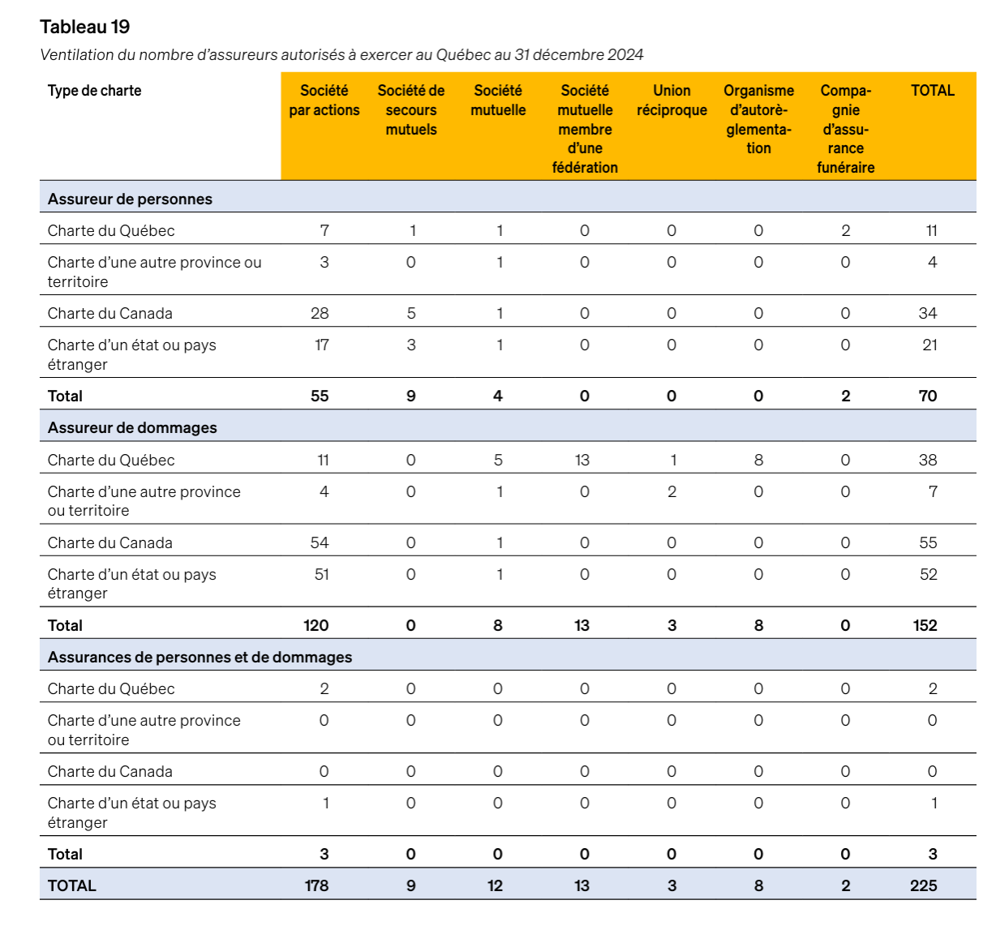{width=80% fig-align="center"}
---

On peut également observer une ventilation du nombre d’assureurs selon deux autres classifications : selon la charte de constitution et selon le statut juridique ou institutionnel. Il convient maintenant d’examiner plus en détail la signification de ces classifications.

## Charte des assureurs 

Au Québec, on dénombre quatre types de chartes permettant à un assureur d’exercer des activités d’assurance.  Sur le site de l’Autorité des marchés financiers, il est également possible de consulter la [liste de l’ensemble des assureurs autorisés à exercer au Québec](https://lautorite.qc.ca/fileadmin/lautorite/grand_public/a-propos-autorite/diffusion-information/Document2_GDC05-06-01-3131.pdf), ainsi que la charte en vertu de laquelle chacun d’eux est constitué (la 4e colonne nommée *Origine de la charte*).

- **Assureur à charte du Québec** 

  Un assureur à charte du Québec est constitué en vertu de la législation québécoise applicable. Sa juridiction de constitution est donc le Québec. Il doit être autorisé par l’AMF pour exercer des activités d’assurance et relève en principe de son encadrement prudentiel, en plus des règles québécoises concernant la conduite de marché.

  Parmi les assureurs exerçant sous cette charte, on peut notamment citer :

  - DESJARDINS ASSURANCES GÉNÉRALES INC.
  - INDUSTRIELLE ALLIANCE, ASSURANCE ET SERVICES FINANCIERS INC.
  - PROMUTUEL ASSURANCE*
  - L'UNIQUE ASSURANCES GÉNÉRALES INC.

- **Assureur à charte d’une autre province ou d’un territoire canadien** 

  Un assureur à charte d’une autre province ou d’un territoire est constitué en vertu des lois d’une juridiction provinciale ou territoriale canadienne, par exemple l’Ontario, l’Alberta ou la Colombie-Britannique. Il n’est pas juridiquement un assureur du Québec, mais il peut exercer au Québec s’il est autorisé par l’AMF. Son régime de constitution demeure celui de sa province ou de son territoire d’origine, tandis que ses activités exercées au Québec sont soumises aux règles québécoises applicables aux assureurs autorisés.

  Parmi les assureurs exerçant sous cette charte, on peut notamment citer :

  - COMPAGNIE D'ASSURANCES TRANS GLOBALE
  - COMPAGNIE D'ASSURANCE VOYAGE ORION

- **Assureur à charte du Canada (charte fédérale)** 

  Un assureur à charte du Canada est constitué en vertu d’une loi fédérale canadienne, principalement la Loi sur les sociétés d’assurances. Il relève, pour sa constitution et sa surveillance prudentielle principale, du cadre fédéral. Toutefois, pour exercer au Québec, même un assureur fédéral doit obtenir une autorisation de l’AMF et se conformer aux règles québécoises en matière de distribution, de contrats d’assurance et de protection des consommateurs.

  Parmi les assureurs exerçant sous cette charte, on peut notamment citer :

  - INTACT COMPAGNIE D'ASSURANCE
  - LA COMPAGNIE D'ASSURANCE GÉNÉRALE CO-OPERATORS
  - SUN LIFE DU CANADA, COMPAGNIE D'ASSURANCE-VIE
  - COMPAGNIE D'ASSURANCE MANUVIE DU CANADA

- **Assureur à charte d’un État ou d’un pays étranger** 

  Un assureur à charte étrangère est constitué selon les lois d'une juridiction située à l'extérieur du Canada, par exemple un État américain ou un pays européen. Pour exercer au Québec, il doit satisfaire aux exigences d'autorisation de l'AMF. Son régime de constitution demeure étranger, mais ses activités canadiennes peuvent également être soumises à la surveillance prudentielle fédérale, notamment lorsqu'elles sont exercées par l'intermédiaire d'une succursale relevant du BSIF. Il importe donc de distinguer la juridiction de constitution de l'assureur et les régimes qui encadrent ses activités au Canada.

  Parmi les assureurs exerçant sous cette charte, on peut notamment citer :

  - LES SOUSCRIPTEURS DU LLOYD'S
  - TOKIO MARITIME & NICHIDO INCENDIE COMPAGNIE D'ASSURANCES LTÉE

---

### Lloyd’s of London : historique, fonctionnement et rôle contemporain

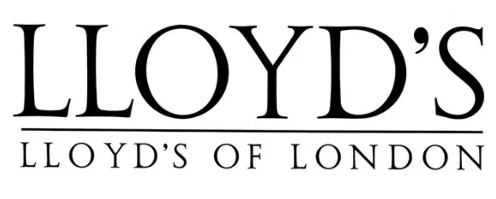

Lloyd’s of London occupe une place particulière dans l’histoire et le fonctionnement de l’assurance en raison de sa structure institutionnelle unique.  Contrairement à un assureur traditionnel, Lloyd’s n’est pas une compagnie d’assurance, mais un marché spécialisé d’assurance et de réassurance. À ce titre, il est pertinent de lui consacrer une attention spécifique dans ces notes de cours.

#### **Origines historiques** {-}

Les origines de Lloyd's remontent à la fin du XVIIe siècle, dans le monde du commerce maritime londonien. Ce contexte explique son développement initial autour de l'assurance des navires et des cargaisons. Au cours des XVIIIe et XIXe siècles, avec l’expansion du commerce international et de l’Empire britannique, les activités de Lloyd’s s’élargissent au-delà de l’assurance maritime. En 1871, le Parlement britannique adopte le *Lloyd’s Act*, qui confère à Lloyd’s un statut juridique officiel et permet une organisation plus structurée du marché.

#### **Une structure institutionnelle singulière** {-}

Lloyd's of London fonctionne comme un marché dans lequel plusieurs acteurs interagissent :

- des syndicats, qui regroupent des capitaux et souscrivent les risques ;
- des courtiers, qui présentent les risques au marché au nom des assurés ;
- des coverholders, qui peuvent souscrire des risques au nom des syndicats dans certaines juridictions ;
- des membres, historiquement appelés « Names », qui fournissent le capital nécessaire à la prise de risques.

Le risque est présenté au marché, généralement par un courtier, et peut être souscrit par un seul syndicat ou réparti entre plusieurs syndicats, chacun participant alors à une fraction déterminée de l'engagement et de la prime. La souscription partagée est fréquente pour les risques complexes, comme un satellite, un parc éolien en mer ou un événement international, sans être obligatoire.

Les membres qui fournissent le capital assument les engagements correspondant à leur participation au syndicat, séparément et non solidairement avec les autres membres. Le marché permet ainsi de mobiliser des capacités spécialisées pour des risques parfois difficiles à couvrir auprès d'un assureur traditionnel. Le marché a longtemps été financé par des investisseurs individuels, les *Names*, avant que les réformes amorcées dans les années 1990 favorisent une participation accrue de capitaux corporatifs. Cette transition est présentée plus loin dans une anecdote historique.

Quelques anecdotes à propos de Lloyd's méritent d'être racontées.

#### Café {-}

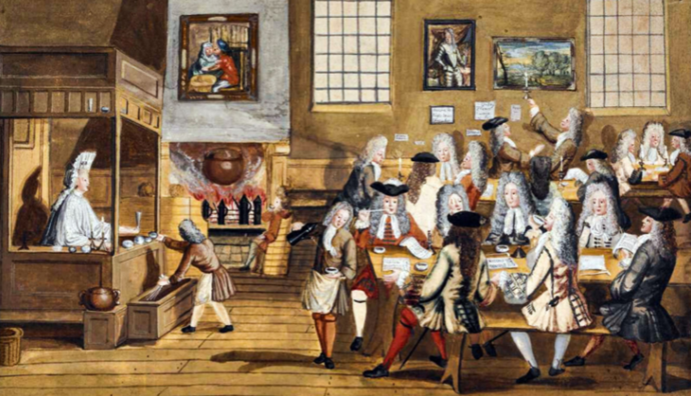

À l’origine, Lloyd’s n’était ni une compagnie d’assurance ni même une institution formelle, mais le coffee house d’Edward Lloyd, ouvert vers 1688 à Londres. Ce café était fréquenté par des armateurs, capitaines de navires, marchands et investisseurs qui cherchaient à échanger de l’information sur les voyages maritimes, les cargaisons et les risques en mer. 

Progressivement, certains clients ont commencé à inscrire leur nom sous des descriptions de risques maritimes, indiquant la part de risque qu’ils acceptaient de couvrir — d’où le terme *underwriter*. Ce lieu informel est ainsi devenu le noyau d’un marché d’assurance fondé sur la réputation personnelle, la confiance et l’information partagée, bien avant l’existence d’assureurs structurés au sens moderne. [Source](https://riskresource.com/newsletters/the-history-of-insurance-underwriting-explained-in-2-minutes/)

#### Protection atypique   {-}

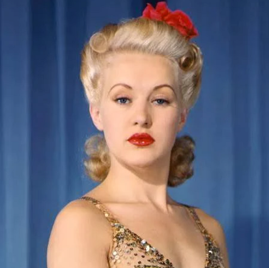

Au fil des siècles, Lloyd’s est devenu célèbre pour avoir assuré des risques jugés trop atypiques ou trop spécifiques pour les assureurs traditionnels. Parmi les exemples souvent cités figurent la voix de chanteurs, les mains de pianistes ou encore les jambes de danseuses. L’un des cas les plus connus est celui de l’actrice américaine Betty Grable, grande vedette hollywoodienne des années 1940, dont les jambes — élément central de son image publique et de sa carrière dans les comédies musicales — auraient été assurées auprès de Lloyd’s.

Plus sérieusement, Lloyd’s a aussi assuré des risques extrêmes liés à l’exploration, à l’aviation expérimentale ou à des événements uniques. Ces contrats illustrent une caractéristique fondamentale de Lloyd’s : il ne s’agit pas d’un assureur unique, mais d’un marché dans lequel des syndicats spécialisés peuvent accepter des risques très ciblés, pourvu qu’ils puissent être décrits, évalués et mutualisés.

#### Les Names  {-}

Pendant plus de deux siècles, une grande partie du capital de Lloyd’s provenait des Names, des individus fortunés qui engageaient leur patrimoine personnel pour garantir les risques souscrits par les syndicats auxquels ils participaient. Contrairement aux actionnaires d’une compagnie moderne, les Names n’avaient aucune responsabilité limitée : en cas de sinistres majeurs, ils étaient légalement tenus de payer, même si cela signifiait vendre leur maison ou liquider leurs actifs.

Cette structure a fonctionné tant que les pertes restaient relativement prévisibles. Mais dans les années 1980 et au début des années 1990, une combinaison de sinistres catastrophiques, de réclamations liées à l’amiante et de polices à développement long a entraîné des appels de fonds massifs. Des milliers de Names ont fait faillite personnelle, ce qui a provoqué une crise existentielle pour Lloyd’s et mené à une profonde réforme : introduction de Names corporatifs, création de véhicules à responsabilité limitée et refonte de la gouvernance. [Source](https://www.theguardian.com/money/2000/nov/04/business.personalfinancenews1)

#### San Francisco   {-}

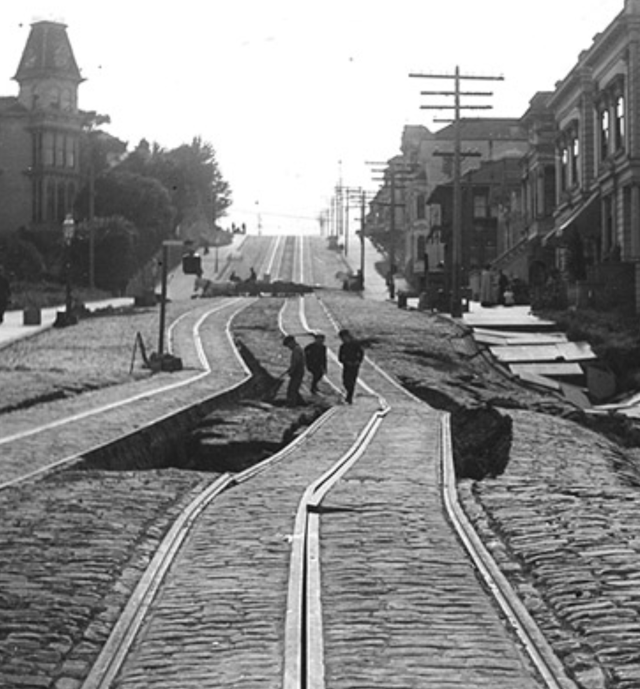

Après le séisme et l’incendie de San Francisco en 1906, de nombreux assureurs américains ont tenté de limiter leurs paiements en invoquant des clauses ambiguës distinguant les dommages causés par le tremblement de terre de ceux causés par l’incendie. Lloyd’s, au contraire, a choisi une approche radicalement différente. Sous l’impulsion de Cuthbert Heath, figure majeure de Lloyd’s à l’époque, les agents ont reçu l’instruction célèbre :

> “Pay all of our policyholders in full, irrespective of the terms of their policies.”

Cette décision a coûté extrêmement cher à court terme, mais elle a établi durablement la réputation internationale de Lloyd’s comme marché fiable, capable d’honorer ses engagements même dans des circonstances exceptionnelles. Cet épisode est souvent cité comme un moment fondateur de la crédibilité moderne de Lloyd’s et de son rôle dans l’assurance des risques catastrophiques. [Source : Lloyd's, séisme de San Francisco de 1906](https://www.lloyds.com/about-lloyds/history/catastrophes-and-claims/san-francisco-earthquake)

#### **Lloyd’s of London aujourd’hui** {-}

Les réformes entreprises à la suite de la crise des années 1980-1990 ont renforcé la gouvernance et élargi les sources de capital. Aujourd'hui, les activités de Lloyd's reposent largement sur des structures corporatives, aux côtés de la participation historique de certains membres individuels. Aujourd'hui, Lloyd's demeure un acteur important de l'assurance et de la réassurance à l'échelle mondiale. Le marché est actif dans plus de 200 pays et territoires et se spécialise dans des risques complexes ou non standardisés, notamment :

- les risques de catastrophes naturelles ;
- l’assurance aviation et maritime ;
- les risques politiques et de crédit ;
- la cyberassurance et d’autres risques émergents.

Lloyd’s continue également d’innover sur le plan de l’analyse des risques, de la gestion du capital et des pratiques de souscription, tout en maintenant un cadre réglementaire et prudentiel rigoureux. Sa capacité à rassembler des capitaux internationaux et à mutualiser des risques complexes explique sa pertinence continue dans le système assurantiel mondial. Pour les étudiants en assurance, Lloyd’s of London constitue ainsi un exemple emblématique d’une organisation assurantielle atypique, dont l’histoire, le fonctionnement et l’évolution illustrent à la fois la diversité des formes institutionnelles en assurance et l’adaptation du secteur à des risques en constante évolution.

Sources :  

  - [Revue Assurances et gestion des risques](https://www.revueassurances.ca/wp-content/uploads/2016/03/2013_81_no1_2_london.pdf)  
  - [Wikipedia](https://en.wikipedia.org/wiki/Lloyd%27s_of_London)

## Statut juridique des assureurs

En plus de leur charte de constitution, les assureurs autorisés au Québec sont classés par l'AMF selon leur **statut juridique ou institutionnel**. Cette classification regroupe des formes d'organisation et certains régimes particuliers. Selon la catégorie, elle renseigne notamment sur la propriété, la gouvernance, la capitalisation et les obligations applicables. Dans la [liste des assureurs autorisés au Québec](https://lautorite.qc.ca/fileadmin/lautorite/grand_public/a-propos-autorite/diffusion-information/Document2_GDC05-06-01-3131.pdf), la première colonne présente cette classification. Il faut toutefois éviter de considérer chacune de ces catégories comme une forme juridique parfaitement comparable aux autres.

- **Compagnie d’assurance funéraire**

  Une compagnie d’assurance funéraire est un assureur spécialisé dans l’offre de produits d’assurance liés aux frais funéraires. Ce statut fait l’objet d’un encadrement juridique distinct, en raison de la nature particulière des produits offerts, de la gestion des fonds perçus à long terme et des enjeux spécifiques de protection des assurés. Les règles applicables à ces compagnies visent notamment à encadrer l’utilisation des fonds, la solvabilité et la transparence à l’égard des bénéficiaires. Seuls deux assureurs au Québec ont ce statut.

- **Organisme d’autoréglementation**

  Un organisme d’autoréglementation, au sens utilisé par l’Autorité des marchés financiers dans ses listes d’assureurs, désigne principalement des fonds d’assurance ou d’indemnisation mis en place dans le cadre de professions réglementées - comme nous le verrons dans un prochain chapitre. Ces entités ont pour fonction d’assurer ou d’indemniser les membres d’une profession ou les tiers, dans un contexte où la couverture est rendue obligatoire par la loi ou par un règlement professionnel.  Il ne s’agit pas d’assureurs commerciaux au sens classique, mais de mécanismes collectifs de protection financière rattachés à un ordre professionnel ou à un cadre réglementaire spécifique. Leur mission, leur mode de financement et leur gouvernance diffèrent de ceux des assureurs traditionnels, bien qu’ils exercent une fonction assurantielle.

- **Société de secours mutuels**

  Une société de secours mutuels est une forme juridique historique, créée à l’origine pour permettre à des membres de se fournir une protection financière mutuelle, souvent dans un cadre communautaire, professionnel ou associatif. Elle ne comporte pas de capital-actions et repose sur un principe de solidarité entre ses membres, qui sont à la fois assurés et participants à la structure. Au Québec, les sociétés de secours mutuels sont régies par un cadre légal spécifique distinct des lois générales sur les sociétés. Leurs activités sont généralement limitées, notamment en matière de produits offerts et de capacité de développement, ce qui explique leur présence relativement marginale dans le paysage assurantiel contemporain.

- **Société mutuelle**

  Une société mutuelle est un assureur détenu collectivement par ses assurés. Elle ne possède pas de capital-actions et n’a donc pas d’actionnaires au sens classique. Les assurés sont membres de la mutuelle et participent, directement ou indirectement, à sa gouvernance selon les mécanismes prévus par la loi et les règlements internes.  Les excédents financiers générés par les activités d’assurance peuvent être conservés afin de renforcer la solvabilité de l’assureur ou redistribués aux membres, par exemple sous forme de ristournes, conformément au cadre réglementaire applicable. La société mutuelle partage plusieurs caractéristiques d’une organisation à caractère coopératif, notamment la participation des membres à la gouvernance, sans que ces notions soient juridiquement interchangeables.

- **Société mutuelle membre d’une fédération**

  Une société mutuelle membre d’une fédération est une mutuelle juridiquement autonome qui adhère à une fédération regroupant plusieurs mutuelles. Chaque mutuelle conserve sa personnalité juridique propre et demeure responsable de ses engagements envers ses assurés. La fédération joue toutefois un rôle structurant important, notamment en fournissant des services communs tels que la réassurance, le soutien financier, l’encadrement de la gouvernance, l’expertise actuarielle ou les infrastructures opérationnelles.  Au Québec, le Groupe Promutuel constitue le principal exemple de ce modèle, avec plusieurs sociétés mutuelles juridiquement distinctes regroupées au sein d’une fédération.
  
- **Société par actions**

  Une société par actions est un assureur constitué sous une forme corporative classique, en vertu d’une loi sur les sociétés applicable dans sa juridiction de constitution. Son capital est divisé en actions détenues par des actionnaires, lesquels peuvent être des personnes physiques, des institutions financières ou des investisseurs institutionnels.  Les assurés ne sont pas propriétaires de l’assureur, sauf s’ils détiennent eux-mêmes des actions. La gouvernance est assurée par un conseil d’administration élu par les actionnaires, et la finalité juridique de l’entité est l’exploitation d’une entreprise d’assurance selon un modèle commercial. Ce statut est aujourd’hui le plus répandu dans l’industrie de l’assurance, tant au Québec qu’au Canada et à l’international, en raison de sa flexibilité en matière de financement, de croissance et d’accès aux marchés des capitaux.

- **Union réciproque**

  Une union réciproque est une forme particulière d’organisation assurantielle dans laquelle les membres s’assurent mutuellement les uns les autres, sans qu’il existe une compagnie d’assurance traditionnelle dotée d’un capital-actions. Chaque membre participe collectivement à l’absorption des risques assumés par le groupe.   La gestion des activités d’assurance est généralement confiée à un gestionnaire mandaté, qui administre les contrats, les sinistres et les opérations courantes au nom des membres. Les risques demeurent toutefois portés collectivement par l’ensemble des participants. Ce statut est relativement rare et est principalement utilisé pour des groupes fermés ou des risques spécialisés, en raison de sa complexité juridique et de sa moindre compatibilité avec les cadres prudentiels modernes. Seuls deux assureurs au Québec ont ce statut.

::: {.callout-important icon=false}
## Absence du statut de coopérative

La classification utilisée par l'AMF ne comprend pas de catégorie générale intitulée « coopérative d'assurance ». Les structures mutualistes y sont principalement représentées par les sociétés mutuelles et les sociétés mutuelles membres d'une fédération. Cela ne signifie toutefois pas que toute organisation exerçant des activités d'assurance et présentant un caractère coopératif relève nécessairement de ces catégories. Il faut distinguer le mode de fonctionnement coopératif ou mutualiste, la forme juridique de l'organisation et le statut sous lequel elle est reconnue par l'AMF.
:::

### Assurance responsabilité professionnelle

La catégorie des organismes d'autoréglementation permet d'introduire une autre dimension de l'écosystème de l'assurance : les mécanismes de protection liés à la responsabilité professionnelle. L’assurance responsabilité professionnelle (souvent appelée assurance erreurs et omissions, ou E&O) vise à couvrir les conséquences financières d’une faute, erreur, omission, négligence ou manquement commis dans l’exercice d’activités professionnelles, lorsqu’un client (ou un tiers) subit un préjudice et réclame une indemnisation.

En pratique, cette protection couvre typiquement (selon le contrat ou le régime) :

  - les dommages que le professionnel pourrait devoir payer (indemnités, règlements) ;
  - les frais de défense (honoraires d’avocats, expertise, etc.), souvent déterminants en responsabilité professionnelle.

#### Complexité de la couverture {-}

Cette assurance est généralement considérée comme complexe par rapport à plusieurs produits d’assurance « classiques », notamment en raison des éléments suivants :

  - **Délais avant réclamation (longue traîne)**  
    Une faute peut être commise aujourd’hui, mais une réclamation peut survenir des années plus tard, quand le dommage est découvert ou quand un litige se cristallise. Cette temporalité complique la tarification, la provision et la gestion du risque (on assure un passé qui peut se révéler plus tard).

  - **Question de déclenchement de la couverture**  
    Selon le produit ou le régime, la couverture peut dépendre de la date de l’acte, de la date de la réclamation, ou d’autres modalités contractuelles (par exemple : exigences de déclaration, périodes de garantie, garanties subséquentes, etc.). Cette mécanique influence fortement les protections réelles et les situations « grises ».

  - **Forte dépendance au contexte juridique et à la preuve**  
    La responsabilité professionnelle se joue souvent sur des détails : normes de pratique, obligations d’information, documents, délais, causalité, etc. Deux dossiers apparemment semblables peuvent avoir des issues très différentes.

  - **Hétérogénéité des risques selon les actes**  
    Un même titre professionnel peut recouvrir des actes très différents (donc des expositions très différentes), et les limites, exclusions et franchises deviennent centrales pour comprendre « ce qui est réellement couvert ».

#### Exemples de formes de protection selon les professions {-}

Typiquement, les professionnels doivent assumer un coût annuel afin de bénéficier d’une protection contre les risques liés à l’exercice de leur profession. Toutefois, les protections de type E&O peuvent prendre plusieurs formes institutionnelles et contractuelles. Chacune de ces formes repose sur des mécanismes distincts de mutualisation, de tarification, de provisionnement et de suffisance des ressources, qui relèvent directement des notions de gestion du risque abordées en actuariat.

- **Protection offerte directement par des compagnies d’assurance**

  Cette forme repose sur des contrats individuels ou sur des programmes affinitaires, comme on en retrouve dans plusieurs marchés de responsabilité professionnelle. La relation est strictement contractuelle : l’assureur s’engage, moyennant une prime, à couvrir certains sinistres définis dans la police, jusqu’à des limites prédéterminées.  

  Une profession pertinente à considérer dans ce contexte est celle des urbanistes. Un avis professionnel ou une recommandation d’aménagement peut contribuer à une décision ayant des conséquences financières importantes, par exemple une décision de zonage, une interprétation d’un règlement, une analyse de conformité ou une recommandation ayant un impact sur la valeur d’un terrain ou sur la possibilité de construire. Le dommage allégué peut n’apparaître que plusieurs années plus tard, lorsqu’un projet échoue, qu’un permis est refusé, qu’un voisin conteste ou qu’un promoteur réclame des pertes. La difficulté d’assurance est alors souvent liée à la causalité — soit la distinction entre ce qui relève réellement de l’avis de l’urbaniste et ce qui découle de décisions politiques, de contraintes techniques ou de choix effectués par le promoteur — ainsi qu’à l’évaluation du préjudice, notamment en matière de occasions d’affaires perdues, de retards ou de frais juridiques.

  Les urbanistes sont soumis à une [obligation de protection en responsabilité professionnelle](https://www.legisquebec.gouv.qc.ca/fr/document/rc/c-26,%20r.%20299), sous réserve des exemptions prévues. Lorsqu'un régime collectif conforme aux exigences réglementaires a été conclu par l'Ordre pour les membres concernés, ceux-ci doivent y adhérer.

- **Protection par un fonds d’assurance rattaché à un ordre professionnel**

  Lorsque l’organisation et le volume de risques le justifient, la responsabilité professionnelle peut être couverte par un régime collectif administré par un fonds distinct de l’ordre professionnel lui-même, en cohérence avec la mission de protection du public. Ce type de structure fonctionne selon une logique assurantielle classique — perception de cotisations, constitution de provisions et paiement des sinistres — mais adaptée à un groupe professionnel homogène.  

  La profession de **notaire** constitue un exemple représentatif de ce modèle. Une erreur dans un acte notarié, telle qu’une description imprécise d’un immeuble, un problème de servitude, une hypothèque mal radiée ou une formalité manquante, peut n’être découverte que plusieurs années plus tard, souvent lors d’une revente, d’un refinancement ou d’un conflit familial lié à une succession.

  Les notaires sont couverts par le [Fonds d’assurance-responsabilité professionnelle](https://www.farpcnq.qc.ca) lié à la Chambre des notaires du Québec, dont la mission explicite est d’assurer la responsabilité professionnelle des membres et ex-membres. Les opérations de ce fonds sont distinctes de celles de la Chambre, et la souscription au régime est obligatoire.

- **Protection par un régime de protection mutuelle ou de défense professionnelle**

  Dans ce cas, la protection ne constitue pas juridiquement un contrat d’assurance. Les professionnels versent des cotisations à une organisation collective dont la mission est de défendre les membres et, le cas échéant, d’indemniser les victimes. Les décisions relatives à la défense et aux règlements sont prises au cas par cas, et les coûts sont mutualisés entre les membres. Ce modèle est principalement utilisé lorsque les sinistres sont rares, potentiellement très coûteux et difficiles à encadrer contractuellement, ce qui rend l’assurance traditionnelle plus délicate à mettre en place.

  La profession **médicale** illustre bien cette situation. Un diagnostic posé trop tard, un résultat critique non suivi ou une complication postopératoire peuvent donner lieu à des réclamations complexes, où l’explication et la documentation deviennent centrales. Dans ces dossiers, l’enjeu ne se limite pas à l’indemnité éventuelle : les coûts de défense — honoraires d’experts, analyses spécialisées et frais juridiques — peuvent être très élevés.

  De plus, les réclamations peuvent survenir longtemps après l'acte médical, par exemple lorsque l'état du patient se détériore ou lorsqu'un lien causal est allégué a posteriori. L'[Association canadienne de protection médicale (CMPA/ACPM)](https://www.cmpa-acpm.ca/fr/home) illustre un modèle de défense médicale mutuelle qui n'est pas une police d'assurance traditionnelle. Les médecins membres partagent les coûts de cette protection, mais l'assistance de l'ACPM est accordée selon ses règles et conserve un caractère discrétionnaire : elle ne représente pas un droit contractuel identique aux garanties prévues par une police d'assurance.

## L’encadrement de l’assurance

La réglementation de l'assurance au Canada repose sur un partage des compétences entre les autorités fédérales et provinciales. Au Québec, l'AMF veille notamment à l'autorisation des assureurs et à l'encadrement des pratiques commerciales, et exerce la surveillance prudentielle des assureurs de compétence québécoise. Le BSIF est responsable de la surveillance prudentielle des assureurs de compétence fédérale et de certaines activités canadiennes d'assureurs étrangers. Cette surveillance porte notamment sur la solvabilité et la solidité financière; elle ne doit pas être confondue avec la réglementation des contrats, de la distribution et de la protection des consommateurs. Nous reviendrons plus en détail sur ces questions au [chapitre 8 : Aspects juridiques et réglementaires](Chap8_Juridique.qmd).

## Portrait de l’assurance au Québec

En ayant maintenant une meilleure compréhension des différents types d’assureurs et de leur encadrement institutionnel, il devient pertinent d’examiner le portrait détaillé du secteur de l’assurance au Québec à partir de données de marché. Cette section vise à décrire la structure du marché, son évolution récente et la répartition des activités selon les principaux segments. L’analyse est présentée en deux parties distinctes : l’assurance de personnes et l’assurance de dommages. Cette distinction reflète à la fois des différences importantes dans la nature des risques assurés, la durée des engagements, les mécanismes de tarification et les cadres réglementaires applicables.

Les **primes directes souscrites** constituent un indicateur de la taille et de l'évolution du marché, mais leur croissance ne mesure pas uniquement une augmentation du nombre de contrats ou des risques assurés. Elle peut également refléter des hausses tarifaires, l'inflation des coûts ou des modifications dans la composition des portefeuilles. En assurance de dommages, notamment, l'AMF attribue une part importante de la hausse des primes de 2024 aux augmentations de tarifs.

### Assurance de personnes

On débute avec l’assurance de personnes, qui regroupe des produits visant à couvrir des risques liés à la personne elle-même plutôt qu’à ses biens. Ces produits se caractérisent généralement par des engagements de moyen ou de long terme et par une forte dépendance aux hypothèses démographiques et financières.

L’assurance de personnes inclut notamment les catégories de produits suivantes :

- l’assurance vie individuelle ;
- l’assurance vie collective ;
- l’assurance accidents et maladie individuelle ;
- l’assurance accidents et maladie collective ;
- les rentes individuelles ;
- les rentes collectives.

Dans cette classification, la distinction entre les produits individuels et collectifs renvoie à la manière dont la couverture est souscrite et administrée, et non à la nature du risque assuré. Les produits individuels sont souscrits directement par une personne à titre individuel. Le contrat est établi entre l’assureur et l’assuré, et les conditions (prime, garanties, exclusions) sont déterminées en fonction du profil individuel de la personne assurée. Les produits collectifs sont souscrits par un preneur de groupe, le plus souvent un employeur, une association ou une organisation, au bénéfice d’un ensemble de personnes. Les garanties sont définies pour le groupe dans son ensemble, et la tarification repose principalement sur les caractéristiques et l’expérience du groupe plutôt que sur celles de chaque individu pris isolément.

#### **Part de marché**  {-}

Selon les données de l’Autorité des marchés financiers, les treize assureurs à charte québécoise, appelés « assureurs québécois », détiennent toujours une part majoritaire du marché québécois en matière de primes directes souscrites non consolidées. En 2024, leur part de marché s'élève à 59,2 %, soit une hausse de 1,2 point de pourcentage par rapport à 2023. Les primes directes souscrites augmentent nettement sur la période 2015–2024, avec une accélération à partir de 2021. Cette progression en valeur monétaire peut provenir tant d'une évolution des couvertures que des tarifs. Les assureurs étrangers conservent une part de marché marginale.

Pris ensemble, ces graphiques mettent en évidence une structure de marché concentrée, dans laquelle un nombre limité d’assureurs à charte québécoise capte une part importante de la croissance du marché, malgré la présence d’un plus grand nombre d’assureurs à charte canadienne et étrangère.

::: {.columns}
::: {.column width="50%"}
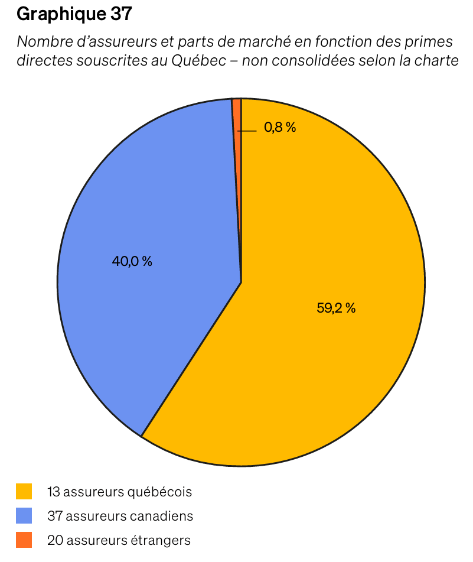{fig-align="center"}
:::

::: {.column width="50%"}
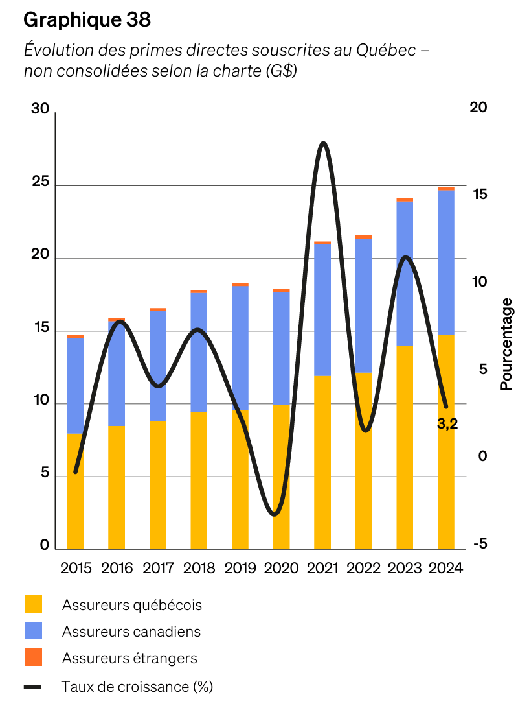{fig-align="center"}
:::
:::

#### **Secteurs d'activité**  {-}

Les graphiques 39 et 40 permettent d’examiner la structure du marché de l’assurance de personnes au Québec selon les secteurs d’activité, ainsi que l’évolution récente des primes directes souscrites non consolidées.  La répartition par secteur et par charte montre que les assureurs à charte québécoise occupent une position dominante dans plusieurs segments, en particulier en rentes individuelles, en rentes collectives ainsi qu’en assurance accidents et maladie collective. Les assureurs à charte canadienne sont surtout présents en assurance vie individuelle et en assurance accidents et maladie collective, tandis que la contribution des assureurs étrangers demeure marginale dans l’ensemble des secteurs.

L'évolution des primes par secteur sur la période 2020–2024 met en évidence une augmentation des montants souscrits en assurance de personnes, principalement portée par l’assurance accidents et maladie collective et par l’assurance vie individuelle. Les autres secteurs, notamment les rentes collectives et l’assurance vie collective, affichent également une progression plus modérée mais continue. Pris conjointement, ces graphiques illustrent un marché où la croissance des primes est largement tirée par quelques secteurs clés, dans un contexte où les assureurs à charte québécoise conservent une présence structurante, particulièrement dans les segments collectifs.

::: {.columns}
::: {.column width="50%"}
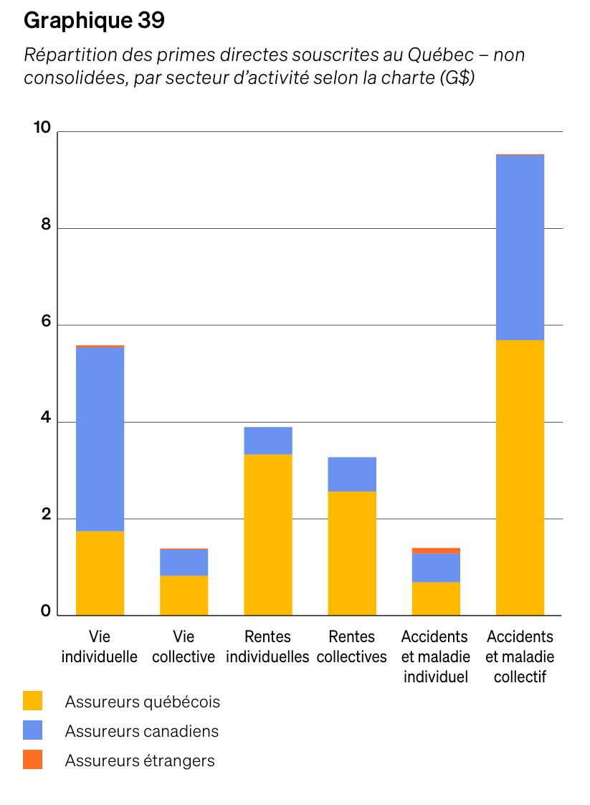{fig-align="center"}
:::

::: {.column width="50%"}
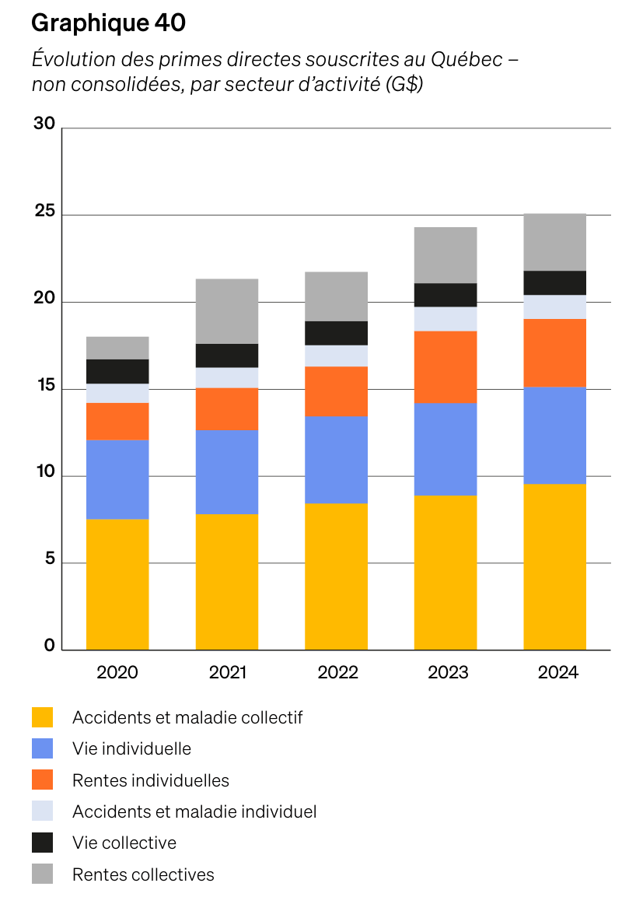{fig-align="center"}
:::
:::

#### **Les grands**  {-}

Le tableau 27 met en évidence une forte concentration du marché québécois de l'assurance de personnes, mesuré en primes directes souscrites non consolidées. En 2024, les six premiers assureurs y totalisent près de 86 % des primes. Par ailleurs, le tableau 20 du rapport, qui regroupe les assureurs au niveau des principaux **assureurs ou groupes d'assureurs**, indique une part de **92,3 % pour les dix premiers**. Les deux présentations ne reposent pas exactement sur la même unité de comparaison.

L’Industrielle Alliance – Vie demeure le premier assureur du marché avec une part de marché de 26,9 % en 2024, en hausse marquée par rapport aux années précédentes. Cette progression traduit une croissance soutenue des primes sur la période récente et un renforcement de sa position dominante. Desjardins Financière et Beneva occupent respectivement les deuxième et troisième rangs, avec des parts de marché de 15,2 % et 14,8 %, formant avec Industrielle Alliance un noyau d’assureurs qui capte à lui seul plus de 56 % du marché.
Les assureurs de rangs quatre à six — Sun Life du Canada, Manufacturers et Canada sur la vie — complètent ce groupe dominant. Bien que leurs parts individuelles soient plus modestes, leur poids cumulé contribue de façon significative à la concentration globale du marché.

À l’inverse, au-delà du sixième rang, les parts de marché individuelles chutent rapidement. Les assureurs classés du septième au trentième rang détiennent chacun moins de 3 % du marché, et la somme de leurs parts représente une fraction relativement limitée du total. Cette répartition met en évidence le poids des principaux acteurs, sans permettre à elle seule de mesurer l'intensité de la concurrence entre assureurs.

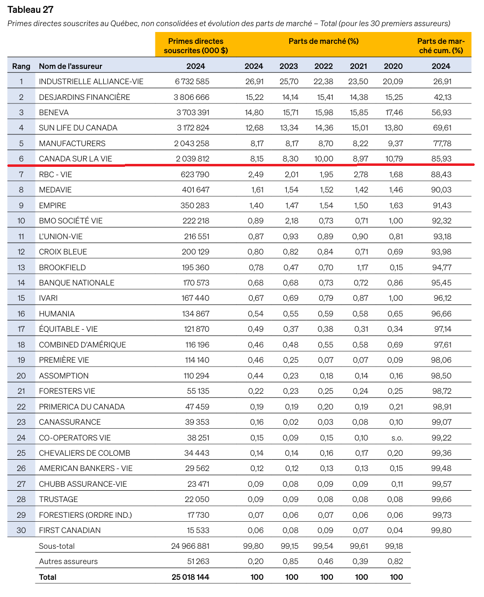{fig-align="center"}

### Assurance de dommages

On poursuit avec l’assurance de dommages, qui regroupe des produits visant à couvrir des pertes financières liées aux biens, aux responsabilités civiles ou à certains événements affectant le patrimoine des assurés. La plupart des contrats d'assurance de dommages couvrent une période relativement courte, souvent un an. Certains risques, notamment en responsabilité, peuvent toutefois donner lieu à des réclamations et à des engagements de très longue durée. La tarification et le provisionnement dépendent notamment de la fréquence et de la sévérité des sinistres.

Les produits d’assurance de dommages incluent notamment les catégories suivantes :

- l’assurance automobile des particuliers ;
- l’assurance automobile des entreprises ;
- l’assurance de biens des particuliers ;
- l’assurance de biens des entreprises ;
- l’assurance de responsabilité ;
- les autres assurances de dommages.

Dans cette classification, la distinction entre les produits destinés aux particuliers et ceux destinés aux entreprises renvoie principalement à la nature de l’assuré et au contexte d’utilisation du bien ou de l’activité assurée. Les produits pour particuliers visent des risques relativement standardisés et homogènes, ce qui permet une tarification plus uniforme. Les produits pour entreprises couvrent quant à eux des risques plus diversifiés et souvent plus complexes, nécessitant une analyse plus spécifique des expositions et des garanties.

Les graphiques et tableaux qui suivent présentent la répartition des primes directes souscrites selon les catégories de produits et selon la charte des assureurs, ainsi que l’évolution récente du marché de l’assurance de dommages au Québec. Ils permettent de comparer la structure de ce marché à celle de l’assurance de personnes, tant en termes de concentration que de dynamique de croissance.

#### **Part de marché**  {-}

Les graphiques 49 et 50 présentent le portrait de l’assurance de dommages au Québec selon la charte des assureurs, tant en termes de structure du marché que d’évolution des primes directes souscrites non consolidées.  Contrairement à l’assurance de personnes, l’assurance de dommages se caractérise par une répartition plus équilibrée des parts de marché entre les assureurs à charte québécoise et les assureurs à charte canadienne. En 2024, les assureurs québécois représentent 43,8 % des parts de marché, tandis que les assureurs canadiens en détiennent 42,7 %. Les assureurs étrangers, bien que relativement nombreux, ne captent qu’une part plus limitée du marché, soit 13,5 %.

L’évolution des primes sur la période 2015–2024 montre une croissance soutenue du marché de l’assurance de dommages, avec une accélération marquée à partir de 2019. Cette hausse de primes concerne principalement les assureurs québécois et canadiens, dont les volumes progressent de façon relativement parallèle, tandis que la contribution des assureurs étrangers demeure plus modeste.

Comparativement à l'assurance de personnes, le marché de l'assurance de dommages présente une concentration moins élevée. Les parts de primes sont davantage réparties entre les principaux acteurs, mais la concentration ne suffit pas, à elle seule, à établir que la concurrence y est plus intense. Celle-ci dépend également, notamment, des barrières à l'entrée, des réseaux de distribution, de la différenciation des produits et du comportement tarifaire des assureurs.

::: {.columns}
::: {.column width="50%"}
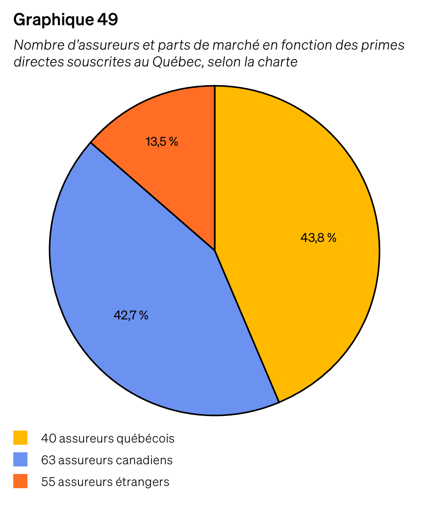{fig-align="center"}
:::

::: {.column width="50%"}
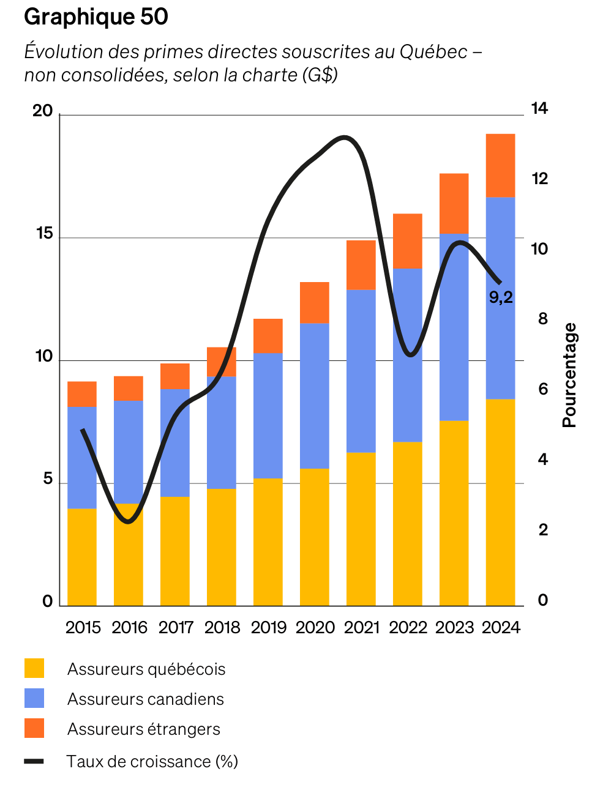{fig-align="center"}
:::
:::

#### **Secteurs d'activité**  {-}

Les graphiques 51 et 53 permettent d’approfondir l’analyse de l’assurance de dommages en examinant la répartition et l’évolution des primes directes souscrites selon les principales catégories de produits. La répartition par catégorie montre que l’assurance automobile des particuliers constitue de loin le segment le plus important du marché, suivie de l’assurance de biens des particuliers. Dans ces deux catégories, les assureurs à charte québécoise occupent une position dominante, captant une part substantielle des primes. À l’inverse, les assureurs à charte canadienne et étrangère sont proportionnellement plus présents dans les segments liés aux entreprises, notamment en assurance de biens des entreprises et en responsabilité, où les risques sont souvent plus complexes et plus hétérogènes.

L’évolution des primes par catégorie sur la période 2020–2024 met en évidence une croissance généralisée de l’ensemble des segments de l’assurance de dommages. L'augmentation des primes est particulièrement marquée en assurance automobile et en assurance de biens des particuliers. Elle doit être interprétée en tenant compte de l'évolution des tarifs et des coûts des sinistres. Les segments liés aux entreprises et à la responsabilité affichent également une progression soutenue, bien que sur des volumes plus modestes.

Pris ensemble, ces graphiques illustrent une structure de marché où l’assurance de dommages repose largement sur les risques des particuliers, tant en niveau qu’en croissance, tandis que les segments destinés aux entreprises jouent un rôle important dans la diversification des risques et dans la répartition des parts de marché entre les différents types d’assureurs.

::: {.columns}
::: {.column width="50%"}
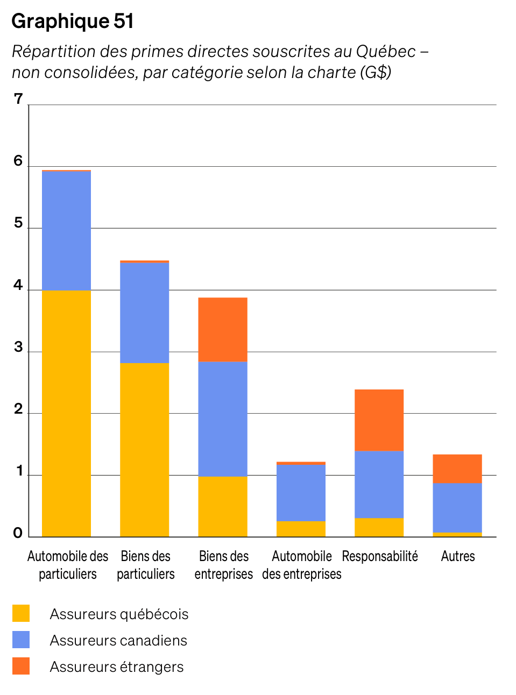{fig-align="center"}
:::

::: {.column width="50%"}
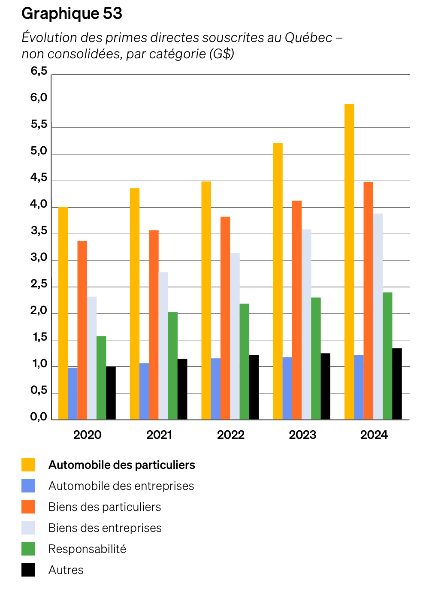{fig-align="center"}
:::
:::

#### **Les grands**  {-}

Le tableau 41 présente la répartition des primes directes souscrites non consolidées en assurance de dommages au Québec pour les 30 principaux assureurs, ainsi que l’évolution de leurs parts de marché sur la période 2020–2024. Comme en assurance de personnes, ce tableau met en évidence une structure de marché relativement concentrée, bien que moins marquée que dans le secteur des personnes.

Intact demeure au premier rang du tableau des assureurs individuels de dommages au Québec, avec près de 20 % des parts de marché en 2024. Sa position est relativement stable depuis 2020, ce qui traduit une domination structurelle plutôt qu’une croissance ponctuelle. Desjardins Assurances générales et Beneva Assurance occupent respectivement les deuxième et troisième rangs, avec des parts de marché de 10,7 % et 8,9 %. À eux trois, ces assureurs représentent environ 40 % du marché de l’assurance de dommages.

Les assureurs classés du quatrième au dixième rang — incluant notamment Lloyd’s, La Personnelle, Belair, Unique et Aviva — détiennent chacun des parts de marché comprises entre 2 % et 5 %. La décroissance des parts est plus graduelle que dans l'assurance de personnes, ce qui traduit une répartition moins concentrée des primes entre les assureurs individuels.

Selon le tableau 41, les dix premières **entités individuelles** représentent environ 64 % des primes en assurance de dommages en 2024. Cette proportion ne doit pas être comparée directement à une concentration calculée pour des **groupes financiers**. En regroupant les assureurs appartenant à un même groupe, le tableau 34 du rapport indique plutôt une concentration de **78,6 %** pour les dix principaux assureurs ou groupes d'assureurs. À unité de comparaison équivalente, le chiffre correspondant est de **92,3 % en assurance de personnes** (tableau 20). Le secteur des dommages est donc moins concentré, sans que cet écart permette à lui seul de conclure qu'il serait nécessairement plus concurrentiel.

En ce qui concerne les volumes globaux, le tableau indique que les primes directes souscrites non consolidées en assurance de dommages s’élèvent à environ 19,2 milliards de dollars en 2024. À titre de comparaison, les primes correspondantes en assurance de personnes atteignent environ 25,0 milliards de dollars pour la même année. L’assurance de personnes constitue donc le marché le plus important en termes de volume de primes au Québec, malgré un nombre d’assureurs plus restreint et une concentration plus élevée.

La comparaison des deux segments illustre ainsi une concentration plus forte en assurance de personnes. Cette observation décrit la répartition des primes entre les acteurs, mais ne constitue pas une mesure directe de l'intensité de la concurrence.

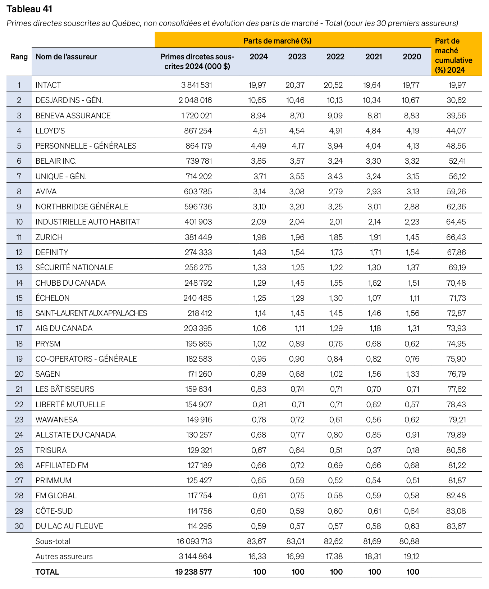{fig-align="center"}

## Conclusion

Ce chapitre a présenté l'écosystème de l'assurance au Québec en distinguant l'assurance de personnes et l'assurance de dommages selon les produits, les structures d'organisation et les marchés. La charte de constitution et le statut juridique ou institutionnel permettent de mieux comprendre l'encadrement des assureurs. Enfin, les données de l'AMF ont permis de comparer la taille et la concentration des deux segments, tout en montrant l'importance de bien définir les populations statistiques et les indicateurs utilisés.

