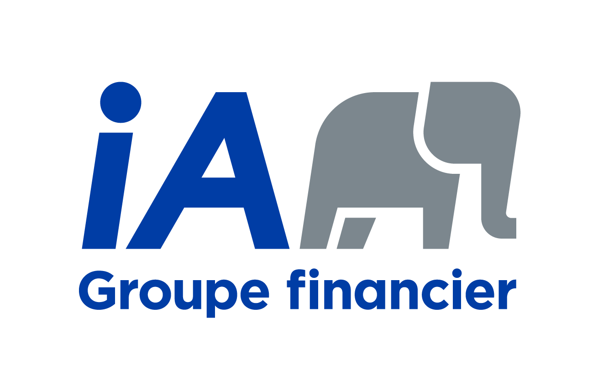
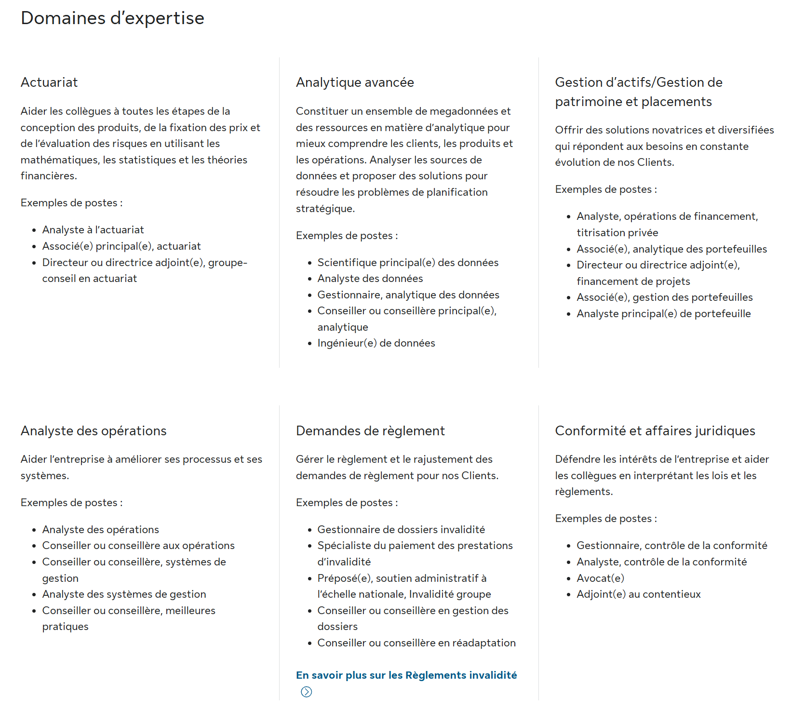
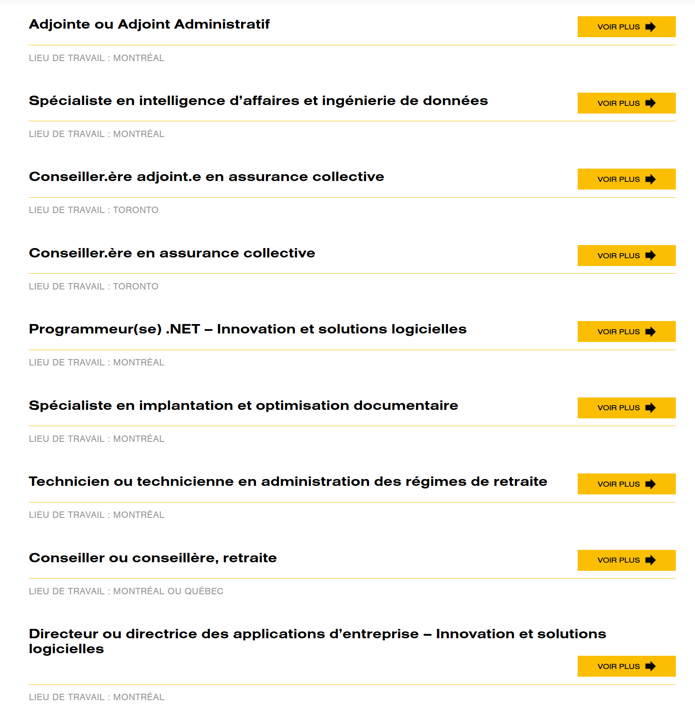
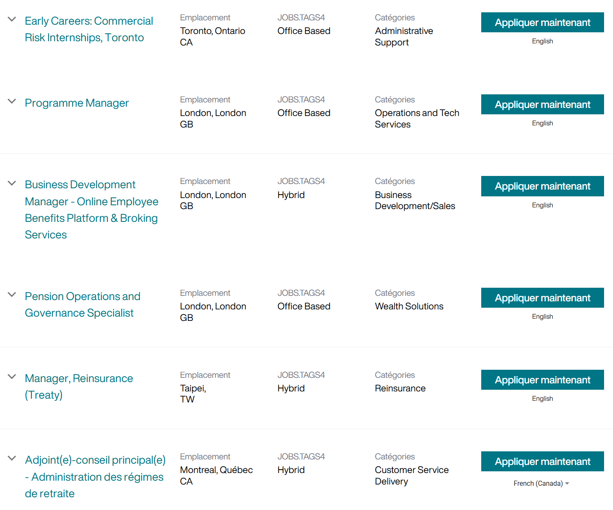

# Les milieux de pratique de l’actuaire

### Objectifs du chapitre {-}


- Identifier les principaux milieux de pratique où l’on retrouve des actuaires (assureurs, réassureurs, consultation, institutions financières, entreprises, secteur public) et comprendre ce qui les distingue.
- Situer l’actuariat dans l’organisation d’une société d’assurance, en reliant la gouvernance (conseil, haute direction, comités) aux fonctions opérationnelles (souscription, sinistres, administration, distribution, finance, technologies de l’information, etc.).
- Décrire les grandes fonctions actuarielles qui reviennent dans la plupart des milieux (tarification, provisionnement, capital, réassurance, analyse d’expérience, modélisation, gestion des risques) et comprendre leurs interactions avec les autres départements.
- Comprendre pourquoi les intitulés de postes et les organigrammes varient d’une organisation à l’autre, et apprendre à interpréter une structure à partir des responsabilités plutôt qu’à partir des titres.
- Mettre en évidence les compétences transversales associées aux milieux de pratique (communication, documentation, jugement professionnel, travail en équipe, contraintes réglementaires et opérationnelles), en complément des compétences techniques.

## Introduction

Après avoir présenté l’écosystème de l’assurance au Québec et les principaux types d’assureurs, il est utile de descendre à l’échelle des organisations où se pratique l’actuariat. Ce chapitre adopte une perspective volontairement générale : il ne vise pas un produit, une ligne d’affaires ou un type d’employeur en particulier.  L’objectif n’est pas de dresser des organigrammes exhaustifs, mais de comprendre comment l’actuariat s’insère dans des organisations qui gèrent des engagements incertains, prennent des décisions sous contrainte (réglementation, capital, concurrence, données, technologie) et doivent maintenir une cohérence entre promesses faites, risques assumés et ressources disponibles.

Les exemples et fonctions décrits ci-dessous se retrouvent, avec des variantes, dans plusieurs milieux : assureurs de personnes, assureurs de dommages, réassureurs, cabinets de consultation, institutions financières, et certaines grandes entreprises privées qui embauchent des actuaires pour des enjeux de retraite, d’avantages sociaux, de risque, ou d’analytique.  Au premier chapitre de ce cours, nous avions listé certaines de ces entreprises qui sont dans la grande région de Montréal.

### Panorama des milieux où l’on retrouve des actuaires

Les actuaires exercent dans une diversité de milieux, publics ou privés, où il s’agit de mesurer, gérer et financer des risques incertains. Sans être exhaustifs, les principaux milieux de pratique peuvent être regroupés comme suit :

- **Assureurs (assurances de personnes et de dommages)**  
  Les assureurs conçoivent et administrent des contrats d’assurance, encaissent des primes, paient des prestations ou des sinistres et doivent demeurer solvables malgré l’incertitude. Les actuaires y contribuent à plusieurs fonctions : tarification, provisionnement, capital, analyse d’expérience, réassurance, modélisation et parfois soutien stratégique.

- **Réassureurs**  
  Les réassureurs assurent les assureurs en prenant en charge une partie des risques qu’ils assument. Ils structurent des traités et évaluent l’exposition globale de portefeuilles souvent internationaux. L’actuariat y est fortement orienté vers la modélisation, l’agrégation des risques et la gestion de portefeuille.

- **Consultation (actuariat-conseil)**  
  Les cabinets de consultation accompagnent des organisations variées : assureurs, employeurs, régimes de retraite, institutions financières ou organismes publics. Les livrables prennent souvent la forme de rapports, d’opinions, de diagnostics, de modèles ou de recommandations, avec une exigence élevée de rigueur méthodologique, de communication claire et de gestion de mandat.

- **Institutions financières et secteurs connexes**  
  On retrouve des actuaires dans des fonctions liées à la gestion des risques, à la modélisation financière, à la gestion actif-passif (ALM), à certains volets de l’évaluation financière ou des normes comptables, ainsi qu’en analytique et en science des données.

- **Entreprises privées non financières**  
  Dans de grandes entreprises, les actuaires interviennent principalement en matière d’avantages sociaux (assurance collective, invalidité, santé), de régimes de retraite, de gestion des risques et, dans certains cas, d’analytique appliquée (prévision, estimation de coûts, analyses de scénarios).

- **Gouvernements et secteur public**  
  Les actuaires œuvrent également au sein d’organismes publics et parapublics, notamment dans les ministères, les agences de réglementation, les régimes publics de retraite et les programmes sociaux. Ils y contribuent à l’évaluation de la viabilité financière de programmes à long terme, à l’analyse des risques collectifs et à l’éclairage des décisions de politiques publiques.

## Gouvernance 

La gouvernance correspond à l’ensemble des mécanismes par lesquels une organisation est dirigée, surveillée et contrôlée. Elle concerne les décisions prises au plus haut niveau et vise à s’assurer que l’organisation poursuit ses objectifs tout en respectant ses obligations légales, financières et éthiques.

Dans les organisations où se pratique l’actuariat — qu’il s’agisse d’assureurs, de cabinets de consultation, d’institutions financières ou de grandes entreprises — la gouvernance est particulièrement importante. Ces organisations prennent souvent des engagements financiers importants, parfois sur de très longues périodes, dans un contexte d’incertitude. Les conséquences de mauvaises décisions peuvent donc se manifester plusieurs années, voire plusieurs décennies plus tard.

La gouvernance ne s’occupe pas des opérations quotidiennes. Elle fixe plutôt le cadre général dans lequel ces opérations doivent s’inscrire : ce qui est permis, ce qui est risqué, ce qui est acceptable ou non. Elle définit les grandes orientations, les limites à respecter et les mécanismes de contrôle.

De façon générale, la gouvernance s’appuie sur plusieurs instances et niveaux de responsabilité.

### Le Conseil d’administration

Le Conseil d’administration est l’instance suprême de décision et de surveillance de l’organisation. Il est généralement composé d’une majorité d’administrateurs externes, c’est-à-dire de personnes qui ne sont pas des employés de la société. Cette composition vise à assurer une certaine indépendance dans la supervision de la direction.

Le Conseil peut également comprendre certains dirigeants, comme le Chef de la direction, ainsi que le Secrétaire corporatif. Le Conseil d’administration ne gère toutefois pas les opérations quotidiennes. Son rôle est plutôt de :

- approuver les grandes orientations stratégiques ;
- nommer et superviser la haute direction ;
- s’assurer de la solidité financière et de la pérennité de l’organisation ;
- veiller au respect des lois, règlements et bonnes pratiques de gouvernance ;
- protéger les intérêts des différentes parties prenantes (clients, assurés, actionnaires, employés, etc.).

### La haute direction et les grands responsables

La haute direction est responsable de la gestion quotidienne de l’organisation et de la mise en œuvre des orientations définies par le Conseil d’administration. Elle coordonne les grandes fonctions internes et arbitre entre des objectifs parfois contradictoires, comme la croissance, la rentabilité, la prudence financière et la conformité réglementaire. Au sommet de cette structure de gestion, on retrouve généralement plusieurs postes de très haute responsabilité. Les intitulés peuvent varier d’une organisation à l’autre, mais les fonctions associées sont relativement standardisées.

On retrouve habituellement les postes suivants :

- **Chef de la direction (Chief Executive Officer – CEO)**  
  Il est responsable de la gestion globale de l’organisation. Il assure la cohérence entre la stratégie approuvée par le Conseil d’administration et les activités concrètes de l’entreprise. Il coordonne l’ensemble de la haute direction et représente l’organisation auprès des parties externes.

- **Chef des opérations (Chief Operating Officer – COO)**  
  Il est responsable du bon fonctionnement des opérations quotidiennes. Cela inclut, selon l’organisation, l’administration des contrats, la gestion des sinistres ou des prestations, le service à la clientèle et l’efficacité des processus internes.

- **Chef des finances (Chief Financial Officer – CFO)**  
  Il est responsable de la gestion financière de l’organisation. Cela comprend la production de l’information financière, la planification budgétaire, la gestion de la trésorerie, les relations avec les auditeurs et, dans certains cas, la supervision des investissements.

- **Chef de la gestion des risques (Chief Risk Officer – CRO)**  
  Il est responsable de l’identification, de la mesure et du suivi des principaux risques auxquels l’organisation est exposée. Ces risques peuvent être financiers, actuariels, opérationnels, juridiques ou réputationnels. Son rôle est de s’assurer que les risques pris sont cohérents avec l’appétit pour le risque défini par la gouvernance.

De plus en plus souvent, on retrouve également :

- **Chef des technologies de l’information (Chief Information Officer – CIO)**  
  Il est responsable des systèmes informatiques, des données et des infrastructures technologiques. Dans un contexte où les décisions reposent fortement sur les données et les modèles, ce rôle est devenu central.

Ces dirigeants forment l’équipe de direction et chapeautent l’ensemble des activités de l’organisation.

#### **Beneva** {-}

<div style="
float:right;
width:28vw;
max-width:420px;
min-width:240px;
margin:0 0 1em 1em;
text-align:center;
">

<div style="font-size:0.85em; margin-top:0.3em;">
</div>
</div>


Beneva est une société canadienne d’assurance mutuelle et de services financiers. Elle est née du regroupement de deux assureurs mutualistes québécois bien établis : La Capitale, fondée en 1941, et SSQ Assurance, fondée en 1944. Le regroupement a été annoncé en janvier 2020 et la nouvelle entité a pris le nom de Beneva en 2020, marquant la création de la plus grande mutuelle d’assurance au Canada.

<div style="clear: both;"></div>

L’organigramme ci-dessus (provenant du [rapport financier de décembre 2024](https://www.beneva.ca/fr/informations-financieres)) présente l’équipe de direction de Beneva telle qu’elle apparaît dans le rapport annuel 2024. À première vue, on ne retrouve pas explicitement les intitulés de postes fréquemment utilisés dans la littérature anglophone (CEO, COO, CFO, CRO, etc.). Cela ne signifie toutefois pas que ces fonctions n’existent pas.

{width=80% fig-align="center"}

Dans les organisations québécoises et canadiennes-françaises, les titres sont généralement **francisés** et certaines fonctions peuvent être **regroupées ou réparties** entre plusieurs vice-présidences exécutives. Les fonctions fondamentales de gouvernance et de pilotage demeurent néanmoins les mêmes.

```{r}
#| echo: false
#| message: false
#| warning: false

library(knitr)
library(kableExtra)

tab_beneva <- data.frame(
`Fonction (terme usuel)` = c(
"Chef de la direction (CEO)",
"Chef des opérations (COO)",
"Chef des finances (CFO)",
"Chef de la gestion des risques (CRO)",
"Chef des technologies de l’information (CIO)",
"Fonction juridique (Chief Legal Officer / General Counsel)",
"Audit interne (fonction de contrôle indépendante)"
),
`Titre utilisé chez Beneva` = c(
"Président et chef de la direction",
"Fonction répartie entre plusieurs vice-présidences exécutives",
"Vice-présidente exécutive et leader – Affaires financières",
"Vice-président – Gestion des risques",
"Vice-présidente exécutive et leader – Performance d’affaires et technologies de l’information",
"Vice-président exécutif et leader – Services juridiques et corporatifs",
"Vice-présidente – Audit interne"
),
`Dirigeant(s)` = c(
"Jean-François Chalifoux",
paste(
"Lara Nourcy",
"Éric Trudel",
"Christian Fournier",
sep = "<br>"
),
"Mélissa Gilbert",
"Michel Fournier",
"Catherine Desgagnés-Bezil",
"Pierre-Marc Bellavance",
"Josée Grondines"
),
check.names = FALSE
)

kbl(
tab_beneva,
format = "html",
escape = FALSE,
align = c("l", "l", "l"),
caption = "Correspondance entre fonctions de direction et titres utilisés chez Beneva"
) %>%
kable_classic(full_width = TRUE, html_font = "sans-serif") %>%
kable_styling(
bootstrap_options = c("striped", "hover", "condensed"),
position = "center"
)
```


#### **Industrielle-Alliance** {-}

<div style="
float:right;
width:28vw;
max-width:420px;
min-width:240px;
margin:0 0 1em 1em;
text-align:center;
">

<div style="font-size:0.85em; margin-top:0.3em;">
</div>
</div>

iA Groupe financier, aussi connu sous le nom d’Industrielle Alliance, est un important groupe canadien d’assurance et de gestion de patrimoine fondé en 1892. Son siège social est situé à Québec. L’entreprise exerce ses activités au Canada et aux États-Unis et offre une vaste gamme de produits et services financiers, notamment en assurance de personnes, en assurance collective, en gestion de patrimoine et en assurance de dommages.

<div style="clear: both;"></div>


L’organigramme ci-dessous (provenant du [rapport financier de décembre 2024](https://ia.ca/-/media/files/ia/investisseurs/rapportsfinanciers/annuel/2025/fr/fo-rapportannuel2024.pdf)) présente les membres du comité exécutif d’Industrielle Alliance (iA Groupe financier). Comme pour Beneva, les titres de postes sont formulés en français et ne correspondent pas toujours directement aux acronymes usuels de la littérature anglophone (CEO, COO, CFO, CRO, etc.). Les fonctions fondamentales de direction — finance, risques, opérations, placements, stratégie et ressources humaines — sont néanmoins clairement présentes, même si leur organisation et leur répartition diffèrent. Cet exemple montre que les organigrammes doivent être interprétés en fonction des responsabilités exercées, et non uniquement à partir des intitulés de postes.

{width=60% fig-align="center"}

```{r}
#| echo: false
#| message: false
#| warning: false

library(knitr)
library(kableExtra)

tab_ia <- data.frame(
  `Fonction (terme usuel)` = c(
    "Chef de la direction (CEO)",
    "Chef des opérations (COO)",
    "Chef des finances (CFO)",
    "Chef de la gestion des risques (CRO)",
    "Chef des placements (Chief Investment Officer)",
    "Stratégie et développement corporatif",
    "Ressources humaines et culture"
  ),
  `Titre utilisé chez iA` = c(
    "Président et chef de la direction",
    "Fonction répartie entre plusieurs vice-présidences exécutives",
    "Vice-président exécutif, chef des finances et actuaire en chef",
    "Vice-président exécutif et chef de la gestion des risques",
    "Vice-président exécutif et chef des placements",
    "Vice-président exécutif – Stratégie, performance, fusions et acquisitions",
    "Vice-présidente exécutive et chef – Talents et culture"
  ),
  `Dirigeant(s)` = c(
    "Denis Ricard",
    paste(
      "Pierre Miron",
      "Sean O’Brien",
      "Renée Laflamme",
      "Louis-Philippe Pouliot",
      sep = "<br>"
    ),
    "Éric Jobin",
    "Philippe Sarfati",
    "Alain Bergeron",
    "Denis Berthiaume",
    "Stéphanie Butt Thibodeau"
  ),
  check.names = FALSE
)

kbl(
  tab_ia,
  format = "html",
  escape = FALSE,
  align = c("l", "l", "l"),
  caption = "Correspondance entre fonctions de direction et titres utilisés chez iA Groupe financier") %>%
  kable_classic(full_width = TRUE, html_font = "sans-serif") %>%
  kable_styling(
    bootstrap_options = c("striped", "hover", "condensed"),
    position = "center"
  ) 

```


### Les comités spécialisés

Pour appuyer le Conseil d’administration et la haute direction, plusieurs comités spécialisés sont généralement mis en place. Ces comités permettent d’approfondir certains enjeux clés et de soutenir la prise de décision au plus haut niveau.

- Le comité d’audit  
  Il supervise la qualité de l’information financière et les mécanismes de contrôle interne. Il s’assure que les états financiers sont fiables et que les processus de vérification interne et externe sont adéquats.

- Le comité de gestion des risques  
  Il se concentre sur l’identification et le suivi des risques importants. Il veille à ce que ces risques soient compris, mesurés et gérés de façon cohérente avec les objectifs de l’organisation.

- Le comité d’investissement (lorsque pertinent)  
  Dans les organisations qui gèrent des sommes importantes, ce comité supervise les orientations en matière de placement. Il s’assure que les décisions d’investissement sont compatibles avec les engagements financiers et avec l’appétit pour le risque.

### Politiques et cadres de gestion

La gouvernance s’appuie également sur des politiques et des cadres formels qui structurent la prise de décision et encadrent les activités de l’organisation. On y retrouve notamment :

- la définition de l’appétit pour le risque ;
- les limites à ne pas dépasser ;
- les pouvoirs de décision et les délégations d’autorité ;
- les mécanismes de contrôle et de reddition de comptes.

Ces politiques servent de référence commune à l’ensemble de l’organisation et assurent une cohérence entre les orientations stratégiques et les décisions opérationnelles.

### Rôle de l’actuariat dans la gouvernance

Sans entrer encore dans le détail du travail actuariel, il est important de comprendre le rôle que joue l’actuariat au niveau de la gouvernance et de la haute direction. Dans ce contexte, l’actuariat joue un rôle clé de soutien à la gouvernance. Les actuaires fournissent des analyses quantitatives qui permettent d’éclairer les décisions prises au plus haut niveau.

Leurs travaux peuvent inclure :

  - des projections à long terme ;
  - des analyses de scénarios et de tests de sensibilité ;
  - des indicateurs de solvabilité ou de capital ;
  - des diagnostics basés sur l’expérience observée ;
  - la documentation des hypothèses et des méthodes utilisées.

Même si les actuaires ne prennent généralement pas les décisions finales, leurs analyses constituent une base essentielle pour évaluer les conséquences futures des choix stratégiques et pour soutenir une prise de décision éclairée.

## Les principaux départements d’une société d’assurance

Après avoir présenté les mécanismes de gouvernance et de pilotage au niveau organisationnel, cette section décrit les principaux départements qui assurent le fonctionnement quotidien d’une société d’assurance. Certains de ces départements sont communs à la majorité des grandes organisations, tandis que d’autres sont directement liés aux activités propres au secteur de l’assurance. 

Il convient toutefois de noter que certaines fonctions, comme la gestion des risques d’entreprise et la conformité réglementaire, ne correspondent pas toujours à des départements opérationnels distincts. Elles jouent plutôt un rôle transversal, en soutenant la gouvernance et en encadrant l’ensemble des départements dans leurs activités quotidiennes. On peut aussi noter que la structure exacte des départements peut toutefois varier considérablement d’une organisation à l’autre. Selon la taille de la société, son modèle d’affaires et son niveau de spécialisation, certains départements peuvent être fusionnés, scindés, externalisés ou même absents. La présentation qui suit vise donc à décrire les grandes fonctions que l’on retrouve le plus fréquemment dans les sociétés d’assurance, plutôt qu’un organigramme universel ou rigide.

- **Départements communs à la plupart des organisations** 
  - **Département de la comptabilité**  
    Le département de la comptabilité est responsable de l’enregistrement des opérations financières, de la production des états financiers, des obligations fiscales et des relations avec les auditeurs internes et externes.
  
  - **Département de la finance et des investissements**  
    Ce département gère les ressources financières de l’organisation, notamment la liquidité, la structure financière et les placements, afin d’assurer la stabilité financière et le financement des activités à court et à long terme.
  
  - **Département des ressources humaines**  
    Le département des ressources humaines encadre la gestion du personnel, incluant la rémunération, le recrutement, la formation, les relations de travail et le développement des compétences.
  
  - **Département des technologies de l’information**  
    Ce département fournit, maintient et sécurise les systèmes informatiques nécessaires aux opérations, à la gestion des données et à l’automatisation des processus de l’organisation.

- **Départements spécifiques au secteur de l’assurance**

  - **Département de la souscription et de la sélection des risques**  
    La souscription a pour rôle d’évaluer les risques proposés, de décider de leur acceptation et de déterminer les conditions contractuelles afin d’assurer la cohérence entre le risque assumé et la prime demandée.
  
  - **Département de l’administration des polices**  
    Ce département assure la gestion administrative des contrats d’assurance tout au long de leur durée de vie, incluant la facturation, les modifications contractuelles et le service administratif aux assurés.
  
  - **Département de l’indemnisation et de la gestion des sinistres (ou des prestations)**  
    Le département de l’indemnisation intervient lorsqu’un événement assuré survient et est responsable de l’analyse des réclamations, de l’interprétation des contrats et du versement des indemnités ou prestations.
  
  - **Département des ventes et de la distribution**  
    Ce département est chargé de la mise en marché des produits d’assurance et de la gestion des réseaux de distribution, incluant les représentants, courtiers et autres partenaires commerciaux.
  
  - **Département d’actuariat**  
    L’actuariat opérationnel soutient les activités d’assurance par la tarification, l’évaluation des provisions, l’analyse de l’expérience et l’évaluation des besoins en capital, en traduisant l’incertitude en mesures quantitatives.
  
  - **Département des affaires juridiques**  
    Le département des affaires juridiques assure l’interprétation et l’application du cadre légal, l’approbation des contrats, la gestion des litiges et le soutien juridique aux activités d’assurance, qui reposent largement sur des engagements contractuels.

#### **Manuvie** {-}

<div style="
float:right;
width:28vw;
max-width:420px;
min-width:240px;
margin:0 0 1em 1em;
text-align:center;
">

<div style="font-size:0.85em; margin-top:0.3em;">
</div>
</div>


[Manuvie](https://www.manuvie.ca) (en anglais *Manulife Financial Corporation*) est une société canadienne de services financiers fondée en 1887. Son siège social principal est situé à Toronto, avec un siège secondaire à Montréal. Elle est historiquement connue sous le nom de *The Manufacturers Life Insurance Company* et constitue aujourd’hui la plus importante compagnie d’assurance au Canada, comme le décrit l’article de [Wikipédia](https://fr.wikipedia.org/wiki/Manuvie).  Manuvie exerce ses activités au Canada et à l’international. Elle est notamment présente aux États-Unis par l’intermédiaire de sa filiale [John Hancock](https://www.johnhancock.com), ainsi que dans plusieurs pays d’Asie et d’autres régions du monde. Cette présence internationale lui confère un rôle majeur dans le secteur de l’assurance et des services financiers à l’échelle mondiale, tel que présenté sur le site officiel de [Manulife](https://www.manulife.com/ca/fr/about-us/who-we-are/our-story).

<div style="clear: both;"></div>

{width=100% fig-align="center"}

La [page de postes disponibles chez Manuvie](https://careers.manulife.com/ca/fr/home)  (janvier 2026) illustre concrètement la diversité des fonctions présentes au sein d’une grande société d’assurance. On y observe que, bien que certains postes soient directement liés à l’actuariat, comme les stages coopératifs en actuariat ou les rôles en tarification et en finances des retraites, une part importante des emplois concerne d’autres départements essentiels au fonctionnement de l’organisation.

Les offres affichées couvrent notamment des fonctions en ventes et distribution, en services bancaires et crédit, en gestion de projets, en stratégie organisationnelle et en gestion opérationnelle. Cela reflète le fait qu’une compagnie d’assurance ne se limite pas à la production actuarielle, mais repose sur une combinaison de compétences financières, commerciales, technologiques, juridiques et managériales.

#### **Sunlife** {-}

<div style="
float:right;
width:28vw;
max-width:420px;
min-width:240px;
margin:0 0 1em 1em;
text-align:center;
">

<div style="font-size:0.85em; margin-top:0.3em;">
</div>
</div> 


[Sun Life Financial](https://www.sunlife.com) est une société canadienne de services financiers fondée à Montréal en 1865 sous le nom *The Sun Insurance Company of Montreal* par Mathew Hamilton Gault, et ses activités ont commencé en 1871. La compagnie a évolué pour devenir l’une des plus anciennes et importantes sociétés d’assurance et de gestion de patrimoine au Canada et dans le monde. Sun Life offre une gamme diversifiée de produits et services dans les domaines de l’assurance et de la gestion de patrimoine au Canada ainsi qu’à l’étranger, notamment aux États-Unis, au Royaume-Uni, en Inde et en Chine.

<div style="clear: both;"></div>


{width=80% fig-align="center"}


L’annonce des [domaines d’expertise chez Sun Life  (janvier 2026)](https://www.sunlife.ca/fr/careers/become-an-employee/) met en évidence une organisation structurée autour de plusieurs pôles fonctionnels distincts, dont l’actuariat n’est qu’un élément parmi d’autres. Bien que l’actuariat y occupe une place centrale, notamment dans la conception des produits, la tarification et l’évaluation des risques, l’affichage montre clairement que l’entreprise repose sur une diversité de compétences spécialisées. On y retrouve des fonctions en analytique avancée et en science des données, qui soutiennent la prise de décision stratégique, l’optimisation des opérations et la compréhension des comportements des clients. Les activités de gestion d’actifs, de gestion de patrimoine et de placements illustrent également le rôle financier élargi des assureurs, qui agissent à la fois comme gestionnaires de risques et comme gestionnaires de capitaux à grande échelle.

L’annonce met aussi en lumière des domaines plus opérationnels et transversaux, tels que l’analyse des opérations, la gestion des demandes de règlement, ainsi que la conformité et les affaires juridiques. Ces fonctions sont essentielles au fonctionnement quotidien de l’assureur, à l’application des contrats, au respect du cadre réglementaire et à la protection des intérêts de l’entreprise et des assurés.


## Structure des autres organisations qui emploient des actuaires

Après avoir décrit en détail la structure d’une société d’assurance, il est utile de présenter, de façon plus synthétique, l’organisation d’autres milieux où exercent des actuaires. Même si ces organisations poursuivent des objectifs différents, on y retrouve souvent des mécanismes de gouvernance similaires, combinés à des structures internes adaptées à leur mission particulière. Dans tous les cas, l’actuariat s’intègre à un ensemble plus large de fonctions décisionnelles, financières et analytiques, mais sa place exacte peut varier considérablement.

### Réassureurs

Les réassureurs présentent une structure organisationnelle très proche de celle des assureurs. On y retrouve généralement un conseil d’administration, une haute direction et des départements spécialisés en finance, actuariat, gestion des risques et investissements. La différence principale réside dans la nature des activités. Les réassureurs ne sont pas en contact direct avec le grand public, mais travaillent avec des assureurs pour absorber une partie de leurs risques. L’actuariat y joue un rôle central, souvent axé sur la modélisation avancée, l’agrégation de portefeuilles complexes, l’analyse de risques extrêmes et la gestion de l’exposition globale.

### Cabinets de consultation en actuariat

Les cabinets de consultation (actuariat-conseil) possèdent eux aussi une structure de gouvernance, mais leur organisation interne est généralement différente de celle d’un assureur. Là où un assureur est structuré autour de fonctions qui soutiennent un portefeuille de contrats (tarification, administration, sinistres, placements, etc.), un cabinet de consultation est d’abord structuré autour de ses domaines de spécialisation, c’est-à-dire autour des types de mandats et des clientèles qu’il sert.

Dans la pratique, on retrouve donc souvent des équipes (ou « pratiques ») organisées par spécialité, par exemple :

- régimes de retraite (évaluations actuarielles, conformité, financement, conseils aux comités de retraite) ;
- assurance collective (tarification, renouvellements, mise en marché, appels d’offres, analyse d’expérience, stratégies de coûts) ;
- assurance de dommages (tarification, provisionnement, modèles, analyses de portefeuille, capital) ;
- assurance de personnes (tarification, provisions, capital, produits, modélisation) ;
- parfois des équipes transversales en science des données, modélisation, risques et capital, ou encore en validation de modèles.

Cette structure reflète le fait qu’un cabinet de consultation vend principalement des mandats et des expertises, plutôt qu’un produit standardisé. Les actuaires y travaillent sur des dossiers variés, souvent avec des échéances serrées, et doivent documenter clairement leurs hypothèses, communiquer leurs résultats et adapter leur approche au contexte du client. Même si l’actuariat constitue le cœur de l’activité, un cabinet de consultation doit aussi fonctionner comme une entreprise à part entière. On y retrouve donc généralement des fonctions de soutien, dont l’importance varie selon la taille du cabinet :

- une équipe de technologies de l’information (outils internes, sécurité, support, automatisation) ;
- une comptabilité et une fonction finance (facturation, suivi des heures, rentabilité des mandats, états financiers) ;
- des ressources humaines (recrutement, formation, gestion des carrières, rémunération) ;
- un service légal et de conformité (contrats de services, confidentialité, protection des données, responsabilités professionnelles) ;
- parfois des équipes de communications, marketing et développement des affaires.

Enfin, la consultation est un milieu particulièrement important pour les étudiants en actuariat, car elle constitue souvent un important employeur en début de carrière. Les stages et les premiers emplois permettent fréquemment d’y développer des compétences transversales comme la rigueur méthodologique, la gestion de mandat, la rédaction de livrables, la communication avec des clients et le travail en équipe multidisciplinaire.

#### **Normandin-Beaudry** {-}

<div style="
float:right;
width:28vw;
max-width:420px;
min-width:240px;
margin:0 0 1em 1em;
text-align:center;
">

<div style="font-size:0.85em; margin-top:0.3em;">
</div>
</div>


La firme de consultation [Normandin Beaudry](https://www.normandin-beaudry.ca) est une société de conseil pleinement québécoise, fondée en 1992 par André Normandin et René Beaudry, spécialisée dans les services-conseils en rémunération globale et en actuariat. Elle rassemble plus de 350 experts qui accompagnent des organisations de toutes tailles (grandes entreprises, PME, organismes publics, municipalités et organismes à but non lucratif) dans la conception, l’optimisation et la gestion de leurs programmes de retraite, d’assurance collective, d’épargne, de rémunération, de santé et de performance. L’entreprise est indépendante et détenue par ses spécialistes, ce qui lui permet de maintenir une stabilité de personnel clé et une expertise pointue. Elle possède des bureaux à Montréal, Toronto et Québec, et sert une clientèle à l’échelle canadienne.

<div style="clear: both;"></div>


Les [annonces de postes affichées  (janvier 2026)](https://www.normandin-beaudry.ca/offres-demploi/) par une firme de consultation, comme celle de Normandin-Beaudry ci-dessous, illustrent concrètement la structure organisationnelle décrite précédemment. On y observe que, même si l’actuariat constitue le cœur de l’expertise offerte aux clients, l’organisation repose sur un ensemble beaucoup plus large de fonctions spécialisées.

{width=60% fig-align="center"}

Les postes liés directement aux domaines de pratique, tels que le conseil en assurance collective ou en retraite, correspondent aux équipes structurées par spécialité et par type de mandats. À côté de ces rôles, la présence de postes en intelligence d’affaires, en ingénierie de données, en développement logiciel et en gestion des applications d’entreprise reflète l’importance croissante des outils analytiques, des systèmes internes et de l’automatisation dans la prestation des services-conseils.

L’affichage met également en évidence des fonctions de soutien essentielles au fonctionnement quotidien du cabinet, comme l’administration, la gestion documentaire et l’administration des régimes. Ces rôles, bien que moins visibles du point de vue actuariel, sont nécessaires pour assurer la qualité des livrables, le respect des échéanciers et la conformité aux exigences contractuelles et réglementaires.

Dans l’ensemble, ces annonces confirment que les cabinets de consultation fonctionnent comme des entreprises de services professionnelles structurées autour de leurs expertises, tout en intégrant des fonctions technologiques, administratives et organisationnelles qui soutiennent directement le travail des équipes de consultation.


#### **Aon** {-}

<div style="
float:right;
width:28vw;
max-width:420px;
min-width:240px;
margin:0 0 1em 1em;
text-align:center;
">

<div style="font-size:0.85em; margin-top:0.3em;">
</div>
</div>


[Aon](https://www.aon.com) est une grande firme mondiale de services professionnels spécialisée dans la gestion des risques, le courtage d’assurance et de réassurance, ainsi que le conseil en retraite, santé et ressources humaines. Elle a été fondée en 1982 à la suite de la fusion de plusieurs sociétés d’assurance et prend son nom d’un mot gaélique signifiant « unité ». Son siège social se trouve à Londres, avec des opérations importantes à Chicago et dans plus d’une centaine de pays, ce qui en fait l’un des acteurs majeurs de son secteur à l’échelle internationale. 

<div style="clear: both;"></div>


Les [annonces de postes affichées (janvier 2026)](https://jobs.aon.com/jobs) par la firme Aon pour des postes au Canada illustrent une autre facette de la consultation en actuariat, marquée par l’envergure internationale et la diversification des activités.

{width=60% fig-align="center"}


On y observe une organisation structurée à la fois par lignes d’affaires (retraite, réassurance, solutions de patrimoine, courtage, développement des affaires) et par fonctions transversales, reflétant la complexité opérationnelle d’une firme de services professionnels mondiale.  Les postes en consultation actuarielle et en gestion des régimes de retraite coexistent avec des rôles en réassurance, en développement des affaires, en opérations, en technologies et en gestion de programmes. Cette diversité montre que, dans une firme comme Aon, l’expertise actuarielle s’insère dans des équipes multidisciplinaires où interagissent des compétences analytiques, commerciales, opérationnelles et technologiques, souvent à l’échelle internationale.

La présence de stages, de postes en début de carrière et de fonctions de gestion souligne également le rôle d’Aon comme organisation de formation et de développement professionnel. Pour les étudiants en actuariat, cet exemple met en évidence que la consultation ne se limite pas à la production d’analyses techniques, mais implique aussi la coordination de projets, la relation client, la compréhension des marchés et l’adaptation à des contextes réglementaires et culturels variés.

### Institutions financières et secteurs connexes

Dans les banques, les gestionnaires d’actifs ou d’autres institutions financières, les actuaires sont intégrés à des équipes qui traitent de gestion des risques, de modélisation financière, de gestion actif-passif (ALM), de capital ou d’analytique avancée. La structure organisationnelle ressemble à celle de grandes entreprises financières, avec une gouvernance formelle et des départements spécialisés. L’actuariat n’y est pas toujours un département distinct, mais plutôt une expertise intégrée à des équipes pluridisciplinaires composées de financiers, d’analystes et de spécialistes des données.

### Entreprises privées non financières

Dans les grandes entreprises industrielles ou de services, la structure repose généralement sur une gouvernance classique (conseil d’administration et haute direction) et sur des départements fonctionnels comme les finances, les ressources humaines et les technologies de l’information.  Les actuaires y interviennent principalement dans des domaines ciblés, tels que les avantages sociaux, les régimes de retraite, la gestion des risques ou certaines analyses de coûts à long terme. Il est rare d’y trouver un département d’actuariat formel ; l’actuaire est souvent rattaché aux finances ou aux ressources humaines.


### Gouvernements et organismes publics

Dans les gouvernements et les organismes publics, la structure organisationnelle diffère sensiblement de celle des entreprises privées. Elle repose généralement sur des ministères, des agences et des organismes parapublics, chacun étant responsable d’un champ d’intervention précis et relevant d’un cadre légal et politique défini.

L’actuariat peut y être organisé sous différentes formes. Dans certains organismes publics, on retrouve des directions, des services ou des unités explicitement actuarielles, notamment lorsque la gestion de régimes financiers complexes constitue une mission centrale de l’organisation. C’est souvent le cas dans les organismes responsables de régimes publics ou de programmes d’assurance. Dans d’autres contextes, les actuaires sont intégrés à des directions plus larges d’analyse financière, économique ou de planification.

Quelle que soit la forme retenue, l’actuariat s’insère dans une structure ministérielle ou parapublique caractérisée par une hiérarchie administrative formelle, des mandats définis par la loi et des mécanismes institutionnels de reddition de comptes. Contrairement aux assureurs privés, où l’actuariat constitue un pilier direct du modèle d’affaires, l’actuariat public agit comme une fonction d’expertise au service d’un mandat collectif.

Les équipes auxquelles sont rattachés les actuaires regroupent souvent des profils variés, tels que des économistes, des statisticiens, des analystes financiers et des juristes. Cette organisation reflète le caractère multidisciplinaire de l’action publique et la nécessité d’intégrer l’analyse actuarielle dans un cadre décisionnel plus large.

La gouvernance des organismes publics repose sur des mécanismes formels propres au secteur public, incluant les lois constitutives, les règlements, les orientations ministérielles et les processus de reddition de comptes. Les travaux d’analyse, dont ceux réalisés par les actuaires, s’inscrivent dans ce cadre institutionnel et contribuent à soutenir les décisions prises aux niveaux administratif et politique.


## Conclusion

Ce chapitre a montré que l’actuariat n’est pas un bloc isolé, mais une fonction qui s’insère dans des organisations très différentes, unies par un même besoin : transformer l’incertitude en décisions cohérentes et finançables. En observant la gouvernance, les départements et les rôles typiques, on comprend mieux où se situent les actuaires, avec qui ils interagissent, et pourquoi leurs analyses prennent des formes variées selon le milieu. Cette vue d’ensemble fournit un cadre pour interpréter des offres d’emploi, comprendre les parcours de carrière possibles et situer les apprentissages universitaires dans la réalité des organisations.
