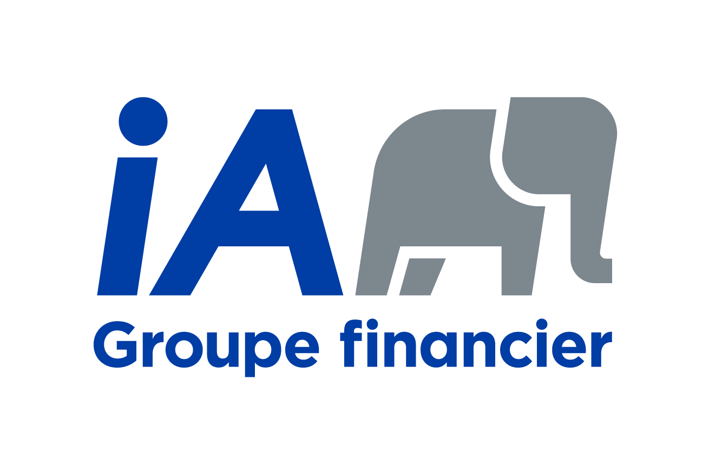
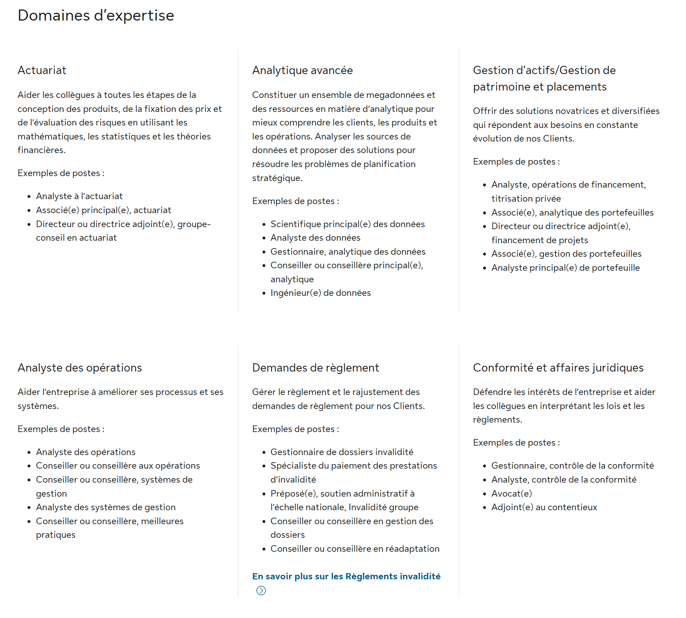
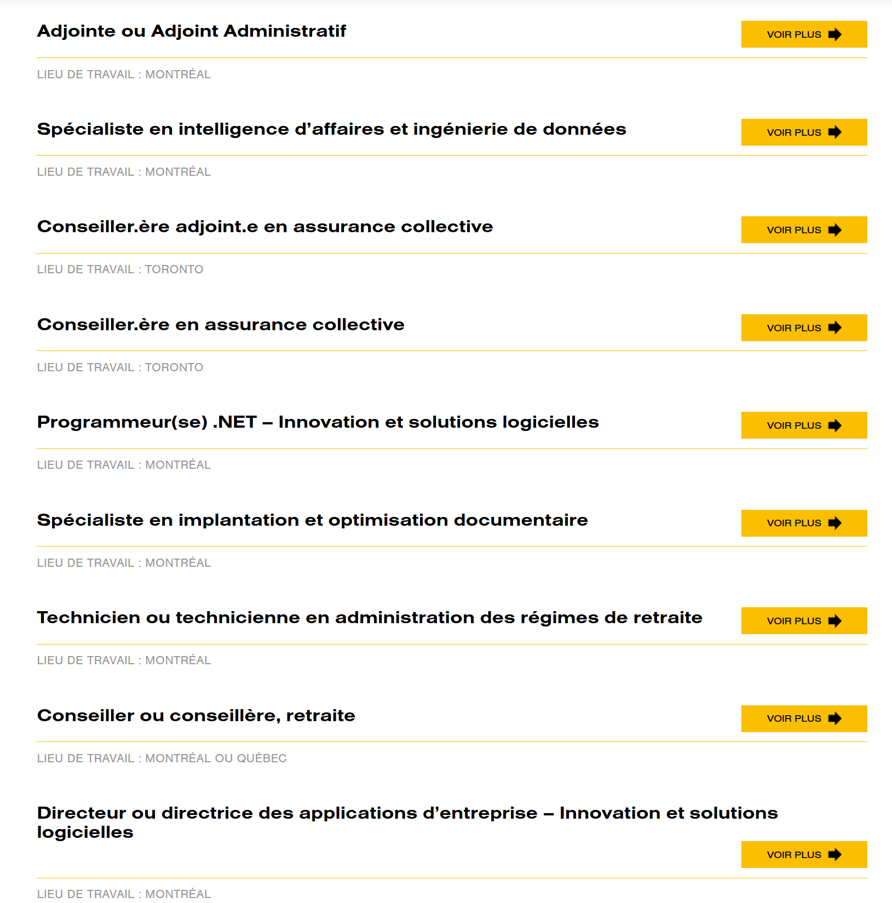
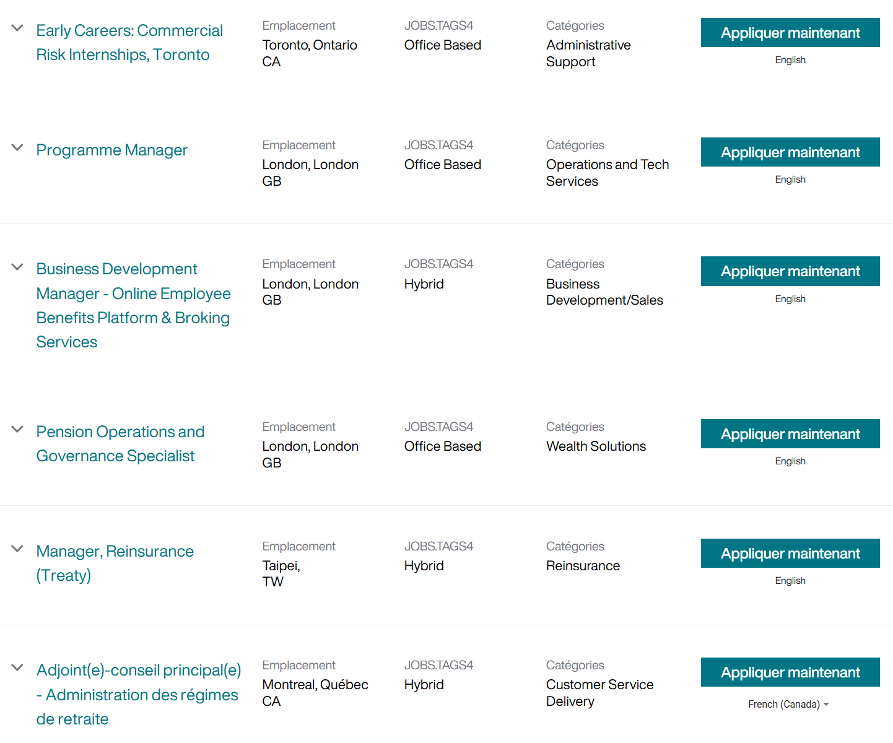

# Les milieux de pratique de l’actuaire

::: {.act-objectifs}

<div class="act-objectifs-titre">Objectifs du chapitre</div>


- Identifier les principaux milieux de pratique où l’on retrouve des actuaires (assureurs, réassureurs, consultation, institutions financières, entreprises, secteur public) et comprendre ce qui les distingue.
- Situer l’actuariat dans l’organisation d’une société d’assurance, en reliant la gouvernance (conseil, haute direction, comités) aux fonctions opérationnelles (souscription, sinistres, administration, distribution, finance, technologies de l’information, etc.).
- Décrire les grandes fonctions actuarielles qui reviennent dans la plupart des milieux (tarification, provisionnement, capital, réassurance, analyse d’expérience, modélisation, gestion des risques) et comprendre leurs interactions avec les autres départements.
- Comprendre pourquoi les intitulés de postes et les organigrammes varient d’une organisation à l’autre, et apprendre à interpréter une structure à partir des responsabilités plutôt qu’à partir des titres.
- Mettre en évidence les compétences transversales associées aux milieux de pratique (communication, documentation, jugement professionnel, travail en équipe, contraintes réglementaires et opérationnelles), en complément des compétences techniques.

:::

::: {.callout-note collapse="true"}

## Plan du chapitre

<div id="plan-chapitre-auto"></div>

:::


## Introduction

Après avoir présenté l’écosystème de l’assurance au Québec et les principaux types d’assureurs, il est utile de descendre à l’échelle des organisations où se pratique l’actuariat. Ce chapitre adopte une perspective volontairement générale : il ne vise pas un produit, une ligne d’affaires ou un type d’employeur en particulier.  L’objectif n’est pas de dresser des organigrammes exhaustifs, mais de comprendre comment l’actuariat s’insère dans des organisations qui gèrent des engagements incertains, prennent des décisions sous diverses contraintes (réglementation, capital, concurrence, données, technologie) et doivent maintenir une cohérence entre promesses faites, risques assumés et ressources disponibles.

Les exemples et fonctions décrits ci-dessous se retrouvent, avec des variantes, dans plusieurs milieux : assureurs de personnes, assureurs de dommages, réassureurs, cabinets de consultation, institutions financières, et certaines grandes entreprises privées qui embauchent des actuaires pour des enjeux de retraite, d’avantages sociaux, de risque, ou d’analytique.  Le premier chapitre présentait notamment plusieurs employeurs de la région de Montréal.

### Panorama des milieux où l’on retrouve des actuaires

Les actuaires exercent dans une diversité de milieux, publics ou privés, où il s’agit de mesurer, gérer et financer des risques. [↗](https://www.cia-ica.ca/fr/les-actuaires/ "Institut canadien des actuaires — domaines de pratique"){.source-link} Sans être exhaustifs, les principaux milieux de pratique peuvent être regroupés comme suit :

- **Assureurs (assurances de personnes et de dommages)**  
  Les assureurs conçoivent et administrent des contrats d’assurance, encaissent des primes, paient des prestations ou des sinistres et doivent demeurer solvables malgré l’incertitude. Les actuaires y contribuent à plusieurs fonctions : tarification, provisionnement, capital, analyse d’expérience, réassurance, modélisation et parfois soutien stratégique. [↗](https://www.cia-ica.ca/fr/les-actuaires/domaines-de-pratique/assurance-individuelle/ "ICA — assurance individuelle"){.source-link}

- **Réassureurs**  
  Les réassureurs assurent les assureurs en prenant en charge une partie des risques qu’ils assument. [↗](https://www.osfi-bsif.gc.ca/fr/donnees-formulaires/rapports-releves/produire-releve-financier/guides-production-releves-financiers/releves-dassurance-multirisque-section-iii-definitions "BSIF — définition de la réassurance"){.source-link} Ils structurent des traités et évaluent l’exposition globale de portefeuilles souvent internationaux. L’actuariat y est fortement orienté vers la modélisation, l’agrégation des risques et la gestion de portefeuille.

- **Consultation (actuariat-conseil)**  
  Les cabinets de consultation accompagnent des organisations variées : assureurs, employeurs, régimes de retraite, institutions financières ou organismes publics. Les livrables prennent souvent la forme de rapports, d’opinions, de diagnostics, de modèles ou de recommandations, avec une exigence élevée de rigueur méthodologique, de communication claire et de gestion de mandat.

- **Institutions financières et secteurs connexes**  
  On retrouve des actuaires dans des fonctions liées à la gestion des risques, à la modélisation financière, à la gestion actif-passif (ALM), à certains volets de l’évaluation financière ou des normes comptables, ainsi qu’en analytique et en science des données.

- **Entreprises privées non financières**  
  Dans de grandes entreprises, les actuaires interviennent principalement en matière d’avantages sociaux (assurance collective, invalidité, santé), de régimes de retraite, de gestion des risques et, dans certains cas, d’analytique appliquée (prévision, estimation de coûts, analyses de scénarios).

- **Gouvernements et secteur public**  
  Les actuaires œuvrent également au sein d’organismes publics et parapublics, notamment dans les ministères, les agences de réglementation, les régimes publics de retraite et les programmes sociaux. Ils y contribuent à l’évaluation de la viabilité financière de programmes à long terme, à l’analyse des risques collectifs et à l’éclairage des décisions de politiques publiques. [↗](https://www.cia-ica.ca/fr/etre-membre/normes-de-pratique/ "ICA — normes de pratique des programmes publics"){.source-link}

## Gouvernance 

La gouvernance correspond à l’ensemble des mécanismes par lesquels une organisation est dirigée, surveillée et contrôlée. [↗](https://lautorite.qc.ca/professionnels/institutions-de-depots-et-societes-de-fiducie/lignes-directrices/assises-de-lencadrement-prudentiel/ligne-directrice-sur-la-gouvernance "AMF — ligne directrice sur la gouvernance"){.source-link} Elle concerne les décisions prises au plus haut niveau et vise à s’assurer que l’organisation poursuit ses objectifs tout en respectant ses obligations légales, financières et éthiques. Dans les organisations où se pratique l’actuariat — qu’il s’agisse d’assureurs, de cabinets de consultation, d’institutions financières ou de grandes entreprises — la gouvernance est particulièrement importante. Ces organisations prennent souvent des engagements financiers importants, parfois sur de très longues périodes, dans un contexte d’incertitude. Les conséquences de mauvaises décisions peuvent donc se manifester plusieurs années, voire plusieurs décennies plus tard.

La gouvernance définit les responsabilités, les pouvoirs de décision et les mécanismes de surveillance qui encadrent les activités de l’organisation. Le conseil d’administration intervient principalement dans la définition et la surveillance des grandes orientations, tandis que la haute direction assure la gestion quotidienne dans le respect du cadre établi. Cette distinction est notamment exposée dans la [ligne directrice sur la gouvernance d’entreprise du BSIF](https://www.osfi-bsif.gc.ca/fr/consignes/repertoire-consignes/gouvernance-dentreprise-ligne-directrice-2018), destinée aux institutions financières de compétence fédérale. De façon générale, la gouvernance s’appuie sur plusieurs instances et niveaux de responsabilité.

### Le conseil d’administration

Le conseil d’administration constitue la principale instance de gouvernance et de surveillance de l’organisation. Il comprend généralement des administrateurs qui ne participent pas à la gestion quotidienne. Une attention particulière est portée à leur indépendance afin qu’ils puissent exercer une surveillance objective de la haute direction et limiter les conflits d’intérêts. L’absence de lien d’emploi ne suffit pas, à elle seule, à garantir cette indépendance. [↗](https://www.osfi-bsif.gc.ca/fr/consignes/repertoire-consignes/gouvernance-dentreprise-ligne-directrice-2018 "BSIF — indépendance du conseil d’administration"){.source-link} Selon la structure de l’organisation, certains dirigeants, comme le chef de la direction, peuvent également être administrateurs. Le secrétaire corporatif contribue au fonctionnement du conseil, notamment en préparant et en assurant le suivi des réunions, sans nécessairement en être membre ou disposer d’un droit de vote. Le conseil ne gère toutefois pas les opérations quotidiennes. Son rôle est plutôt de :

- approuver les grandes orientations stratégiques ;
- nommer et superviser la haute direction ;
- s’assurer de la solidité financière et de la pérennité de l’organisation ;
- veiller au respect des lois, règlements et bonnes pratiques de gouvernance ;
- tenir compte des intérêts des différentes parties prenantes (clients, assurés, actionnaires, employés, etc.), dans le respect des obligations propres au conseil.

### La haute direction et les grands responsables

La haute direction est responsable de la gestion quotidienne de l’organisation et de la mise en œuvre des orientations approuvées par le conseil d’administration. Elle coordonne les grandes fonctions internes et arbitre entre des objectifs parfois contradictoires, comme la croissance, la rentabilité, la prudence financière et la conformité réglementaire. Au sommet de cette structure de gestion, on retrouve généralement plusieurs postes de très haute responsabilité. [↗](https://www.osfi-bsif.gc.ca/fr/consignes/repertoire-consignes/gouvernance-dentreprise-ligne-directrice-2018 "BSIF — conseil, haute direction et fonctions de supervision"){.source-link} Les intitulés peuvent varier d’une organisation à l’autre, mais les fonctions associées sont relativement standardisées.

On retrouve habituellement les postes suivants :

- **Chef de la direction (Chief Executive Officer – CEO)**  
  Il est responsable de la gestion globale de l’organisation. Il assure la cohérence entre la stratégie approuvée par le conseil d’administration et les activités concrètes de l’entreprise. Il coordonne l’ensemble de la haute direction et représente l’organisation auprès des parties externes.

- **Chef des opérations (Chief Operating Officer – COO)**  
  Il est responsable du bon fonctionnement des opérations quotidiennes. Cela inclut, selon l’organisation, l’administration des contrats, la gestion des sinistres ou des prestations, le service à la clientèle et l’efficacité des processus internes.

- **Chef des finances (Chief Financial Officer – CFO)**  
  Il est responsable de la gestion financière de l’organisation. Cela comprend la production de l’information financière, la planification budgétaire, la gestion de la trésorerie, les relations avec les auditeurs et, dans certains cas, la supervision des investissements.

- **Chef de la gestion des risques (Chief Risk Officer – CRO)**  
  Il est responsable de l’identification, de la mesure et du suivi des principaux risques auxquels l’organisation est exposée. Ces risques peuvent être financiers, actuariels, opérationnels, juridiques ou réputationnels. Son rôle est de s’assurer que les risques pris sont cohérents avec l’appétit pour le risque défini par la gouvernance.

Selon l’organisation, on retrouve également :

- **Chef des technologies de l’information (Chief Information Officer – CIO)**  
  Il est responsable des systèmes informatiques, des données et des infrastructures technologiques. Dans un contexte où les décisions reposent fortement sur les données et les modèles, ce rôle est devenu central.

Ces fonctions peuvent être exercées par des personnes distinctes, combinées ou réparties entre plusieurs équipes. En finance, l’acronyme CIO désigne parfois le *Chief Investment Officer* (chef des placements), plutôt que le *Chief Information Officer* : le contexte est donc important pour interpréter les titres.


### Exemples

Afin de mieux comprendre comment les responsabilités de la haute direction sont réparties au sein d’une compagnie d’assurance, examinons la structure organisationnelle de deux importants assureurs québécois : Beneva et Industrielle Alliance. Ces deux organisations exercent des activités similaires, mais possèdent des structures de propriété, de gouvernance et de gestion qui leur sont propres.

::::: {.fiche-organisation}

<div class="fiche-organisation-entete">
<div>
<div class="fiche-organisation-nom">Beneva</div>
<div class="fiche-organisation-type">Société d’assurance et de services financiers</div>
</div>
<div class="fiche-organisation-logo">

</div>
</div>

<div class="fiche-organisation-caracteristiques">

<div>
<div class="fiche-organisation-libelle">Siège social</div>
<div class="fiche-organisation-valeur">Québec</div>
</div>

<div>
<div class="fiche-organisation-libelle">Création</div>
<div class="fiche-organisation-valeur">2020 — Regroupement</div>
</div>

<div>
<div class="fiche-organisation-libelle">Structure de propriété</div>
<div class="fiche-organisation-valeur">Mutualiste</div>
</div>

<div>
<div class="fiche-organisation-libelle">Principaux marchés</div>
<div class="fiche-organisation-valeur">Canada</div>
</div>

<div>
<div class="fiche-organisation-libelle">Secteurs d’activité</div>
<div class="fiche-organisation-valeur">Assurance, épargne et placements</div>
</div>

<div>
<div class="fiche-organisation-libelle">Site Web</div>
<div class="fiche-organisation-valeur"><a href="https://www.beneva.ca">www.beneva.ca</a></div>
</div>

</div>

:::: {.fiche-organisation-description}

Beneva est née du regroupement de deux assureurs mutualistes québécois bien établis : La Capitale, fondée en 1941, et SSQ Assurance, fondée en 1944. Le regroupement a été annoncé en janvier 2020 et la marque Beneva a été dévoilée en décembre de la même année. [↗](https://www.beneva.ca/fr/regroupement "Beneva — Historique du regroupement"){.source-link} Beneva exerce ses activités dans plusieurs secteurs, notamment l’assurance individuelle, l’assurance collective, l’assurance de dommages, l’épargne et les placements. Sa structure mutualiste la distingue des sociétés d’assurance par actions, puisque son modèle de gouvernance repose sur ses membres plutôt que sur des actionnaires externes. [↗](https://www.beneva.ca/fr/a-propos "Beneva — Présentation de l’organisation"){.source-link}

::::


<div class="fiche-organisation-libelle" style="border-top:1px solid #D1DCDD; padding-top:18px; margin-top:24px; margin-bottom:12px;">
Équipe de direction
</div>

La présentation de l’équipe de direction ci-dessous, tirée des [documents financiers de Beneva pour 2024](https://www.beneva.ca/fr/informations-financieres), permet d’observer concrètement la répartition des responsabilités au sein de l’organisation. Les titres utilisés ne correspondent pas nécessairement aux acronymes anglophones présentés précédemment (CEO, COO, CFO, CRO, etc.).

::: {.encadre}

{width=90% fig-align="center"}

:::

Le tableau suivant établit une correspondance entre les principales fonctions de direction et de contrôle et les postes présentés dans les documents financiers de Beneva.

::: {.encadre}

```{r}
#| echo: false
#| message: false
#| warning: false

library(knitr)
library(kableExtra)

tab_beneva <- data.frame(
  `Fonction` = c(
    "Chef de la direction (CEO)",
    "Chef des opérations (COO)",
    "Chef des finances (CFO)",
    "Chef de la gestion des risques (CRO)",
    "Chef des technologies de l’information (CIO)",
    "Fonction juridique",
    "Audit interne"
  ),
  `Titre utilisé chez Beneva` = c(
    "Président et chef de la direction",
    "Aucun poste unique identifié; responsabilités opérationnelles réparties",
    "Vice-présidente exécutive et leader – Affaires financières",
    "Vice-président – Gestion des risques",
    "Vice-présidente exécutive et leader – Performance d’affaires et technologies de l’information",
    "Vice-président exécutif et leader – Services juridiques et corporatifs",
    "Vice-présidente – Audit interne"
  ),
  `Dirigeant` = c(
    "Jean-François Chalifoux",
    "—",
    "Mélissa Gilbert",
    "Michel Fournier",
    "Catherine Desgagnés-Bezil",
    "Pierre-Marc Bellavance",
    "Josée Grondines"
  ),
  check.names = FALSE
)

kbl(
  tab_beneva,
  format = "html",
  align = c("l", "l", "l")
) |>
  kable_styling(
    bootstrap_options = c("striped", "hover"),
    full_width = TRUE,
    position = "center"
  ) |>
  column_spec(1, bold = TRUE)
```

:::

:::::


::::: {.fiche-organisation}

<div class="fiche-organisation-entete">
<div>
<div class="fiche-organisation-nom">iA Groupe financier</div>
<div class="fiche-organisation-type">Groupe d’assurance et de gestion de patrimoine</div>
</div>
<div class="fiche-organisation-logo">

</div>
</div>

<div class="fiche-organisation-caracteristiques">

<div>
<div class="fiche-organisation-libelle">Siège social</div>
<div class="fiche-organisation-valeur">Québec</div>
</div>

<div>
<div class="fiche-organisation-libelle">Création</div>
<div class="fiche-organisation-valeur">1892</div>
</div>

<div>
<div class="fiche-organisation-libelle">Structure de propriété</div>
<div class="fiche-organisation-valeur">Société par actions</div>
</div>

<div>
<div class="fiche-organisation-libelle">Principaux marchés</div>
<div class="fiche-organisation-valeur">Canada et États-Unis</div>
</div>

<div>
<div class="fiche-organisation-libelle">Secteurs d’activité</div>
<div class="fiche-organisation-valeur">Assurance, épargne et gestion de patrimoine</div>
</div>

<div>
<div class="fiche-organisation-libelle">Site Web</div>
<div class="fiche-organisation-valeur"><a href="https://www.ia.ca">www.ia.ca</a></div>
</div>

</div>

:::: {.fiche-organisation-description}

iA Groupe financier, aussi connu sous le nom d’Industrielle Alliance, est un important groupe canadien d’assurance et de gestion de patrimoine dont les origines remontent à 1892. Le groupe exerce ses activités dans plusieurs secteurs, notamment l’assurance individuelle, l’assurance collective, l’assurance de dommages, l’épargne, les placements et la gestion de patrimoine. Contrairement à Beneva, iA Groupe financier possède une structure de société par actions. Sa société de portefeuille, iA Société financière inc., est inscrite à la Bourse de Toronto sous le symbole IAG. Son modèle de gouvernance doit ainsi tenir compte des intérêts de ses actionnaires et des obligations de divulgation propres aux sociétés cotées en bourse. [↗](https://ia.ca/a-propos "iA — Présentation du groupe et histoire"){.source-link}

::::


<div class="fiche-organisation-libelle" style="border-top:1px solid #D1DCDD; padding-top:18px; margin-top:24px; margin-bottom:12px;">
Équipe de direction
</div>

La présentation du comité exécutif ci-dessous, tirée du [rapport annuel 2024 d’iA Groupe financier](https://ia.ca/-/media/files/ia/investisseurs/rapportsfinanciers/annuel/2025/fr/fo-rapportannuel2024.pdf), permet d’observer concrètement la répartition des responsabilités au sein de l’organisation. Comme chez Beneva, certaines fonctions sont regroupées au sein d’un même poste, tandis que d’autres sont réparties entre plusieurs membres de la haute direction.

::: {.encadre}

{width=70% fig-align="center"}

:::

Le tableau suivant établit une correspondance entre les principales fonctions de direction et les postes présentés dans le rapport annuel d’iA Groupe financier.

::: {.encadre}

```{r}
#| echo: false
#| message: false
#| warning: false

library(knitr)
library(kableExtra)

tab_ia <- data.frame(
  `Fonction` = c(
    "Chef de la direction (CEO)",
    "Chef des opérations (COO)",
    "Chef des finances (CFO)",
    "Chef de la gestion des risques (CRO)",
    "Chef des placements (CIO)",
    "Stratégie et développement corporatif",
    "Ressources humaines et culture"
  ),
  `Titre utilisé chez iA` = c(
    "Président et chef de la direction",
    "Aucun poste unique identifié; responsabilités opérationnelles réparties",
    "Vice-président exécutif, chef des finances et actuaire en chef",
    "Vice-président exécutif et chef de la gestion des risques",
    "Vice-président exécutif et chef des placements",
    "Vice-président exécutif – Stratégie, performance, fusions et acquisitions",
    "Vice-présidente exécutive et chef – Talents et culture"
  ),
  `Dirigeant` = c(
    "Denis Ricard",
    "—",
    "Éric Jobin",
    "Philippe Sarfati",
    "Alain Bergeron",
    "Denis Berthiaume",
    "Stéphanie Butt Thibodeau"
  ),
  check.names = FALSE
)

kbl(
  tab_ia,
  format = "html",
  align = c("l", "l", "l")
) |>
  kable_styling(
    bootstrap_options = c("striped", "hover"),
    full_width = TRUE,
    position = "center"
  ) |>
  column_spec(1, bold = TRUE)
```

:::

:::::


#### Analyse des structures organisationnelles {-}

Les exemples de Beneva et d’Industrielle Alliance illustrent qu’il n’existe pas de structure organisationnelle unique pour les compagnies d’assurance. Bien que ces organisations exercent des activités similaires et doivent remplir plusieurs fonctions communes, elles peuvent organiser leur haute direction de différentes manières. Plusieurs observations peuvent être tirées de ces deux exemples :

- **La répartition des responsabilités opérationnelles.** Dans les deux organisations, aucun poste unique de chef des opérations (COO) n’est présenté. Les responsabilités opérationnelles semblent plutôt réparties entre plusieurs membres de la haute direction, notamment en fonction des différents secteurs d’activité.
- **La distinction entre la gestion financière et la gestion des risques.** Les deux organisations confient ces responsabilités à des personnes différentes. Cette séparation permet notamment de distinguer les objectifs de performance financière des préoccupations relatives à la maîtrise des risques.
- **Le regroupement de certaines fonctions.** Chez Beneva, les technologies de l’information sont regroupées avec la performance d’affaires, tandis que chez Industrielle Alliance, les fonctions de chef des finances et d’actuaire en chef sont exercées par une même personne.
- **La diversité des titres.** Dans les organisations québécoises et canadiennes-françaises, les titres sont généralement francisés et ne correspondent pas toujours directement aux acronymes anglophones usuels. Il importe donc de comprendre les responsabilités exercées plutôt que de s’appuyer uniquement sur les intitulés des postes.
- **L’indépendance des fonctions de contrôle.** La structure de Beneva illustre particulièrement bien ce principe. On remarque que le vice-président responsable de la gestion des risques possède un lien fonctionnel avec le comité de gestion des risques, éthique et TI, tandis que la vice-présidente responsable de l’audit interne possède un lien fonctionnel avec le comité d’audit. Ces mécanismes contribuent à préserver l’indépendance des fonctions de contrôle à l’égard des activités opérationnelles. [↗](https://lautorite.qc.ca/professionnels/institutions-de-depots-et-societes-de-fiducie/lignes-directrices/assises-de-lencadrement-prudentiel/ligne-directrice-sur-la-gouvernance "AMF — Ligne directrice sur la gouvernance"){.source-link}

Il convient également de distinguer la structure de propriété d’une organisation de sa structure de gestion. Bien que Beneva soit un assureur mutualiste et qu’Industrielle Alliance soit un groupe coté en bourse, les deux organisations doivent assurer leur solidité financière, gérer leurs risques et respecter les exigences réglementaires applicables. La différence entre leurs modèles de propriété n’élimine donc pas la nécessité de remplir plusieurs fonctions de gestion et de contrôle communes. Les deux structures présentées correspondent à l’année 2024. Elles permettent toutefois d’illustrer des principes d’organisation et de gouvernance qui demeurent pertinents même lorsque les structures ou les titulaires des postes évoluent.


### Les comités spécialisés

Le conseil d’administration et la haute direction peuvent s’appuyer sur différents comités spécialisés. Certains sont des **comités du conseil**, principalement responsables de la surveillance; d’autres sont des **comités de direction**, davantage associés à la gestion courante et à la préparation des décisions. Leur rattachement exact varie selon l’organisation. [↗](https://www.osfi-bsif.gc.ca/fr/consignes/repertoire-consignes/gouvernance-dentreprise-ligne-directrice-2018 "BSIF — gouvernance, comité d’audit et comité des risques"){.source-link}

- **Le comité d’audit**  
  Généralement rattaché au conseil d’administration, il surveille la qualité de l’information financière, les mécanismes de contrôle interne et les travaux des auditeurs internes et externes.

- **Le comité de gestion des risques**  
  Selon sa structure et son rattachement, il contribue soit à la surveillance des principaux risques pour le compte du conseil, soit à leur gestion et à leur suivi au niveau de la direction.

- **Le comité d’investissement (lorsque pertinent)**  
  Il examine les orientations et les décisions en matière de placement. Un comité du conseil peut en surveiller les grandes politiques, tandis qu’un comité de direction peut participer à leur mise en œuvre.

### Politiques et cadres de gestion

La gouvernance s’appuie également sur des politiques et des cadres formels qui structurent la prise de décision et encadrent les activités de l’organisation. On y retrouve notamment :

- la définition de l’appétit pour le risque ;
- les limites à ne pas dépasser ;
- les pouvoirs de décision et les délégations d’autorité ;
- les mécanismes de contrôle et de reddition de comptes.

Ces politiques servent de référence commune à l’ensemble de l’organisation et assurent une cohérence entre les orientations stratégiques et les décisions opérationnelles. [↗](https://lautorite.qc.ca/professionnels/institutions-de-depots-et-societes-de-fiducie/lignes-directrices/assises-de-lencadrement-prudentiel/ligne-directrice-sur-la-gouvernance "AMF — cadre de gouvernance et gestion des risques"){.source-link}

### Rôle de l’actuariat dans la gouvernance

L’actuariat joue un rôle important dans le soutien à la gouvernance et à la haute direction. Les actuaires fournissent des analyses quantitatives qui permettent d’éclairer les décisions prises aux différents niveaux de l’organisation. [↗](https://www.cia-ica.ca/fr/les-actuaires/ "ICA — contribution des actuaires aux organisations"){.source-link}

Leurs travaux peuvent inclure :

  - des projections à long terme ;
  - des analyses de scénarios et de tests de sensibilité ;
  - des indicateurs de solvabilité ou de capital ;
  - des diagnostics basés sur l’expérience observée ;
  - la documentation des hypothèses et des méthodes utilisées.

Même si les actuaires ne prennent généralement pas les décisions finales, leurs analyses constituent une base essentielle pour évaluer les conséquences futures des choix stratégiques et pour soutenir une prise de décision éclairée.

## Les principaux départements d’une société d’assurance

Après avoir présenté les mécanismes de gouvernance et de pilotage au niveau organisationnel, cette section décrit les principaux départements qui assurent le fonctionnement quotidien d’une société d’assurance. Certains de ces départements sont communs à la majorité des grandes organisations, tandis que d’autres sont directement liés aux activités propres au secteur de l’assurance. 

Il convient toutefois de noter que certaines fonctions, comme la gestion des risques d’entreprise et la conformité réglementaire, ne correspondent pas toujours à des départements opérationnels distincts. Elles jouent plutôt un rôle transversal, en soutenant la gouvernance et en encadrant l’ensemble des départements dans leurs activités quotidiennes. La structure exacte des départements varie considérablement d’une organisation à l’autre. Selon la taille de la société, son modèle d’affaires et son niveau de spécialisation, certains départements peuvent être fusionnés, scindés, externalisés ou même absents. La présentation qui suit vise donc à décrire les grandes fonctions que l’on retrouve le plus fréquemment dans les sociétés d’assurance, plutôt qu’un organigramme universel ou rigide.

- **Départements communs à la plupart des organisations** 
  - **Département de la comptabilité**  
    Le département de la comptabilité est responsable de l’enregistrement des opérations financières, de la production des états financiers, des obligations fiscales et des relations avec les auditeurs internes et externes.
  
  - **Département de la finance et des investissements**  
    Ce département gère les ressources financières de l’organisation, notamment la liquidité, la structure financière et les placements, afin d’assurer la stabilité financière et le financement des activités à court et à long terme.
  
  - **Département des ressources humaines**  
    Le département des ressources humaines encadre la gestion du personnel, incluant la rémunération, le recrutement, la formation, les relations de travail et le développement des compétences.
  
  - **Département des technologies de l’information**  
    Ce département fournit, maintient et sécurise les systèmes informatiques nécessaires aux opérations, à la gestion des données et à l’automatisation des processus de l’organisation.

- **Départements spécifiques au secteur de l’assurance**

  - **Département de la souscription et de la sélection des risques**  
    La souscription a pour rôle d’évaluer les risques proposés, de décider de leur acceptation et de déterminer les conditions contractuelles afin d’assurer la cohérence entre le risque assumé et la prime demandée.
  
  - **Département de l’administration des polices**  
    Ce département assure la gestion administrative des contrats d’assurance tout au long de leur durée de vie, incluant la facturation, les modifications contractuelles et le service administratif aux assurés.
  
  - **Département de l’indemnisation et de la gestion des sinistres (ou des prestations)**  
    Le département de l’indemnisation intervient lorsqu’un événement assuré survient et est responsable de l’analyse des réclamations, de l’interprétation des contrats et du versement des indemnités ou prestations.
  
  - **Département des ventes et de la distribution**  
    Ce département est chargé de la mise en marché des produits d’assurance et de la gestion des réseaux de distribution, incluant les représentants, courtiers et autres partenaires commerciaux.
  
  - **Département d’actuariat**  
    L’actuariat opérationnel soutient les activités d’assurance par la tarification, l’évaluation des provisions, l’analyse de l’expérience et l’évaluation des besoins en capital, en traduisant l’incertitude en mesures quantitatives. [↗](https://www.cia-ica.ca/fr/les-actuaires/domaines-de-pratique/assurances-iard/ "ICA — fonctions actuarielles en assurances IARD"){.source-link}
  
  - **Département des affaires juridiques**  
    Le département des affaires juridiques assure l’interprétation et l’application du cadre légal, l’approbation des contrats, la gestion des litiges et le soutien juridique aux activités d’assurance, qui reposent largement sur des engagements contractuels.

### Les interactions entre l’actuariat et les autres départements

Les actuaires travaillent rarement de façon isolée. Leurs analyses dépendent des données et de l’expertise d’autres équipes et, en retour, orientent des décisions opérationnelles, financières ou commerciales. Les collaborations varient selon les domaines :

| Fonction actuarielle | Collaborations fréquentes |
|:---|:---|
| **Tarification** | Souscription, distribution et développement des produits |
| **Provisionnement** | Finance, comptabilité et indemnisation |
| **Gestion du capital** | Finance, gestion des risques et placements |
| **Réassurance** | Souscription, gestion des risques et finance |
| **Analyse d’expérience** | Indemnisation, administration, analytique et données |
| **Modélisation** | Technologies de l’information, finance et gestion des risques |

Par exemple, une analyse de tarification peut nécessiter des données sur les sinistres, des informations sur les contrats et une discussion avec les équipes de souscription ou de distribution. La qualité d’un travail actuariel dépend donc autant de la compréhension du fonctionnement de l’assureur et de la qualité des données que des méthodes quantitatives utilisées. [↗](https://www.cia-ica.ca/fr/les-actuaires/domaines-de-pratique/assurance-individuelle/ "ICA — collaboration interdisciplinaire en assurance"){.source-link}

### Exemples

Les sites de recrutement des compagnies d’assurance constituent une autre façon de découvrir les principales fonctions exercées au sein de ces organisations. Les exemples de Manuvie et de Sun Life permettent d’illustrer la diversité des postes, des compétences et des domaines d’expertise que l’on retrouve chez les grands assureurs.


::::: {.fiche-organisation}

<div class="fiche-organisation-entete">
<div>
<div class="fiche-organisation-nom">Manuvie</div>
<div class="fiche-organisation-type">Groupe international d’assurance et de services financiers</div>
</div>
<div class="fiche-organisation-logo">

</div>
</div>

<div class="fiche-organisation-caracteristiques">

<div>
<div class="fiche-organisation-libelle">Siège social</div>
<div class="fiche-organisation-valeur">Toronto</div>
</div>

<div>
<div class="fiche-organisation-libelle">Création</div>
<div class="fiche-organisation-valeur">1887</div>
</div>

<div>
<div class="fiche-organisation-libelle">Structure de propriété</div>
<div class="fiche-organisation-valeur">Société par actions (TSX : MFC)</div>
</div>

<div>
<div class="fiche-organisation-libelle">Principaux marchés</div>
<div class="fiche-organisation-valeur">Canada, États-Unis et Asie</div>
</div>

<div>
<div class="fiche-organisation-libelle">Secteurs d’activité</div>
<div class="fiche-organisation-valeur">Assurance, épargne et gestion de patrimoine</div>
</div>

<div>
<div class="fiche-organisation-libelle">Site Web</div>
<div class="fiche-organisation-valeur"><a href="https://www.manuvie.ca">www.manuvie.ca</a></div>
</div>

</div>

:::: {.fiche-organisation-description}

Manuvie (*Manulife Financial Corporation* en anglais) est une société canadienne de services financiers fondée en 1887 sous le nom de *The Manufacturers Life Insurance Company*. Son siège social mondial est situé à Toronto, tandis que le siège de ses activités canadiennes se trouve à Waterloo, en Ontario. L’entreprise possède également une présence importante à Montréal. Manuvie exerce ses activités à l’échelle internationale, notamment aux États-Unis par l’intermédiaire de sa marque John Hancock, ainsi que dans plusieurs pays d’Asie. Le groupe offre une vaste gamme de produits d’assurance, de solutions d’épargne et de services de gestion de patrimoine et d’actifs. [↗](https://www.manulife.com/ca/fr/about-us/who-we-are/our-story "Manuvie — Histoire et présentation du groupe"){.source-link} [↗](https://www.manulife.com/ca/en/business/contact-us "Manuvie — Coordonnées des bureaux"){.source-link}

::::


<div class="fiche-organisation-libelle" style="border-top:1px solid #D1DCDD; padding-top:18px; margin-top:24px; margin-bottom:12px;">
Domaines d’activité et perspectives d’emploi
</div>

La capture d’écran ci-dessous, tirée du [site de recrutement de Manuvie](https://careers.manulife.com/ca/fr/home) en janvier 2026, présente quelques exemples de postes offerts au sein de l’organisation. On y retrouve aussi bien des postes directement liés à l’actuariat que des postes en vente, en crédit, en gestion de projets et en stratégie organisationnelle.

::: {.encadre}

{width=100% fig-align="center"}

:::

:::::


::::: {.fiche-organisation}

<div class="fiche-organisation-entete">
<div>
<div class="fiche-organisation-nom">Sun Life</div>
<div class="fiche-organisation-type">Groupe international d’assurance et de gestion de patrimoine</div>
</div>
<div class="fiche-organisation-logo">

</div>
</div>

<div class="fiche-organisation-caracteristiques">

<div>
<div class="fiche-organisation-libelle">Siège social</div>
<div class="fiche-organisation-valeur">Toronto</div>
</div>

<div>
<div class="fiche-organisation-libelle">Création</div>
<div class="fiche-organisation-valeur">1865 — Montréal</div>
</div>

<div>
<div class="fiche-organisation-libelle">Structure de propriété</div>
<div class="fiche-organisation-valeur">Société par actions (TSX : SLF)</div>
</div>

<div>
<div class="fiche-organisation-libelle">Principaux marchés</div>
<div class="fiche-organisation-valeur">Canada, États-Unis, Europe et Asie</div>
</div>

<div>
<div class="fiche-organisation-libelle">Secteurs d’activité</div>
<div class="fiche-organisation-valeur">Assurance, épargne et gestion d’actifs</div>
</div>

<div>
<div class="fiche-organisation-libelle">Site Web</div>
<div class="fiche-organisation-valeur"><a href="https://www.sunlife.ca">www.sunlife.ca</a></div>
</div>

</div>

:::: {.fiche-organisation-description}

Sun Life (*Sun Life Financial Inc.*) est une société canadienne de services financiers fondée à Montréal en 1865 sous le nom de *The Sun Insurance Company of Montreal*, notamment par Mathew Hamilton Gault. Elle commence ses activités en 1871 et devient progressivement l’un des plus importants groupes canadiens d’assurance et de services financiers. Aujourd’hui, son siège social est situé à Toronto et le groupe exerce ses activités dans plusieurs régions du monde. Sun Life offre notamment des produits d’assurance individuelle et collective, des solutions d’épargne-retraite ainsi que des services de gestion de patrimoine, de placements et de gestion d’actifs. [↗](https://www.patrimoine-culturel.gouv.qc.ca/detail.do?id=13307&methode=consulter&type=pge "Répertoire du patrimoine culturel du Québec — Histoire de Sun Life"){.source-link} [↗](https://www.sunlife.com "Sun Life — Site institutionnel"){.source-link}

::::


<div class="fiche-organisation-libelle" style="border-top:1px solid #D1DCDD; padding-top:18px; margin-top:24px; margin-bottom:12px;">
Domaines d’activité et perspectives d’emploi
</div>

La capture d’écran ci-dessous, tirée du [site de recrutement de Sun Life](https://www.sunlife.ca/fr/careers/become-an-employee/) en janvier 2026, présente plusieurs domaines d’expertise au sein de l’organisation ainsi que des exemples de postes associés à chacun d’eux.

::: {.encadre}

{width=90% fig-align="center"}

:::

:::::


#### Analyse des domaines d’activité {-}

Les exemples de Manuvie et de Sun Life illustrent la diversité des compétences nécessaires au fonctionnement d’une grande société d’assurance. Plusieurs observations peuvent être tirées de ces deux illustrations :

- **L’actuariat.** Les postes en actuariat touchent notamment la conception des produits d’assurance, leur tarification, l’évaluation des risques et la modélisation financière.

- **La science des données et l’analytique avancée.** Les assureurs emploient également des spécialistes des données afin de mieux comprendre les comportements des clients, d’améliorer leurs modèles et d’optimiser leurs processus opérationnels.

- **La finance et les investissements.** Les activités de gestion de portefeuille, de financement et de placement rappellent que les compagnies d’assurance sont également d’importants gestionnaires de capitaux.

- **Les ventes et la distribution.** La commercialisation des produits d’assurance et les relations avec la clientèle nécessitent des compétences distinctes de celles mobilisées pour la conception et la tarification des produits.

- **La gestion des opérations et des prestations.** L’administration des activités quotidiennes, l’amélioration des processus et le règlement des demandes de prestations mobilisent de nombreux professionnels.

- **Les fonctions transversales.** La gestion de projets, la stratégie organisationnelle, la conformité et les affaires juridiques soutiennent et encadrent les activités des différents départements.

Ces exemples permettent également de mieux situer la profession actuarielle au sein d’une société d’assurance. Si l’actuariat constitue une expertise fondamentale propre au secteur de l’assurance, il s’inscrit dans un environnement multidisciplinaire. Les actuaires sont ainsi appelés à collaborer régulièrement avec des professionnels dont les formations, les compétences et les responsabilités diffèrent des leurs. Enfin, les possibilités de carrière d’une personne ayant une formation actuarielle ne se limitent pas nécessairement aux postes portant explicitement le titre d’actuaire. Les compétences quantitatives, financières et analytiques acquises au cours de sa formation peuvent également être mises à profit dans plusieurs autres départements de l’organisation.


## Structure des autres organisations qui emploient des actuaires

Après avoir décrit en détail la structure d’une société d’assurance, il est utile de présenter, de façon plus synthétique, l’organisation d’autres milieux où exercent des actuaires. Même si ces organisations poursuivent des objectifs différents, on y retrouve souvent des mécanismes de gouvernance similaires, combinés à des structures internes adaptées à leur mission particulière. Dans tous les cas, l’actuariat s’intègre à un ensemble plus large de fonctions décisionnelles, financières et analytiques, mais sa place exacte peut varier considérablement.

### Réassureurs

Les réassureurs présentent une structure proche de celle des assureurs, avec des fonctions de finance, d’actuariat, de gestion des risques et de placements. Leur clientèle est principalement constituée d’assureurs auxquels ils proposent de transférer une partie des risques. [↗](https://www.osfi-bsif.gc.ca/fr/donnees-formulaires/rapports-releves/produire-releve-financier/guides-production-releves-financiers/releves-dassurance-multirisque-section-iii-definitions "BSIF — transfert des risques par réassurance"){.source-link} L’actuariat y met particulièrement l’accent sur la modélisation, l’agrégation de portefeuilles, les risques extrêmes et les expositions internationales.

### Cabinets de consultation en actuariat

Les cabinets de consultation (actuariat-conseil) possèdent eux aussi une structure de gouvernance, mais leur organisation interne est généralement différente de celle d’un assureur. Là où un assureur est structuré autour de fonctions qui soutiennent un portefeuille de contrats (tarification, administration, sinistres, placements, etc.), un cabinet de consultation est d’abord structuré autour de ses domaines de spécialisation, c’est-à-dire autour des types de mandats et des clientèles qu’il sert.

Dans la pratique, on retrouve donc souvent des équipes (ou « pratiques ») organisées par spécialité, par exemple :

- régimes de retraite (évaluations actuarielles, conformité, financement, conseils aux comités de retraite) ;
- assurance collective (tarification, renouvellements, mise en marché, appels d’offres, analyse d’expérience, stratégies de coûts) ;
- assurance de dommages (tarification, provisionnement, modèles, analyses de portefeuille, capital) ;
- assurance de personnes (tarification, provisions, capital, produits, modélisation) ;
- parfois des équipes transversales en science des données, modélisation, risques et capital, ou encore en validation de modèles.

Cette structure reflète le fait qu’un cabinet de consultation vend principalement des mandats et des expertises, plutôt qu’un produit standardisé. Les actuaires y travaillent sur des dossiers variés, souvent avec des échéances serrées, et doivent documenter clairement leurs hypothèses, communiquer leurs résultats et adapter leur approche au contexte du client. Même si l’actuariat constitue le cœur de l’activité, un cabinet de consultation doit aussi fonctionner comme une entreprise à part entière. On y retrouve donc généralement des fonctions de soutien, dont l’importance varie selon la taille du cabinet :

- une équipe de technologies de l’information (outils internes, sécurité, support, automatisation) ;
- une comptabilité et une fonction finance (facturation, suivi des heures, rentabilité des mandats, états financiers) ;
- des ressources humaines (recrutement, formation, gestion des carrières, rémunération) ;
- un service légal et de conformité (contrats de services, confidentialité, protection des données, responsabilités professionnelles) ;
- parfois des équipes de communications, marketing et développement des affaires.

Enfin, la consultation est un milieu particulièrement important pour les étudiants en actuariat, car elle constitue souvent un important employeur en début de carrière. Les stages et les premiers emplois permettent fréquemment d’y développer des compétences transversales comme la rigueur méthodologique, la gestion de mandat, la rédaction de livrables, la communication avec des clients et le travail en équipe multidisciplinaire.

#### Exemples de cabinets de consultation {-}

Les offres d’emploi publiées par les cabinets de consultation permettent d’observer concrètement la manière dont ces organisations structurent leurs activités autour de leurs domaines d’expertise. Examinons deux firmes de consultation dont la taille, les activités et la présence géographique diffèrent considérablement : Normandin Beaudry et Aon.


::::: {.fiche-organisation}

<div class="fiche-organisation-entete">
<div>
<div class="fiche-organisation-nom">Normandin Beaudry</div>
<div class="fiche-organisation-type">Firme de consultation en actuariat et en rémunération globale</div>
</div>
<div class="fiche-organisation-logo">

</div>
</div>

<div class="fiche-organisation-caracteristiques">

<div>
<div class="fiche-organisation-libelle">Siège social</div>
<div class="fiche-organisation-valeur">Montréal</div>
</div>

<div>
<div class="fiche-organisation-libelle">Création</div>
<div class="fiche-organisation-valeur">1992</div>
</div>

<div>
<div class="fiche-organisation-libelle">Structure de propriété</div>
<div class="fiche-organisation-valeur">Firme indépendante détenue par ses spécialistes</div>
</div>

<div>
<div class="fiche-organisation-libelle">Principaux marchés</div>
<div class="fiche-organisation-valeur">Canada</div>
</div>

<div>
<div class="fiche-organisation-libelle">Secteurs d’activité</div>
<div class="fiche-organisation-valeur">Actuariat-conseil et rémunération globale</div>
</div>

<div>
<div class="fiche-organisation-libelle">Site Web</div>
<div class="fiche-organisation-valeur"><a href="https://www.normandin-beaudry.ca">www.normandin-beaudry.ca</a></div>
</div>

</div>

:::: {.fiche-organisation-description}

Normandin Beaudry est une firme de consultation d’origine québécoise, fondée en 1992 par André Normandin et René Beaudry, spécialisée dans les services-conseils en actuariat et en rémunération globale. [↗](https://memorial100.com/recits/normandin-beaudry/ "Historique des fondateurs de Normandin Beaudry"){.source-link} La firme accompagne des organisations de toutes tailles, notamment des grandes entreprises, des PME, des organismes publics, des municipalités et des organismes à but non lucratif.

Ses domaines d’expertise comprennent notamment les régimes de retraite, l’assurance collective, l’épargne, la rémunération, la santé et la performance organisationnelle. L’entreprise est indépendante et détenue par ses spécialistes. Elle possède des bureaux à Montréal, à Toronto et à Québec et sert une clientèle à l’échelle canadienne. [↗](https://www.normandin-beaudry.ca/ "Normandin Beaudry — Présentation de la firme et domaines de pratique"){.source-link}

::::


<div class="fiche-organisation-libelle" style="border-top:1px solid #D1DCDD; padding-top:18px; margin-top:24px; margin-bottom:12px;">
Domaines d’activité et perspectives d’emploi
</div>

La capture d’écran ci-dessous, tirée du [site de recrutement de Normandin Beaudry](https://www.normandin-beaudry.ca/offres-demploi/) en janvier 2026, présente quelques exemples de postes offerts au sein de la firme. On y retrouve des postes directement associés aux domaines de pratique actuarielle, mais également des postes en technologies, en intelligence d’affaires et en administration.

::: {.encadre}

{width=80% fig-align="center"}

:::

:::::


::::: {.fiche-organisation}

<div class="fiche-organisation-entete">
<div>
<div class="fiche-organisation-nom">Aon</div>
<div class="fiche-organisation-type">Groupe international de services professionnels</div>
</div>
<div class="fiche-organisation-logo">

</div>
</div>

<div class="fiche-organisation-caracteristiques">

<div>
<div class="fiche-organisation-libelle">Siège social statutaire</div>
<div class="fiche-organisation-valeur">Dublin, Irlande</div>
</div>

<div>
<div class="fiche-organisation-libelle">Création</div>
<div class="fiche-organisation-valeur">1982 — Fusion</div>
</div>

<div>
<div class="fiche-organisation-libelle">Structure de propriété</div>
<div class="fiche-organisation-valeur">Société par actions (NYSE : AON)</div>
</div>

<div>
<div class="fiche-organisation-libelle">Principaux marchés</div>
<div class="fiche-organisation-valeur">International</div>
</div>

<div>
<div class="fiche-organisation-libelle">Secteurs d’activité</div>
<div class="fiche-organisation-valeur">Courtage, gestion des risques et consultation</div>
</div>

<div>
<div class="fiche-organisation-libelle">Site Web</div>
<div class="fiche-organisation-valeur"><a href="https://www.aon.com">www.aon.com</a></div>
</div>

</div>

:::: {.fiche-organisation-description}

Aon est une grande firme mondiale de services professionnels spécialisée dans la gestion des risques, le courtage d’assurance et de réassurance, ainsi que les services-conseils en retraite, en santé et en ressources humaines. Les origines du groupe sous sa forme actuelle remontent à 1982, à la suite de la fusion de Ryan Insurance Group et de Combined International Corporation. [↗](https://www.aon.com/taiwan/about-aon/company-overview/history-facts.jsp "Aon — Historique du groupe"){.source-link}

Son siège statutaire se trouve à Dublin, en Irlande, tandis que son siège opérationnel mondial est situé à Londres. Le groupe possède également une présence importante à Chicago et exerce ses activités dans de nombreux pays, dont le Canada. Contrairement à un cabinet spécialisé exclusivement en actuariat-conseil, Aon offre une gamme beaucoup plus étendue de services professionnels, au sein desquels s’intègrent les activités actuarielles. [↗](https://www.aon.com/en/about/leadership-and-governance/corporate-information "Aon — Informations institutionnelles"){.source-link}

::::


<div class="fiche-organisation-libelle" style="border-top:1px solid #D1DCDD; padding-top:18px; margin-top:24px; margin-bottom:12px;">
Domaines d’activité et perspectives d’emploi
</div>

La capture d’écran ci-dessous, tirée du [site de recrutement d’Aon](https://jobs.aon.com/jobs) en janvier 2026, présente quelques exemples de postes offerts au Canada. Ces offres illustrent la diversité des activités professionnelles au sein d’une grande firme internationale de consultation et de courtage.

::: {.encadre}

{width=80% fig-align="center"}

:::

:::::


#### Analyse des structures organisationnelles {-}

Les exemples de Normandin Beaudry et d’Aon permettent de mieux comprendre les particularités de l’organisation interne des cabinets de consultation. Plusieurs observations peuvent être tirées de ces deux exemples :

- **L’organisation par domaines d’expertise.** Les cabinets de consultation structurent une partie importante de leurs activités autour de leurs spécialités et des besoins de leurs clients. Les équipes en retraite et en assurance collective, par exemple, réalisent des mandats qui nécessitent des connaissances techniques et réglementaires différentes.

- **La diversité des modèles d’affaires.** Normandin Beaudry concentre ses activités sur les services-conseils en actuariat et en rémunération globale, tandis qu’Aon intègre la consultation actuarielle à une offre beaucoup plus large de services professionnels, comprenant notamment le courtage d’assurance et de réassurance.

- **L’importance des technologies et de la science des données.** Les offres d’emploi en intelligence d’affaires, en ingénierie de données, en développement logiciel et en gestion des applications illustrent l’importance des outils technologiques dans la réalisation des mandats de consultation.

- **La présence de fonctions de soutien.** Comme les sociétés d’assurance, les cabinets de consultation doivent assurer leur propre fonctionnement. Des équipes administratives, financières, technologiques et commerciales soutiennent donc les professionnels qui réalisent les mandats auprès des clients.

- **La diversité des possibilités de carrière.** Les deux organisations offrent des possibilités de carrière qui ne se limitent pas à la réalisation de calculs actuariels. La gestion de projets, le développement des affaires, les relations avec les clients et la coordination d’équipes multidisciplinaires font également partie des responsabilités que peuvent être appelés à exercer les actuaires.

La différence fondamentale entre une société d’assurance et un cabinet de consultation réside dans la nature de leurs activités. Alors qu’un assureur prend en charge des risques en contrepartie de primes, un cabinet de consultation fournit principalement des analyses, des recommandations et des services spécialisés en contrepartie d’honoraires.

Cette différence explique en grande partie pourquoi leurs structures organisationnelles sont différentes, même si elles font appel à plusieurs expertises communes.


### Institutions financières et secteurs connexes

Dans les banques, les sociétés de gestion d’actifs et les autres institutions financières, les actuaires se retrouvent généralement au sein d’équipes de gestion des risques, de modélisation financière, de gestion actif-passif (ALM), de capital ou d’analytique. Leur expertise s’intègre ainsi à des équipes multidisciplinaires plutôt qu’à un département d’actuariat distinct.

### Entreprises privées non financières

Dans les grandes entreprises industrielles ou de services, les actuaires interviennent surtout sur des enjeux ciblés : avantages sociaux, régimes de retraite, gestion des risques ou coûts à long terme. Ils sont fréquemment rattachés aux finances ou aux ressources humaines plutôt qu’à un département d’actuariat distinct.


### Gouvernements et organismes publics

Dans les gouvernements et les organismes publics, la structure organisationnelle diffère sensiblement de celle des entreprises privées. Elle repose généralement sur des ministères, des agences et des organismes parapublics, chacun étant responsable d’un champ d’intervention précis et relevant d’un cadre légal et politique défini.

L’actuariat peut y être organisé sous différentes formes. Dans certains organismes publics, on retrouve des directions, des services ou des unités explicitement actuarielles, notamment lorsque la gestion de régimes financiers complexes constitue une mission centrale de l’organisation. C’est souvent le cas dans les organismes responsables de régimes publics ou de programmes d’assurance. Dans d’autres contextes, les actuaires sont intégrés à des directions plus larges d’analyse financière, économique ou de planification.

Quelle que soit la forme retenue, l’actuariat s’insère dans une structure ministérielle ou parapublique caractérisée par une hiérarchie administrative formelle, des mandats définis par la loi et des mécanismes institutionnels de reddition de comptes. Dans le secteur public, l’actuariat est une fonction d’expertise au service d’un mandat collectif; il peut aussi être au cœur des activités d’un régime public d’assurance ou de retraite. [↗](https://www.cia-ica.ca/fr/etre-membre/normes-de-pratique/ "ICA — normes applicables aux programmes publics d’assurance et de sécurité sociale"){.source-link}

Les équipes auxquelles sont rattachés les actuaires regroupent souvent des profils variés, tels que des économistes, des statisticiens, des analystes financiers et des juristes. Cette organisation reflète le caractère multidisciplinaire de l’action publique et la nécessité d’intégrer l’analyse actuarielle dans un cadre décisionnel plus large.

## Conclusion

Ce chapitre a montré que l’actuariat n’est pas un bloc isolé, mais une fonction qui s’insère dans des organisations très différentes, unies par un même besoin : transformer l’incertitude en décisions cohérentes et finançables. En observant la gouvernance, les départements et les rôles typiques, on comprend mieux où se situent les actuaires, avec qui ils interagissent, et pourquoi leurs analyses prennent des formes variées selon le milieu. Cette vue d’ensemble fournit un cadre pour interpréter des offres d’emploi, comprendre les parcours de carrière possibles et situer les apprentissages universitaires dans la réalité des organisations.

::: {.callout-note collapse="true" icon=false}

## Références et liens utiles {-}

### Milieux de pratique et normes actuarielles {-}

- [ICA — Assurance individuelle](https://www.cia-ica.ca/fr/les-actuaires/domaines-de-pratique/assurance-individuelle/)
- [ICA — Assurances IARD](https://www.cia-ica.ca/fr/les-actuaires/domaines-de-pratique/assurances-iard/)
- [ICA — Les actuaires et leurs domaines de pratique](https://www.cia-ica.ca/fr/les-actuaires/)
- [ICA — Normes de pratique](https://www.cia-ica.ca/fr/etre-membre/normes-de-pratique/)

### Gouvernance, réglementation et réassurance {-}

- [AMF — Ligne directrice sur la gouvernance](https://lautorite.qc.ca/professionnels/institutions-de-depots-et-societes-de-fiducie/lignes-directrices/assises-de-lencadrement-prudentiel/ligne-directrice-sur-la-gouvernance)
- [BSIF — Définition réglementaire de la réassurance](https://www.osfi-bsif.gc.ca/fr/donnees-formulaires/rapports-releves/produire-releve-financier/guides-production-releves-financiers/releves-dassurance-multirisque-section-iii-definitions)
- [BSIF — Ligne directrice sur la gouvernance d’entreprise](https://www.osfi-bsif.gc.ca/fr/consignes/repertoire-consignes/gouvernance-dentreprise-ligne-directrice-2018)

### Assureurs et exemples organisationnels {-}

- [Beneva — Chronologie du regroupement](https://www.beneva.ca/fr/regroupement)
- [Beneva — Informations financières et rapports annuels](https://www.beneva.ca/fr/informations-financieres)
- [Beneva — Notre histoire](https://www.beneva.ca/fr/a-propos)
- [iA Groupe financier — Rapport annuel 2024](https://ia.ca/-/media/files/ia/investisseurs/rapportsfinanciers/annuel/2025/fr/fo-rapportannuel2024.pdf)
- [iA Groupe financier — À propos](https://ia.ca/a-propos)
- [John Hancock — Site officiel](https://www.johnhancock.com)
- [Manuvie — Carrières](https://careers.manulife.com/ca/fr/home)
- [Manuvie — Coordonnées et sièges](https://www.manulife.com/ca/en/business/contact-us)
- [Manuvie — Notre histoire](https://www.manulife.com/ca/fr/about-us/who-we-are/our-story)
- [Manuvie — Site canadien](https://www.manuvie.ca)
- [Répertoire du patrimoine culturel du Québec — Sun Life](https://www.patrimoine-culturel.gouv.qc.ca/detail.do?id=13307&methode=consulter&type=pge)
- [Sun Life — Carrières](https://www.sunlife.ca/fr/careers/become-an-employee/)
- [Sun Life — Site institutionnel](https://www.sunlife.com)

### Cabinets de consultation {-}

- [Aon — Coordonnées et sièges sociaux](https://www.aon.com/en/about/leadership-and-governance/corporate-information)
- [Aon — Histoire du groupe](https://www.aon.com/taiwan/about-aon/company-overview/history-facts.jsp)
- [Aon — Offres d’emploi](https://jobs.aon.com/jobs)
- [Aon — Site institutionnel](https://www.aon.com)
- [Memorial 100 — Fondation de Normandin Beaudry](https://memorial100.com/recits/normandin-beaudry/)
- [Normandin Beaudry — Offres d’emploi](https://www.normandin-beaudry.ca/offres-demploi/)
- [Normandin Beaudry — Présentation et expertises](https://www.normandin-beaudry.ca)

:::
