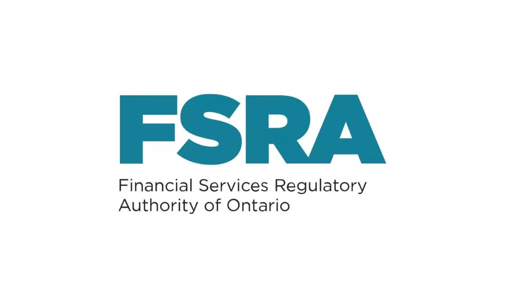
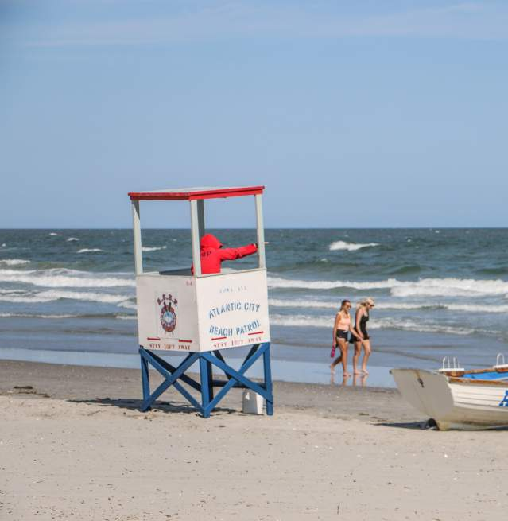

# Aspects juridiques et réglementaires

::: {.act-objectifs}

Objectifs du chapitre

- Situer l’assurance dans son cadre juridique et réglementaire au Canada et au Québec ;
- Comprendre le partage constitutionnel des compétences en matière d’assurance et le rôle respectif des autorités fédérales et provinciales ;
- Distinguer la surveillance prudentielle de l’encadrement des activités de marché ;
- Identifier les principaux organismes de régulation en assurance et comprendre leur champ d’intervention ;
- Reconnaître le rôle du contrat d’assurance dans la définition des risques couverts et des engagements financiers de l’assureur ;
- Comprendre certaines notions juridiques clés qui influencent directement la pratique actuarielle, notamment l’intérêt assurable, le principe indemnitaire, la subrogation, la prescription et la charge de la preuve.

:::

::: {.callout-note collapse="true"}

## Plan du chapitre

:::

## Introduction

L’assurance est une activité économique fortement encadrée par le droit. Les produits assurantiels, les contrats, les pratiques commerciales, la capitalisation des assureurs et la protection des assurés [↗](https://lautorite.qc.ca/professionnels/assureurs/lignes-directrices "Source"){.source-link} ne relèvent pas uniquement de considérations techniques ou financières, mais s’inscrivent dans un cadre juridique et réglementaire précis. Pour l’actuaire, comprendre ce cadre ne relève pas d’un simple complément théorique. Les règles juridiques influencent directement la conception des produits, la tarification, la gestion des risques, la solvabilité des assureurs et les obligations envers les assurés. Elles déterminent également les limites dans lesquelles les modèles actuariels peuvent être appliqués en pratique.

Pas d'inquiétude : on ne forme pas des avocats dans un programme d'actuariat

Au Canada, le cadre juridique de l’assurance présente deux caractéristiques structurantes. D’une part, la réglementation de l’assurance repose sur un partage des responsabilités entre le gouvernement fédéral et les provinces [↗](https://www.canada.ca/fr/agence-consommation-matiere-financiere/services/assurance/determiner-besoins-assurance.html "Source"){.source-link}. D’autre part, les règles de droit applicables aux relations contractuelles ne reposent pas partout sur les mêmes fondements juridiques [↗](https://canada.justice.gc.ca/fra/sjc-csj/harmonization/services_information/fondements-fundamentals.html "Source"){.source-link}, ce qui confère au système canadien une structure particulière.

Ce chapitre vise à présenter les bases juridiques et réglementaires essentielles à la compréhension de l’assurance au Canada et au Québec. Il ne s’agit évidemment pas de former des juristes, mais de fournir aux futurs actuaires les repères nécessaires pour situer leur pratique professionnelle dans son cadre légal, comprendre le rôle des différentes autorités de réglementation et saisir les implications concrètes de ce cadre sur l’exercice de l’actuariat.

## Le droit et l’assurance

### Les grandes branches du droit

Le droit canadien peut être abordé à partir d'une distinction entre droit public et droit privé [↗](https://www.justice.gc.ca/fra/pr-rp/pm-cp/just/02.html "Source"){.source-link}. Le droit public encadre notamment l'organisation et l'action de l'État; il comprend le droit constitutionnel, le droit administratif et le droit criminel. Le droit privé régit principalement les relations entre les personnes, notamment les contrats, les obligations et la responsabilité civile.

L'assurance fait intervenir ces deux branches. Le [contrat d'assurance](https://www.legisquebec.gouv.qc.ca/fr/document/lc/CCQ-1991#se:2389) relève principalement du droit privé, puisqu'il définit les droits et obligations de l'assureur, du preneur, de l'assuré et, le cas échéant, du bénéficiaire. En revanche, les autorisations d'exercer, les exigences de capital, la surveillance prudentielle et [l'encadrement réglementaire des pratiques commerciales](https://lautorite.qc.ca/professionnels/assureurs/lignes-directrices) relèvent largement du droit public. Certaines conduites dans le domaine de l'assurance, comme la [fraude](https://laws-lois.justice.gc.ca/fra/lois/C-46/section-380.html), peuvent également soulever des questions de droit criminel.

Il faut distinguer cette classification d'une autre particularité du Canada : le [bijuridisme](https://canada.justice.gc.ca/fra/sjc-csj/harmonization/services_information/fondements-fundamentals.html). Au Québec, le droit privé repose principalement sur la tradition civiliste et le Code civil du Québec. Dans les autres provinces et territoires, il repose principalement sur la *common law*. Ces traditions influencent la façon d'interpréter et d'appliquer les contrats, même si des lois écrites et la jurisprudence jouent un rôle dans les deux systèmes.

### Historique

Cette dualité juridique trouve son origine dans [l'histoire du droit civil au Canada](https://www.justice.gc.ca/fra/pr-rp/sjc-csj/pji-ilp/hist/). Notons tout d'abord que jusqu'au milieu du XVIIIe siècle, le territoire correspondant à l'actuelle province du Québec faisait partie de la Nouvelle-France, une colonie de la France en Amérique du Nord. Durant cette période, les relations civiles y étaient régies par le droit civil français, principalement la [Coutume de Paris](https://www.justice.gc.ca/fra/pr-rp/autre-other/civil/civil.html), qui constituait un ensemble de règles applicables notamment aux contrats, aux biens et aux obligations entre personnes. Son application à la Nouvelle-France avait été officiellement établie en 1664.

À la suite de la conquête britannique de la Nouvelle-France, achevée militairement en 1760 avec la capitulation de Montréal, le territoire correspondant à l'actuel Québec passe sous l'autorité du Royaume-Uni. Cette situation est officialisée par le [traité de Paris de 1763](https://canada.justice.gc.ca/fra/sjc-csj/harmonization/services_information/fondements-fundamentals.html). Le droit anglais, issu d'une tradition juridique qui s'est développée progressivement en Angleterre, notamment après la conquête normande de 1066, repose largement sur les précédents judiciaires et le développement des tribunaux royaux [↗](https://www.judiciary.uk/about-the-judiciary/history-of-the-judiciary-in-england-and-wales/history-of-the-judiciary/ "Source"){.source-link}. Cette tradition évoluera vers ce que l'on désigne aujourd'hui comme la *common law*.

Pas d'inquiétude (bis): on ne forme pas des historiens et je ne suis pas professeur d'histoire

Après une tentative infructueuse d'imposer le droit anglais au Québec, le Parlement britannique adopte [l'Acte de Québec de 1774](https://www.justice.gc.ca/fra/pr-rp/autre-other/civil/civil.html), qui rétablit officiellement l'application du droit civil français en matière de propriété et de droits civils, tout en maintenant le droit criminel anglais. Par la suite, l'évolution constitutionnelle du Canada a permis au Québec de conserver un droit civil codifié, tandis que les autres provinces et territoires ont continué d'appliquer la *common law*.

Au Québec, le maintien du droit civil a toutefois soulevé des difficultés importantes. Au fil du temps, les anciennes lois françaises, les lois britanniques et les dispositions législatives locales avaient formé un ensemble juridique complexe, parfois difficile à interpréter et à appliquer. Afin de remédier à cette situation, un processus de codification a été entrepris en 1857 [↗](https://www.bibliotheque.assnat.qc.ca/guides/fr/code-civil-du-quebec-du-bas-canada-a-aujourd-hui/57-commission-de-codification-du-code-civil "Source"){.source-link}, en s'inspirant notamment du Code Napoléon de 1804. Ce travail a mené à l'adoption, en 1865, du [Code civil du Bas-Canada](https://www.bibliotheque.assnat.qc.ca/guides/fr/code-civil-du-quebec-du-bas-canada-a-aujourd-hui/51-code-civil-du-bas-canada), entré en vigueur le 1er août 1866. Ce code a ensuite été remplacé par le [Code civil du Québec](https://www.bibliotheque.assnat.qc.ca/guides/fr/code-civil-du-quebec-du-bas-canada-a-aujourd-hui/397-code-civil-du-quebec-1991), adopté en 1991 et entré en vigueur le 1er janvier 1994. Il constitue aujourd'hui la pierre angulaire du droit civil québécois, y compris en matière d'assurance.

Dans les autres provinces et territoires, la *common law* demeure la principale tradition juridique en matière de droit privé. Elle accorde une place importante aux précédents judiciaires et à l'évolution du droit à travers les décisions des tribunaux, tout en reconnaissant le rôle des lois adoptées par les législateurs. Cette coexistence de deux traditions de droit privé au Canada [↗](https://www.justice.gc.ca/fra/sjc-csj/harmonization/index.html "Source"){.source-link} a des conséquences directes sur la manière dont les contrats d'assurance sont rédigés, interprétés et appliqués, en particulier au Québec.

::: {#exm-1 .custom}

On considère un exemple volontairement simplifié afin d’illustrer la différence de logique entre les systèmes juridiques. Supposons qu’un assureur souhaite offrir un nouveau produit d’assurance couvrant un risque particulier.

- Dans la tradition de la [*common law*](https://canada.justice.gc.ca/fra/pr-rp/pm-cp/just/03.html), la recherche de décisions judiciaires pertinentes et de principes jurisprudentiels constitue une étape importante de l’analyse, parallèlement à l'examen des lois applicables. La question centrale est la suivante : *Comment les tribunaux ont-ils traité des contrats ou des situations comparables ?* Le raisonnement consiste notamment à comparer le produit envisagé à des cas existants, afin de déterminer comment les précédents judiciaires pourraient influencer l'interprétation et l'application du contrat.

- Dans la [tradition civiliste québécoise](https://canada.justice.gc.ca/fra/pr-rp/sjc-csj/harmonization/hlf-hfl/f2-b2/bf2b.html), l’examen des dispositions du Code civil du Québec et des autres lois applicables constitue un point de départ important. La question centrale est la suivante : *Comment le Code encadre-t-il ce type de contrat et quelles règles générales s’appliquent ?* Le raisonnement consiste à interpréter les règles légales pertinentes, en tenant compte également de la jurisprudence, afin de déterminer les conditions de validité et les limites du contrat envisagé.

Dans les deux traditions, les lois et les décisions judiciaires doivent donc être prises en considération. La différence concerne surtout la place accordée aux principes codifiés et aux précédents judiciaires dans le raisonnement juridique.

:::

 

## Le partage constitutionnel des compétences

### Fondements constitutionnels

Le cadre juridique de l’assurance au Canada ne peut être compris indépendamment de la structure politique du pays. Le Canada est un État fédéral, c’est-à-dire un État composé de plusieurs entités territoriales — les provinces — qui disposent de leurs propres compétences juridiques, tout en partageant certaines responsabilités avec un gouvernement central, appelé le gouvernement fédéral. Cette structure fédérale s’est mise en place à la [création du Canada en 1867](https://www.canada.ca/fr/affaires-intergouvernementales/services/federation/federalisme-canada.html), avec l’union de trois colonies britanniques : la province du Canada, le Nouveau-Brunswick et la Nouvelle-Écosse. La province du Canada a alors été divisée en deux provinces, le Québec et l’Ontario. Ces nouvelles provinces ont conservé une partie de leurs institutions et traditions juridiques. Cette continuité explique notamment pourquoi le Québec a maintenu un système de droit civil, tandis que les autres provinces ont conservé un système fondé sur la *common law*.

La structure constitutionnelle du Canada, établie principalement par la [Loi constitutionnelle de 1867](https://laws-lois.justice.gc.ca/fra/const/TexteComplet.html), ne confère pas explicitement la compétence exclusive sur l’assurance à un seul ordre de gouvernement. Elle attribue plutôt certaines compétences générales au gouvernement fédéral et d’autres aux provinces, ce qui a mené, au fil du temps, à une répartition fonctionnelle des responsabilités en matière d’assurance.

### Le partage des compétences en matière d’assurance

Les [articles 91 et 92 de la Loi constitutionnelle de 1867](https://laws-lois.justice.gc.ca/fra/const/TexteComplet.html) répartissent les compétences entre le Parlement fédéral et les législatures provinciales, sans confier expressément et exclusivement toute l'assurance à un seul ordre de gouvernement. Les règles applicables peuvent donc provenir de lois fédérales ou provinciales, selon leur objet et les institutions concernées.

- Le gouvernement fédéral encadre notamment les institutions financières d'assurance relevant de sa compétence. Par l'intermédiaire du [Bureau du surintendant des institutions financières (BSIF)](https://www.osfi-bsif.gc.ca/fr/surveillance/institutions-financieres), il surveille notamment leurs fonds propres, leur solvabilité, leur gouvernance et leur gestion des risques.
- Les provinces réglementent notamment les contrats d'assurance, la distribution, les pratiques commerciales et la protection des consommateurs sur leur territoire. Elles peuvent aussi exercer une véritable surveillance prudentielle des assureurs constitués sous leur propre régime, comme le fait [l'Autorité des marchés financiers (AMF)](https://lautorite.qc.ca/professionnels/assureurs) au Québec.

Ainsi, il serait incorrect d'attribuer toute la surveillance prudentielle au gouvernement fédéral et toute la réglementation commerciale aux provinces. Un assureur de compétence fédérale peut être soumis à la surveillance prudentielle du BSIF tout en respectant les règles québécoises sur les activités d'assurance exercées au Québec. Un assureur de compétence québécoise peut, quant à lui, relever de l'AMF pour ses obligations tant prudentielles que commerciales, conformément notamment à la [Loi sur les assureurs](https://www.legisquebec.gouv.qc.ca/fr/document/lc/A-32.1).

### Notion de surveillance prudentielle

La [surveillance prudentielle](https://lautorite.qc.ca/professionnels/assureurs/lignes-directrices) vise à s'assurer qu'un assureur dispose des ressources financières et des mécanismes de gestion nécessaires pour respecter ses engagements envers les assurés, même dans des conditions défavorables. Elle s'intéresse donc à la solidité financière de l'institution dans son ensemble, plutôt qu'aux dispositions particulières de chaque contrat d'assurance. Cette surveillance porte notamment sur :

- Les engagements financiers : l'évaluation des prestations futures et la suffisance des provisions constituées pour les couvrir.
- Le capital et la solvabilité : les ressources financières dont dispose l'assureur pour absorber des pertes imprévues.
- La gestion des risques : l'identification et le contrôle des risques d'assurance, de marché, de crédit, de liquidité et des risques opérationnels.
- La gouvernance : la qualité des mécanismes de contrôle interne et de surveillance des décisions.
- La résistance aux événements défavorables : l'utilisation de scénarios et de tests de résistance [↗](https://www.osfi-bsif.gc.ca/fr/consignes/repertoire-consignes/evaluation-interne-risques-solvabilite "Source"){.source-link} pour évaluer la capacité de l'assureur à faire face à des situations exceptionnelles.

L'actuariat occupe une place importante dans cette surveillance. Les actuaires contribuent notamment à l'évaluation des engagements futurs, à la modélisation des risques et à l'estimation des besoins en capital. Ces travaux mobilisent directement les connaissances en probabilités, en statistiques et en modélisation mathématique acquises durant la formation actuarielle. L'objectif de la surveillance prudentielle n'est donc pas d'empêcher les assureurs de prendre des risques, mais de veiller à ce que les risques assumés demeurent compatibles avec leur capacité financière et leurs mécanismes de gestion.

## La réglementation de l’assurance

La [réglementation de l’assurance au Canada](https://lautorite.qc.ca/professionnels/assureurs) repose sur un ensemble de lois et de règlements qui ne s’appliquent pas selon une logique unique. Certaines règles encadrent l’assureur en tant qu’institution financière, tandis que d’autres encadrent les activités d’assurance exercées sur un territoire donné, notamment les contrats conclus avec les assurés et les pratiques de mise en marché. Il en résulte qu’un assureur n’est pas régi par un seul régime juridique homogène, mais par une superposition de normes qui dépendent à la fois de sa constitution juridique et des territoires où il exerce ses activités. La réglementation de l’assurance ne peut donc être comprise uniquement à partir de la charte de l’assureur, même si celle-ci joue un rôle structurant dans l’architecture réglementaire.

### Les chartes des assureurs

La charte, déjà présentée au chapitre précédent, indique la juridiction en vertu de laquelle un assureur est constitué. Elle contribue à déterminer son régime institutionnel et sa principale autorité de surveillance prudentielle, notamment pour la gouvernance, le capital et la gestion des risques. Elle ne détermine toutefois pas, à elle seule, le droit applicable aux contrats ni toutes les règles encadrant les activités d’assurance exercées sur un territoire donné. Les principaux types de chartes peuvent ainsi être distingués selon leur portée juridique.

- **Assureurs à charte du Québec**

  La charte québécoise renvoie au régime de constitution d’un assureur en vertu du droit québécois. Elle situe l’assureur dans l’ordre juridique du Québec en tant que personne morale et détermine l’autorité responsable de sa surveillance prudentielle principale. À ce titre, l’assureur est intégré au cadre institutionnel québécois, tant pour sa gouvernance que pour ses exigences prudentielles. Toutefois, la charte québécoise ne constitue pas en soi une autorisation d’exercer des activités d’assurance. L’exercice effectif des activités demeure conditionnel à une [autorisation délivrée par l’Autorité des marchés financiers](https://lautorite.qc.ca/professionnels/assureurs/droit-dexercice/autorisation-exercer-assureur-quebec). Par ailleurs, la charte ne crée pas un régime contractuel autonome : les contrats d'assurance sont régis par les règles du Code civil du Québec lorsque le droit québécois leur est applicable, notamment selon les conditions prévues à l'[article 3119](https://www.legisquebec.gouv.qc.ca/fr/document/lc/CCQ-1991#se:3119), indépendamment de la charte de l'assureur.

- **Assureurs à charte d’une autre province ou d’un territoire canadien**

  Un assureur constitué sous une charte provinciale ou territoriale autre que celle du Québec relève, pour sa constitution et sa surveillance prudentielle principale, de l’ordre juridique de sa juridiction d’origine. Néanmoins, dès lors qu’il exerce des activités d’assurance au Québec, cet assureur est assujetti aux [lois québécoises applicables aux activités exercées sur le territoire](https://www.legisquebec.gouv.qc.ca/fr/document/lc/A-32.1#se:21). Cette situation illustre la dissociation entre le régime de constitution de l’assureur, déterminé par la charte, et le droit applicable aux contrats d’assurance et aux pratiques de marché, déterminé selon les règles juridiques applicables aux activités concernées.

- **Assureurs à charte du Canada**

  La charte fédérale place l’assureur sous le régime de constitution prévu par la législation fédérale, notamment la [*Loi sur les sociétés d’assurances*](https://laws-lois.justice.gc.ca/fra/lois/I-11.8/). Elle confère à l’assureur une reconnaissance institutionnelle à l’échelle canadienne et soumet sa surveillance prudentielle principale à l'autorité fédérale compétente, le [Bureau du surintendant des institutions financières (BSIF)](https://www.osfi-bsif.gc.ca/fr/surveillance/institutions-financieres), en particulier en matière de capitalisation, de gestion des risques et de gouvernance. Cette reconnaissance nationale n’a toutefois pas pour effet d’uniformiser le droit applicable aux activités d’assurance exercées dans les provinces. Lorsqu’un assureur à charte fédérale exerce des activités d'assurance au Québec, il demeure soumis aux exigences provinciales applicables, notamment celles relatives à la distribution des produits, aux contrats d’assurance et à la protection des assurés. La charte fédérale organise donc le cadre institutionnel de l’assureur, sans écarter l’application du droit provincial aux activités exercées localement.

- **Assureurs à charte étrangère**

  Les assureurs constitués sous une charte étrangère relèvent, pour leur existence juridique, du droit de l’État ou du pays où ils sont constitués. Lorsqu’ils exercent des activités d’assurance au Canada par une succursale relevant du régime fédéral, le BSIF surveille les activités canadiennes de cette succursale, et non la solvabilité mondiale de l’assureur étranger, conformément à sa [ligne directrice sur les entités étrangères exploitant une succursale au Canada](https://www.osfi-bsif.gc.ca/fr/consignes/repertoire-consignes/entites-etrangeres-exploitant-succursale-au-canada-ligne-directrice-2021). Comme pour les autres catégories d’assureurs, la charte étrangère ne détermine pas à elle seule le droit applicable aux contrats conclus au Québec. Les activités exercées sur le territoire québécois demeurent soumises aux lois provinciales applicables, notamment à la [Loi sur les assureurs](https://www.legisquebec.gouv.qc.ca/fr/document/lc/A-32.1) et, lorsque le droit québécois régit le contrat, aux dispositions du Code civil du Québec en matière d’assurance.

## Organismes de régulation

### Bureau du surintendant des institutions financières (BSIF)

Le [Bureau du surintendant des institutions financières](https://laws-lois.justice.gc.ca/fra/lois/O-2.7/), désigné par l’acronyme BSIF en français et OSFI en anglais, est un organisme indépendant créé par une loi du Parlement du Canada. Il est responsable de la surveillance prudentielle des [institutions financières de compétence fédérale](https://www.osfi-bsif.gc.ca/fr/surveillance/institutions-financieres), notamment les banques, les sociétés d’assurance constituées sous charte fédérale et les succursales canadiennes d’assureurs étrangers. Cette surveillance porte sur le capital, la solvabilité, la gouvernance et la gestion des risques afin que les institutions puissent honorer leurs engagements, même dans des conditions défavorables. Elle ne porte pas directement sur les clauses des contrats d’assurance individuels.

Dans le cadre de ses fonctions, le BSIF élabore et applique des normes prudentielles [↗](https://www.osfi-bsif.gc.ca/fr/consignes/repertoire-consignes/comment-consignes-sarriment-notre-mandat "Source"){.source-link} et participe à des mécanismes de coopération nationale et internationale en matière de réglementation financière. Son intervention vise l’assureur en tant qu’institution financière et s’exerce indépendamment des règles provinciales qui encadrent les activités d’assurance exercées sur un territoire donné.

### Autorité des marchés financiers (AMF)

L’[Autorité des marchés financiers](https://lautorite.qc.ca/professionnels/assureurs) est l’organisme public responsable de l’encadrement de l’assurance au Québec. Elle exerce un double rôle : la [surveillance prudentielle](https://lautorite.qc.ca/professionnels/assureurs/lignes-directrices) des assureurs constitués sous charte québécoise et l’encadrement des [pratiques commerciales](https://lautorite.qc.ca/professionnels/assureurs/lignes-directrices/pratiques-commerciales) des assureurs autorisés à exercer au Québec, quelle que soit leur charte. Ce second volet couvre notamment l’information fournie aux assurés, la distribution et l’administration des contrats, le règlement des sinistres et le [traitement des plaintes](https://lautorite.qc.ca/professionnels/assureurs/declaration-annuelle-sur-les-pratiques-commerciales). La protection des consommateurs en constitue un objectif central.

En règle générale, un assureur qui exerce l’activité d’assureur au Québec dans le cadre de l’exploitation d’une entreprise doit obtenir l’autorisation de l’AMF et respecter les règles applicables, notamment celles de la [*Loi sur les assureurs*](https://www.legisquebec.gouv.qc.ca/fr/document/lc/A-32.1), de la [*Loi sur la distribution de produits et services financiers*](https://www.legisquebec.gouv.qc.ca/fr/document/lc/D-9.2) et du [Code civil du Québec](https://www.legisquebec.gouv.qc.ca/fr/document/lc/CCQ-1991). La *Loi sur les assureurs* prévoit toutefois des exceptions, notamment pour certaines activités de réassurance et situations particulières ([articles 27 et 28](https://www.legisquebec.gouv.qc.ca/fr/document/lc/A-32.1#se:27)).

### Financial Services Regulatory Authority of Ontario (FSRA)

La [*Financial Services Regulatory Authority of Ontario* (FSRA)](https://www.fsrao.ca/fr/propos-de-larsf), appelée en français l’Autorité ontarienne de réglementation des services financiers (ARSF), est l’organisme public responsable de l’encadrement des assurances en Ontario. Elle assure la surveillance prudentielle des assureurs constitués en Ontario et des assureurs réciproques [↗](https://www.fsrao.ca/fr/reglementation/lignes-directrices/cadre-de-surveillance-axee-sur-le-risque-pour-les-compagnies-dassurance-constituees-en-ontario-et-les-assureurs-reciproques "Source"){.source-link} relevant de sa compétence. Elle encadre également la conduite de marché des assureurs autorisés à exercer en Ontario, notamment la distribution, l’information donnée aux assurés, le règlement des sinistres et le traitement des plaintes. La protection du public constitue un objectif central de son intervention.

En règle générale, les assureurs qui exercent des activités d’assurance en Ontario doivent détenir les autorisations requises et respecter les règles de la [*Insurance Act* de l’Ontario](https://www.ontario.ca/laws/statute/90i08) et des règlements connexes, sous réserve des exceptions applicables.

#### **Collaboration pratique entre le BSIF et l’AMF** {-}

Même si la compétence prudentielle principale d’un assureur peut relever du fédéral, par l’entremise du Bureau du surintendant des institutions financières, ou de la province, par l’entremise de l’Autorité des marchés financiers par exemple, ces organismes ne fonctionnent pas de manière isolée dans la pratique. Le BSIF et l’AMF participent à des mécanismes de communication, de coordination et d’échange d’information, notamment sur les enjeux réglementaires et les risques touchant le secteur financier. Cette collaboration demeure toutefois encadrée par des règles de confidentialité et certaines limites institutionnelles. Les évaluations du Fonds monétaire international sur la réglementation financière canadienne [↗](https://www.elibrary.imf.org/view/journals/002/2025/220/article-A001-en.xml "Source"){.source-link} reconnaissent ces efforts de coopération tout en soulignant la nécessité de renforcer les mécanismes d’échange d’information entre les autorités fédérales et provinciales.

## Comparaison concrète pour un assureur exerçant au Québec

Le tableau suivant résume les principales autorités compétentes pour un assureur qui exerce des activités au Québec. Il présente une situation générale : les exceptions prévues par les lois, les structures particulières et les règles applicables à certaines activités doivent être prises en compte dans une analyse réglementaire détaillée. L'[article 21 de la Loi sur les assureurs](https://www.legisquebec.gouv.qc.ca/fr/document/lc/A-32.1#se:21) prévoit notamment l'obligation générale d'obtenir une autorisation de l'AMF pour exercer l'activité d'assureur au Québec, sous réserve des exceptions applicables.

| Type d’assureur | Surveillance prudentielle principale | Encadrement des activités au Québec |
|:--|:--|:--|
| Charte du Canada | [BSIF](https://www.osfi-bsif.gc.ca/fr/surveillance/institutions-financieres) | AMF et lois québécoises applicables |
| Charte du Québec | [AMF](https://lautorite.qc.ca/professionnels/assureurs/cadre-de-surveillance) | AMF et lois québécoises applicables |
| Charte d’une autre province ou d’un territoire | Autorité prudentielle de la juridiction d’origine | AMF et lois québécoises applicables |
| Charte étrangère avec succursale fédérale | [BSIF pour les activités canadiennes](https://www.osfi-bsif.gc.ca/fr/consignes/repertoire-consignes/entites-etrangeres-exploitant-succursale-au-canada-ligne-directrice-2021); autorité étrangère compétente pour l’assureur dans son ensemble | AMF et lois québécoises applicables |

La distinction essentielle est la suivante : la surveillance prudentielle de l'institution et l'encadrement de ses activités commerciales et contractuelles au Québec sont deux dimensions différentes. Elles peuvent relever d'autorités distinctes et s'appliquer simultanément.

#### **Choix de la charte pour un assureur** {-}

Le choix d'une charte ne repose pas sur un critère unique. Une charte fédérale peut faciliter la centralisation de la surveillance prudentielle d'un assureur présent dans plusieurs provinces; elle ne dispense cependant pas de respecter les [exigences provinciales applicables aux activités d'assurance](https://lautorite.qc.ca/professionnels/assureurs/droit-dexercice/autorisation-exercer-assureur-quebec). Inversement, une charte québécoise peut s'inscrire dans la continuité historique et organisationnelle d'un assureur dont les activités sont concentrées au Québec, sans interdire à celui-ci d'exercer ailleurs au Canada sous réserve des autorisations nécessaires. Le régime de constitution retenu dépend notamment de l'histoire de l'entreprise, de sa structure de propriété, de ses objectifs de croissance et des contraintes réglementaires. Il ne permet pas, à lui seul, de conclure qu'une forme est systématiquement plus efficace qu'une autre. De même, les proportions observées des différents types de chartes sur le marché ne suffisent pas à établir les causes des décisions de constitution des assureurs.

## Le contrat d’assurance

Après avoir examiné les autorités chargées d’encadrer les assureurs, intéressons-nous maintenant aux règles qui déterminent les engagements découlant des contrats d’assurance.

Le [contrat d'assurance](https://www.legisquebec.gouv.qc.ca/fr/document/lc/CCQ-1991#se:2389) constitue le fondement juridique de la relation entre l'assureur et le preneur, qui n'est pas nécessairement la personne assurée. Il définit notamment les risques couverts, les exclusions, les obligations des parties et les conditions donnant droit à une prestation. Ces dispositions sont essentielles en actuariat, puisqu'elles déterminent les engagements financiers que l'assureur doit évaluer. Au Québec, le contrat d'assurance est encadré par le Code civil du Québec. Il présente généralement les caractéristiques suivantes :

- Un [contrat d'adhésion](https://www.legisquebec.gouv.qc.ca/fr/document/lc/CCQ-1991#se:1379) : les conditions sont habituellement rédigées par l'assureur et ne sont pas librement négociées. En cas d'ambiguïté, une clause s'interprète notamment en faveur de l'adhérent ([article 1432](https://www.legisquebec.gouv.qc.ca/fr/document/lc/CCQ-1991#se:1432)).
- Un [contrat aléatoire](https://www.legisquebec.gouv.qc.ca/fr/document/lc/CCQ-1991#se:1382) : l'obligation de prestation de l'assureur dépend d'un événement incertain, comme la survenance d'un sinistre ou le moment du décès de l'assuré.
- Un contrat à [titre onéreux](https://www.legisquebec.gouv.qc.ca/fr/document/lc/CCQ-1991#se:1381) et [bilatéral](https://www.legisquebec.gouv.qc.ca/fr/document/lc/CCQ-1991#se:1380) : le preneur s'engage notamment à payer une prime, tandis que l'assureur s'engage à fournir la protection prévue au contrat.

Les parties doivent également [agir de bonne foi](https://www.legisquebec.gouv.qc.ca/fr/document/lc/CCQ-1991#se:1375), tant lors de la souscription que pendant l'exécution du contrat. Les notions juridiques présentées ci-dessous permettent de comprendre certaines conséquences concrètes de ces règles en assurance-vie et en assurance de dommages.

### Notion de nullité

En droit, la [**nullité**](https://www.legisquebec.gouv.qc.ca/fr/document/lc/CCQ-1991#se:1416) est une sanction qui intervient lorsqu'un contrat ne respecte pas certaines conditions nécessaires à sa validité. Un contrat annulé est, en principe, considéré comme n'ayant jamais existé juridiquement. Le Code civil du Québec distingue deux formes de nullité :

- La [nullité absolue](https://www.legisquebec.gouv.qc.ca/fr/document/lc/CCQ-1991#se:1417) protège l'intérêt général, notamment l'ordre public. Elle peut être invoquée par toute personne ayant un intérêt né et actuel, et le tribunal peut également la soulever d'office ([article 1418](https://www.legisquebec.gouv.qc.ca/fr/document/lc/CCQ-1991#se:1418)).
- La [nullité relative](https://www.legisquebec.gouv.qc.ca/fr/document/lc/CCQ-1991#se:1419) protège les intérêts particuliers d'une personne, notamment lorsque son consentement a été vicié. Elle peut normalement être invoquée par la personne protégée ou, dans certaines conditions, par son cocontractant. La personne protégée peut également choisir de maintenir le contrat malgré le vice ([article 1420](https://www.legisquebec.gouv.qc.ca/fr/document/lc/CCQ-1991#se:1420)).

Dans les deux cas, l'annulation entraîne en principe la restitution des prestations échangées entre les parties, conformément aux règles du Code civil du Québec ([article 1422](https://www.legisquebec.gouv.qc.ca/fr/document/lc/CCQ-1991#se:1422)).

::: {.act-cas .act-cas-vie}

#### Exemple en assurance-vie {-}

> Lors de la souscription, un preneur d'assurance doit [répondre à plusieurs questions sur son état de santé](https://www.legisquebec.gouv.qc.ca/fr/document/lc/CCQ-1991#se:2408). Supposons qu'une personne omette volontairement de déclarer une maladie grave dont elle a connaissance. L'assureur accepte alors le contrat en croyant que le risque est normal.

Si l'assureur démontre que l'omission constitue une fraude ou une fausse déclaration pertinente au regard du risque, il peut disposer de recours pour [demander la nullité du contrat](https://www.legisquebec.gouv.qc.ca/fr/document/lc/CCQ-1991#se:2410). En assurance-vie, l'[article 2424 du Code civil du Québec](https://www.legisquebec.gouv.qc.ca/fr/document/lc/CCQ-1991#se:2424) limite toutefois cette possibilité lorsqu'une assurance est en vigueur depuis deux ans, sauf en cas de fraude. L'issue dépend donc de la preuve, des règles applicables et des circonstances; elle ne permet pas de conclure automatiquement à la conservation des primes. La nullité demandée pour protéger l'assureur relève ici, en principe, de la logique de la [nullité relative](https://www.legisquebec.gouv.qc.ca/fr/document/lc/CCQ-1991#se:1419).

:::

::: {.act-cas .act-cas-dommages}

#### Exemple en assurance de dommages {-}

> Supposons qu'une entreprise exerce une activité commerciale interdite par la loi. Pour se protéger financièrement, elle conclut avec un assureur un contrat d'assurance de pertes d'exploitation qui prévoit expressément une indemnisation si les autorités saisissent ses marchandises ou ordonnent la fermeture de l'établissement. L'assureur connaît la nature illégale des activités et accepte de garantir les pertes de revenus qui en découleraient.

Contrairement à une situation de fausse déclaration, le problème ne concerne pas ici une information dissimulée à l'assureur. C'est l'objet même de la garantie qui est contraire à l'ordre public, puisqu'elle vise à protéger les revenus provenant d'une activité dont l'exploitation est interdite. Les [articles 1411](https://www.legisquebec.gouv.qc.ca/fr/document/lc/CCQ-1991#se:1411) et [1413](https://www.legisquebec.gouv.qc.ca/fr/document/lc/CCQ-1991#se:1413) du Code civil du Québec prévoient la nullité des contrats dont la cause ou l'objet est contraire à la loi ou à l'ordre public. Puisque l'interdiction de l'activité vise la protection de l'intérêt général, la garantie pourrait être frappée de [nullité absolue, conformément à l'article 1417](https://www.legisquebec.gouv.qc.ca/fr/document/lc/CCQ-1991#se:1417). La distinction est donc fondamentale : la nullité ne découle pas simplement du caractère illégal de certaines activités de l'assuré, mais du fait que le contrat vise précisément à garantir les conséquences économiques de leur interdiction.

:::

### Déclaration et aggravation du risque

Lorsqu'un assureur accepte de couvrir un risque, il doit pouvoir en évaluer les caractéristiques afin de déterminer les conditions du contrat et la prime appropriée. Cette évaluation repose notamment sur les renseignements fournis par le preneur et, dans certaines circonstances, par la personne assurée. Selon l'[article 2408 du Code civil du Québec](https://www.legisquebec.gouv.qc.ca/fr/document/lc/CCQ-1991#se:2408), ceux-ci doivent déclarer les circonstances connues qui sont susceptibles d'influencer de façon importante l'appréciation du risque, la détermination de la prime ou la décision de l'assureur d'accepter le contrat. Une fausse déclaration ou une omission importante peut entraîner des conséquences sur la validité du contrat ou sur l'indemnisation, selon les règles applicables ([articles 2410 et 2411](https://www.legisquebec.gouv.qc.ca/fr/document/lc/CCQ-1991#se:2410)).

En assurance de dommages, cette obligation peut également s'appliquer pendant la durée du contrat. L'[article 2466](https://www.legisquebec.gouv.qc.ca/fr/document/lc/CCQ-1991#se:2466) prévoit que l'assuré doit déclarer promptement les circonstances résultant de ses faits et gestes qui aggravent de façon importante les risques couverts. L'assureur peut alors, selon les conditions prévues à l'[article 2467](https://www.legisquebec.gouv.qc.ca/fr/document/lc/CCQ-1991#se:2467), proposer une nouvelle prime ou résilier le contrat. Cette obligation particulière de déclaration en cours de contrat ne s'applique pas de la même manière en assurance de personnes.

Du point de vue actuariel, ces règles sont importantes puisque la tarification repose sur les caractéristiques du risque au moment de son évaluation. Une information inexacte ou une modification importante du risque peut créer un écart entre la prime demandée et le coût réel de la protection offerte.

::: {.act-cas .act-cas-vie}

#### Exemple en assurance-vie {-}

> Une personne de 35 ans souhaite souscrire une assurance-vie temporaire de 500 000 $. Lors de la souscription, l'assureur lui demande si elle pratique certaines activités présentant un risque particulier, notamment le parachutisme. Cette personne effectue régulièrement plusieurs sauts par année et déclare cette activité dans sa proposition d'assurance. Après avoir évalué le risque, l'assureur accepte de lui offrir la protection demandée, mais à une prime plus élevée que celle qui aurait été exigée d'une personne présentant autrement les mêmes caractéristiques et ne pratiquant pas cette activité.

Dans cet exemple, le preneur respecte son obligation de déclaration en fournissant une information pertinente à l'évaluation du risque. L'assureur peut ainsi intégrer cette caractéristique dans sa tarification et déterminer les conditions auxquelles il accepte de fournir la protection. Le contrat est établi en fonction du risque déclaré, sans qu'il soit nécessaire d'attendre la survenance d'un sinistre pour en constater les conséquences financières.

Il faut toutefois distinguer la déclaration initiale du risque et son évolution ultérieure. Contrairement à l'assurance de dommages, l'assurance-vie ne comporte pas d'obligation générale comparable à celle de l'article 2466 imposant de déclarer toute aggravation importante du risque pendant la durée du contrat. Ainsi, une personne qui commencerait à pratiquer le parachutisme plusieurs années après avoir souscrit une assurance-vie n'aurait pas automatiquement l'obligation légale d'en informer son assureur. Cette distinction reflète notamment le caractère généralement durable des engagements pris par l'assureur-vie.

:::

::: {.act-cas .act-cas-dommages}

#### Exemple en assurance de dommages {-}

> Une personne possède une maison assurée contre l'incendie. Lors de la souscription, elle déclare que la résidence est utilisée exclusivement à des fins personnelles. Un an plus tard, elle décide de transformer son garage en atelier commercial de fabrication de meubles. Elle y installe plusieurs machines et commence à entreposer des solvants et d'autres produits inflammables. Cette nouvelle utilisation de la résidence augmente sensiblement le risque d'incendie par rapport à la situation initialement déclarée.

En vertu de l'[article 2466 du Code civil du Québec](https://www.legisquebec.gouv.qc.ca/fr/document/lc/CCQ-1991#se:2466), l'assuré doit déclarer promptement cette modification importante du risque, puisqu'elle résulte de ses propres activités. L'assureur pourra alors réévaluer la situation et décider, selon les conditions prévues à l'[article 2467](https://www.legisquebec.gouv.qc.ca/fr/document/lc/CCQ-1991#se:2467), de maintenir la protection moyennant une prime plus élevée ou de résilier le contrat.

Si l'assuré omet de déclarer cette aggravation et qu'un incendie survient, les conséquences ne sont pas nécessairement les mêmes dans toutes les situations. Selon les circonstances, l'assureur pourrait invoquer une réduction proportionnelle de l'indemnité ou la nullité du contrat, conformément aux règles des [articles 2466 et 2411](https://www.legisquebec.gouv.qc.ca/fr/document/lc/CCQ-1991#se:2411). Il ne suffit donc pas de constater une aggravation du risque pour conclure automatiquement à l'absence de couverture.

Cet exemple illustre une difficulté importante pour l'actuaire : un risque correctement tarifé lors de la souscription peut évoluer pendant la durée du contrat. Les mécanismes de déclaration et de révision des conditions permettent alors à l'assureur d'adapter ses engagements à cette nouvelle réalité.

:::

### Intérêt assurable

L’intérêt d’assurance établit le lien juridiquement pertinent entre une personne et le risque couvert. Il contribue à distinguer une assurance d’un simple pari. Toutefois, sa nature et le moment où il doit exister varient selon la branche d’assurance. En assurance individuelle de personnes, l'[article 2418 du Code civil du Québec](https://www.legisquebec.gouv.qc.ca/fr/document/lc/CCQ-1991#se:2418) exige en principe un intérêt dans la vie ou la santé de l’assuré au moment de la conclusion du contrat, à moins que cette personne n’y consente par écrit. En assurance de biens, l'[article 2481](https://www.legisquebec.gouv.qc.ca/fr/document/lc/CCQ-1991#se:2481) exige un intérêt d’assurance au moment du sinistre. Cette différence de calendrier est importante : la validité d’une assurance sur la vie d’autrui et le droit à une indemnité pour la perte d’un bien ne s’apprécient pas selon la même règle.

::: {.act-cas .act-cas-vie}

#### Exemple en assurance-vie {-}

> Une personne souscrit une assurance-vie temporaire de 500 000 $ sur la vie de son conjoint de fait, avec lequel elle partage son logement et ses obligations financières. Elle est à la fois preneuse du contrat et bénéficiaire de l'assurance, tandis que son conjoint est la personne assurée. Quelques années plus tard, le couple se sépare. La personne qui a souscrit l'assurance décide néanmoins de conserver le contrat et continue à payer les primes. Plusieurs années après cette séparation, son ancien conjoint décède.

Au moment de la souscription, le preneur possédait un [intérêt d'assurance dans la vie de son conjoint de fait](https://www.legisquebec.gouv.qc.ca/fr/document/lc/CCQ-1991#se:2419), notamment en raison de leur relation et de leurs obligations financières communes. Le contrat était donc valide à cet égard. La question est maintenant la suivante : la séparation fait-elle disparaître le droit à la prestation d'assurance?

La réponse est non. En vertu de l'[article 2418 du Code civil du Québec](https://www.legisquebec.gouv.qc.ca/fr/document/lc/CCQ-1991#se:2418), l'intérêt d'assurance, lorsqu'il est requis, s'apprécie au moment de la conclusion du contrat. La disparition ultérieure de cet intérêt ne rend donc pas le contrat invalide. Ainsi, si le contrat demeure en vigueur et que ses autres conditions sont respectées, l'ex-conjoint de fait recevra les 500 000 $ au décès de l'assuré, même si les deux personnes sont séparées depuis plusieurs années. Cet exemple illustre une distinction importante : en assurance-vie, l'intérêt d'assurance doit normalement exister au moment de la souscription, sauf consentement écrit de l'assuré, mais il n'est pas nécessaire qu'il subsiste jusqu'au décès de la personne assurée.

Cet exemple concerne le maintien de la validité du contrat malgré la disparition de l'intérêt d'assurance. Il ne faut pas confondre cette question avec les règles de désignation et de révocabilité du bénéficiaire, notamment en cas de séparation ou de divorce, qui sont examinées au [chapitre 9](Chap9_Base_assurancepersonnes.qmd).

:::

::: {.act-cas .act-cas-dommages}

#### Exemple en assurance de dommages {-}

> Une personne souscrit une assurance habitation couvrant une résidence appartenant à un ami. Elle n'est ni propriétaire, ni locataire, ni responsable légal du bien et n'assume aucune obligation financière liée à cette résidence. Elle explique vouloir assurer la maison parce qu'elle y est attachée et souhaite éviter que son ami subisse des difficultés financières en cas de sinistre.

Dans cette situation, la personne qui souscrit l'assurance ne possède aucun intérêt économique propre dans la maison. Elle ne pourrait donc pas réclamer une indemnité pour elle-même si la résidence était détruite par un incendie. Selon l'[article 2481 du Code civil du Québec](https://www.legisquebec.gouv.qc.ca/fr/document/lc/CCQ-1991#se:2481), l'intérêt d'assurance doit exister au moment du sinistre. De plus, l'[article 2484](https://www.legisquebec.gouv.qc.ca/fr/document/lc/CCQ-1991#se:2484) prévoit la nullité de l'assurance d'un bien dans lequel l'assuré n'a aucun intérêt d'assurance.

Cela ne signifie toutefois pas qu'il est impossible d'assurer un bien appartenant à autrui. L'[article 2483](https://www.legisquebec.gouv.qc.ca/fr/document/lc/CCQ-1991#se:2483) permet de souscrire une assurance pour le compte d'une autre personne, notamment au moyen d'une stipulation au bénéfice de celle-ci. Dans notre exemple, la personne pourrait donc souscrire, avec l'accord de l'assureur, une assurance couvrant la maison pour le compte de son ami propriétaire. Elle serait responsable du paiement des primes, mais c'est son ami, qui possède un intérêt d'assurance dans la résidence, qui pourrait bénéficier de l'indemnisation en cas de sinistre couvert. La distinction est importante : il n'est pas nécessaire que celui qui paie les primes soit celui qui possède l'intérêt d'assurance dans le bien. En revanche, la personne qui bénéficie de l'indemnisation doit posséder un intérêt d'assurance correspondant à la perte subie.

:::

### Principe indemnitaire et limites de l’indemnisation

En assurance de dommages, le contrat est structuré autour du [principe indemnitaire (article 2463 du Code civil du Québec)](https://www.legisquebec.gouv.qc.ca/fr/document/lc/CCQ-1991#se:2463). L’objectif n’est pas d’enrichir l’assuré, mais de le replacer, autant que possible, dans la situation financière qui aurait été la sienne en l’absence du sinistre. Ce principe s'articule avec les plafonds, les franchises, les limites de garantie et les mécanismes d’évaluation des pertes prévus au contrat. Pour l’actuaire, le principe indemnitaire est essentiel pour comprendre pourquoi la distribution des sinistres observés ne correspond pas nécessairement à la distribution des pertes économiques réelles. Le contrat d’assurance modifie la forme des pertes indemnisées, en imposant des limites et des ajustements qui doivent être intégrés aux modèles de tarification et de provisionnement. Ce principe permet également de comprendre pourquoi certaines structures contractuelles sont privilégiées dans la pratique. Les montants assurés, les clauses de [valeur à neuf ou de valeur dépréciée](https://lautorite.qc.ca/grand-public/glossaire-financier) et les limites de responsabilité reflètent à la fois des choix contractuels et des règles juridiques qui influencent directement les résultats financiers de l’assureur.

::: {.act-cas .act-cas-vie}

#### Exemple en assurance-vie {-}

> Une personne souscrit une assurance-vie temporaire de 500 000 $ sur sa propre tête. Elle choisit ce montant en estimant les conséquences financières que son décès pourrait avoir sur sa famille : perte de revenus, remboursement de l'hypothèque, besoins futurs des enfants, etc. Quelques années plus tard, l'assuré décède. Les bénéficiaires reçoivent les 500 000 $ prévus au contrat, indépendamment de la perte économique réellement subie.

L'assurance-vie ne repose pas sur le principe indemnitaire : le [capital versé au bénéficiaire](https://lautorite.qc.ca/grand-public/assurance/assurance-vie/8-questions-et-reponses-pour-demystifier-lassurance-vie) n'est pas calculé en fonction d'une perte financière constatée au moment du décès. Toutefois, cela ne signifie pas que le montant assuré est choisi arbitrairement. Un preneur prévoyant peut justement déterminer le capital souhaité en fonction des besoins financiers anticipés de ses proches, sous réserve de son acceptation par l'assureur. Il existe donc une logique de compensation économique, mais celle-ci est établie à l'avance, lors de la souscription, plutôt qu'au moment du décès. La prestation demeure celle prévue au contrat, même si les besoins financiers réels des bénéficiaires se révèlent finalement différents de ceux qui avaient été anticipés.

:::

::: {.act-cas .act-cas-dommages}

#### Exemple en assurance de dommages {-}

> Un propriétaire subit un incendie qui endommage gravement la cuisine de sa résidence. Le coût pour reconstruire la cuisine à neuf est estimé à 40 000 $. Toutefois, la police d’assurance prévoit une franchise de 2 000 $ et une indemnisation en valeur dépréciée. En tenant compte de l’usure des matériaux et de l’âge des installations, la valeur indemnisable est évaluée à 28 000 $. L’assureur verse donc une indemnité de 26 000 $ après application de la franchise.

Cet exemple illustre concrètement le principe indemnitaire. Même si la reconstruction à neuf coûterait 40 000 $, le montant effectivement versé par l’assureur est inférieur, puisqu'il tient compte de la dépréciation et de la franchise prévues au contrat. L'indemnisation vise ici à compenser la valeur des éléments endommagés, plutôt qu'à financer leur remplacement intégral par des installations neuves.

Certaines garanties de [*valeur à neuf*](https://lautorite.qc.ca/grand-public/glossaire-financier) modifient toutefois la façon de calculer la prestation prévue au contrat. Leur effet sur la fréquence et le coût des réclamations constitue une question empirique, qui ne peut être tranchée sans données appropriées.

:::

### Subrogation

En assurance de dommages, la [subrogation](https://www.legisquebec.gouv.qc.ca/fr/document/lc/CCQ-1991#se:2474) permet à l’assureur, dans les limites de l’indemnité versée, d’exercer les droits de l’assuré contre un tiers responsable du préjudice (article 2474 du Code civil du Québec). L’assureur ne peut toutefois pas se subroger contre les personnes qui font partie de la maison de l’assuré. Ce mécanisme vise notamment à éviter qu'une même perte soit indemnisée deux fois dans le cadre de l'assurance de dommages et à faire supporter, ultimement, le coût du sinistre à la personne qui en est responsable lorsque cela est possible. Du point de vue actuariel, la subrogation explique pourquoi le coût final d’un sinistre peut différer du montant initialement payé. Les montants récupérés ultérieurement influencent les coûts ultimes, les résultats techniques et les flux de trésorerie. Ils doivent donc être intégrés à l’analyse des données de sinistres, notamment dans l’estimation des charges ultimes et des provisions. La subrogation illustre ainsi que le règlement initial d’un sinistre ne marque pas toujours la fin de son impact financier pour l’assureur.

::: {.act-cas .act-cas-vie}

#### Exemple en assurance-vie {-}

> Une personne décède à la suite d’un accident survenu lors de travaux de rénovation dans un immeuble, en raison de la défaillance grave d’un équipement fourni par un tiers. L’assureur-vie verse le capital assuré aux bénéficiaires, conformément aux termes du contrat. Les bénéficiaires intentent ensuite un recours civil contre le fabricant ou le fournisseur de l’équipement afin d’obtenir des dommages-intérêts pour le préjudice qu'ils ont personnellement subi.

Dans ce contexte, la subrogation ne joue généralement pas le même rôle qu’en assurance de dommages. L’assurance-vie n’est pas fondée sur le principe indemnitaire : le capital versé correspond à une somme convenue à l’avance, et non à la compensation directe d’une perte économique mesurée. Le paiement de l’assurance-vie n’éteint donc pas les recours civils des bénéficiaires contre le tiers responsable. Le versement du capital assuré ne transfère pas automatiquement à l’assureur-vie les recours personnels des bénéficiaires contre le tiers responsable. Selon l'[article 1608 du Code civil du Québec](https://www.legisquebec.gouv.qc.ca/fr/document/lc/CCQ-1991#se:1608), le versement d'une prestation par un tiers ne réduit pas nécessairement les dommages-intérêts dus par le responsable. Les dommages-intérêts que les bénéficiaires peuvent obtenir demeurent soumis aux [règles de responsabilité civile](https://www.legisquebec.gouv.qc.ca/fr/document/lc/CCQ-1991#se:1457) applicables, indépendamment du capital contractuellement payable. Cela contraste avec la subrogation légale en assurance de dommages.

:::

::: {.act-cas .act-cas-dommages}

#### Exemple en assurance de dommages {-}

> Un entrepreneur réalise des travaux électriques défectueux dans la résidence d’un assuré. À la suite de ces travaux, un incendie cause des dommages couverts par l’assurance habitation. L’assureur verse une indemnité de 80 000 $ au propriétaire. Une enquête permet ensuite d’établir que l’incendie résulte d’une faute de l’entrepreneur.

En vertu de l'[article 2474 du Code civil du Québec](https://www.legisquebec.gouv.qc.ca/fr/document/lc/CCQ-1991#se:2474), l’assureur peut exercer, jusqu’à concurrence de l’indemnité qu’il a payée, les droits de l’assuré contre l’entrepreneur responsable. Si ce recours lui permet de récupérer 50 000 $, le coût net supporté par l’assureur pour ce sinistre est ramené à 30 000 $, avant de tenir compte des éventuels frais de recours. Du point de vue actuariel, les montants récupérés après paiement doivent être pris en compte dans l’analyse des coûts ultimes et du provisionnement. La subrogation doit être distinguée de la valeur de récupération d’un bien endommagé ou retrouvé : ces deux mécanismes peuvent réduire le coût net d’un sinistre, mais ils ne reposent pas sur la même notion juridique.

:::

### Droit de sauvetage

En assurance de dommages, le droit de sauvetage concerne la récupération d’un bien endommagé ou de sa valeur résiduelle, dans les conditions prévues par la loi ou le contrat. L’[article 2494 du Code civil du Québec](https://www.legisquebec.gouv.qc.ca/fr/document/lc/CCQ-1991#se:2494) prévoit que l’assureur qui s’est réservé la faculté de réparer, de reconstruire ou de remplacer le bien bénéficie du droit de sauvetage et peut récupérer celui-ci, sous réserve des droits des créanciers prioritaires et hypothécaires. De son côté, le [formulaire de police d’assurance automobile du Québec (F.P.Q. n° 1, p. 24)](https://lautorite.qc.ca/fileadmin/lautorite/formulaires/professionnels/assureurs/automobile/fpq_1.pdf) prévoit expressément le droit de l’assureur de récupérer le bien ou sa partie endommagée après indemnisation. L’assureur peut ainsi récupérer un véhicule déclaré perte totale et en tirer une valeur résiduelle, par exemple en le revendant pour ses pièces ou pour sa réparation. Du point de vue actuariel, cette récupération réduit le coût net du sinistre et doit être prise en compte dans l’estimation des charges ultimes et des provisions. Comme dans le cas de la subrogation, le montant initialement versé à l’assuré ne représente donc pas nécessairement le coût définitif du sinistre pour l’assureur.

::: {.act-cas .act-cas-dommages}

#### Exemple en assurance de dommages {-}

> Un automobiliste est victime d’un accident qui endommage gravement son véhicule. L’assureur considère que les réparations seraient trop coûteuses et déclare le véhicule perte totale. Conformément aux conditions de la police, il verse une indemnité de 25 000 $ au propriétaire et récupère le véhicule accidenté.

Même si le véhicule ne peut plus être utilisé dans son état actuel, certaines de ses composantes conservent une valeur économique. L’assureur revend donc l’épave à une entreprise spécialisée pour 5 000 $. En faisant abstraction des frais de récupération et de disposition, le coût net du sinistre pour l’assureur est de 20 000 $ plutôt que de 25 000 $.

Ce montant de 5 000 $ constitue une valeur de sauvetage. Pour l’actuaire, il s’agit d’une récupération qui réduit le coût ultime du sinistre. Dans les données d’assurance, il importe donc de distinguer les indemnités versées des montants récupérés ultérieurement, afin d’évaluer correctement le coût des réclamations.

:::

::: {.encadre}

#### **Droit de sauvetage et subrogation** {-}

La subrogation et le droit de sauvetage permettent tous deux de réduire le coût final d’un sinistre, mais reposent sur des mécanismes différents.

- **Subrogation** : l’assureur exerce les droits de l’assuré contre un tiers responsable du dommage ([article 2474](https://www.legisquebec.gouv.qc.ca/fr/document/lc/CCQ-1991#se:2474)).
- **Droit de sauvetage** : l’assureur récupère un bien endommagé ou sa valeur résiduelle, dans les conditions applicables ([article 2494](https://www.legisquebec.gouv.qc.ca/fr/document/lc/CCQ-1991#se:2494)).

Ces deux mécanismes peuvent intervenir dans un même sinistre. Ils constituent des sources distinctes de récupération dont l'actuaire doit tenir compte dans l'évaluation du coût ultime des réclamations.

:::

### Prescription et délais

Les délais de déclaration du sinistre et les délais de prescription sont deux mécanismes distincts :

- L’avis de sinistre vise à informer l’assureur et à lui permettre d’enquêter. En assurance de dommages, l'[article 2470 du Code civil du Québec](https://www.legisquebec.gouv.qc.ca/fr/document/lc/CCQ-1991#se:2470) prévoit notamment que le retard de déclaration ne justifie pas automatiquement un refus d’indemnité; l’application d’une clause de déchéance pour ce retard suppose notamment un préjudice subi par l’assureur.

- La prescription extinctive détermine le délai pendant lequel un recours peut être exercé. Au Québec, l'[article 2925](https://www.legisquebec.gouv.qc.ca/fr/document/lc/CCQ-1991#se:2925) prévoit en principe un délai de trois ans pour une action visant à faire valoir un droit personnel, sauf délai particulier. Le point de départ, la suspension ou l’interruption de la prescription dépendent des règles applicables et des circonstances.

Il faut donc éviter de confondre une déclaration tardive faite à l’assureur avec une action judiciaire entreprise après l’expiration du délai de prescription.

::: {.act-cas .act-cas-vie}

#### Exemple en assurance-vie {-}

> Une personne est désignée bénéficiaire d’un contrat d’assurance-vie. À la suite du décès de l’assuré, elle n’entreprend aucune démarche auprès de l’assureur pendant plusieurs années, soit par ignorance de l’existence du contrat, soit en raison de difficultés personnelles. Ce n’est que longtemps après le décès qu’elle contacte finalement l’assureur afin de réclamer le capital assuré.

Le décès constitue l’événement assuré, mais le bénéficiaire doit encore faire établir son droit à la prestation. Si un litige survient et qu’il doit exercer un recours judiciaire, la prescription applicable devient pertinente. Le délai général de trois ans ne commence pas nécessairement à courir automatiquement au jour du décès dans toutes les circonstances : il faut identifier le [moment où le recours a pris naissance (article 2880)](https://www.legisquebec.gouv.qc.ca/fr/document/lc/CCQ-1991#se:2880) et tenir compte, s’il y a lieu, des règles de [suspension (article 2904)](https://www.legisquebec.gouv.qc.ca/fr/document/lc/CCQ-1991#se:2904) ou d'[interruption (article 2892)](https://www.legisquebec.gouv.qc.ca/fr/document/lc/CCQ-1991#se:2892). L'ignorance de l'existence du contrat ne suspend toutefois pas automatiquement la prescription. Il serait donc incorrect d’affirmer qu’une réclamation devient automatiquement irrecevable trois ans après un décès. Une analyse doit distinguer la présentation d’une demande à l’assureur, le droit d’action, la prescription et les [mécanismes applicables aux prestations d’assurance-vie non réclamées](https://www.revenuquebec.ca/fr/biens-non-reclames/sinformer/produits-financiers-non-reclames/types-de-produits-financiers-non-reclames/).

:::

::: {.act-cas .act-cas-dommages}

#### Exemple en assurance de dommages {-}

> Un assuré subit un dégât d’eau clairement identifiable dans sa résidence, causé par la rupture soudaine d’un tuyau. Le sinistre entraîne des dommages visibles aux murs et au plancher. Bien qu’il soit conscient que l’événement pourrait être couvert, l’assuré choisit de ne pas déclarer le sinistre immédiatement, estimant que les réparations peuvent attendre. Plusieurs années plus tard, il décide finalement de présenter une réclamation en lien avec cet événement précis.

Deux difficultés distinctes peuvent se présenter. D’une part, le retard de déclaration peut nuire à l’enquête de l’assureur. Toutefois, selon l'[article 2470](https://www.legisquebec.gouv.qc.ca/fr/document/lc/CCQ-1991#se:2470), une clause de déchéance fondée sur ce retard ne peut être invoquée automatiquement : l’assureur doit notamment avoir subi un préjudice en raison du retard. D’autre part, si l’assuré doit poursuivre l’assureur en justice pour obtenir une prestation contestée, son action peut être assujettie à la prescription extinctive. Cette question dépend du point de départ du recours et des règles légales applicables. Le seul fait que la preuve devienne plus difficile à établir avec le temps n’est ni la définition ni le fondement exclusif de la prescription.

:::

### Preuve, enquête et charge de la preuve

Le contrat d’assurance ne se limite pas à définir des garanties et des exclusions. Il encadre également la manière dont un sinistre doit être établi, vérifié et, le cas échéant, indemnisé. La survenance d’un événement assuré ne suffit pas, à elle seule, à entraîner automatiquement le versement d’une prestation. Encore faut-il que les conditions prévues au contrat soient démontrées. Cette exigence se traduit par une répartition de la [charge de la preuve (article 2803 du Code civil du Québec)](https://www.legisquebec.gouv.qc.ca/fr/document/lc/CCQ-1991#se:2803) entre les parties. La personne qui réclame une prestation doit généralement établir les faits donnant ouverture à la garantie et, lorsque cela est applicable, l'étendue de la perte. De son côté, l'assureur qui invoque une exclusion, une limitation ou une cause de nullité doit démontrer les faits justifiant son application.

L’enquête menée par l’assureur constitue une étape normale de l’exécution du contrat. Elle vise à vérifier les faits pertinents, à établir un lien de causalité entre l’événement déclaré et les pertes observées, et à déterminer si les conditions de la garantie sont remplies. En assurance de dommages, l'[article 2471 du Code civil du Québec](https://www.legisquebec.gouv.qc.ca/fr/document/lc/CCQ-1991#se:2471) prévoit notamment l'obligation de fournir à l'assureur les renseignements et les pièces justificatives nécessaires à l'analyse du sinistre. Avec le temps, cette capacité de vérification peut se dégrader, ce qui souligne l'importance des délais de déclaration présentés précédemment. Les règles de prescription répondent toutefois à des considérations juridiques plus larges.

::: {.act-cas .act-cas-vie}

#### Exemple en assurance-vie {-}

> Une personne est bénéficiaire d’un contrat d’assurance-vie individuelle. À la suite du décès de l’assuré, elle présente une réclamation auprès de l’assureur. L’assureur demande alors certains documents, notamment le certificat de décès, des renseignements sur la cause du décès et des informations relatives aux déclarations faites lors de la souscription, en particulier si le décès survient peu de temps après l’entrée en vigueur du contrat.

Dans ce contexte, la preuve du décès constitue la première condition à remplir pour que la prestation soit versée. Le bénéficiaire doit établir que l’événement assuré est bien survenu. Toutefois, cette preuve ne met pas automatiquement fin à l’analyse. Selon les circonstances, l’assureur peut également vérifier si certaines clauses contractuelles s’appliquent, par exemple une exclusion spécifique, ou si les [règles relatives à la contestation du contrat (article 2424)](https://www.legisquebec.gouv.qc.ca/fr/document/lc/CCQ-1991#se:2424) permettent de remettre en cause sa validité. L’enquête ne vise pas à remettre en cause systématiquement la réclamation, mais à s’assurer que les conditions prévues au contrat sont respectées. Si l’assureur invoque une exclusion ou une nullité du contrat, il lui revient alors d’en démontrer les faits justificatifs. Cet exemple illustre que, même en assurance-vie, où le montant de la prestation est fixé à l’avance, le versement demeure conditionnel à l’établissement des faits pertinents et au respect des règles contractuelles.

:::

::: {.act-cas .act-cas-dommages}

#### Exemple en assurance de dommages {-}

> Un entrepreneur est poursuivi par un client qui affirme avoir subi un dommage corporel à la suite d’une chute sur un chantier. Le client soutient que la chute est due à une négligence de l’entrepreneur, notamment l’absence de signalisation adéquate. L’entrepreneur déclare le sinistre à son assureur en responsabilité civile et demande que celui-ci prenne en charge la réclamation et les frais de défense.

Il faut distinguer ici l'obligation de défendre l'assuré et l'obligation d'indemniser le tiers lésé. En assurance responsabilité civile, l'[article 2503 du Code civil du Québec](https://www.legisquebec.gouv.qc.ca/fr/document/lc/CCQ-1991#se:2503) prévoit l'obligation pour l'assureur de prendre fait et cause pour son assuré. Cette obligation peut être déclenchée par les allégations de la demande lorsqu'elles révèlent une possibilité de couverture, même si la faute de l'entrepreneur n'a pas encore été établie. La responsabilité et le montant des dommages font ensuite l'objet d'une analyse distincte. L'assuré doit collaborer à l'enquête, tandis que l'assureur évalue les témoignages, les expertises, les contrats et les règles de sécurité pertinents. Il peut donc engager des frais de défense même lorsque la responsabilité de l'assuré n'est finalement pas retenue.

Cette distinction entre l'obligation de défendre et l'obligation d'indemniser est également reconnue par la jurisprudence, notamment dans l'arrêt [*Progressive Homes Ltd. c. Cie canadienne d'assurances générales Lombard* (2010 CSC 33)](https://decisions.scc-csc.ca/scc-csc/scc-csc/en/7874/1/document.do), où la Cour suprême du Canada confirme qu'une possibilité de couverture peut suffire à déclencher l'obligation de défendre.

:::

### Autres dispositions contractuelles

Les notions présentées précédemment ne couvrent évidemment pas l'ensemble des règles juridiques applicables aux contrats d'assurance. Le Code civil du Québec prévoit plusieurs autres dispositions importantes, dont certaines peuvent avoir des conséquences directes sur les obligations de l'assureur et les prestations versées. Mentionnons notamment :

- **Les clauses abusives ou incompréhensibles** : certaines clauses d'un contrat d'adhésion peuvent être annulées ou voir leurs effets limités, notamment lorsqu'elles sont abusives ou incompréhensibles ([articles 1436 et 1437](https://www.legisquebec.gouv.qc.ca/fr/document/lc/CCQ-1991#se:1436)).
- **La résiliation du contrat** : des règles encadrent les conditions de résiliation d'une assurance de dommages, notamment les préavis et le remboursement des primes non acquises ([articles 2477 à 2479](https://www.legisquebec.gouv.qc.ca/fr/document/lc/CCQ-1991#se:2477)).
- **Le délai de paiement de l'indemnité** : en assurance de dommages, l'assureur doit généralement verser l'indemnité dans les 60 jours suivant la réception de la déclaration de sinistre ou des renseignements et pièces justificatives demandés ([article 2473](https://www.legisquebec.gouv.qc.ca/fr/document/lc/CCQ-1991#se:2473)).
- **La pluralité d'assurances** : lorsqu'un même risque est couvert par plusieurs assureurs, des règles déterminent les obligations respectives de ceux-ci et la répartition de l'indemnisation, sans que l'assuré puisse être indemnisé au-delà du préjudice subi ([article 2496](https://www.legisquebec.gouv.qc.ca/fr/document/lc/CCQ-1991#se:2496)).
- **La faute intentionnelle de l'assuré** : en assurance de dommages, l'assureur n'est pas tenu d'indemniser le préjudice résultant de la faute intentionnelle de l'assuré, sous réserve des distinctions prévues par la loi ([article 2464](https://www.legisquebec.gouv.qc.ca/fr/document/lc/CCQ-1991#se:2464)).

Ces dispositions rappellent que les engagements financiers d'un assureur ne dépendent pas uniquement de la survenance des sinistres, mais également des règles juridiques qui encadrent la validité, l'exécution et les limites des contrats d'assurance.

## Conclusion

Ce chapitre n’avait pas pour objectif de transformer le cours en droit des assurances, mais de rappeler une idée simple et structurante : en assurance, les chiffres ne flottent jamais dans le vide. Ils prennent sens à l’intérieur d’un cadre juridique précis, qui définit ce que signifie être couvert, démontrer un sinistre, verser une indemnité et même exercer des activités d’assurance dans un État fédéral comme le Canada. Pour l’actuaire, cette réalité est fondamentale. Les garanties, les exclusions et les obligations contractuelles déterminent les risques que l’assureur s’engage réellement à couvrir et, par conséquent, les engagements financiers qu’il doit évaluer. Un modèle actuariel peut être parfaitement rigoureux sur le plan mathématique, mais produire des résultats inadéquats si le cadre juridique dans lequel il s’applique est mal compris.

<strong>Portée du survol juridique</strong>

Ce chapitre présente une sélection de notions juridiques pertinentes pour comprendre le fonctionnement de l'industrie de l'assurance et leurs conséquences sur la pratique actuarielle. Rédigé dans le cadre d'un cours d'introduction à l'actuariat, il privilégie les principes généraux et les exemples concrets plutôt qu'une analyse juridique exhaustive. Le cadre législatif et réglementaire de l'assurance est beaucoup plus vaste et complexe que ce qui peut être présenté ici. Ces notes ne constituent donc pas un ouvrage de référence juridique et ne remplacent pas la consultation du <a href="https://www.legisquebec.gouv.qc.ca/fr/document/lc/CCQ-1991">Code civil du Québec</a>, des autres lois applicables ou des interprétations jurisprudentielles pertinentes. Le <a href="Chap9_Base_assurancepersonnes.qmd">chapitre 9</a> approfondira certaines dispositions particulières aux contrats d'assurance de personnes.

::: {.callout-note collapse="true" icon=false}

## Références et liens utiles {-}

### Code civil du Québec {-}

- [Texte complet du Code civil du Québec](https://www.legisquebec.gouv.qc.ca/fr/document/lc/CCQ-1991)
- Contrats et obligations : articles [1375](https://www.legisquebec.gouv.qc.ca/fr/document/lc/CCQ-1991#se:1375), [1379](https://www.legisquebec.gouv.qc.ca/fr/document/lc/CCQ-1991#se:1379), [1380](https://www.legisquebec.gouv.qc.ca/fr/document/lc/CCQ-1991#se:1380), [1381](https://www.legisquebec.gouv.qc.ca/fr/document/lc/CCQ-1991#se:1381), [1382](https://www.legisquebec.gouv.qc.ca/fr/document/lc/CCQ-1991#se:1382), [1432](https://www.legisquebec.gouv.qc.ca/fr/document/lc/CCQ-1991#se:1432), [1436](https://www.legisquebec.gouv.qc.ca/fr/document/lc/CCQ-1991#se:1436), [1457](https://www.legisquebec.gouv.qc.ca/fr/document/lc/CCQ-1991#se:1457), [1608](https://www.legisquebec.gouv.qc.ca/fr/document/lc/CCQ-1991#se:1608).
- Nullité et validité du contrat : articles [1411](https://www.legisquebec.gouv.qc.ca/fr/document/lc/CCQ-1991#se:1411), [1413](https://www.legisquebec.gouv.qc.ca/fr/document/lc/CCQ-1991#se:1413), [1416](https://www.legisquebec.gouv.qc.ca/fr/document/lc/CCQ-1991#se:1416), [1417](https://www.legisquebec.gouv.qc.ca/fr/document/lc/CCQ-1991#se:1417), [1418](https://www.legisquebec.gouv.qc.ca/fr/document/lc/CCQ-1991#se:1418), [1419](https://www.legisquebec.gouv.qc.ca/fr/document/lc/CCQ-1991#se:1419), [1420](https://www.legisquebec.gouv.qc.ca/fr/document/lc/CCQ-1991#se:1420), [1422](https://www.legisquebec.gouv.qc.ca/fr/document/lc/CCQ-1991#se:1422).
- Assurance de personnes et déclaration du risque : articles [2389](https://www.legisquebec.gouv.qc.ca/fr/document/lc/CCQ-1991#se:2389), [2408](https://www.legisquebec.gouv.qc.ca/fr/document/lc/CCQ-1991#se:2408), [2410](https://www.legisquebec.gouv.qc.ca/fr/document/lc/CCQ-1991#se:2410), [2411](https://www.legisquebec.gouv.qc.ca/fr/document/lc/CCQ-1991#se:2411), [2418](https://www.legisquebec.gouv.qc.ca/fr/document/lc/CCQ-1991#se:2418), [2419](https://www.legisquebec.gouv.qc.ca/fr/document/lc/CCQ-1991#se:2419), [2424](https://www.legisquebec.gouv.qc.ca/fr/document/lc/CCQ-1991#se:2424).
- Assurance de dommages et règlement des sinistres : articles [2463](https://www.legisquebec.gouv.qc.ca/fr/document/lc/CCQ-1991#se:2463), [2464](https://www.legisquebec.gouv.qc.ca/fr/document/lc/CCQ-1991#se:2464), [2466](https://www.legisquebec.gouv.qc.ca/fr/document/lc/CCQ-1991#se:2466), [2467](https://www.legisquebec.gouv.qc.ca/fr/document/lc/CCQ-1991#se:2467), [2470](https://www.legisquebec.gouv.qc.ca/fr/document/lc/CCQ-1991#se:2470), [2471](https://www.legisquebec.gouv.qc.ca/fr/document/lc/CCQ-1991#se:2471), [2473](https://www.legisquebec.gouv.qc.ca/fr/document/lc/CCQ-1991#se:2473), [2474](https://www.legisquebec.gouv.qc.ca/fr/document/lc/CCQ-1991#se:2474), [2477](https://www.legisquebec.gouv.qc.ca/fr/document/lc/CCQ-1991#se:2477), [2481](https://www.legisquebec.gouv.qc.ca/fr/document/lc/CCQ-1991#se:2481), [2483](https://www.legisquebec.gouv.qc.ca/fr/document/lc/CCQ-1991#se:2483), [2484](https://www.legisquebec.gouv.qc.ca/fr/document/lc/CCQ-1991#se:2484), [2494](https://www.legisquebec.gouv.qc.ca/fr/document/lc/CCQ-1991#se:2494), [2496](https://www.legisquebec.gouv.qc.ca/fr/document/lc/CCQ-1991#se:2496), [2503](https://www.legisquebec.gouv.qc.ca/fr/document/lc/CCQ-1991#se:2503).
- Prescription, preuve et droit international privé : articles [2803](https://www.legisquebec.gouv.qc.ca/fr/document/lc/CCQ-1991#se:2803), [2880](https://www.legisquebec.gouv.qc.ca/fr/document/lc/CCQ-1991#se:2880), [2892](https://www.legisquebec.gouv.qc.ca/fr/document/lc/CCQ-1991#se:2892), [2904](https://www.legisquebec.gouv.qc.ca/fr/document/lc/CCQ-1991#se:2904), [2925](https://www.legisquebec.gouv.qc.ca/fr/document/lc/CCQ-1991#se:2925), [3119](https://www.legisquebec.gouv.qc.ca/fr/document/lc/CCQ-1991#se:3119).

### Histoire, traditions juridiques et droit canadien {-}

- [Bijuridisme et fondements du droit canadien](https://canada.justice.gc.ca/fra/sjc-csj/harmonization/services_information/fondements-fundamentals.html)
- [Droit public et droit privé – ministère de la Justice](https://www.justice.gc.ca/fra/pr-rp/pm-cp/just/02.html)
- [Histoire du droit civil au Canada](https://www.justice.gc.ca/fra/pr-rp/sjc-csj/pji-ilp/hist/)
- [Droit civil français et Coutume de Paris](https://www.justice.gc.ca/fra/pr-rp/autre-other/civil/civil.html)
- [Histoire du système judiciaire en Angleterre et au pays de Galles](https://www.judiciary.uk/about-the-judiciary/history-of-the-judiciary-in-england-and-wales/history-of-the-judiciary/)
- [Commission de codification du Code civil (1857)](https://www.bibliotheque.assnat.qc.ca/guides/fr/code-civil-du-quebec-du-bas-canada-a-aujourd-hui/57-commission-de-codification-du-code-civil)
- [Code civil du Bas-Canada – historique](https://www.bibliotheque.assnat.qc.ca/guides/fr/code-civil-du-quebec-du-bas-canada-a-aujourd-hui/51-code-civil-du-bas-canada)
- [Code civil du Québec (1991) – historique](https://www.bibliotheque.assnat.qc.ca/guides/fr/code-civil-du-quebec-du-bas-canada-a-aujourd-hui/397-code-civil-du-quebec-1991)
- [Harmonisation des lois fédérales avec le droit civil et la common law](https://www.justice.gc.ca/fra/sjc-csj/harmonization/index.html)
- [Présentation de la common law](https://canada.justice.gc.ca/fra/pr-rp/pm-cp/just/03.html)
- [Tradition civiliste québécoise](https://canada.justice.gc.ca/fra/pr-rp/sjc-csj/harmonization/hlf-hfl/f2-b2/bf2b.html)
- [Fédéralisme canadien – gouvernement du Canada](https://www.canada.ca/fr/affaires-intergouvernementales/services/federation/federalisme-canada.html)

### Lois, jurisprudence et documents juridiques {-}

- [Loi constitutionnelle de 1867 – texte complet](https://laws-lois.justice.gc.ca/fra/const/TexteComplet.html)
- [Code criminel – article 380 (fraude)](https://laws-lois.justice.gc.ca/fra/lois/C-46/section-380.html)
- [Loi sur les assureurs (Québec)](https://www.legisquebec.gouv.qc.ca/fr/document/lc/A-32.1)
- [Loi sur les assureurs – article 21](https://www.legisquebec.gouv.qc.ca/fr/document/lc/A-32.1#se:21)
- [Loi sur les assureurs – articles 27 et 28](https://www.legisquebec.gouv.qc.ca/fr/document/lc/A-32.1#se:27)
- [Loi sur les sociétés d’assurances (Canada)](https://laws-lois.justice.gc.ca/fra/lois/I-11.8/)
- [Loi sur le Bureau du surintendant des institutions financières](https://laws-lois.justice.gc.ca/fra/lois/O-2.7/)
- [Loi sur la distribution de produits et services financiers (Québec)](https://www.legisquebec.gouv.qc.ca/fr/document/lc/D-9.2)
- [Insurance Act (Ontario)](https://www.ontario.ca/laws/statute/90i08)
- [Progressive Homes Ltd. c. Lombard – Cour suprême du Canada](https://decisions.scc-csc.ca/scc-csc/scc-csc/en/7874/1/document.do)
- [Formulaire de police d’assurance automobile du Québec (F.P.Q. no 1)](https://lautorite.qc.ca/fileadmin/lautorite/formulaires/professionnels/assureurs/automobile/fpq_1.pdf)

### Autorités de réglementation et autres ressources {-}

- [AMF – lignes directrices destinées aux assureurs](https://lautorite.qc.ca/professionnels/assureurs/lignes-directrices)
- [ACFC – déterminer ses besoins en assurance](https://www.canada.ca/fr/agence-consommation-matiere-financiere/services/assurance/determiner-besoins-assurance.html)
- [BSIF – institutions financières sous surveillance](https://www.osfi-bsif.gc.ca/fr/surveillance/institutions-financieres)
- [AMF – encadrement des assureurs](https://lautorite.qc.ca/professionnels/assureurs)
- [BSIF – évaluation interne des risques et de la solvabilité](https://www.osfi-bsif.gc.ca/fr/consignes/repertoire-consignes/evaluation-interne-risques-solvabilite)
- [AMF – autorisation d’exercer comme assureur au Québec](https://lautorite.qc.ca/professionnels/assureurs/droit-dexercice/autorisation-exercer-assureur-quebec)
- [BSIF – entités étrangères exploitant une succursale au Canada](https://www.osfi-bsif.gc.ca/fr/consignes/repertoire-consignes/entites-etrangeres-exploitant-succursale-au-canada-ligne-directrice-2021)
- [BSIF – consignes et mandat de surveillance](https://www.osfi-bsif.gc.ca/fr/consignes/repertoire-consignes/comment-consignes-sarriment-notre-mandat)
- [AMF – ligne directrice sur les pratiques commerciales](https://lautorite.qc.ca/professionnels/assureurs/lignes-directrices/pratiques-commerciales)
- [AMF – déclaration annuelle sur les pratiques commerciales](https://lautorite.qc.ca/professionnels/assureurs/declaration-annuelle-sur-les-pratiques-commerciales)
- [FSRA/ARSF – rôle et mandat](https://www.fsrao.ca/fr/propos-de-larsf)
- [FSRA/ARSF – surveillance des assureurs constitués en Ontario et des assureurs réciproques](https://www.fsrao.ca/fr/reglementation/lignes-directrices/cadre-de-surveillance-axee-sur-le-risque-pour-les-compagnies-dassurance-constituees-en-ontario-et-les-assureurs-reciproques)
- [FMI – évaluation de la réglementation financière canadienne (2025)](https://www.elibrary.imf.org/view/journals/002/2025/220/article-A001-en.xml)
- [AMF – cadre de surveillance](https://lautorite.qc.ca/professionnels/assureurs/cadre-de-surveillance)
- [AMF – glossaire financier](https://lautorite.qc.ca/grand-public/glossaire-financier)
- [AMF – questions et réponses sur l’assurance-vie](https://lautorite.qc.ca/grand-public/assurance/assurance-vie/8-questions-et-reponses-pour-demystifier-lassurance-vie)
- [Revenu Québec – produits financiers non réclamés](https://www.revenuquebec.ca/fr/biens-non-reclames/sinformer/produits-financiers-non-reclames/types-de-produits-financiers-non-reclames/)

:::
