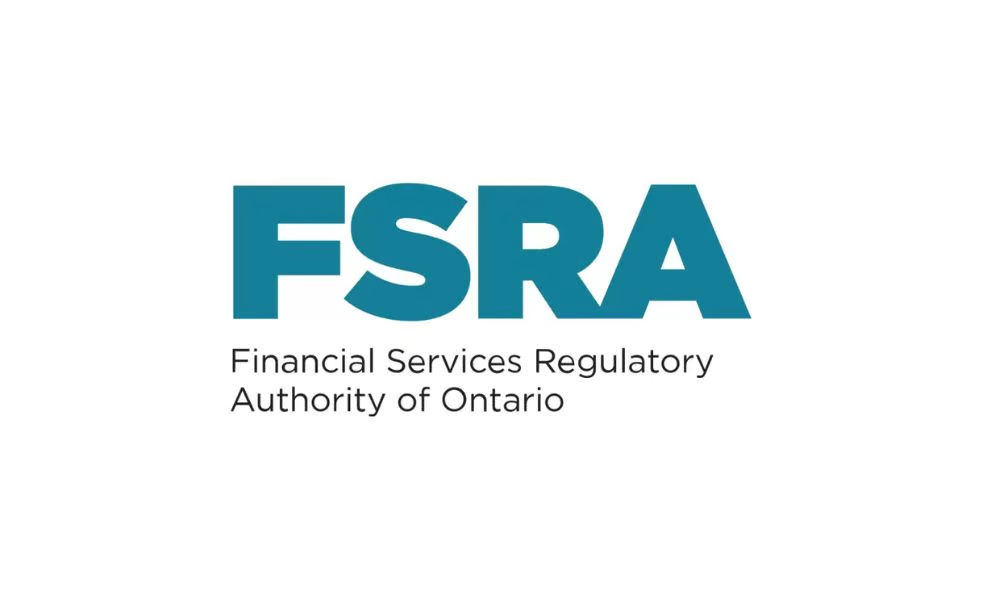

# Aspects juridiques et réglementaires

::: {.act-objectifs}

Objectifs du chapitre

- Situer l’assurance dans son cadre juridique et réglementaire au Canada et au Québec ;
- Comprendre le partage constitutionnel des compétences en matière d’assurance et le rôle respectif des autorités fédérales et provinciales ;
- Distinguer la surveillance prudentielle de l’encadrement des activités de marché ;
- Identifier les principaux organismes de régulation en assurance et comprendre leur champ d’intervention ;
- Reconnaître l’importance du contrat d’assurance comme fondement juridique de la mutualisation des risques ;
- Comprendre certaines notions juridiques clés qui influencent directement la pratique actuarielle, notamment l’intérêt assurable, le principe indemnitaire, la subrogation, la prescription et la charge de la preuve.

:::

## Introduction

L’assurance est une activité économique fortement encadrée par le droit. Les produits assurantiels, les contrats, les pratiques commerciales, la capitalisation des assureurs et la protection des assurés ne relèvent pas uniquement de considérations techniques ou financières, mais s’inscrivent dans un cadre juridique et réglementaire précis.  Pour l’actuaire, comprendre ce cadre ne relève pas d’un simple complément théorique. Les règles juridiques influencent directement la conception des produits, la tarification, la gestion des risques, la solvabilité des assureurs et les obligations envers les assurés. Elles déterminent également les limites dans lesquelles les modèles actuariels peuvent être appliqués en pratique.

Pas d'inquiétude: on ne forme pas des avocats dans un programme d'actuariat

Au Canada, le cadre juridique de l’assurance présente deux caractéristiques structurantes. D’une part, la réglementation de l’assurance repose sur un partage constitutionnel des compétences entre le gouvernement fédéral et les provinces. D’autre part, les règles de droit applicables aux relations contractuelles ne reposent pas partout sur les mêmes fondements juridiques, ce qui confère au système canadien une structure particulière.

Ce chapitre vise à présenter les bases juridiques et réglementaires essentielles à la compréhension de l’assurance au Canada et au Québec. Il ne s’agit évidemment pas de former des juristes, mais de fournir aux futurs actuaires les repères nécessaires pour situer leur pratique professionnelle dans son cadre légal, comprendre le rôle des différentes autorités de réglementation et saisir les implications concrètes de ce cadre sur l’exercice de l’actuariat.

## Le droit et l’assurance

### Les grandes branches du droit

Dans le cadre du système juridique canadien, le domaine du droit est généralement divisé en deux grands volets : le droit civil et le droit criminel. Cette distinction sert à situer les différentes règles juridiques selon leur objet. Le droit criminel vise à sanctionner certains comportements considérés comme portant atteinte à l’ordre public, tandis que le droit civil encadre les relations juridiques entre les personnes, notamment par l’entremise de contrats et d’obligations.  Cette classification n’a toutefois rien d’universel. Dans d’autres systèmes juridiques, le droit peut être structuré différemment. Par exemple, certains États accordent une place centrale au droit religieux, au droit coutumier ou au droit administratif, sans que la distinction entre droit civil et droit criminel occupe le même rôle structurant qu’au Canada.

Dans le contexte canadien, et en particulier pour l’étude de l’assurance, cette distinction demeure pertinente, puisque l’assurance relève clairement du droit civil, c’est-à-dire du droit qui encadre les relations contractuelles entre personnes.  Elle repose sur des contrats conclus entre un assureur et un preneur, lesquels établissent des droits et des obligations réciproques. Les notions centrales de l’assurance — consentement, bonne foi, obligation d’information, interprétation des clauses, responsabilité contractuelle — sont toutes issues du droit civil.

Même si certaines infractions peuvent être commises dans le contexte de l’assurance (fraude, fausses déclarations intentionnelles, détournement de fonds), ces situations relèvent alors du droit criminel de manière accessoire. Le fonctionnement normal de l’assurance, la validité des contrats et le règlement des différends entre assureurs et assurés demeurent des questions de droit civil. Pour comprendre le cadre juridique de l’assurance, il est donc essentiel de se placer dans une logique civile et contractuelle, plutôt que pénale.

### Historique

Dans le domaine du droit civil, le Canada présente une particularité importante : il existe deux systèmes juridiques distincts :  

  - Au Québec, le droit civil est basé sur un code, soit le Code civil du Québec.  
  - Dans les autres provinces et territoires, le droit civil repose sur la *Common Law*.

Cette dualité trouve son origine dans [l’histoire](https://justice.gc.ca/fra/pr-rp/sjc-csj/pji-ilp/hist/index.html). Notons tout d'abord que jusqu’au milieu du 18e siècle, le territoire correspondant à l’actuelle province du Québec faisait partie d'un territoire appelé *la Nouvelle-France*, une colonie de la France en Amérique du Nord. Durant cette période, les relations civiles y étaient régies par le droit civil français, principalement la [Coutume de Paris](https://fr.wikipedia.org/wiki/Coutume_de_Paris), qui constituait un ensemble de règles applicables aux contrats, aux biens et aux obligations entre personnes.

À la suite de la conquête britannique de la Nouvelle-France, achevée en 1760 avec la capitulation de Montréal, le territoire de la Nouvelle-France passe sous l’autorité du Royaume-Uni. Le droit anglais, issu d’une tradition de droit coutumier et jurisprudentiel développée en Angleterre depuis la conquête normande de 1066, repose largement sur les décisions rendues par les tribunaux. Cette tradition, influencée notamment par certaines pratiques issues du [droit de la Normandie](https://fr.wikipedia.org/wiki/Coutume_de_Normandie), évoluera progressivement vers ce que l’on désigne aujourd’hui comme la [Common Law](https://fr.wikipedia.org/wiki/Common_law).

Pas d'inquiétude (bis): on ne forme pas des historiens et je ne suis pas professeur d'histoire

Après une tentative infructueuse d’imposer le droit anglais au Québec, le Parlement britannique adopte [l’Acte de Québec de 1774](https://fr.wikipedia.org/wiki/Acte_de_Qu%C3%A9bec), qui rétablit officiellement l’application du droit civil français comme système juridique applicable à la province du  Québec. Par la suite, l’évolution constitutionnelle du Canada a permis au Québec de conserver un droit civil codifié, tandis que les autres provinces et territoires ont continué d’appliquer la *Common Law*.

Au Québec, le maintien du droit civil a toutefois soulevé des difficultés importantes. Le droit civil français d’origine était un droit ancien, fragmenté et partiellement devenu inadapté à une société moderne. De plus, l’abolition du régime seigneurial en 1854 et l’adoption successive de nombreuses lois avaient contribué à créer un ensemble juridique complexe et peu cohérent.  Afin de remédier à cette situation, un processus de codification a été entrepris en 1857, inspiré du Code Napoléon de 1804. Ce travail a mené à l’adoption, en 1866, du [Code civil du Bas-Canada](https://fr.wikipedia.org/wiki/Code_civil_du_Bas-Canada). Ce code a ensuite été remplacé en 1994 par le [Code civil du Québec](https://www.bibliotheque.assnat.qc.ca/guides/fr/code-civil-du-quebec-du-bas-canada-a-aujourd-hui/397-code-civil-du-quebec-1991), qui constitue aujourd’hui la pierre angulaire du droit civil québécois, y compris en matière d’assurance.

Dans les autres provinces, à majorité anglophone, la Common Law s’est appliquée dès leur création. Elle repose sur les précédents judiciaires et sur une évolution progressive du droit à travers les décisions des tribunaux. Cette coexistence de deux systèmes juridiques civils au Canada a des conséquences directes sur la manière dont les contrats d’assurance sont rédigés, interprétés et appliqués, en particulier au Québec.

::: {.callout-note icon=false}
## Exemple simplifié 

On considère un exemple volontairement simplifié afin d’illustrer la différence de logique entre les systèmes juridiques.  Supposons qu’un assureur souhaite offrir un nouveau produit d’assurance couvrant un risque particulier.  

  - Dans une logique de Common Law, l’analyse commence par la recherche de situations analogues ayant déjà été examinées par les tribunaux. La question centrale est la suivante: *Existe-t-il des décisions judiciaires ou des principes jurisprudentiels qui permettent ou limitent un contrat de ce type ?*  Le raisonnement consiste alors à comparer le produit envisagé à des cas existants, afin d’évaluer s’il s’inscrit dans une continuité jurisprudentielle acceptable.  

  - Dans une logique de droit civil codifié, comme au Québec, l’analyse commence par l’examen du Code civil. La question centrale est la suivante :  *Comment le Code encadre-t-il ce type de contrat et quelles règles générales s’appliquent ?*  Le raisonnement consiste à interpréter les dispositions pertinentes du Code afin de déterminer si le contrat envisagé est compatible avec la structure et les limites prévues par le texte.

:::

 

## Le partage constitutionnel des compétences

### Fondements constitutionnels

Le cadre juridique de l’assurance au Canada ne peut être compris indépendamment de la structure politique du pays. Le Canada est un État fédéral, c’est-à-dire un État composé de plusieurs entités territoriales — les provinces — qui disposent de leurs propres compétences juridiques, tout en partageant certaines responsabilités avec un gouvernement central, appelé le gouvernement fédéral. Cette structure fédérale s’est mise en place au moment de la [création du Canada en 1867](https://www.lhistoire.fr/1867-naissance-du-canada), lorsque plusieurs colonies britanniques d’Amérique du Nord se sont regroupées pour former un nouvel État. Parmi celles-ci se trouvait notamment le territoire correspondant à l’actuelle province du Québec, qui était alors une colonie britannique héritière de l’ancienne Nouvelle-France.  Ces colonies, devenues des provinces, ont conservé une partie de leurs institutions juridiques et de leurs traditions propres. Cette continuité explique notamment pourquoi le Québec a maintenu un système de droit civil, tandis que les autres provinces ont conservé un système fondé sur la *Common Law*.

La structure constitutionnelle du Canada, établie principalement par la [Loi constitutionnelle de 1867](https://fr.wikipedia.org/wiki/Loi_constitutionnelle_de_1867), ne confère pas explicitement la compétence exclusive sur l’assurance à un seul ordre de gouvernement. Elle attribue plutôt certaines compétences générales au gouvernement fédéral et d’autres aux provinces, ce qui a mené, au fil du temps, à une répartition fonctionnelle des responsabilités en matière d’assurance.

### Le partage des compétences en matière d’assurance

Dans le cadre constitutionnel canadien, l’assurance relève à la fois du gouvernement fédéral et des provinces. Ce partage des compétences s’explique par la nature même de l’assurance, qui combine une activité financière exercée par des institutions et une relation contractuelle entre parties privées.  De façon générale, le partage des responsabilités peut être résumé comme suit :

- **Le gouvernement fédéral** intervient principalement sur les aspects prudentiels et financiers, notamment en ce qui concerne :
  - la stabilité du système financier à l’échelle nationale ;
  - la solidité financière des institutions d’assurance ;
  - les exigences de capital et de solvabilité ;
  - la capacité des assureurs à honorer leurs engagements, y compris dans des contextes économiques défavorables ou exceptionnels.

  Cette intervention s’exerce à l’échelle institutionnelle et systémique. Elle ne vise pas à encadrer le contenu des contrats d’assurance, mais plutôt à préserver la viabilité financière des assureurs et la confiance du public envers le système financier.

- **Les provinces** exercent leurs compétences principalement à travers le droit privé et la réglementation des activités commerciales sur leur territoire. Elles sont notamment responsables :
  - des règles applicables aux contrats d’assurance ;
  - de l’encadrement des produits offerts au public ;
  - de la distribution des produits d’assurance et de la conduite des intermédiaires ;
  - de la protection des consommateurs et des mécanismes de traitement des plaintes.

  Au Québec, ces compétences s’appuient en particulier sur le Code civil du Québec, qui définit le contrat d’assurance et les obligations des parties, ainsi que sur des lois spécifiques encadrant la commercialisation et la distribution des produits d’assurance.

La conséquence directe de ce partage est qu’un même assureur peut être soumis simultanément à des exigences relevant de deux ordres de gouvernement. Une institution peut ainsi être surveillée sur le plan de sa solidité financière par le gouvernement fédéral, tout en étant encadrée, sur le plan contractuel et commercial, par les autorités provinciales lorsqu’elle offre des produits à des assurés.

### Notion de surveillance prudentielle

Ce qu'on nomme ici la surveillance prudentielle désigne l’ensemble des mécanismes par lesquels un organisme de réglementation vise à s’assurer qu’un assureur est en mesure de respecter ses engagements financiers envers les assurés, même dans des conditions défavorables. Elle porte sur l’assureur en tant qu’institution financière et non sur le contenu détaillé des contrats conclus avec les assurés.

Du point de vue actuariel, cette surveillance prudentielle consiste principalement à encadrer la manière dont les risques sont identifiés, mesurés, financés et gérés à l’échelle globale de l’assureur. Elle vise à réduire la probabilité de défaillance de l’institution et à limiter l’impact systémique qu’une telle défaillance pourrait avoir sur les assurés et sur le système financier.

::: {.callout-important}
## Formation en actuariat
Cette logique prudentielle repose directement sur des outils quantitatifs et mathématiques qui constituent le coeur de la formation en actuariat. L’évaluation de la suffisance du capital, la modélisation des engagements futurs, l’analyse de scénarios défavorables, les tests de résistance et la quantification des risques extrêmes exigent une maîtrise approfondie des probabilités, des statistiques, des modèles stochastiques et des méthodes d’optimisation. À cet égard, les études en actuariat visent précisément à doter les futurs actuaires des compétences nécessaires pour intervenir dans ce cadre prudentiel. Les notions enseignées en tarification, en provisionnement, en modélisation des risques et en gestion du capital trouvent une application directe dans les exigences de surveillance prudentielle imposées aux assureurs. L’actuariat joue ainsi un rôle central dans la traduction quantitative des objectifs de solidité financière poursuivis par les organismes de réglementation.
:::

Mais pour revenir concrètement au contenu de la surveillance prudentielle, elle concerne notamment :

- la suffisance du capital et des marges de solvabilité en fonction du profil de risque de l’assureur ;
- la qualité et la cohérence des hypothèses utilisées pour le provisionnement des engagements futurs ;
- la gestion des risques d’assurance, de marché, de crédit, de liquidité et opérationnels ;
- la gouvernance et les mécanismes de contrôle interne liés à la prise de risque ;
- la capacité de l’assureur à absorber des chocs adverses, notamment à l’aide d’analyses de scénarios et de tests de résistance.

La surveillance prudentielle ne vise donc pas à empêcher la prise de risque, mais à s’assurer que les risques assumés par l’assureur sont compatibles avec ses ressources financières, sa structure de gouvernance et sa capacité globale de gestion des risques. Elle constitue un cadre dans lequel l’actuariat joue un rôle central, tant pour la quantification des risques que pour l’évaluation de la suffisance des ressources nécessaires pour les couvrir.

## La réglementation de l’assurance

La réglementation de l’assurance au Canada repose sur un ensemble de lois et de règlements qui ne s’appliquent pas selon une logique unique. Certaines règles encadrent l’assureur en tant qu’institution financière, tandis que d’autres encadrent les activités d’assurance exercées sur un territoire donné, notamment les contrats conclus avec les assurés et les pratiques de mise en marché. Il en résulte qu’un assureur n’est pas régi par un seul régime juridique homogène, mais par une superposition de normes qui dépendent à la fois de sa constitution juridique et des territoires où il exerce ses activités. La réglementation de l’assurance ne peut donc être comprise uniquement à partir de la charte de l’assureur, même si celle-ci joue un rôle structurant dans l’architecture réglementaire.

### Les chartes des assureurs

La notion de charte d’un assureur a déjà été rapidement couverte lors d'un chapitre précédent.  Pour rappel, la charte d'un assureur permet d’identifier la juridiction en vertu de laquelle une personne morale est constituée comme assureur. De façon générale, la charte d’un assureur déterminera l’autorité responsable de sa surveillance prudentielle principale (comme, entre autres l'Autorité des Marchés Financiers (AMF) du Québec que nous avions introduit plus tot). End'autres mots, la charte fixe le cadre institutionnel applicable à l’assureur, notamment en matière de gouvernance, d’exigences de capital et de contrôle prudentiel. En revanche, la charte ne détermine pas, à elle seule, le droit applicable aux contrats d’assurance conclus sur un territoire donné ni l’ensemble des règles encadrant les activités d’assurance qui y sont exercées.

Pour rappel, le droit canadien de l’assurance distingue plusieurs types de chartes selon la juridiction en vertu de laquelle l’assureur est constitué. Cette distinction, déjà présentée dans un chapitre précédent sous un angle descriptif, peut maintenant être précisée quant à sa portée juridique.

- **Assureurs à charte du Québec**

  La charte québécoise renvoie au régime de constitution d’un assureur en vertu du droit québécois. Elle situe l’assureur dans l’ordre juridique du Québec en tant que personne morale et détermine l’autorité responsable de sa surveillance prudentielle principale. À ce titre, l’assureur est intégré au cadre institutionnel québécois, tant pour sa gouvernance que pour ses exigences prudentielles. Toutefois, la charte québécoise ne constitue pas en soi une autorisation d’exercer des activités d’assurance. L’exercice effectif des activités demeure conditionnel à une autorisation délivrée par l’Autorité des marchés financiers. Par ailleurs, la charte ne crée pas un régime contractuel autonome : les contrats conclus avec des assurés québécois sont régis par les règles générales du Code civil du Québec, indépendamment de la charte.

- **Assureurs à charte d’une autre province ou d’un territoire canadien**

  Un assureur constitué sous une charte provinciale ou territoriale autre que celle du Québec relève, pour sa constitution et sa surveillance prudentielle principale, de l’ordre juridique de sa juridiction d’origine. Sa personnalité juridique n’est donc pas fondée sur le droit québécois. Néanmoins, dès lors qu’il exerce des activités d’assurance au Québec, cet assureur est assujetti aux lois québécoises applicables aux activités exercées sur le territoire. Cette situation illustre la dissociation entre le régime de constitution de l’assureur, déterminé par la charte, et le droit applicable aux contrats d’assurance et aux pratiques de marché, déterminé par le lieu d’exercice des activités.

- **Assureurs à charte du Canada**

  La charte fédérale place l’assureur sous le régime de constitution prévu par la législation fédérale, notamment la Loi sur les sociétés d’assurances. Elle confère à l’assureur une reconnaissance institutionnelle à l’échelle canadienne et soumet sa surveillance prudentielle principale à l’autorité fédérale compétente, en particulier en matière de capitalisation, de gestion des risques et de gouvernance. Cette reconnaissance nationale n’a toutefois pas pour effet d’uniformiser le droit applicable aux activités d’assurance exercées dans les provinces. Lorsqu’un assureur à charte fédérale opère au Québec, il demeure soumis aux exigences provinciales relatives à la distribution des produits, aux contrats d’assurance et à la protection des assurés. La charte fédérale organise donc le cadre institutionnel de l’assureur, sans écarter l’application du droit provincial aux activités exercées localement.

- **Assureurs à charte étrangère**

  Les assureurs constitués sous une charte étrangère relèvent, pour leur existence juridique, du droit de l’État ou du pays où ils sont constitués. Lorsqu’ils exercent des activités d’assurance au Canada, notamment par l’entremise d’une succursale autorisée, ils sont intégrés au cadre réglementaire canadien pour les aspects prudentiels relevant de la compétence fédérale. Comme pour les autres catégories d’assureurs, la charte étrangère n’a pas d’incidence sur le droit applicable aux contrats conclus au Québec. Les activités exercées sur le territoire québécois demeurent soumises aux lois provinciales applicables, en particulier aux règles du Code civil du Québec en matière de contrats d’assurance.

### Application des lois et règlements

La coexistence de plusieurs sources normatives implique qu’un même assureur peut être assujetti simultanément à différents régimes juridiques. Le cadre juridique applicable dépend à la fois de la charte en vertu de laquelle l’assureur est constitué et des territoires où il exerce effectivement des activités d’assurance. Le régime de constitution de l’assureur et sa surveillance prudentielle principale découlent de sa charte. Celle-ci détermine notamment l’autorité responsable du contrôle institutionnel de l’assureur, en particulier en matière de gouvernance, de capitalisation et de gestion des risques.

## Organismes de régulation

### Bureau du surintendant des institutions financières (BSIF)

La réglementation fédérale de l’assurance au Canada vise principalement à assurer la solidité financière des institutions et la stabilité du système financier dans son ensemble. Elle s’inscrit dans une logique prudentielle et systémique, centrée sur la capacité des assureurs à honorer leurs engagements envers les assurés, y compris dans des contextes économiques défavorables. Elle ne porte pas directement sur le contenu des contrats d’assurance ni sur les relations contractuelles individuelles.

Le Bureau du surintendant des institutions financières, désigné par l’acronyme BSIF en français et OSFI en anglais, est un organisme indépendant créé par une loi du Parlement du Canada. Il est responsable de la surveillance prudentielle des institutions financières de compétence fédérale, incluant notamment les banques et les sociétés d’assurance constituées sous charte fédérale, ainsi que les succursales canadiennes d’assureurs étrangers.

Le rôle du BSIF consiste à évaluer la solidité financière des institutions qu’il supervise et à s’assurer qu’elles disposent de ressources suffisantes pour faire face à leurs risques. Cette surveillance porte notamment sur le capital, la solvabilité, la gouvernance et les mécanismes de gestion des risques, dans une perspective de stabilité du système financier.

Dans le cadre de ses fonctions, le BSIF élabore et applique des normes prudentielles et participe à des mécanismes de coopération nationale et internationale en matière de réglementation financière. Son intervention vise l’assureur en tant qu’institution financière et s’exerce indépendamment des règles provinciales qui encadrent les activités d’assurance exercées sur un territoire donné.

### Autorité des marchés financiers (AMF)

Au Québec, la réglementation de l’assurance relève principalement de la compétence provinciale et s’inscrit dans le cadre du droit civil et de la réglementation des activités commerciales. Elle vise à encadrer les produits offerts au public, leur distribution et les relations contractuelles entre les assureurs, les intermédiaires et les assurés.

Contrairement à la réglementation fédérale, qui est centrée sur la solidité financière des institutions, l’encadrement provincial porte directement sur la conception et la mise en marché des produits d’assurance. Il concerne notamment l’information fournie aux assurés, l’administration des contrats, le règlement des sinistres et le traitement des plaintes. La protection des consommateurs constitue ainsi un objectif central de l’intervention provinciale en assurance.

L’Autorité des marchés financiers est l’organisme public responsable de cet encadrement au Québec. En matière d’assurance, elle exerce un double rôle. D’une part, elle assure la surveillance prudentielle des assureurs constitués sous charte québécoise. D’autre part, elle encadre la conduite de marché de l’ensemble des assureurs autorisés à exercer au Québec, quelle que soit leur charte de constitution.

En pratique, tout assureur qui souhaite offrir des produits d’assurance au Québec doit être autorisé par l’AMF et se conformer aux règles provinciales applicables, notamment celles découlant de la Loi sur les assureurs, de la Loi sur la distribution de produits et services financiers et du Code civil du Québec. Cette exigence s’applique également aux assureurs à charte fédérale ou étrangère pour leurs activités exercées sur le territoire québécois.

### Financial Services Regulatory Authority of Ontario (FSRA)

En Ontario, la réglementation de l’assurance relève principalement de la compétence provinciale et s’inscrit dans le cadre du droit commun (*common law*) et de la réglementation des activités financières et commerciales. Elle vise à encadrer les produits offerts au public, leur distribution ainsi que les relations contractuelles entre les assureurs, les intermédiaires et les assurés.

À l’instar des autres provinces canadiennes, l’encadrement ontarien se distingue de la réglementation fédérale, laquelle est principalement axée sur la solidité financière et la solvabilité globale des institutions. La réglementation provinciale porte plutôt sur la conception, la distribution et l’administration des produits d’assurance. Elle concerne notamment l’information transmise aux assurés, les pratiques de vente, la gestion des contrats, le règlement des sinistres et le traitement des plaintes. La protection du public constitue un objectif central de cette intervention provinciale.

La *Financial Services Regulatory Authority of Ontario* (FSRA) est l’organisme public responsable de cet encadrement en Ontario. En matière d’assurance, elle exerce un rôle comparable à celui des autorités provinciales des autres juridictions canadiennes. D’une part, elle assure la surveillance prudentielle des assureurs constitués sous charte ontarienne. D’autre part, elle encadre la conduite de marché de l’ensemble des assureurs autorisés à exercer des activités en Ontario, indépendamment de leur charte de constitution.

En pratique, tout assureur qui souhaite offrir des produits d’assurance en Ontario doit être autorisé par la FSRA et se conformer aux règles provinciales applicables, notamment celles découlant de la *Insurance Act* de l’Ontario et des règlements connexes. Cette obligation s’applique également aux assureurs à charte fédérale ou étrangère pour les activités qu’ils exercent sur le territoire ontarien.

::: {.callout-warning icon=false}
### Collaboration pratique entre le BSIF et l’AMF

Même si la compétence prudentielle d’un assureur peut relever du fédéral, par l’entremise du Bureau du surintendant des institutions financières, ou de la province, par l’entremise de l’Autorité des marchés financiers par exemple, ces organismes ne fonctionnent pas de manière isolée dans la pratique. LE BSIF et l'AMF, entre autres, participent à des mécanismes de communication, d’échange d’information et de coordination, en particulier lorsque les activités d’un assureur soulèvent des enjeux interprovinciaux ou systémiques. Cette logique de collaboration est reconnue dans plusieurs travaux portant sur la supervision financière au Canada. 
:::

## Comparaison concrète pour un assureur exerçant au Québec

Quel que soit le type de charte sous lequel un assureur est constitué, toute activité d’assurance exercée sur le territoire québécois relève de l’Autorité des marchés financiers. En revanche, l’organisme responsable de la surveillance prudentielle principale dépend de la juridiction de constitution de l’assureur. Cette distinction permet de situer concrètement le rôle respectif des autorités fédérales et provinciales.

- **Assureur à charte du Canada**

  - Surveillance prudentielle principale exercée par le Bureau du surintendant des institutions financières.
  - Encadrement des activités exercées au Québec assuré par l’Autorité des marchés financiers, notamment pour :
    - l’autorisation d’exercer ;
    - les produits offerts et leur distribution ;
    - l’application du Code civil du Québec ;
    - la protection des consommateurs.

- **Assureur à charte du Québec**

  - Surveillance prudentielle et encadrement des activités exercés entièrement par l’Autorité des marchés financiers.
  - Absence de relation institutionnelle directe avec le Bureau du surintendant des institutions financières, sauf dans des contextes exceptionnels de coordination nationale.

- **Assureur à charte d’une autre province ou d’un territoire canadien**

  - Surveillance prudentielle principale exercée par l’autorité de la juridiction de constitution de l’assureur.
  - Absence de surveillance prudentielle institutionnelle exercée par le BSIF ou par l’Autorité des marchés financiers.
  - Obligation de travailler avec l’Autorité des marchés financiers pour toute activité exercée au Québec, notamment en matière de contrats, de distribution et de protection des assurés.

- **Assureur à charte étrangère**

  - Surveillance prudentielle exercée par le Bureau du surintendant des institutions financières pour les activités canadiennes (succursale ou entité autorisée).
  - Encadrement des activités exercées au Québec assuré par l’Autorité des marchés financiers.
  - Maintien d’obligations réglementaires à l’égard de la juridiction étrangère d’origine.

La synthèse ci-dessous met en évidence que, quelle que soit la charte de constitution, toute activité d’assurance exercée au Québec relève de l’Autorité des marchés financiers, tandis que la surveillance prudentielle principale dépend de la juridiction de constitution de l’assureur.

| Type d’assureur | Surveillance prudentielle principale | Encadrement des activités au Québec |
|-----------------|--------------------------------------|-------------------------------------|
| Charte du Canada | Bureau du surintendant des institutions financières | Autorité des marchés financiers |
| Charte du Québec | Autorité des marchés financiers | Autorité des marchés financiers |
| Charte d’une autre province ou territoire | Autorité provinciale d’origine | Autorité des marchés financiers |
| Charte étrangère | Bureau du surintendant des institutions financières (succursale canadienne) | Autorité des marchés financiers |

::: {.callout-note icon=false}
### Clarification importante : compétence prudentielle et charte de l’assureur

Plus haut dans ce chapitre, il a été indiqué que les aspects prudentiels de l’assurance relèvent principalement de la compétence fédérale. Il est donc légitime de se demander pourquoi un assureur constitué sous charte du Québec n’a pas à travailler directement avec le Bureau du surintendant des institutions financières.

La réponse tient au fait que la compétence prudentielle n’est pas attribuée de manière abstraite à un seul ordre de gouvernement, mais qu’elle est exercée **en fonction de la juridiction de constitution de l’assureur**. Lorsque l’assureur est une institution de compétence fédérale, la surveillance prudentielle relève du cadre fédéral. Lorsque l’assureur est une institution de compétence provinciale, cette surveillance relève de l’autorité provinciale compétente.

Ainsi, un assureur à charte du Québec est soumis à des exigences prudentielles réelles et substantielles, mais celles-ci sont exercées par l’Autorité des marchés financiers plutôt que par le Bureau du surintendant des institutions financières. Il n’y a donc pas d’exception ou de vide réglementaire, mais une application cohérente du partage des compétences dans un État fédéral.

Cette distinction permet de concilier l’intervention du gouvernement fédéral en matière de stabilité financière avec l’autonomie provinciale en matière de constitution et de supervision des institutions d’assurance.
:::

### Choix de la charte pour un assureur

La répartition des chartes observée sur le marché québécois reflète généralement une logique institutionnelle liée à la portée géographique recherchée par l’assureur et aux coûts juridiques et opérationnels associés aux différents régimes de constitution.

- **Assureurs visant une présence interprovinciale**

  Lorsqu’un assureur souhaite exercer des activités dans plusieurs provinces, la charte fédérale offre un cadre institutionnel unique à l’échelle canadienne. Elle permet d’unifier la constitution de l’assureur, sa surveillance prudentielle principale et ses exigences de gouvernance sous l’autorité du Bureau du surintendant des institutions financières. L’assureur demeure tenu d’obtenir les autorisations nécessaires dans chaque province où il offre des produits, mais il évite la multiplication de régimes prudentiels distincts et l’adaptation répétée de sa structure institutionnelle.

  À l’inverse, un assureur constitué sous la charte d’une autre province ou d’un territoire canadien conserve une surveillance prudentielle principale exercée par sa juridiction d’origine. Lorsqu’il étend ses activités à d’autres provinces, il doit composer avec une multiplication des interactions réglementaires, tant pour l’accès aux marchés que pour l’adaptation de sa conformité aux exigences propres à chaque territoire. Dans un contexte d’expansion nationale, cette trajectoire est souvent perçue comme moins efficace que l’adoption d’une charte fédérale dès le départ, ce qui contribue à la sous-représentation des assureurs à charte provinciale non québécoise sur le marché québécois.

- **Assureurs constitués au Québec et continuité institutionnelle**

  La forte présence d’assureurs à charte du Québec parmi les assureurs historiquement québécois s’explique fréquemment par une continuité institutionnelle. Plusieurs de ces assureurs ont été constitués et développés dans un cadre où leur marché principal était le Québec, et où la conception des produits, la distribution et les relations contractuelles étaient structurées autour du droit civil québécois et de l’encadrement provincial.

  Dans ce contexte, conserver une charte du Québec ne constitue pas une anomalie, mais un choix cohérent avec une stratégie centrée sur le marché québécois. La charte québécoise place l’assureur sous une surveillance prudentielle principale exercée au Québec et l’inscrit dans un environnement réglementaire où l’essentiel des enjeux commerciaux, contractuels et de conduite de marché se situent déjà sur le territoire. Il est également important de souligner qu’un passage d’une charte du Québec vers une charte fédérale n’est pas une simple formalité administrative. Une telle transition implique un changement institutionnel substantiel, notamment en matière de gouvernance, de reddition de comptes et de surveillance prudentielle. Même lorsqu’un assureur québécois envisage une expansion au-delà du Québec, l’arbitrage entre la continuité de son cadre institutionnel et les avantages d’une charte fédérale peut donc être non trivial.

Dans l’ensemble, on observe une double tendance : les assureurs à vocation pancanadienne privilégient souvent une charte fédérale, tandis que plusieurs assureurs québécois conservent une charte du Québec lorsque leur modèle d’affaires demeure principalement ancré sur le marché québécois.

## Le contrat d’assurance

Jusqu’ici, le chapitre a surtout présenté l’architecture institutionnelle de la réglementation : le partage des compétences, la distinction entre surveillance prudentielle et conduite de marché, ainsi que le rôle des organismes de régulation. La question devient maintenant plus concrète : une fois qu’un assureur est autorisé à exercer et qu’il est encadré sur le plan prudentiel et commercial, quel est l’objet juridique central sur lequel repose l’assurance elle-même ?

Cet objet est le contrat d’assurance. C’est lui qui définit les garanties, les exclusions, les obligations de déclaration, les délais, les droits de recours et, plus largement, les conditions dans lesquelles le risque est effectivement mutualisé. Autrement dit, même lorsque les calculs actuariels sont exacts, ils ne valent que dans les limites du contrat : ce qui est assuré, ce qui ne l’est pas, et les circonstances dans lesquelles une prestation sera due.

Dans un cours d’introduction à l’actuariat, il n’est ni nécessaire ni souhaitable d’entrer dans une analyse détaillée du droit des assurances. Toutefois, certaines notions civiles structurantes influencent directement la tarification, la conception des produits, la gestion des sinistres et le provisionnement. Elles agissent comme des contraintes de base sur les données observées (déclarations, sinistres, contestations), sur les comportements des assurés et sur les coûts ultimement supportés par l’assureur. Les éléments présentés ci-dessous correspondent à des notions juridiques fondamentales qui encadrent le contrat d’assurance et qui influencent directement la manière dont les risques sont tarifés, gérés et observés en pratique actuarielle.

### Notions générales sur les contrats au Québec

Au Québec, un contrat est un accord de volonté par lequel une ou plusieurs personnes s’obligent envers une ou plusieurs autres à faire quelque chose qui est stipulé dans le contrat. La bonne foi doit gouverner la conduite des parties tant au moment de la naissance de l’obligation qu’à celui de son exécution ou de son extinction. Les catégories de contrat suivantes sont utiles pour qualifier un contrat, y compris un contrat d’assurance.

- **Contrat de gré à gré et contrat d’adhésion**  
  Un contrat d’adhésion existe lorsque les stipulations essentielles ont été imposées ou rédigées par une partie et ne pouvaient être librement discutées. L’article 1432 du Code civil indique que le contrat d’adhésion s’interprète en faveur de l’adhérent et contre celui qui a rédigé le contrat. Un contrat qui n’est pas un contrat d’adhésion est un contrat de gré à gré.

- **Contrat unilatéral ou bilatéral**  
  Un contrat unilatéral existe lorsqu’une des parties s’oblige envers l’autre sans obligation corrélative de la part de cette dernière. Un contrat bilatéral existe lorsque les parties s’obligent réciproquement.

- **Contrat à titre onéreux ou à titre gratuit**  
  Un contrat est à titre onéreux lorsque chaque partie retire un avantage en échange de son obligation. Il est à titre gratuit lorsqu’une partie s’oblige pour le bénéfice de l’autre sans avantage en retour.

- **Contrat commutatif ou aléatoire**  
  Un contrat est commutatif lorsque l’étendue des obligations et des avantages est certaine et déterminée au moment où il est conclu. Il est aléatoire lorsque l’étendue de l’obligation ou des avantages est incertaine.

- **Contrat à exécution instantanée ou successive**  
  Un contrat est à exécution instantanée lorsque les obligations s’exécutent en une seule fois. Il est à exécution successive lorsque les obligations s’exécutent en plusieurs fois ou de façon continue.

::: {.callout-note icon=false}

### Le contrat d’assurance 

Ainsi, un contrat d’assurance est un contrat par lequel un assureur s’engage, en contrepartie du paiement d’une prime, à verser une prestation si un événement incertain survient. En pratique, un contrat d’assurance présentera donc généralement les caractéristiques suivantes :

- Il s’agit d’un contrat d’adhésion, puisque les conditions sont habituellement rédigées par l’assureur et ne sont pas librement négociées.
- Il s’agit d’un contrat bilatéral : l’assuré doit payer une prime et l’assureur doit fournir la garantie prévue au contrat.
- Il s’agit d’un contrat à titre onéreux, chaque partie recevant un avantage en échange de son obligation.
- Il s’agit d’un contrat aléatoire, puisque l’obligation de l’assureur dépend de la survenance d’un événement incertain.
- Il s’agit généralement d’un contrat à exécution successive, la garantie étant fournie pendant toute la durée du contrat.

Puisqu'il s'agit d'un contrat d'adhésion, il est intéressant de mentionner que cela signifie qu'en cas d’ambiguïté importante sur le contrat, l’interprétation légale aura tendance à favoriser l’assuré.

:::

### Notion de nullité

Le Code civil prévoit la notion de nullité des contrats.

- Un contrat ou une disposition nulle est réputé n’avoir jamais existé juridiquement. Les parties doivent alors, en principe, se restituer les prestations reçues.  
- La nullité peut être absolue ou relative :

  - **Nullité absolue**  
    Elle sanctionne la violation d’une règle visant la protection de l’intérêt général (ordre public). Elle peut être invoquée par toute personne ayant un intérêt et peut être soulevée d’office par le tribunal.

  - **Nullité relative**  
    Elle sanctionne la violation d’une règle visant la protection d’intérêts particuliers, par exemple en présence d’un vice de consentement. Elle ne peut être invoquée que par la personne que la règle vise à protéger et peut être confirmée par celle-ci, c’est-à-dire que cette personne décide de maintenir le contrat malgré le vice.

::: {.callout-important icon=false}

## Conséquences de la nullité

En assurance, la nullité peut notamment résulter d’une fausse déclaration importante du preneur lors de la souscription.

- Si la fausse déclaration est intentionnelle, l’assureur peut demander la nullité du contrat. Le contrat est alors réputé n’avoir jamais existé, l’assureur peut conserver les primes reçues et aucune prestation n’est payable.  
- Si la fausse déclaration n’est pas intentionnelle, le contrat n’est généralement pas annulé rétroactivement. L’assureur peut plutôt ajuster les conséquences du contrat, par exemple en réduisant l’indemnité proportionnellement à la prime qui aurait dû être payée si le risque réel avait été connu.

:::

#### **Assurance-vie** {-}

Prenons un exemple en assurance-vie individuelle.

> Lors de la souscription, un preneur d’assurance doit répondre à plusieurs questions sur son état de santé.  Supposons qu’une personne omette volontairement de déclarer une maladie grave dont elle a connaissance. L’assureur accepte alors le contrat en croyant que le risque est normal.  

Si l’assureur découvre que la fausse déclaration était intentionnelle et déterminante pour l’évaluation du risque, il peut demander la nullité du contrat. Le contrat est alors réputé n’avoir jamais existé. Aucune prestation n’est payable et l’assureur peut généralement conserver les primes déjà reçues. Il s’agit d’un exemple de nullité **relative** : la règle vise à protéger l’assureur contre une fausse représentation du risque lors de la formation du contrat. Seul l’assureur peut invoquer cette nullité.

#### **Assurance de dommages** {-}

Considérons maintenant un exemple en assurance de dommages.

> Supposons qu’une personne tente d’assurer un immeuble qu’elle utilise pour exploiter une activité illégale, par exemple une installation servant à la production de drogues interdites. Lors de la souscription, elle demande une assurance habitation couvrant les dommages causés par un incendie.

Si l’assureur découvre que l’assurance vise à protéger une activité illégale, le contrat peut être déclaré nul. Il s’agit d’un cas de **nullité absolue**, car le contrat est contraire à l’ordre public. La nullité peut être invoquée par toute personne ayant un intérêt et peut même être soulevée par le tribunal. Le contrat est alors réputé n’avoir jamais existé juridiquement et aucune prestation n’est payable, et, en principe, les primes payées doivent être restituées.

### Intérêt assurable 

Une autre notion centrale du contrat d’assurance est celle de l’intérêt assurable. Pour qu’un contrat d’assurance soit valide et produise ses effets, l’assuré ou le preneur doit avoir un lien reconnu avec le risque couvert. Ce lien peut être de nature économique, juridique ou personnelle, selon le type d’assurance. L’intérêt assurable vise à empêcher que l’assurance ne devienne un mécanisme de spéculation ou un simple pari sur la survenance d’un événement. Même si un risque est aléatoire, mesurable et techniquement assurable du point de vue actuariel, il ne peut faire l’objet d’un contrat valide que si l’assuré subit une perte réelle ou possède un lien juridiquement reconnu avec ce risque.

Un élément fondamental, souvent source de confusion, est que le moment où l’intérêt assurable est exigé n’est pas le même en assurance de dommages et en assurance de personnes. Cette différence explique pourquoi certaines situations posent problème dès la souscription dans un cas, alors que dans l’autre, le contrat peut demeurer valide malgré l’évolution des relations entre les personnes concernées.

#### **Assurance-vie** {-}

Prenons un exemple en assurance-vie individuelle :

> Une personne souscrit une assurance-vie temporaire de 500 000 $ sur la tête de son conjoint. Elle est à la fois preneur et bénéficiaire du contrat. Au moment de la souscription, ils vivent ensemble et partagent des obligations financières communes. Quelques années plus tard, le couple se sépare, sans que le contrat d’assurance-vie soit modifié. Plusieurs années après la séparation, l’assuré décède et l’ex-conjoint demeure désigné bénéficiaire.

Dans cet exemple, l’intérêt assurable existait clairement au moment de la formation du contrat. Le lien conjugal et la dépendance économique justifiaient la souscription de l’assurance-vie. En assurance-vie, c’est ce moment — celui de la conclusion du contrat — qui est déterminant pour apprécier l’existence de l’intérêt assurable. Le fait que la relation entre le preneur et l’assuré ait changé par la suite n’affecte pas, en soi, la validité du contrat du point de vue de l’intérêt assurable. Le contrat peut donc demeurer pleinement en vigueur même si, au moment du décès, la relation personnelle qui justifiait initialement l’assurance n’existe plus.

Les difficultés qui peuvent surgir dans ce type de situation ne concernent généralement pas l’intérêt assurable, mais plutôt la désignation du bénéficiaire, le caractère révocable ou irrévocable de cette désignation, ou encore l’absence de mise à jour du contrat à la suite d’un changement de situation personnelle. Du point de vue actuariel, cette règle confère une stabilité juridique aux contrats d’assurance-vie, qui sont conçus pour s’étendre sur de longues périodes.

#### **Assurance de dommages** {-}

Considérons maintenant un exemple en assurance habitation :

> Une personne souscrit une assurance habitation couvrant une résidence appartenant à un « ami». Elle n’est ni propriétaire, ni locataire, ni responsable légal du bien, et n’assume aucune obligation financière liée à cette résidence. Elle explique vouloir assurer la maison parce qu’elle y est attachée et « souhaite éviter que son ami subisse des difficultés financières en cas de sinistre ». 

Dans ce cas, le problème apparaît dès la souscription du contrat. En assurance de dommages, l’intérêt assurable repose sur l’existence d’une perte financière directe que subirait l’assuré si le sinistre survenait. Comme la personne n’a aucun droit sur le bien et n’en subirait aucune perte économique, elle ne possède pas d’intérêt assurable. Un tel contrat d'assurance serait dépourvu d’objet valable du point de vue juridique. 

Cette exigence joue également au moment d'une sinistre. Par exemple, si un assuré vend sa maison et conserve par erreur sa police d’assurance, un sinistre survenant après la vente ne serait pas indemnisable, puisque l’assuré n’aurait plus d’intérêt assurable au moment de la perte. En assurance de dommages, l’intérêt doit donc exister tant à la formation du contrat qu’au moment du sinistre.

### Principe indemnitaire et limites de l’indemnisation 

En assurance de dommages, le contrat est structuré autour du principe indemnitaire. L’objectif n’est pas d’enrichir l’assuré, mais de le replacer, autant que possible, dans la situation financière qui aurait été la sienne en l’absence du sinistre. Ce principe explique l’existence de plafonds, de franchises, de limites de garantie et de mécanismes d’évaluation des pertes.

Pour l’actuaire, le principe indemnitaire est essentiel pour comprendre pourquoi la distribution des sinistres observés ne correspond pas nécessairement à la distribution des pertes économiques réelles. Le contrat d’assurance modifie la forme des pertes indemnisées, en imposant des limites et des ajustements qui doivent être intégrés aux modèles de tarification et de provisionnement.

Ce principe permet également de comprendre pourquoi certaines structures contractuelles sont privilégiées dans la pratique. Les montants assurés, les clauses de valeur à neuf ou de valeur dépréciée et les limites de responsabilité ne sont pas uniquement des choix commerciaux : ils traduisent des contraintes juridiques qui influencent directement les résultats financiers de l’assureur.

#### **Assurance-vie** {-}

Prenons un exemple illustrant la différence entre assurance-vie et assurance de dommages :

> Une personne souscrit une assurance-vie temporaire de 500 000 $ sur sa propre tête. Quelques années plus tard, l’assuré décède. Les bénéficiaires reçoivent le montant prévu au contrat, soit 500 000 $, indépendamment des dépenses funéraires réelles, des dettes laissées par l’assuré ou de la situation financière exacte des bénéficiaires au moment du décès.

Cet exemple met en évidence que l’assurance-vie ne repose pas sur le principe indemnitaire. La prestation versée n’a pas pour objectif de compenser une perte financière précisément mesurée. Elle correspond plutôt à un montant convenu à l’avance lors de la souscription du contrat.

En assurance-vie, le décès n’est pas évalué comme une perte économique mesurable au sens strict. Il s’agit d’un événement certain à terme, mais incertain quant à sa date. L’indemnité versée ne cherche donc pas à replacer les bénéficiaires dans une situation financière antérieure, mais à exécuter une promesse contractuelle. Du point de vue actuariel, cela explique pourquoi la tarification repose principalement sur des modèles de mortalité et des mécanismes de capitalisation, sans évaluation ex post de la perte réelle subie par les bénéficiaires.

Cette distinction permet de comprendre pourquoi les notions de valeur réelle, de dépréciation ou de franchises n’existent pas en assurance-vie, et pourquoi le montant versé demeure identique quel que soit l’impact financier réel du décès.

#### **Assurance de dommages** {-}

Prenons maintenant un exemple en assurance habitation :

> Un propriétaire subit un incendie qui endommage gravement la cuisine de sa résidence. Le coût réel pour reconstruire la cuisine à neuf est estimé à 40 000 $. Toutefois, la police d’assurance prévoit une franchise de 2 000 $ et une indemnisation en valeur dépréciée. En tenant compte de l’usure des matériaux et de l’âge des installations, la valeur indemnisable est évaluée à 28 000 $. L’assureur verse donc une indemnité de 26 000 $ après application de la franchise.

Cet exemple illustre concrètement le principe indemnitaire. Même si la perte économique brute liée au sinistre est de 40 000 $, le montant effectivement versé par l’assureur est inférieur. Le contrat ne vise pas à financer une amélioration de la résidence ni à replacer l’assuré dans une situation meilleure que celle qui prévalait avant le sinistre.

On peut alors se demander si certaines garanties de *valeur à neuf* en assurance automobile ne déplacent pas subtilement l’objectif du contrat, en transformant partiellement une logique de compensation en une logique d’opportunité, dès lors qu’elles peuvent accroître l’incitation à la réclamation et que l’on observe, dans la pratique, une augmentation notable de la sinistralité vers la fin de la période de couverture associée à ce type de garantie.

### Subrogation 

La subrogation intervient après le paiement d’un sinistre. Elle permet à l’assureur, une fois l’indemnité versée, d’exercer les droits de l’assuré contre un tiers responsable du dommage. Cette mécanique vise à éviter qu’un même préjudice soit indemnisé plus d’une fois et à faire supporter, ultimement, le coût du sinistre à la personne qui en est responsable lorsque cela est possible.

Du point de vue actuariel, la subrogation explique pourquoi le coût final d’un sinistre peut différer du montant initialement payé. Les montants récupérés ultérieurement influencent les coûts ultimes, les résultats techniques et les flux de trésorerie. Ils doivent donc être intégrés à l’analyse des données de sinistres, notamment dans l’estimation des charges ultimes et des provisions. La subrogation illustre ainsi que le règlement initial d’un sinistre ne marque pas toujours la fin de son impact financier pour l’assureur.

#### **Assurance-vie** {-}

Prenons un exemple en assurance-vie :

> Une personne décède à la suite d’un accident survenu lors de travaux de rénovation dans un immeuble, en raison de la défaillance grave d’un équipement fourni par un tiers. L’assureur-vie verse le capital assuré aux bénéficiaires, conformément aux termes du contrat. Les bénéficiaires intentent ensuite un recours civil contre le fabricant ou le fournisseur de l’équipement afin d’obtenir des dommages-intérêts pour le préjudice subi.

Dans ce contexte, la subrogation ne joue généralement pas le même rôle qu’en assurance de dommages. L’assurance-vie n’est pas fondée sur le principe indemnitaire : le capital versé correspond à une somme convenue à l’avance, et non à la compensation directe d’une perte économique mesurée. Le paiement de l’assurance-vie n’éteint donc pas les recours civils des bénéficiaires contre le tiers responsable.

L’assureur-vie ne se substitue pas automatiquement aux bénéficiaires pour exercer leurs droits contre le tiers responsable. Les sommes obtenues à la suite d’un recours civil n’ont pas pour effet de réduire ou de compenser le capital d’assurance versé. Cet exemple met en évidence que la subrogation est beaucoup plus limitée, voire absente, en assurance-vie, ce qui reflète la nature non indemnitaire de ce type de contrat.

#### **Assurance de dommages** {-}

Considérons maintenant un exemple en assurance automobile :

> Un assuré déclare le vol de son véhicule. Après enquête, l’assureur conclut à un vol couvert et verse à l’assuré une indemnité correspondant à la valeur assurée du véhicule. Plusieurs semaines plus tard, le véhicule est retrouvé par les autorités dans un état permettant sa récupération ou sa revente. À ce moment, l’assuré a déjà été indemnisé pour la perte subie.

Dans ce cas, la subrogation permet d’éviter un double avantage pour l’assuré. Une fois l’indemnité versée, l’assureur est subrogé dans les droits de l’assuré relativement au bien assuré. Le véhicule retrouvé appartient alors à l’assureur, qui peut en disposer, par exemple en le revendant ou en le récupérant pour pièces.

Du point de vue juridique, cette mécanique reflète le principe selon lequel l’indemnité versée éteint le droit de l’assuré sur le bien perdu. Du point de vue actuariel, elle explique pourquoi le coût ultime du sinistre peut être inférieur au montant initialement payé. La valeur de récupération du véhicule constitue une forme de recouvrement qui vient réduire le coût net du sinistre.

Ces récupérations sont généralement incertaines quant à leur montant et différées dans le temps. Elles doivent donc être intégrées aux analyses de sinistres, tant pour l’évaluation des coûts ultimes que pour le provisionnement. Cet exemple illustre que, même après le paiement complet d’un sinistre, le résultat financier associé à celui-ci peut encore évoluer de façon significative.

### Prescription et délais 

Le droit impose des délais pour la déclaration des sinistres et pour l’exercice de certains recours. Ces délais, appelés délais de prescription, ont pour effet de limiter dans le temps les obligations et les responsabilités découlant du contrat d’assurance. Une fois le délai écoulé, un droit peut s’éteindre, même si le sinistre ou l’événement assuré est réel.

#### **Assurance-vie** {-}

Prenons un exemple en assurance-vie :

> Une personne est désignée bénéficiaire d’un contrat d’assurance-vie. À la suite du décès de l’assuré, elle n’entreprend aucune démarche auprès de l’assureur pendant plusieurs années, soit par ignorance de l’existence du contrat, soit en raison de difficultés personnelles. Ce n’est que longtemps après le décès qu’elle contacte finalement l’assureur afin de réclamer le capital assuré.

Dans ce type de situation, le décès constitue bien l’événement assuré au sens du contrat. Toutefois, l’existence de l’événement assuré ne suffit pas, à elle seule, à entraîner automatiquement le versement de la prestation. L’exercice du droit au paiement demeure soumis à des délais de prescription prévus par la loi ou par le contrat, qui encadrent la période pendant laquelle le bénéficiaire peut faire valoir sa réclamation auprès de l’assureur.

Même si le contrat est valide et que le décès est incontestable, le bénéficiaire peut perdre son droit au paiement s’il agit après l’expiration du délai applicable. Cette extinction du droit n’a pas pour effet de nier la réalité du décès ni de remettre en cause la validité du contrat. Elle traduit plutôt une limite juridique à l’exercice des droits qui découlent du contrat d’assurance. La prescription agit ainsi indépendamment du bien-fondé de la réclamation sur le fond.

Cette règle permet de distinguer l’existence abstraite d’un droit, qui naît au moment du décès, de la possibilité concrète de l’exercer dans le temps. Une fois le délai écoulé, le droit subsiste en théorie, mais il ne peut plus être valablement invoqué contre l’assureur, ce qui met fin aux obligations exécutoires découlant du contrat.

#### **Assurance de dommages** {-}

Considérons maintenant un exemple en assurance de dommages :

> Un assuré subit un dégât d’eau clairement identifiable dans sa résidence, causé par la rupture soudaine d’un tuyau. Le sinistre entraîne des dommages visibles aux murs et au plancher. Bien qu’il soit conscient que l’événement pourrait être couvert, l’assuré choisit de ne pas déclarer le sinistre immédiatement, estimant que les réparations peuvent attendre. Plusieurs années plus tard, il décide finalement de présenter une réclamation en lien avec cet événement précis.

Dans ce cas, la difficulté ne porte pas sur la nature des dommages ni sur leur cause immédiate, mais sur le délai écoulé entre la survenance du sinistre et l’exercice du droit à l’indemnisation. Les contrats d’assurance de dommages imposent des délais pour la déclaration des sinistres et pour l’exercice des recours, afin de permettre à l’assureur d’enquêter, de constater les dommages et d’établir un lien de causalité fiable entre l’événement déclaré et les pertes observées.

Au-delà d’un certain laps de temps, même en l’absence de mauvaise foi, il devient pratiquement impossible pour l’assureur de déterminer si les dommages constatés résultent d’un sinistre couvert, d’un problème préexistant ou d’une détérioration progressive indépendante de l’événement initial. Le délai de prescription reflète ainsi une limite objective à la capacité d’observation et de vérification, et non seulement une contrainte procédurale.

Si le délai de prescription est expiré, l’assuré peut perdre son droit à l’indemnisation, même si le sinistre est réel, identifiable et couvert par le contrat, précisément parce que le cadre juridique reconnaît qu’au-delà d’un certain horizon temporel, la distinction entre sinistre assurable et dommage non couvert devient incertaine.

### Preuve, enquête et charge de la preuve

Le contrat d’assurance ne se limite pas à définir des garanties et des exclusions. Il encadre également la manière dont un sinistre doit être établi, vérifié et, le cas échéant, indemnisé. La survenance d’un événement assuré ne suffit pas, à elle seule, à entraîner automatiquement le versement d’une prestation. Encore faut-il que les conditions prévues au contrat soient démontrées.

Cette exigence se traduit par une répartition des rôles entre l’assuré et l’assureur. L’assuré doit généralement établir l’existence du sinistre et l’étendue des pertes qu’il allègue, tandis que l’assureur, s’il refuse ou limite l’indemnisation, doit fonder sa décision sur une clause contractuelle applicable, comme une exclusion, une limitation ou un manquement aux obligations prévues au contrat.

L’enquête menée par l’assureur constitue une étape normale de l’exécution du contrat. Elle vise à vérifier les faits pertinents, à établir un lien de causalité entre l’événement déclaré et les pertes observées, et à déterminer si les conditions de la garantie sont remplies. Avec le temps, cette capacité de vérification se dégrade, ce qui explique l’importance des délais de déclaration et des règles de prescription présentées précédemment.

#### **Assurance-vie** {-}

Prenons un exemple en assurance-vie :

> Une personne est bénéficiaire d’un contrat d’assurance-vie individuelle. À la suite du décès de l’assuré, elle présente une réclamation auprès de l’assureur. L’assureur demande alors certains documents, notamment le certificat de décès, des renseignements sur la cause du décès et des informations relatives aux déclarations faites lors de la souscription, en particulier si le décès survient peu de temps après l’entrée en vigueur du contrat.

Dans ce contexte, la preuve du décès constitue la première condition à remplir pour que la prestation soit versée. Le bénéficiaire doit établir que l’événement assuré est bien survenu. Toutefois, cette preuve ne met pas automatiquement fin à l’analyse. Selon les circonstances, l’assureur peut également vérifier si certaines clauses contractuelles s’appliquent, par exemple une période de contestabilité ou une exclusion spécifique.

L’enquête ne vise pas à remettre en cause systématiquement la réclamation, mais à s’assurer que les conditions prévues au contrat sont respectées. Si l’assureur invoque une exclusion ou une nullité du contrat, il lui revient alors d’en démontrer l’application. Cet exemple illustre que, même en assurance-vie, où le montant de la prestation est fixé à l’avance, le versement demeure conditionnel à l’établissement des faits pertinents et au respect des règles contractuelles.

#### **Assurance de dommages** {-}

Considérons maintenant un exemple en assurance responsabilité civile :

> Un entrepreneur est poursuivi par un client qui affirme avoir subi un dommage corporel à la suite d’une chute sur un chantier. Le client soutient que la chute est due à une négligence de l’entrepreneur, notamment l’absence de signalisation adéquate. L’entrepreneur déclare le sinistre à son assureur en responsabilité civile et demande que celui-ci prenne en charge la réclamation et les frais de défense.

Dans ce contexte, la difficulté ne porte pas sur l’existence d’un événement allégué, mais sur l’établissement des faits juridiquement pertinents. Pour que la garantie s’applique, il faut démontrer non seulement la survenance du dommage, mais également l’existence d’un lien de causalité entre une faute imputable à l’assuré et le préjudice subi par le tiers.

L’assuré doit collaborer à l’enquête et fournir les informations permettant d’établir les circonstances de l’événement. De son côté, l’assureur analyse les éléments disponibles afin de déterminer si les conditions de la garantie sont remplies ou si une exclusion s’applique. L’enquête peut porter sur des témoignages, des rapports d’experts, des contrats ou des normes de sécurité applicables au chantier.

::: {.callout-note icon=false}
## Assurance de personnes vs assurance de dommages

Les exemples présentés permettent de dégager quelques différences juridiques structurantes entre l’assurance de personnes et l’assurance de dommages, qui expliquent pourquoi ces deux domaines reposent sur des logiques contractuelles distinctes.  

  - En assurance de personnes, les prestations correspondent à des montants déterminés à l’avance et ne reposent pas sur une évaluation ex post d’une perte financière mesurable. L’intérêt assurable est exigé au moment de la formation du contrat, mais n’a pas nécessairement à subsister jusqu’à la survenance de l’événement assuré. Les notions de bénéficiaire, de contestabilité et de validité contractuelle jouent un rôle central, tandis que le montant versé est généralement indépendant des conséquences économiques concrètes de l’événement.  

  - En assurance de dommages, le contrat repose sur une logique indemnitaire. L’indemnité vise à compenser une perte financière réelle, sans enrichissement de l’assuré. L’intérêt assurable doit exister au moment du sinistre, l’évaluation des dommages constitue une étape centrale du processus d’indemnisation, et les montants versés sont encadrés par des franchises, des limites et des règles d’estimation. La possibilité de subrogation ainsi que l’importance des délais de déclaration et de prescription reflètent cette logique de compensation et de vérification des pertes.

Dans l’ensemble, ces différences montrent que la nature juridique du contrat d’assurance influence directement la structure des garanties, le traitement des sinistres et les contraintes auxquelles sont soumis les acteurs, au-delà des seules considérations techniques.
:::

## Conclusion

Ce chapitre n’avait pas pour objectif de transformer le cours en droit des assurances, mais de rappeler une idée simple et structurante : en assurance, les chiffres ne flottent jamais dans le vide. Ils prennent sens à l’intérieur d’un cadre juridique précis, qui définit ce que signifie être couvert, ce que signifie démontrer un sinistre, ce que signifie verser une indemnité, et même ce que signifie exister comme assureur dans un État fédéral comme le Canada.

