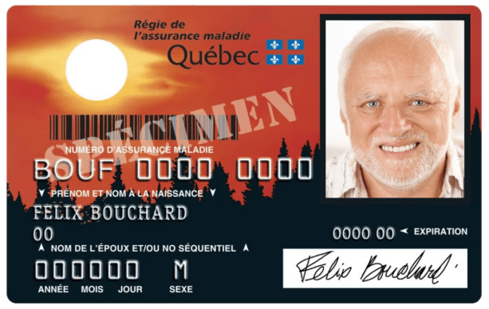

# Notions de base en assurance-vie

::: {.act-objectifs}

Objectifs du chapitre

- Identifier les principales catégories de protections offertes en assurance individuelle de personnes;
- Distinguer les principaux intervenants d’un contrat d’assurance (assureur, preneur, assuré, bénéficiaire);
- Décrire certaines caractéristiques fondamentales d’un contrat d’assurance de personnes (prise d’effet, obligations de déclaration, non-paiement des primes, etc.);
- Expliquer le rôle du bénéficiaire et les différentes façons de le désigner;
- Comprendre les notions de révocabilité du bénéficiaire et de saisissabilité des prestations de décès.

:::

## Introduction

L'assurance de personnes ne se limite pas au versement d'un capital au décès. Elle peut aussi remplacer un revenu interrompu par une invalidité ou couvrir certaines dépenses de santé. Les garanties varient selon l'événement assuré, la forme des prestations et les conditions du contrat.  Après les principes juridiques généraux étudiés au [chapitre 8](Chap8_Juridique.qmd), nous nous intéressons ici aux protections offertes, au fonctionnement concret des contrats d'assurance de personnes et, surtout, aux droits des bénéficiaires d'une assurance-vie. 

L'assurance individuelle de personnes comprend principalement deux grandes familles :

- L'**assurance sur la vie**, qui prévoit le versement d'un capital au décès de l'assuré, lorsque les conditions du contrat sont remplies. Le montant est généralement choisi en fonction des besoins financiers anticipés des proches : perte de revenu, remboursement d'une hypothèque, dépenses des enfants ou frais immédiats. Les différentes formes d'assurance-vie seront étudiées dans les chapitres suivants.
- L'**assurance contre les accidents et la maladie**, qui couvre d'autres conséquences financières, notamment une incapacité de travailler, certains frais médicaux ou la survenance d'une maladie grave. Selon la garantie, l'assureur peut verser une somme forfaitaire, un revenu périodique ou le remboursement de dépenses admissibles.

Ces protections sont complémentaires : un capital payable au décès et un revenu de remplacement pendant une invalidité ne répondent pas au même besoin.

::: {#exm-1 .custom}
Marie, 38 ans, vit avec son conjoint et leurs deux enfants. Le ménage possède une résidence sur laquelle il reste une hypothèque de 210 000 $. Marie gagne un revenu important pour sa famille et détient deux contrats d’assurance de personnes.  

- Le premier est une assurance-vie de 250 000 $. Si Marie décède, son conjoint pourrait utiliser cette somme pour rembourser entièrement l’hypothèque. Il resterait alors 40 000 $ pour faire face aux autres dépenses familiales. La disparition du revenu de Marie pourrait néanmoins créer des difficultés financières à plus long terme.  

- Le second contrat est une assurance invalidité qui prévoit une prestation mensuelle de 3 000 $, après un délai de carence de 90 jours, si les conditions du contrat sont satisfaites. Si Marie devient incapable de travailler pendant deux ans à la suite d'un accident, elle pourrait recevoir un revenu de remplacement pendant cette période. Cependant, les dépenses familiales continueraient de s'accumuler, notamment les versements hypothécaires.

Cet exemple montre que les deux protections répondent à des besoins distincts. Une assurance-vie suffisamment élevée pour rembourser les dettes au décès ne garantit pas que la famille pourra maintenir son niveau de vie si l'assuré devient invalide.
:::

### Régimes publics de santé au Québec

Au Québec, la protection financière contre les dépenses de santé repose notamment sur deux grands mécanismes : le régime public d'assurance maladie, qui couvre les principaux services médicaux et hospitaliers, et le régime général d'assurance médicaments, qui combine des protections publiques et privées. Ces deux régimes jouent un rôle central dans l'accès aux soins, tout en laissant une place aux assurances privées pour certaines protections complémentaires.

#### **Le régime public d'assurance maladie** {-}

L'instauration de l'assurance hospitalisation en 1961, puis de l'assurance maladie en 1970, constitue une transformation majeure du système de santé québécois. Auparavant, l'accès aux soins pouvait représenter un fardeau financier considérable pour les familles. Ces régimes ont progressivement établi un principe fondamental : l'accès aux services médicaux et hospitaliers assurés doit dépendre des besoins de santé plutôt que de la capacité financière des personnes.

La [Régie de l'assurance maladie du Québec (RAMQ)](https://www.ramq.gouv.qc.ca/fr) administre notamment le régime public d'assurance maladie. Celui-ci permet aux personnes admissibles de recevoir sans frais directs les services médicaux assurés, comme les consultations, les examens diagnostiques et les interventions chirurgicales. Les services hospitaliers assurés sont également financés publiquement. Ce système repose sur une mutualisation à l'échelle de la population, financée principalement par les revenus publics plutôt que par des primes individuelles établies selon l'état de santé.

La couverture n'est toutefois pas illimitée. Certains services dentaires et optométriques sont couverts seulement pour des catégories particulières de personnes, tandis que plusieurs services de physiothérapie, de psychologie ou d'autres professionnels de la santé ne sont pas systématiquement assurés lorsqu'ils sont obtenus en pratique privée. Les assurances collectives offertes par les employeurs viennent souvent compléter cette protection publique.

Pour l'actuariat, ce régime illustre une forme de mutualisation très différente de celle des assurances privées. Le risque financier associé à la maladie est largement réparti entre les contribuables, tandis que les questions de financement concernent notamment l'évolution des dépenses de santé, le vieillissement de la population et l'utilisation des services. La couverture publique réduit ainsi considérablement l'exposition financière individuelle aux soins assurés, sans éliminer tous les besoins d'assurance privée.

Pour connaître les protections offertes, consulter la [liste des services couverts par la RAMQ](https://www.ramq.gouv.qc.ca/fr/citoyens/assurance-maladie/informer-services-couverts).

#### **Régime public d'assurance médicaments du Québec** {-}

L'assurance maladie ne couvre pas automatiquement tous les médicaments achetés en pharmacie. Pour répondre à ce besoin, le Québec a instauré en 1997 un régime général d'assurance médicaments dont l'objectif est d'assurer à la population un accès raisonnable et équitable aux médicaments requis par son état de santé. Ce régime présente une particularité importante : contrairement à l'assurance maladie, il repose sur une combinaison de protections publiques et privées. Toute personne établie de façon permanente au Québec doit être couverte par une assurance médicaments, selon les règles d'admissibilité applicables. Le fonctionnement général est le suivant :

- Les personnes de moins de 65 ans ayant accès à un régime privé admissible, notamment par leur employeur, leur conjoint ou un regroupement professionnel, doivent généralement y adhérer.
- Les personnes qui n'ont pas accès à un tel régime sont couvertes par le régime public administré par la RAMQ, à condition d'y être admissibles.
- À partir de 65 ans, l'inscription au régime public est automatique, mais les personnes ayant accès à une assurance privée peuvent, selon les protections offertes, choisir leur couverture ou combiner le régime public avec une assurance complémentaire.

Le régime public couvre les médicaments inscrits sur une liste régulièrement mise à jour, sous réserve des conditions de remboursement applicables. Son financement repose notamment sur des contributions publiques, une prime annuelle établie selon la situation financière de l'assuré et une participation au coût des médicaments. Cette dernière peut prendre la forme d'une franchise et d'une coassurance, avec des plafonds de contribution et des exemptions pour certaines catégories de personnes.

Les régimes privés sont également encadrés par la Loi sur l'assurance médicaments. Ils doivent notamment respecter une protection minimale et certaines limites de contribution financière, tout en pouvant offrir des garanties supplémentaires. Ces obligations assurent un niveau de protection de base malgré la diversité des employeurs, des assureurs et des contrats. Du point de vue actuariel, ce système est particulièrement intéressant puisqu'il combine une obligation générale d'assurance, un financement public pour une partie de la population et des régimes privés dont les primes dépendent notamment de l'expérience des groupes assurés. Il soulève également des questions importantes de mutualisation, de sélection des risques, de consommation des médicaments et de croissance des coûts pharmaceutiques.

Le [site de la RAMQ consacré à l'assurance médicaments](https://www.ramq.gouv.qc.ca/fr/citoyens/assurance-medicaments) présente les règles d'admissibilité, les médicaments couverts et les modalités de participation financière. Les exigences relatives aux contrats privés sont détaillées dans la section [Renseignements sur les régimes privés](https://www.ramq.gouv.qc.ca/fr/citoyens/assurance-medicaments/renseignements-regimes-prives).

### Assurances privées de personnes

En complément des régimes publics, les assureurs privés offrent différentes protections visant à réduire les conséquences financières de la maladie, de l'invalidité ou du décès. Certaines couvrent des dépenses qui ne sont pas prises en charge par les régimes publics, tandis que d'autres prévoient le versement d'un capital ou d'un revenu de remplacement lorsqu'un événement assuré survient.

Ces protections comprennent notamment l'assurance-vie, l'assurance invalidité, l'assurance maladies graves ainsi que les assurances couvrant les médicaments, les soins dentaires et d'autres dépenses de santé. Dans le cas des médicaments, les régimes privés participent directement au régime général québécois présenté précédemment. Les assurances privées de personnes peuvent être souscrites de deux façons :

- En assurance individuelle, une personne souscrit directement un contrat auprès d'un assureur. Les garanties et la tarification tiennent notamment compte des caractéristiques du contrat et, lorsque cela s'applique, du risque propre à la personne assurée.
- En assurance collective, un contrat est généralement souscrit par un employeur, un syndicat ou une association au bénéfice de ses employés ou de ses membres, ainsi que de leurs personnes à charge admissibles. Les garanties sont établies pour le groupe, parfois avec des protections facultatives et un partage des primes entre les participants et le preneur du contrat.

Cette distinction influence notamment la sélection des risques, la tarification, l'admissibilité et l'administration des garanties. Elle ne change toutefois pas fondamentalement la nature des protections offertes.

::: {#exm-2 .custom}
Sophie détient une assurance-vie individuelle de 150 000 $, choisie selon ses besoins. Son employeur lui offre aussi un régime collectif comprenant une assurance-vie équivalant à son salaire annuel, une assurance invalidité et une assurance médicaments.

Elle peut personnaliser certaines conditions de son contrat individuel, alors que les garanties collectives sont surtout déterminées pour le groupe. Le régime collectif peut néanmoins lui permettre d'acheter une protection d'assurance-vie additionnelle, dans les limites proposées et parfois sous réserve de preuves d'assurabilité.

Les deux assurances-vie couvrent le même événement, mais elles ne donnent pas à Sophie la même liberté de choix.
:::

## Caractéristiques des contrats privés d'assurance de personnes

Le [chapitre 8](Chap8_Juridique.qmd) a présenté les principales règles juridiques encadrant les contrats d'assurance, notamment leur validité, l'intérêt d'assurance, les obligations de déclaration et les règles de preuve. Ces principes s'appliquent également aux assurances privées de personnes, mais certaines dispositions particulières viennent en préciser le fonctionnement. Nous nous intéressons ici aux aspects plus concrets de ces contrats : les rôles respectifs du preneur, de l'assuré et du bénéficiaire, les conditions de prise d'effet de la couverture, les conséquences du non-paiement des primes ainsi que les règles entourant la désignation des bénéficiaires. Ces éléments permettent de comprendre comment les protections sont établies, maintenues et éventuellement versées, sans reprendre les principes juridiques généraux déjà étudiés.

### Intervenants au contrat

Dans un contrat d'assurance-vie, plusieurs personnes peuvent jouer des rôles distincts :

- L'assureur fournit la garantie prévue au contrat.
- Le preneur, ou titulaire, souscrit le contrat et exerce les droits qui y sont rattachés.
- L'assuré est la personne dont le décès déclenche, le cas échéant, la prestation.
- Le bénéficiaire est la personne désignée pour recevoir cette prestation.
- Le payeur des primes acquitte les primes; il s'agit souvent du preneur, mais pas nécessairement.

Ces rôles peuvent être réunis ou répartis entre plusieurs personnes.

::: {#exm-3 .custom}
Bernard veut protéger financièrement sa petite-fille Alice, âgée de 19 ans, si sa mère Julie décède prématurément. Il souscrit auprès d'Assurances ABC une assurance-vie de 250 000 $ sur la vie de Julie, désigne Alice comme bénéficiaire et paie les primes. Les rôles sont donc les suivants :

- Assureur : Assurances ABC.
- Preneur et payeur des primes : Bernard.
- Assurée : Julie.
- Bénéficiaire : Alice.

Si Julie décède pendant que la protection est en vigueur, Alice recevra le capital. Bernard, bien qu'il possède et finance le contrat, n'en est pas bénéficiaire. La souscription sur la vie d'une autre personne suppose aussi le respect des règles d'intérêt d'assurance ou de consentement exposées au [chapitre 8](Chap8_Juridique.qmd).
:::

### Contenu du contrat : la police d'assurance

La police consigne les garanties, les exclusions et les principales conditions de l'assurance. Elle permet notamment de retrouver :

- l'identité du preneur et de l'assuré, ainsi que la désignation du bénéficiaire;
- le risque couvert, le montant assuré et la durée de la protection;
- les primes et les échéances de paiement;
- les droits particuliers du titulaire, notamment le rachat, les avances sur police ou la transformation, lorsque ces mécanismes existent.

La proposition et les autres documents contractuels pertinents doivent également être pris en compte pour établir les droits et obligations des parties.

::: {#exm-4 .custom}
Reprenons l'exemple de Bernard, qui a souscrit une assurance-vie de 250 000 $ sur la vie de Julie, au bénéfice d'Alice. Supposons que la police précise les conditions suivantes :

- Capital assuré : 250 000 $.
- Type de protection : assurance-vie temporaire de 20 ans.
- Durée : protection prenant fin 20 ans après la prise d'effet, sans renouvellement automatique.
- Prime : montant annuel fixe payable par Bernard pendant la durée du contrat.
- Bénéficiaire : Alice.

Si Julie décède pendant les 20 années de couverture, Alice recevra normalement les 250 000 $, sous réserve des conditions et exclusions applicables. En revanche, si Julie décède après l'expiration du contrat et qu'aucune nouvelle protection n'a été souscrite, aucune prestation ne sera versée. Cet exemple montre que la police ne définit pas seulement le montant assuré : elle précise également les circonstances et la période pendant lesquelles l'assureur s'engage à verser une prestation.

:::

### Déclarations de santé et acceptation du risque

Les règles d'intérêt d'assurance et de déclaration du risque ont été présentées au [chapitre 8](Chap8_Juridique.qmd). En assurance de personnes, elles interviennent concrètement lors de la sélection médicale : l'assureur peut accepter la demande aux conditions habituelles, imposer une surprime, prévoir une exclusion ou refuser la protection. Les conséquences d'une fausse déclaration, notamment les limites de contestation après deux ans, relèvent des règles étudiées dans ce même chapitre. 

Une question plus particulière mérite toutefois d'être examinée : que se passe-t-il lorsqu'une maladie est déclarée, mais que l'assureur n'en prévoit pas expressément l'exclusion? La déclaration d'une maladie préexistante ne signifie pas automatiquement que cette maladie est exclue de la garantie. Lorsque l'assureur accepte une assurance accidents ou maladie sans prévoir d'exclusion expresse visant une affection déclarée, il ne peut généralement pas refuser ultérieurement une prestation pour le seul motif que cette affection était déjà connue (article 2417 du Code civil du Québec).  Il faut donc distinguer une surprime, qui modifie le coût de la couverture, d'une exclusion, qui en limite l'étendue. Les autres conditions du contrat continuent néanmoins de s'appliquer.

::: {#exm-4 .custom}
À 35 ans, Alexandre, consultant en informatique à son compte, souhaite souscrire une assurance invalidité lui garantissant un revenu de remplacement de 5 000 $ par mois. Il souffre depuis plusieurs années de la maladie de Crohn, une affection inflammatoire chronique de l'intestin. Sa condition est relativement stable, mais elle peut occasionner des épisodes nécessitant des traitements importants et des périodes d'arrêt de travail.

Alexandre déclare cette maladie dans sa proposition et fournit les renseignements médicaux demandés. Après avoir évalué son dossier, l'assureur accepte de lui offrir une protection, mais exige une prime supérieure à celle d'une personne présentant un profil de risque standard. Aucune exclusion particulière concernant la maladie de Crohn n'est toutefois inscrite au contrat.

Quatre ans plus tard, Alexandre subit une complication importante de sa maladie et doit interrompre ses activités professionnelles pendant huit mois. Lorsqu'il présente sa demande de prestations, l'assureur ne peut simplement refuser de l'indemniser au motif que la maladie était déjà présente lors de la souscription. Cette affection avait été déclarée et aucune clause ne l'excluait expressément. Alexandre doit néanmoins satisfaire aux autres conditions du contrat, notamment celles définissant l'invalidité assurée.

La situation aurait été différente si l'assureur avait accepté le contrat en y inscrivant une exclusion visant expressément la maladie de Crohn. Une surprime et une exclusion ne produisent donc pas les mêmes effets : la première permet à l'assureur de facturer davantage pour accepter un risque, tandis que la seconde limite les événements donnant droit à une prestation.
:::

### Erreur sur l'âge de l'assuré

L'âge intervient directement dans la tarification et parfois dans la durée des prestations. Contrairement aux fausses déclarations examinées au chapitre 8, une erreur d'âge fait l'objet de règles particulières :

- Si l'âge véritable dépassait les limites prévues par les tarifs à la souscription, l'assureur peut, dans les délais et conditions de l'article 2421 du Code civil du Québec, demander la nullité de l'assurance-vie.
- Dans les autres cas, le capital d'assurance-vie est généralement ajusté selon le rapport entre la prime payée et celle qui aurait été exigée à l'âge véritable (article 2420).

Les deux exemples suivants illustrent les conséquences possibles sur le capital et sur la durée d'une garantie.

::: {#exm-5 .custom}
À la souscription de son assurance-vie, Marc déclare avoir 45 ans alors qu’il en a réellement 50. Il obtient une protection de 500 000\$ moyennant une prime annuelle de 900\$. Si l’assureur avait connu son âge véritable, il aurait exigé une prime annuelle de 1 500\$ pour cette même protection. Douze ans plus tard, Marc décède. Son conjoint présente une demande de prestation de 500 000\$, mais l’assureur découvre l’erreur sur l’âge déclaré. Comme Marc était admissible à l’assurance à son âge véritable, le contrat demeure valide. Toutefois, la prestation est ajustée pour tenir compte de la prime insuffisante qui a été payée. Le capital versé est alors calculé comme suit :

$$
500\,000 \times \frac{900}{1\,500} = 300\,000
$$

Le bénéficiaire recevra donc 300 000\$ plutôt que les 500 000\$ prévus initialement. Cette réduction de 200 000\$ peut avoir des conséquences importantes : si le couple comptait notamment sur cette assurance pour rembourser un solde hypothécaire de 360 000\$, la prestation ne suffira plus à éliminer entièrement cette dette. Le contrat n’est donc pas annulé, mais la protection est ramenée au montant que la prime payée permettait réellement d’obtenir à l’âge véritable de l’assuré.
:::

L’âge peut aussi déterminer la durée de la protection. Certains contrats d’assurance-vie ou d’assurance invalidité prennent fin lorsque l’assuré atteint un âge donné. Lorsqu’une erreur est découverte, c’est alors l’âge véritable qui sert à déterminer la date de fin de la couverture.

::: {#exm-6 .custom}
Nadia, une professionnelle à son compte, souscrit une assurance invalidité prévoyant une prestation de 5 000\$ par mois. Son contrat stipule que la protection et le versement des prestations prennent fin lorsqu’elle atteint 65 ans. Or, une erreur dans sa date de naissance fait en sorte que l’assureur lui attribue 54 ans au moment de la souscription, alors qu’elle en a réellement 59. Trois ans plus tard, Nadia subit un accident qui la rend incapable de reprendre ses activités professionnelles. Elle a alors 62 ans, mais les renseignements figurant au dossier de l’assureur indiquent plutôt 57 ans.

En consultant son contrat, Nadia pourrait croire qu’elle bénéficie encore de huit années de prestations potentielles, jusqu’à l’âge de 65 ans inscrit implicitement dans son dossier. Pourtant, l’âge véritable prévaut : sa protection prendra fin lorsqu’elle atteindra réellement 65 ans, soit dans trois ans seulement.  En supposant une invalidité permanente, et en faisant abstraction du délai de carence et des autres limitations contractuelles, la différence est considérable :

- Selon l’âge déclaré : 96 mois × 5 000\$ = 480 000\$ de prestations potentielles.
- Selon l’âge véritable : 36 mois × 5 000\$ = 180 000\$ de prestations potentielles.

La différence atteint ainsi 300 000\$. Il ne s’agit pas d’une réduction du montant mensuel assuré, mais plutôt d’une diminution de la période pendant laquelle les prestations peuvent être versées. Une erreur sur l’âge peut donc modifier considérablement la valeur économique d’une protection, même lorsque le montant de la prestation demeure inchangé.
:::

### Autres éléments du contrat

#### **Conséquences du non-paiement des primes** {-}

Le non-paiement d'une prime ne met pas toujours fin immédiatement à l'assurance.  En assurance-vie, un délai de grâce de 30 jours s'applique généralement aux primes autres que la première. Une assurance individuelle qui a pris fin pour défaut de paiement peut, sous certaines conditions, être remise en vigueur à la demande du titulaire dans les deux ans, notamment moyennant le paiement des sommes dues et la preuve d'assurabilité requise (articles 2427 et 2431 du Code civil du Québec). En assurance contre les accidents et la maladie, la résiliation pour non-paiement exige généralement un avis écrit transmis au titulaire au moins 15 jours à l'avance. La police doit être consultée pour établir la situation exacte du contrat et les modalités de maintien ou de remise en vigueur.

#### **Possibilité de rachat du contrat** {-}

Certaines assurances-vie, notamment des contrats permanents, comportent une valeur de rachat. Le titulaire peut alors, selon les dispositions de sa police, mettre fin à la protection et recevoir une somme de l'assureur. Cette valeur ne doit pas être confondue avec la provision actuarielle constituée pour évaluer les engagements futurs de l'assureur. Le fonctionnement de ces contrats et de leur valeur de rachat sera étudié au [chapitre 12](Chap12_Assurancevie_permanente.html), consacré à l'assurance-vie permanente.

#### **Prise d'effet du contrat** {-}

Une proposition signée ne signifie pas nécessairement que l'assurance est déjà en vigueur. Au Québec, la prise d'effet d'une assurance-vie suppose généralement l'acceptation de la proposition sans modification, le paiement de la première prime et l'absence de changement dans l'assurabilité du risque entre la proposition et l'acceptation (article 2425 du Code civil du Québec). En assurance contre les accidents et la maladie, la prise d'effet est généralement liée à la livraison de la police au preneur (article 2426). Une protection provisoire peut aussi être prévue selon les documents contractuels. Il importe donc de vérifier la date et les conditions de prise d'effet plutôt que de présumer que la signature suffit.

#### **Suicide de l'assuré** {-}

Une police d'assurance-vie peut prévoir une exclusion de la prestation en cas de suicide pendant les deux premières années de couverture. Cette exclusion doit être expressément stipulée au contrat; elle ne s'applique pas simplement parce que le décès résulte d'un suicide. Il faut donc examiner la clause et la date de prise d'effet de la protection.

## Dispositions touchant le bénéficiaire du contrat d'assurance-vie

Le bénéficiaire désigné recevra le capital au décès de l'assuré si les conditions du contrat sont remplies. La désignation mérite une attention particulière : elle détermine non seulement à qui la prestation sera payée, mais aussi si celle-ci fera partie de la succession.

- Si la succession est bénéficiaire, le capital est intégré au patrimoine successoral et peut notamment servir au règlement des dettes du défunt.
- Si une personne est désignée directement, elle reçoit généralement la prestation hors succession, sous réserve des règles applicables.

En l'absence de bénéficiaire valide, la somme revient normalement au titulaire; lorsque le titulaire et l'assuré sont la même personne, elle entre dans sa succession. Le choix du bénéficiaire peut donc avoir des conséquences très concrètes, comme l'illustre l'exemple suivant.

::: {#exm-7 .custom}
Alex possède un chalet familial d’une valeur de 650 000\$ qu’il souhaite transmettre à ses deux enfants. Son patrimoine comprend également 20 000\$ de liquidités et une assurance-vie de 200 000\$. Dans son testament, il prévoit que ses enfants hériteront de ses biens à parts égales. Au moment de son décès, le liquidateur estime que les dettes, les impôts et les autres obligations de la succession totalisent 115 000\$. Le patrimoine d’Alex est donc suffisamment important pour acquitter ces sommes, mais il manque de liquidités pour le faire sans vendre ou refinancer certains actifs.  

  - Si Alex a désigné sa succession comme bénéficiaire de son assurance-vie, les 200 000\$ s’ajoutent aux 20 000\$ déjà disponibles. Le liquidateur dispose ainsi de 220 000\$ pour acquitter les obligations successorales. Une fois celles-ci réglées, il reste 105 000\$ en liquidités, en plus du chalet qui pourra être transmis aux enfants conformément au testament.  

  - Si Alex a plutôt désigné directement sa fille Camille comme bénéficiaire, celle-ci recevra personnellement les 200 000\$. Le liquidateur ne disposera alors que des 20 000\$ appartenant à la succession pour régler les obligations de 115 000\$. Il devra trouver les 95 000\$ manquants, par exemple en refinançant le chalet ou en envisageant sa vente. Camille pourrait volontairement utiliser une partie de sa prestation pour faciliter le règlement de la succession, mais elle n'y serait généralement pas obligée.

Dans cette situation, la désignation de la succession peut donc être avantageuse, puisqu’elle permet d'utiliser l’assurance-vie pour préserver les autres actifs et faciliter leur transmission aux héritiers. À l'inverse, lorsqu'une succession possède déjà suffisamment de liquidités, une désignation directe peut être préférable pour soustraire la prestation aux dettes successorales.
:::

### Décès du bénéficiaire et désignation d'un remplaçant

Si le bénéficiaire principal décède avant l'assuré, sa désignation peut devenir sans effet. Le titulaire peut prévoir un bénéficiaire subrogé, ou subsidiaire, qui recevra la prestation dans cette situation. En revanche, si le bénéficiaire survit à l'assuré, même brièvement, il acquiert normalement le droit au capital; son décès ultérieur ne transfère pas ce droit au bénéficiaire subrogé.

::: {#exm-8 .custom}
Olivier détient une assurance-vie de 100 000\$ dont il est à la fois le titulaire et l'assuré. Il a désigné sa sœur Sophie comme bénéficiaire principale et son frère Thomas comme bénéficiaire subrogé. Thomas ne recevra donc le capital que si Sophie n'est plus en vie au moment du décès d'Olivier.

Considérons deux situations où seule la chronologie des décès est différente.

- Dans la première situation, Olivier décède et Sophie lui survit pendant quelques jours. Même si Sophie décède avant que l'assureur ait traité la réclamation, elle avait déjà acquis le droit à la prestation au décès d'Olivier. Les 100 000\$ font donc partie de la succession de Sophie et seront transmis à ses propres héritiers. Thomas ne reçoit pas automatiquement cette somme, malgré sa désignation comme bénéficiaire subrogé.

- Dans la seconde situation, Sophie décède quelques jours avant Olivier. Au moment du décès de ce dernier, la bénéficiaire principale n'est plus en vie. Thomas devient alors le bénéficiaire de la prestation et reçoit directement les 100 000\$, sans que cette somme transite par la succession de Sophie.

Le contrat, le montant assuré et les bénéficiaires désignés sont identiques dans les deux situations. Pourtant, la destination de la prestation est différente. Quelques jours, voire quelques minutes, peuvent donc modifier considérablement les conséquences financières d'une désignation de bénéficiaire.
:::

### Décès simultané de l'assuré et du bénéficiaire

Lorsque l'assuré et le bénéficiaire décèdent dans un même événement et que l'ordre des décès ne peut être établi, l'article 2448 du Code civil du Québec prévoit une présomption particulière : aux fins de l'assurance, l'assuré est réputé avoir survécu au bénéficiaire. Une exception légale existe notamment dans certaines situations successorales particulières. Cette règle peut modifier le destinataire du capital.

::: {#exm-9 .custom}
Alexandre détient une assurance-vie de 500 000\$ et a désigné sa conjointe Mélanie comme bénéficiaire principale. Sa fille Julie, issue d'une précédente union, est désignée comme bénéficiaire subrogée. Alexandre et Mélanie sont victimes d'un grave accident de la route. Tous deux décèdent, mais les circonstances de l'accident ne permettent pas d'établir avec certitude lequel est mort en premier. Cette incertitude pourrait avoir des conséquences financières importantes.  

  - Si Mélanie avait survécu à Alexandre, même pendant quelques minutes, le droit à la prestation de 500 000\$ lui aurait appartenu. Après son propre décès, ce droit aurait fait partie de sa succession, dont les héritiers ne sont pas nécessairement les mêmes que ceux d'Alexandre.  
  - À l'inverse, si Mélanie était décédée avant Alexandre, Julie aurait eu droit à la prestation en sa qualité de bénéficiaire subrogée.

Comme l'ordre des décès ne peut être établi, la présomption prévue par le Code civil s'applique. Alexandre est réputé avoir survécu à Mélanie, de sorte que celle-ci est considérée comme étant décédée avant lui. Julie reçoit donc directement les 500 000\$. Cette règle ne permet évidemment pas de connaître l'ordre réel des décès. Elle établit plutôt une solution juridique à une situation qui, autrement, pourrait donner lieu à des contestations entre les successions des personnes décédées.
:::

### Titulaire subrogé

Le titulaire d'une assurance sur la vie d'autrui peut prévoir qu'une autre personne deviendra titulaire du contrat à son propre décès. Ce titulaire subrogé reprend alors les droits associés à la police; il n'est pas nécessairement le bénéficiaire de la prestation. Le mécanisme permet de maintenir le contrat lorsque le preneur décède avant la personne assurée.

::: {#exm-10 .custom}
Martin est l'un des trois associés d'un cabinet de génie-conseil. Il détient personnellement une assurance-vie de 600 000\$ sur la tête de Samuel, un autre associé dont l'expertise est essentielle au fonctionnement de l'entreprise. Le cabinet est désigné comme bénéficiaire, puisque la prestation doit permettre de financer les coûts de remplacement de Samuel et de soutenir les activités de l'entreprise en cas de décès. Martin a également désigné Inès, la troisième associée, comme titulaire subrogée du contrat. Cette disposition prend toute son importance lorsque Martin décède subitement, alors que Samuel est toujours vivant.

Le décès de Martin n'entraîne aucun versement de l'assurance-vie, puisque ce n'est pas lui qui est assuré. Cependant, grâce à la désignation effectuée, Inès devient propriétaire du contrat. Elle reprend les droits et obligations associés à celui-ci, notamment le paiement des primes nécessaires à son maintien en vigueur. La désignation du cabinet comme bénéficiaire demeure inchangée.  Quatre ans plus tard, Samuel décède à son tour. Le contrat étant toujours en vigueur, l'assureur verse les 600 000\$ au cabinet, conformément à la désignation du bénéficiaire.

Cet exemple met en évidence deux mécanismes distincts. Au décès de Martin, la propriété du contrat est transférée à Inès, sans qu'aucune prestation soit versée. Au décès de Samuel, c'est plutôt l'obligation de l'assureur de verser le capital assuré qui prend effet, et la somme revient au cabinet. Le titulaire subrogé n'est donc pas nécessairement celui qui recevra la prestation. Sa désignation vise avant tout à assurer la continuité de la propriété et de l'administration du contrat.
:::

### Révocabilité du bénéficiaire

La désignation d'un bénéficiaire est révocable lorsque le titulaire peut la modifier sans son autorisation. Si elle est irrévocable, son consentement est normalement requis pour la remplacer. Au Québec, les règles supplétives varient notamment selon le lien avec le bénéficiaire et le mode de désignation.

::: {.encadre}

| Situation | Police | Écrit distinct | Testament |
|---|---|---|---|
| Conjoint marié | irrévocable (sauf stipulation contraire) | irrévocable (sauf stipulation contraire) | révocable |
| Conjoint en union civile | irrévocable (sauf stipulation contraire) | irrévocable (sauf stipulation contraire) | révocable |
| Conjoint de fait | révocable (sauf stipulation contraire) | révocable (sauf stipulation contraire) | révocable |
| Autre personne | révocable (sauf stipulation contraire) | révocable (sauf stipulation contraire) | révocable |

:::

Une désignation testamentaire est toujours révocable. Le divorce, la nullité du mariage ou la dissolution de l'union civile rendent en principe caduque la désignation du conjoint à titre de bénéficiaire ou de titulaire subrogé (article 2459 du Code civil du Québec). La séparation de conjoints de fait n'entraîne pas automatiquement cette conséquence.

::: {#exm-11 .custom}
Émilie et Nicolas sont mariés depuis quinze ans. Émilie détient une assurance-vie de 400 000\$ et a désigné Nicolas comme bénéficiaire lors de la souscription, sans préciser si cette désignation est révocable ou irrévocable. Le couple se sépare, mais aucune procédure de divorce n'a encore été complétée. Émilie souhaite maintenant désigner ses deux enfants comme bénéficiaires, à parts égales. Elle communique avec son assureur pour effectuer le changement, mais apprend que la désignation de Nicolas est présumée irrévocable en vertu du Code civil du Québec. Elle ne peut donc pas le remplacer sans son consentement.

Supposons maintenant qu'Émilie et Nicolas aient plutôt vécu en union de fait. Dans cette situation, la désignation de Nicolas aurait été présumée révocable. Émilie aurait alors pu transmettre une nouvelle désignation écrite à l'assureur sans avoir à obtenir son autorisation.

Les conséquences peuvent être importantes. Si Émilie décède avant que la situation soit régularisée, Nicolas pourrait recevoir les 400 000\$ malgré leur séparation. Le simple fait de ne plus former un couple ne suffit donc pas nécessairement à modifier les droits associés à une désignation de bénéficiaire. La distinction entre mariage et union de fait ne concerne ainsi pas seulement le droit familial : elle peut aussi avoir des répercussions importantes sur le contrôle d'un contrat d'assurance-vie.
:::

::: {#exm-12 .custom}
En 2018, François souscrit une assurance-vie de 300 000\$ et désigne son frère Mathieu comme bénéficiaire révocable. Quelques années plus tard, François devient père d'une petite fille, Clara, et décide de modifier ses dispositions successorales. En 2025, il rédige un nouveau testament dans lequel il prévoit que Clara héritera de l'ensemble de ses biens. François suppose alors que cette disposition s'applique également à son assurance-vie. Il ne communique toutefois avec son assureur pour effectuer aucune modification. François décède l'année suivante. Lors du règlement de sa succession, le liquidateur découvre que Mathieu figure toujours comme bénéficiaire dans la police d'assurance. Or, le testament ne mentionne pas expressément cette police et ne manifeste pas clairement l'intention de modifier la désignation du bénéficiaire.

Dans ces circonstances, la désignation antérieure de Mathieu demeure applicable. Il pourra donc recevoir les 300 000\$ directement de l'assureur, même si le testament prévoit que Clara hérite de l'ensemble des biens de François.

La situation aurait été différente si François avait expressément désigné Clara comme bénéficiaire de cette assurance-vie dans son testament, en identifiant clairement le contrat visé. Une telle disposition testamentaire aurait pu remplacer la désignation antérieure de Mathieu, puisque celle-ci était révocable, sous réserve des règles applicables à la réception des désignations par l'assureur.

Cet exemple montre que modifier son testament ne revient pas nécessairement à modifier les bénéficiaires de ses contrats d'assurance. Une planification successorale cohérente exige de vérifier que les désignations figurant dans les polices correspondent toujours aux intentions du titulaire.
:::

### Saisissabilité du contrat d'assurance-vie

Certaines assurances-vie permanentes comportent une valeur de rachat que les créanciers du titulaire pourraient chercher à saisir. Le Code civil du Québec prévoit toutefois des protections qui dépendent notamment du bénéficiaire désigné et de la révocabilité de cette désignation. Il faut distinguer cette question, qui concerne les droits du titulaire pendant sa vie, de celle du paiement direct du capital après le décès.

::: {.encadre}

| Bénéficiaire désigné | Protection contre la saisie des droits du contrat |
|---|:---:|
| Révocable ordinaire (ami, conjoint de fait, etc.) | Généralement non |
| Révocable privilégié (époux, conjoint uni civilement, descendant ou ascendant du titulaire) | Oui |
| Irrévocable | Oui |

:::

Ces protections sont assujetties aux exceptions prévues par la loi et ne rendent pas automatiquement tous les avoirs du titulaire insaisissables. Une fois le capital versé, les droits des créanciers personnels du bénéficiaire constituent également une question distincte.

::: {#exm-13 .custom}
Isabelle est consultante à son compte depuis une quinzaine d'années. Elle détient une assurance-vie permanente offrant une prestation de décès de 500 000\$ et comportant une valeur de rachat de 85 000\$. Cette dernière représente la somme qu'elle pourrait récupérer, selon les conditions de son contrat, si elle décidait de mettre fin à sa protection.

À la suite de difficultés financières dans son entreprise, Isabelle accumule des dettes personnelles de 140 000\$. Certains de ses créanciers entreprennent des démarches pour récupérer les sommes qui leur sont dues. La valeur de rachat de son assurance-vie constitue alors un actif susceptible de les intéresser.  Le traitement de cet actif dépend notamment de la désignation du bénéficiaire. Considérons trois situations possibles :

- Si Isabelle a désigné sa conjointe de fait comme bénéficiaire révocable, les droits associés au contrat ne bénéficient généralement pas de la protection contre la saisie prévue pour certaines catégories de bénéficiaires. Les créanciers pourraient donc, sous réserve des règles applicables, chercher à faire réaliser la valeur de rachat de 85 000\$ pour récupérer une partie de leurs créances.

- Si Isabelle a plutôt désigné sa fille adulte comme bénéficiaire révocable, les droits conférés par le contrat bénéficient de la protection prévue dans le Code civil du Québec. La valeur de rachat est alors généralement insaisissable, même si Isabelle conserve le droit de modifier sa désignation.

- Isabelle aurait également pu désigner sa conjointe de fait comme bénéficiaire irrévocable. Cette désignation aurait aussi pour effet de rendre les droits du contrat insaisissables. Toutefois, Isabelle perdrait alors une partie de sa liberté de gestion du contrat, puisqu'elle ne pourrait notamment plus modifier librement la désignation de sa conjointe.

Dans les trois situations, le capital assuré et la valeur de rachat sont identiques. Ce sont les droits accordés au bénéficiaire et les règles juridiques qui en découlent qui modifient la protection contre les créanciers. Il faut toutefois préciser qu'une personne déjà aux prises avec des difficultés financières ne peut pas nécessairement rendre ses actifs insaisissables en changeant simplement de bénéficiaire. Certaines opérations effectuées au détriment des créanciers peuvent être contestées.

Cet exemple illustre ainsi que la désignation d'un bénéficiaire n'influence pas seulement la distribution du capital au décès. Elle peut également modifier la protection du patrimoine du titulaire pendant sa vie, tout en limitant, dans certains cas, sa liberté de disposer du contrat.
:::

## Conclusion

Les protections d'assurance de personnes répondent à des besoins différents, mais leur fonctionnement repose toujours sur des conditions contractuelles précises. La distinction entre preneur, assuré et bénéficiaire, les modalités de prise d'effet ou de maintien de la couverture et les dispositions propres aux assurances de personnes peuvent changer concrètement le résultat d'une réclamation.  La désignation du bénéficiaire est particulièrement importante : elle peut modifier la destination du capital, les droits du titulaire et la situation de ses créanciers. C'est pourquoi la compréhension des contrats doit accompagner leur analyse actuarielle.

---

::: {.act-lexique}

::: {.act-lexique-entete}

## Annexe : lexique de certains termes d’assurance {-}

:::

ACCAP (CLHIA)
: Association canadienne des compagnies d’assurance de personnes. Porte-parole de l’industrie de l’assurance de personnes.

Assurance-vie (définition ACCAP)
: Assurance prévoyant le paiement d’une somme au décès, accidentel ou non, de l’assuré.

Assurance-vie à prime nivelée (définition ACCAP)
: Assurance dont la prime reste la même pendant toute la durée du contrat. La prime est supérieure au coût réel de l’assurance durant les premières années et inférieure pendant les dernières années. L’excédent des primes des premières années est mis en réserve et le revenu de placement de ces sommes permet de maintenir les primes à un niveau constant.

Avance sur contrat (définition ACCAP)
: Avance consentie par l’assureur au titulaire d’une police d’assurance-vie et garantie par la valeur de rachat de la police.

Bénéficiaire (définition ACCAP)
: Personne appelée à recevoir les sommes dues aux termes du contrat, au décès de l’assuré.

Capital assuré (définition ACCAP)
: Somme indiquée à la première page de la police et versée à l’échéance de celle-ci ou au décès de l’assuré. Ce montant n’inclut pas les sommes supplémentaires prévues par certaines garanties additionnelles ni les capitaux souscrits avec les participations touchées.

Participation (adapté de la terminologie de l'ACCAP)
: Somme attribuée à certains contrats d'assurance-vie avec participation, selon les résultats et les règles de répartition de l'assureur. Les participations ne sont généralement pas garanties et peuvent, selon le contrat et les options retenues, être versées en espèces, servir à réduire les primes ou être utilisées autrement.

Proposition d’assurance (définition ACCAP)
: Déclaration remplie par une personne désirant souscrire un contrat d’assurance. On y retrouve notamment le genre d’assurance et le capital assuré demandés, les noms de l’assuré et du bénéficiaire et d’autres renseignements servant à l’évaluation du risque.

Provisions mathématiques (adapté de la terminologie de l'ACCAP)
: Évaluation actuarielle des engagements financiers futurs liés à des contrats d'assurance-vie ou de rente, selon les méthodes et hypothèses applicables. Il faut distinguer ces engagements, qui figurent au passif de l'assureur, des actifs détenus pour les financer.

Souscripteur (définition ACCAP)
: Personne qui a souscrit un contrat d’assurance. En assurance-vie, le souscripteur est souvent l’assuré, mais ce n’est pas toujours le cas. Il est souvent préférable d’utiliser les termes preneur ou titulaire afin d’éviter une confusion avec l’usage du mot souscripteur pour désigner le tarificateur.

Valeur de rachat
: Somme payable au comptant si le titulaire résilie sa police avant l’échéance ou avant le décès. On dit alors que l’assureur rachète la police qu’il avait vendue au titulaire.

:::
