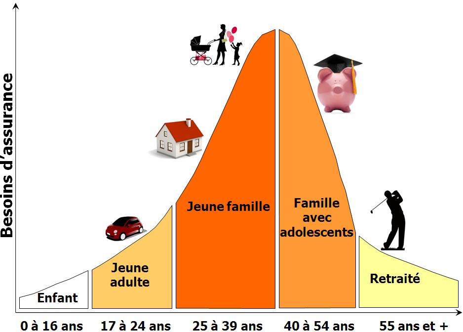

# Notions de base en assurance-vie

### Objectifs du chapitre {-}

- Identifier les principales catégories de protections offertes en assurance individuelle de personnes;  
- Distinguer les principaux intervenants d’un contrat d’assurance (assureur, preneur, assuré, bénéficiaire);  
- Décrire certaines caractéristiques fondamentales d’un contrat d’assurance de personnes (prise d’effet, obligations de déclaration, non-paiement des primes, etc.);  
- Expliquer le rôle du bénéficiaire et les différentes façons de le désigner;  
- Comprendre les notions de révocabilité du bénéficiaire et de saisissabilité des prestations de décès.  

## Introduction

L’assurance de personnes vise à protéger un individu et ses proches contre certaines conséquences financières liées à la vie, à la santé ou à la capacité de travailler. Ces protections prennent la forme de contrats d’assurance qui prévoient le paiement d’une prestation lorsque certains événements surviennent. Dans ce chapitre, nous présentons les principales catégories de protections offertes en assurance individuelle de personnes ainsi que leurs caractéristiques générales.

### Catégories de protection

Les contrats d’assurance individuelle de personnes se divisent en deux grandes catégories : 

1. **L’assurance sur la vie**, qui garantit le paiement d’une somme convenue (appelée prestation de décès ou capital assuré) au décès de l’assuré, pourvu que le contrat soit toujours en vigueur à ce moment. Cette somme est versée au bénéficiaire désigné dans la police et vise généralement à compenser les conséquences financières du décès de l’assuré, par exemple :
   - remplacer une partie du revenu que l’assuré procurait à sa famille;
   - rembourser certaines dettes, comme une hypothèque;
   - couvrir des dépenses importantes, telles que les frais funéraires;
   - fournir un capital permettant aux proches de maintenir leur niveau de vie.

2. **L’assurance contre les accidents et la maladie**, qui prévoit le paiement d’une prestation lorsque certains événements liés à la santé surviennent. Selon le type de contrat, cette prestation peut prendre différentes formes, par exemple :  
   - un revenu de remplacement en cas d’invalidité (assurance invalidité);
   - un remboursement de frais médicaux, notamment :
     - médicaments;
     - soins paramédicaux;
     - soins dentaires;
     - soins de la vue;
   - une protection liée à des situations particulières, comme :
     - l’assurance voyage;
     - l’assurance contre les maladies graves.

::: {#exm-1 .custom}

Marie possède deux protections d’assurance de personnes.

- Elle détient une assurance-vie de 250 000 $. Si Marie décède alors que le contrat est en vigueur, l’assureur versera ce montant au bénéficiaire qu’elle a désigné.

- Elle détient aussi une assurance invalidité. Si Marie devient incapable de travailler à la suite d’une maladie ou d’un accident, cette assurance peut lui verser un revenu de remplacement pendant la période où elle est invalide.

Dans le premier cas, la prestation est liée au décès de l’assurée. Dans le second cas, la prestation est liée à un événement touchant sa santé ou sa capacité de travailler.

:::

### Régie de l’assurance maladie du Québec (RAMQ)

Au Québec, une partie importante de la protection contre les accidents et la maladie est assurée par le régime public d’assurance maladie administré par la [Régie de l’assurance maladie du Québec (RAMQ)](https://www.ramq.gouv.qc.ca/fr). Ce régime, souvent associé à la *carte d’assurance maladie* (communément appelée *carte soleil*), donne accès à un ensemble de services médicaux couverts par l’État. Par exemple, les consultations auprès des médecins et plusieurs services hospitaliers sont généralement pris en charge par le système public.

Les assurances privées contre les accidents et la maladie jouent donc souvent un rôle complémentaire au régime public. Elles permettent notamment de couvrir certaines dépenses qui ne sont pas entièrement prises en charge par l’assurance maladie du Québec, comme :

- les médicaments d’ordonnance (dans certains cas);
- les soins dentaires;
- les soins paramédicaux (physiothérapie, chiropractie, etc.);
- les soins de la vue;
- certaines protections particulières, comme l’assurance invalidité ou l’assurance maladies graves.

Ainsi, au Québec, l’assurance privée en matière de santé s’inscrit généralement en complément du régime public, plutôt qu’en remplacement de celui-ci.

### Régime public d’assurance médicaments du Québec

Au Québec, la couverture des médicaments d’ordonnance repose sur un système mixte combinant assurance publique et assurance privée. [Le régime public d’assurance médicaments](https://www.ramq.gouv.qc.ca/fr/citoyens/assurance-medicaments), administré par la Régie de l’assurance maladie du Québec (RAMQ), vise à garantir qu’une personne résidant au Québec ait accès à une protection minimale pour les médicaments prescrits. Le fonctionnement du système repose sur le principe suivant :

- les personnes qui ont accès à un régime privé, généralement par l’intermédiaire de leur employeur ou de celui de leur conjoint, doivent obligatoirement y adhérer;
- les personnes qui n’ont pas accès à une assurance collective sont couvertes par le régime public.

Dans le régime public, l’assuré doit généralement assumer une partie du coût des médicaments sous forme de franchise et de coassurance, jusqu’à un maximum annuel fixé par le gouvernement. Les régimes privés d’assurance médicaments jouent donc souvent un rôle complémentaire. Ils offrent parfois une couverture plus généreuse, par exemple :
- une franchise plus faible;
- un taux de remboursement plus élevé;
- une couverture élargie pour certains médicaments.

Ainsi, comme dans le cas de l’assurance maladie, l’assurance privée au Québec s’inscrit généralement en complément du régime public, afin d’améliorer la protection offerte aux assurés.

### Assurances individuelles et assurances collectives

Les protections décrites dans ce chapitre peuvent être offertes soit par un **contrat individuel** conclu directement entre une personne et une compagnie d’assurance, soit dans le cadre d’un **contrat collectif** couvrant un groupe de personnes.

La nature des protections demeure généralement la même (assurance vie, invalidité, maladie, etc.). Toutefois, dans un régime collectif, les risques sont mutualisés au niveau du groupe plutôt qu’au niveau individuel.  Les contrats collectifs sont également encadrés par des règles juridiques et administratives différentes de celles applicables à l’assurance individuelle. Par conséquent, les méthodes actuarielle utilisées pour analyser et tarifer ces régimes peuvent aussi différer.

::: {#exm-1 .custom}

Sophie souscrit une assurance-vie de 150 000 $ directement auprès d’une compagnie d’assurance. Elle remplit une proposition, choisit le montant assuré et paie elle-même les primes. Il s’agit d’une assurance individuelle.

Sophie bénéficie également d’une assurance collective offerte par son employeur. Ce régime lui donne accès à différentes protections, par exemple une assurance médicaments et une assurance invalidité. Dans ce cas, le contrat est conclu entre l’employeur et l’assureur, et l’ensemble des employés admissibles sont couverts par le même régime.

Dans le premier cas, le contrat est conclu individuellement avec l’assureur. Dans le second cas, la protection fait partie d’un régime collectif couvrant un groupe de personnes.

:::

## Caractéristiques du contrat

Au chapitre précédent, à la section *Notions générales sur les contrats au Québec*, nous avons présenté brièvement la notion de contrat d’assurance. Il est maintenant utile de revenir sur certaines de ces notions afin de les examiner plus précisément dans le contexte des contrats d’assurance individuelle de personnes. Pour rappel, un contrat d’assurance est généralement un contrat d’adhésion, bilatéral, à titre onéreux, aléatoire et à exécution successive.  D'autres caractéristiques spécifiques à l'assurance de personnes peuvent être mentionnées.

### Intervenants au contrat

Un contrat d’assurance est conclu entre l’assureur et le preneur. Toutefois, d’autres personnes peuvent être liées au contrat ou en tirer des droits.  Les principaux intervenants sont :

- l’assureur, qui s’engage à verser la prestation prévue au contrat si l’événement assuré survient;
- le preneur (aussi appelé titulaire ou détenteur du contrat), qui conclut le contrat avec l’assureur et exerce les droits qui y sont rattachés;
- l’assuré, c’est-à-dire la personne sur laquelle porte le risque (par exemple la personne dont le décès est assuré);
- le bénéficiaire, qui recevra la prestation si l’événement assuré survient;
- le payeur de primes, qui peut être le preneur, mais aussi une autre personne.

Ces rôles peuvent être exercés par des personnes différentes. On peut prendre un exemple illustratif pour mieux comprendre:

---

::: {#exm-1 .custom}
Grand-papa Généreux souscrit une assurance sur la vie de sa petite-fille Maude à sa naissance. Il est donc initialement le preneur du contrat. Dix ans plus tard, il transfère la propriété du contrat à Guy, le père de Maude. La bénéficiaire désignée est Catherine, la mère de Maude. 

Après le transfert, les différents rôles seraient donc les suivants :

- assureur : Compagnie d’assurance ABC;
- preneur (titulaire du contrat) : Guy;
- assurée : Maude;
- bénéficiaire : Catherine.
:::

### Possibilité de rachat du contrat

Certaines polices d’assurance-vie comportent un mécanisme d’accumulation permettant de répartir dans le temps le coût du risque, qui augmente généralement avec l’âge. Dans les premières années du contrat, la prime payée peut être supérieure au coût immédiat du risque et aux frais. L’excédent contribue à constituer une provision actuarielle (souvent appelée *réserve* dans le langage courant), qui s’accumule au fil du temps et est utilisée pour financer une partie du coût plus élevé du risque aux âges plus avancés.

Si le titulaire met fin au contrat avant son échéance, il faut disposer de cette provision. Lorsque l’assureur remet au titulaire tout ou une partie de cette somme, on parle de valeur de rachat.  On peut interpréter ce mécanisme comme le fait que l’assureur verse une somme au titulaire afin de mettre fin au contrat et de se libérer de ses obligations futures. Autrement dit, l’assureur rachète l’engagement qu’il avait pris envers le titulaire.  Nous reviendrons en détails sur la notion de rachat de contrat au chapitre 12.

### Prise d’effet du contrat

Au Québec, **le contrat d’assurance-vie** prend généralement effet au moment où l’assureur accepte la proposition, pourvu que certaines conditions soient respectées. En pratique, le contrat prend effet si :

- la proposition est acceptée par l’assureur sans modification;
- la première prime a été payée;
- aucun changement n’est survenu dans le caractère assurable du risque entre la signature de la proposition et son acceptation.

Ces conditions visent à s’assurer que l’assureur accepte le risque tel qu’il avait été présenté lors de la proposition. Dans les autres provinces canadiennes, la pratique est souvent décrite différemment : le contrat prend généralement effet au moment de la livraison de la police au preneur, pourvu que la première prime ait été payée et que le risque n’ait pas changé depuis la proposition.

Au Québec, **le contrat d’assurance contre la maladie ou les accidents** prend généralement effet au moment de la livraison de la police au preneur par l’assureur, même si la livraison n’est pas effectuée par un représentant de l’assureur. Dans les autres provinces canadiennes, le contrat prend également effet au moment de la livraison de la police au preneur. Il n’y a donc pas de différence significative avec le Québec dans ce cas.

### Contenu du contrat : la police d’assurance

La police d’assurance est le document qui constate l’existence du contrat et en précise les conditions. Bien que le contrat puisse exister indépendamment du document lui-même, la police constitue la preuve principale de son contenu.  La proposition d’assurance doit faire partie de la police si l’assureur veut pouvoir l’invoquer, notamment en cas de fraude ou de fausse déclaration.

Le Code civil du Québec exige que la police contienne certaines informations essentielles. En pratique, elle doit notamment indiquer :

- le nom des parties au contrat (assureur et preneur);
- le nom de l’assuré;
- le nom du bénéficiaire ou le moyen de l’identifier;
- l’objet de l’assurance;
- le montant de l’assurance (ou l’équivalent dans le cas d’un remboursement de frais);
- la nature des risques couverts;
- le moment à partir duquel la couverture prend effet et sa durée;
- le montant ou le taux des primes et leurs échéances;
- les délais de paiement des primes;
- les droits de participation aux bénéfices;
- la méthode servant à établir la valeur de rachat, s’il y a lieu;
- les droits à la valeur de rachat, s’il y a lieu;
- les droits aux avances sur police;
- les conditions de remise en vigueur;
- les droits de transformation;
- les modalités de paiement des sommes dues;
- la période durant laquelle les prestations sont payables.

### Intérêt d’assurance

Comme nous l’avons vu au chapitre précédent, une notion centrale du contrat d’assurance est celle de l’intérêt d’assurance (ou intérêt assurable). Une personne possède un intérêt d’assurance lorsque la vie ou la santé d’une autre personne présente pour elle un intérêt réel, moral ou pécuniaire. Une personne a généralement un intérêt d’assurance dans la vie ou la santé :

- de sa propre personne;
- de son conjoint;
- de ses descendants;
- des descendants de son conjoint;
- des personnes qui contribuent à son soutien ou à son éducation;
- de ses préposés ou des membres de son personnel;
- de toute autre personne dont la vie ou la santé présente pour elle un intérêt moral ou pécuniaire.

### Obligations du preneur et de l’assuré : déclarations du risque

Lorsque l’assureur exige des preuves d’assurabilité, le preneur et l’assuré doivent déclarer les faits importants, c’est-à-dire toutes les circonstances connues d’eux qui sont susceptibles d’influencer de façon importante :

- l’établissement de la prime;
- l’appréciation du risque;
- la décision de l’assureur d’accepter ou non le risque.

L’obligation de déclaration est réputée correctement exécutée si :

- la déclaration correspond à celle qu’aurait faite un assuré prévoyant placé dans les mêmes circonstances;
- elle est faite sans réticence importante;
- les circonstances sont, en substance, conformes à la déclaration.

À l’exception de l’âge de l’assuré, les fausses déclarations ou les réticences peuvent entraîner, à la demande de l’assureur, la nullité du contrat, même si le sinistre n’est pas lié au risque ainsi mal déclaré.

### Affection déclarée en assurance accidents ou maladie

Dans le passé, certains assureurs acceptaient un contrat d’assurance, encaissaient les primes pendant plusieurs années, puis refusaient de payer une prestation en invoquant une maladie préexistante. La situation typique était la suivante :

- l’assuré déclare une condition médicale dans la proposition;
- l’assureur accepte le contrat;
- plusieurs années plus tard, l’assuré devient invalide;
- l’assureur soutient que l’invalidité est liée à une condition antérieure et refuse de payer.

Cette pratique créait une grande incertitude pour les assurés.  Pour corriger, le Code civil encadre maintenant cette situation. Lorsqu’une affection est déclarée dans la proposition, l’assureur doit décider **immédiatement** comment traiter ce risque. Il peut :

- accepter le risque;
- refuser le contrat;
- accepter le contrat mais exclure explicitement l’affection.

Si l’assureur accepte le contrat sans exclure clairement cette affection, il ne pourra généralement pas refuser de payer plus tard en invoquant cette même condition.  Ainsi :

- une affection déclarée est couverte, sauf si une clause du contrat l’exclut expressément;
- l’assureur ne peut pas utiliser une clause générale pour exclure les affections non déclarées, sauf si l’affection se manifeste dans les deux premières années du contrat ou en cas de fraude.

---

::: {#exm-3 .custom}
Supposons qu’une personne mentionne dans sa proposition d’assurance invalidité qu’elle a déjà souffert de douleurs au dos.

- Si l’assureur accepte le contrat sans exclure explicitement les problèmes de dos, cette condition demeure couverte.  
- Si cette personne devient invalide quelques années plus tard à cause d’un problème de colonne vertébrale, l’assureur ne pourra généralement pas refuser de payer en invoquant simplement l’existence d’une condition antérieure. Pour exclure ce risque, l’assureur aurait dû l’indiquer clairement dans la police au moment de la souscription.
:::

### Fausse déclaration sur l’âge de l’assuré

Il peut arriver que l’âge déclaré dans la proposition soit erroné. Le Code civil prévoit alors des règles particulières. La nullité du contrat n’est possible que dans une situation précise :

- l’âge véritable se situe en dehors des limites prévues par les tarifs de l’assureur au moment de la formation du contrat;
- l’assureur demande la nullité alors que l’assuré est vivant;
- cette demande est faite dans les 60 jours suivant la découverte de l’erreur.

Dans les autres cas, le contrat demeure valide. Le montant assuré est simplement ajusté selon le rapport entre :

- la prime qui a été payée;
- la prime qui aurait dû être payée selon l’âge véritable.

---

::: {#exm-4 .custom}
Si un assuré déclare avoir 40 ans alors qu’il en a 45, la prime payée est trop faible. Si le décès survient, la prestation peut être réduite proportionnellement à la prime qui aurait dû être payée pour un assuré de 45 ans.
:::

---

::: {#exm-5 .custom}
L’âge véritable peut aussi influencer la durée de la couverture. Par exemple, certains contrats d’assurance-vie ou d’assurance invalidité prennent fin à un âge déterminé. Si l’âge déclaré est erroné et que l’erreur est découverte avant le décès ou avant la fin du contrat, c’est l’âge véritable qui sert à déterminer la date de fin de la couverture.
:::

### Conséquences du non-paiement des primes

Le non-paiement d’une prime n’entraîne pas immédiatement la fin du contrat.

En **assurance-vie**, le preneur dispose d’un délai de grâce de 30 jours pour payer une prime (sauf la première).

- l’assurance demeure en vigueur durant ce délai;
- aucun intérêt n’est exigé sur la prime impayée;
- si la prime n’est pas payée avant la fin du délai, le contrat prend fin.

Si une assurance individuelle prend fin pour défaut de paiement, l’assureur doit toutefois la remettre en vigueur si les conditions suivantes sont réunies :

- le titulaire en fait la demande dans les deux ans suivant la fin du contrat;
- l’assuré satisfait encore aux conditions d’assurabilité;
- la valeur de rachat n’a pas été versée;
- le titulaire n’a pas opté pour une réduction ou une prolongation de l’assurance.

Dans ce cas, le titulaire doit payer les primes en souffrance et rembourser les avances sur police, avec un intérêt n’excédant pas le taux fixé par règlement.

En **assurance contre la maladie ou les accidents**, le contrat ne peut pas être résilié pour défaut de paiement à moins que le titulaire n’en ait été avisé par écrit au moins 15 jours à l’avance.

### Suicide de l’assuré

Le Code civil permet à l’assureur de refuser le paiement de la prestation de décès en cas de suicide si les deux conditions suivantes sont réunies :

- le suicide survient au cours des deux premières années d’assurance;
- le contrat contient une clause excluant expressément le suicide.

Après cette période de deux ans, l’assureur doit généralement verser la prestation prévue au contrat, même si le décès résulte d’un suicide. Toute augmentation du montant d’assurance obtenue par modification du contrat est habituellement soumise à une exclusion semblable pendant deux ans à compter de la prise d’effet de cette augmentation.

## Dispositions touchant le bénéficiaire du contrat d’assurance-vie

Dans un contrat d’assurance-vie, le titulaire désigne généralement un bénéficiaire, c’est-à-dire la personne qui recevra la prestation de décès si l’assuré décède alors que le contrat est en vigueur. Le bénéficiaire peut être désigné :

- dans la police d’assurance;
- dans un écrit distinct;
- dans un testament.

Le choix du bénéficiaire est important, car il détermine de quelle manière la prestation sera versée et si elle fera partie ou non de la succession de l’assuré. Deux situations principales peuvent se présenter :

- la prestation est versée à la succession de l’assuré;
- la prestation est versée directement à une personne physique ou morale (par exemple un conjoint, un enfant, un ami ou un organisme).

### Succession comme bénéficiaire

La succession est bénéficiaire lorsque le titulaire du contrat la désigne explicitement en utilisant des termes comme *succession*, *héritiers légaux*, *ayants droit* ou *légataires*. Elle peut aussi devenir bénéficiaire lorsqu’aucune personne n’est désignée ou lorsque le bénéficiaire nommé est décédé. Lorsque la succession est bénéficiaire, la prestation de décès fait partie du patrimoine successoral et est distribuée selon les règles applicables à la succession.

Cette solution présente certains avantages et inconvénients.

**Avantage**

- la solution est simple, puisqu’il n’est pas nécessaire de modifier la désignation du bénéficiaire lorsque la situation familiale change.

**Inconvénient**

- la prestation entre dans la succession et peut donc être accessible aux créanciers de celle-ci.

### Personne physique ou morale comme bénéficiaire

Le titulaire peut également désigner directement une personne physique ou morale comme bénéficiaire du contrat.  Dans ce cas, la prestation de décès est généralement versée directement au bénéficiaire et ne fait pas partie de la succession. Cette désignation comporte également des avantages et des inconvénients.

**Avantages**

- la prestation est généralement versée plus rapidement;
- le capital assuré n’entre pas dans la succession;
- la prestation n’est généralement pas accessible aux créanciers de la personne décédée;
- dans certaines situations, la valeur de rachat peut être insaisissable par les créanciers du preneur.

**Inconvénients**

- le titulaire peut oublier de modifier la désignation lorsque la situation familiale change;
- la présence d’un bénéficiaire irrévocable peut rendre difficile toute modification;
- lorsque la désignation est faite par testament, la rédaction doit être très précise.

### Décès du bénéficiaire et décès simultané

Certaines règles particulières s’appliquent lorsque le bénéficiaire décède avant l’assuré ou lorsque l’ordre des décès ne peut pas être établi.

- Si le bénéficiaire décède avant l’assuré, deux situations peuvent se présenter.  
  - Si le titulaire du contrat n’est pas l’assuré, le titulaire devient alors le bénéficiaire du contrat.
  - Si le titulaire est aussi l’assuré, la prestation de décès sera versée à la succession de l’assuré.

- Il peut arriver que l’assuré et le bénéficiaire décèdent en même temps, ou dans des circonstances où il est impossible de déterminer l’ordre des décès. Dans ce cas, la loi prévoit certaines présomptions :
  - aux fins de l’assurance, l’assuré est réputé avoir survécu au bénéficiaire;
  - la prestation est donc traitée comme si le bénéficiaire était décédé avant l’assuré.
  - Toutefois, une exception existe dans un cas très particulier : si l’assuré décède sans testament et sans héritier au degré successible, le bénéficiaire est alors réputé avoir survécu à l’assuré.

### Subrogation

Afin d’éviter les difficultés qui peuvent survenir lorsque l’assuré et le bénéficiaire décèdent en même temps (par exemple lors d’un accident), il est possible de prévoir à l’avance certaines désignations de remplacement. Le titulaire du contrat peut notamment désigner:

- **un bénéficiaire subrogé**, c’est-à-dire un bénéficiaire qui recevra la prestation si le bénéficiaire principal est décédé ou ne peut recevoir la prestation;
- **un titulaire subrogé**, c’est-à-dire une personne qui deviendra titulaire du contrat si le titulaire initial décède.

Ces désignations permettent d’éviter l’incertitude quant à la personne qui recevra la prestation ou qui exercera les droits liés au contrat lorsque des événements imprévus surviennent.

### Révocabilité du bénéficiaire

Dans un contrat d’assurance-vie, le bénéficiaire peut être désigné comme étant révocable ou irrévocable:   
  - Une désignation révocable signifie que le titulaire du contrat peut modifier ou remplacer le bénéficiaire sans obtenir l’autorisation de cette personne.  
  - Une désignation irrévocable signifie que le titulaire ne peut pas modifier la désignation sans le consentement du bénéficiaire.

Au Québec, la règle dépend principalement de l’identité du bénéficiaire et du document utilisé pour faire la désignation.

::: {.encadre}

| Situation | Police | Écrit distinct | Testament |
|---|---|---|---|
| Conjoint marié | irrévocable (sauf stipulation contraire) | irrévocable (sauf stipulation contraire) | révocable |
| Conjoint en union civile | irrévocable (sauf stipulation contraire) | irrévocable (sauf stipulation contraire) | révocable |
| Conjoint de fait | révocable (sauf stipulation contraire) | révocable (sauf stipulation contraire) | révocable |
| Autre personne | révocable (sauf stipulation contraire) | révocable (sauf stipulation contraire) | révocable |

:::

Ainsi, lorsque le bénéficiaire est le conjoint marié ou le conjoint en union civile et que la désignation est faite dans la police ou dans un écrit distinct, la désignation est présumée irrévocable. Dans les autres cas, la désignation est généralement révocable.

Autres éléments:   
  - Le divorce ou la nullité du mariage, ainsi que la dissolution ou la nullité de l’union civile, rendent caduque la désignation du conjoint comme bénéficiaire ou titulaire subrogé.  
  - Une désignation peut être révoquée par écrit. Une désignation faite dans un testament est toujours révocable et peut être modifiée par un nouveau testament ou par une désignation faite ultérieurement.

::: {.callout-note icon=false}
## Note historique 

Ces règles proviennent en partie d’une ancienne loi, la Loi sur l’assurance des parents (1865), dont certains effets subsistent dans le Code civil du Québec.
:::

### Saisissabilité des prestations de décès

La saisissabilité désigne la possibilité pour les créanciers d’une personne de saisir une somme d’argent afin de rembourser les dettes de cette personne.  Dans le contexte de l’assurance-vie, la question est la suivante : les créanciers du défunt peuvent-ils réclamer la prestation de décès versée par l’assureur?

La réponse dépend principalement de la désignation du bénéficiaire.  

- Si aucun bénéficiaire n’est désigné, la prestation est versée à la succession du défunt. Dans ce cas, elle fait partie du patrimoine successoral et peut être utilisée pour payer les dettes.  

- Si un bénéficiaire est désigné, la prestation est versée directement à cette personne. En règle générale, cette somme ne fait pas partie de la succession et elle est protégée contre les créanciers du défunt.  

L'idée générale est que la prestation est saisissable lorsqu’elle est versée à la succession. Lorsqu’un bénéficiaire est désigné, elle est généralement protégée contre les créanciers du défunt. Plus précisément, la situation peut être résumée ainsi :

::: {.encadre}

| Type de bénéficiaire | Saisissables | Non saisissables |
|---|:---:|:---:|
| Aucun bénéficiaire (succession) | ✓ |  |
| Révocable ordinaire (incluant conjoint de fait) |  | ✓ |
| Révocable privilégié (conjoint marié ou en union civile, descendants, ascendants) |  | ✓ |
| Irrévocable |  | ✓ |

:::

## Conclusion

Ce chapitre a présenté les principales protections offertes en assurance individuelle de personnes, ainsi que les caractéristiques fondamentales des contrats d’assurance-vie et d’assurance contre les accidents et la maladie. Nous avons également examiné les rôles des différents intervenants au contrat, les obligations du preneur et de l’assuré, ainsi que les règles entourant la prise d’effet et le maintien des protections. Enfin, une attention particulière a été accordée à la désignation des bénéficiaires, à leur révocabilité et à la saisissabilité des prestations de décès.

---

## Annexe : lexique de certains termes d’assurance {-}

**ACCAP (CLHIA)**  
Association canadienne des compagnies d’assurance de personnes. Porte-parole de l’industrie de l’assurance de personnes.

**Assurance-vie** (définition ACCAP)  
Assurance prévoyant le paiement d’une somme au décès, accidentel ou non, de l’assuré.

**Assurance-vie à prime nivelée** (définition ACCAP)  
Assurance dont la prime reste la même pendant toute la durée du contrat. La prime est supérieure au coût réel de l’assurance durant les premières années et inférieure pendant les dernières années. L’excédent des primes des premières années est mis en réserve et le revenu de placement de ces sommes permet de maintenir les primes à un niveau constant.

**Avance sur contrat** (définition ACCAP)  
Avance consentie par l’assureur au titulaire d’une police d’assurance-vie et garantie par la valeur de rachat de la police.

**Bénéficiaire** (définition ACCAP)  
Personne appelée à recevoir les sommes dues aux termes du contrat, au décès de l’assuré.

**Capital assuré** (définition ACCAP)  
Somme indiquée à la première page de la police et versée à l’échéance de celle-ci ou au décès de l’assuré. Ce montant n’inclut pas les sommes supplémentaires prévues par certaines garanties additionnelles ni les capitaux souscrits avec les participations touchées.

**Participation** (définition ACCAP)  
Somme tirée des bénéfices de la société et versée annuellement au titulaire. Les participations ne sont pas garanties et dépendent notamment de la mortalité et de la morbidité, des revenus de placement, des dépenses et d’autres facteurs.

**Proposition d’assurance** (définition ACCAP)  
Déclaration remplie par une personne désirant souscrire un contrat d’assurance. On y retrouve notamment le genre d’assurance et le capital assuré demandés, les noms de l’assuré et du bénéficiaire et d’autres renseignements servant à l’évaluation du risque.

**Provisions mathématiques** (définition ACCAP)  
Fonds que les assureurs doivent constituer pour respecter leurs engagements envers les titulaires de contrats d’assurances et de rentes. Elles doivent être calculées de sorte que, une fois ajoutées aux primes et aux revenus de placement futurs, l’assureur détienne les fonds nécessaires au paiement des prestations et des frais, y compris en cas de résultats défavorables.

**Souscripteur** (définition ACCAP)  
Personne qui a souscrit un contrat d’assurance. En assurance-vie, le souscripteur est souvent l’assuré, mais ce n’est pas toujours le cas. Il est souvent préférable d’utiliser les termes preneur ou titulaire afin d’éviter une confusion avec l’usage du mot souscripteur pour désigner le tarificateur.

**Valeur de rachat**  
Somme payable au comptant si le titulaire résilie sa police avant l’échéance ou avant le décès. On dit alors que l’assureur rachète la police qu’il avait vendue au titulaire.

