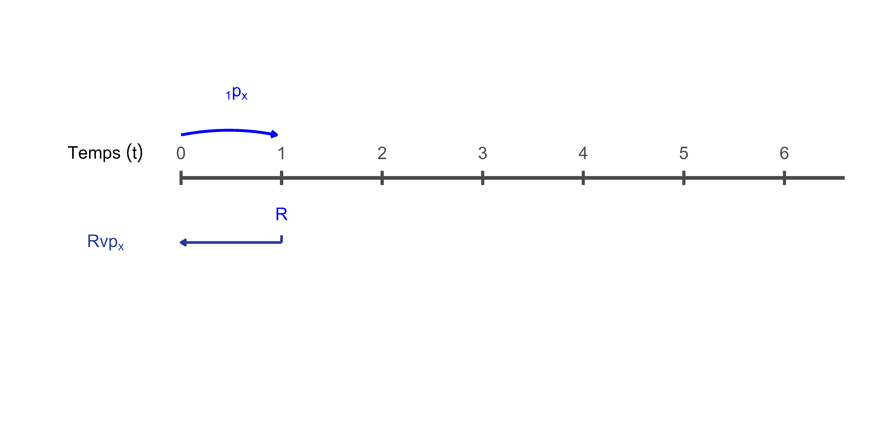

# Dessins

## Probabilités cumlatives

```{r}
#| code-fold: true
#| echo: false
#| message: false
#| warning: false
#| fig-height: 4
#| fig-width: 14
#| fig-align: center

library(ggplot2)
library(ggtext)
library(grid)
library(magick)

plot_survie_k <- function(k, t_max = 6) {
  
  if (!k %in% 1:6) {
    stop("k doit être un entier entre 1 et 6.")
  }
  
  ticks <- data.frame(
    t = 0:t_max,
    y = 0
  )
  
  green_arrows <- data.frame(
    x    = 0:(k - 1) + 0.05,
    xend = 0:(k - 1) + 0.95,
    y    = 0.6,
    yend = 0.6
  )
  
  green_labels <- data.frame(
    x = 0:(k - 1) + 0.5,
    y = 1.2,
    label = sapply(0:(k - 1), function(j) {
      if (j == 0) "p[x]" else paste0("p[x+", j, "]")
    })
  )
  
  blue_label <- paste0("phantom(0)[", k, "] * p[x]")
  
  ggplot() +
    theme_void() +
    coord_cartesian(
      xlim = c(-1.4, t_max + 0.6),
      ylim = c(-1.6, 1.6),
      clip = "off"
    ) +
    geom_segment(
      aes(x = 0, xend = t_max, y = 0, yend = 0),
      linewidth = 1.4,
      color = "#4a4a4a"
    ) +
    geom_segment(
      data = ticks,
      aes(x = t, xend = t, y = -0.10, yend = 0.10),
      linewidth = 1.2,
      color = "#4a4a4a"
    ) +
    annotate(
      "text",
      x = -0.75,
      y = 0.35,
      label = "Temps~(t)",
      parse = TRUE,
      size = 5
    ) +
    geom_text(
      data = ticks,
      aes(x = t, y = 0.35, label = t),
      size = 5,
      color = "#4a4a4a"
    ) +
    geom_curve(
      data = green_arrows,
      aes(x = x, y = y, xend = xend, yend = yend),
      curvature = -0.25,
      color = "#00BA38",
      linewidth = 1.1,
      arrow = arrow(length = unit(0.18, "cm"))
    ) +
    geom_text(
      data = green_labels,
      aes(x = x, y = y, label = label),
      parse = TRUE,
      color = "#00BA38",
      size = 5
    ) +
    geom_curve(
      aes(x = 0.05, y = -0.26, xend = k - 0.05, yend = -0.26),
      curvature = 0.1,
      color = "blue",
      linewidth = 1.1,
      arrow = arrow(length = unit(0.18, "cm"))
    ) +
    annotate(
      "text",
      x = k / 2,
      y = -0.85,
      label = blue_label,
      parse = TRUE,
      color = "blue",
      size = 5
    )
}

gif_file <- file.path("GIF", "survie.gif")

if (!file.exists(gif_file)) {
  
  plots <- lapply(1:6, plot_survie_k)
  tmp_files <- file.path("GIF", paste0("frame_", 1:6, ".png"))
  
  for (i in 1:6) {
    ggsave(
      filename = tmp_files[i],
      plot = plots[[i]],
      width = 10,
      height = 2.8,
      units = "in",
      dpi = 600
    )
  }
  
  gif <- image_read(tmp_files) |>
    image_animate(fps = 1)
  
  image_write(gif, path = gif_file)
  
  file.remove(tmp_files)
}

```

{width=70%}

## Espérance de vie 


```{r}
#| code-fold: true
#| echo: false
#| message: false
#| warning: false
#| fig-height: 4
#| fig-width: 14
#| fig-align: center

library(ggplot2)
library(ggtext)
library(grid)

plot_deces_k <- function(k, t_max = 6) {
  
  if (!k %in% 1:6) {
    stop("k doit être un entier entre 1 et 6.")
  }
  
  ticks <- data.frame(
    t = 0:t_max,
    y = 0
  )
  
  cashflows <- data.frame(
    t = k,
    y = 0,
    label = as.character(k)
  )
  
  death <- data.frame(
    x = k - 0.2,
    y = 0
  )
  
  # positions verticales des termes de somme
  y_terms <- seq(-0.9, by = -0.3, length.out = k)
  
  # étiquettes en bas
  bottom_labels <- sapply(1:k, function(j) {
    if (j == 1) {
      "1 %*% q[x]"
    } else {
      paste0(
        j,
        " %*% phantom(0)[", j - 1, "] * p[x] * q[x+", j - 1, "]"
      )
    }
  })
  
  p <- ggplot() +
    theme_void() +
    coord_cartesian(
      xlim = c(-1.4, t_max + 0.6),
      ylim = c(-3.4, 2.2),
      clip = "off"
    ) +
    
    # ligne du temps
    geom_segment(
      aes(x = 0, xend = t_max+0.6, y = 0, yend = 0),
      linewidth = 1.4,
      color = "#4a4a4a"
    ) +
    
    # graduations
    geom_segment(
      data = ticks,
      aes(x = t, xend = t, y = -0.10, yend = 0.10),
      linewidth = 1.2,
      color = "#4a4a4a"
    ) +
    
    # label du temps
    annotate(
      "text",
      x = -0.75,
      y = 0.35,
      label = "Temps~(t)",
      parse = TRUE,
      size = 5
    ) +
    
    # chiffres de temps
    geom_text(
      data = ticks,
      aes(x = t, y = 0.35, label = t),
      size = 5,
      color = "#4a4a4a"
    ) +
    
    # flux
    geom_text(
      data = cashflows,
      aes(x = t, y = -0.5, label = label),
      size = 5,
      color = "red"
    ) +
    
    # décès
    geom_point(
      data = death,
      aes(x = x, y = y),
      shape = 4,
      size = 3,
      stroke = 1.5,
      color = "red"
    ) +
    
    # flèche rouge
    geom_curve(
      aes(
        x = (k - 1) + 0.05,
        y = 0.6,
        xend = k - 0.2,
        yend = 0.6
      ),
      curvature = -0.25,
      color = "red",
      linewidth = 1.1,
      arrow = arrow(length = unit(0.18, "cm"))
    ) +
    
    # label rouge
    annotate(
      "text",
      x = k - 0.6,
      y = 1.2,
      label = if (k == 1) "q[x]" else paste0("q[x+", k - 1, "]"),
      parse = TRUE,
      color = "red",
      size = 5
    ) +
    
    # trait vertical de somme
    geom_segment(
      aes(
        x = k,
        xend = k,
        y = -0.8,
        yend = y_terms[k]
      ),
      linewidth = 1.0,
      color = "#243c96"
    ) +
    
    # trait horizontal de somme
    geom_segment(
      aes(
        x = k,
        xend = 0,
        y = y_terms[k],
        yend = y_terms[k]
      ),
      linewidth = 1.0,
      color = "#243c96",
      arrow = arrow(length = unit(0.18, "cm"))
    )
  
  # flèche bleue et label bleu si k >= 2
  if (k >= 2) {
    p <- p +
      geom_curve(
        aes(
          x = 0,
          y = 0.6,
          xend = k - 1 + 0.95 - 1,
          yend = 0.6
        ),
        curvature = -0.1,
        color = "blue",
        linewidth = 1.1,
        arrow = arrow(length = unit(0.18, "cm"))
      ) +
      annotate(
        "text",
        x = (k - 1) / 2,
        y = 1.2,
        label = paste0("phantom(0)[", k - 1, "] * p[x]"),
        parse = TRUE,
        color = "blue",
        size = 5
      )
  }
  
  # étiquettes du bas
  for (j in 1:k) {
    p <- p +
      annotate(
        "text",
        x = -0.75,
        y = y_terms[j],
        label = bottom_labels[j],
        color = "#243c96",
        parse = TRUE,
        size = 5
      )
  }
  
  p
}

### Ajout plots7 ###

plot_deces_k2 <- function(k, t_max = 6) {
  
  if (!k %in% 1:6) {
    stop("k doit être un entier entre 1 et 6.")
  }
  
  ticks <- data.frame(
    t = 0:t_max,
    y = 0
  )
  
  cashflows <- data.frame(
    t = k,
    y = 0,
    label = as.character(k)
  )
  
  death <- data.frame(
    x = k - 0.2,
    y = 0
  )
  
  # positions verticales des termes de somme
  y_terms <- seq(-0.9, by = -0.3, length.out = k)
  
  # étiquettes en bas
  bottom_labels <- sapply(1:k, function(j) {
    if (j == 1) {
      "1 %*% q[x]"
    } else {
      paste0(
        j,
        " %*% phantom(0)[", j - 1, "] * p[x] * q[x+", j - 1, "]"
      )
    }
  })
  
  p <- ggplot() +
    theme_void() +
    coord_cartesian(
      xlim = c(-1.4, t_max + 0.6),
      ylim = c(-3.4, 2.2),
      clip = "off"
    ) +
    
    # ligne du temps
    geom_segment(
      aes(x = 0, xend = t_max+0.6, y = 0, yend = 0),
      linewidth = 1.4,
      color = "#4a4a4a"
    ) +
    
    # graduations
    geom_segment(
      data = ticks,
      aes(x = t, xend = t, y = -0.10, yend = 0.10),
      linewidth = 1.2,
      color = "#4a4a4a"
    ) +
    
    # label du temps
    annotate(
      "text",
      x = -0.75,
      y = 0.35,
      label = "Temps~(t)",
      parse = TRUE,
      size = 5
    ) +
    
    # chiffres de temps
    geom_text(
      data = ticks,
      aes(x = t, y = 0.35, label = t),
      size = 5,
      color = "#4a4a4a"
    ) +

    # trait vertical de somme
    geom_segment(
      aes(
        x = 6.2,
        xend = 6.2,
        y = -0.8,
        yend = -2.7
      ),
      linewidth = 1.0,
      color = "#243c96"
    ) +
    
    # trait horizontal de somme
    geom_segment(
      aes(
        x = 6.2,
        xend = 0,
        y = -2.7,
        yend = -2.7
      ),
      linewidth = 1.0,
      color = "#243c96",
      arrow = arrow(length = unit(0.18, "cm"))
    )+
      annotate(
    "text",
    x = -0.75,
    y = -2.55,
    label = "...",
    color = "#243c96",
    size = 6
  ) 
  
  # flèche bleue et label bleu si k >= 2
  if (k >= 2) {
    p <- p +
      geom_curve(
        aes(
          x = 0,
          y = 0.6,
          xend = 6.2,
          yend = 0.6
        ),
        curvature = -0.1,
        color = "blue",
        linewidth = 1.1,
        arrow = arrow(length = unit(0.18, "cm"))
      ) +
      annotate(
        "text",
        x = (k - 1) / 2,
        y = 1.2,
        label = paste0("phantom(0)[", "t", "] * p[x]"),
        parse = TRUE,
        color = "blue",
        size = 5
      )
  }
  
  # étiquettes du bas
  for (j in 1:k) {
    p <- p +
      annotate(
        "text",
        x = -0.75,
        y = y_terms[j],
        label = bottom_labels[j],
        color = "#243c96",
        parse = TRUE,
        size = 5
      )
  }
  
  p
}

####

gif_file <- file.path("GIF", "esperance.gif")

if (!file.exists(gif_file)) {
  
  plots <- lapply(1:6, plot_deces_k)
  plots2 <- lapply(6, plot_deces_k2)
  plots[[7]] <- plots2[[1]]
  
    
  plots[[8]] <- plots[[7]] +
    annotate(
      "text",
      x = -0.75,
      y = -2.8,
      label = "_________",
      color = "#243c96",
      size = 5
    ) +
    annotate(
      "text",
      x = -0.75,
      y = -3.2,
      label = "sum((t+1) * phantom(0)[t] * p[x] * q[x+t], t==0, infinity)",
      parse = TRUE,
      color = "#243c96",
      size = 5
    )

  plots[[9]] <- plots[[8]]
  plots[[10]] <- plots[[8]]
  
  tmp_files <- paste0("frame_", 1:10, ".png")
  
  for (i in 1:10) {
    ggsave(
      filename = tmp_files[i],
      plot = plots[[i]],
      width = 10,
      height = 5,
      units = "in",
      dpi = 600
    )
  }
  
  gif <- image_read(tmp_files) |>
    image_animate(fps = 1)
  
  image_write(gif, path = gif_file)
  
  file.remove(tmp_files)
}


```

{width=70%}


## Assurance-vie 


```{r}
#| code-fold: true
#| echo: false
#| message: false
#| warning: false
#| fig-height: 4
#| fig-width: 14
#| fig-align: center

library(ggplot2)
library(ggtext)
library(grid)

plot_deces_k <- function(k, t_max = 6) {
  
  if (!k %in% 1:6) {
    stop("k doit être un entier entre 1 et 6.")
  }
  
  ticks <- data.frame(
    t = 0:t_max,
    y = 0
  )
  
  cashflows <- data.frame(
    t = k,
    y = 0,
    label = as.character("S")
  )
  
  death <- data.frame(
    x = k - 0.2,
    y = 0
  )
  
  # positions verticales des termes de somme
  y_terms <- seq(-0.9, by = -0.3, length.out = k)
  
  # étiquettes en bas
bottom_labels <- sapply(1:k, function(j) {
  if (j == 1) {
    "S * v * q[x]"
  } else {
    paste0(
      "S * v^", j,
      " * phantom(0)[", j - 1, "] * p[x] * q[x+", j - 1, "]"
    )
  }
})
  
  p <- ggplot() +
    theme_void() +
    coord_cartesian(
      xlim = c(-1.4, t_max + 0.6),
      ylim = c(-3.4, 2.2),
      clip = "off"
    ) +
    
    # ligne du temps
    geom_segment(
      aes(x = 0, xend = t_max+0.6, y = 0, yend = 0),
      linewidth = 1.4,
      color = "#4a4a4a"
    ) +
    
    # graduations
    geom_segment(
      data = ticks,
      aes(x = t, xend = t, y = -0.10, yend = 0.10),
      linewidth = 1.2,
      color = "#4a4a4a"
    ) +
    
    # label du temps
    annotate(
      "text",
      x = -0.75,
      y = 0.35,
      label = "Temps~(t)",
      parse = TRUE,
      size = 5
    ) +
    
    # chiffres de temps
    geom_text(
      data = ticks,
      aes(x = t, y = 0.35, label = t),
      size = 5,
      color = "#4a4a4a"
    ) +
    
    # flux
    geom_text(
      data = cashflows,
      aes(x = t, y = -0.5, label = label),
      size = 5,
      color = "red"
    ) +
    
    # décès
    geom_point(
      data = death,
      aes(x = x, y = y),
      shape = 4,
      size = 3,
      stroke = 1.5,
      color = "red"
    ) +
    
    # flèche rouge
    geom_curve(
      aes(
        x = (k - 1) + 0.05,
        y = 0.6,
        xend = k - 0.2,
        yend = 0.6
      ),
      curvature = -0.25,
      color = "red",
      linewidth = 1.1,
      arrow = arrow(length = unit(0.18, "cm"))
    ) +
    
    # label rouge
    annotate(
      "text",
      x = k - 0.6,
      y = 1.2,
      label = if (k == 1) "q[x]" else paste0("q[x+", k - 1, "]"),
      parse = TRUE,
      color = "red",
      size = 5
    ) +
    
    # trait vertical de somme
    geom_segment(
      aes(
        x = k,
        xend = k,
        y = -0.8,
        yend = y_terms[k]
      ),
      linewidth = 1.0,
      color = "#243c96"
    ) +
    
    # trait horizontal de somme
    geom_segment(
      aes(
        x = k,
        xend = 0,
        y = y_terms[k],
        yend = y_terms[k]
      ),
      linewidth = 1.0,
      color = "#243c96",
      arrow = arrow(length = unit(0.18, "cm"))
    )
  
  # flèche bleue et label bleu si k >= 2
  if (k >= 2) {
    p <- p +
      geom_curve(
        aes(
          x = 0,
          y = 0.6,
          xend = k - 1 + 0.95 - 1,
          yend = 0.6
        ),
        curvature = -0.1,
        color = "blue",
        linewidth = 1.1,
        arrow = arrow(length = unit(0.18, "cm"))
      ) +
      annotate(
        "text",
        x = (k - 1) / 2,
        y = 1.2,
        label = paste0("phantom(0)[", k - 1, "] * p[x]"),
        parse = TRUE,
        color = "blue",
        size = 5
      )
  }
  
  # étiquettes du bas
  for (j in 1:k) {
    p <- p +
      annotate(
        "text",
        x = -0.75,
        y = y_terms[j],
        label = bottom_labels[j],
        color = "#243c96",
        parse = TRUE,
        size = 5
      )
  }
  
  p
}

### Ajout plots7 ###

plot_deces_k2 <- function(k, t_max = 6) {
  
  if (!k %in% 1:6) {
    stop("k doit être un entier entre 1 et 6.")
  }
  
  ticks <- data.frame(
    t = 0:t_max,
    y = 0
  )
  
  cashflows <- data.frame(
    t = k,
    y = 0,
    label = as.character(k)
  )
  
  death <- data.frame(
    x = k - 0.2,
    y = 0
  )
  
  # positions verticales des termes de somme
  y_terms <- seq(-0.9, by = -0.3, length.out = k)
  
  # étiquettes en bas
bottom_labels <- sapply(1:k, function(j) {
  if (j == 1) {
    "S * v * q[x]"
  } else {
    paste0(
      "S * v^", j,
      " * phantom(0)[", j - 1, "] * p[x] * q[x+", j - 1, "]"
    )
  }
})
  
  p <- ggplot() +
    theme_void() +
    coord_cartesian(
      xlim = c(-1.4, t_max + 0.6),
      ylim = c(-3.4, 2.2),
      clip = "off"
    ) +
    
    # ligne du temps
    geom_segment(
      aes(x = 0, xend = t_max+0.6, y = 0, yend = 0),
      linewidth = 1.4,
      color = "#4a4a4a"
    ) +
    
    # graduations
    geom_segment(
      data = ticks,
      aes(x = t, xend = t, y = -0.10, yend = 0.10),
      linewidth = 1.2,
      color = "#4a4a4a"
    ) +
    
    # label du temps
    annotate(
      "text",
      x = -0.75,
      y = 0.35,
      label = "Temps~(t)",
      parse = TRUE,
      size = 5
    ) +
    
    # chiffres de temps
    geom_text(
      data = ticks,
      aes(x = t, y = 0.35, label = t),
      size = 5,
      color = "#4a4a4a"
    ) +

    # trait vertical de somme
    geom_segment(
      aes(
        x = 6.2,
        xend = 6.2,
        y = -0.8,
        yend = -2.7
      ),
      linewidth = 1.0,
      color = "#243c96"
    ) +
    
    # trait horizontal de somme
    geom_segment(
      aes(
        x = 6.2,
        xend = 0,
        y = -2.7,
        yend = -2.7
      ),
      linewidth = 1.0,
      color = "#243c96",
      arrow = arrow(length = unit(0.18, "cm"))
    )+
      annotate(
    "text",
    x = -0.75,
    y = -2.55,
    label = "...",
    color = "#243c96",
    size = 6
  ) 
  
  # flèche bleue et label bleu si k >= 2
  if (k >= 2) {
    p <- p +
      geom_curve(
        aes(
          x = 0,
          y = 0.6,
          xend = 6.2,
          yend = 0.6
        ),
        curvature = -0.1,
        color = "blue",
        linewidth = 1.1,
        arrow = arrow(length = unit(0.18, "cm"))
      ) +
      annotate(
        "text",
        x = (k - 1) / 2,
        y = 1.2,
        label = paste0("phantom(0)[", "t", "] * p[x]"),
        parse = TRUE,
        color = "blue",
        size = 5
      )
  }
  
  # étiquettes du bas
  for (j in 1:k) {
    p <- p +
      annotate(
        "text",
        x = -0.75,
        y = y_terms[j],
        label = bottom_labels[j],
        color = "#243c96",
        parse = TRUE,
        size = 5
      )
  }
  
  p
}

####

gif_file <- file.path("GIF", "avie.gif")

if (!file.exists(gif_file)) {
  
  plots <- lapply(1:6, plot_deces_k)
  plots2 <- lapply(6, plot_deces_k2)
  plots[[7]] <- plots2[[1]]
  
    
  plots[[8]] <- plots[[7]] +
    annotate(
      "text",
      x = -0.75,
      y = -2.8,
      label = "_________",
      color = "#243c96",
      size = 5
    ) +
    annotate(
      "text",
      x = -0.75,
      y = -3.2,
      label = "sum(S * v^(t+1) * phantom(0)[t] * p[x] * q[x+t], t==0, infinity)",
      parse = TRUE,
      color = "#243c96",
      size = 5
    )

  plots[[9]] <- plots[[8]]
  plots[[10]] <- plots[[8]]
  
  tmp_files <- paste0("frame_", 1:10, ".png")
  
  for (i in 1:10) {
    ggsave(
      filename = tmp_files[i],
      plot = plots[[i]],
      width = 10,
      height = 5,
      units = "in",
      dpi = 600
    )
  }
  
  gif <- image_read(tmp_files) |>
    image_animate(fps = 1)
  
  image_write(gif, path = gif_file)
  
  file.remove(tmp_files)
}


```

{width=70%}


## Rente

### Rente 1

```{r}
#| code-fold: true
#| echo: false
#| message: false
#| warning: false
#| fig-height: 4
#| fig-width: 14
#| fig-align: center

library(ggplot2)
library(ggtext)
library(grid)

plot_deces_k <- function(k, t_max = 6) {
  
  if (!k %in% 1:6) {
    stop("k doit être un entier entre 1 et 6.")
  }
  
  ticks <- data.frame(
    t = 0:t_max,
    y = 0
  )
  
  cashflows <- data.frame(
    t = 0:(k-1),
    y = 0,
    label = as.character("R")
  )
  
  death <- data.frame(
    x = k - 0.2,
    y = 0
  )
  
  # positions verticales des termes de somme
  y_terms <- seq(-0.9, by = -0.3, length.out = k)

    sum_lines <- data.frame(
  x = 0:(k - 1),
  y0 = -0.8,
  y1 = y_terms[k]
)
    
  # étiquettes en bas
bottom_labels <- sapply(1:k, function(j) {
  
  if (j <= 3) {
    
    rente_terms <- sapply(0:(j - 1), function(m) {
      if (m == 0) {
        "R"
      } else if (m == 1) {
        "R * v"
      } else {
        paste0("R * v^", m)
      }
    })
    
    rente_part <- if (j == 1) {
      "R"
    } else {
      paste0("(", paste(rente_terms, collapse = " + "), ")")
    }
    
  } else {
    
    rente_part <- paste0("(R + ... + R * v^", j - 1, ")")
    
  }
  
  if (j == 1) {
    paste0(rente_part, " * q[x]")
  } else {
    paste0(
      rente_part,
      " * phantom(0)[", j - 1, "] * p[x] * q[x+", j - 1, "]"
    )
  }
})
  p <- ggplot() +
    theme_void() +
    coord_cartesian(
      xlim = c(-1.4, t_max + 0.6),
      ylim = c(-3.4, 2.2),
      clip = "off"
    ) +
    
    # ligne du temps
    geom_segment(
      aes(x = 0, xend = t_max+0.6, y = 0, yend = 0),
      linewidth = 1.4,
      color = "#4a4a4a"
    ) +
    
    # graduations
    geom_segment(
      data = ticks,
      aes(x = t, xend = t, y = -0.10, yend = 0.10),
      linewidth = 1.2,
      color = "#4a4a4a"
    ) +
    
    # label du temps
    annotate(
      "text",
      x = -0.75,
      y = 0.35,
      label = "Temps~(t)",
      parse = TRUE,
      size = 5
    ) +
    
    # chiffres de temps
    geom_text(
      data = ticks,
      aes(x = t, y = 0.35, label = t),
      size = 5,
      color = "#4a4a4a"
    ) +
    
    # flux
    geom_text(
      data = cashflows,
      aes(x = t, y = -0.5, label = label),
      size = 5,
      color = "blue"
    ) +
    
    # décès
    geom_point(
      data = death,
      aes(x = x, y = y),
      shape = 4,
      size = 3,
      stroke = 1.5,
      color = "red"
    ) +
    
    # flèche rouge
    geom_curve(
      aes(
        x = (k - 1) + 0.05,
        y = 0.6,
        xend = k - 0.2,
        yend = 0.6
      ),
      curvature = -0.25,
      color = "red",
      linewidth = 1.1,
      arrow = arrow(length = unit(0.18, "cm"))
    ) +
    
    # label rouge
    annotate(
      "text",
      x = k - 0.6,
      y = 1.2,
      label = if (k == 1) "q[x]" else paste0("q[x+", k - 1, "]"),
      parse = TRUE,
      color = "red",
      size = 5
    ) +
    
geom_segment(
  data = sum_lines,
  aes(
    x = x,
    xend = x,
    y = y0,
    yend = y1
  ),
  linewidth = 1.0,
  color = "#243c96"
)+
    
sum_segment <- if (k == 1) {
  geom_segment(
    aes(
      x = k - 1,
      xend = -0.5,
      y = y_terms[k],
      yend = y_terms[k]
    ),
    linewidth = 1.0,
    color = "#243c96",
    arrow = arrow(length = unit(0.18, "cm"))
  )
} else {
  geom_segment(
    aes(
      x = k - 1,
      xend = 0,
      y = y_terms[k],
      yend = y_terms[k]
    ),
    linewidth = 1.0,
    color = "#243c96",
    arrow = arrow(length = unit(0.18, "cm"))
  )
}
  
  # flèche bleue et label bleu si k >= 2
  if (k >= 2) {
    p <- p +
      geom_curve(
        aes(
          x = 0,
          y = 0.6,
          xend = k - 1 + 0.95 - 1,
          yend = 0.6
        ),
        curvature = -0.1,
        color = "blue",
        linewidth = 1.1,
        arrow = arrow(length = unit(0.18, "cm"))
      ) +
      annotate(
        "text",
        x = (k - 1) / 2,
        y = 1.2,
        label = paste0("phantom(0)[", k - 1, "] * p[x]"),
        parse = TRUE,
        color = "blue",
        size = 5
      )
  }
  
  # étiquettes du bas
  for (j in 1:k) {
    p <- p +
      annotate(
        "text",
        x = -0.75,
        y = y_terms[j],
        label = bottom_labels[j],
        color = "#243c96",
        parse = TRUE,
        size = 3.5
      )
  }
  
  p
}

### Ajout plots7 ###

plot_deces_k2 <- function(k, t_max = 6) {
  
  if (!k %in% 1:6) {
    stop("k doit être un entier entre 1 et 6.")
  }
  
  ticks <- data.frame(
    t = 0:t_max,
    y = 0
  )
  
  cashflows <- data.frame(
    t = 0:(k-1),
    y = 0,
    label = as.character(k)
  )
  
  death <- data.frame(
    x = k - 0.2,
    y = 0
  )

  # positions verticales des termes de somme
  y_terms <- seq(-0.9, by = -0.3, length.out = k)
  
sum_lines <- data.frame(
  x = c(0:(k - 1), 6.2),
  y0 = -0.8,
  y1 = y_terms[k]
)
  
  # étiquettes en bas
bottom_labels <- sapply(1:k, function(j) {
  
  if (j <= 3) {
    
    rente_terms <- sapply(0:(j - 1), function(m) {
      if (m == 0) {
        "R"
      } else if (m == 1) {
        "R * v"
      } else {
        paste0("R * v^", m)
      }
    })
    
    rente_part <- if (j == 1) {
      "R"
    } else {
      paste0("(", paste(rente_terms, collapse = " + "), ")")
    }
    
  } else {
    
    rente_part <- paste0("(R + ... + R * v^", j - 1, ")")
    
  }
  
  if (j == 1) {
    paste0(rente_part, " * q[x]")
  } else {
    paste0(
      rente_part,
      " * phantom(0)[", j - 1, "] * p[x] * q[x+", j - 1, "]"
    )
  }
})
  
  p <- ggplot() +
    theme_void() +
    coord_cartesian(
      xlim = c(-1.4, t_max + 0.6),
      ylim = c(-3.4, 2.2),
      clip = "off"
    ) +
    
    # ligne du temps
    geom_segment(
      aes(x = 0, xend = t_max+0.6, y = 0, yend = 0),
      linewidth = 1.4,
      color = "#4a4a4a"
    ) +
    
    # graduations
    geom_segment(
      data = ticks,
      aes(x = t, xend = t, y = -0.10, yend = 0.10),
      linewidth = 1.2,
      color = "#4a4a4a"
    ) +
    
    # label du temps
    annotate(
      "text",
      x = -0.75,
      y = 0.35,
      label = "Temps~(t)",
      parse = TRUE,
      size = 5
    ) +
    
    # chiffres de temps
    geom_text(
      data = ticks,
      aes(x = t, y = 0.35, label = t),
      size = 5,
      color = "#4a4a4a"
    ) +

    # trait vertical de somme
geom_segment(
  data = sum_lines,
  aes(
    x = x,
    xend = x,
    y = y0,
    yend = y1
  ),
  linewidth = 1.0,
  color = "#243c96"
)
    
    # trait horizontal de somme
    geom_segment(
      aes(
        x = 6.2,
        xend = -0.5,
        y = -2.7,
        yend = -2.7
      ),
      linewidth = 1.0,
      color = "#243c96",
      arrow = arrow(length = unit(0.18, "cm"))
    )+
      annotate(
    "text",
    x = -1,
    y = -2.55,
    label = "...",
    color = "#243c96",
    size = 6
  ) 
  
  # flèche bleue et label bleu si k >= 2
  if (k >= 2) {
    p <- p +
      geom_curve(
        aes(
          x = 0,
          y = 0.6,
          xend = 6.2,
          yend = 0.6
        ),
        curvature = -0.1,
        color = "blue",
        linewidth = 1.1,
        arrow = arrow(length = unit(0.18, "cm"))
      ) +
      annotate(
        "text",
        x = (k - 1) / 2,
        y = 1.2,
        label = paste0("phantom(0)[", "t", "] * p[x]"),
        parse = TRUE,
        color = "blue",
        size = 5
      )
  }
  
  # étiquettes du bas
  for (j in 1:k) {
    p <- p +
      annotate(
        "text",
        x = -0.75,
        y = y_terms[j],
        label = bottom_labels[j],
        color = "#243c96",
        parse = TRUE,
        size = 3.5
      )
  }
  
  p
}

####

gif_file <- file.path("GIF", "rente1.gif")

#if (!file.exists(gif_file)) {
  
  plots <- lapply(1:6, plot_deces_k)
  plots2 <- lapply(6, plot_deces_k2)
  plots[[7]] <- plots2[[1]]
  
    
  plots[[8]] <- plots[[7]] +
    annotate(
      "text",
      x = -0.75,
      y = -2.8,
      label = "_________",
      color = "#243c96",
      size = 3.5
    ) +
annotate(
  "text",
  x = -0.75,
  y = -3.3,
  label = "sum((sum(R * v^m, m==0, t)) * phantom(0)[t] * p[x] * q[x+t], t==0, infinity)",
  parse = TRUE,
  color = "#243c96",
  size = 3.5
)

  plots[[9]] <- plots[[8]]
  plots[[10]] <- plots[[8]]
  
  tmp_files <- paste0("frame_", 1:10, ".png")
  
  for (i in 1:10) {
    ggsave(
      filename = tmp_files[i],
      plot = plots[[i]],
      width = 10,
      height = 5,
      units = "in",
      dpi = 600
    )
  }
  
  gif <- image_read(tmp_files) |>
    image_animate(fps = 1)
  
  image_write(gif, path = gif_file)
  
  file.remove(tmp_files)
#}


```

```{r}
#| code-fold: true
#| echo: false
#| message: false
#| warning: false
#| fig-height: 4
#| fig-width: 14
#| fig-align: center

library(ggplot2)
library(grid)
library(magick)

# ============================================================
# Helpers
# ============================================================

make_bottom_labels <- function(k) {
  sapply(1:k, function(j) {
    
    if (j <= 3) {
      rente_terms <- sapply(0:(j - 1), function(m) {
        if (m == 0) {
          "R"
        } else if (m == 1) {
          "R * v"
        } else {
          paste0("R * v^", m)
        }
      })
      
      rente_part <- if (j == 1) {
        "R"
      } else {
        paste0("(", paste(rente_terms, collapse = " + "), ")")
      }
      
    } else {
      rente_part <- paste0("(R + ... + R * v^", j - 1, ")")
    }
    
    if (j == 1) {
      paste0(rente_part, " * q[x]")
    } else {
      paste0(
        rente_part,
        " * phantom(0)[", j - 1, "] * p[x] * q[x+", j - 1, "]"
      )
    }
  })
}

make_base_plot <- function(t_max = 6, ylim = c(-3.4, 2.2)) {
  ticks <- data.frame(t = 0:t_max)
  
  ggplot() +
    theme_void() +
    coord_cartesian(
      xlim = c(-1.4, t_max + 0.6),
      ylim = ylim,
      clip = "off"
    ) +
    geom_segment(
      aes(x = 0, xend = t_max + 0.6, y = 0, yend = 0),
      linewidth = 1.4,
      color = "#4a4a4a"
    ) +
    geom_segment(
      data = ticks,
      aes(x = t, xend = t, y = -0.10, yend = 0.10),
      linewidth = 1.2,
      color = "#4a4a4a"
    ) +
    annotate(
      "text",
      x = -0.75,
      y = 0.35,
      label = "Temps~(t)",
      parse = TRUE,
      size = 5
    ) +
    geom_text(
      data = ticks,
      aes(x = t, y = 0.35, label = t),
      size = 5,
      color = "#4a4a4a"
    )
}

add_bottom_labels <- function(p, bottom_labels, y_terms) {
  for (j in seq_along(bottom_labels)) {
    p <- p +
      annotate(
        "text",
        x = -1,
        y = y_terms[j],
        label = bottom_labels[j],
        color = "#243c96",
        parse = TRUE,
        size = 3.5
      )
  }
  p
}

# ============================================================
# Plot 1 à 6 : décès à t = k
# ============================================================

plot_deces_k <- function(k, t_max = 6) {
  
  if (!k %in% 1:6) {
    stop("k doit être un entier entre 1 et 6.")
  }
  
  cashflows <- data.frame(
    t = 0:(k - 1),
    label = "R"
  )
  
  death <- data.frame(
    x = k - 0.2,
    y = 0
  )
  
  y_terms <- seq(-0.9, by = -0.3, length.out = k)
  
  sum_lines <- data.frame(
    x = 0:(k - 1),
    y0 = -0.8,
    y1 = y_terms[k]
  )
  
  bottom_labels <- make_bottom_labels(k)
  
  xend_sum <- if (k == 1) -0.5 else -0.3
  
  p <- make_base_plot(t_max = t_max) +
    
    geom_text(
      data = cashflows,
      aes(x = t, y = -0.5, label = label),
      size = 5,
      color = "blue"
    ) +
    
    geom_point(
      data = death,
      aes(x = x, y = y),
      shape = 4,
      size = 3,
      stroke = 1.5,
      color = "red"
    ) +
    
    geom_curve(
      aes(
        x = (k - 1) + 0.05,
        y = 0.6,
        xend = k - 0.2,
        yend = 0.6
      ),
      curvature = -0.25,
      color = "red",
      linewidth = 1.1,
      arrow = arrow(length = unit(0.18, "cm"))
    ) +
    
    annotate(
      "text",
      x = k - 0.6,
      y = 1.2,
      label = if (k == 1) "q[x]" else paste0("q[x+", k - 1, "]"),
      parse = TRUE,
      color = "red",
      size = 5
    ) +
    
    geom_segment(
      data = sum_lines,
      aes(x = x, xend = x, y = y0, yend = y1),
      linewidth = 1.0,
      color = "#243c96"
    ) +
    
    geom_segment(
      aes(
        x = k - 1,
        xend = xend_sum,
        y = y_terms[k],
        yend = y_terms[k]
      ),
      linewidth = 1.0,
      color = "#243c96",
      arrow = arrow(length = unit(0.18, "cm"))
    )
  
  if (k >= 2) {
    p <- p +
      geom_curve(
        aes(
          x = 0,
          y = 0.6,
          xend = k - 1,
          yend = 0.6
        ),
        curvature = -0.1,
        color = "blue",
        linewidth = 1.1,
        arrow = arrow(length = unit(0.18, "cm"))
      ) +
      annotate(
        "text",
        x = (k - 1) / 2,
        y = 1.2,
        label = paste0("phantom(0)[", k - 1, "] * p[x]"),
        parse = TRUE,
        color = "blue",
        size = 5
      )
  }
  
  p <- add_bottom_labels(p, bottom_labels, y_terms)
  
  p
}

# ============================================================
# Plot final généralisé
# ============================================================

plot_deces_general <- function(t_max = 6, k = 6) {
  
  y_terms <- seq(-0.9, by = -0.3, length.out = k)
  bottom_labels <- make_bottom_labels(k)
  
  sum_lines <- data.frame(
    x = c(0:(k - 1), 6.2),
    y0 = -0.8,
    y1 = y_terms[k]
  )
  
  p <- make_base_plot(t_max = t_max) +
    
    geom_segment(
      data = sum_lines,
      aes(x = x, xend = x, y = y0, yend = y1),
      linewidth = 1.0,
      color = "#243c96"
    ) +
    
    geom_segment(
      aes(
        x = 6.2,
        xend = -0.3,
        y = y_terms[k],
        yend = y_terms[k]
      ),
      linewidth = 1.0,
      color = "#243c96",
      arrow = arrow(length = unit(0.18, "cm"))
    ) +
    
    annotate(
      "text",
      x = -1,
      y = -2.55,
      label = "...",
      color = "#243c96",
      size = 6
    ) +
   
    geom_curve(
      aes(
        x = 0,
        y = 0.6,
        xend = 6.2,
        yend = 0.6
      ),
      curvature = -0.1,
      color = "blue",
      linewidth = 1.1,
      arrow = arrow(length = unit(0.18, "cm"))
    ) +
    
    annotate(
      "text",
      x = 3.1,
      y = 1.2,
      label = "phantom(0)[t] * p[x]",
      parse = TRUE,
      color = "blue",
      size = 5
    )
  
  p <- add_bottom_labels(p, bottom_labels, y_terms)
  
  cashflows <- data.frame(
    t = 0:6,
    label = "R"
  )
    
  p +
    geom_text(
      data = cashflows,
      aes(x = t, y = -0.5, label = label),
      size = 5,
      color = "blue"
    ) +
    annotate(
      "text",
      x = -1,
      y = -2.8,
      label = "_________",
      color = "#243c96",
      size = 3.5
    ) +
    annotate(
      "text",
      x = -1,
      y = -3.3,
      label = "sum((sum(R * v^m, m==0, t)) * phantom(0)[t] * p[x] * q[x+t], t==0, infinity)",
      parse = TRUE,
      color = "#243c96",
      size = 3.5
    )
}

# ============================================================
# Génération du GIF
# ============================================================

dir.create("GIF", showWarnings = FALSE)

gif_file <- file.path("GIF", "rente1.gif")
tmp_files <- file.path("GIF", paste0("frame_", 1:10, ".png"))

plots <- lapply(1:6, plot_deces_k)
plots[[7]] <- plot_deces_general()
plots[[8]] <- plots[[7]]
plots[[9]] <- plots[[7]]
plots[[10]] <- plots[[7]]

for (i in 1:10) {
  ggsave(
    filename = tmp_files[i],
    plot = plots[[i]],
    width = 10,
    height = 5,
    units = "in",
    dpi = 600
  )
}

gif <- image_read(tmp_files) |>
  image_animate(fps = 1)

image_write(gif, path = gif_file)

file.remove(tmp_files)

```


{width=70%}


### Rente 1b

```{r}
#| code-fold: true
#| echo: false
#| message: false
#| warning: false
#| fig-height: 4
#| fig-width: 14
#| fig-align: center

library(ggplot2)
library(grid)
library(magick)

# ============================================================
# Helpers
# ============================================================

make_bottom_labels <- function(k) {
  sapply(1:k, function(j) {
    
    if (j <= 3) {
      rente_terms <- sapply(0:(j - 1), function(m) {
        if (m == 0) {
          "0"
        } else if (m == 1) {
          "R * v"
        } else {
          paste0("R * v^", m)
        }
      })
      
      rente_part <- if (j == 1) {
        "R"
      } else {
        paste0("(", paste(rente_terms, collapse = " + "), ")")
      }
      
    } else {
      rente_part <- paste0("(R*v + ... + R * v^", j - 1, ")")
    }
    
    if (j == 1) {
      paste0(rente_part, " * q[x]")
    } else {
      paste0(
        rente_part,
        " * phantom(0)[", j - 1, "] * p[x] * q[x+", j - 1, "]"
      )
    }
  })
}

make_base_plot <- function(t_max = 6, ylim = c(-3.4, 2.2)) {
  ticks <- data.frame(t = 0:t_max)
  
  ggplot() +
    theme_void() +
    coord_cartesian(
      xlim = c(-1.4, t_max + 0.6),
      ylim = ylim,
      clip = "off"
    ) +
    geom_segment(
      aes(x = 0, xend = t_max + 0.6, y = 0, yend = 0),
      linewidth = 1.4,
      color = "#4a4a4a"
    ) +
    geom_segment(
      data = ticks,
      aes(x = t, xend = t, y = -0.10, yend = 0.10),
      linewidth = 1.2,
      color = "#4a4a4a"
    ) +
    annotate(
      "text",
      x = -0.75,
      y = 0.35,
      label = "Temps~(t)",
      parse = TRUE,
      size = 5
    ) +
    geom_text(
      data = ticks,
      aes(x = t, y = 0.35, label = t),
      size = 5,
      color = "#4a4a4a"
    )
}

add_bottom_labels <- function(p, bottom_labels, y_terms) {
  for (j in seq_along(bottom_labels)) {
    p <- p +
      annotate(
        "text",
        x = -1,
        y = y_terms[j],
        label = bottom_labels[j],
        color = "#243c96",
        parse = TRUE,
        size = 3.5
      )
  }
  p
}

# ============================================================
# Plot 1 à 6 : décès à t = k
# ============================================================

plot_deces_k <- function(k, t_max = 6) {
  
  if (!k %in% 1:6) {
    stop("k doit être un entier entre 1 et 6.")
  }
  
  cashflows <- data.frame(
    t = 0:(k - 1),
    label = "R"
  )
  
  death <- data.frame(
    x = k - 0.2,
    y = 0
  )
  
  y_terms <- seq(-0.9, by = -0.3, length.out = k)
  
  sum_lines <- data.frame(
    x = 0:(k - 1),
    y0 = -0.8,
    y1 = y_terms[k]
  )
  
  bottom_labels <- make_bottom_labels(k)
  
  xend_sum <- if (k == 1) -0.5 else -0.3
  
  p <- make_base_plot(t_max = t_max) +
    
    geom_text(
      data = cashflows,
      aes(x = t, y = -0.5, label = label),
      size = 5,
      color = "blue"
    ) +
    
    geom_point(
      data = death,
      aes(x = x, y = y),
      shape = 4,
      size = 3,
      stroke = 1.5,
      color = "red"
    ) +
    
    geom_curve(
      aes(
        x = (k - 1) + 0.05,
        y = 0.6,
        xend = k - 0.2,
        yend = 0.6
      ),
      curvature = -0.25,
      color = "red",
      linewidth = 1.1,
      arrow = arrow(length = unit(0.18, "cm"))
    ) +
    
    annotate(
      "text",
      x = k - 0.6,
      y = 1.2,
      label = if (k == 1) "q[x]" else paste0("q[x+", k - 1, "]"),
      parse = TRUE,
      color = "red",
      size = 5
    ) +
    
    geom_segment(
      data = sum_lines,
      aes(x = x, xend = x, y = y0, yend = y1),
      linewidth = 1.0,
      color = "#243c96"
    ) +
    
    geom_segment(
      aes(
        x = k - 1,
        xend = xend_sum,
        y = y_terms[k],
        yend = y_terms[k]
      ),
      linewidth = 1.0,
      color = "#243c96",
      arrow = arrow(length = unit(0.18, "cm"))
    )
  
  if (k >= 2) {
    p <- p +
      geom_curve(
        aes(
          x = 0,
          y = 0.6,
          xend = k - 1,
          yend = 0.6
        ),
        curvature = -0.1,
        color = "blue",
        linewidth = 1.1,
        arrow = arrow(length = unit(0.18, "cm"))
      ) +
      annotate(
        "text",
        x = (k - 1) / 2,
        y = 1.2,
        label = paste0("phantom(0)[", k - 1, "] * p[x]"),
        parse = TRUE,
        color = "blue",
        size = 5
      )
  }
  
  p <- add_bottom_labels(p, bottom_labels, y_terms)
  
  p
}

# ============================================================
# Plot final généralisé
# ============================================================

plot_deces_general <- function(t_max = 6, k = 6) {
  
  y_terms <- seq(-0.9, by = -0.3, length.out = k)
  bottom_labels <- make_bottom_labels(k)
  
  sum_lines <- data.frame(
    x = c(0:(k - 1), 6.2),
    y0 = -0.8,
    y1 = y_terms[k]
  )
  
  p <- make_base_plot(t_max = t_max) +
    
    geom_segment(
      data = sum_lines,
      aes(x = x, xend = x, y = y0, yend = y1),
      linewidth = 1.0,
      color = "#243c96"
    ) +
    
    geom_segment(
      aes(
        x = 6.2,
        xend = -0.3,
        y = y_terms[k],
        yend = y_terms[k]
      ),
      linewidth = 1.0,
      color = "#243c96",
      arrow = arrow(length = unit(0.18, "cm"))
    ) +
    
    annotate(
      "text",
      x = -1,
      y = -2.55,
      label = "...",
      color = "#243c96",
      size = 6
    ) +
   
    geom_curve(
      aes(
        x = 0,
        y = 0.6,
        xend = 6.2,
        yend = 0.6
      ),
      curvature = -0.1,
      color = "blue",
      linewidth = 1.1,
      arrow = arrow(length = unit(0.18, "cm"))
    ) +
    
    annotate(
      "text",
      x = 3.1,
      y = 1.2,
      label = "phantom(0)[t] * p[x]",
      parse = TRUE,
      color = "blue",
      size = 5
    )
  
  p <- add_bottom_labels(p, bottom_labels, y_terms)
  
  cashflows <- data.frame(
    t = 0:6,
    label = "R"
  )
    
  p +
    geom_text(
      data = cashflows,
      aes(x = t, y = -0.5, label = label),
      size = 5,
      color = "blue"
    ) +
    annotate(
      "text",
      x = -1,
      y = -2.8,
      label = "_________",
      color = "#243c96",
      size = 3.5
    ) +
    annotate(
      "text",
      x = -1,
      y = -3.3,
      label = "sum((sum(R * v^m, m==0, t)) * phantom(0)[t] * p[x] * q[x+t], t==0, infinity)",
      parse = TRUE,
      color = "#243c96",
      size = 3.5
    )
}

# ============================================================
# Génération du GIF
# ============================================================

dir.create("GIF", showWarnings = FALSE)

gif_file <- file.path("GIF", "rente1b.gif")
tmp_files <- file.path("GIF", paste0("frame_", 1:10, ".png"))

plots <- lapply(2:6, plot_deces_k)
plots[[7]] <- plot_deces_general()
plots[[8]] <- plots[[7]]
plots[[9]] <- plots[[7]]
plots[[10]] <- plots[[7]]

for (i in 1:10) {
  ggsave(
    filename = tmp_files[i],
    plot = plots[[i]],
    width = 10,
    height = 5,
    units = "in",
    dpi = 600
  )
}

gif <- image_read(tmp_files) |>
  image_animate(fps = 1)

image_write(gif, path = gif_file)

file.remove(tmp_files)

```


### Rente 2 


```{r}
#| code-fold: true
#| echo: false
#| message: false
#| warning: false
#| fig-height: 4
#| fig-width: 14
#| fig-align: center

library(ggplot2)
library(ggtext)
library(grid)

plot_deces_k <- function(k, t_max = 6) {
  
  if (!k %in% 1:6) {
    stop("k doit être un entier entre 1 et 6.")
  }
  
  ticks <- data.frame(
    t = 0:t_max,
    y = 0
  )
  
  cashflows <- data.frame(
    t = k,
    y = 0,
    label = as.character("R")
  )
  
  death <- data.frame(
    x = k - 0.2,
    y = 0
  )
  
  # positions verticales des termes de somme
  y_terms <- seq(-0.9, by = -0.3, length.out = k)
  
  # étiquettes en bas
bottom_labels <- sapply(1:k, function(j) {
  if (j == 1) {
    "R * v * p[x]"
  } else {
    paste0(
      "R * v^", j,
      " * phantom(0)[", j , "] * p[x] "
    )
  }
})
  
  p <- ggplot() +
    theme_void() +
    coord_cartesian(
      xlim = c(-1.4, t_max + 0.6),
      ylim = c(-3.4, 2.2),
      clip = "off"
    ) +
    
    # ligne du temps
    geom_segment(
      aes(x = 0, xend = t_max+0.6, y = 0, yend = 0),
      linewidth = 1.4,
      color = "#4a4a4a"
    ) +
    
    # graduations
    geom_segment(
      data = ticks,
      aes(x = t, xend = t, y = -0.10, yend = 0.10),
      linewidth = 1.2,
      color = "#4a4a4a"
    ) +
    
    # label du temps
    annotate(
      "text",
      x = -0.75,
      y = 0.35,
      label = "Temps~(t)",
      parse = TRUE,
      size = 5
    ) +
    
    # chiffres de temps
    geom_text(
      data = ticks,
      aes(x = t, y = 0.35, label = t),
      size = 5,
      color = "#4a4a4a"
    ) +
    
    # flux
    geom_text(
      data = cashflows,
      aes(x = t, y = -0.5, label = label),
      size = 5,
      color = "blue"
    ) +

    # trait vertical de somme
    geom_segment(
      aes(
        x = k,
        xend = k,
        y = -0.8,
        yend = y_terms[k]
      ),
      linewidth = 1.0,
      color = "#243c96"
    ) +
    
    # trait horizontal de somme
    geom_segment(
      aes(
        x = k,
        xend = 0,
        y = y_terms[k],
        yend = y_terms[k]
      ),
      linewidth = 1.0,
      color = "#243c96",
      arrow = arrow(length = unit(0.18, "cm"))
    )
  
  # flèche bleue et label bleu si k >= 2
  if (k >= 1) {
    p <- p +
      geom_curve(
        aes(
          x = 0,
          y = 0.6,
          xend = k - 1 + 0.95 ,
          yend = 0.6
        ),
        curvature = -0.1,
        color = "blue",
        linewidth = 1.1,
        arrow = arrow(length = unit(0.18, "cm"))
      ) +
      annotate(
        "text",
        x = (k ) / 2,
        y = 1.2,
        label = paste0("phantom(0)[", k , "] * p[x]"),
        parse = TRUE,
        color = "blue",
        size = 5
      )
  }
  
  # étiquettes du bas
  for (j in 1:k) {
    p <- p +
      annotate(
        "text",
        x = -0.75,
        y = y_terms[j],
        label = bottom_labels[j],
        color = "#243c96",
        parse = TRUE,
        size = 5
      )
  }
  
  p
}

### Ajout plots7 ###

plot_deces_k2 <- function(k, t_max = 6) {
  
  if (!k %in% 1:6) {
    stop("k doit être un entier entre 1 et 6.")
  }
  
  ticks <- data.frame(
    t = 0:t_max,
    y = 0
  )
  
  cashflows <- data.frame(
    t = k,
    y = 0,
    label = as.character(k)
  )
  
  death <- data.frame(
    x = k - 0.2,
    y = 0
  )
  
  # positions verticales des termes de somme
  y_terms <- seq(-0.9, by = -0.3, length.out = k)
  
  # étiquettes en bas
bottom_labels <- sapply(1:k, function(j) {
  if (j == 1) {
    "R * v * p[x]"
  } else {
    paste0(
      "R * v^", j,
      " * phantom(0)[", j, "] * p[x]"
    )
  }
})
  
  p <- ggplot() +
    theme_void() +
    coord_cartesian(
      xlim = c(-1.4, t_max + 0.6),
      ylim = c(-3.4, 2.2),
      clip = "off"
    ) +
    
    # ligne du temps
    geom_segment(
      aes(x = 0, xend = t_max+0.6, y = 0, yend = 0),
      linewidth = 1.4,
      color = "#4a4a4a"
    ) +
    
    # graduations
    geom_segment(
      data = ticks,
      aes(x = t, xend = t, y = -0.10, yend = 0.10),
      linewidth = 1.2,
      color = "#4a4a4a"
    ) +
    
    # label du temps
    annotate(
      "text",
      x = -0.75,
      y = 0.35,
      label = "Temps~(t)",
      parse = TRUE,
      size = 5
    ) +
    
    # chiffres de temps
    geom_text(
      data = ticks,
      aes(x = t, y = 0.35, label = t),
      size = 5,
      color = "#4a4a4a"
    ) +

    # trait vertical de somme
    geom_segment(
      aes(
        x = 6.2,
        xend = 6.2,
        y = -0.8,
        yend = -2.7
      ),
      linewidth = 1.0,
      color = "#243c96"
    ) +
    
    # trait horizontal de somme
    geom_segment(
      aes(
        x = 6.2,
        xend = 0,
        y = -2.7,
        yend = -2.7
      ),
      linewidth = 1.0,
      color = "#243c96",
      arrow = arrow(length = unit(0.18, "cm"))
    )+
      annotate(
    "text",
    x = -0.75,
    y = -2.55,
    label = "...",
    color = "#243c96",
    size = 6
  ) 
  
  # flèche bleue et label bleu si k >= 2
  if (k >= 2) {
    p <- p +
      geom_curve(
        aes(
          x = 0,
          y = 0.6,
          xend = 6.2,
          yend = 0.6
        ),
        curvature = -0.1,
        color = "blue",
        linewidth = 1.1,
        arrow = arrow(length = unit(0.18, "cm"))
      ) +
      annotate(
        "text",
        x = (k - 1) / 2,
        y = 1.2,
        label = paste0("phantom(0)[", "t", "] * p[x]"),
        parse = TRUE,
        color = "blue",
        size = 5
      )
  }
  
  # étiquettes du bas
  for (j in 1:k) {
    p <- p +
      annotate(
        "text",
        x = -0.75,
        y = y_terms[j],
        label = bottom_labels[j],
        color = "#243c96",
        parse = TRUE,
        size = 5
      )
  }
  
  p
}

####

gif_file <- file.path("GIF", "rente2.gif")

#if (!file.exists(gif_file)) {
  
  plots <- lapply(1:6, plot_deces_k)
  plots2 <- lapply(6, plot_deces_k2)
  plots[[7]] <- plots2[[1]]
  
    
  plots[[8]] <- plots[[7]] +
    annotate(
      "text",
      x = -0.75,
      y = -2.8,
      label = "_________",
      color = "#243c96",
      size = 5
    ) +
    annotate(
      "text",
      x = -0.75,
      y = -3.2,
      label = "sum(R * v^(t) * phantom(0)[t] * p[x], t==1, infinity)",
      parse = TRUE,
      color = "#243c96",
      size = 5
    )

  plots[[9]] <- plots[[8]]
  plots[[10]] <- plots[[8]]
  
  tmp_files <- paste0("frame_", 1:10, ".png")
  
  for (i in 1:10) {
    ggsave(
      filename = tmp_files[i],
      plot = plots[[i]],
      width = 10,
      height = 5,
      units = "in",
      dpi = 600
    )
  }
  
  gif <- image_read(tmp_files) |>
    image_animate(fps = 1)
  
  image_write(gif, path = gif_file)
  
  file.remove(tmp_files)
#}


```

{width=70%}


```{r}
#| code-fold: true
#| echo: false
#| message: false
#| warning: false
#| fig-height: 4
#| fig-width: 14
#| fig-align: center


library(ggplot2)
library(grid)
library(magick)

# ============================================================
# Helpers
# ============================================================

make_bottom_labels <- function(k) {
  sapply(1:k, function(j) {
    
    if (j <= 3) {
      rente_terms <- sapply(1:j, function(m) {
        if (m == 1) {
          "R * v"
        } else {
          paste0("R * v^", m)
        }
      })
      
      rente_part <- if (j == 1) {
        "R * v"
      } else {
        paste0("(", paste(rente_terms, collapse = " + "), ")")
      }
      
    } else {
      rente_part <- paste0("(R * v + ... + R * v^", j, ")")
    }
    
    if (j == 1) {
      paste0(rente_part, " * q[x]")
    } else {
      paste0(
        rente_part,
        " * phantom(0)[", j - 1, "] * p[x] * q[x+", j - 1, "]"
      )
    }
  })
}

make_base_plot <- function(t_max = 6, ylim = c(-3.4, 2.2)) {
  ticks <- data.frame(t = 0:t_max)
  
  ggplot() +
    theme_void() +
    coord_cartesian(
      xlim = c(-1.4, t_max + 0.6),
      ylim = ylim,
      clip = "off"
    ) +
    geom_segment(
      aes(x = 0, xend = t_max + 0.6, y = 0, yend = 0),
      linewidth = 1.4,
      color = "#4a4a4a"
    ) +
    geom_segment(
      data = ticks,
      aes(x = t, xend = t, y = -0.10, yend = 0.10),
      linewidth = 1.2,
      color = "#4a4a4a"
    ) +
    annotate(
      "text",
      x = -0.75,
      y = 0.35,
      label = "Temps~(t)",
      parse = TRUE,
      size = 5
    ) +
    geom_text(
      data = ticks,
      aes(x = t, y = 0.35, label = t),
      size = 5,
      color = "#4a4a4a"
    )
}

add_bottom_labels <- function(p, bottom_labels, y_terms) {
  for (j in seq_along(bottom_labels)) {
    p <- p +
      annotate(
        "text",
        x = -1,
        y = y_terms[j],
        label = bottom_labels[j],
        color = "#243c96",
        parse = TRUE,
        size = 3.5
      )
  }
  p
}

# ============================================================
# Plot 1 à 6 : décès durant l'année k
# ============================================================

plot_deces_k <- function(k, t_max = 6) {
  
  if (!k %in% 1:6) {
    stop("k doit être un entier entre 1 et 6.")
  }
  
  # Paiements à la fin des années 1, 2, ..., k
  cashflows <- data.frame(
    t = 1:k,
    label = "R"
  )
  
  death <- data.frame(
    x = k - 0.2,
    y = 0
  )
  
  y_terms <- seq(-0.9, by = -0.3, length.out = k)
  
  sum_lines <- data.frame(
    x = 1:k,
    y0 = -0.8,
    y1 = y_terms[k]
  )
  
  bottom_labels <- make_bottom_labels(k)
  
  xend_sum <- if (k == 1) -0.5 else -0.3
  
  p <- make_base_plot(t_max = t_max) +
    
    geom_text(
      data = cashflows,
      aes(x = t, y = -0.5, label = label),
      size = 5,
      color = "blue"
    ) +
    
    geom_point(
      data = death,
      aes(x = x, y = y),
      shape = 4,
      size = 3,
      stroke = 1.5,
      color = "red"
    ) +
    
    geom_curve(
      aes(
        x = (k - 1) + 0.05,
        y = 0.6,
        xend = k - 0.2,
        yend = 0.6
      ),
      curvature = -0.25,
      color = "red",
      linewidth = 1.1,
      arrow = arrow(length = unit(0.18, "cm"))
    ) +
    
    annotate(
      "text",
      x = k - 0.6,
      y = 1.2,
      label = if (k == 1) "q[x]" else paste0("q[x+", k - 1, "]"),
      parse = TRUE,
      color = "red",
      size = 5
    ) +
    
    geom_segment(
      data = sum_lines,
      aes(x = x, xend = x, y = y0, yend = y1),
      linewidth = 1.0,
      color = "#243c96"
    ) +
    
    geom_segment(
      aes(
        x = k,
        xend = xend_sum,
        y = y_terms[k],
        yend = y_terms[k]
      ),
      linewidth = 1.0,
      color = "#243c96",
      arrow = arrow(length = unit(0.18, "cm"))
    )
  
  if (k >= 2) {
    p <- p +
      geom_curve(
        aes(
          x = 0,
          y = 0.6,
          xend = k - 0.05,
          yend = 0.6
        ),
        curvature = -0.1,
        color = "blue",
        linewidth = 1.1,
        arrow = arrow(length = unit(0.18, "cm"))
      ) +
      annotate(
        "text",
        x = k / 2,
        y = 1.2,
        label = paste0("phantom(0)[", k - 1, "] * p[x]"),
        parse = TRUE,
        color = "blue",
        size = 5
      )
  }
  
  p <- add_bottom_labels(p, bottom_labels, y_terms)
  
  p
}

# ============================================================
# Plot final généralisé
# ============================================================

plot_deces_general <- function(t_max = 6, k = 6) {
  
  y_terms <- seq(-0.9, by = -0.3, length.out = k)
  bottom_labels <- make_bottom_labels(k)
  
  sum_lines <- data.frame(
    x = c(1:k, 6.2),
    y0 = -0.8,
    y1 = y_terms[k]
  )
  
  p <- make_base_plot(t_max = t_max) +
    
    geom_segment(
      data = sum_lines,
      aes(x = x, xend = x, y = y0, yend = y1),
      linewidth = 1.0,
      color = "#243c96"
    ) +
    
    geom_segment(
      aes(
        x = 6.2,
        xend = -0.3,
        y = y_terms[k],
        yend = y_terms[k]
      ),
      linewidth = 1.0,
      color = "#243c96",
      arrow = arrow(length = unit(0.18, "cm"))
    ) +
    
    annotate(
      "text",
      x = -1,
      y = -2.55,
      label = "...",
      color = "#243c96",
      size = 6
    ) +
    
    geom_curve(
      aes(
        x = 0,
        y = 0.6,
        xend = 6.2,
        yend = 0.6
      ),
      curvature = -0.1,
      color = "blue",
      linewidth = 1.1,
      arrow = arrow(length = unit(0.18, "cm"))
    ) +
    
    annotate(
      "text",
      x = 3.1,
      y = 1.2,
      label = "phantom(0)[t] * p[x]",
      parse = TRUE,
      color = "blue",
      size = 5
    )
  
  p <- add_bottom_labels(p, bottom_labels, y_terms)
  
  cashflows <- data.frame(
    t = 1:6,
    label = "R"
  )
  
  p +
    geom_text(
      data = cashflows,
      aes(x = t, y = -0.5, label = label),
      size = 5,
      color = "blue"
    ) +
    annotate(
      "text",
      x = -1,
      y = -2.8,
      label = "_________",
      color = "#243c96",
      size = 3.5
    ) +
    annotate(
      "text",
      x = -1,
      y = -3.3,
      label = "sum((sum(R * v^m, m==1, t+1)) * phantom(0)[t] * p[x] * q[x+t], t==0, infinity)",
      parse = TRUE,
      color = "#243c96",
      size = 3.5
    )
}

# ============================================================
# Génération du GIF
# ============================================================

dir.create("GIF", showWarnings = FALSE)

gif_file <- file.path("GIF", "rente_immediate.gif")
tmp_files <- file.path("GIF", paste0("frame_", 1:10, ".png"))

plots <- lapply(1:6, plot_deces_k)
plots[[7]] <- plot_deces_general()
plots[[8]] <- plots[[7]]
plots[[9]] <- plots[[7]]
plots[[10]] <- plots[[7]]

for (i in seq_along(plots)) {
  ggsave(
    filename = tmp_files[i],
    plot = plots[[i]],
    width = 10,
    height = 5,
    units = "in",
    dpi = 600
  )
}

gif <- image_read(tmp_files) |>
  image_animate(fps = 1)

image_write(gif, path = gif_file)

file.remove(tmp_files)

```

